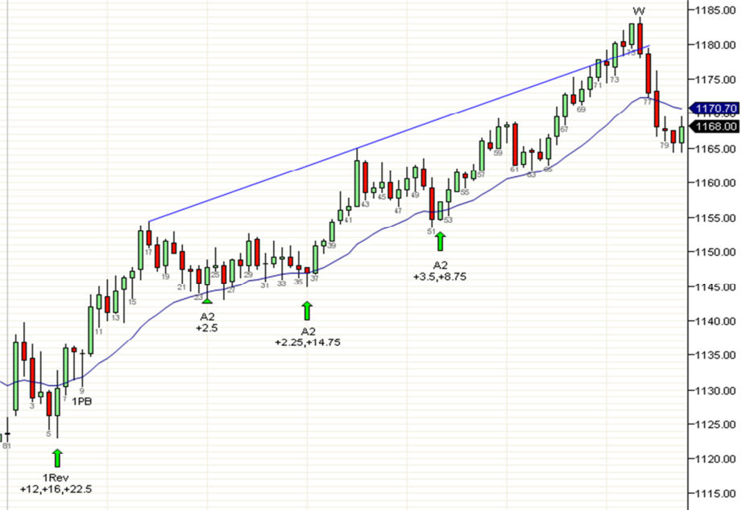

[Contents](00-目录.md) · [Next →](02-glossary.md)

# Nine Transitions

Original pages 1–6

**Price Action Trading on the Emini — 2010–2012 articles compilation**

The market could be moving in only three directions at any time: up, down or flat. From there, it could transition to any other or have a continuation in the existing direction.

Therefore there are nine possible transitions the price could take.

“Cadaver”

<http://ninetrans.blogspot.com>

---

[Contents](00-目录.md) · [Next →](02-glossary.md)
