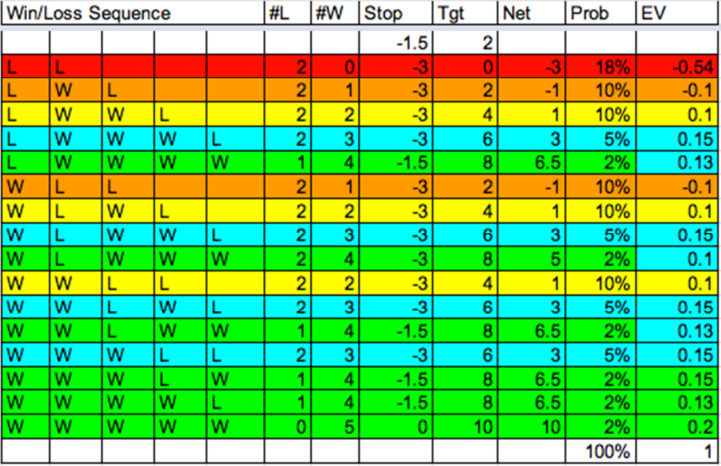

[← Previous](03-price-action-trading.md) · [Contents](00-目录.md) · [Next →](05-trading-guide.md)

# 1.3 Setup Chart

Original pages 12–13

<!-- p.12 -->

Read this first: Four trades off nine transitions

|  | UP | FLAT | DOWN |
| --- | --- | --- | --- |
| **UP** | A2, 1CBO, hH1,G2,BT | TT | W,W1P |
| **FLAT** | BO | fBO | BO |
| **DOWN** | W, W1P | TT | A2, 1CBO, hL1,G2,BT |
| **BO** | TRI | XT | BP |
| **fBO** | WBO | rev bar | DP |
| **TT** | DT/DB, 1pb | TTR | fRev+fA2, 1rev |

Rows are the direction being left, columns the direction being entered.

This chart describes all my setups from the nine transitions. When the trend is up, I'm looking for A2 in a normal trend, 1chbo in a channel move, H1 in a hard trend and G2 in a deep pullback. Im also looking to exit and stay out when the trend ends in a Trend termination (TT) move such as a double top, TTR or weak reversal followed by weak A2. If there is a wedge move and reversal, Im looking for W and W1P entries to reverse. Down trend is very similar except all entries are complementary.

When the movement is flat or trading range, Im looking for trend breakouts. usually these are triangle breakouts, expanding triangle breakouts and breakout pullbacks.

If the range is large enough, I may consider fBO trades. These include a reversal bar on breakout, Double bottom pullback and a two or three legged failed breakout (WBO). Often I will not take these trades and simply take one of the breakout on the other side of the range.

TT is not something to trade but rather a sign to exit your trend positions. A double top or double bottom, a TTR move or a reversal and continuation trade that both do not have follow through are the most common trend termination signals.

In addition to the above, I also trade the first reversal of the day and the first pullback of the day at the open, but those are complex topics that deserve their own posts.

<!-- p.13 -->

## Two strikes

p.13

A decent win rate and a favorable win size/loss size ratio is the key to accumulating profits. A trader with poor win rate is likely to have extremely high number of trades. For one, the moment he is stopped out, he looks to getting in right away and often operates in an emotionally distressed state and is bound to compound mistakes. Ironically, the more he trades, the worse his performance is likely to get. There are some steps a trader needs to take in order to avoid falling into this very common trap. The first is that a trader should look for major turns in direction and on a given day there are unlikely to be more than five. So the question a trader should ask himself is not if he thinks the market will go up over the next bar or two, but if its a major change in direction. The ability to locate these turns require a trader to trade less than he normally would. A trader who trades with-trend off a non-overlapping signal bar with a strong close near the ema or trendline is likely to be at least 50% successful. So if your success rate is under 50%, the first thing to do is to trade nothing else. The next thing you can do is to adopt a "two strikes" policy. If you lose two trades, you are done for the day. You should also be done for the day if you took five trades total. In the beginning, you may end up finishing your quota in the first half hour after open, but with over time, you will be able to stake out longer and be able to focus on large moves.

The chart above is meant to be illustrative but shows how a two strikes policy would work with a -1.5 stop and a +2 target. As seen from the chart above, there is a very good chance you will be stopped at two trades on a large number of days and conversely on some rare occasions, you may get four or five wins. Nearly half the time, it expects a loss on the first trade and nearly three out of four times, a loss on either the first or second trade. Even so, there is an expected value (EV) of about a point accumulating per day. The loss policy above can be abbreviated as 2/5 (two losses out of five maximum). You can try other variations such as 3/6 or multiple contracts and targets or anything else that's suitable to your trading style. Note that positive expected value is a side effect and the main goal here is to improve your ability to consistently take good trades and focus on major moves. Note that on many days, there may be only three or four trades, so don't be surprised if you take in less than the EV.

Note that the -1.5 stop is tuned for my proven setups. Other setups may need a wider stop but your stop should not be larger than your target. A wider stop is likely to negatively impact your EV, so trades with wider stops should have a very large EV (such as 1PB or W1P).

---

[← Previous](03-price-action-trading.md) · [Contents](00-目录.md) · [Next →](05-trading-guide.md)
