[← Previous](05-trading-guide.md) · [Contents](00-目录.md) · [Next →](07-trading-psychology.md)

# 1.5 Price Action Basics

Original pages 16–33

<!-- p.16 -->

## Price Action Basics I - Bar selection

Tuesday, September 13, 2011 · p.16

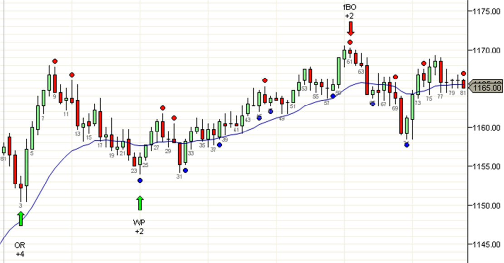

The very first thing to learn about price action trading is signal bar selection. If you do nothing else but trade every well formed bar, you will make money on most days. If you trade well-formed bars only with-trend, you will make money consistently. Enter above a bull signal bar with a stop below it and vice-versa for bear bar. If the bar is too large or too small or has lots of overlap, use a money stop of 8 ticks.

The indicator above plots a red dot above any reasonable bear bar and a blue dot below any reasonable bull bar. Naturally, this means it misses some of my important setups such as OR/1Rev at b3 and possibly some 1PB setups.

If you did nothing but trade these bars, most of your trades would be wins. Your losses would only be from b45-47 chop and possibly b74 L1. If you swung any contracts for any of your previous trades, you probably earned money overall.

Lets add some common sense to the mix and eliminate counter-trend trades and H1/L1 against strong moves. This gives only b45 as a losing trade of the day. Add a second common sense rule and do not take shallow H1/L1 with-trend unless its close to ema or trendline and you already have an all-winner day.

<!-- p.17 -->

## Price Action Basics II - Reversals and pullbacks in trends

Wednesday, September 14, 2011 · p.17

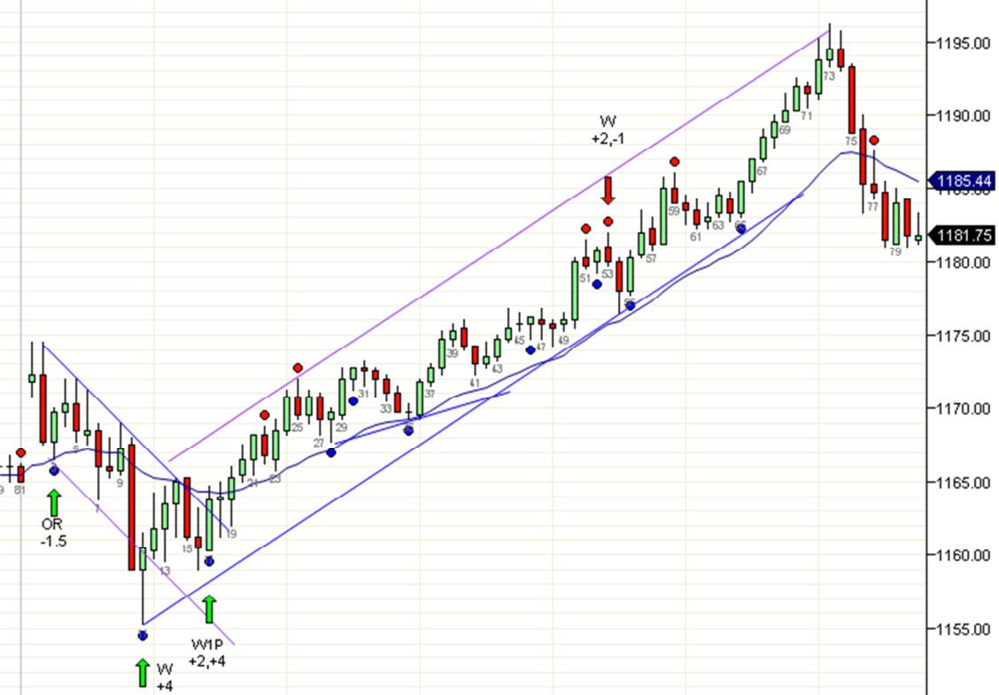

When the market is in a trend move, it will continue to be in the trend until there is a very strong overshoot or a very clear trendline break. When in a trend, every counter-trend signal is probably a trap and you should ignore it and wait for its failure. Even with the very clear and obvious W at b53 after an obvious buy climax, the risk of failure is high. An obnoxious overshoot such as b11 or an obvious trendline break such as b74-79 and a successful test of the extreme is necessary before any counter-trend trades are attempted. A failed L2 (b13,15) after a bullish reversal (b11) is a strong confirmation of the reversal and the next buy signal is usually good for a swing. The W entry is the only counter-trend trade you ever need to take since it usually gives a confirmation and a with trend W1P right after. Every reversal signal in a trend is probably a pullback and nothing more until counter strength is demonstrated. You should look for with-trend signals near the ema or trend line. Ignore signals far away from them (b30,46,52) since they imply possibly another leg in the pullback.

<!-- p.18 -->

## Price action Basics III - 1st Reversal or Opening Reversal

Thursday, September 15, 2011 · p.18

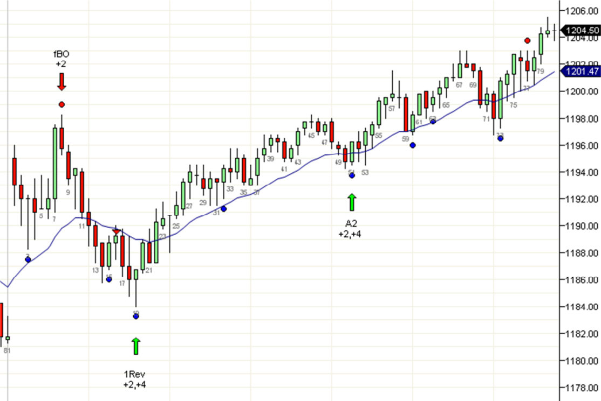

When the day opens, one option is to treat the first bar as a trading range and watch for fBO and BP of b1. If the BO or fBO looks compelling, it may lead to a trend and you should take a strong signal bar such as b8 or b19. The larger the distance to the other extreme of the day, the higher the chances of a trend developing. Therefore, its perfectly fine to ignore something like b3 and wait for a break above the HOD (b1 at this point) and wait for a failure or BP. When the move is possibly a trend move (b8-b19), no matter how small, its reversal is a 1Rev and is likely to lead to the primary move of the day. Since 1Revs can fail, conservative traders can take a 1PB if the fBO or BO succeeds. In other words buy only the HL after a bullish reversal and a LH after a bearish reversal. Today's 1PB would be b24, which is not well formed, so its acceptable to skip it and wait for the next setup. You should only take with-primary trend setups until the other extreme of the day is taken out. This strategy works for almost any day except tight trading ranges with tiny bars. On those days, very few things work and price action entries have a high failure rate, so its best to skip trading if the range of the first hour or two is very small, especially if there was no gap on open.

<!-- p.19 -->

## Price Action Basics IV: Trading ranges, Trends, fBOs and BPs

Monday, September 26, 2011 · p.19

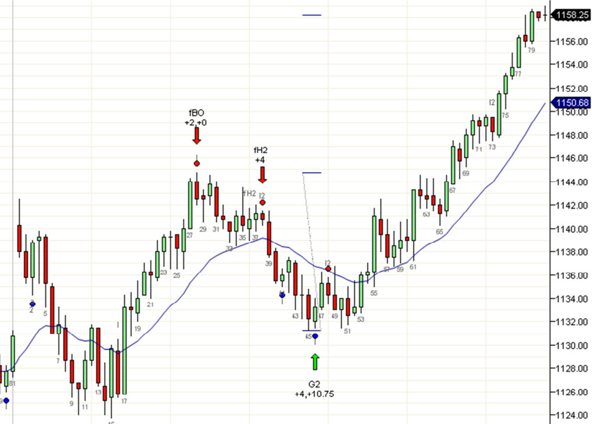

A breakout from a trading range is an attempt to create a trend and its failure is a move back into the trading range. A successful breakout leads to a trend. Similarly, a successful failure to resume the trend leads to a trading range. Today, b15 and b28 were failures to resume the trend and b67 was a successful resumption of the trend.

After every breakout, the trader needs to decide if he will fade the breakout or enter with the breakout on a pullback. In general, when in a trading range, a trade on the failure of the breakout is more likely to succeed and certain important signs are needed to trade with the breakout.

The signs are:

1. Breakout is strong (i.e., half or more of the breakout bar is beyond the break point)
2. Strong close
3. Second attempt to breakout
4. Poor attempt to fail the breakout

<!-- p.20 -->

Lets look at these one by one:

1. Strong breakout: b27 and b67 were both very strong breakout bars, but b67 was more than halfway above the break point. Even though b27 was less than halfway out, there was a good chance that a 2 or 3 legged pullback could give a second attempt up. On the other hand b10 was a weak breakout with weak close. 2. Strong close: A strong close beyond the breakout point indicates that there were insufficient fade orders at the break point. A weak close followed by a deep pullback (such as b29-46) indicates possible failure of the breakout. A weak close such as b10 indicates fade orders were waiting and a failed second attempt (b15) is likely to seek the other end of the range. 3. Second attempt: Second attempts are stronger than first attempts and second attempts of strong closes usually are very successful. An fBO (b28) that fails to take out the other end of the range (b15 low) should be treated like a deep pullback and is a possible trend break (HL after HH). This is especially true after a fL2 such as the one at b50. 4. Poor attempt to fail the breakout: b11 and b15 are strong attempts to fail the breakout. Usually, when the first failure is pronounced (b11,12), the second will usually go much further (b15-b27). If the bar after the breakout bar is a reversal or inside bar with a strong close such as b28, there is a high probability of at least 2 legs down, possibly deep. If the attempt to fail the breakout is poor such as b67, and it does not trigger, the chances are very high that the price will seek a measured move of the prior range (b28-45 met at b79).

<!-- p.21 -->

## Price Action Basics V: The Open Gaps

Tuesday, September 27, 2011 · p.21

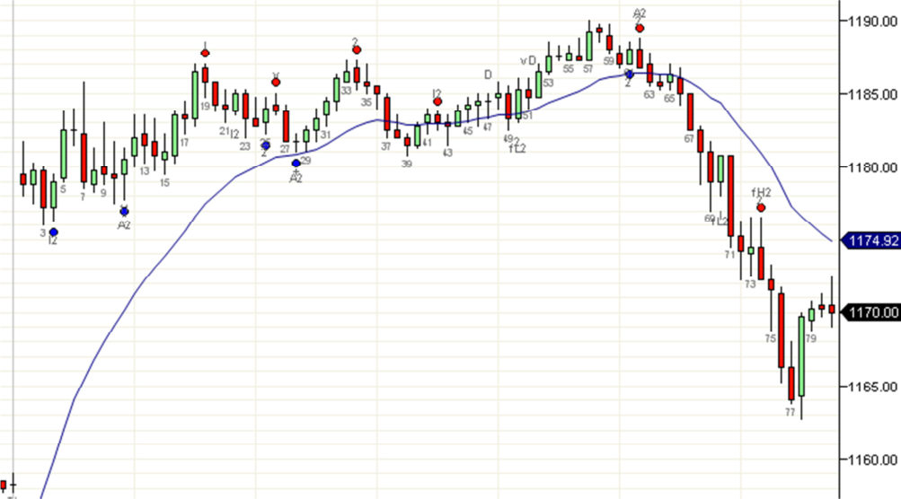

The open is a very complex set of topics and gap opens are an important source of information about the day's price action. Occasionally, the market opens very near to the close of the prior day (less than one average bar). This usually can be traded as if there was no gap and the open is simply continuation of the prior day's price action. Usually, the open almost always is a few bar lengths away from the close of the prior day. This is a small gap and usually this acts like a breakout or a trendline break. Usually, the market attempts to close small gaps giving either a pullback from the gap breakout or re-test after the gap trendline break. Sometimes small gaps will extend before closing and this will lead to a protracted trend after reversal. When a small gap extends, you usually have no idea how far it will go but you always know that the reversal will test the close of the prior day. Gaps that give an open within the body of the prior day, especially mid-body are suspect. No matter which way they trend, they are likely to reverse sometime within the day.

In other words, most days are likely to trend trying to close the gap. Naturally, if it tries to close the gap in two or three attempts and fails, the market will usually give a large trend in the opposite direction. Keeping the above in mind is very important to determine 1Rev correctly. The last case is the large gap (about a day's range). A large gap can lead to a large trend if it tries to close the gap. If it tries to extend the gap, it often behaves like a spike and channel with the gap as a spike. This often means its a soft-trend day. A large gap down can give a hard trend if it tries to widen the gap.

However, a large gap simply gives a trading range, which can lead to a gap closure late in the day (as in today's chart). A good metric for the trendiness of a large gap is the first bar, which if its a average sized trend bar is likely to lead to a large trend day. A doji or other poor bar such as today's b1 usually indicates a poor AM trend.Determining the likely primary direction of the day improves your chances of a successful 1Rev and 1PB entry, which in turn allows you to swing for larger number of points and increases your profitability.

<!-- p.22 -->

## Price Action Basics VI - The first bar

Wednesday, September 28, 2011 · p.22

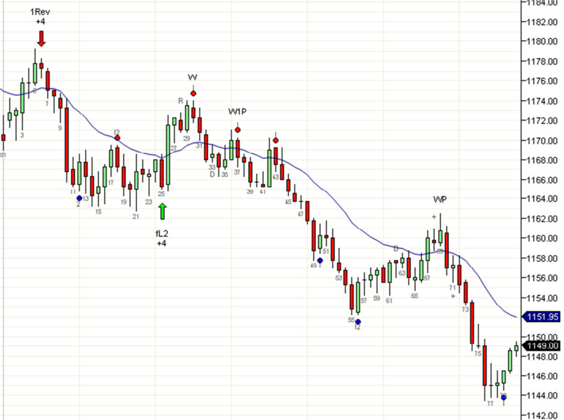

According to Al Brooks, the first bar represents the day in a nutshell on most days. As you can see, today that was not true. My modification is that the first one or two bars represents the AM movement. If the first couple of bars are strong trend bars in the same direction, there is a good chance of a trend move (either with or against the first two bars). If the first bar is a trading range type of bar or the first two bars are opposite colored and overlap (even though they are trend bars), then the market is forming an opening range rather than an opening trend. The first bar is special, because it is the only bar thats guaranteed to give both a new HOD and LOD. From this point on, you can trade fBOs and BP of b1 and continue with every new HOD and LOD. A bar with tails such as b1 today should be considered a small trading range. Such an opening often leads to an expanding triangle open, which essentially is a series of fBO of every new high and low until one of them gives a two or three legged LH (such as b30) or HL and begins a trend move. Trend bars on open show energy and will often lead to an AM trend. Those trends will often reverse and lead to a prolonged trend that could last all day A reversal bar on open will often give a sharp move that will turn around and take out the other end of b1. This is especially true if the reversal bar is in the wrong place, i.e., mid-range or a bull reversal bar above a small gap, etc.

Doji b1 can give a small fBO on one end of the bar followed by a prolonged move when the other side of the bar breaks out. But it can also lead to BW open. Regardless, the size and form of b1 is only a guide and should not be relied upon religiously. There are various edge cases that are too numerous to list and can only be mastered with experience. The right way to approach b1 is as if its a trading range and trade it as if its a small trading range. That is to say, if there is a strong breakout, enter on a pullback and if there is a weak breakout, fade the breakout. Remember that fBO of small ranges is usually not worth the trouble and that applies to b1 as well.

<!-- p.23 -->

## Price Action Basics VII - The Initial trend, 1Rev and 1PB

Thursday, September 29, 2011 · p.23

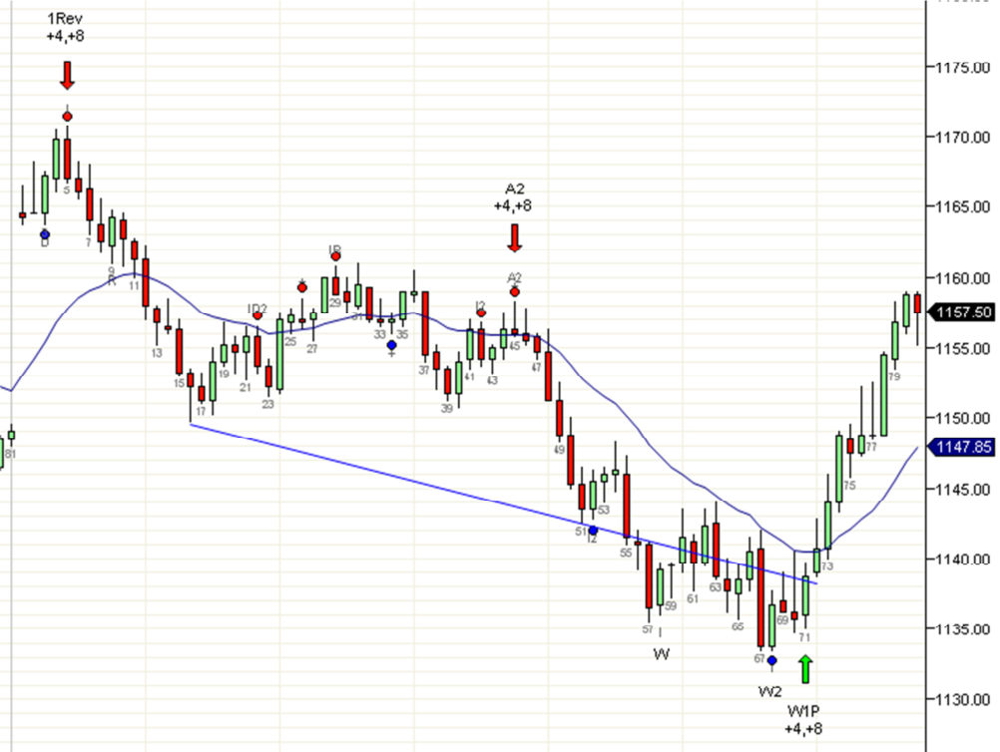

After zero or many fBOs off the first bar of the day, the market may attempt to trend. This is called the initial trend and if its strong, it may eventually persist till the end of the day. However, on most days, there will be an attempt to reverse the trend. If b4 was the initial trend attempt, then b5 is its reversal. On the other hand b4,5 could simply be another fBO and b5 to b8 could be the initial trend. b9 would then be the first attempt to reverse the trend. If this attempt is feeble, then it will fail and turn into the first pullback of the trend or 1PB. Often the protective stop above 1PB is not violated for the rest of the day (including today). This makes 1PB often the best swing entry of the day. For practical reasons, the first deep pullback is usually a better swing candidate.

The W at b29 or the W1P at b36 make excellent 1PB entries and are often the best practical swing entries of the day. This is because a protective stop of a deep pullback is less likely to be taken out before yielding a swing profit and a deep pullback is easier to enter than a one bar pullback such as b9.Today, there was an excellent PM move, but on many days, the AM trend is the only large move and the lunch and post-lunch hours do not yield any large moves unencumbered by choppy movement and stop runs. This is why mastering the 1PB entry is crucial to profitability.

<!-- p.24 -->

## Price Action Basics VIII - The opening range and its measured move.

Friday, September 30, 2011 · p.24

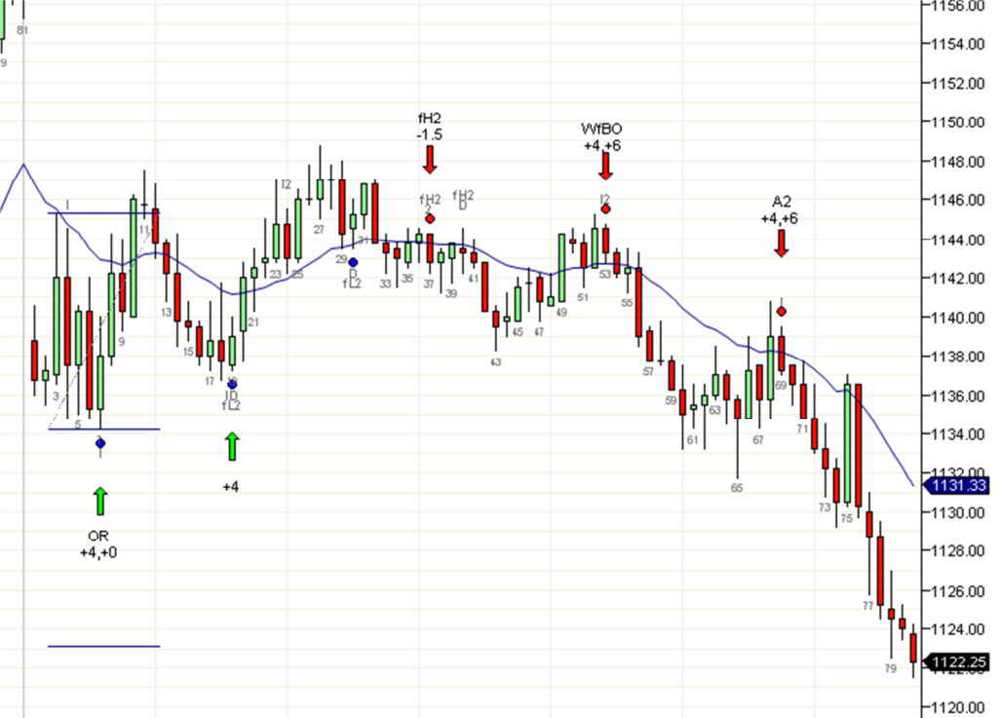

On some days, there is no clear initial trend and the first few bars of the day are simply a trading range. Two up and two down moves that don't go too far from the open make an opening range. On many days there will be no successful breakout of the range and the market will oscillate between the bounds of the range and every breakout attempt will fail.

When the market fails to break out twice (b11 and b27), it normally tests the other end (b61). However, when the market does breakout successfully, it will often reach the measured move of the opening range.

A three push failure (b3,11,27) on one end of the TR often results in the successful break on the other side. A simple but fairly successful way to trade these moves is to take the first HL long and the first LH short of the day as long as they are close to the prior swing and hold till the other end is taken out. For example, you would buy above b19 and sell below b37 or b53.

A 2 legged pullback after a breakout(b69) is possibly the first A2 in a new trend and is a high probability trade.

<!-- p.25 -->

## Price Action Basics IX - Scalp and swing entries

Monday, October 3, 2011 · p.25

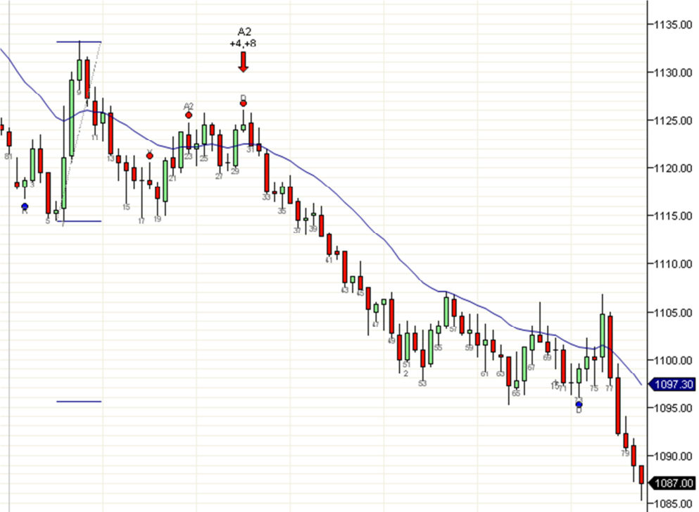

A scalp is a pre-defined amount of profit that the user expects to take, regardless of the parameters of the trade. ES traders often have one point as their scalp size, forex traders have 10 pips and so on. Technically, the smallest possible scalp is 1 tick in futures and 0.01 in stocks. In general a scalp is around the same size as the risk (distance from entry to stop). Traders who enter on stops above signal bars need to adjust their trading to resize their scalp size with changes in signal bar size. A swing is a large undetermined move many times the size of the original risk. Swing entries are essential to be a profitable trader since scalp entries are likely to be breakeven at best for the new trader. Not all entries are swingable. To be swingable, you should have a reasonable expectation that the next pullback will not take out your breakeven stop. For example, today b23 or even b26 was not a swing setup, only b30 was. Only trend continuation setups (i.e., setups that are likely to continue the trend to a new extreme are swingable. The best swingable setups are: 1PB, A2, W1P. BPs and fBOs in particular are not usually swingable. Usually, second attempts, failures (such as the 1tf on b30), the first pullback in a new trend are swingable. You do not need to bother adding a runner to your trade unless you expect the trade to be swingable. Entering only on swingable trades highly improves your win rate in addition to your profit per trade. Always try to correctly read if a setup us also a swing setup before placing your trade. large tails signal bar, bars of the wrong color, outside bars or otherwise poorly formed bars carry a high risk of pullback or failure and should not be swing entries.

<!-- p.26 -->

## Price Action Basics X - More than bars

Tuesday, October 4, 2011 · p.26

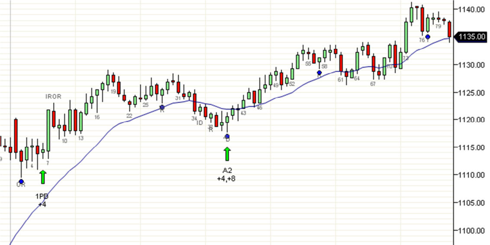

As I've posted many times before, you can trade very well by focusing on good bars and common sense. However, bars do not always tell you the full story. The context of each bar and the market's current place in the nine transitions is very important to distinguish between a strong and a weak bar.

For example, b13 and b72 were overlapped bars and the indicator filtered them out. However, b8-13 represented a 2 legged pullback after a strong breakout and should work like a breakout pullback. Similarly, b72 was a second HL after a second HH and is a trend break. Both bars worked very well for swing entries.

On the other hand, b19 despite being a strong inside bar on a W move up gave a pullback that took out break-even stops while b30, despite being a doji bar let the swing position advance unmolested to +8 points. The reason is simple. At b19, we were still in a bull trend and b22 was seen as a deep pullback and attracted buyers. b30 on the other hand was 3 pushes to a LH after the TL break (b19-22) and attracted sellers.

b51 was a decent inside bar, but it came after a 3 push breakout of the trading range. Although the trade worked on this instance, its a low probability trade since a 3 push BO of the trading range is likely to fail and seek the other end of the trading range.

While bars filter out bad entries, if your aim is to take very few trades that swing for a lot of points, you need to be able to read the nine transitions fluently to make the optimal decisions. Never swing trades because you don't want to be left out of a large move based on just one bar. When in doubt, take only deep pullbacks near support such as ema, trendline or prior swings.

<!-- p.27 -->

## Trading plan: Trading Range day

Friday, August 12, 2011 · p.27

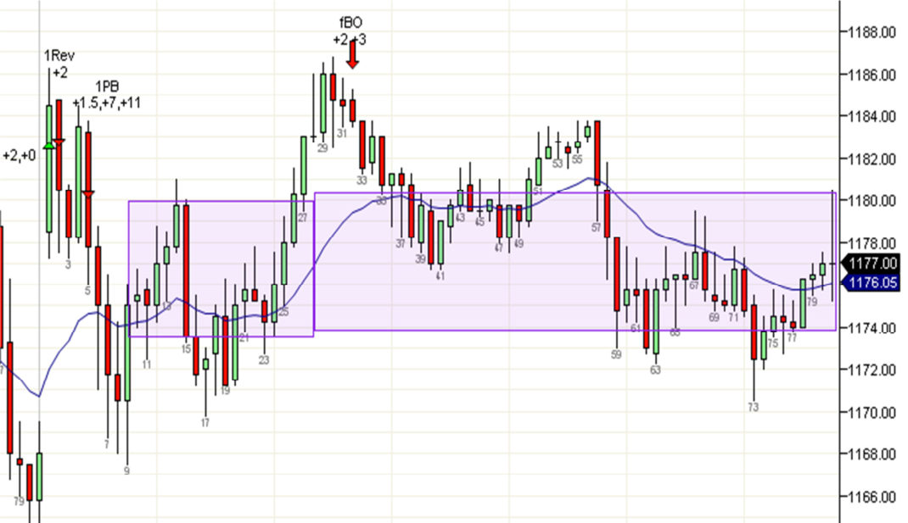

Since most trading days are trading range days, its essential to have a plan to trade them well. Identifying a trading range day is a lot easier: If its not a trend day, it's very likely to be a trading range day. Rather than go with the default, I use a simpler heuristic. After the first two up and down moves (including any gaps), if you are back where you started from, its likely to be a trading range day. For example, today the first move up was the gap and the bull trend bar b1 and the second move down was b8. At this point, you are back where you started, so this is likely to be a trading range day with b1-b8 as the opening range.

On a trading range day, the first few bars are likely to have a lot of overlaps and tails, preventing a clear signal bar. One way around this is to trade a smaller timeframe such as the 3m chart as shown here. The entries are mid-bar on the 5m chart and do not really make much sense but are much clearer on the 3m chart. Once the first hour or so is complete, you should no longer look at the 3m chart since the setups there are likely to be of lower probability of success. Trading range days often have two legged moves in each direction followed by two legged moves in another without really moving too far from the range. Most swing entries are likely to fail and your breakeven stop is likely to be hit. So a valid plan is to take every two legged move and exit on the second push. For example, if you sold 3m b2 on the chart shown to the left, you would exit when the second push ended either on strength at the close of 3m b9 or when a bar ticks beyond a prior bar (above 3m b14).

<!-- p.28 -->

However, I avoid trading this way, simply because I prefer larger moves. A viable plan is to buy near the low of the range and sell near the high of the range. Simply stated, trade the failed breakouts of the range and try to hold it till the other end of the range is tested. So for example, the 5m b32 gave a failed breakout of the HOD b1. The right approach is to short this and try to hold it till b9 low is tested.

To constrain yourself to truly taking trades only near the ends of the trading range, divide the opening range into three parts and mark out the central part. Take only buy signals below it and sell signals above it. Hold it till the price crosses to the other side (b27) or attempts to bounce back a second time (b50). Ignore all entries that would take place in the center. This should allow you to swing even on a trading range day and avoid most of the choppy entries. When a new lod or hod (b30) extends the range, adjust your box accordingly.

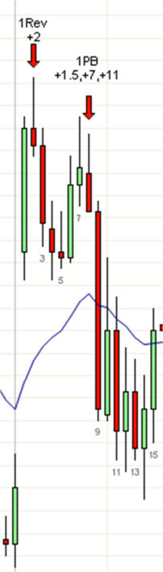

Using this system, you would have only taken the long above b17 and the shorts below b32 and b56. These also happen to be the best swingable trades today. Note that this may not work on TTR days, when the range of the day is 5 points or less. TTR days are best not traded at all, since any trade is low probability.

Just as you stop trading trends when the trend terminates into a trading range, you need to stop trading a range when it breaks into a trend. Take the first plausible pullback and ride the new trend and avoid trying to insist it to turn back into the trading range.

Along with the Trading plan: Trend days, you have 90% of the days covered. The remaining trends are hard trends, soft trends, Spike and channel and TTRs. Recognizing these and trading them correctly is the key to successful trading.

<!-- p.29 -->

## Trading plan: Trend day

Thursday, August 11, 2011 · p.29

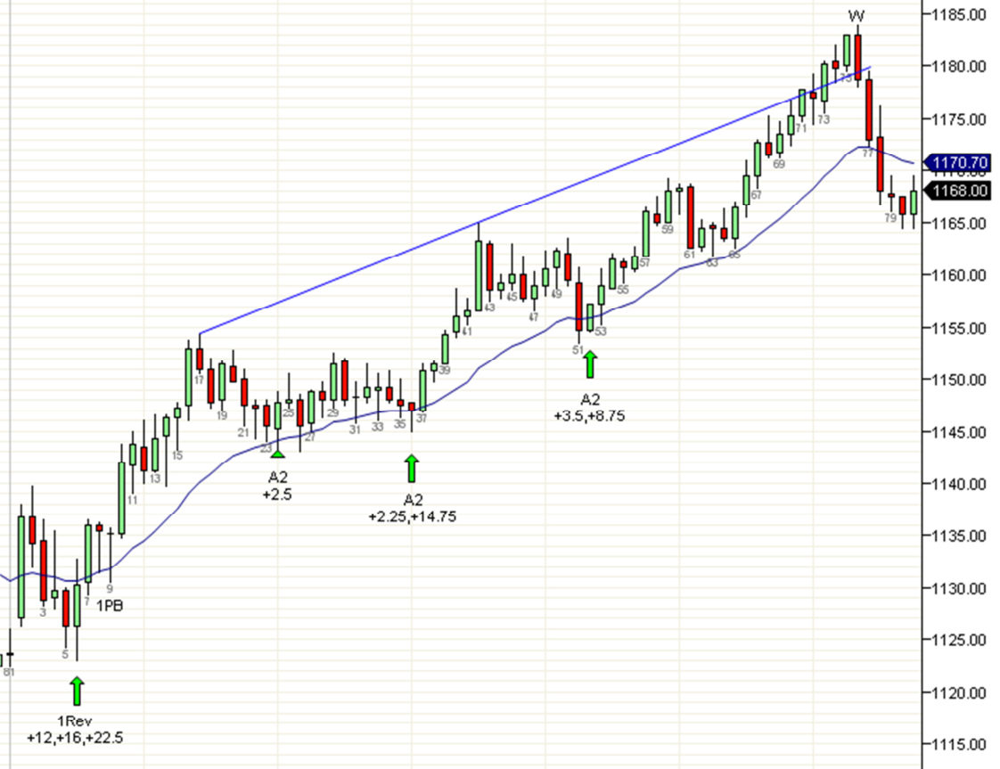

Trading on trend days is relatively easy and trading only on trend days and sitting on the sidelines on the rest of the days is a viable trading plan. The only issue is that trend days occur infrequently (about 20% of trading days) but on sharp moves on the daily chart, trend days can occur a lot more.

The first step is to identify a trend day. Overall there are some common attributes but these do not automatically guarantee a trend day.

- A large gap (beyond the range of the prior day) and a large opening bar that widens the gap
- A large gap that fails to close in a 2 or 3 legged move
- A small gap that reverses the high, low or close of prior day
- A small gap that moves to ema and reverses
- First 3 or 4 bars make a trend move

<!-- p.30 -->

In all the above, you can simply take the 1st pullback and swing for the rest of the day. The 1st reversal (b5 or b6) and the 1st pullback (b9) are often very poor bars so a conservative trader may simply wait for the first 2 legged pullback. On many days this means missing a large portion of the AM move but a 2L pb is far easier to enter.

The main thing to watch out for in a 2 legged pullback is the quality of the signal bar. Often the first signal bar is a trap. For example b24 was an outside bar and b33 was a doji. b47 had a tail on the entry side, was away from the ema and was strongly overlapped by prior bars. In such cases, you should simply wait for the next signal. You will know your entry is correct when your signal bar is strong (b37) and after it closes, the breakeven stop at your entry price will not be hit.

You should always be on the watch for possible trend terminations such as a double top, W (b75), TTR or a trendline break. After this point, there may be no more A2s.

Once you can trade trend days adding trading range days is easier. On the setup chart most setups are in trend moves. In trading ranges there are basically only breakouts and failed breakouts and those take a lot more experience to trade profitably. You can be a profitable trader without ever trading trading ranges if you are able to sit out on 80% days.

<!-- p.31 -->

## Hard trend identification and trading

Wednesday, July 27, 2011 · p.31

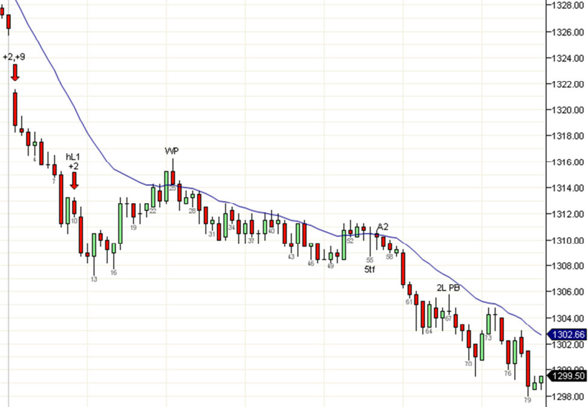

Hard trends are trends that begin strong and carry strong for many bars. This means minimal pullbacks and large moves. Such days are hard to trade for a few reasons. The first is they are comparatively rare, so the trader has no experience with it. Second, 2 legged pullbacks and pullbacks to ema are rare, and due to the large distance to the ema, a pullback to the ema is strong enough to appear to be a mini trend, possibly a reversal. The third and most important reason is that hard trends rarely reverse. They may break and go into a trading range or turn into a channel but reversals are rare and they almost always require a couple of hours in a trading range or TTR first.

The first clue that its a hard trend day is a large gap and an open beyond the range of the previous day. The second clue is a strong 1st bar. The first bar cannot be very large (2 to 3 points is ideal) or it could act as a trading range or turn into a spike and channel. The last clue is that any attempt to create a pullback turns into a doji or inside bar. So by b4, you should have identified a hard trend.

Trading hard trends is very simple yet hard to do. You can short below any bar that has a shaved or a 1t tail with a stop above that bar. So other than large bars like b8 (which give poor risk/reward), very few strong closes would disappoint.

When a hard trend is broken such as by the move from b16-25, the trend has ended and will either enter a trading range or channel. Today, we channelled (b28-50) and then had a BO attempt that failed and gave a second hard leg down. Often the hard trend break will simply channel till the end of the day, without any easy swing entries. This is why its important to enter early in the AM and swing some as far as possible.

<!-- p.32 -->

## Correctly trading a soft trend

Thursday, March 3, 2011 · p.32

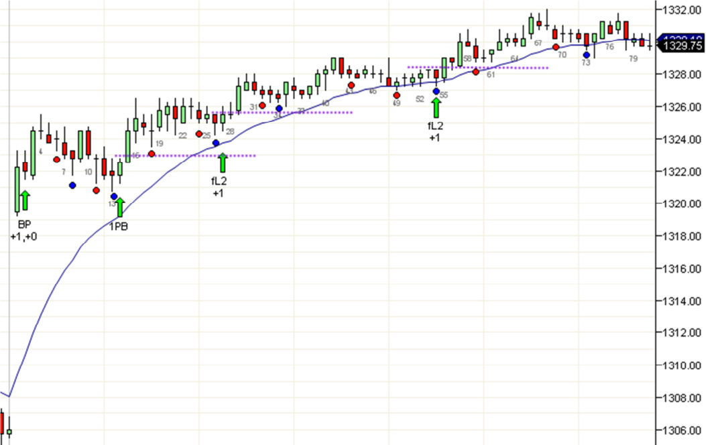

The first step in trading a soft trend is to correctly identify it. Other than the first pullback, which can be deep, a soft trend's distinguishing feature is that pullbacks go only one or two ticks below a previous bar and usually fail to close below the previous bar. The second distinguishing feature is that counter-trend trades rarely succeed since most pullbacks overall do not go more than 4 or 5 ticks below the low of any bar. The big difference between a hard trend and a soft trend is that in a soft trend, both pullbacks and breakouts do not go far for each swing. Both hard and soft trends are traded the same way. In the direction of the trend only.

By bar 24 or so it was obvious that today was a soft trend and the correct way to trade this is to buy above any bar with at least 2t body (regardless of color) after an L2 (failed L2 or fL2 entry). In the chart above, the red dots represent L1 and the blue dots represent L2. If you correctly enter your trades, none of your breakeven stops should be taken out as illustrated by the dotted lines. Entering above a doji bar or overlap usually means sitting through a pullback as with b47 and should be avoided.

Since your exits very closely map to your next entry, many folks will simply let it ride till end of day. This is usually takes experience not to get shaken out at the next pullback but its something a trader should try at least with 1 contract.

<!-- p.33 -->

## Spike and Channel day

Friday, July 1, 2011 · p.33

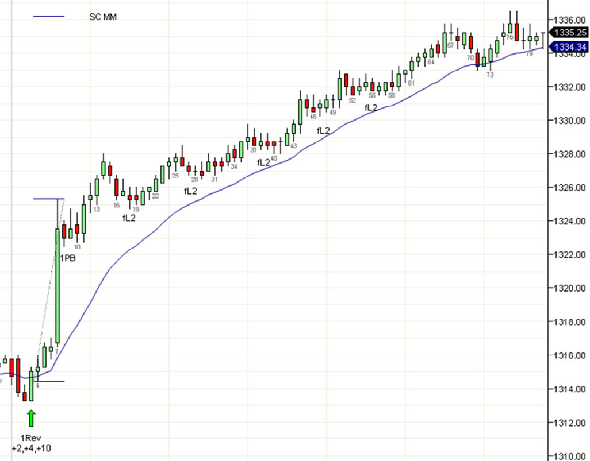

Good traders know the rules, while great traders also know the exceptions to these rules. One of the exceptions to trading barbwire is entering on shallow pullbacks in a very strong soft trend. Normally, I prefer deep pullbacks because they provide the best opportunity for a swing entry. However on a Spike and Channel (SC) day, its best to hold as long as you can. When the spike is strong (entry bar to 1st pullback, b4-b7) and the pullback is shallow (b8-10, about 1/3 of the large bar), there is a very good chance of a SC day. The stronger the spike and the shallower the pullback, the higher the chances of a channel running to the end of the day. If you entered before the spike, it makes perfect sense to take out most of your profits near the top of the spike and optionally keep one runner to the end of the day. If you missed the breakout, you should enter on the first 2 legged pb (b10 or b20). SC days are often soft trends and give small bars and very tiny pullbacks. Typically pullbacks are only a tick or two below the previous bars. This is one of the few opportunities to buy the low of any bar that would be L2 on limit. Once your are in, you should hold as long as there is no close below the ema. Note that technically almost every pullback is barbwire in a soft trend and you can buy above every failed L2 (b20,b29,b40) if you are not comfortable buying limit on the L2 breakout.

---

[← Previous](05-trading-guide.md) · [Contents](00-目录.md) · [Next →](07-trading-psychology.md)
