[← Previous](06-price-action-basics.md) · [Contents](00-目录.md) · [Next →](08-2010-12.md)

# 1.6 Trading Psychology

Original pages 34–88

<!-- p.34 -->

## Developing your trading skills

Saturday, February 5, 2011 · p.34

Having a trading plan and having a list of best setups does not guarantee trading success. Practically everyone knows common setups such as entering near ema or trendline in a trend or fading breakouts in a trading range. Yet most people lose money trading. The reason is that learning to trade is not like memorizing a phone number, but rather like learning to swim. You can read all you want about various swimming styles and how your arm should cut into the water at the correct angle, but once you jump into the water, you may come close to drowning the first few times. Trading the same few setups repeatedly is a far better trainer than doing everything you may have heard of or read about. Even if the best trader in the world tells you his best secret, you will still lose money until you have traded the setup often enough to master it. The setup is irrelevant. Your practice and mastery of it are far more important. Learning to trade is about working on yourself, not about gaining some magical secret that will make you rich. Some people are just not cut for trading and will ultimately give up or go broke. The mindset needed to be a trader can be developed by practice, but for some its part of their very nature. The following characteristics define a good trader:

- An appetite for risk
- A tolerance to loss
- An understanding of probability

An appetite for risk does not mean you love gambling. Risk means you are able to put something on the line to get something of higher value. When you fly on a plane, you are at a tiny risk of killing yourself. However, the risk even though severe is low enough that it does not bother you and the reward is high enough that you are willing to take it. The first time when you board a plane, it may have caused some excitement and terror but flying repeatedly removes the emotional element of air travel. In the trading world, your risk is the distance between your entry and stop. It is smaller, but much more probable. You should be willing to lose that much without undergoing grievous emotional stress. If you are very risk averse, you will ultimately fail in trading. You will have periods in your trading life where you have periods of extended successes and extended losses. A tolerance for loss means more than just being able to bear it. It means you have planned for this in your trading plan by perhaps having a second job or sufficient money put away from your good years. You should be able to go back to your notes and read them and maybe switch to to SIM trading for a few weeks until you get your mojo back. All setups no matter how good will occasionally fail, and sometimes they will fail repeatedly. You need to understand that the risk you take and the reward you expect will pay off eventually and repeated wins and losses are to be expected. If they are causing you distress, you need to back off and switch to SIM trading. When you are distressed, you are on tilt and are more likely to blow your account.

<!-- p.35 -->

The relationship between risk and probability is this:

reward * probability > risk OR reward > risk / probability

So if your winning percentage is 50%, and you are expecting to make 4 ticks, your risk needs to be less than 2t. Another way to look at this is that if your winning percentage is 50% and your risk is 8 ticks, you need to make at least 16 ticks to just break even. This is one reason I stopped taking any entry that is unlikely to give me at least 4 points. As you work on your winning percentage, you can take trades with smaller expected moves. Once you understand this math, you can trade with confidence knowing that eventually you will be profitable as long as you follow this simple rule.

To summarize: Trading is a skill you acquire and you practice is key. Start slow and small and work your way to success.

<!-- p.36 -->

## Fewer, better trades.

Wednesday, November 9, 2011 · p.36

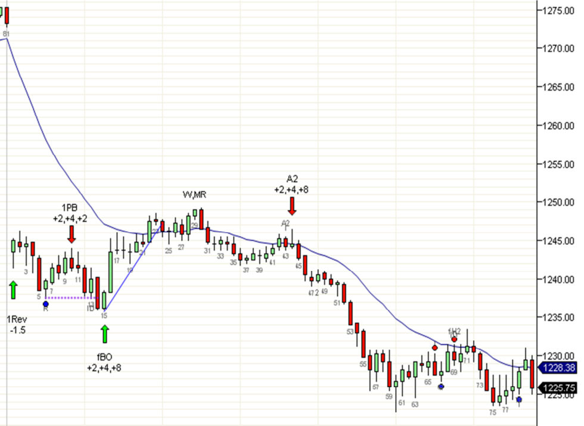

One of the biggest errors for new traders is overtrading. Overtrading will eat away at your profitable trades and overall prevent you from being consistent. One of the first goals of a trader should be to reduce the number of trades taken per day to about five. Think about this: How many major directional changes do you expect in a day?

Reduction in the number of trades allows you to focus on larger moves instead of flip-flopping on every other bar. If you are a new trader, this will also help in limiting your losses.

The first step you need to take is to eliminate limit entries. There are some legitimate limit entries in price action trading, but trying to save two ticks should not be one of them. The skill level of market reading necessary to be able to consistently win at limit entries is very high and I am not too proud to admit that I'm not there yet. If you want to trade limits, remember that you should be entering only on bar closes and not where you fantasize the price may turn mid-bar. The second step you need to take is to only enter on signal bars with a strong close and little overlap. The only exception to this is a 1Rev at ema, 1PB and any with-trend entry on a soft-trend day. If your strong signal bar does not trigger, let it go. Even if it gives a strong inside bar with an equally strong close, at this point its in overlap. The only exception to this rule is a FF after a large move.

The last step is to only trade proven setups such as A2, W1P and so on. "I think this will move up now" is not a proven trade. You may have noticed patterns that look reliable but they may not be tradable for various reasons. You should first attempt to trade them on SIM and then try with small size about 100 times before you can add them to your proven list.

<!-- p.37 -->

## Fire and forget

Thursday, November 10, 2011 · p.37

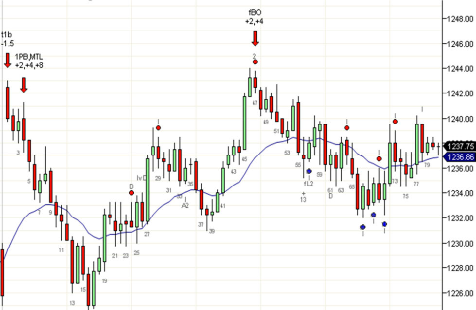

One of the reasons traders overtrade is that their sense of market direction is focused on the small movements. A second reason is that they become distressed and doubt their own entries as soon as the market moves against them. They may often reverse their positions with every bar or every other bar.

The right thing to do is to make a note of the kind of setup and let the market take you out. If your trade fails, it will take you out by hitting your stop and if its successful, it will take you out by reaching your targets. This will give you an accurate measure of what kind of entries you have mastered and what you need to work on.

If you are a trader who focuses on swing entries only, you have the luxury of having a very small stop (of say -1.5 points on the ES). For example on today's chart, short below b1 required a 7t stop but entires on bars b4 (1PB), b17 (W), b47 (fBO) needed very small stops. These setups are usually the ones that run for a large number of points, so do not be upset if your stop is taken out; it means a larger stop would have probably been taken out in any case. 1Rev and 1PB may need larger stops, but -2 points usually suffice.

Most trading platforms support OCO orders where you can set stops and targets to cancel each other. Once you set an order forget about it and wait for the next setup. If the next setup is in the opposite direction to the position you are in, close out your position and enter a new order.

This way, you stop focusing on profit and loss and focus on bars instead.

<!-- p.38 -->

## Greed

Thursday, November 24, 2011 · p.38

Traders should not be ashamed to admit that greed is probably what motivated a lot of us to get into trading. After all, there is the promise of easy money or rather, lots of easy money that we can gain by trading. Greed may be good, but it will force the trader to make many mistakes.

One of the worst mistakes a trader can make is entering on a poor setup because "this could take off from here". You are afraid to be left out. This brings us to our first realization: Greed is just fear thats not immediate.

However, when you do get in on the poor setup, either because the signal bar was poor or because the pullback was too shallow or any other reason, you probably entered at a poor price point and a possible pullback will take out your stop unless you use a wide stop. From this we infer: Greed forces us to enter on a large risk

Often, even a large stop could be hit and you may resort to loosening your stop, which of course can still be hit so you end up taking a stop much larger than your profit expectation. A stop placement on entry is a statement that if the entry is correct, the price should never touch the stop. If you loosen stops habitually, you are not really trading with stops. Therefore, Greed forces us to disregard our stops

Some traders when faced with a wide stop will add on at the worse price so that they have a better chance of breaking even and a tighter net stop. This means that Greed forces us to throw good money after bad.

Ideally, you want to be very choosy about where you enter and understand that success lies in consistency (steady, higher percentage of wins) rather than depending on any one trade "taking off". The key to this is to take strong bars on deep pullbacks or at the ends of a trading range. However, if you do enter on a poor bar and it does not take off, remember that the first loss is the best loss. Take your loss and wait for the next setup. Refusing to accept being wrong and replaying the losing scenarios described above is the quickest way to a blown account.

"Be fearful when others are greedy" is a simplification. Fear is equally unproductive. The correct antidote to greed is caution. When you feel an urgency to enter, do not enter unless the signal is good and risk is acceptable. Do not fret about letting a big mover pass you by. There is always another trade with a better signal in the very near future. Once you enter, let the trade fail if it needs to. You will never know what trades you are capable of reading and entering correctly if you don't let the market stop you out.

<!-- p.39 -->

## Fear

Sunday, November 27, 2011 · p.39

Being stopped out several times will wreck your confidence and the trader may turn into a victim of fear. Fear is always an immediate emotion and will paralyze you and prevent you from entering viable setups. Often very good setups will move immediately after triggering and your hesitation will cause you to miss out. Fear will make you miss out on many solid trades.

Since good setups will often give a strong entry bar and the entry bar usually grows very quickly after the trade is triggered, you may curse yourself and enter mid-bar, a few ticks or a point above your ideal entry. This also means your risk is now larger by a point or so. This means fear forces you to enter on a large risk.

With a few exceptions a slight pullback after an entry trigger is a normal event and mid-bar entry may cause your stop to be taken out. A trader stricken with fear is unlikely to loosen the stop or add-on (unlike the greed stricken trader) but would probably reverse at the stop. Fear will cause you to be pushed around by every pullback and strong move the market makes.

Reversing every two or three bars will destroy any confidence you still have left in your ability to read market direction and you will get chopped up. Unlike the greedy trader who's account is killed by few large losses, the fearful trader's account dies by a thousand small cuts. If you are fear stricken, you should never reverse a position. A loss for a fearful trader puts him "on tilt" and he is likely to make more mistakes if he continues to trade for the rest of the day. Fear is rather hard to overcome and the only way out is to realize that every setup has a certain percentage of wins and the remainder are bound to be losses. Some losses will be clustered close enough that it will appear that you have lost your ability to trade that setup. The best approach is to stop trading for a certain number of bars after a loss and stop trading after a certain number of losing trades for the rest of the day. The knowledge that your losses are limited per day in the worst case is a stabilizing force on your psyche.

"Be greedy when others are fearful" is easy to say but impossible to practice since you are the fearful one. The antidote to fear is risk management. Once you understand and accept the maximum losses per trade and per day, you already know how much you will lose in the worst case for any given period of time. If this is something you have already accepted as the cost of trading or learning to trade, fear will be much more manageable.

## Impatience

Tuesday, November 29, 2011 · p.39

A key requirement to be a successful trader is patience. Even very experienced traders will admit that their trading would improve if they work on their patience.

New traders are impatient and and long to be in a trade and until they take a position tend to see every tick as loss of opportunity. Once they are in, they are very impatient and want the trade to work right away and take them to profit. The moment they are out of a trade whether due to hitting a target or being stopped out, they want to be in again. Therefore, impatience makes traders overtrade.

<!-- p.40 -->

Impatience, combined with greed and fear will force traders to have impaired judgement and results in inconsistent performance. Its very unlikely that a trader who is entering and exiting a trade every two or three bars to have a high success rate. Even a high success rate can be neutralized by a couple of poor trades if you focus only on small moves.

Patience for a trader, is being able to do nothing for hours while waiting for a proven setup o form and when it does appear, to act on quickly. After entry the trader should not exit as long as the stop is not taken out unless a setup in the opposite direction sets up and is triggered. The trade should terminate either by reaching a target or being stopped out. Patience and confidence in the setup will enable you to take larger profits.

Impatience is addressed by focusing on large moves. Looking for a large swing move will check your impulse to be in a trade since there are a small number of large moves in a

## Discipline

Thursday, December 1, 2011 · p.40

Discipline is the ability to stick to your long term goals by successfully ignoring short term temptations. You probably already know if you have a modicum of self-discipline. Are you successfully able to stick to a diet or exercise regime? Are you a person who can stick to a decision to make a permanent change to your life such as waking up at 5:00 AM every weekday or to quit smoking cold turkey?

Most people would stop and wonder here and that means no. Discipline, like muscle strength needs to be trained and built upon and will atrophy when you stop working on it.

For a trader, discipline is the ability to stick to a plan and execute only that plan. For example, let us take a very simple trading plan: Trade the first two-legged HL or LH of the day with a stop loss and profit target of +2 points each. You could add an additional requirement of the entry side tail being 2 ticks or less.

If you want to follow this trading plan, you would wait for a two legged HL and buy above any bull bar with a 2 point stop and target. Similarly, you would wait for a two legged LH and sell below any bear bar. If the pattern does not trigger and turns into a HH or LL, you no longer take the trade and do no trade for the rest of the day (unless you have another setup in your plan).

On the other hand, if it does trigger there are only three ways you get out of the trade:

1. You are stopped out
2. Your target is filled
3. A signal sets up in the opposite direction to your position and is triggered

Discipline is the precursor to consistency. Discipline does not itself lead to consistency, but it does tell you if any of your setups are worth working on or should be dropped from your list. You still do need to find setups that work and once you find one, you are on the way to consistency. New setups that you want to try can be added one by one and discipline is what helps you weed out setups that are not worth trading.

<!-- p.41 -->

## Trading Discipline

Saturday, December 3, 2011 · p.41

When trading BPA, I try to follow the following rules:

1. Clarity: I will not trade unless I read one of my proven setups. I want the setup to be as clear as possible. Any ambiguity probably means the move wont go too far. I want pullbacks to be deep and signal bars to be strong without a lot of overlap. If these characteristics are missing, I will usually wait for a second entry. If the setup is poor, I will often pass it up. I'm OK with not taking any trades on any given trading day.
2. Swingable entries: In general, I only prefer to enter setups that will go four points or more. I also want to only enter where I believe the price will not pullback to my entry price after moving away from the signal bar. Often these are second attempts.
3. Firm stops: Stops can only be tightened. Once the price moves a certain distance away from the entry price (say 2 points), I will move the stop to breakeven and lock in gains beyond every new swing point.
4. A few good trades: In general, I prefer to take a few good trades rather than many mediocre ones. This is because I can be a winning trader with a modest percentage of successful trades as long as at least some of my winners go 2x to 4x the risk.
5. Daily loss limit: Daily stops losses are crucial. Some days, my game is just off possibly due to lack of rest or unexpected price action. I prefer sitting out and keeping my winnings from my prior days over trading every day and losing everything I've made over the last few days.

Note that the above rules are applicable to any trading system and the important point is to stick to these simple rules since they will help you measure your success and isolate winning setups.

Rule 1 and 3 helps you measure your success and helps you to isolate winning entries. Rule 2 and 3 improve your win/loss ratio. Rule 2 and 4 helps you focus on larger moves and not be mesmerized by the current bar or two. Rule 5 helps to protect you against outlier days when price action is not favorable to trading. You can measure your progress by keeping a score card of each trade to see if you followed the rules you laid down. Soon you will be able to detect what areas you need to work on.

## Overconfidence

Monday, December 5, 2011 · p.41

Consistency requires practice and you just need experience with all sorts of price action. When the price action changes by either slowing down to tiny bars or being volatile with huge bars, your consistency will suffer some impairment. This will continue until your trading experience builds sufficient recall that you will be able to react effortlessly. For many traders, the start of consistency brings a new enemy: Overconfidence. This will trick the trader into trying new setups, increasing size aggressively, taking larger risk and in general work hard on self-sabotaging and loss of their hard earned consistency.

For example, a trader making 2 points consistently by trading the first two-legged pullback of the day may become successful enough that he thinks he can add a new setup or perhaps incorporate a new trading style such as trading mid-bar or on limit. Chances are that the new addition negatively impacts his trading results and may flip him back to being a losing trader.

<!-- p.42 -->

The devastation and loss of confidence that can follow is possibly severe. A trader may find himself between periods of consistency and inconsistency and lose hope of ever being able to trade consistently for a living. Overconfidence is hard to treat because its hard to distinguish it from plain confidence when you have to judge yourself. The way to deal with this is to attempt only one new setup at a time and only try it once or twice a day. New styles such as limit trading and mid-bar entry should never be attempted since they are micro-optimizations. If most of your setups are expected to go 4 points, an additional one point by entering on limit is usually not worth the additional risk. Prove all new setups by trying them on disciplined SIM trading first and tabulate results. Many of them are probably not even worth trying.

Remember that success lies in taking a few profitable trades and working on increasing the volume. A trader with only one winning setup that is 70% successful is better off than one with a 100 setups that are overall 50% successful.

You need only one or two good setups. Even a single setup could take years to master so don't try to cram new techniques until you have mastered your current setup.

## Going on Tilt

Monday, December 19, 2011 · p.42

Poker players understand that when a player gets an especially bad beat, he is likely to go "on tilt" and especially when its a large pot. This generally means the player is likely to play the next few hands aggressively on weaker cards and in general make poor judgements trying to win his money back. Whenever anyone at a table has a bad beat, the rest of the table will turn on the player like vultures hoping to take the rest of his chip stack.

This is relevant to traders because a lot of traders approach trading like they approach gambling. A strong belief in luck and other superstition, trading larger size after a beat, bragging about your huge wins but not mentioning your losses, etc. are signs that you may be approaching trading as an alternative gambling system.

And just like gambling, most players will end up losing most of the time with an occasional win that you brag about. If this is the case with you, you are better off going to the casino and playing blackjack -- at least you will get free drinks.

A significant cause of a bad beat is the unexpectedness of the result. The player was expecting a win -- possibly a large win -- but was shocked to end up a loser. This shakes the player's confidence in his ability to read the cards and analyze the players' moves and in general play the game successfully. At this point he needs to win just to restore his confidence and he needs to win quickly. This urgent need will impair his judgement and force a lot of errors. Going on tilt in trading is psychologically very similar.

The way to approach this is to avoid having a large beat. Always enter fixed risk and size. Over time as your consistency improves, you may choose to increase the size but you should never trade arbitrary size just because you are "feeling lucky". You should also never loosen your stops or add-on to a losing position, since large losses are what will impair you psychologically.

In addition, your daily loss limit needs to be fixed. Just as you would leave the table when you realize you are the worst player, you should stop trading for the day if you have been beat 2 or 3 times in the day. Over time, the knowledge that your downside is limited per trade and per day, while your upside is much larger will give you confidence and eliminate the gambler's mentality.

<!-- p.43 -->

## The need to be right

Wednesday, December 21, 2011 · p.43

When a trade fails and the market moves against the trader, she may continue to re-enter in the same direction over and over again. At the end of the day, the trader may realize she has been shorting all the way to the top, usually unsuccessfully on a strong bull day. Similarly, some traders will buy every drop on a bear day, assuming that "it should turn anytime now".

Being married to the bias is a common failing. The trader insists he knows better than the market and it should turn and go in his direction anytime soon. The failing to recognize that the market is always right and the trader is always wrong is a fundamental error that can be the difference between one bad trade and a series of bad trades. Such a mindset is also liable to encourage the trader to add-on to a losing position because every failed entry results in a much better price if the price is going to reverse anyway.

A simple but hard way to deal with this is to not have bias. This means ignoring news, TV, economic and political analysis such as why the market should go down because of the misdeeds of politicians, why Europe is doomed or pretty much anything else since news is sensation-driven and does not reflect immediate demand and supply.

Even if you do have bias, if the trade goes against you for a large number of points, you should not enter in the same direction until there was an obvious trendline break and test of extreme.

Most important, do not be shocked that your trade has failed. No one can be right all the time. Keep your loss small by taking an early loss and sit out for a couple of bars if you need to clear your mind. Taking a step back and looking at the overall chart or a higher timeframe will often reset your bias and allow you to recognize trendlines and enter with-trend or sit out of choppy moves.

<!-- p.44 -->

## I understand the setups, but am unable to trade

Saturday, February 11, 2012 · p.44

Many traders have contacted me privately and mentioned that while they understand the setups and can recognize them post-market or often real-time, they are unable to trade them. Some of it is due to being in a counter-position but a lot of it due to various psychological reasons.

Some of the symptoms and reasons are:

1. Freezing/unable to pull the trigger: This is due to fear of being wrong.
2. Impulse/Chasing: Freezing often leads to chasing, i.e. entering where you should be exiting. This is fear of being left out. Late entries mid-bar fall into this category.
3. Being shaken out: You havent mentally accepted your risk.
4. Unable to hold, exiting early: You are not confident of your read.
5. Revenge trading: Emotionally upset at loss, want to win right now!
6. Fading a strong trend instead of trading with trend: Perfectionists fall for this since they want the market to validate their genius ability to predict where the market turns exactly.
7. Letting a winner turn loser: Caused by greed and high expectations.
8. Scaling into a losing position: Caused by the need to be right. Trader will continue to scale in until the pain of losing money is greater than pain of being wrong.
9. Reversing your position on a loss: Some setups are reversible, for example failed A2 is usually an indication of two more legs in the new direction. However, this is about reversing your position on any failed trade without knowing if its reversible.

In addition there are poor trading habits that cause lower success rate:

1. Trading off poor signal bars: Poor signal bars sometimes work but it takes experience to trade them correctly. In particular, they need to have some strengthening factors such as being a BT or being on the ema. Most traders would do best to skip the trade and let it run without you.
2. Trading BW/OL: Most trades in BW/OL are likely to fail. Yes, some breakouts do occur out of BW but you are usually better off trading the failure or BP of the breakout.
3. Getting in before the signal bar triggers: Some traders are anxious to get a better price so they buy before the signal bar triggers.

I would like to address these in various blog posts showing where on the chart such an error may occur and how to avoid them. This will change the format of the charts for a few days. If you made a certain error on a given day, you could let me know and I will add it to the day's chart.

If you have any common mistakes that you would like me to address, just post a comment on this blog post and I will add it to the list.

<!-- p.45 -->

## Eliminating your mistakes, one by one

Sunday, July 3, 2011 · p.45

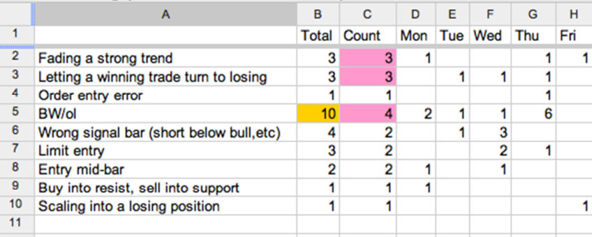

When you lose a trade, you have to ask yourself if you entered correctly and it just went against you or if it was an emotional or careless entry. Traders who can otherwise read price action well will still be unprofitable because they do not have the discipline to enter only on good setups.

Your first task as a trader is to assess your winning percentages over a fixed timeframe, say a week. Is your winning percentage under 50%? In that case, maybe your current trading style is unsuitable to your personality. Are you trading breakouts and you panic when it moves against you? Maybe you are better off buying pullbacks. Are you trading counter-trend all the time? Perhaps a switch to with-trend trading may improve your score. Your first goal is to find a system where you are right at least 50% of the time on most days.

The next task is to assess every losing trade at the end of every day and update a chart as shown above. List your common mistakes and how many times you committed them per day. There are two categories of mistakes. Ones that you commit on most days and ones that you commit rarely except on certain days when you make a lot of them. Some are both.

For example, in the chart above, trading BW/ol is a mistake that is committed almost everyday but also especially on certain price action (Thursday in the example). Buying the wrong signal bar triggered only on two days, but on Wednesday it triggered 3 times. Mistakes that you commit on most days is the most important to fix. Pick the one that has caused you the highest losses and work on it consciously every trading day until you make it not more than twice a week. Then move to the next one.

Mistakes that you commit on specific kinds of days are easier to fix. You just need to recognize the kind of day that triggers an avalanche of mistakes. Are you shorting your way to the top on a Spike and channel day? Once you see the channel stop trading or only take with-channel trades. Put a post-it note on your monitor that warns: "Watch for channel!" if you must. Are you buying every bull breakout in a strong bear? Fade the breakout instead.

A genuine setup that you would take otherwise that just happened to go against you is not a mistake. That's part of trading. But you should keep track of this separately. This information allows you to select setups that are best for you and you should choose only the top 2 in the beginning and add others slowly as your trading improves.

<!-- p.46 -->

## Freezing, inability to pull the trigger

Monday, February 13, 2012 · p.46

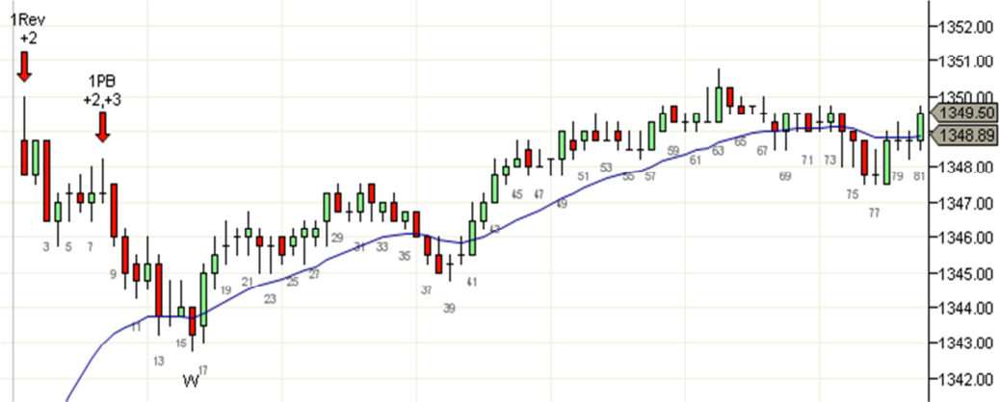

Traders often complain that they are unable to enter what may be a good setup. Sometimes signal bars are weak or the move itself it hard to discern. Know first that these are extremely valid concerns. Your body has learnt to be cautious and will react vicerally causing you to pause due to the accumulated stress of prior mistakes. In principle, this is exactly like getting a static electric shock when you touch a metal surface. If done often enough, your body will refuse to touch the object even when you command your hand to do so.

You can reduce the impact of the reaction by reducing your trading size. Trade only 1c or trade 100 shares of SPY or even 10 shares. If you wish you could even trade on a simulator and risk no money at all in the beginning and slowly move to real money using very small size.

One way to work on eliminating the freezing reaction with this is to evaluate your setups objectively, rather than subjectively. In general no setup is perfect and waiting for very clear setups often means you rarely trade. This is actually not a bad thing for a new trader.

Alternatively, a trader may choose to let something else compensate for weakness. For example, you may choose to take a weak bar if the pattern is clear, such as the 1PB at b8. It was effectively an L2 at a lower high after a strong bar b3. Another strengthener is the ema, so the FF and W at b16 for example could be tradeable based on being at a strong place.

Conversely, a trader may choose to take a strong bar even if the pattern looks uncertain such as the 1Rev at b1 or the fBO at b65. So a weak pattern with a weak signal such as b39 can be ignored until you develop the experience to read them correctly. While b39 did work, this would save you from reading b33 as an A2 for example. But once you have an objective set of rules as to what is tradable, you should follow it.

The key to trading success is to follow your objective criteria with discipline and let the market stop you out if you are wrong. Without this, there is no way of measuring what setups work for you and what do not. Once you have the data, you can winnow your setups and trade only the ones that work best for you.

Don't focus on winning or losing. You are collecting data about your setups and losers are a necessary part of the data. Once you accept losing trades as part of what you seek, your freezing reaction will fade over time.

<!-- p.47 -->

## Trigger happy

Wednesday, February 15, 2012 · p.47

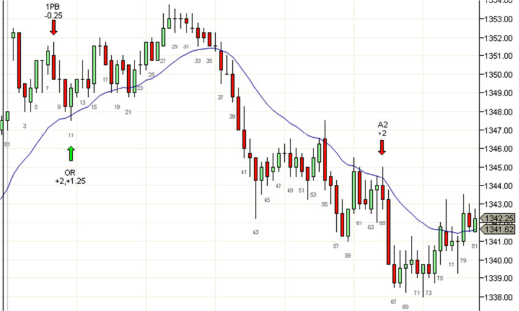

The English have two qualities that I admire: caution and courage

--Napolean

Caution without courage is timidity. Courage without caution is foolhardiness. A trader needs to develop caution tempered with courage to protect from being swayed by emotions. The opposite of the trader who fears getting into any trade is the trader who gets into every possible trade. The truth is, the over-trader is simply scared of missing a big move, which he thinks will happen "anytime now". Fortunately, this mistake is rectified very quickly as soon as the trader blows his fifth or sixth account. But by then, he has turned into a fearful trader.

For example, a trigger happy trader may buy the close of b1 reading it as a reversal bar and a strong close indicating a possible bullish trend from first bar (T1B) day. To his horror b2 starts selling right from its open into its close. At this point, he may turn short below b1 or below b2. If he's lucky, he's scalped out and is close to breakeven by the close of b3. If not, he may buy b4, then sell b8 and by the time b11 appears, he is emotionally exhausted, possibly down by a few points for the day and has thoroughly exercised his expletive vocabulary.

The sense of urgency the trader felt as he entered every trade so far is his very undoing. This is the exact feeling a car dealer will try to induce in a customer at the dealership. "If you buy right now, you get this and this" or "tomorrow, we may not be able to work out such great financing", etc. Without the emotion of urgency, our trader may read the chart differently. For example, if it was presented bar by bar a month later, since he's not tormented by an urgency to make money, it should be apparent that b1 was a doji and not a reversal bar and its close or breakout does not merit a buy. Similarly, selling below a doji on the first attempt is dangerous.

The over-trader thinks like a gambler. To him any trade has the same chance of success or failure, sort of like betting on red on the roulette wheel. He will bet on every spin since every spin is essentially the same. Traders however, need to think like poker players. Only play good hands and muck poor hands. A better analogy is to think of trading like hunting. Its insufficient to spot a prey that would make a fine meal. Everything should be positioned for a successful hunt before you risk life and limb to chase it

<!-- p.48 -->

The trick to trading successfully is to only take setups that you are certain will work. Its insufficient to correctly read the direction of market movement. In the beginning that may mean you are just watching the market day after day, without taking any trade. This is very important and you should not skip it. What you are doing is removing the fever and developing the patience of a hunter. Over time, you will be able to read patterns where your probability of success is high. Keep a list of proven setups handy. At any point you feel the urge to enter, ask yourself: Is this a setup I know is high probability? If not, pass up the trade. Its not worth it to find out. If you feel you cannot control yourself, trade it on SIM. But eventually, you need to let it go without even resorting to trading it on SIM. Once you enter, follow your risk management strictly. If it stops you out, so be it. That data goes into your statistical database and is essential to selecting the best setups for you.

<!-- p.49 -->

## Getting shaken out Part I - Large risk.

Tuesday, February 28, 2012 · p.49

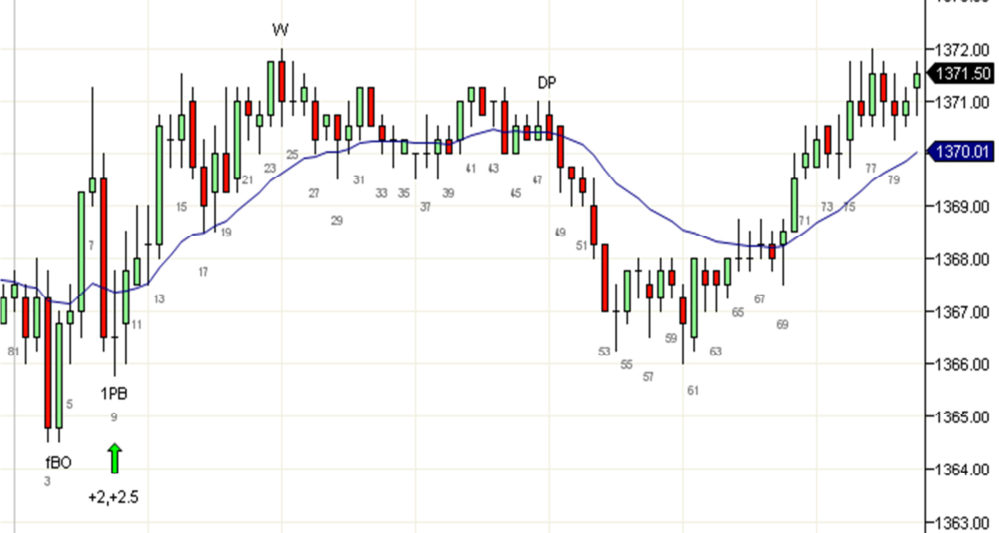

Large setup bars often have large pullbacks after entry or outright failure. The reason for this is simple. When the risk is large, risk management rules prevent many professional traders from entering on the breakout of that bar. (News related activity is a notable exception). The knowledge that large bars are unlikely to be successful setups also encourages faders to fade a large bar causing large bars to often act as trading ranges.

Limit traders often buy a pullback after a breakout and often on a smaller timeframe the pullback may be two or three legged. This will often cause a breakout pullback of a large bar to succeed.

Regardless of the profit potential, if the theoretical risk of a trade is large, a trader is likely to be very distressed if the market begins to pullback right after entry. This is very natural and its your body warning you that this is possibly a poor trade based on prior experiences.

If you have traded large bars and lost a few times, your body will learn to be alarmed when you place the trade when your greed tells you to do so. This is because risk causes stress and large risk causes large stress. When the pullback nears your physical tolerance but not your wide stop, you may despair and get out because you cannot take it anymore. Often, the market will take you out by a tick or two and turn right around. The lesson from this is that stops larger than what your physiology permit are probably useless and moreover, counter-productive.

The simple lesson from this is to not take trades where the signal bar is large. Another possible resolution is to use fixed stops for all your trades. If you only use 6t stops, your body will get comfortable with the risk and let your mind focus on high probability setups.

<!-- p.50 -->

## Getting shaken out II - Poor setup bar.

Wednesday, February 29, 2012 · p.50

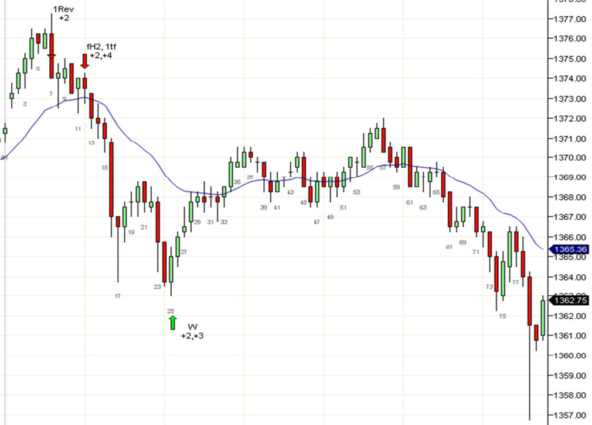

Often in the heat of the moment or out of boredom or desperation or a fear of missing out, you may end up entering on a less than ideal setup. This happens to the best traders and I'm not sure if there is ever a cure for it. Although these trades may eventually work, you may have to sit through a multi-bar pullback. The more pullback bars you have to sit through, the greater the chances you will get shaken out of the trade. A great example is b29. Its an inside bar after a very strong leg off a W. You may buy above it expecting a large breakout bar, but right after entry it turns into a bearish outside doji bar. Such an entry bar is extremely demoralizing and the trader will begin to see everything that's possibly wrong with the setup bar. It was a 3t doji bar with one body at ema. The entry bar gave a double top with the prior swing high. A second L could turn into an A2 short, etc. The likely result is that the trader will exit at a small loss and the price immediately starts moving up. A second example is buying above b46 (instead of b47). Given that b46 is a bear bar, an H2 above it is highly likely to result in a pullback. The trader may start seeing similar arguments as to why the entry was incorrect and exit at breakeven or strong loss just before price starts moving. Technically, both entries worked. b28 low and b46 lows were respected. But 6t stops were hit. When signal bars are larger, larger fixed stops are also likely to be hit. Note that waiting for a strong bar (b33, b47) would have prevented poor entries. A strong bar such as b47 often will insulate you from poor entries since sellers are likely to sell the close of that bar, preventing it from triggering. A poor entry will often give a second entry (b49 with b46) that will often have a better close or lower risk. Those should help you avoid being shaken out. In general, only taking setups where you are likely to get a strong entry bar is the only way to avoid getting shaken out. These include A2, G2, W1P and 1PB.

<!-- p.51 -->

## Getting shaken out III - Not taking the early profit

Wednesday, March 7, 2012 · p.51

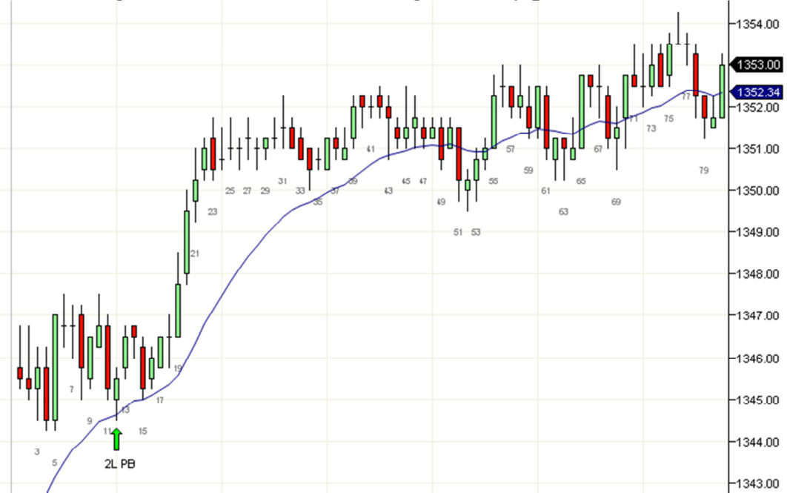

When you are trading only one contract, you should always take an early profit. A reasonable early profit could be your risk or slightly higher. When you are trading multiple contracts, you should sell some at an early profit for at least some of your contracts. For a -1.5 stop, I prefer to take a 2 point early profit. Psychologically, this act allows you to tolerate a pullback far more easily than simply holding it to the final target.

The early profit ameliorates your stress levels via a couple of pathways. One, it gives you a sense of accomplishment, marks success and gives a boost to your confidence for doing the right thing. Second, it lowers your holding size, reducing the stress you feel when the market pulls back against you.

For example, assume you bought b52 today and did not sell at +2 near the high of b56. Your reasoning is simple. It was a one legged breakout after a three legged pullback and should give at least one more leg up. However when the price pulls back to below your entry price on b62, and b62 mid-bar looks like a bear bar, the chances you panicking and exit at a flat or one tick loss are far higher than if you sell half your position at +2.

If you sold at +2, you are more relaxed and could easily place your stop at breakeven. Even if its hit, you wouldn't care too much since your trade is already a winner. If you choose to take a 4t extra risk perhaps you would see your new high. Even if the trade went bad, you would still net +1. This knowledge makes it easier to weather a pullback.

Holding a winning trade for a choice between a larger winning trade vs a smaller winning trade is far easier than holding a winning trade with a choice between a larger winning trade and a losing trade.

<!-- p.52 -->

## Getting shaken out IV - Recent losing trade

Wednesday, March 14, 2012 · p.52

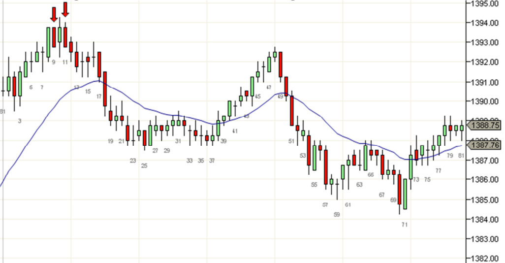

A recent loss shakes your confidence in your next trade often without you noticing it. For example, suppose you shorted b9 and were stopped out on the next bar at b10 high. Another setup bar forms at b11 right away and you re-enter. Chances are high that anything other than bear trend bars will force you to exit early. So when b16 is forming and looks like a bull bar near its high, you may decide to exit on the next tick above and get out exactly where stronger traders add more to their short position.

Its likely that if you did not have a recent loss, the pullback wouldn't bother you that much. Its important to know how wins and losses impact you and to learn not to be overconfident after wins or scared after losses. One way around this is to let some time pass after a losing trade. If you choose to wait for two swings (b10h and b15 l) and only take an entry after that, you may possibly read the fH1 at b16 correctly and hold longer.

If you are a trader who often or even occasionally experiences a series of losses every few bars, you need to follow the two swing wait rule after exiting any trade regardless of whether its a win or loss.

<!-- p.53 -->

## Getting Shaken out V - Mid-bar decisions

Tuesday, March 20, 2012 · p.53

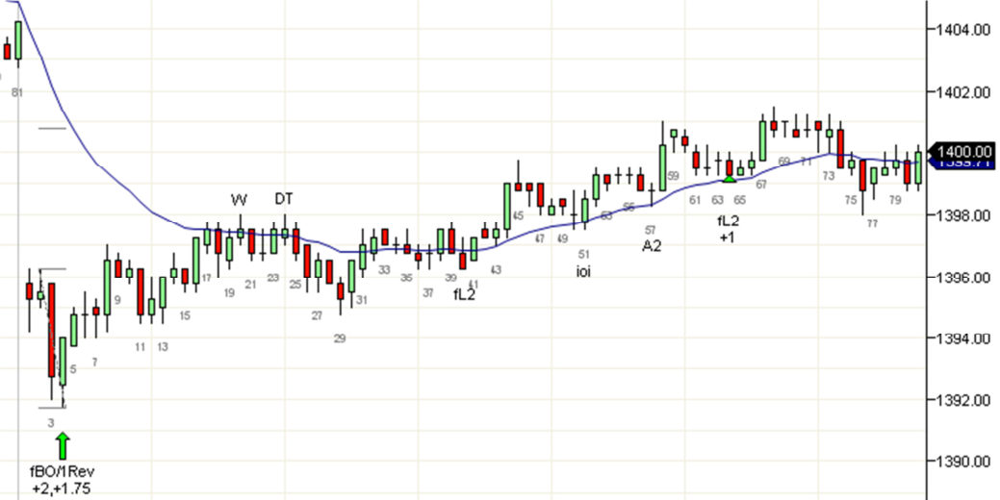

One of the troubles that plague discretionary traders is that they are impacted by every tick of the market. Whether the bar grows or pulls back, flips green to red, approaches their stops or moves away will drive all kinds of elation and anxiety in them and this often drives them to make rash decisions.

For example, today if a trader bought b4 and moved his stop below b5 after it closed, he should simply wait to either be filled on his target or be stopped out. A weak trader may see b6 turning red when its near its bottom and may wonder if it could turn into a 1PB short. He may feel compelled to exit his long position or even reverse mid-b6. He may reverse to long by buying above b7 and get stopped out at b11 and so on.

This kind of trading consists of second guessing yourself on every tick and changing your decision based on mid-bar appearance. Note that most trading methodology is based on how a bar looks after its close and not how it looks mid-bar. So there should be absolutely no reason to make a decision mid-bar.

Once you enter a trade and set a stop, it means that you are willing to tolerate a pullback until your stop. If you cannot tolerate a shallower pullback, then you need to find a trading system that allows a smaller pullback.

The right thing to do is to let the market either fill your target or stop you out if you are wrong. The only time you should exit early is if the market presents a reasonable opposing trade that you may have taken if you were flat. For example, The DT and W at b24 made me exit my swing long earlier and the long near b64 low was no longer viable after the final flag/1tf/W at around b72 and I exited it before my target was filled.

Being able to accept a loss at your stop will also enable to hold till your target is filled. If your stops are regularly taken out, you can simply drop that setup. If your targets fall short all the time, you can learn to have a bit more modest expectations.

<!-- p.54 -->

## Unable to hold, exiting early I - Drawn out move

Wednesday, March 21, 2012 · p.54

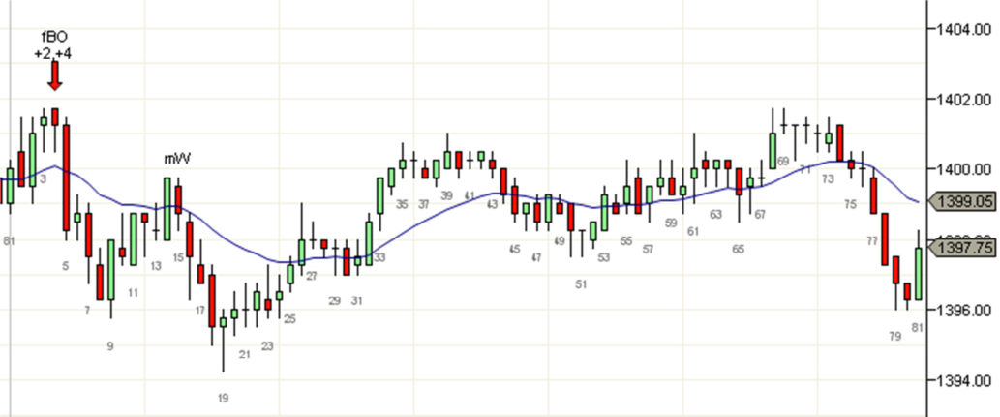

Human beings are naturally impatient and this often works against trading profits. While being unable to hold for long durations is far better than being shaken out, it can often cut profits deep enough to be of some concern.

For example, today if a trader bought b19 and held through the horizontal movement around b20-24, he would probably plan to exit on an L2 if the signal is good or on the third push up. Technically, he should exit when the price ticks below b37 or just above b35 (during b39) and then wait for more price action.

However, the sideways movement right after entry is likely to have caused him some distress and question the strength of the setup. He may consider the movement as BW and expect any BO above to fail and cause the market to drop below. He may read the bear bar b23 as a break in the trend or b21 and b23 as two interruptions in the trend making b26 a third push up to the ema and exit (or worse reverse his position). After all, thats exactly what happened at b10-13. If b21 had been a large trend bar with a strong close, he would have less of a problem sticking to his plan.

The solution to this to understand what b20-24 really is. Its an attempt to fail the reversal and many reversals have such a pattern right after if the entry bar is not a large trend bar. b15 was an fH2 that triggered off the first attempt to reverse at b9 and succeeded in failing the attempted reversal. b23 was a signal bar that attempts to fail the reversal off b19, making it an fH2 if it triggered.

Price action such as b20-24 is to be expected right after a reversal if the entry bar is small and the trader has two techniques to deal with it. First, take a first profit at +2 and move stop to breakeven for the remaining position. The very act of taking a profit increases your confidence in the setup and your trading in general. The act of moving the stop to breakeven releases anxiety since the mind perceives lighter risk. Once you hold through the first pullback, sticking to your plan becomes much easier.

<!-- p.55 -->

## Unable to hold, exiting early II - Recency Bias

Friday, March 23, 2012 · p.55

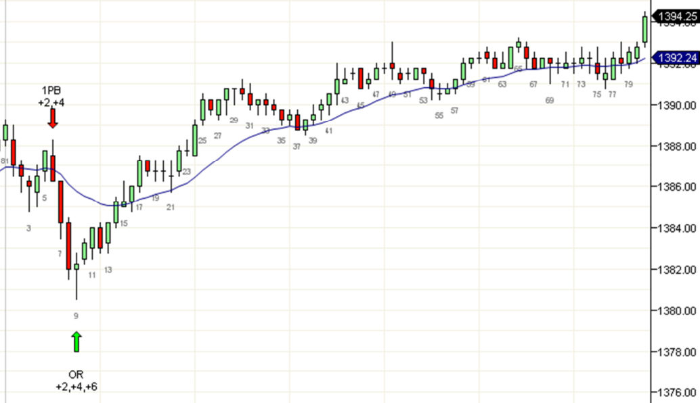

Recency bias is our ability to recall recent events and experiences more readily than earlier ones. This means that anything you experience recently is likely to have a disproportionately strong impact on your decision making than older events. Recency bias is very hard to fight since its an essential part of our cognitive and learning processes.

For example, today I exited a bit earlier than I could have when I bought above b9. When the initial move off a first reversal (b9-29) is strong, you can often swing a trade till the end of the day or an obvious overshoot of the TCL. However, after adapting to the recent narrow range days, I exited at +6 right above b24 instead of my planned +8.

The permanent solution to this is to accumulate experience and develop the skill to quickly recall and adapt to changing conditions. The more experience you accumulate, the less recency bias impacts you. The tactical solution however, is to trade mechanically and stick to the plan. At the least, I should have exited on an L2 (after fL2 b21) below b30 for my swing position.

<!-- p.56 -->

## Unable to hold, exiting early III - Recent losses

Wednesday, March 28, 2012 · p.56

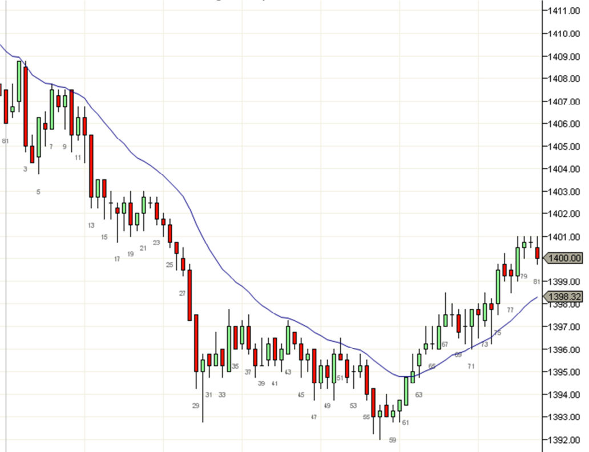

One of the most difficult tasks a trader faces is to not let recent outcomes impact their current decisions. For example, a trader who may have sold b3 and bought b5 and lost both trades may have also entered a short below b8. However, instead of letting it run, he may be tempted to take a quick profit and exit his position completely. This is mainly because the two very recent losses have impacted his emotions and judgements pretty intensely even though he may not realize it consciously. The human survival mechanism kicks in and forces the trader to get out at a small, certain profit and be closer to flat for the day rather than risk making the loss larger.

It is very hard to overcome this emotional impact and start with a clean slate so to speak since there is insufficient time for the trader to calm down and regain composure. The way I address this is to avoid trading for at least two swings or wait for the price to move away from the area where you had your loss.

Not trading for a couple of swings protects you from going into tilt mode. Not trading around the same price protects you from choppy action. If you took a decent looking signal and were stopped out, there is a very good chance you are in some choppy waters and should expect to be stopped out again. Letting the price move away allows some time to pass and is likely to give you a better setup for the next trade.

<!-- p.57 -->

## Exiting early

Monday, July 9, 2012 · p.57

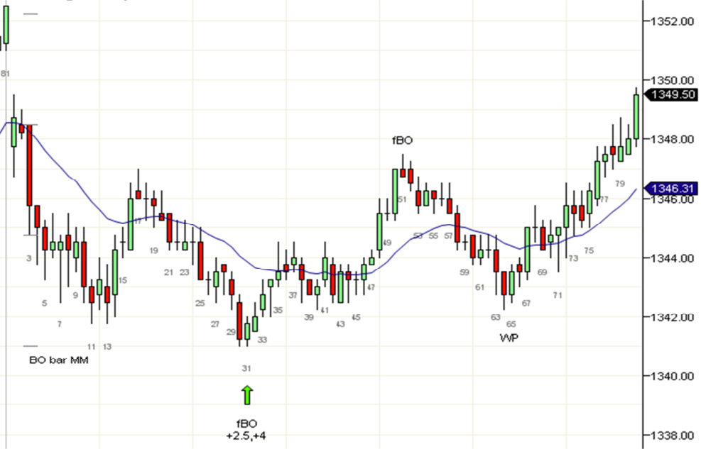

Although I prefer to swing most of my trades till a trend terminates, sometimes its prudent to exit early. In general when the market is in a trading range, you cannot expect most trades to really break into a very strong trend and you may need to look to exit early.

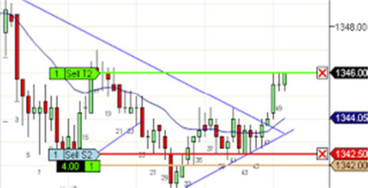

A classic application of this rule is an fBO trade. Since fBO can only be expected to give two legs and the two legs may or may not take out any target (i.e. recent swing points or H/LOD), its often prudent to take a large open profit. For example, today's fBO setup at b31 popped very high for a second leg up at b48. The theoretical swing stop is below the prior swing (b43) and when the price moves close to a potential target (b17H), it makes sense to exit early and re-enter on the expected deep pullback (eventually occurred at b65). One option is to exit on strength (inset image) or exit on the next tick against you (eventually below b51). I prefer to exit on strength when a potential FF type setup shows up (inside bar b49 could act like FF). Even on trend days, when the market makes a disproportionally strong move, you should expect an extended pullback, which could be either a quick deep pullback or an prolonged shallow pullback. If your swing stop and the price are very far (4+ points) its usually best to take an early profit rather than sit through what could be an prolonged, deep or complex pullback. A notable exception to this rule is the late trend, which rarely pulls back.

<!-- p.58 -->

## Trading on tilt and prevention

Tuesday, March 27, 2012 · p.58

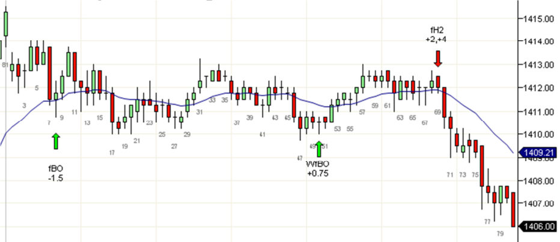

If a person is hit once, he may try to hit back; if he is hit twice quickly before he can react, he may try to run away and if he is hit three times before he can react, he may go berserk and try to kill or be killed. To some degree this is a survival mechanism and applies to most human interactions. Repeated harassment of someone is also likely to cause the suicide mode to kick in and I have discussed how Poker players can go on tilt if they are in a bad beat. Losing a trade causes similar reactions to losing a poker hand. This is because a moderately good trader expects his trade to work and is often shocked when successive trades are lost one after another. The more trades you lose in succession, the more you are likely to throw caution to the winds and enter on poor setups trying to make back the money you have lost. Narrow days such as today are extremely dangerous to any style of trading, be it scalping, swinging, with-trend or counter-trend. You may not even realize you are a trader that can go on tilt, but its very obvious from your trading history. If most of your days have a small steady profit on a few trades but a few days have huge losses with a large number of trades, you are susceptible to tilt. All kinds of bad trading habits that you thought were kicked for good will re-surface when you are on tilt and you will lose trade after trade and you may end up blowing your account on a single day. There are a few simple things you can do to minimize the damage when going on tilt. A very important technique to prevent a string of losses is to avoid trading for at least two more swings right after a loss. For example, after my loss of b8 buy at b12, I need to sit out until b17. With a few exceptions, taking the very next signal is inadvisable unless the failure move went some points beyond your signal bar. The first thing you do when you lose a trade is to ask yourself if you made a mistake (poor signal, incorrect read, etc). If so, note it down right away in a journal. The very act of noting down a mistake disengages your mind from the chart and forces you to acknowledge your mistake. The next thing you do is to step back from your computer, perhaps get a glass of water to drink or do a couple of push-ups. This is analogous to walking away after being hit instead of risking life and limb in a fight. This also calms the urgency you may feel to get in right away and helps you to avoid trading for two swings. If you encounter a second loss right away after returning, you are less likely to go on tilt. After two or three losses, halt your trading for the day. Traders who go on tilt usually do the least damage if they are able to stop early. The more they trade trying to make up the loss, the larger their daily loss. Its a rare trader who has gone on tilt and recovered in time to make up the loss and end the day a big winner. You will never be able to halt after two losses unless you are also able to step back after a loss and perform the rituals above. Often, the reason for your string of losses is something you may be unaware of. Perhaps you didn't get sufficient sleep or are hungry or had too much to drink the prior night or your internet connection is sporadic or you are trading the wrong contract. In any case, if your win/loss pattern is very different, you should halt trading for the day.A fixed maximum daily loss is the perfect complement to a fixed per-trade loss. Celebrate your freedom from the trading desk when you hit it and go out and enjoy your day.

<!-- p.59 -->

## Revenge Trading - Reversing where you would be stopped out

Friday, March 30, 2012 · p.59

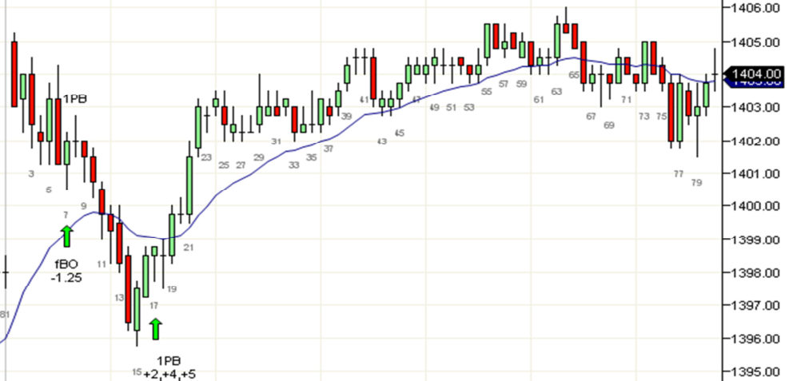

As I've previously posted, a trend first bar is just a trading range. However, a strong bear close that overshoots a bull channel TCL from the prior day is a sign of a move down. If a trader chooses to sell below b1 instead of waiting for a breakout pullback of b1, he may follow standard price action principles and move his stop above b2. Since b2 is had a strong close, he may simply decide to reverse where he is being stopped out. This is an unplanned trade and is a form of revenge trade.

This is caused by the trader having a plan for success, but not a plan for failure. He has very carefully visualized his setup, entry and targets. He may have chosen his stop, but being so sure of his trade, does not really expect it to be hit. After all, the setup is just too beautiful. How could it ever fail? The failure of a beautiful setup usually means you are still in a choppy trading range and there is a very good chance that any setups near this area are likely to fail regardless of direction. The right thing to do is to wait out two swings or until the price moves some distance away from choppy action. Since I had taken b7 and was stopped out, my plan required me to stay out for two swings or until the price moved some distance away from this setup, both of which meant I would enter on the 1st PB after the reversal at b15. While some traders can retain clarity of thought after a loss, many just wont be able to. For example, if an experienced trader shorted below b71 after reading it as an A2 short (since b69 is an L1 variant) and was stopped out, he may retain the clarity of mind to correctly short b74 as a W pullback. (but he could probably never do so if he reversed and went long during b73.) However, under most circumstances its best to wait out two swings. A short below b50 DT was stopped out at b55. Naturally, a short after 7 bull bars is likely to fail even if this was not BW. After waiting two swings, i.e., close of b63, chances of a successful trade increase. The price has also moved the size of a recent bar or two away from the original price and has also given the trader some time to regain composure.

In summary, when you encounter a loss, always avoid getting back in right away. Have some criteria for re-entry. The chances of you reacting emotionally and urgently right after a loss is very high and puts you at severe disadvantage. In this state you are unlikely to be reading the market at your finest skill level. Let the market go for now and wait for better price action. Entering on strong bars is a great way to filter poor price action areas. Strong setup bars failing actually gives you a lot more information about the market since poor bars could fail anywhere but strong bars only fail in trading ranges/channels.

<!-- p.60 -->

## Fading a strong trend instead of trading with trend

Wednesday, April 4, 2012 · p.60

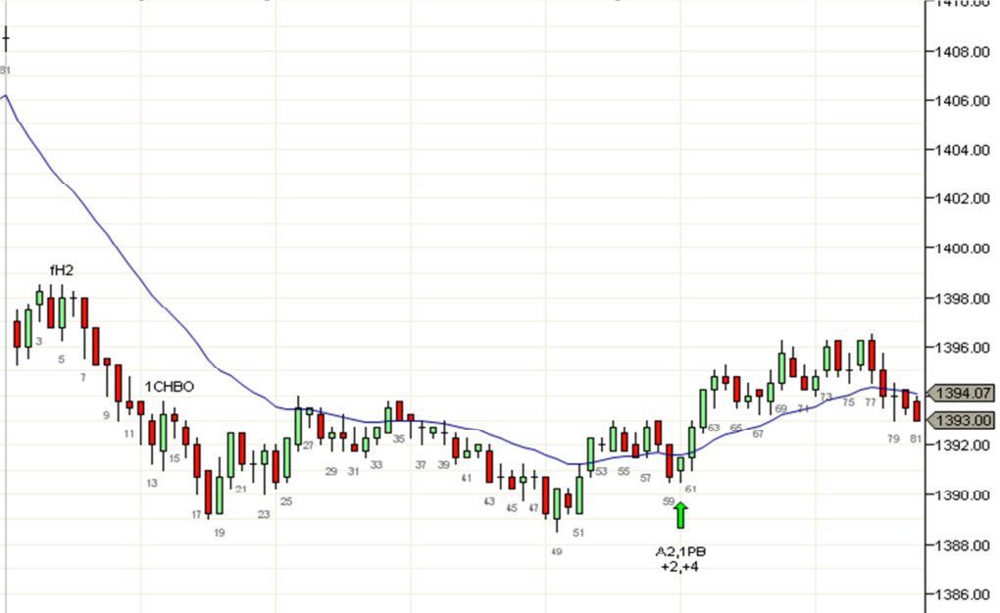

One of the classic trader's error is to fall in love with their first position. If a trader bought b2 since he may be expecting gap closure or b5 as a possible second attempt to close the gap or 1PB, he may be surprised when the market stops him out and takes out the low of the day. When he later sees b9, he may see a reversal bar. b12 may appear as a reversal bar after a possible 1 bar FF at b11. b12,13 may appear to be a rather strong 2 bar reversal. The trader may end up buying every one of these and getting stopped out every time. (The alternative, adding on at every new signal is far more dangerous). One of the reasons I prefer to trade on breakouts of signal bars rather than simply buy on close is that it prevents me from entering into many incorrect trades such as these. The complementary situation is the trader who was right about the initial direction but fails to see the trend break (b19-b27) and test (b49) and insists on shorting every move up. After a major reversal at b49, there are no more short trades and b58 therefore is not an A2 short. (A common reason for failed A2s is being in denial about trend termination or trend reversal). A common reason for such behavior is the trader's bias about market direction. This bias may be a fundamental bias caused by reading too many economic blogs or watching TV or other inherent biases about the strength or weakness about the world economy that the trader wants to see reflected in the market today. Traders who don't watch news are possibly subject to technical bias. They may have an inherent belief in some pattern or indicator and are expecting a strong reaction. It is correct to trade those and natural for some of them to fail. The trader however, should not repeatedly enter a trade in the same direction assuming he would eventually be proven right. This is the need for acceptance and is a strong human trait. You should not let it meddle with your trading since the market is too impersonal to either accept or reject you. The trader needs to realize that all biases and opinions are always wrong regardless of their direction. Only the market is right and for a day trader, the strength and underpinnings of the economy are meaningless. Patterns and indicators are tools and they fail occasionally no matter how reliable they may have been. The right way to trade is to accept only what the market presents and be aware that trends can break, trading ranges can breakout and nothing is guaranteed to run forever or reverse eventually.

<!-- p.61 -->

## Types of trading errors

Monday, May 7, 2012 · p.61

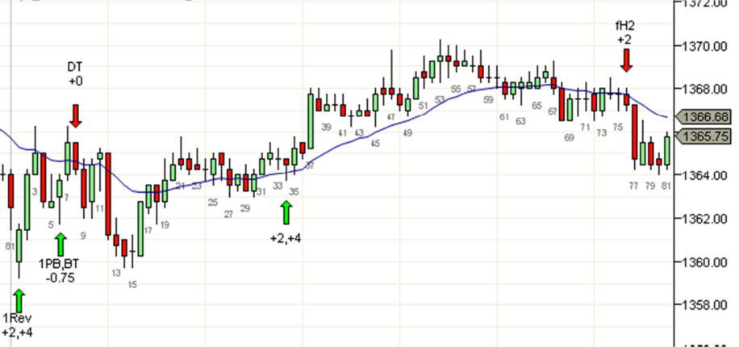

I have arbitrarily classified trading errors into the following:

1. Directional error: Trader in incorrect regarding primary market direction
2. Entry error: Trader has entered too early or on the wrong bar
3. Stop error: Trader has used stop thats too wide or too narrow
4. Execution error: Trader loosened or tightened stop too early or was shaken out.

Directional error: A trader has missed the end of a trend or incorrectly reads a pullback as a reversal. Misreading a trading range as a trend and vice-versa also are part of directional error. A couple of years of trading later, traders get a general sense of where the market is heading and these errors should become rarer. For example, the move to b68 broke the trend and its clear even without a trendline. At this point any with-trend setup such as b69 should be suspect. b69 buy is a directional error. Entry error: The trader is generally right regarding where the market is headed but enters on improper bars. For example, after two failures to sell in the AM (b3 and b8), there is a good chance the market is headed higher. A trader who buys b12 makes an entry error. Stop error: The trader is right regarding direction and entry. However, his stop is to tight or too lax. A trader who bought b28 with a 5t stop had a very tight stop and would be stopped out. Overlaps require a larger stop, at least 6t. Inside bars have their theoretical stops below the preceding outside bar. Similarly, a buyer above b6 who keeps his stop below b6 has a stop that's too large. Execution Error: Entering late (more than 1t beyond bar except due to slippage), getting shaken out on the first pullback (ok to exit on the second pullback), tightening stop before price moves away or gives a first pullback, loosening stop so that the pullback does not hit your stop, exiting when you have a tiny profit are some of the common execution errors. Most execution errors are due to psychological pressure and it often means the risk is too much for you to bear.

A trader often grows by overcoming these errors often in the exact order above. If your sense of direction is generally wrong, you will never be able to swing for many points. You should think of alternative trading styles, such as scalping for a point or two and trying to reach a high level of accuracy. Entry errors are usually caused by taking the first setup, usually a poor setup due to large signal bar or overlap. Your best bet is to restrict yourself to only very clear setup bars or second entries. Stop errors can be largely eliminated using fixed stops of 6t for inside and borderline overlapped bars and 5t for everything else. Execution errors are harder to address. The best way to work on them is to have a fire and forget trading style with fixed stops and targets and only exit by filling an OCO stop/target.

<!-- p.62 -->

## Letting a winner turn into a loser

Tuesday, June 5, 2012 · p.62

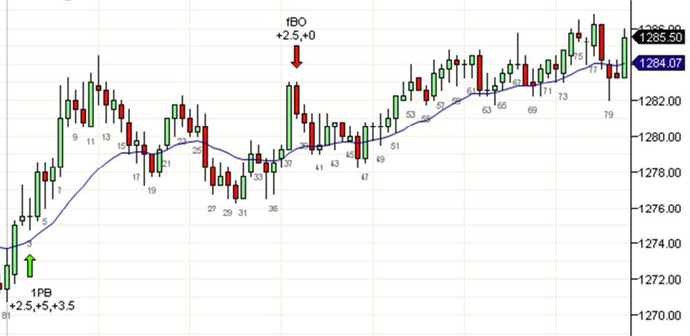

Greed, fear and hope are the terrible curses that afflict traders. Hope can be eliminated with clear fixed stops. Greed and fear need to be balanced against each other and will never really go away.

Not every trade will be a winner and for a lot of traders, taking a first profit greatly improves their equity curve. This is especially true for reversals and attempted breakouts out of a trading range since these setups fail routinely.

For example, traders expecting an imminent reversal of the trading range (since b38 was a 2L LH after a trendline break -- a major reversal setup) will often hold all-in and will refuse to take a profit. Such traders may even keep their stop above the signal bar until an additional LH is formed. Those traders would have lost today. A trader that took an early profit on the other hand, was a small winner even though both were wrong about the overall market direction.

If a trader sold b38, he is best served by taking a profit when he is right and moving the stop to breakeven when his target is filled. If the market moves against him twice, i.e., ticks beyond a bar twice against his trade (above b48), he would need to exit if he has not been filled. If he was filled, he should move his stop to breakeven on the balance of his position.

A trader who sold b23 today as the first pullback after a W made a profit of 4 pts. He should keep his stop on any runners at breakeven. Keeping the stop above the signal bar or worse, above a prior swing is a symptom of hope and not objectivity. No matter how obvious the reversal at b12 and the first LH at b23 may look, the trade can always fail and its best to let it stop you out and look for a fresh trade.

Even in a very strong high momentum trend, you are usually better off taking an early profit. This is because if you entered early in the move, the chances of a sustained trend are unknown and if you enter late, the chances of a trend reversing or going into a deep pullback stopping you out are always existing risk factors.

<!-- p.63 -->

## Adding to a losing position

Wednesday, June 6, 2012 · p.63

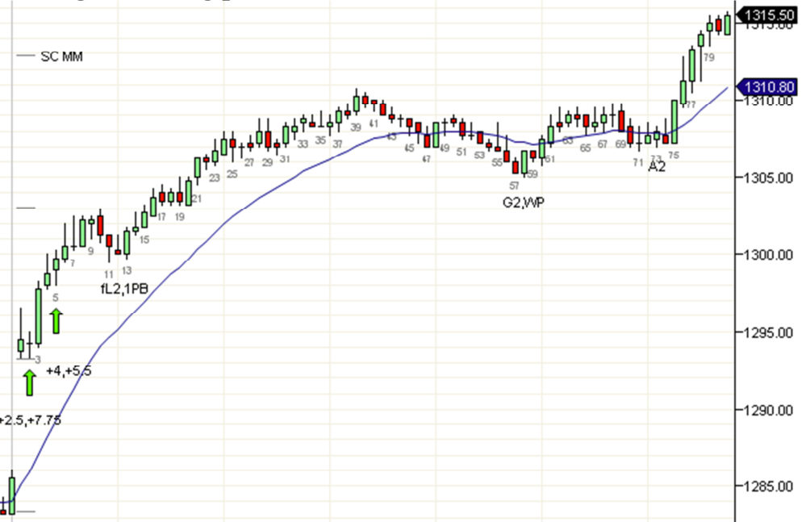

Among all the trading sins, none is venial as adding to a losing position for a better average price. On trading range days, adding-on may work eventually although a trader would end up trading way beyond his comfort level before he sees a price better than his average price. On many days, he may only get away with a scratch.

On trend days such as today, counter-trend traders are likely to get killed if they add on anytime the trade moves against them. For example, a trader may short b10 as a first attempt to reverse (which is profitable on many days), but when the trade moves against him, instead of letting the market stop him out, he may decide to move the stop way up and add on where he would be stopped out or on the next signal.

The psychological issue at hand is the desire to pick the exact high or low of the move to get the best possible price. This combined with a wrong sense of direction will destroy the trader's account rapidly.

The way to deal with this issue is to resolve to never trade reversals. A trader should always wait for the reversal to succeed and establish a successful trend in the opposite direction and enter on its first pullback. Unless a reversal is obvious, it is likely to fail.

On a day such as today, a trader looking to short would do much better if he waited for the short trend (b41-47) to establish and then enter on b50 than to short every bear bar on the way up from b1 trying to pick the exact turn.

<!-- p.64 -->

## Reversing your postion on a loss

Thursday, June 7, 2012 · p.64

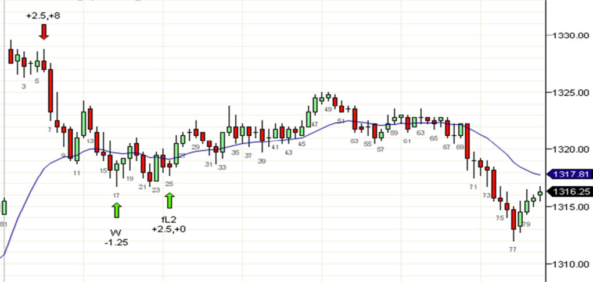

One of the prevalent causes of overtrading is reversing every time a trader gets stopped out. Many traders fall into this trap because they only pay attention to bars and have no choice but to flip on anything that may look like a reversal bar. For example, if a trader shorted b29 as two legs up in a bear and then on b32 he may interpret that the trend may have flipped and buys b32 and then sells b34 and so on. The second reason traders fall for this is that have heard that a failure is a strong signal and a failed failure is an even stronger signal and two failures in the same direction are extremely strong etc. Therefore if a trader sold b34 as a W24,29,34 he may see b37 as two pushes down and reverse to long. The chop in this area may end up being read as fL2 or fH2 or any number of things causing him to interpret a new direction with every bar. The real problem here is that the trader is focusing on a micro level. A trader always needs to keep in mind if the market is trending (b1-b17) or chopping around (b25-b45), breaking out and failing (b46-53) or breaking out and continuing (b56-70). Being aware of the nine transitions reduces directional error. Reversing very often is rooted in the fear of missing an impending very large move. This symptom also suggests that a trader's sense of market direction is undeveloped. This can be combated by realizing that if you are stopped out twice near the same price area, you are probably in chop and your entry is effectively trying to predict a breakout. Predicting breakouts is one of the hardest things to do in trading, whereas waiting for a breakout to occur and jumping on the first pullback is far easier. My way of avoiding falling into this trap is to assume that if my trade fails, the market probably in a chop and except in the first hour, I will avoid re-entering until the price moves away from the area. For example, if I read b34 as a W and sold it, I will not trade until price moves away from b34, i.e. until b49. There are two exceptions to this rule. If an opposing trade fails twice, I may consider entering again in the same direction. For example, I was stopped out of my trade on b17 long, b20 setup a short and failed twice when b25 triggered. This should only be done if you are expecting a very large move.

In the first hour if the stop out was due to a fixed stop and not a theoretical stop, I will usually re-enter. For example, if I shorted b1 and my 6t stop was taken out, then the trade hasn't theoretically failed until b2 high is taken out. I will enter on b6 even though the price hasn't moved away from my losing trade.

Remember that there are one or two and occasionally three good swings a day. Focus on capturing a decent portion of those. This ensures a very high risk to reward ratio and eventually a very high win to loss ratio.

<!-- p.65 -->

## The hard road to consistency I - Overtrading

Friday, July 20, 2012 · p.65

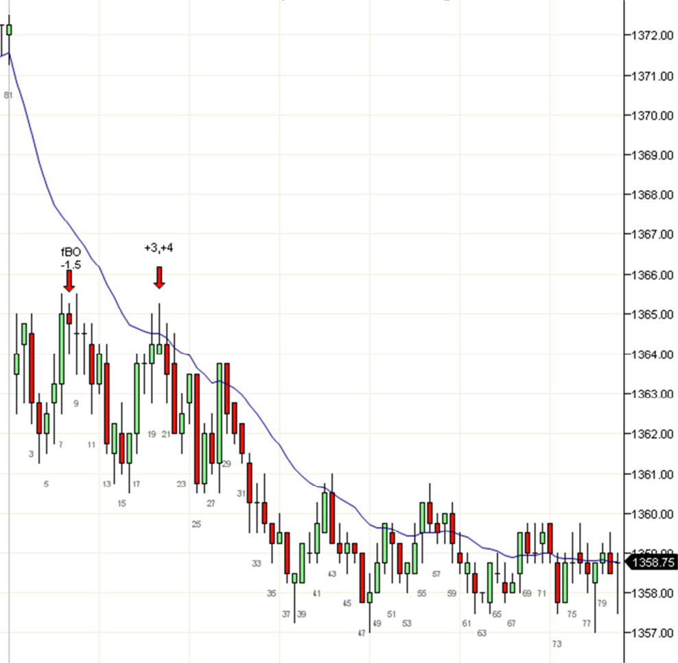

The trouble with trading is that you are in a position to do whatever you want and need to struggle to develop the discipline not to do things that hurt you. This is exactly the opposite from the real world where you are in a position to do very few things and have to struggle to do things you want to do.

You will learn very quickly that doing everything that comes to your mind leads quickly to ruin. The only way out is to learn not to do things. Your focus needs to change to stop doing things that cost you money even though they work some of the time.

In trading nothing is guaranteed. No setup is guaranteed to work every single time and even the best setups can have a repeated sequence of many losses. Everything is a probability and probability works only with a large number of samples. Even a 50% setup should be expected to see at least 6 consecutive losers in 100 attempts. (Go ahead, toss a coin 100 times).

<!-- p.66 -->

Despite having a profitable system, many traders fail and this is because they are unable to follow their own rules. A trader needs to figure out what habits are damaging their trading and root them out.

The most dangerous bad habit is over-trading. What over-trading is depends on your style of trading. If your goal is to trade the 3 to 5 large swings of the day, then any day over 10 trades is probably over-trading. If you are a scalper who wants to take 10 trades a day, 20 may not be that bad but 40 certainly is. The best measure of overtrading is a poor win/trade ratio. 2 points from one trade is decent, 2 points from 20 trades is not.

Overtrading usually is caused by the trader reacting poorly (emotionally) to a loss. There are two kinds of reactions to a lost trade: Retrying and flip-flopping. A trader who has decided the market is going down will continue to short the market over and over, regardless of stop-outs. He thinks he is right about the direction of the market but incorrect about timing or stop size. The next time has to work!

The flip-flopper is far worse. He will go long if stopped out of a short trade and vice-versa. If a great long setup was stopped out, then the market certainly should drop, right? (Answer: wrong. See b14)

The correct way to react on a loss is to look at the market objectively and enter only if there is an extremely good reason. A trader susceptible to overtrading should just sit out a few bars even if there appears to be a good reason to re-enter. Usually, if you were stopped out of a good setup, the market probably is in chop and you should not trade for a while.

Wait for the price to move away from the area you were stopped out from or give two swings in opposite directions after the bar that stopped you out. Most traders who enter right away after being stopped out have a state of mind thats a possible combination of disappointment, surprise, sense of urgency and desperation all of which are likely to cloud their judgement. Until you are consistent, stay out until price moves away or gives two more swings after a losing trade.

The mind treats losses like a mini-trauma and needs time to recover. Most losses due to over-trading are caused by poor judgement due to recent loss.

You also need to protect your account from being blown up because you cannot accept to have a losing day and will keep trying to trade your way out of a drawdown. Over traders should have a strict rule regarding the number of losing trades they have per day. If you are in a state of mind that is causing you to lose over and over, trying harder is likely to make it worse, not better.

Understand that your main goal as a trader is to manage risk and once you have crossed a certain number of losing trades, your risk of ending the day with a larger loss is higher if you continue to trade and manage the risk by stopping trading.

<!-- p.67 -->

## The hard road to consistency II - The off day

Tuesday, July 24, 2012 · p.67

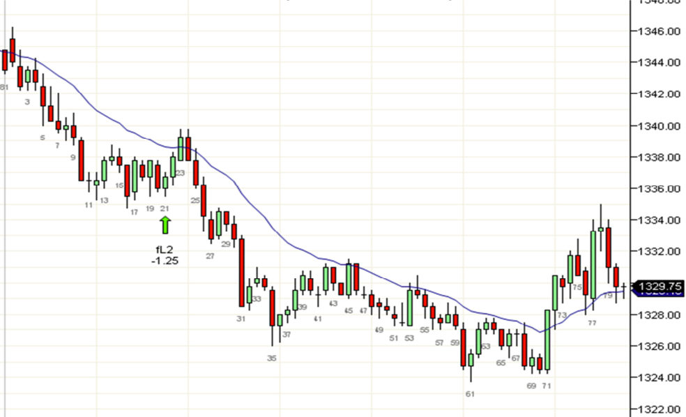

"A Samarian warrior does not fear death, nor does he rush out to meet it"

--Conan the Barbarian

Trading requires you be at your very best. You need to be alert and focused. You need to be rested and undistracted. You need to have eaten and your body should be healthy. Do not party unless the market is closed the next day. Despite diligence to your alertness and despite years of good trading, you will most certainly have an occasional off day when you are just not in the game. Many traders who have an early brush with consistency accumulate enough points to think they have made it and start increasing their trading size. This is dangerous because a single off day can wipe you out. The most dangerous thing about nacent consistency is that you won't believe you can be wrong repeatedly on the same day and will have the confidence to think that you can win back everything you lost.

This is why I have a strict two failed trade limit. You may take a PM trade if you lose two trades in the AM but only if a great trade sets up (for a maximum total of three losses a day).

The following signs should alert you that today is an off day:

1. You already have a reason to believe you may not be at your best (did not sleep/eat)
2. You lapsed into poor habits you thought were broken long ago
3. You are repeatedly reading the market worse than usual
4. You already hit your max losses

The moment you realize you are off, you need to stop trading. Even many years later, you will certainly encounter a day where you simply are not in tune with the market. Stop before you damage yourself more. Release yourself from the pressure to make money and focus on studying your newfound situation. This day is a poor trading opportunity but a great educational opportunity. Study your behavior and study the market's behavior.

<!-- p.68 -->

## The hard road to consistency III - The heavy cost of education

Monday, July 30, 2012 · p.68

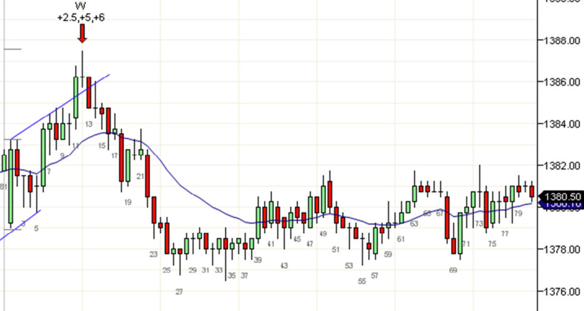

Trading is very expensive to learn. There are countless ways to trade, many of which are unprofitable and many others profitable only to their sole practitioners. Of these countless ways of trading, only a couple are probably suited for you. Most people who try to trade systems without proving it to themselves will end up losing everything they put into it.

It is my opinion that a couple of observations of market behavior are insufficient to be branded setups and traded off. Its like observing the number thirteen is unlucky or people with the zodiac sign Leo are born leaders. It may seem true due to selection bias but most likely its just simple superstition. Many trading setups are superstitions and you should not trade them until know the probabilities for each setup.

Whatever setup you observe, read on a blog, hear from some hotshot trader or otherwise obtain from other means needs to be tested and measured to determine the following:

- Potential reward:risk (Needs to be at least 1:1, 2:3 or better recommended)
- Stop size required (Smaller is better or you may get shaken out)
- Probability of success: (Theoretically 50%+ but 60%+ recommended)
- Invalidating conditions and subtle variations (the fewer, the better)

The best way to get this information is to actually trade the setups. A sample of 20 trades will quickly eliminate poor setups. A sample of 40 should be sufficient to calculate probabilities. A sample of 100 should be sufficient to calculate stops.

Setups have subtle variations that make a given setup clear or strong vs muddy or weak. For example, today's trend down b12-27 from the W reversal was broken by a counter-trend move b35-49 and then we got a deep mW b50-55 (two inside bars b52,54 make this three tiny pushes). The subtle difference between the three pushes ending a leg versus an actual reversal of a trend takes experience and many traders could fail to realize that this is not an actual reversal. If they did not take a scalp profit, they probably were stopped out. Such losses add to the overall cost of your trading education and only screen time will make you better.

<!-- p.69 -->

I believe the first year of trading can be done entirely in SIM and will probably save tens of thousands of dollars for the average trader. I have yet to meet a single trader who became profitable in the first year. Save the capital for once you know what you are doing. Modern SIM trading is extremely realistic and enables you to keep the same detailed records of wins, stops required, etc. The only thing missing is your mental discipline and ability to trade exactly as if it was the real thing. If you wish, you can toss a coin and switch between real trading and SIM trading arbitrarily until your mind does not differentiate.

Most traders fail because they run out of capital and the severe loss of the first few years of trading makes them give up. Reduce the cost of education by carefully evaluating and choosing setups and practicing your system until your prove it to yourself.

<!-- p.70 -->

## The hard road to consistency IV - Very few low risk trades

Friday, August 3, 2012 · p.70

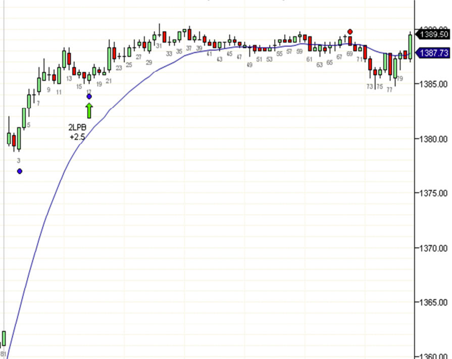

Your consistency will only improve when your outlook changes from looking eagerly to make a profit to watching cautiously to minimize risk. Letting trades go if they dont seem to match the risk to reward expectation is the basic underlying framework of any profitable trading system.

As long as you try to recognize every tradable patterns and act on them, you are likely to stay a breakeven trader or slightly better. Once you are comfortable letting trades go, you become a far better trader. The larger your risk, the higher your chances of making a trade work, but also higher your loss if the setup were to fail. The bare minimum risk on ES is 5t. If you are just starting out, your win rate is probably near 50%. At 50% a 1 point win such as the long above b11 versus a 5t loss actually works against you. To account for commissions and other costs, you need to take at least 6t just to breakeven. You would really need to look for trades that give you 2x your risk. On an average day, there may be about two to five low risk/high reward trades. Your goal should be to focus on them and not bother with the minor trades.

For example, today there were only three setups that gave 10t while respecting a 5t stop (marked with dots on chart). Technically, some other bars such as b60 and b20 may have worked but they were second entries or not clear setups.

The best risk to reward is the first deep pullback in a new move. b17L was the first deep pullback in a bull move and b69S was the first deep pullback in a bear move. Measuring risk is also about knowing when you can trade and when you need to sit out. When bars are small (b23-60) you are usually better off sitting out until bars come back to normal. Otherwise, you risk the pattern play out just as you expected but unable to reach your target. Wait for decent sized bars and then look for setups.

<!-- p.71 -->

## The hard road to consistency V - Poor price action days

Monday, August 6, 2012 · p.71

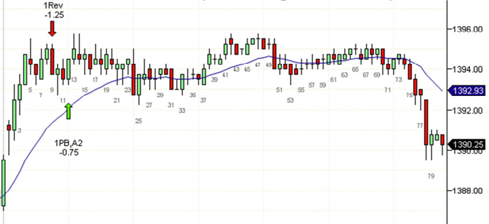

In the post Off days, I spoke about the trader not being upto his game despite the price action being conducive to his type of trading. The flip side is when the trader is focused and ready but the price action is extremely poor. Today was such a day on ES. Of course what constitutes poor price action varies based on trading strategy. For someone who takes very few trades and swings them to the max, a small range day with overlapped TTR action on most of the day is probably the worst kind of price action. On the other hand, a tick scalper would probably love a day like this.

There was no clear signal that worked the entire day and the biggest moves on b1 and b74 arguably were not off clear signals. New traders may get chopped up losing entire weeks worth of earnings on a day like this. This is mainly due to focusing on patterns and ignoring market context. The risk management strategy to deal with such a day is exactly the same as the off day. You need to stop trading after two losses.

Occasionally, you could look for an additional PM setup if a good one sets up (it did not today). Expert and agile traders (I'm not one) may be able to switch context and switch to fading entry bars to get 10t on quite a few trades (for example, fading the second push down by selling close of b23 or buying close of b31 with 4t risk and 8t target) Remember that every day does not have to be a winning day. Some days are simply not meant for swinging style trading. Since I choose to not trade unless my potential reward is 2x the risk, I prefer to stay out and reduce my exposure than to take smaller rewards (There were a few 1:1 setups).

<!-- p.72 -->

## The hard road to consistency VI - Your equity curve as a price chart.

Thursday, August 9, 2012 · p.72

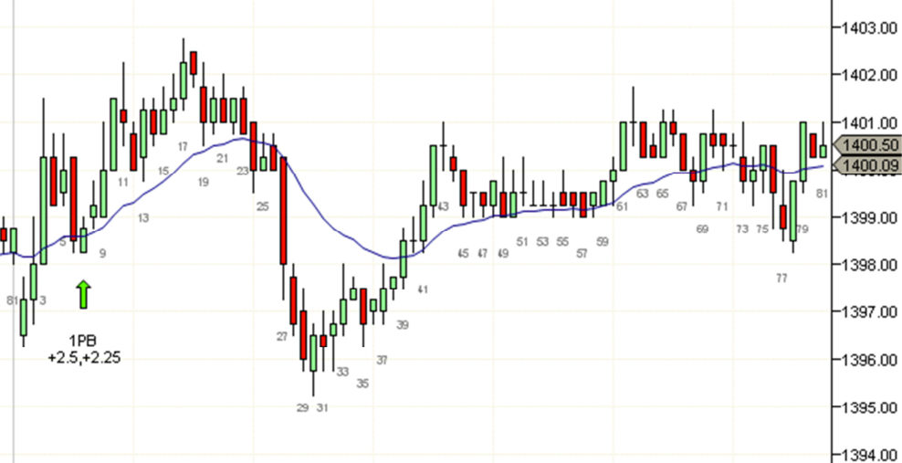

If you plot your winning days as green bars and losing days as red bars, you get a chart of your account size that looks similar to the price chart such as the one shown above. What makes a price chart go up and down also makes your trading account balance go up and down. When your trading is in an uptrend, you have mostly winning days with occasional losing days. The fewer and smaller your losing days, the faster your account grows. Therefore a winning trader's account shows a cumulative graph like that of b1-17.

A breakeven trader is likely to have alternating winning and losing days, todays gains lost the next day such as the range between b45-59. A losing trader is likely to lose a few times (b18-25) and go on tilt (b26-29) and then stop trading or change his style. Its obvious that for your account to grow, you need to have fewer and smaller losing days and larger and greater number of winning days. While you may not be able to control the number of winning days versus losing days in the beginning, you certainly have the power to control how large a losing day is. Limiting your maximum loss per day prevents days where you go on tilt, effectively reducing days that look like b27 to a small bear bar, meaning much faster recovery on days where price action is more suited to your style and skill level of trading.

The first thing a big losing trader needs to do is be a smaller losing trader and then change to a breakeven trader. If you take trades where your wins are twice as large as your losses, there are very few ways you can be a losing trader, for example by going on tilt and taking questionable trades. At worst you should be a breakeven trader with alternating winning and losing days. Once you are a breakeven trader, you can stay in the game indefinitely and hone your trading skills until you slowly start seeing profit. A breakeven trader can keep detailed logs regarding setups tried, stop sizes used, win rates, confidence in the read, etc. and narrow choices to a small set of setups that work for him. Continuous focus on this small set of setups over time will slowly flip these setups from net breakeven to net wins.

<!-- p.73 -->

## The hard road to consistency VII – No good signal bars

Monday, August 13, 2012 · p.73

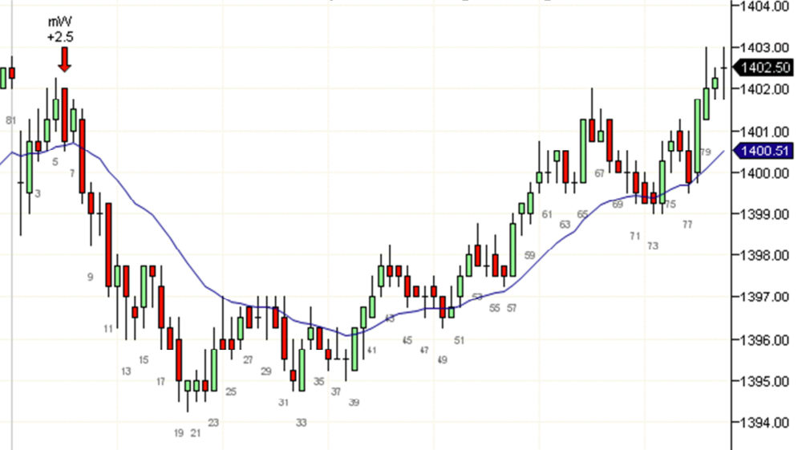

One of the most frustrating things for a trader is the lack of a good signal bar in a trend. A good signal bar is any signal bar with a shaved or 1t tail on the entry side and at least a 2t body. Ideally, the signal bar is neither too small or too large compared to recent bars.

I always recommend entering on good signal bars for a couple of reasons. When the market is not ready to trend your way, a strong signal bar is unlikely to trigger (b12, b66). This will protect you from many poor trades. A second important feature of good signal bars is that they are likely to respect a fixed stop (5t/6t for ES) for any given instrument.

However, on some days, there simply is no good signal bar in the direction of the trend (b10,16,20,38,50,73) but the reverse direction will often give great looking signal bars (b12,27,30,44,53,66,76).

This is typical of channel type price action. A trader who insists on great signal bars is likely to take very few trades on a channel day – which is not necessarily a bad thing, since channels are very hard to trade for most traders.

One way around this is to valuate the strengths of a signal by 3 criteria: location, pattern and signal bar. If location and pattern are strong, take a poor signal bar with-trend. For our purposes, location is a support such as HLC of prior day, ema, trendline, breakout point (as in BT) etc. Pattern is any two or three legged pullback.

Therefore, take any two or three legged pullback to a support even on a weak bar. This enables us to take b50, b56 long for example. Note that this can only be done if the signal bar is small and you can use a price action stop (beyond signal bar) rather than a fixed stop.

<!-- p.74 -->

## The hard road to consistency VIII - The tyranny of psychology

Friday, August 24, 2012 · p.74

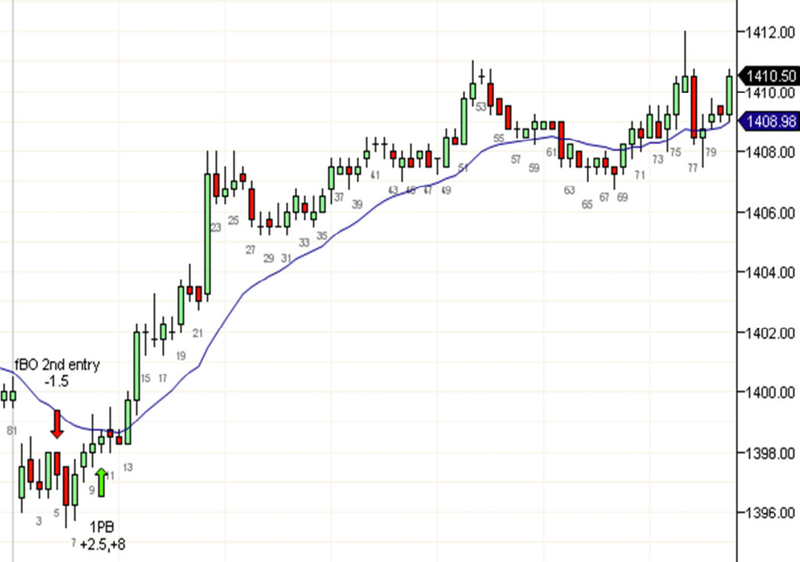

Many traders and other professionals in the trading world tell us that poor trading is mostly a psychological issue. While there's some truth in this statement, its incomplete and inaccurate. Otherwise, all psychologists should be fantastic traders.

The reality of trading is a bit more complicated. Obviously, you first need a system and understanding of the mechanics of trading. You need good risk management and trade management practices because having the best psychological state of mind is no substitute for stops.

I have searched far and wide for psychological articles regarding trading and found many books, articles and webinars, some with deep insight. However, most psychologists are not traders and their treatment of psychological issues is academic. Most of the material is generalized rather than actionable. For example: "Its more important to enhance well being than to reduce stress while trading" or "ask yourself before taking any action, am I doing whats in my best interest?"

<!-- p.75 -->

Most of these observations are not actionable or otherwise useful. Benefits of prescriptions not related to actual trading such as marking off your trading area, feng shui, etc. may provide marginal benefits but should be viewed as borderline superstitions.

The entire development of a trader is two stages:

1. Develop or learn a proven winning system 2. Strengthen the discipline to follow it

Developing a winning system is complicated, tedious and time consuming. You are usually better off finding a mentor and learn a proven system and adjust it to fit your personality.

Once you have a system, discipline is what enables you to follow it closely. What is discipline? Discipline is simply the ability to resist short-term temptations in favor of long-term goals. Discipline is actionable. Just follow your system's rules and nothing else!

Its most important to note that many systems work only during specific kinds of price action and you should not trade if preconditions are not met. For example, my system works very well on trending and large range days and works poorly on small range days. Fading systems work very well on trading range days and fail on trending days. Tick and bar scalpers can trade almost any price action but their win / trade is low and therefore they would need to lease a seat on the exchange to be profitable.

The ability to sit out during price action not fit for your system is discipline. The ability to stick to your stops and your daily stop loss is discipline. The ability to resist poor behavior (chasing trades, adding to losers, shorting all the way to the top, etc) are discipline.

When you chase a trade for example, you have overruled your judgement regarding passing up the preceding signal. You can never develop confidence in your market reading if you are easily swayed by a single bar. Accept that your system cannot detect every setup and at best you can catch a high percentage of moves. For example, do not buy b22 if you passed up b21 as a poor signal. Instead, add the observation to your list of things to investigate. Given enough samples, you will be able to pick on such moves eventually. You should have always anticipated a move, not react to it in urgency.

Over time, these observations will add to your system and make it richer and you will grow as a trader.

<!-- p.76 -->

## The hard road to consistency IX -- The need to re-learn lessons over and over

Monday, September 3, 2012 · p.76

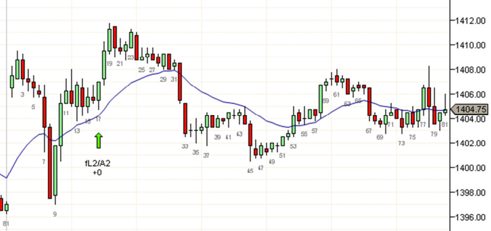

A trader should be expected to constantly having to learn and re-learn lessons and this is just part of learning to trade. Some of this is due to being emotionally reactive. A trader who sees a huge bar like b8 may be tempted to sell below it and is likely to be stopped out. Similarly, a trader may short a bull trend all the way to the top and blow up an account.

The first step is to understand what made you fail. Did you enter on fear of being left out instead of waiting for a setup? Are you deficient in some price action principles? (shorting all the way to the top = does not understand trends can go on indefinitely). Are your stops too tight? Are your targets too lofty? Do you enter too early? Do you love to pick tops and bottoms? Do you enter before a signal bar closes only to find that the good looking bull bar 30 seconds before bar close is now a bear bar? Do you enter on limit banking on your ability to predict reversals to the tick? Do you misread overlaps and chop as patterns?

Whatever your errors may be, you need to first identify them. The next step is to figure out the right way to trade those situations. Ignoring actual reversals and taking the 1st pullback after the successful reversal alone eliminates over half the errors above. Using proper trade management eliminates most of the others. If you can get here, you should be breakeven to slightly profitable on most days. But to get here, you need to practice over and over and only sustained effort can break your bad habits.

Days where price action exposes a large gap in your experience (counter-trend trading on trend days) are likely to still create large losing days and therefore, you should switch to SIM to collect data on these days. Identifying market structure responsible for huge losses and acting on them is a much harder task, but the fact that you switched to SIM after two losing trades enables you to stay in the game and figure out ways to identify and trade such exceptional days.

Even so, there would be rare days such as the flash-crash that could still give you some trouble. But you would be far more confident in your trading and welcome the opportunity to learn from exceptional events.

<!-- p.77 -->

## The hard road to consistency X - The elusiveness of discipline

Wednesday, September 5, 2012 · p.77

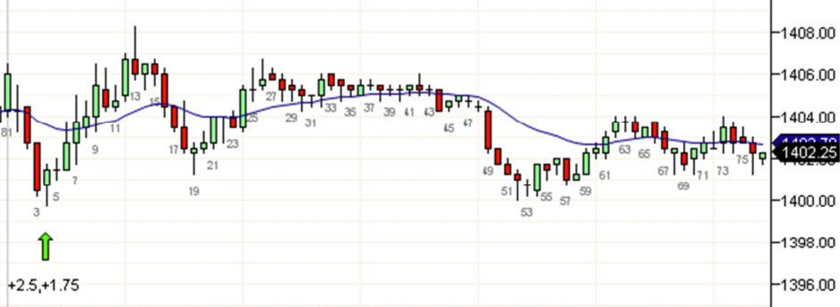

One of the great surprises in trading is that knowing what to do and the ability to do it are two unrelated things. Knowing what to do is knowledge, the ability to do it is skill. Its fairly easy to describe price action post-facto. Its simple to know to hold through a pullback or to exit on the next push if you aren't under pressure from holding a position.

Traders need to work on improving their trading to be close to the ideal post-facto decision as much as possible. For the most part, this is a constant struggle. Information is always imperfect and decisions are often hard to make correctly. The process of working on yourself to make the best possible decision given the information you have is what traders do constantly and may be simply called building discipline.

Discipline is more than just following your rules. Its also the ability to make correct decisions in the face of recent failures. Even the most seasoned traders would be impacted by successive failures or missed opportunities.

For example, a trader who was stopped out on a 1CBO buy above b14 may be hesitant to buy b19. A trader who missed the reversal at b13 may enter a larger size on b27, which he may see as a deep 2L PB. Every loss and missed opportunity are likely to cause some distress in the mind of even the most experienced traders eventually forcing more and more mistakes. Similarly, a well executed trade may give a heightened sense of confidence and invincibility, forcing rash behavior.

The resistance to such pressure is something that needs to be worked on and can only be developed with practice. The ability to see a trade setup independently of recent price action and your bout with the market is something you need to focus on constantly.

The guide to doing this is to evaluate the market movements as information and disregard trading as something you need to do. "I need to make 2 points today" or "I better take one more trade so I can end the day without a loss" are terrible advices.

Focus on the information you get from the market. Constantly work on keeping your evaluation as objective as possible. Ignore statements about the economy, foreign crises or anything else that other traders and the news are discussing. They have absolutely no weight compared to what the market tells you. Building discipline is like quitting smoking. Easy for those who don't have to do it but extremely hard for those who do need to do so. Constant slips of discipline and breaking your own rules are to be expected. Look at the few examples of success around you for inspiration and keep working at it. Know that even fractional improvements in discipline add up and build you up as a trader.

<!-- p.78 -->

## The Trader's Mind I - The Trading Contradiction

Saturday, October 27, 2012 · p.78

One of the real contradiction traders face is that the forces that attract people to trading are exactly what make them lose in trading.

For most traders, trading is attractive because they can:

- Make a lot of money
- Get rich quickly
- Have the best commute
- Make a good living trading only 2 hrs every day.
- Live anywhere
- No bosses or employees needed
- Be unaffected by economy, political shifts, natural disasters, etc.
- No hard assets, office space, etc needed.

Do you want to have an income in the top 10% working for yourself two hours from your home while you can browse the computer? Well, who wouldn't?

Lets step back a moment and see how someone outside the trading world may evaluate these criteria:

- Make a lot of money - greedy
- Get rich quickly - impatient
- You have the best commute - lazy
- Make a good living trading only 2 hrs every day. - super lazy
- Live anywhere - mercurial
- No bosses or employees needed - poor social skills
- Be unaffected by economy, political shifts, natural disasters, etc. - fearful
- No hard assets, office space, etc needed. - unattached.

As you can see, the worst developed personalities are naturally attracted to trading and its no wonder that 80% of traders lose everything they ever put into trading. To be successful, you need to fight the very qualities that brought you to trading in the first place. This is the contradiction that traders face on the very first day that they begin to trade.

This is how each of the above qualities impacts your trading:

- Greedy - Makes you stay in a winning trade too long until it becomes a loser.
- Impatient - Forces trades, enter too early on poor signals
- Lazy - does not work on improving one's understanding of the market and trading system.
- Mercurial - Emotional trading, revenge trading, chasing price with every turn.
- Poor social skills - Inability to learn from the experiences of other traders
- Fearful - Cant take trades, exit trades too early, unable to hold through a pullback
- Unattached - Jump from trading system to trading system whenever current system gives a bad day

I know of no single trader who started without at least half of these afflictions.

<!-- p.79 -->

Once you acknowledge that just choosing to be a trader automatically sets you up for failure, you have the opportunity to amend the very qualities that brought you to trading and modify yourself to be the very opposite and thus be successful.

## The Trader's Mind II - The Rush

Wednesday, October 31, 2012 · p.79

When a trader first begins trading, regardless of whether he is successful, he experiences a rush. A trader who has beginner's luck is likely to experience exhilaration of suddenly coming into money that he never imagined. This leads him to think trading is easy and make a conscious or unconscious commitment to trading as a profession.

The rush of trading is similar to the rush of gambling and other addictive behavior. This will lead him to make significant investments when he doesn't really comprehend the kind of risk for each of these investments. Even a cautious investor will risk more and move to riskier investments until failure hits.

This sort of behavior is automatic and part of human nature and most people find this understandable.

What may be unexpected is that intense emotional experiences can cause sustained changes in the person's behavior. The trader will crave the excitement and rush and continue to engage in trading just to feel the rush of trading. This will automatically put a trader on the track to some very bad habits.

For example, most new traders overtrade. A consistent winning trader may take four to ten trades a day while a new trader is likely to take 40. This is because the initial rush is driving the trading behavior. A second common habit is trading out of boredom. The trader's need for excitement and knowledge of what is possible drives him to seek that experience over and over again.

As a result, the trader does not even realize he has overtraded. He may have thought that he has taken 10 trades and be shocked to find that he has taken 40 trades. Once a trader introduces himself to the trading world in such a fashion, he already doomed to overtrade and go on tilt. Many traders blow their accounts in a few days and are shocked when it happens.

If you are in this stage, stop and ask yourself if you really want to trade to escape the drudgery of your life. Getting a motorcycle is far cheaper. Trading has to be a deliberate, carefully considered business decision. You need to think like the casino, not like the gambler.

<!-- p.80 -->

## The Trader's mind III - Eagerness and Dispair

Thursday, November 8, 2012 · p.80

Eventually, the trader settles in and realizes that trading is not easy but he can see patterns much more clearly. This is chop; this is a breakout and so on. However, in the eagerness to trade, the trader enters too early. The market stops out the trader and gives a better entry and resumes the move.

The trader may go into dispair at this point. An emotionally sensitive trader may have also reversed his position, thinking that the failure of a great setup is a very strong signal and may get stopped out a second time. If this happens enough times, the trader will find his confidence shaken and weak.

The good news is that the reason the market goes where you expect it to go is because you are now able to read the market. The bad news is that the human brain is extremely efficient at recognizing patterns and will alert you as soon as it can. This is a survival advantage. The earlier you spot a predator or prey, the better your chances of having a good meal and seeing another sunrise. Because of this, you will see the pattern a lot earlier and you eagerness will force you to act prematurely.

The right mental adjustment you need to do is to separate the pattern recognition from the action. Once a pattern is recognized, take it as directional advice and wait for a definitive signal. Some traders manage by using large stops. While this may work ok for many, I prefer precise entries since it maximizes my reward to risk (R multiple or RX). A larger RX in various kinds of price action is essential for me personally for trading large size with confidence.

Patience and the willingness to pass on a potential large move are essential for consistency. Once you are able to wait patiently and make a rational choice regarding any signal, you may take slightly lower probability trades if the RX is statistically very large such as 1PB in the first hour. Patience -- the ability to wait for the right setup depends on detachment -- the ability to pass on a trade and miss a large profit. Combined with discipline, the ability to follow your own rules by resisting short-term temptations to meet long term goals is key trading behaviors for success.

<!-- p.81 -->

## The Trader's mind IV - The bargain

Friday, November 9, 2012 · p.81

If the mad rush on black Friday's shopping is any lesson, humans love a bargain. Who doesn't like to get a $100 item for $80? That's 20% off! You can use the $20 to get something else.

Humans like bargains because it maximizes your purchasing power and is an inbuilt efficiency behavior. Efficiency is not limited to shopping. All things being equal, you should obviously choose a toaster that toasts quicker, a commute that is shorter and so on.

A person who can more efficiently spend his resources has higher survival ability and efficient use of our resources is therefore an inbuilt characteristic of humans.

When it comes to trading, a trader's efficient mind makes him want to buy low and sell high. Buying low is a good thing, unless you are in a down trend and the price is going further down. The bargain hunter forces the trader to enter into dangerous trading patterns such as:

- Bottom picking -- It fell to $3 from $10, what a deal! (All kinds of counter-trend trading)
- Adding on to a loser -- At $1 its 3 times cheaper, my profit will be 3x as big when it goes back to $10
- Entering before a signal bar forms -- its going to be a bull bar anyway, may as well buy now to save 3t

I have personally struggled for months to break these habits before I was successful. The key element is to realize that the price is not what's important, its the difference between the entry price and the exit price and the probability that your stop is not hit in between.

Focus on probability and nothing else. Measure probability of success by taking SIM trades before you take action. You need to have a modicum of discipline to do this. Focusing on probability will automatically shift your mind in the right direction.

<!-- p.82 -->

## The Trader's mind V - The anchor

Monday, November 12, 2012 · p.82

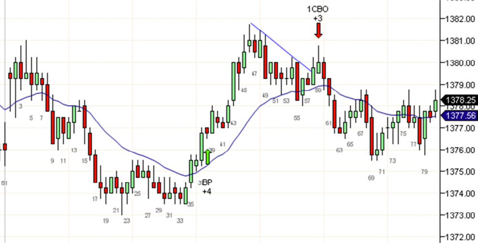

Humans do not actually have any ability to measure intrinsic value of any item. Practically all estimated values are fuzzily calculated from any claims of value the person may have encountered.

For example, if I show an object never seen before and ask what the value could be, people are likely to go blank. When pressed further, they may guess based on its size, weight, shininess and beauty. You may have grandparents that long for the good old days when coffee was 5 cents a cup. The entire notion of paying $5 at starbucks seems absurd to them. And to actually line up to pay that ridiculous amount is quite insane in their opinion. This because your grandpa's valuation circuitry is stuck in the 1950s. A similar thing happens to all of us on smaller timescales. This is called anchoring. When you see an item (say a pound of coffee) for sale at $5, you expect it to remain at $5. If suddenly it jumps to $10, you wont buy it right then, you wait for prices to come back down. But if the price remains at $10 for a few months, you are likely to give in and buy it for $10. Your mind is now anchored to the new price. Anchoring is subtly employed by stores all the time. The 50% sale tells us that the fancy hat at $200 is cheap because its real value is $400. We are so lucky to get it half-off. Why, its like we just earned $200. All we have to do to earn it is to spend $200. The store has subtly anchored the value of the article to $400 in your mind. If there was no sale, you wouldn't buy it because $200 would look expensive. This is why when JC Penny decided to forego sales in favor of everyday low prices, they took a huge loss. Nobody has any reason to buy because nothing looks cheap.

Anchoring is what makes markets stay in trading ranges (coffee should be $5) and trend ($10 is the new normal). Anchoring is also why pullbacks, especially deep pullbacks work very well (50% off sale). In fact, anchoring is why price action works very well in general. For a trader, this means that he can simply imagine he's either a seller of buyer of a pound of coffee or any other item that he is familiar with and correctly guess the behavior of the crowd most of the time. If the price gets too high or too low suddenly, there will be resistance and the price will pullback. However, if it stays there for a long enough duration, it can become the new normal. Deep and sharp pullbacks are more likely to continue and slow slides are likely to eventually break a trend for this very reason.

Once you can understand how price moves, you will find price action far easier to read and understand.

<!-- p.83 -->

## The Trader's mind VI - Conviction and doubt

Tuesday, November 13, 2012 · p.83

In the world outside trading, persistence and conviction are good traits. A persistent man is likely to solve the problem, get the date with the woman of his choice or get a job. We judge people's conviction in their positions by how well they can defend their own views. A telling example is the characterization of an election candidate as a flip-flopper resulting in their election loss. Holding fast a misinformed opinion is seen as a sign of strong ethos than switching position based on new evidence.

Your conviction or faith in your opinion endears you to your social clique. Conservatives feel comfortable hanging with other conservatives and greens with other greens. This piece of human nature is something we learn very young and use it to adopt various facets of our identity and stick to it lifelong.

I'm a Mets fan. I'm a libertarian. I'm against the death penalty and so on. The adoption of identity facets is an automatic social behavior and its function is primarily social.

When this behavior is carried to the trading world, it works against the trader from the very beginning. Trading is ultimately a non-social function as far as your account is concerned. Your losses are your own and forming an opinion and sticking to it in the face of hell or high water works against you every time.

A trader who is convinced the market has gone up too far may short the market and when it stops him out, try again on the next high and eventually short his way to the top. A seasoned trader often does not have an opinion as to the general strength or weaknesses of the market and follows the principle: "Trade what you see, not what you think."

To develop the ability to abandon a damaging view when you are wrong, adopt a rule where if you are wrong twice, you won't trade in the same direction until the price moves substantially away from the current location. Remember that you are always wrong and the market is always right.

The flip side of conviction is doubt. A trader who has a long series of losses (including consistent winning traders) are subject to losing confidence in their system, their ability to read the market and follow their own system. Such traders are subject to buyer's regret right after entering a trade, being shaken out on even the smallest pullback and tightening stops too early and thereby exiting on a loss just before the market makes a huge move in the direction of their trade.

Even when the market moves in their favor, they are unable to hold for many points. The very first pullback causes them great distress and forces them to exit at a small profit. Imagine seeing an open profit of four points and then panicing and exiting at +1 when the market pulls back. To build confidence and enable yourself to hold through pullbacks, always take a partial profit on the first push in your direction. Especially during the first hour, reversals can be abrupt and take out your stop and change your winning trade to a losing trade, which damages your confidence even more.

The partial profit enables you to hold your runner beyond the first pullback after which it gets easier since your swing stop moves into profit once the next swing point forms. Taking partial profits and sticking to your trade management rules builds confidence.

In general, you need to work on abandoning your precious opinions regarding the economy, news, the government or anything else you think may be impacting the market. These things may impact the market long-term but you have to realize that your opinions and identity relations are worthless for trading the market. You can only rely on what you see, your trade management rules and your discipline.

<!-- p.84 -->

## The Trader's Mind VII - The Chase

Wednesday, November 14, 2012 · p.84

So far we have seen inherent character issues of a trader that work very well in the outside world but sets up the trader for failure in the trading world. These are character issues built over years and are hard to shake. However, with careful planning of rules and discipline, a trader can avoid triggering them. For example, entering only on or after the breakout beyond the signal bar, we can prevent a trader's bargain hunting behavior from causing losses.

In this post we look at a complementary part of the trader's mind, his reactivity to the market. When a trader is watching the market and is expecting a big move up, he is disciplined and waits for a good signal or pattern. Bar after bar forms and the trader chooses to pass up since they do not meet his criteria. Suddenly out of the blue a large breakout bar occurs and the trader is caught unprepared, he simply cannot stand idly by as the market apparently is shooting up. He gives in and buys way above where he would have bought if the bar was acceptable. The market promptly stops him out in a deep intra bar pullback and either fails or resumes its march up.

This is a familiar scene many traders have played over and over. When the market moves in a way you did not expect and you feel forced to act, you are likely to make a mistake. Even if you are not stopped out, if the bar starts pulling back, your confidence will be weak because this is not a trade you have taken many times and is not a natural setup and management for you. Your mind is very vulnerable to making several mistakes at this point. One way to handle this is to realize that a weak breakout will fail and a strong breakout is likely to break into a trend and the first pullback in the trend is a far better entry.

Another classical reactivity is to a prolonged channel. You see a heavily overlapped or other poor setup in a channel and take a trade and are stopped out. You enter again and again, trying to get it right this time and lose several times before you can finally enter it just right. This leads to a phyrric victory, since your gain from the winning trade is unlikely to be larger than the accumulated losses. Traders often "persist" since they know that the direction is right, they just need to figure how to enter the channel correctly. Unless you want to fade counter-trend entry bars and scalp, the only reasonable way to enter a channel is to wait for a an attempted break of the channel or wait for the channel to break into a trend.

Realize that being right about direction is insufficient. Trading chatrooms are full of traders predicting an up or down move accurately, without being able to find a good place to enter with a tight stop. Entering with a wide stop may allow you to enter nearly anywhere but such trading carries the risk of large drawdowns and is unsuitable for new traders. Patience and the willingness to sit out until your setup appears is paramount to consistency.

In the world outside trading, persistence and chasing your dreams may be great characteristics. For trading, patience and discipline are far more important.

<!-- p.85 -->

## The Trader's mind VIII - The basics of emotions

Thursday, November 15, 2012 · p.85

What exactly are emotions and why do we feel them? Emotions are a form of self-communication. When our ancestors were primitive creatures facing an uncertain world, the mind would sense imminent danger and opportunity and activate the physical changes need for immediate action.

Obvious examples are when a predator is sensed, the body needs to quickly switch to fight-or-flight mode. Similarly, when food or mating opportunities are sighted, the mind becomes alert and eager.

Practically all your emotions and behavior stem from millions of years of survival adaptation. In the ancient world, reacting to good or bad situations immediately and appropriately meant life instead of death. Modern humans rarely face such challenges and have developed some degree of control over their emotions. Occasionally, the limbic system keeps escalating emotion and may be hard for you to control it.

Emotions are about expectancy and preparedness. Events that you are well aware are likely to happen and are prepared for do not cause strong emotional reaction. For example, if someone close to you dies suddenly, you may feel shock and dispair and cry for days. On the other hand, if they were terminally ill for a couple of years, their death may actually bring you closure and relief instead. Similarly, if you do not win the lottery, you don't really go into an emotional fit because you never expected to win. But when you win, you are delighted.

Events that you are unprepared for can cause your body to go into "just do something" mode. For example, countries where there are fire-prevention drills see systematic evacuation on a fire alarm while those without may see stampedes.

What does this mean to me as a trader? When you are watching the market, your mind is in a mode similar to the mind looking for mating opportunities. You'll probably hit on every potential trade till one works. Once you are in a trade, you watch anxiously for prey or potential danger. This compels you to exit trades early with no loss than to stand your ground and be stopped out. When you are stopped out, your mind acts like a parent gazelle whose calf has been attacked by wolves.. Your mind goes into "just do something" crisis mode. This is also called classic tilt mode, when a couple of losses force the trader to abandon all risk management and trade management rules and just try to get his money back.

Lets call these three emotions lust, fear and desperation. Of these desperation is the hardest to control. Your mind is in a state where its willing to go to great lengths and take severe risks to get back its precious young. You will do the most damage to your account in this state. Fear prevents you from following through with your trading plan and you will end up with small winners and large losers and you will be a net loser over the long term. Lust traps you into poor trade after poor trade and your account will bleed slowly from a thousand cuts.

So how do I address this in my trading plan? Once you understand the forces driving you, you can work on managing them. One way to manage this is to try to observe yourself and see how you act. The very act of observation will change the observed (the observer effect).

Desperation: When you are in desperation, you are unlikely to be able to observe yourself and think rationally. Having someone else observe you will often help with a reality check. This could be a mentor or trading buddy. Its important you disclose all your trades to your observer or it wont have the full effect. Your trading buddy can watch out for signs of poor emotional state and support you with feedback. Having a maximum trade count per day and a maximum loss limit will greatly protect your account from an untimely demise.

<!-- p.86 -->

Fear: More important than entering a trade is what you do after you enter. If the trade was ill-advised and caused by chasing an unexpected large bar, you should probably just exit at the best possible price. If the trade was a legitimate setup, you need to follow your trade management with discipline. Only discipline will help you overcome fear and develop confidence. Making trade management a mechanical affair with fixed stops and targets frees your mind of fear.

Lust: Before you enter a trade and before you have encountered a losing trade for the day, your mind is best prepared to make clear judgements. If you can read the market reasonably well, take every clear setup until you hit your daily loss limit. When starting out, your read of the market will naturally need a lot of improvement and losses are routine. What you do not want to do is to react to unexpected moves. Any trade you took on an expected move is far more likely to be successful than a trade taken on unexpected moves. Tame your desire to be part of the action. Only take well defined setups. Start with one setup and add more with time.

Naturally, these are not the only emotions you face. Greed, which makes you hold well beyond your expected target is another great killer. Hope, which persuades you to loosen your stops prevents you from developing any kind of discipline. All of these need to be understood and addressed.

In summary, realize that your emotions are telling you that an event occurred that you did not expect and were unprepared for. Learn from the event and incorporate it into your trading plan rather than reacting to it immediately by trading. Use understanding, preparation and discipline to tame your emotions.º

<!-- p.87 -->

## The Trader's Mind IX - The consistent trader

Friday, November 16, 2012 · p.87

The consistently profitable trader replaces eagerness and impatience with patience and caution. The simplest thing you can do psychologically for your account is to prevent getting into bad trades in the first place.

Never be eager to trade but when your setup shows up, act without hesitation. This seems counter-intuitive, but this is how many predators work. You may have seen shows on discovery channel where a camouflaged fish stays without moving until a prey comes close enough and then it jumps suddenly and eats it. That's basically what the trader tries to be: patient but alert. With some exceptions, its usually better to miss a trade than to take a trade and be stopped out.

Once in a trade, a winning trader simply follows fixed trade management rules. For example, price either fills a fixed target or stops the trader out. There should be little discretion here, since your judgement, which was strongest before you got into a trade is now at its weakest. Every tick against a weak trader makes him panic and want to get out for breakeven or tiny profit. Every tick in his favor makes him push the target further out. The consistent trader does neither. Its not that he is any superior, its just that he uses mathematics to ensure that his odds of reaching a profit are higher than his odds of being stopped out and over time, he accumulates winnings regardless of what happens on this individual trade. The individual trade does not matter and losses are part of trading. Do not try to use your judgement now, its at its weakest. Use well tested trade management rules.

After a win, a poor trader is jubilant and will trade larger size and weaker setups (trading the house money). After a losing trade he is in dispair and curiously may do the exact same thing: trade larger and weaker setups to "make the money back." This is a well travelled shortcut to a blown account.

A consistent trader does no such thing. He simply tries to go back to pre-trade mode where he is patient yet alert.

A winning trader also knows when to stop for the day. Its utterly important not to have large losing days and too many losing trades in a day. Your mind cannot after a point control your emotions because you may not even realize you are in a state of desperation. A winning trader stops trading at a well defined daily loss limit.

Eventually, the winning days become larger than the losing days and a trader becomes profitable. For some traders this is a sudden change but for most its gradual and occurs with improvement in their trading skill.

<!-- p.88 -->

## The Trader's Mind X - The transition to success

Sunday, November 18, 2012 · p.88

So now that you understand the differences in psychological makeup of a new trader versus a successful trader, let's see how to transition your mind from the former to the latter.

Replace lust with caution and skepticism. The very first step is to limit the number of trades you take. When traders say that overtrading is a very common trading error, thats only half-correct. Many of the ills of trading poorly show up as overtrading. By limiting the number of trades you can make, you prevent the amount of damage you can do to your account in one sitting. But more important, your mind needs to shift from getting into this move to getting into the biggest move of the day. Since there are only one or two big moves in the first couple of hours and perhaps another in the last hour and half, your approach switches to looking for quality trades and large swing trades. What this means for your account is that despite a low win rate, you can still be a profitable trader if your wins are at least twice as large as your losses. Your goal as a new trader should be to exclusively focus on large moves. If you are unsure the move is going to be large, its ok not to take the trade. Don't worry if you stand aside and the move ends up being big. That is part of trading. Learn to let it go. Similarly, you will be stopped out a couple of times and the very next move will be large (or not). That's ok. You are in the process of learning to judge exactly where the large move is. With experience it will come naturally (but not without sufficient screen time).

Replace fear with discipline. Once your discrimination and judgement get better, your larger wins and smaller losses will make you a better selector of trades however, your trade management needs to be extremely disciplined. Note that as long as you are trading in a trend (HH and HL or LL and LH) with volatility (decent size swings and bars) and near support (TL/ema/swingpoint), your chances of success should be slightly greater than 50% at the very least. Add good pattern and signal bar and your win rate should be around 60% or even more. Your decision to enter the trade is all the processing your mind needs to make. Once you set a stop and target, do not change them. Your mind is vulnerable when in a trade and susceptible to errors of judgement. You should simply let the math work for you and let the market either fill your target or take your stop out. If your setups are truly 60%, you will accumulate winnings in the long run.

Replace desperation with acceptance. Many professionally successful people who come to trading believe rightly that perseverance is a virtue and its their dogged persistence that made them successful. Realize that in trading, perseverance is inapplicable and desperation is probably what you will slip into. Learn to accept that today is a losing day and stop trading. Take a trading buddy's help if you wish. Disclose your losing trades and let them tell you to stop. Soon, you will be able to stop on your own. Similarly, do not be overconfident on successive wins and end up taking untested setups. Many traders have their large losing days right after their large winning days. If you are susceptible to these, just take a day off or only take one trade the next day after a big winning or losing day, win or lose.

Refine your method continuously. Over time, you can make slight changes to the above rules and fine tune your setups. For example, you should always keep track of the success rate of your individual setups and your average win or loss per setup. That way, passing a lower expectancy setup or taking a good setup with a questionable signal bar become easier. Always keep your trading goals in mind when you refine your methods. For example, you should prefer to refine your system for higher probability than to get a better price since adding a contract to a higher probability trade is a better way to make more money than getting an extra couple of ticks on existing size. Over time, your approach and mental state will shift to that of a successful trader. However, this is not easy and will be a constant struggle. Even after you have been winning for a while, its possible to have slip ups and lapse into your old habits. You should always be on guard and protect your mind from harmful habits as long as you are a trader.

---

[← Previous](06-price-action-basics.md) · [Contents](00-目录.md) · [Next →](08-2010-12.md)
