[← Previous](07-trading-psychology.md) · [Contents](00-目录.md) · [Next →](09-2011-01.md)

# December 2010

Original pages 90–110

<!-- p.90 -->

## A hard Wedge reversal

Thursday, December 9, 2010 · p.90

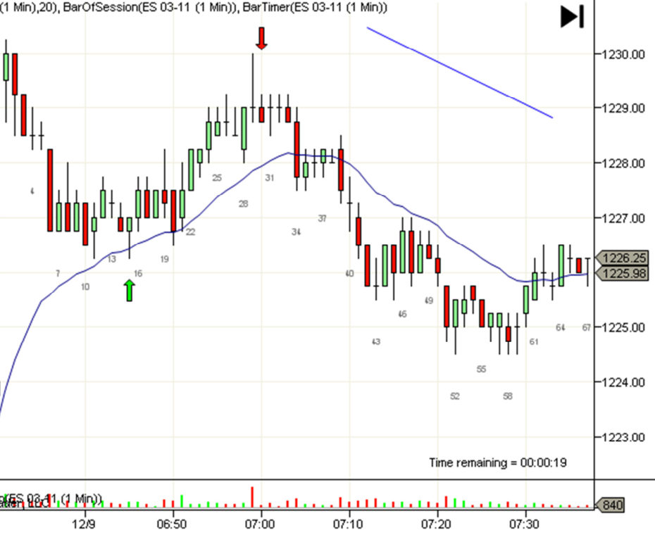

Due to the large gap on the open, I could trade the 1 minute chart on the open. The opening range (b1 to b8) had a failed Breakout with double bottom on b15.

From there the price moved up three pushes to a wedge (W) at b30. This short could be held until the W reversal further in the day.

<!-- p.91 -->

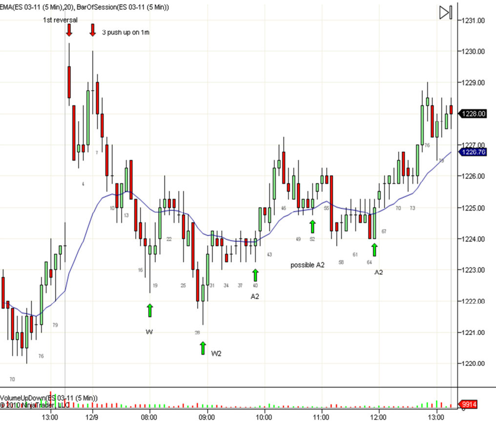

A reversal bar above a large gap is always a good trade for a scalp at least. Today, your scalp would have worked but your swing portion would be stopped out for breakeven. On days like this, many traders miss a good runner unless they re-enter on the 1 minute chart, which provided a W entry. Even on the 5 minute chart, a micro-W was clear due to the three spikes up.

The double bottom up down at b11,12 is a possible reversal, however with 5 bear bars against the buyer, it ended up working like a trading range. A short above which proved successful.

b18 technically was a W, but its signal and entry bars closed weak. This led to a further A2 short off b24 on a less than desirable looking signal bars.

b29 was a very strong wedge and was a great potential swing trade. So were the A2s at b40 and b65.

Shorting b22 and b55 proved profitable today, however in general these trades are dangerous. There was possibly a W reversal before b22 and b55 could have been a trap for one more leg up. These trades can be taken with lighter size only but leaving out lesser probability trades is the best option in the long run.

<!-- p.92 -->

## Slow down on Soft trend days

Friday, December 10, 2010 · p.92

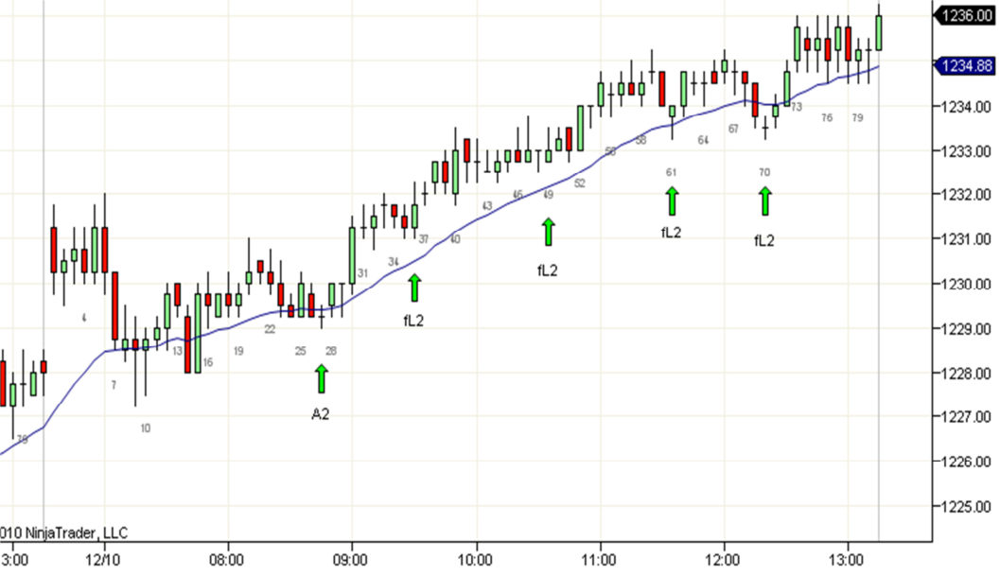

Some days, such as 2010-09-09 are hard trend days. Signals are clear and well trades usually succeed with trend or counter-trend. In contrast a soft trend day such as 2010-09-10, operates much slower with lots of overlapping bars, trapping traders in both directions.

Except the clear A2 at b27, the rest were all terrible looking signals for longs. Nearly every short signal failed and counter-trend traders who shorted all the way to the top lost terribly. Faders do well on days with overlapping bars with lots of tail. Today was possibly a great day to enter on limit on failed L2.

<!-- p.93 -->

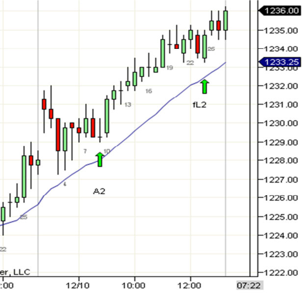

Another way to get around overlapping days is to slow down and move to a 15m chart. The trading style that would get you chopped up on a day like this would work great on a slower chart.

Today gave an A2 long at b9 and a failed L2 at b24. As with slower chart, you do have fewer signals, but they do tend to work better. As you can see, there was not a single bar that dipped below its previous bar all the way to bar 21.

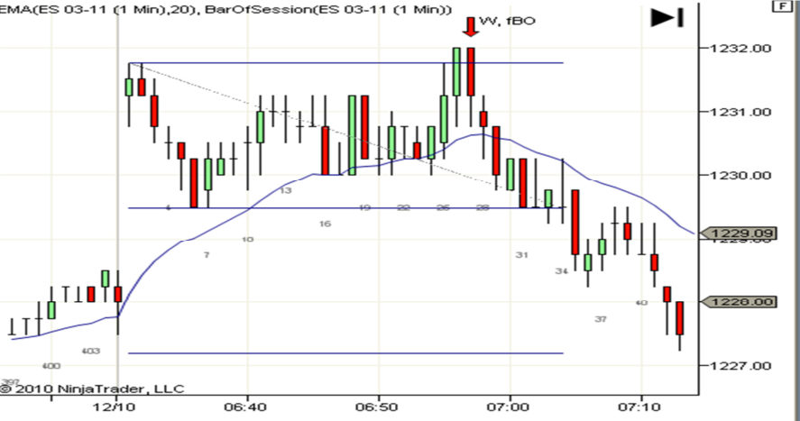

Just as you slow down in a slow market, you should speed up in a fast market. The opening hour is usually fast moving and slowing it down on a 1 minute chart will reveal some interesting trades. The opening bars created a trading range and b27 broke above it and failed, giving a failed Break Out (fBO) signal. This move went to a measured move of the size of the range.

<!-- p.94 -->

## Trading range day

Monday, December 13, 2010 · p.94

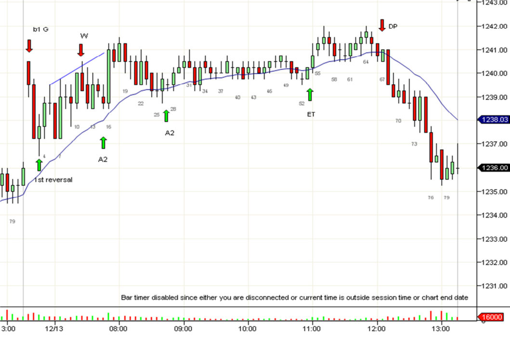

What looked like a promising trend day after strong signal and entry bars turned to a small range day pretty quickly. The first reversal often looks terrible, but will turn around and test the high of the day. b16 broke above the HOD and gave a possible breakout failure (BF) on bar 25, however there was very little follow through on the lunch hour. The triangle consolidation broke into an expanding triangle on b52, which led to a second attempt to break above the HOD. When the second attempt failed, the market quickly dropped.

Generally TR failures give a measured move of the range size, so we should expect the price to hit 1228 or so overnight or tomorrow.

<!-- p.95 -->

## FOMC day

Tuesday, December 14, 2010 · p.95

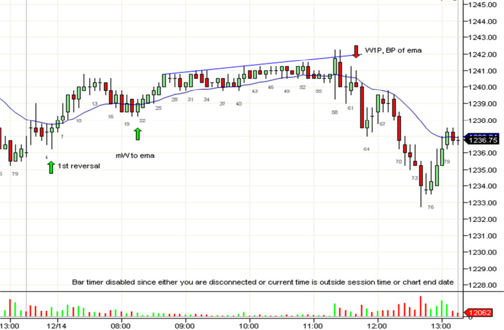

Today opened weak, with a doji bar at the ema. Given the strong move late into yesterday, there was some chance of a second leg down. However, b1 had false breakouts on both sides and gave a first reversal signal with micro-wedge (mW) on b5. This was probably the best trade of the AM.

The next pullback was a mW to the ema ending in a down up signal bar on b21. This was good for a scalp. Although this did eventually give +2, anyone who had a swing stop probably exited when the market went against them the second time on b33.

There usually is an overshoot for a tight trading range (TTR) to reverse. A rising TTR is usually a wedge, and the FOMC announcement triggered an overshoot of the Trend Channel Line (TCL) on b58.

b62 was a very strong signal (A2, W1P, BP of ema) and everyone took it. The breakeven stop did not get hit and the trade could be held till the overshoot/climax of b74.

By all counts, today's FOMC action was tame at least for the first bar on news. The TTR made breakout trading of the FOMC announcement impractical since there wasn't sufficient energy in the market. A TTR breakout usually fails, so it would be a bad idea to breakout trade the Fed.

Repeated selling late in the day is usually a bad sign for the price and this may mean some down days in the near future.

<!-- p.96 -->

## Traps

Wednesday, December 15, 2010 · p.96

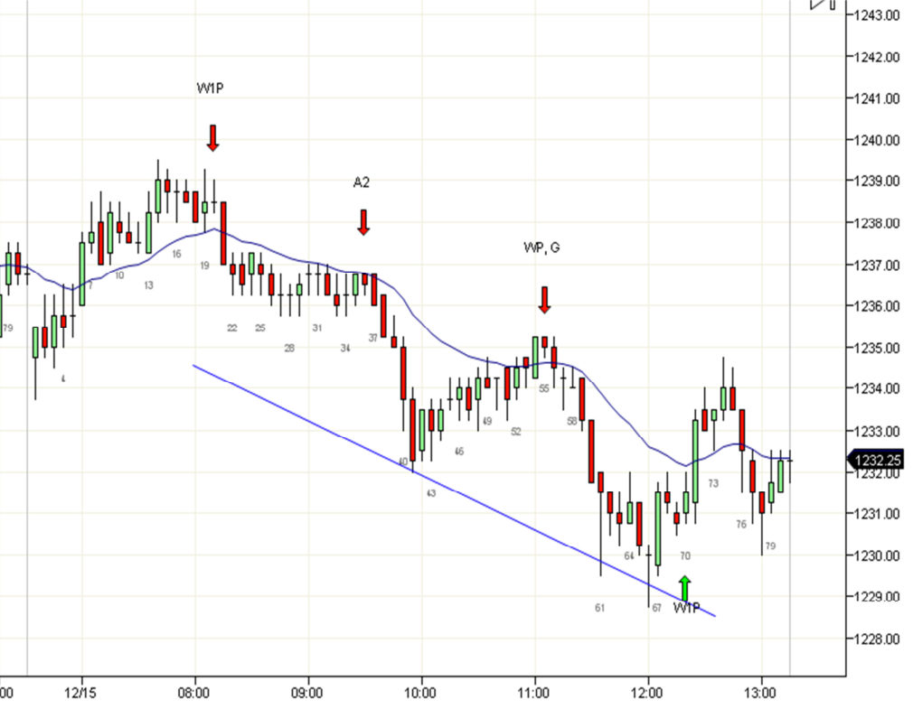

Today was a rather tough day but those who took the weak signals did well. b1 was a bullish reversal bar inside yesterdays range with not much of a gap to speak of and therefore does not qualify to be a first reversal. Many such bars end up failing quickly and taking out its low (such as 2010-12-06). However b2,3 trapped buyers and sellers and a buy above b3 was probably OK.

b6 was a breakout bar and there was a good chance the price would go to a MM before it reversed. That's why neither the L1 at b8 nor L2 at b10 were good shorts. b12 could be interpreted as an A2 long and there could be possibly 2 legs up but there were not. b15 was a poor W signal followed by a terrible looking W1P at b19. the W1P broke out to the down side and a tight trading range gave an A2 short. This was the easiest trade of the day. After taking out the low of yesterday, there was a wedge pullback (WP) that gave a gap (G) inside bar short signal. b49 was a possible A2 short and some traders probably got stopped out on b54 before it resumed down. Market gave a scalp to b44 longs before it turned down.

An overshoot at b61 and buying convinced most shorts to get out below it on b66. The scalp on b66 worked, but its a riskier trade since there is not much time left for a swing. The first pullback after Wedge (W1P) at b70 is the better trade.

<!-- p.97 -->

Traps:

1. Today there were a few traps. b1 buyers got a terrible entry bar and were stopped out if they moved their stops below the entry bar. Lesson: do not move your stop to breakeven until the price has moved 5t. 2. b17 shorts who thought they were shorting L2 were stopped out on b19. There was no price action entry on b16 since it did not go below outer bar b14. There is no good L1 until traders have entered. b20 is the correct L2 entry (below b19) 3. 49 was a possible L2. However when the body is inside the previous body, its a variation of an inside bar and the entry would be below b48.

## The expanding triangle open

Thursday, December 16, 2010 · p.97

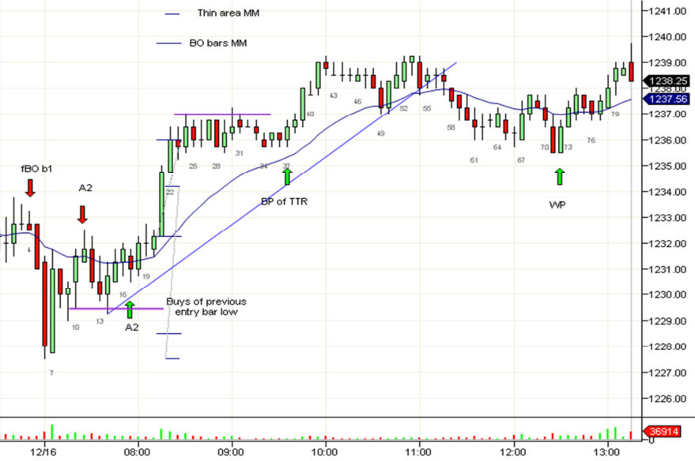

When the market opens near yesterday's close with a marginal bar such as today's doji, the market will try to break out both sides until it encounters a hard reversal. Todays open was a tick away from yesterday and it was very likely the breakout of the doji would fail and is tradeable if it gives a decent entry. The ii bar on b4 with a shaved close was a good entry. The news related down up reversal was 4 points tall and this means there is some risk that it will turn into a trading range. Two legs up provided an A2 short at b11. However, the entry bar b10 closed strong, so there was some chance they would buy its low (purple line). A shallower pullback at b17 was an A2 long and very good setup. The market shot up +4 and turned into a TTR. b30 broke above the TTR and gave a BP at b36 ii. Since there was no overshoot, b42 would be a poor short for W. b53 gave a double top but it was a marginal short since there was no demonstration of bear strength. A Double top pullback (DP) ii short at b56 was also marginal but could be taken with an option to reverse above the DT. b63 was a marginal G and b66 was a marginal G2 entry since they forced a buy above and mid flag. The down up bars at b72 after three pushes down was a good signal. Technically, this was the first bull bar below the ema that triggered a long position. Price took out the high of day (HOD) and retraced all of yesterday's down move.

<!-- p.98 -->

## Trading breakouts and tight trading ranges

Friday, December 17, 2010 · p.98

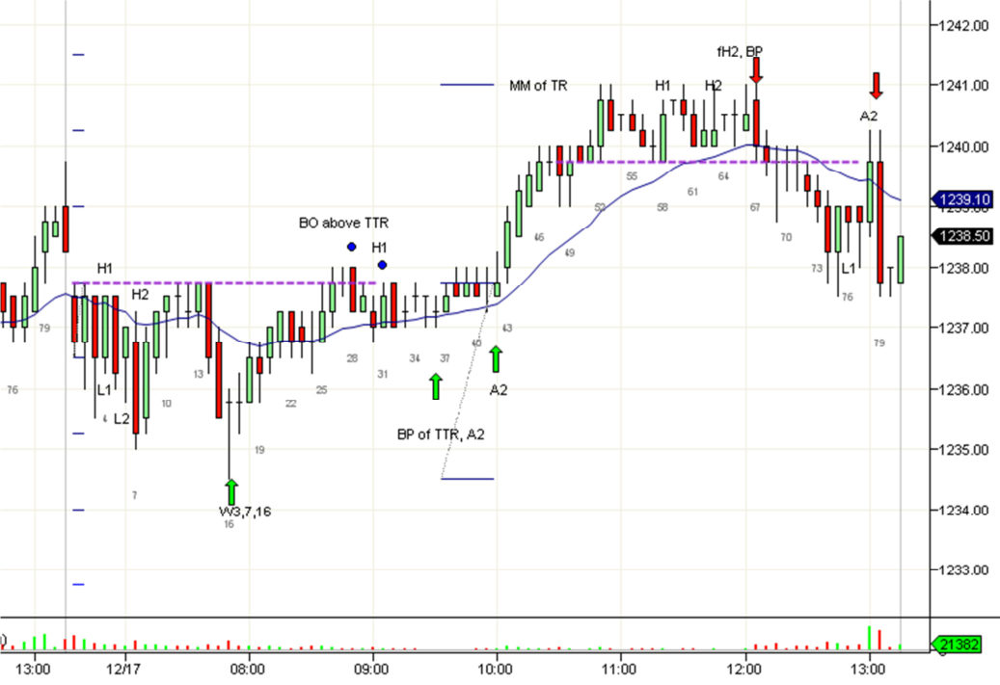

For a long time, trading Breakouts (BO) and tight trading ranges (TTR) had eluded me. Trading these requires quite a bit of practice, but when you get it right, you can catch a good run with low risk. The trick to trading breakouts is to trade only breakout pullbacks and occasionally, failed break outs (fBO). The safest trades are breakouts that try to reverse twice and fail. These have the added benefit of being a 2 legged pullback after a breakout and are therefore a high probability trade.

Another thing to note is the context in which the breakout is taking place. Did the market try to sell off a couple of times and fail? In that case, the breakout is likely to succeed. Note that almost every breakout today failed. Today opened with a bear trend bar below the ema. Many traders short below this, assuming there is a good chance of a bear trend from first bar, but when yesterday's close is within reach, its unlikely to go down before making at least two attempts to close it. The breakout of b1 failed but could not go above b1 and stop out the b1 traders. Just as b2 was a failed break below b1, b3 was a failed break below b2 and so on.

b4 was an H1 variant and set up an L1. b7 gave both an H2 and an L2. With two legs down and any b1 traders still in play would have exited with their scalp profit so limit traders may have bought here. The breakout attempt at b11 and b13 failed twice and setup a fBO short on an ii setup. The third push down at b16 gave a weak wedge (W) setup and ended up with a weak entry bar and this meant it did not break into a runaway trend. There was a breakout attempt above the range at b26, which tried to fail twice on b28 and then on b32. b31 triggered the H1 but b34 did not trigger the H2 since it did not go above b32. b36 set up an H2, a failed L2 and a 2 legged breakout pullback. This was the strongest signal all day. A break above the range often goes up to a measured move(MM) as it did today. At the MM of 1241, it tried to break out twice at b58 and b63 and failed giving a fBO entry below b67.

<!-- p.99 -->

## Trend Reversal

Monday, December 20, 2010 · p.99

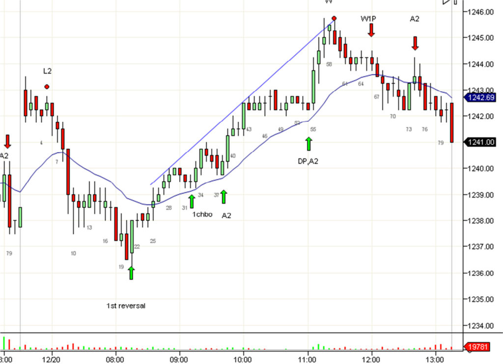

When a trend bar tries to close a medium sized gap (larger than one recent bar but smaller than a recent day), there is a good chance the opening trend will reverse sometime in the first hour. This is because buyers would not buy above a small gap, expecting it to close. When it does close, its possible they will move in.

Today's b5 setup a 2 legged pullback after a trend bar and gave a short entry near the bottom of the flag. Conservative traders should pass this since we could see a fBO of the range and have the market move up. However, with the close of yesterday within range in the first hour, there was a good chance it would work. The first reversal at b21 was possibly a W4,19,21. A 2 or 3 tick doji after a strong close usually works like a W1P and is generally good for a swing trade.A first channel breakout at b31 was bought, but the buyers could not scalp out nor were they stopped out, making b38 an A2 long. This was the second swingable entry today.

A DP at b54 broke above a poor signal bar and overshot a trendchannel line breaking above the high of the day. This breakout failed in a W, giving a W1P and A2 on the way down.

<!-- p.100 -->

## The glacier

Tuesday, December 21, 2010 · p.100

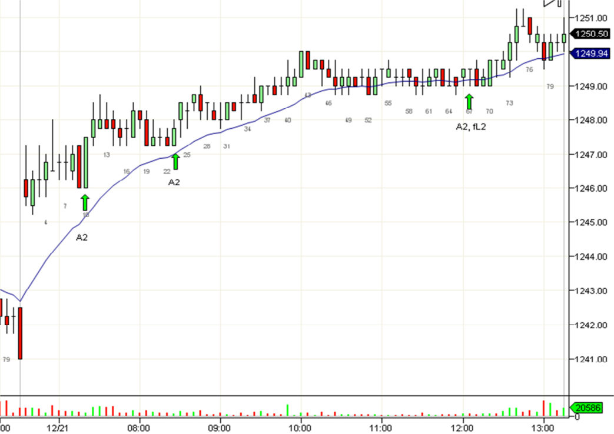

A glacier grinds on very slowly, destroying anything that stands in its way. Occasionally it seems to recede a bit, but before you know, it continues with the grind. For some reason there are only bullish glaciers. Bears tend to fall quickly, which makes traders love shorting more than going long.

How do you recognize a glacier early in the day? A failed L2 is a good indication. A shaved bear bar that does not tick below is another good indication. One and two tick pullbacks below previous bars is a very strong indication. Today, all these signs made themselves known within the first hour. The first failed L2 gave the first strong buy signal of the day. A very obvious 2 legged pullback near the ema on b22 was probably the easiest to read signal of the day. The hardest signal to read was the failed L2 and then A2 at b67. When there are overlapping and inside bars, every inside bar is a possible signal. If it does trigger, it becomes an L or H. Basically b55 triggered the first H1 and b59 and b65 triggered an L1 and an L2. b68 triggered an H2 and almost failed. Reading H and L into TTRs is very error-prone. Its simpler to look at them in terms of breakouts and failed breakouts. b55 attempted a first breakout. b58 and b65 were two attempts to fail the breakout. A failed breakout should result in a measured move down, so both the failures were unsuccessful. At this point the next breakout is a high probability candidate for success. The next breakout occurred at b68 and given the overlap, a pullback was to be expected.

b75 inside bar was a very strong exit signal and a good place to close out a slow and steady day. A glacier is seen by some as buying by institutions and as distribution by others. Often two or three days after a glacier there is a down day.

<!-- p.101 -->

## Another soft trend/glacier day

Wednesday, December 22, 2010 · p.101

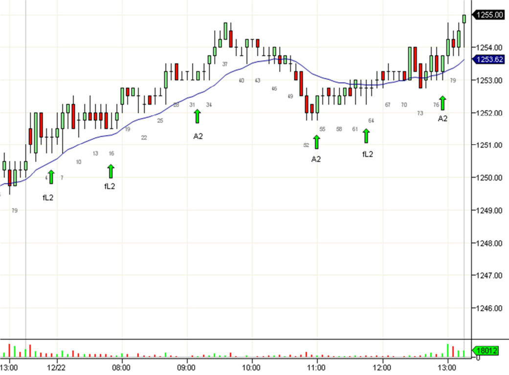

Today's open very close to close of yesterday should have cautioned traders about a possible repeat grind day. The failed 1t L1 on bar 2 and L2 on bar 4 confirmed today's price action prognosis. Every failed L2 could be bought. b32 was a rare A2 long but it was a horizontal flag signaling a possible final flag. The possible W and W1P short entries at bars b38 and b42 were dangerous and are not to be taken given the terrible risk/reward ratio.A deep pullback to b52 provided the first deep pullback of the day and was the easiest trade of the day. Aggressive traders probably also bought the b76 A2 into the close.

All in all, today was a long only day with bars that were only a few ticks long. Buying on limit expecting an L2 to fail worked every time today except the obvious b43.

<!-- p.102 -->

## Small doji day

Thursday, December 23, 2010 · p.102

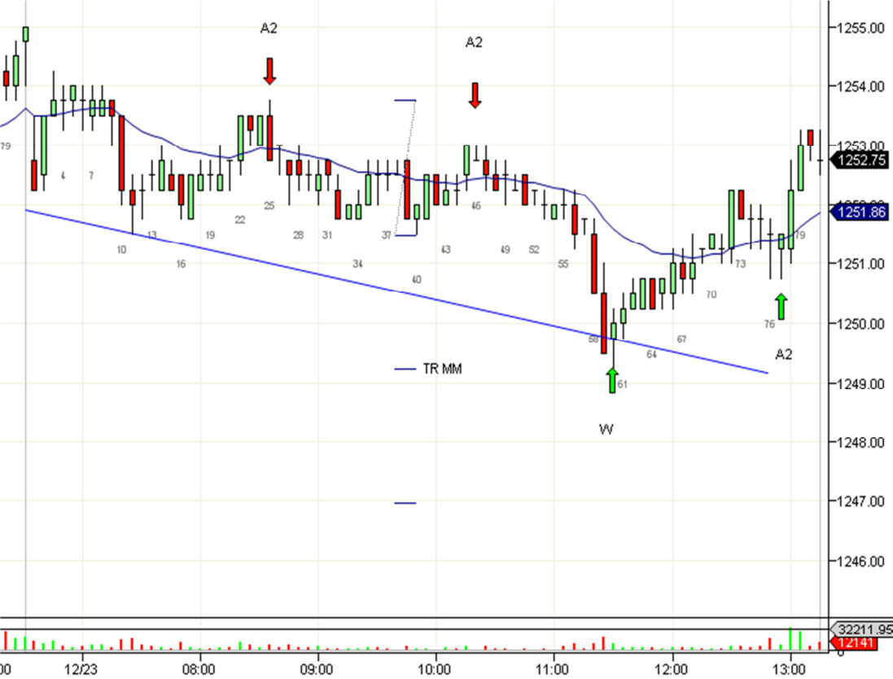

Today closed at its open after moving up and down, making a doji or plus sign on the daily chart. The first two bars were were an obvious trading range, so the market would have to hold above it and give a two legged pullback for a buy or the more likely scenario of the breakout failing. The breakout did fail and it tested the other end of the range. At this point the market tried to fail it twice, once on the move upto bar14 and then again on the move upto bar 22. At this point, it was a two legged pullback in a bear move near the ema and therefore a legitimate short signal. However this was close to lunchtime and there was a very good chance there wouldn't be any real move for a couple of hours. It was a good decision to wait for the next signal.

The market moved three pushes down to double bottom at b40, indicating a possible reversal or move up. However, it could not give a successful double bottom pullback and thus broke below the double bottom which normally results in a measured move down the size of the range, which the price went to the tick.At this point, we also had a TCL overshoot, so even tho the reversal bar was weak, it was probably an acceptable buy. The first pullback after the wedge (W1P) forced a buy at the top of a flag, but it was probably ok, since the flag was only two ticks long. Cautious traders could stay out and enter on the A2 and double bottom at ema on b77.

<!-- p.103 -->

## The importance of catching the early move

Monday, December 27, 2010 · p.103

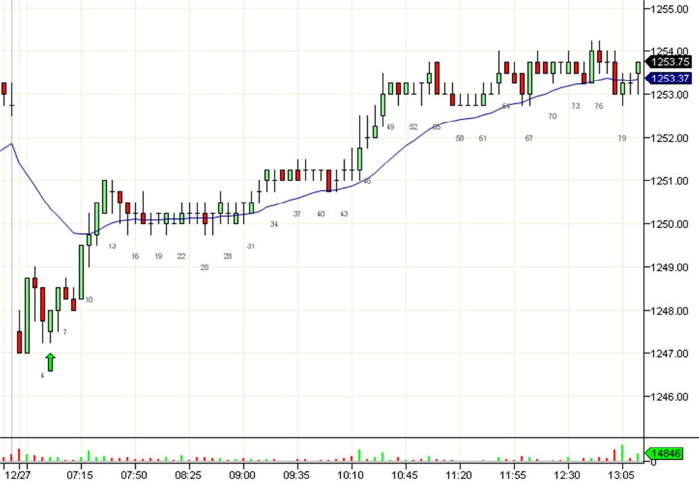

Often, the first good signal is the only one that is worth taking for a swing. Learning to take the first signal correctly will also start you off in the black, allowing you to pass on anything less than great trades. Today was a triangle open. Expanding triangle opens are more common, triangle opens are less so. Today presented exactly one entry that I would take, a second entry long. A second entry is any entry that gives an entry at the same price as the previous entry, provided the previous entry is valid and the entry bar closes strong. For example, todays b2 went above a reversal bar (a bullish signal) and closed strong. The bar was a 7t shaved bar and there was a good chance a pullback could be bought for a swing. b5 presented a stronger signal bar compared to b1 (shaved bull bar with 1t tail). b1 and b2 made up the opening range and b3 was a failed breakout above it. b5 effectively gave a breakout pullback entry. The weak 1t pullback below b7 and its failure was two attempts to fail the breakout and buying above b8 was a high probability trade regardless of it being a bear bar. The price moved quickly to a measured move (MM) to twice the opening range as expected. The rest of the day gave only poor entries and while I could read them, they were not worth the risk:reward ratio. While horizontal TTR usually breaks in the direction of the previous trend, b3 and b12 had already made two pushes up and there was the risk that the push up would fail before it could reach a scalp.

Rest of the moves came off one or two tick doji bars and are often unreliable. A cautious trader who missed b5 or b8 would probably not take any other trades today. A possible exception is b42 double bottom at the ema and BT of the TTR, but even that should be avoided on a day that does not promise to be a large range day.

<!-- p.104 -->

## The first reversal

Tuesday, December 28, 2010 · p.104

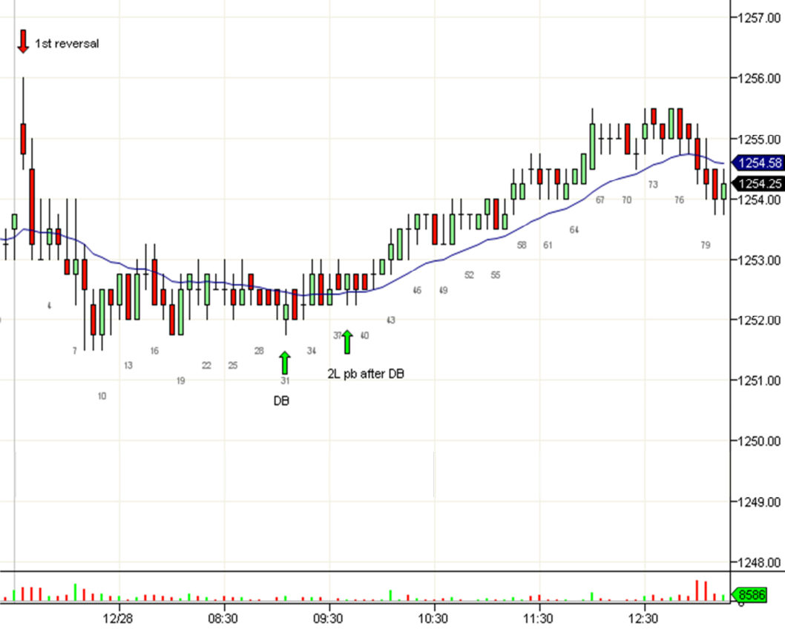

When there is a large gap (larger than a recent day) and the first bar forms a reversal bar trying to reverse the gap, it can be considered a first reversal. Today was only marginally a first reversal since the gap was relatively small in terms of points and the bar closed just above the high of yesterday. When there is some doubt as to whether a reversal bar is worth taking, it sometimes helps to see the first five bars of a 1 minute chart.

<!-- p.105 -->

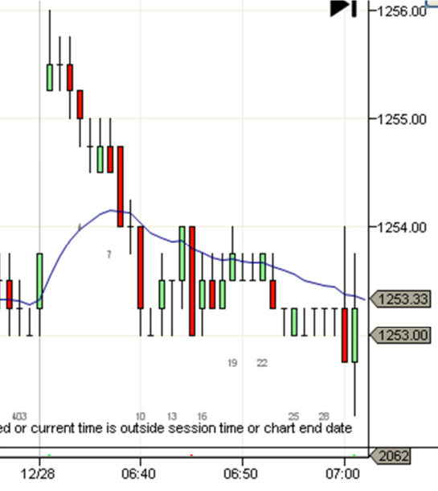

As you can see from the chart, there was no bull strength during the first 5 1 minute bars. No bars went above the previous bar or closed up strong. Such a first bar is worth shorting.

On 2010-12-21, we had a similar bar but shorts below it ended up in a one tick failure (1tf). Yes, the bar overlapped the previous day just a bit, but that by itself is not a show stopper.

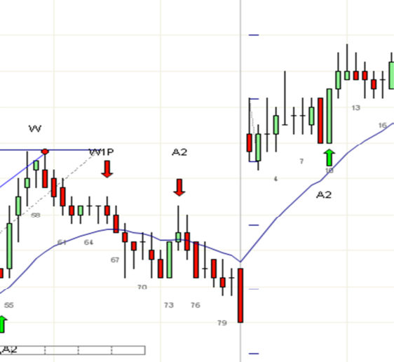

Zooming into a 1m chart shows us how the bar was different. The first three minutes had strong bull action and bulls simply saw the bear bars as a buying opportunity at a better price.

<!-- p.106 -->

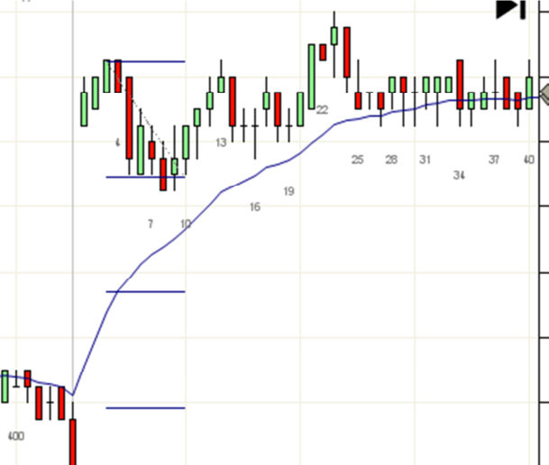

Especially on a possibly small range day, its important to get in early on a possible AM move. First reversals are an important part of this trading principle.

<!-- p.107 -->

## Opening range Breakout and pullback

Wednesday, December 29, 2010 · p.107

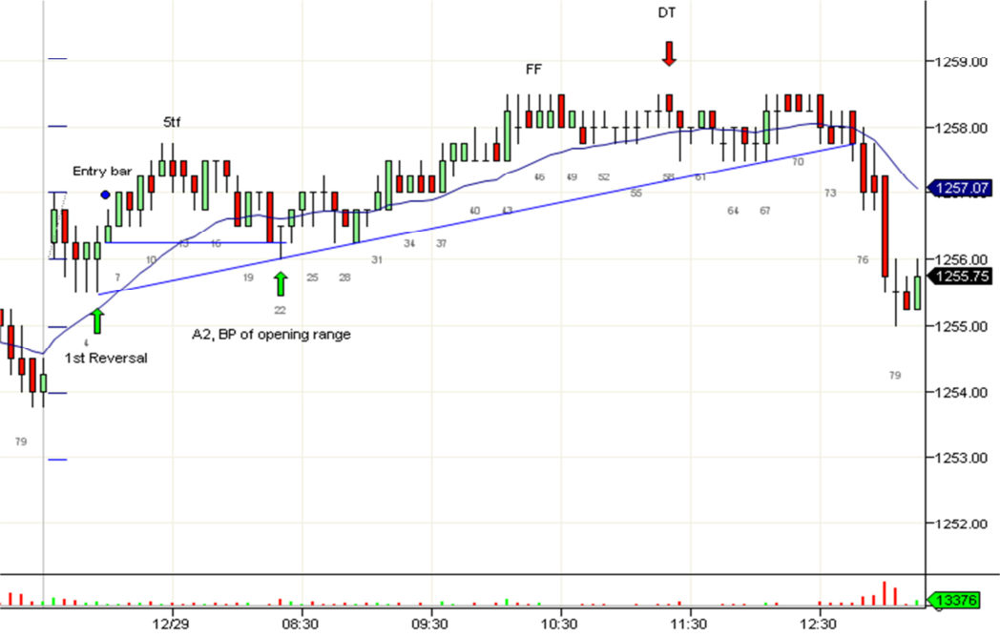

Often the first bar alone acts as an opening range. The first breakout beyond the bar fails and the price attempts to break the other end. If the other end closes strong, i.e., closes above the range and gives two or three bars that do not reverse the breakout, there is a very strong chance that the eventual pullback can be traded for a swing position to the measured move of the size of the range, especially if the pullback is two legged.

Today was a small range version of the scenario. Bar1's low was breached but turned into a first reversal. The correct entry was above b3, which did not trigger but we did get an entry above b5. When there is a large overlap among the reversal bars, often the price comes down to take out the stop below the entry bar as it did today on b22. When the distance between the low of the entry bar and the prior swing low is small, this is a good limit entry with a stop below the previous swing low. Regardless, the pullback into b22 was a 2 legged pullback to a higher low and brought in buyers.

The price moved three legs to a final flag (FF) at b43 to 49. A double top at b58 was a failed attempt to break above the FF. The market ended up making a second attempt to breakout of the range and failed to below the low of the day.

<!-- p.108 -->

## Trend respawn

p.108

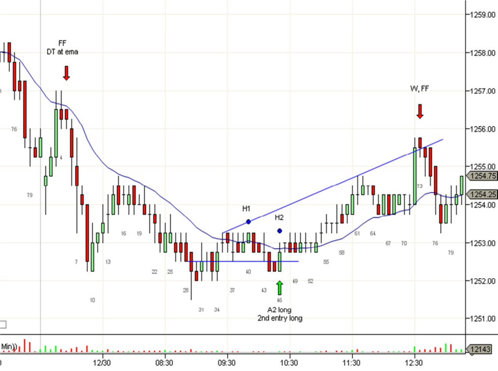

When the final bars of a day constitute a sharp move, i.e., a sharp trend begins very late in the day and the day closes without breaking a trend line, there is a good chance that the next will show some follow through.

Additionally, if the next day opens with a little or no gap, you may be able to trade the early bars like a continuation of yesterday's move.

Seen from this context, the move to b4 was a 2 legged pullback in a bear trend. The ii signal bar at the ema was a very good setup for a short.

The move from b10 to b15 broke the trend line and we ended up testing the low of the previous move. A trendline break without an overshoot usually ends in a trading range and today the range was between b10 low and b15 high. b29 was also a failed breakout of this range.

After this, bar 46 gave an A2 long. It was also the second 2 legged higher low after 34. A failed breakout usually tries to breakout of the other side of the range, so a 2 point move was to be expected. The breakout succeeded on the third push up, which reversed as a Wedge.

<!-- p.109 -->

## Trend breaks and trend births

Friday, December 31, 2010 · p.109

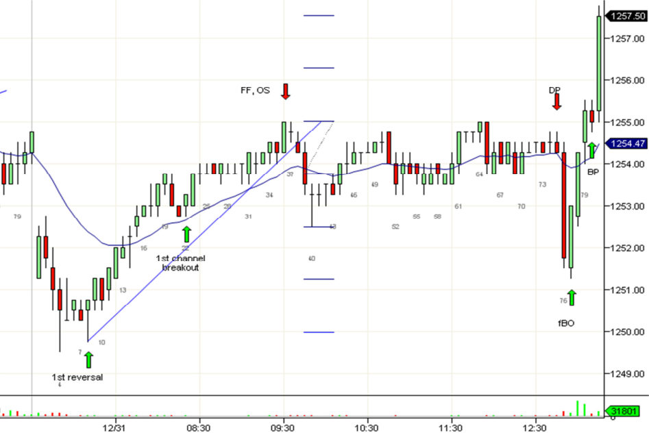

The first thing a price action trader learns is that the market is either trending or in a trading range. If its in a trend, take only with trend trades. If its in a trading range, fade breakouts, i.e., take counter-trend trades.

Of course, many traders find themselves in trouble when they find they are trying to trade with trend but the trend has already ended or they are trying to fade a breakout into a new trend. Therefore, its vital to know when a trend has ended and when a trend is erupting from a trading range. Many trend terminations are fairly obvious because they end in Wedges or overshoots and then reverse. However, often trends end in a consolidation. The definitive sign a trend has ended is if the trend line is broken. A broken trendline is clear and obvious if the price moves below the previous swing low in a one legged move as it did today from b37 to b40. The fact that it did so after a failed breakout from a horizontal final flag adds credibility to the end of trend. At this point the market is in a trading range bounded by the recent swing high of b37 and the swing low of b40. Any move to the edges of this range may be faded. If the range size is small as it was today, there could be insufficient room to give a scalp profit using price action entries. Limit traders can fade the first approach with confidence knowing that the first attempt is likely to fail and they have a reasonable stop a tick or two above the recent swing points. Trends usually birth after a breakout failure of one of the bounds of the range. Today, we got two attempts to break above the range at b51 and b65 and this gave a DP (double top/bottom and pullback) at b75. DPs are often trend generators and work best in the direction of the previous trend. Today's move had a breakout below the range but it failed at a measured move of half the trading range. The failure resulted in a breakout attempt on the opposite side of the range and gave a breakout pullback long entry (essentially a pause bar on b80). A failed breakout on one end of the trading range usually gives a breakout pullback on the other side of the range esp if the test on the second end is a one legged move. These are also very strong trend generators.

<!-- p.110 -->

---

[← Previous](07-trading-psychology.md) · [Contents](00-目录.md) · [Next →](09-2011-01.md)
