[← Previous](08-2010-12.md) · [Contents](00-目录.md) · [Next →](10-2011-02.md)

# January 2011

Original pages 112–133

<!-- p.112 -->

## A2 as a reversible trade

Monday, January 3, 2011 · p.112

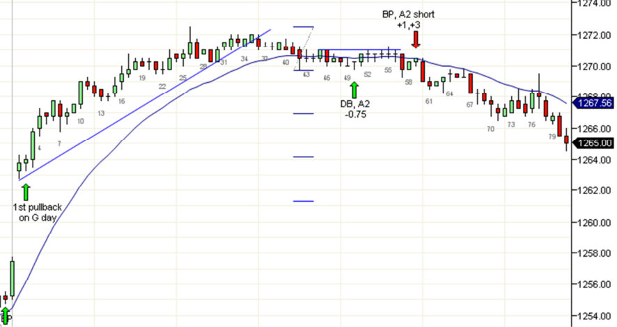

Today was a very clear trend from first bar, with the second bar giving an inside bar buy signal. Buyers above bar 1 could hold until a trendline break or trend channel line overshoot or other obvious trend termination signals.

The first sign came today at b19 ii possible final flag signal. However, it failed to trigger on b20 which led to a 2 legged breakout of the flag that terminated in a possible climax bar on b26 (large bar size with large volume after an extended run). This in turn gave another ii signal. This one did trigger and most longs would have gotten out by now.

Next we got a double top at b36 that did not trigger, followed by a double top pullback at b40. Many days when you have a trend from the first bar, various reversal signals will simply create a shallow pullback only to race up again. since we did not have a clear trendline break yet, none of these short signals are tradeable. The trendline broke decisively when the price dropped below b29 at b42. From this point, we had an H1 at b45 followed by a weak doji A2 signal bar at b50. On many strong trend days, the signal bars are terrible, so you need to take them anyway. Especially A2 as a continuation trade on a strong trend day is usually a good trade.

However, if the A2 fails, i.e, goes below the entry or signal bars, it often turns into an A2 short signal. Today the move from b42 low to b55 high was a 2 legged move that was a clear A2 short setup the moment it went above the high of b45. Until price fell below b50, the A2 long has not yet failed. Once it did fail at b57, failing the double bottom, its a clear short. The breakout pullback at b59 was the best entry for the shorts. b77 was another possible A2 and second entry short (same entry as b74, with strong b74 signal and b75 entry bars). Since this was near end of session, most traders would choose to exit their shorts rather than re-enter into new positions.

The breakout below the trading range should go to at least the size of the range. Today it did and despite a strong 3 point reaction at the measured move, it continued further down.

In summary, A2s are good trades to take since when they fail, they are usually reversible to the other side.

<!-- p.113 -->

## Trend from first bar

Tuesday, January 4, 2011 · p.113

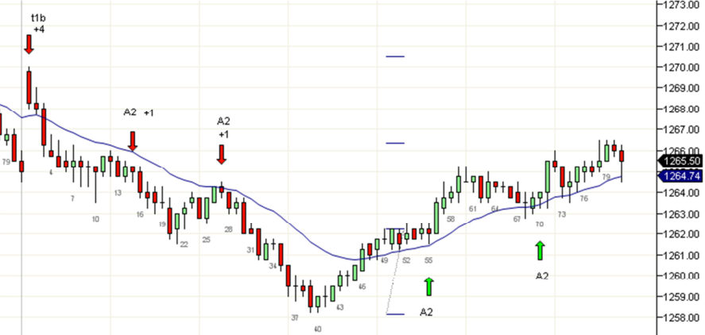

A great trend bar as the first bar of the day is not to be missed, since it is likely to go quite a long way. An ideal first trend bar is around two points long with no more than 1t tail on each end. 3 points or longer and it could act as a trading range causing a rush to buy below it or sell above it. A couple of ticks smaller and the next bar may trigger and reverse the move before giving a scalp profit, thus establishing a trading range. One way to ensure you are entering correctly is to wait for a small pullback before or after the bar triggers. This ensures buyers had a chance to reverse the trend bar and failed.

You should be able to hold the trade until you start seeing bars with tails as we saw around bar 7. When this happens, its usually prudent to exit and re-enter on the next signal. Today, we got an A2 short at b15. Normally, its a bad idea to sell below a flag, but b14 was a failed H2, which should give at least 2 pushes down.

When the price hit the ema in a clear 2 legged move at b27, it gave a very clear A2 signal that was good for a swing. b34 was a possible final flag that triggered and reversed at b40.

The one legged move to close above ema and clear break of trendline meant there was no more short trades left in the move. An A2 entry at b55 and b70 gave long trades reversing quite a bit of the bear move.

<!-- p.114 -->

## First pullbacks and breakout tests

Wednesday, January 5, 2011 · p.114

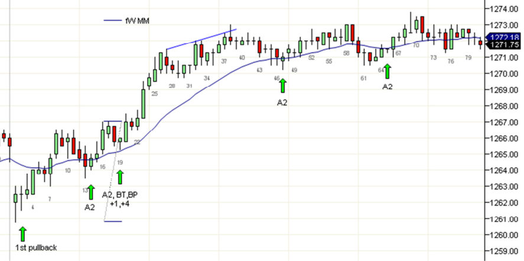

Often buying above the first bar is risky. A weak reversal bar near the ema on a small gap such as today often breaks above and fails. This is especially true if the body is small and the entire bar is within yesterday's range as it was today.

Since its important to catch a big move early on, its best to pass on the first bar if its weak and wait for a strong breakout and enter on the first pullback. Sometimes the second bar forms an inside bar of the same color as the first bar. This can serve as the first pullback. A doji such as today is acceptable but weaker.

Cautious traders can pass on b2 and buy above b6. Limit buyers can place a limit order at the original entry once the low of a bar closes above it (b5). This would trigger today at the low of b7. There is some risk associated with buying limit early in the day since a first reversal can be severe. The best entry therefore is the first A2 at b14. Although technically the entry was above b13, practically all traders would have bought above b14 since it was a small bull bar at ema.

b19 was a breakout test that stopped a tick above the previous signal. When a breakout tests happens to have its low exactly at the ema, its a very good sign to add on a bit more if the bar is not too large.

Once the move hit +10 points from the low, most traders are looking to get out and all trades are essentially scalps. Hence the quality of trades drop therefore you should skip any questionable trade.

<!-- p.115 -->

## The gapless open

Thursday, January 6, 2011 · p.115

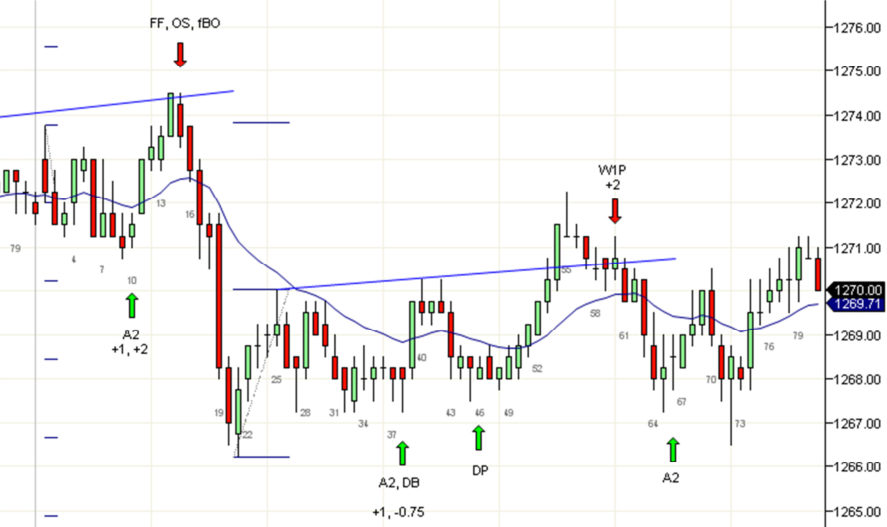

Getting on the correct side of the initial move is hardest when the first bar has a small or no gap from yesterday's last bar but the first bar closes strong. Generally, its best to treat it as a trading range and fade its breakouts. The next best option is to wait for a breakout and get in with trend on the first pullback.

These days generally become trading ranges or trending trading ranges but sometimes do break into trend from first bar but the odds are with a trading range.

Given todays first two strong bars, its not surprising many traders went with shorting the first pullback at b5. However, b3 was a possible first reversal and the entry bar b6 could have easily given a higher low and a long entry so not trading it was the correct option.

A second attempt to break below failed at b9 and b10 presented a long entry at the bottom of the trading range. This was an easy long trade to take. However sometimes the breakout on the other side does not give a breakout pullback and simply fails spectacularly. The signs were there but hard to read. There was a 2 bar final flag at b13 and an overshoot from yesterday's trendline and the bear strength earlier. However I missed the big move and probably so did others. As expected the market stopped at a measured move from the size of the trading range and gave a reversal bar or a down up two bar reversal. The entry bar was strong and due to the overlap, once could expect the low of the entry bar to be bought. This was tested 3 times at b27,32 and 38.

The A2 and DB at b38 and the DP at b46 were fairly easy to read. The W move to b55 gave a doji candle, so it was ok to pass it on and enter below the W1P at b60.

<!-- p.116 -->

## Trading with trend

Friday, January 7, 2011 · p.116

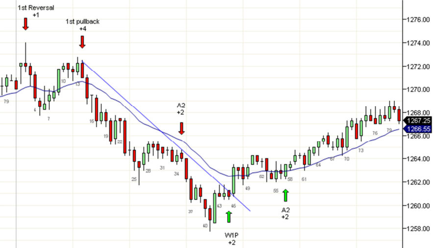

An unfortunate consequence of focusing on oscillators, pivots and support and resistance levels is that the trader is forced to focus on counter-trend trading, which is usually low probability. The second consequence is that the trader typically focuses on small moves, netting +1 or +2 points when they should be focusing on getting a large slice of the move.

The third consequence of trading this way is it forces you to use limit orders, which are inherently counter-trend. While consistent traders can use limit orders quite successfully, for most traders, they are counter productive since it forces you to focus on getting the best price rather than focusing on the best probability trades that can be held for the maximum points.

Until the trader can begin to read trend breakouts and reversals perfectly, its best to let a trend establish itself and then take every continuation trade. For example, today's bar 2 was a possible first reversal and even if you didn't take it, you could easily take the first pullback at b14, which is usually the best swing entry for the day. If you missed it, you could still get in at the first A2 at b35.

By b46, the trendline is broken after the W at b41, you would no longer be looking at short trades. You could easily take the first A2 at b57.

In addition to A2, W1P (the first pullback after a W reversal) and the first reversal of the day are very good trades once you can read them correctly.

<!-- p.117 -->

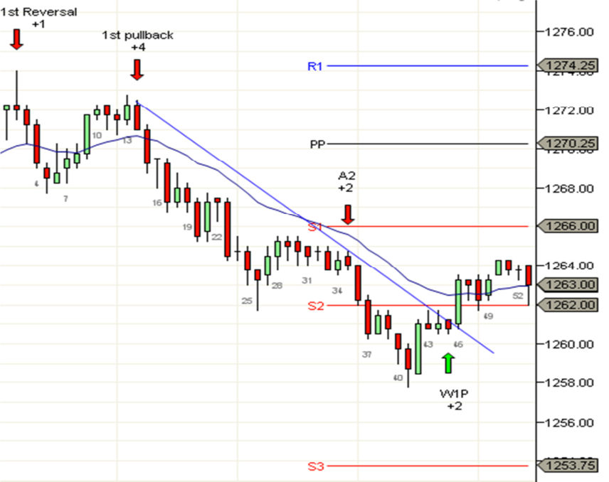

Traders who focused on buying the low of what they expected to be a major reversal due to it being a pivot or fibonacci or other proprietary support or resistance zone possibly made a couple of points or lost a couple of points.

<!-- p.118 -->

## Large open bar is a trading range.

Monday, January 10, 2011 · p.118

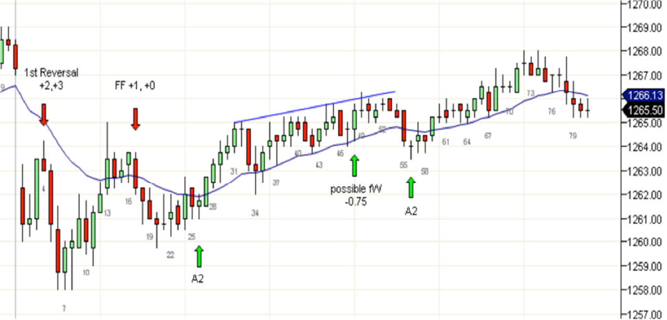

Today opened with a medium sized gap but the opening bar was large. When the first bar is too large, it can act as a trading range. So its breakout on both sides can be faded on a good signal bar. Todays first breakout was above and gave the biggest move of the day. A rare outside-inside-outside reversal at b6,7,8 turned the price around and presented the first pullback at b11. However, given the entry was at the top of the flag, it was understandable to pass it up.

An exhaustion bar at b13 followed by an ii short turned around and presented an A2 long at b26. However this was hard to read and given the prior final flag and dojis was a low probability entry.

The first channel break at b35 was a risky forced a buy at the top of the range. Given the double top at 32, it was best to pass it up.

The market moved above the double top at b38 and tried to fail twice at b42 and b46. This was also a 3 push move in a channel and would act as a wedge. If this triggered and failed, there was a chance of a measured move of 5 points up. However, the price moved against the buyers twice, and an exit below b53 was apropos. b56 presented an A2 long and this was the last reasonable trade of the day. b73/74 was a possible FF or DT but given the mood of the day, its best to pass up such trades near the end of the trading session.

<!-- p.119 -->

## Buying limits

Tuesday, January 11, 2011 · p.119

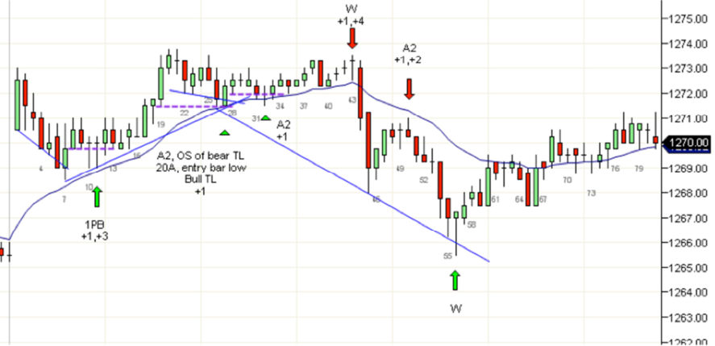

I rarely buy limit, because I have no idea where the price will turn if at all and where to place a stop. Also, buying mid bar has the risk that the bar may end up quite differently than you imagined. Sometimes however, there are compelling reasons to enter on limit. The principal reason for me is a hard value at which I believe buyers will come in. This allows me to enter at a precise price as opposed to eyeballing the chart for an entry and secondly, a precise stop, making it quite like entering on stops above a signal bar. Today presented some of those occasions. The first condition for me to enter on limit is that there must be an overshoot. This will ensure that even if I'm wrong and the bar moves 4 or 5 ticks against me, there is some chance the market will withdraw and allow me to exit at breakeven. The second condition is a price point below me where buyers will be compelled to enter for example because its low of a major reversal or first touch of ema after 20 bars. The third condition is that the sell from which the move originated must be from a poor signal.

For example, the market presented a first reversal at b7 but forced a buy above a big flag forcing a stop of over 2 points. Although the entry bar b8 was strong, there was a good chance its low would be taken out. when b9 presented a poor sell signal (again due to overlap), an order to buy the low of the entry bar b8 becomes viable. The overshoot of b7 and the ema and b7 low are compelling reasons to buy and becomes a reasonable alternative to buying above the first pullback above b11. Note that when you buy above b11, the first pullback is real but when you were buying the low of b8, the first pullback only exists in your hopes. A second example is buying a tick above the low of b19 when the market made a 2 legged approach to the ema at b26. Here there were a host of reasons to buy such as: the overshoot of the bear pullback trendline, more than 20 gap bars from a rising ema, a bull trend line, etc. Even conservative traders probably bought this on limit. The low of b19 is likely to be bought, given the move was so strong and the low or a tick above it is a good entry price.

For those who passed up the limit trade, the technical entry forced a buy above b26 but some traders would buy above b27 and the entry bar b28 was likely to fail. The overlap and breakout below bull bar b30 was likely to fail, so a limit buy at b28 low with stop below b27 was a good entry. Today there was a late trend breakout to the downside that occurred after 4 failed attempts to breakout. The L4 below b42 was a typical double trap. b43 ticked below b42 trapping bears in, ticked above trapping them out and trapping bulls in and then broke below making b43 both a W and W1P and a DT and a DP. There were 2 large bars down followed by an A2 and due to the size of b45, there was some chance of buying below it, so an exit at the low of b45 was probably warranted.

<!-- p.120 -->

## First reversal vs first pullback vs first channel breakout

Wednesday, January 12, 2011 · p.120

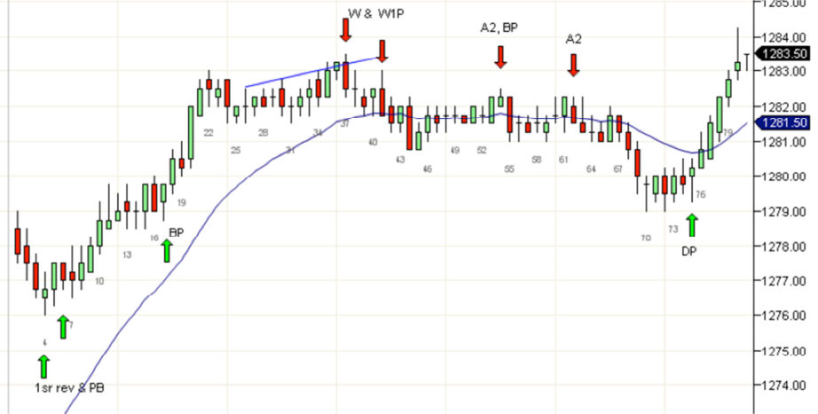

Day after day I post charts where the first reversal and pullback can be entered and held for a swing often till the end of the day. The first pullback is especially good for a profitable swing for at least the AM session. However, how do know which bar is the first reversal? Is it possible that b4 and b5 represent a first pullback that will continue to move to the bear side? Could it be a first channel breakout that has a high chance of resuming its down move?

Sometimes a reversal bar is obvious. Its almost the same size as previous bars and looks like a well formed reversal bar with at most one tick entry side tail (or 2t if bar is large). However many other days its not quite obvious. For example in today's chart is bar 4 not an obvious first reversal. However, any reversal that gives an entry beyond the first bar after giving a one point scalp should be taken. A second reversal can be taken if it is an obvious breakout failure of the other end of the first bar. If not, wait for a possible breakout pullback or hang on to your swing portion.

One strategy is not to take a questionable first reversal bar, but to then take the first pullback in either direction provided its a good setup. A trap in one direction such as b7 today also sets up an entry in the opposite direction. A good first reversal that ticks below a signal bar is usually good for another leg down (in essence turning into a first pullback trade) so reverse below the signal or even the entry bar. Typically if the first couple of bars are larger than 2 points (when average range is 10 points) or if the first two bars are up down or down up bars there is a good chance it will act as a trading range and you should look for either a failed breakout or breakout pullback when your first reversal tests the other extreme of the range as we saw yesterday.

<!-- p.121 -->

## The various kinds of reversals

Thursday, January 13, 2011 · p.121

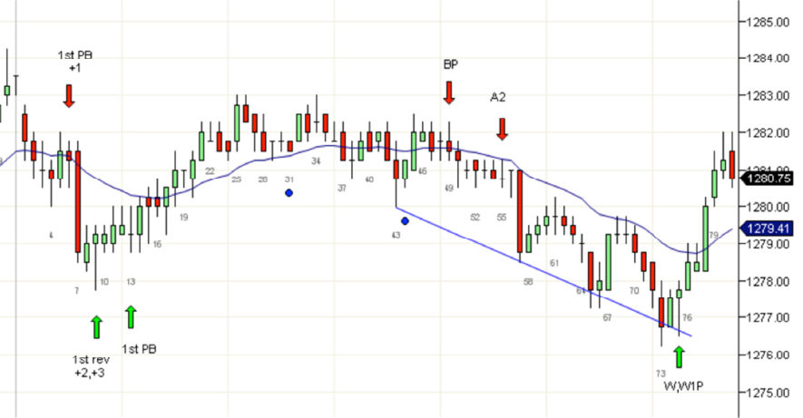

Most traders are familiar with the reversal bar but such well formed reversal bars are found only in strong trend reversals, typically with obnoxious overshoots. Often you get Double top (b26,34) or bottom reversals, which many traders can spot. Occasionally, you get an inside bar reversal. These should only be taken if there is an overshoot and the entry still leaves room for a scalp to the other end of the outside bar. This is because large bars often act as trading ranges and there will be sellers above large bear bars and buyers below large bull bars.

For example the entry above b58 was exactly six ticks from the outside bar's high, making this a possible reversal bar if there was an overshoot. When there is no overshoot, these bars act as traps and you can sell below a bear setup such as the b62 inside bar. b67 did have an overshoot, but there was insufficient space above it. In fact, you would be buying the very top of the bear bar, which is a terrible entry. Regardless, it went up to become a 5tf. This could also be shorted at the inside bar b69.

The next and very important kind of reversal is the outside - inside - outside reversal we see at b73-75. When presented along with an overshoot, this is as good as a strong reversal bar. Normally the 3rd bar ticks above the inside bar trapping bulls in, then ticks below it trapping bulls out and bears in and then reverses up again. This kind of double trap results in a sharp move.

The last kind of overshoot is the inverse of the above, an inside - outside - inside reversal (b8-10). When present with a sharp overshoot as it did today, this also results in a reversal. For a bull reversal bar followed by a bear inside bar, you may want bears to be trapped before buying above it.

The ability to find high probability reversals allows you to hold your swing longer in addition to avoid getting in and out of low probability scalps.

<!-- p.122 -->

## Signs of trend strength

Friday, January 14, 2011 · p.122

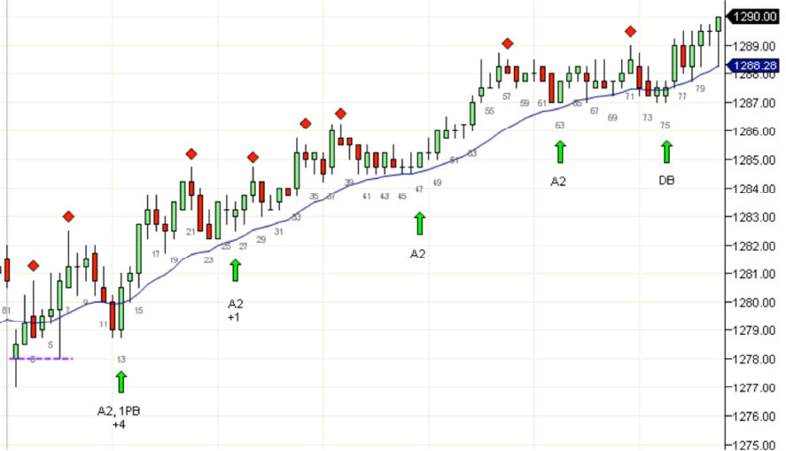

Today's first bar was unlikely to be a first reversal, since it was between yesterday's recent swing high and low. However, folks waiting for the first reversal should heed to very strong and obvious signals the market gave regarding trend strength.

First, the entry bar above b1 was a shaved bar. This shows urgency on the side of longs. Second, the first reversal bar b3 did not trigger. When a reversal bar does not trigger, its a sign that there is certainly more up. Instead, the price broke above it, another bullish sign. The news reaction did a breakout test of the open at b6 low. What this means is folks who bought the open had more buy orders waiting at the same price. This usually means a strong bull day. b4 and b6 did not qualify to be first pullbacks since they would trigger a buy above the HOD. b8 was a doji after a weak close, and not really a buy setup. b13 was therefore the first pullback and could be held till the end of the day.

The red diamonds indicate poor reversal signals which in turn indicate trend strength. b7, b21 and b71 were poor looking reversal bars (they were bull bars or had large entry side tail). b34 and b38 were one tick inside bars. b57 did not trigger on the next bar. All these signs show bull strength and half-hearted shorting, which meant only long positions should be taken all day. This is because most good traders will not be selling those bars but in fact, will use them as points to add to their positions.

True there were overshoots at b7 and b21 but overshoots only imply a pullback is due. An obnoxious overshoot is needed for a real reversal. This is also why W1P is a much better trade than W.

The other strong trend signs today were the 20+bars above ema and medium sized bars. The fact that every single swing low was above the previous swing low is also the sign of a healthy trend. As long as many or all these signs are present, dont even think of counter trend trades.

<!-- p.123 -->

## Consolidation and breakout

Tuesday, January 18, 2011 · p.123

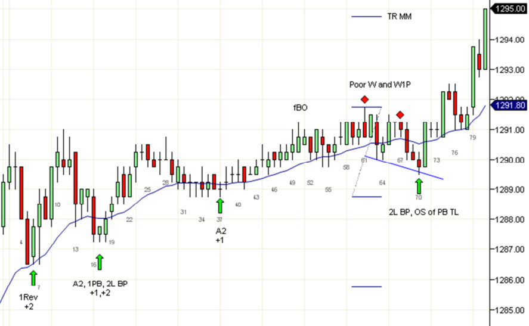

While today's first bar was the ideal size (2 points for an average 10 point day) with only 1t on each end, the fact that it occurred without any gap from Friday was good reason to believe this was a trading range bar. A good bear bar near its top would be a good short candidate and a possible 1st reversal. However, we got a doji inside bar after a bull bar and while this works, there's a good chance that there could be a higher low that does not give a scalp profit so the right decision is to pass on the trade and wait for a higher low or a break below the bar and a possible reversal up.

The down up reversal at b6 is a first reversal and should be taken. this should be good till the hod at least. Since this is down up reversal and not an inside bar trade, the entry is above the bull bar. The almost outside up entry bar of b7 gives a possible move to 1291.50.

b10-b12 is a ii variant final flag and could lead to a move down. However, we are expecting a first pullback after a first reversal and folks who want to go long may skip the short trade and take a two legged higher low for a swing.

b17 was a gap bar and a two legged pullback to a higher low and is the best swing option for the day. This should attempt to break above the HOD and try to get a measured move of the pullback, that is 1294.75.

The move to b37 was a 2 legged poorly formed A2 signal and a rather shallow pullback. This is a TTR consolidation and its perfectly fine to get out at this point and wait for the market to breakout.

The market moved to b61 as a poorly formed W and gave a reversal bar exactly at the b7 measured move. This reversal bar did not trigger, which was a bullish signal and shorts are best avoided at this point since there are no signs of bearish strength yet.

While I normally buy above bullish bars, b70 was a small bear bar that had lots going for it. A 2 legged pullback after a breakout at b61, an overshoot of the pullback trendline, breakout test of the A2 signal at b37 and the first trendline break.

<!-- p.124 -->

However, it was perfectly acceptable to buy above the shaved bar b71 or b78 breakout pullback and hold till the measured moves were met or end of day.

The day ended at 1295, 1t above the measured moves of the first pullback and the final trading range.

A triangle is a sign of consolidation and many traders exit their positions since a triangle could breakout either way although usually along the previous trend.

The poor reversal bars at b50 and b61 along with the generally strong trend indicated a bullish breakout and bullish breakouts usually occur after pullbacks such as the two legged pullback to b70.

Its important to note the examples of failed breakouts today. b2 broke above and failed giving a trend move to the other end of the range. b10 gave a 2 legged pullback, giving a long trade. b50 and b61 were failed breakouts that did not generate a trade since the breakout bar did not generate a signal or trigger.

<!-- p.125 -->

## Tight Trading Ranges on Hard trend days

Wednesday, January 19, 2011 · p.125

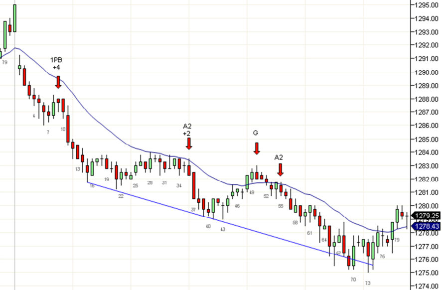

Two boxes in the Trend transition matrix are labeled TTR. Since TTRs are full of failed trades but often lead to strong breakouts, detecting and correctly trading TTRs is very important to your trading success. One of the common types of TTRs are found on a hard trend day such as today. Usually, after such a hard move of 10 points or so, the market moves horizontally in a TTR and is essentially a very weak pullback.

The move from b16 to b35 is a down to horizontal transition and is a TTR. Except the short below b19, every single price action entry failed. This is a very important example of why you need to stay out of a TTR. The only single kind of trade you can take is a breakout after a failed breakout on another side. b28 broke above the previous swing high of b19 and failed giving an A2 short below b36. Even if you could not read the A2 correctly, the fact that the market gave a shaved trend bar at the ema after a failed breakout is sufficient reason to go short.

Detecting and exiting on a TTR: Although today the TTR was of short duration, sometimes the TTR can last till the end of the day or at least till the last 90 minutes. Exiting when you detect the TTR is the right approach and here is how I do it. If a hard trend day suddenly produces tiny bars and dojis such as b17 and b18, I will worry a TTR is forming and exit on the next bear bar or near the previous swing low. Then I will wait for a failed breakout and assume we are are breaking out in the opposite direction especially if the failure would break with trend (most TTRs are w/trend flags). Occasionally TTRs will give a double bottom pullback and reverse up and I will usually take that trade only if the other side of the TTR is at least one 6 ticks away.

<!-- p.126 -->

Today's Summary

A strong trend gives very few successful counter-trend trades while a hard trend has legs that move many points. This usually means a hard trend can give a windfall if you swing it yet it can erase all the winnings if it does reverse. My approach is to take some or all off whenever I expect the market to go into a tight trading range and re-enter on the next signal. Traders who trade large number of contracts can simply keep taking profit at every swing extreme or preset targets of +2, +4, +8 etc.

The first bar today was a doji with a 1t body but its entry bar was a strong bear bar. A gap day with such a strong entry bar is sufficient cause to short below it. Cautious traders could enter below the first pullback at b9. The actual entry is below b8, which happens to be the entry bar of the b7 longs and will likely cause a selloff. This is also a failed H1 trade (fH1) that should give a measured move of just under 5 points.

The TTR fBO trade described above is also a very obvious trade once you are able to read it correctly.

b41 was a possible W reversal but there were plenty of signs that the signal was bad. b43 was an outside up bar that never triggered. The db bar b43 was a doji, which like the outside bar was a trading range type of bar. You did ok if you bought above any of these but its doubtful it would reverse hard. There was no W1P and therefore the Gap bar at b50 was a good short and could be held till a new LOD.

## Handling unclear signals

Thursday, January 20, 2011 · p.126

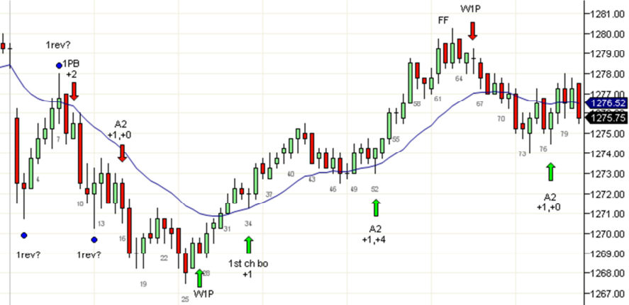

Often you get signals that should be good but the bars end up bad or slightly off. Normally, its best to let them go and wait for a second better signal. Signal bars can be bad for various reasons. First and foremost, they are not the right color. You need a bull bar to buy long and bear bar to short. The second reason is that the risk is too high because of bar size. The first hour most reversals can work and some traders do trade any reasonable signal.

<!-- p.127 -->

In the chart above, is b2 today a first reversal? Since the big bar b1 would act as a trading range, b2 could be breakout and a small pullback could lead to a breakout pullback stopping you out. If it had even a single tick bull body, it would probably be worth the risk. Similarly b7 could give a breakout pullback since the actual breakout was on bar 6 an additional bar increases the chances of breakout pullback. b9 was indeed a first pullback with an entry above b8 for long or below for short. b12 was just a large doji and not a reversal bar. A second attempt to go below it may be taken as an A2 short.

b25,26 was a down up bar reversal and I missed it along with b27 W1P. Often W1Ps give a channel and its hard to get in until a first channel break as it did on b34. Although b34 was a doji bar and possibly an H1, it was a high probability trade because it was a breakout test of the swing high b21 and also at ema.

The A2 entry above b50 was questionable because it forced a buy above the flag and one point above the previous entry. If you'd rather not wait for a second entry that usually presents itself as b52 did here, you should use a 8t money stop instead of a price action stop.

W1Ps are usually good for at least a point but sometimes I dont take them. b66 is an example. There was no clear reversal bar near the FF around b64 and the entry bar b65 was weak. b66 forced a short below the flag and I passed up the trade.

b74 was an example of an otherwise excellent bar that many may not have taken. A Gap reversal bar after an overshoot of the pullback but demanded a 10t stop. The entry went to a 5t failure and took out the stops below the entry bar. 8t stops were respected however.

In summary, if the bar is the wrong color, pass up the trade. If the bar is the wrong size, use a money stop instead of a price action stop. If the bar is a doji, take the trade if there are supporting reasons such as breakout test, ema, trendline support, channel overshoot, etc.

<!-- p.128 -->

## Entering on L1 and H1 in a strong trend

Friday, January 21, 2011 · p.128

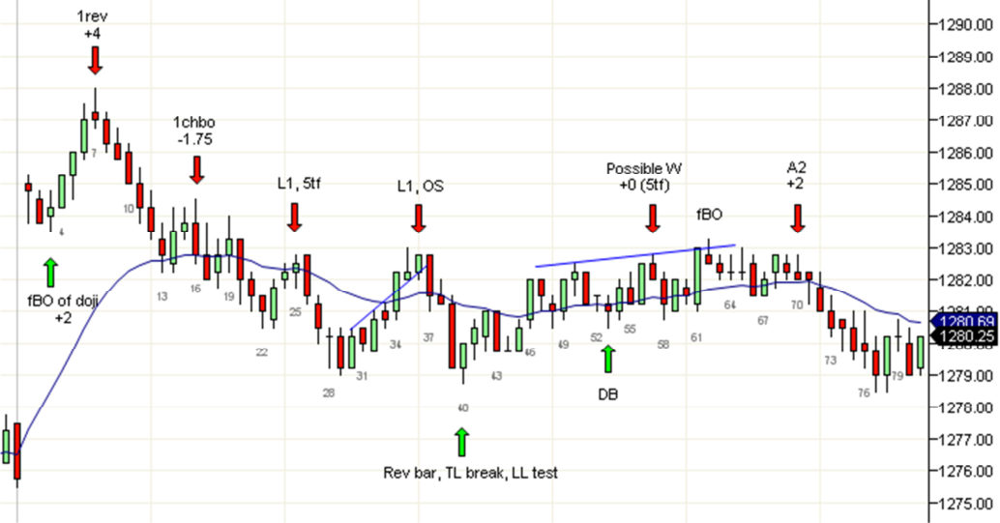

Second entries such as A2 and W1P are my staple entries on most days, but on strong trend days, you may not get many of them. On these days you have may have to enter on L1s and H1s. Today was such a day and I would like to share how I pick which L1s I like to take and which ones I avoid.

When a strong trend such as the one from b7 to b13 progresses (with average size bars, not too much tails or overlap, goes many points before a pullback) you may have to suspect that its a very strong trend day and you may have to enter on L1s.

My rule for entering on L1s is simple. Every small trend bar is a with trend entry regardless of color. (Note: This only applies on strong trends). so b15, b25, b57, b62 were such L1 entries. The second requirement I have is that there needs to be one other reason such as 5tf on b25 or the overshoot and inside bar on b36.

I waited to short below the bear bar b16 and this cost me 7ticks as my stop above b17 was taken out. Since the bar was a bit large I should have not moved the stop till I had scalped out and this was an error on my part. Avoiding the entry below an outside bar that's close to the low of day was probably the best thing to do at that point. b16 would also have been a 1st pullback entry if it had occurred a bit higher. Anyone who shorted it and held it till the end of day would have done well.

<!-- p.129 -->

## Trading Channels

Monday, January 24, 2011 · p.129

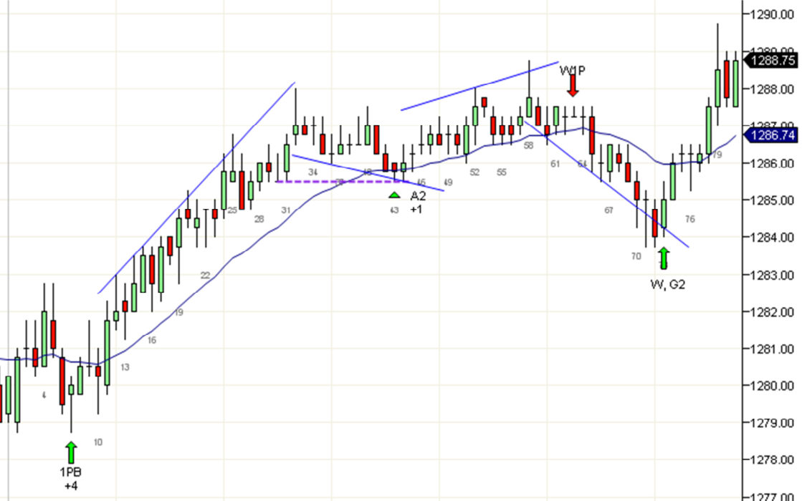

Channels should never be counter-trend traded regardless of what signals you may be reading into them. This is especially true for a channel that has just broken out of a trading range. Every L2 or overshoot is destined to fail if you take a counter-trend trade. This is because a channel is just a trend on a slower timeframe. One option is to trade the slower timeframe. The other option is to enter half a position on every pullback bar. When there is a first break of the channel, you could enter the other half. For example, you could buy the close of bars 13,16,18,23,26, etc. with a stop below the previous bull bar.

The safest and the correct trade however is to wait for the first channel break and enter with trend after a 2 legged pullback. First channel breaks are fairly safe to enter at the ema with a tight stop. After the channel break, your odds of successful counter trend trades improve.

The best move of course is to be in the channel before it begins. A 1st pullback entry above b7 or a breakout pullback entry above b13 would let you swing the move until the first channel break and test above it.

<!-- p.130 -->

## The very best trades

Tuesday, January 25, 2011 · p.130

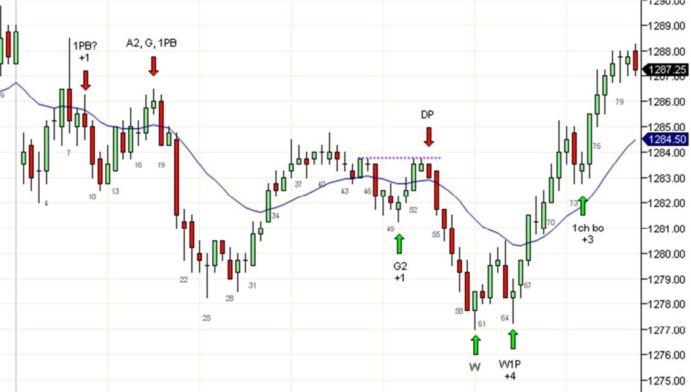

There were probably hundreds of trades today but today was a great sampler of my favorite trades. The first pullback (1PB), Two legged pullback near ema (A2), Double Top or Bottom and pullback (DP), first pullback after Wedge reversal (W1P). The biggest moves come from these trades, and I make sure I enter them when I can read them on time. Today I missed the DP on b54 and possibly the A2 or 1PB on b18.

Trading only these four will still keep you in the black even with a 50% success rate since they often go to +4 points.

<!-- p.131 -->

## Optimal trading of breakouts and failed breakouts

Thursday, January 27, 2011 · p.131

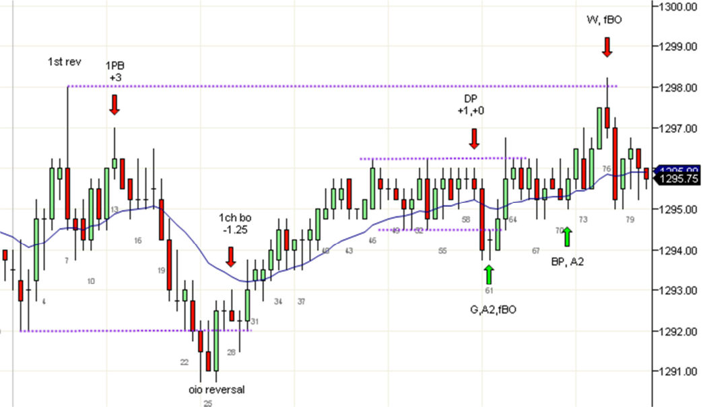

Most breakouts fail and lead to a test of the other side of a trading range. Occasionally, the breakout succeeds and you need to enter it with trend on a pullback.

The following factors increase the likelihood of a successful breakout:

- Large breakout bar
- No overshoot of a trend channel line on the breakout
- Previous failed breakout on other end of the range
- A 2 legged pullback after breakout

A successful breakout is likely to move to twice the size of the range. For example, b63 broke above the afternoon trading range and gave a breakout pullback A2 bar b71 which moved to twice the range at b76. A failed breakout on the other hand is likely to move to the other end of the trading range. For example, the failed breakout below b1 at b24 caused the market to turn up and test the high of b7.

So the correct way to trade a breakout is as follows:

If the trading range is small, as in the afternoon chop between b46 and b58, there is a very good chance the first breakout will fail. Scalp and reverse on the failure. If the range is very small, you may not even be able to scalp so just stay out till the range widens. If the trading range is large such as the open move from b1 to b7, then you can enter on the failure if the failure signal is a bar of reasonable size such as b76. If the failure bar is large, enter on the first pullback as in b13 short or b29 long. You could scalp part and hold the rest until a breakout or test of the other end of the range.Occasionally, the market will break a trendline and turn into a TTR as it did at b50. When this happens, its safe to get out near the top of the recent swing and wait for more price action. This is because a failed Breakout can quickly turn into a breakout and a deep pullback and you dont want all those profits to evaporate.

<!-- p.132 -->

## Trading hard trends

Friday, January 28, 2011 · p.132

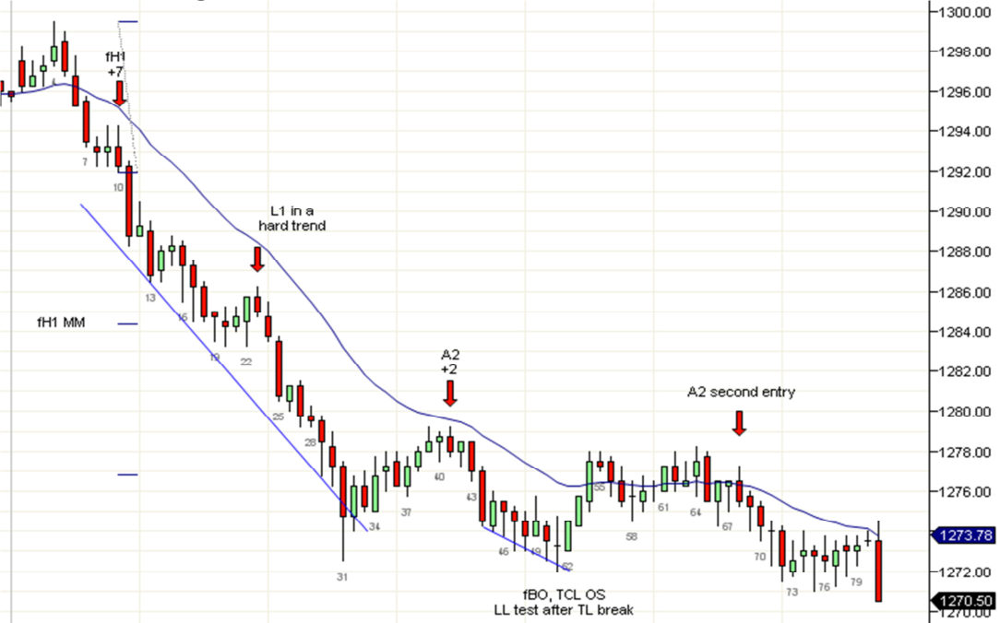

Trading a trend with sharp moves and long bars is very hard since you get very few entries and every entry moves a large number of points. When you see two or three trend bars with very little overlap, you already know its one of these days. Often the best entry is the first pullback, which in the case of a hard trend like this is a special kind of failed H1 (fH1) that usually gives a measured move down. The harder the move before the pullback and the weaker the pullback as today, the greater the chances of meeting or exceeding the measured move. Often after the measured move is met there is a tight trading range, so I exit and wait for more price action. On majority of the days, holding a fH1 till the end of day can pay profitably as it did today.

But what if you missed the fH1 entry on b10 or exited with a couple of points?

One option is to short the close of every trend bar or its breakout. I personally find selling closes hard to stomach, since the pullback can be as large as the trend bar itself as with b13. My technique is to enter on any pullback and short below any small bar regardless of color until there is an obnoxious overshoot. Days like this nearly always have a huge bar with an obnoxious overshoot as in b31.

For example, shorts below b23, b26 were good entries. Aggressive traders would short any H1 expecting it to fail. Once the sell climax occurs, the down move is over for a while and you should expect a pullback. This pullback does not have to go near ema but often tests the high of the sell climax bar. Usually this can be shorted at least once to test the low of the climax bar. On days like these the best policy is to only trade in the direction of the primary trend since there is a very good chance there could be another huge move late in the day but very low chance of a sharp reversal. For example although b62 had at least 3 reasons to buy, I would pass it up and only focus on short trades.

<!-- p.133 -->

## Determining continuation versus reversal

Monday, January 31, 2011 · p.133

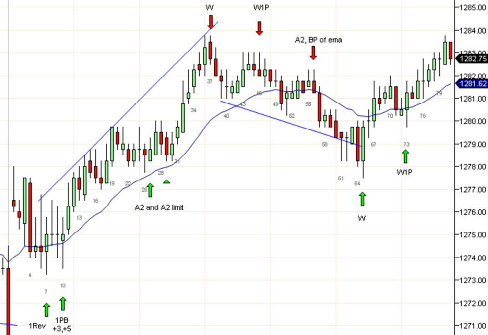

Often you may ask yourself if the trend has really ended or is this just a pullback. And if its a pullback, is it going to be a one legged, two legged or three legged pullback. Or perhaps its a channel down.

For example in today's chart is b25 a 2 legged pullback or was b19,b24 a double top that we should sell? The answer is simple. In the absence of a trendline break or trend channel line overshoot, always assume the trend is still on and go with trend. The wide overlaps make it difficult to take a price action entry above b25 or 26 or even b30. One option is to buy above the signal bar (b25 or 26 in this case) and allow one pullback below your entry bar. You could also buy part of the position at the expected pullback, i.e., below the twin bars b27,28.

On the other hand what about b46? Is that a W1P or just a leg up in a two legged move to the ema (eventually at b51). Whenever you ask yourself if this is a W you should ask if this was in any way an extreme move. The move from b31 to b37 was indeed a sharp move and tagged the trendchannel line but did not otherwise exhibit signs of a W reversal.

- There was no obnoxious overshoot.
- There was no reversal bar
- The entry bar b38 did not actually trigger theoretical entry below b36.
---

[← Previous](08-2010-12.md) · [Contents](00-目录.md) · [Next →](10-2011-02.md)
