[← Previous](09-2011-01.md) · [Contents](00-目录.md) · [Next →](11-2011-03.md)

# February 2011

Original pages 134–149

<!-- p.134 -->

It was indeed the third push up and there was a micro trend channel line overshoot, so this could still work like a marginal W1P. Often when the signs are ambiguous you may just get a deep pullback or a trend line break as it did today. Its perfectly alright to take a weaker W1P for a scalp or wait for the next entry. B56 gave a two legged BP short of the ema. b54 had a lower high and lower close and divided the move into two legs. This is a very strong signal that you should take.

If for some reason you did buy above b51 assuming its an A2 long, the two legged move to b56 should tell you to exit or reverse.

Also keep in mind the overall price action context. The horizontal trading range between bars 19-30 could act as a magnet forcing any breakout to be pulled back into the area.

Pullbacks are just smaller trends in the opposite direction and an overshoot of its trend channel line or trendline break and test is the best way to determine if the pullback has ended. In general one legged pullbacks should only be taken in very strong trends, 2 legged pullbacks can be taken anytime unless the moves shows strength in the pullback direction (such as breakout bar). 2 or 3 legged (W) pullbacks can be taken if they show an overshoot. Most pullbacks that end at trendline or ema without breaking it giving a good signal bar can be taken.

## Detecting and trading extremely strong trends

Tuesday, February 1, 2011 · p.134

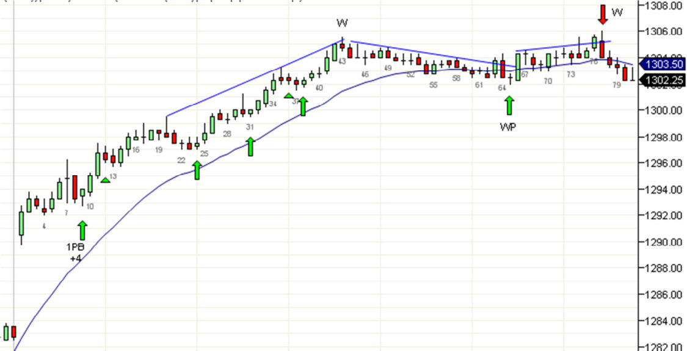

Folks who are used to trading with indicators often destroy their accounts shorting all the way to the top on a very strong trend day. Learning to identify a strong trend and going with it instead of against is very important to your trading success.

One of the biggest signs of a strong trend day is a large gap. Anything larger than half an average day is a large gap and you should be on the lookout for a strong trend move. Average to small size bars is a good indication this will be a strong trend day. A first pullback (b3,4)

<!-- p.135 -->

instead of a reversal is another indication the price wants to move up. A 1tf of the short entry on b4 is another indication of strength.

At this point you should be buying any pullback for any reason. A second one tick failure at b9 indicates a very strong day and you can even buy the low of any inside bear bar on limit as long as the bars are reasonable size. You can also buy above any bull inside bar to take an H1 entry. You can continue to do this until there is a strong trend break. However, when the bars get tiny, there is a real chance of a TTR, which simply a trend ending where an up move turns sideways and is part of the nine transitions. Buying only above bull bars reduces your chances of buying in the middle of a TTR as does buying after a deeper pullback since TTRs are normally shallow.

What about wedges? is b11 a third push up and therefore a wedge? The single most important thing to remember about Wedges are that they will not pullback without an overshoot and they are best tradeable after a trendline break. Therefore, b11 or even b20 should not be expected to give a large pullback. b43 was possibly a W since the move from b20 to b23 could be a marginal trendline break and it did overshoot a tick or so. However its a poor W without an obnoxious overshoot on a very strong day. Even though it did move 3+ points down, it was a harrowing move for nearly two hours. However this move did give a strong break of the trendline and the next W at b77 is more comfortably shortable.

The most important point to note about trading days like these is that you should have identified a strong trend day decided early in the day to only trade long or just enter after a deep pullback and swing till an obnoxious overshoot or strong trendline break.

## Breaking Bad

Wednesday, February 2, 2011 · p.135

The precise determination of the direction and entry of breakouts is one of the hardest aspects of trading. Even when you can get the direction right, many traders often get stopped out before the market has the eventual big breakout. If you can get in correctly, you stand to gain the best risk to reward ratio. This has led so many traders and algorithmic programs to concentrate their efforts on correctly detecting and entering a breakout. Today's entry represents the fBO or center square in the nine transitions.

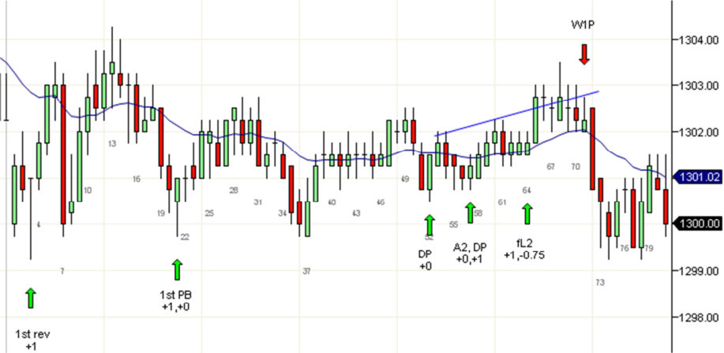

<!-- p.136 -->

Many traders concentrate on entering on breakouts and many others on fading breakouts since most of them fail. The truth is that breakouts in a trend usually succeed and breakouts in trading ranges usually fail. Even then, occasionally breakouts do succeed from a trading range and thus trends are born.

If you look at the chart from today, b3 was a possible first reversal and b8 was a possible first pullback. It was a tough trade to take since the signal bar was a one tick bodied inside bar with a large tail forcing you to buy in the middle of the range. A second entry for the first pullback at b21 was a much more decent entry but at this point, the trader finds himself in a trading range. At this point, the correct thing to do is assume every breakout will fail as we saw today:

- b37 attempted breakout of b21 swing low failed
- b50 attempted breakout above BW failed
- b52 attempted breakout below BW failed
- b65 broke above 3 swing highs, but eventually failed
- b74 breakout below triple bottom failed.

Many successful breakouts are a result of a failed breakout on one side of the trading range or a double bottom pullback on one end of the trading range. Today we had a marginal double bottom pullback at b52. What made the setup deficient was that the pullback after the double bottom was not sufficiently deep. This entry forced a buy in the middle of the range 3t higher than the double bottom entry and certainly closer to a recent swing high. A successful DP usually gives an entry close to the original double bottom entry and dips nearer to the double bottom. Another important clue that this DB was likely to fail was that the breakout happened on the third push with an overshoot. Normally for a breakout, this is OK if there is follow through. If not, its time to exit or reverse your positions.

The hardest thing about trading breakouts is that they mentally condition you to expect a certain type of move and you end up taking a marginal entry. For example, after the double bottom at b37, I was expecting a DP, and correctly read the failures of b47 break up from BW and b51 break below ema but ended up taking b52, despite it being marginal. Trading failures on the other hand is far simpler. You could have traded every failed breakout in the list above and done very well today. And if for some reason the failure fails, you could always reverse and go with the breakout pullback.

<!-- p.137 -->

## Prison Break: Breakouts from horizontal flags

Thursday, February 3, 2011 · p.137

Horizontal flags with alternating up and down bars (like the bars of a prison cell) often produce violent breakouts. Predicting them correctly is quite a challenge. Often there will be multiple breakouts that all fail until one of them breaks suddenly and moves many times the size of the flag.

Horizontal flags can also act as magnets and the move often retracts back to the horizontal area. So if you get a reversal, you should at least exit if not reverse your position altogether. Like all breakouts horizontal breakouts are also best traded as breakout pullbacks. This article represents the yellow boxes in the first and third columns of the center row in the nine transitions. Be aware that trying to predict breakouts is extremely risky, and usually you are better off taking a breakout pullback. Sometimes there are no breakout pullbacks, and you just need to let it go.

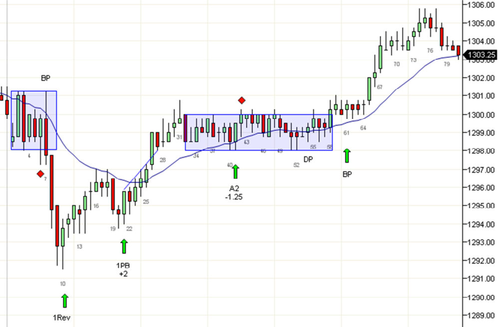

For example b6 broke through the flag and although it looked like a poor reversal bar with a large overlap, it failed to breakout of the other side and gave a sharp move down without any pullback to enter with trend. Another horizontal flag during lunch hour also showed a similar breakout. The first breakout at b42 broke above the previous swing high of b37 and failed to break below the swing low of b40. This made the DP entry above b54 viable or you could just take the BP at b61. Horizontal flags generally break with the prior trend and away from the ema rather than across. Since yesterday's final move was down, todays opening flag should also break down. Similarly the lunch flag should break up.

<!-- p.138 -->

## First Channel breakouts

Friday, February 4, 2011 · p.138

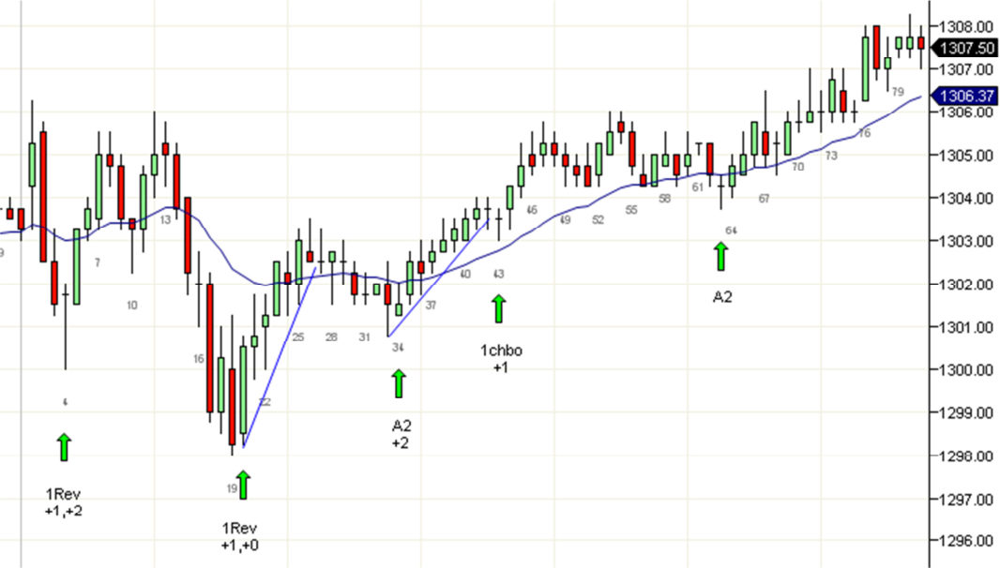

First channel breakouts are a high probability entry if you can correctly identify them. I usually end up not taking them, because I'm already in a position due to a prior entry and have just exited my scalp portion a few ticks ago. It does not make sense to re-enter unless the price action has shifted significantly.

The correct way to enter a first channel breakout long is if the price triggers above the bar that broke the micro-trendline. Therefore for the channel from b34 to b42, since the bar b43 dipped below the prior bar, an entry above it is a high probability entry.

On the other hand for the channel from b20 to b25, the channel was broken by b27, but a long above it was not triggered. A second bar that dips below the prior bar is more likely to be a 2 or 3 legged pullback or barb wire and you should not be buying above b28.

The move eventually gave two failed extremely poor sell signals, a doji reversal at b29 and a 1t ii short at b32 both of which failed and turned into an A2 long. Although technically the b32 ii is a possible long signal and would make it an A2, its such a poor signal that very few traders took it. If you did take a poor signal, you need a money stop of 8 ticks (which was not hit).

<!-- p.139 -->

## Exiting a swing position

Monday, February 7, 2011 · p.139

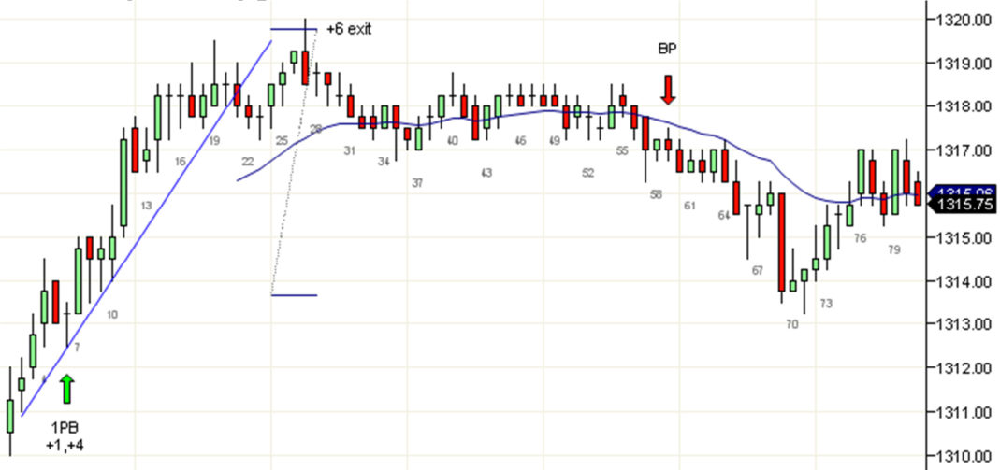

"Profit often, profit early" is a good principle on how to exit your positions. You should always exit one contract at +1, this gives you strength to hold through a pullback to breakeven or slightly below since you wont be fretting over lost profits or fear a good trade turning bad. Exiting additional contracts at +4, +8 and +10 with a stop below the previous swing low is a good practice and is practiced by many price action traders. Today's post represents the top central orange cell labeled 'TTR' in the nine transitions.

Today presented very few low risk entries and the earliest entry was the 1PB at b6. You could hold it till the end of day, but often the market tells you it may not pay to hold till the end of day. Today presented some of these signs that should not be ignored.

A healthy trend prints strong trend bodies. When it can no longer do that and tails and overlaps dominate, you should watch for trend weaknesses such as trendline breaks or climax bars.

The earliest sign was a possible horizontal FF from b14 to b16. The fact that its breakout on b17 failed right away was a sign to exit on strength. The shrinking bodies and growing tails approaching a trendline that has been tested at least four times already signalled a possible trendline break which we got on the move down to b23. Since this was a first trendline break after a sharp move, a test of the HOD was a high probability event. If you entered above b6 today, you could try to exit at 1319.75 giving you +6. The price crossed it by one tick and turned down into a reversal bar.

As I have noted before, an end of an up move does not automatically mean you should reverse your position. Often strong trends give horizontal flags that later break in the direction of the original trend. However, sometimes it breaks in the opposite direction as it did today and the right thing to do is to exit and wait for more price action.

<!-- p.140 -->

## The classic A2

Tuesday, February 8, 2011 · p.140

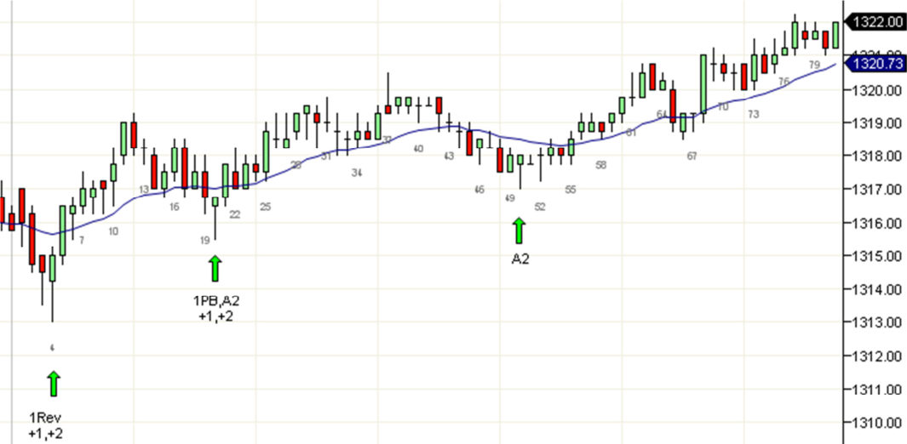

Today's post is regarding continuation in a trend and represents the top left corner of the nine transitions.

A 2 legged pullback that gives an entry just above or below the ema is called an A2 (for 2 Legged move to Average). The ema used by Brooks system is a 20 bar exponential moving average. A well formed A2 looks like the one from bars b12 to b20. The move is mostly trend bars and there is a clear trendline break of the pullback at b16 and a second leg down to b20, which closed strong.

Not all A2s are that clear. Sometimes it may be as simple as 2 failed attempts to turn down such as the move from b31 to b35. b32 tried to fail the new high and so did b35. The bars were dojis, which are trading ranges. Normally A2s that are made hard to read dont go very far and are best passed up. The only exception is during a soft trend day when every entry is an A2 made of overlapping bars.

If an A2 is not made of good looking bars, you may wish to wait for an additional confirming signal to increase its chances of running for a swing such as a double bottom or G bar. For example, b50 was a G2 bar in addition to being an A2 long entry. Since G2 itself is a high probability trade.

<!-- p.141 -->

## One legged moves to ema

Wednesday, February 9, 2011 · p.141

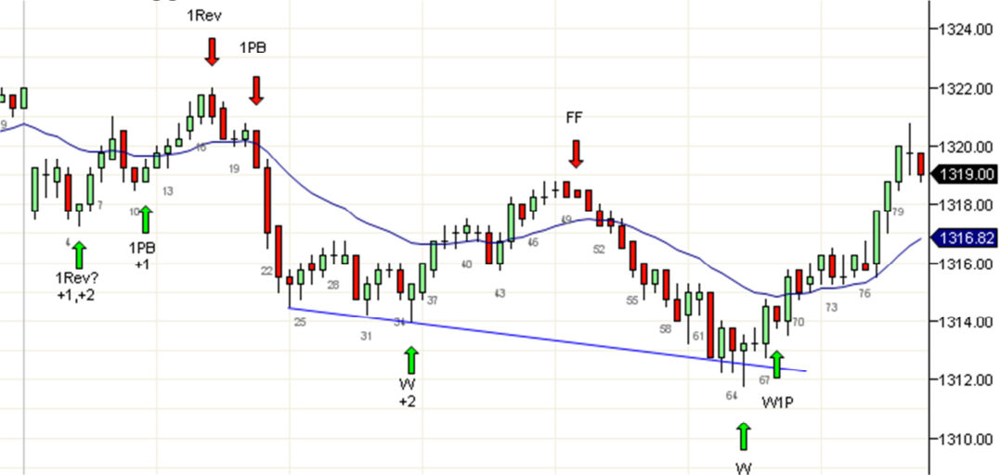

A common sign of the end of a trend and often the beginning of a reversal is a one legged move to the ema and close beyond it. Today showed several of these cases and a conservative trader can simply enter with the new trend on its first pullback.

Today's first such move was from b5 to b7. Had b5 not ticked below b1, it would have been a two legged move and therefore a possible sell signal. Similarly the move from b17 to b19 was one legged and even though it did not quite close below, a fraction of a tick is close enough to sell below the pullback bar b20.

The overlap of the tail and only a fraction of a tick overshoot of the TCL on b35 made the wedge signal rather weak but a one legged move on strong trend bars meant there would be another leg up at least and if the signal bar b43 did not have such an overlap or if the pullback was deeper, I'd have taken the trade instead of passing it up.

The move from the final flag at b49 to b52 was one legged and made of shaved bear bars. The first pullback however was b57 inside bar, which forced a sell at the bottom and is riskier. After a close below the ema, any small trend bar in the direction of the move can be used as a signal bar especially if its shaved.

Strictly speaking the move from b64 to b69 was not strictly one legged, but for our purposes, since the price only ticked one tick below previous bars and turned into outside up bars, you could easily treat it as a one legged move. In this particular case, it shouldn't matter, since the strong overshoot has already confirmed the reversal.

<!-- p.142 -->

## Lunch money

Thursday, February 10, 2011 · p.142

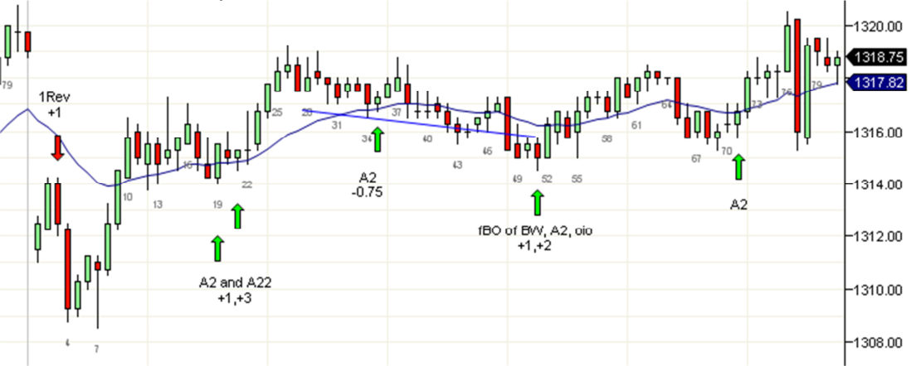

Often during lunch session, the pullbacks can be complex and protracted. Trend breakouts during lunch sessions do happen, but they are comparatively scarce. The simplest way to trade lunch is to stay out and is the recommended practice for beginners. Lunch hour also is rife with traps and breakouts that look bold but go nowhere, so limit traders are especially vulnerable. It may seem that they stop you out to the tick and then reverse the move. Even the reliable A2s can fail as we did today at the A2 off b34. This is because lunch hour bars are badly formed and signals are not good enough for many traders to enter.

Even fading every breakout is dangerous since breakouts sometime do succeed especially if accompanied by some unexpected news. If the AM session had a trend move, as long as there was no overshoot, you should assume the entire lunch move is likely to be a pullback or trend break at the worst and it should at least test the previous swing extreme.

The correct way to enter the market at the end of the lunch hour is after a trend bar breakout and enter in the direction of its likely failure. Today, the comparatively large trend bar at b48 failed and gave an long entry. which could be held till HOD is tested or end of day with a stop below the entry bar b52

<!-- p.143 -->

## Climax and exhaustion bars

Friday, February 11, 2011 · p.143

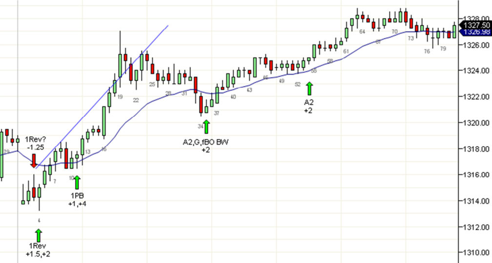

A climax bar is a large bar on high volume at the end of an extended move. A true climax often turns into a crash after a weak pullback. Today's bar 19 was an exhaustion rather than a climax because of the following reasons:

- The move was large but not extended. The move from low of day was well within the average bar size of recent days.
- The pullback on b22,23 was rather strong
- The short signals on b20 and b24 did not have follow through

Despite the channel overshoot, it wasn't really a wedge since it was only two legs up for all practical purposes. All these meant an extended correction and the price was certain to test and try to break above b19. The Gap bar and a failed breakout of the trend bar from the BW pattern of b26-32 was the correct long entry to take. Those who missed it could also take the first A2 above ema at b52 or b54.

<!-- p.144 -->

## Weak wedges

Monday, February 14, 2011 · p.144

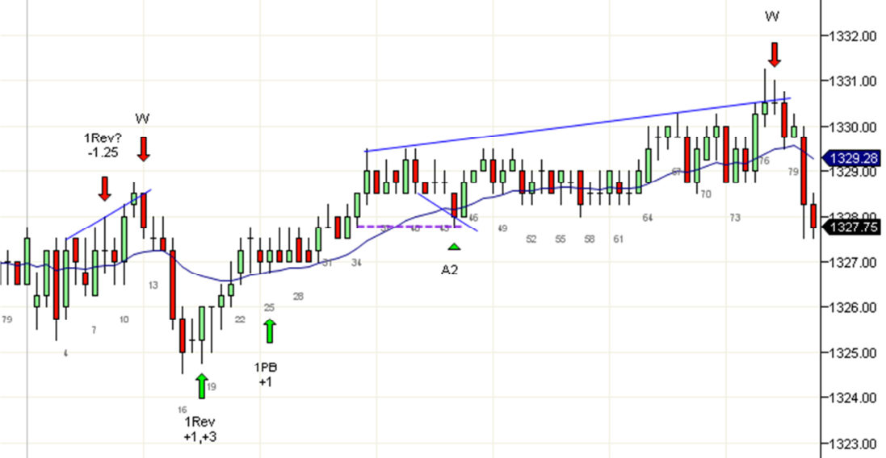

Narrow range days usually have overlapping bars and one or two weak wedges. Some of these wedges are traps and others pull back a few points but may not actually result in a reversal. The reason is that wedges need to be extreme moves and have a clear signal bar for with trend traders to switch sides.

Today we had a W4,8,11 from the open but we did not actually get a reversal bar. The closest readable entry was the W1P at b14, but even that is a bit risky. The strong overlap at the open would act as a magnet, pulling the price back in so its a scalp at best.

There was a possible W23,31,35 which gave a inside bar signal that never triggered. This is usually an indication of unwillingness of traders to short and hence, more up. The right thing to do is to buy a 2L PB to ema, possibly on limit at say b44 or so.

A third W35,67,76 gave a better signal that had a strong entry bar and the W1P at b79 was a good entry and could be taken for a swing if it wasn't at the end of day.

Weak wedges also occur in pullbacks and they are usually excellent with trend entries. For example, W48,51,57 was possibly a weak W pullback and buying above the next bull bar is acceptable as long as you are okay holding through pullbacks since your signal bar had lots of overlap.

In summary, the trick to trading wedges is the same as trading every other signal. When the signal is clear and strong, go with it. Otherwise, fade it.

<!-- p.145 -->

## Managing trades that go bad

Wednesday, February 16, 2011 · p.145

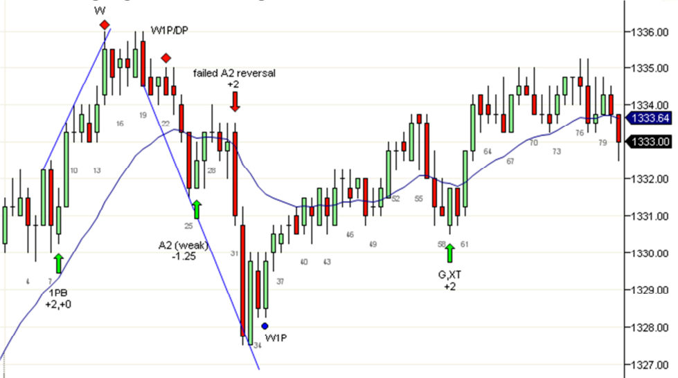

Sometimes we read the market incorrectly or in the heat of a big move, place orders before identifying a pattern correctly. Sometimes we get into trades due to bad habits or the trades we enter into just fail. How you manage your trade after you get into it plays very strongly into your trading success. The ideal situation is to very rarely get into bad trades. A simple way to do this is to never buy above or sell below overlaps, especially if in BW. Folks who bought above b16, a doji bar or above b26 or sold below b58 lost. The second rule is if your signal bar has a large tail on the entry side, its usually better to wait for a second signal. Also avoid large inside bars since they often act as trading ranges. The best and first course is to scratch the trade by exiting at a small profit or breakeven if your entry bar is anything but a trend bar. The next option is to move your stop below your entry bar no matter how crappy it looks and let the market take you out. An alternative is to trail 5t from your entry and let the market take you out.

If you choose your entries correctly, your entry bar should be a nice long trend bar with small tails. The setups I choose typically have such entry bars and if they end up looking like anything else, I look to bail. For example, b9, b20 and b61. A bar with a single small tail is ok, as long as the close is strong such as b20 and b36.

Any bar that has larger tails is higher risk of failure such as b27, b70. At the very least, exit most of your position at a smaller target.

Bars that end up in a doji or whose close is against your position are very likely to be failures, possibly after a bit more move in your direction such as b5, b17, b22, b64 etc. You should exit right away and look to reverse your position.

My standard trades of A2, W1P, DP and fBO should not need more than 4t or 5t stop and often go to +2. Once your scalp of +1 is filled, you should right away move your stop to breakeven. After that, you can move the stop after every HL or LH. An alternative is to trail it by 5t and let the market take you out. If you trade this way, your maximum loss is 4t/trade (or 5t in the first hour). and your expected gain is about 6t average (+1 and +2/+0). This inversion from 4t target and 6t stop to 6t target and 4t stop means your accuracy only needs to be slightly greater than 50% instead of the 70% for breakeven.

<!-- p.146 -->

## Wedge reversals and W1P

Wednesday, February 23, 2011 · p.146

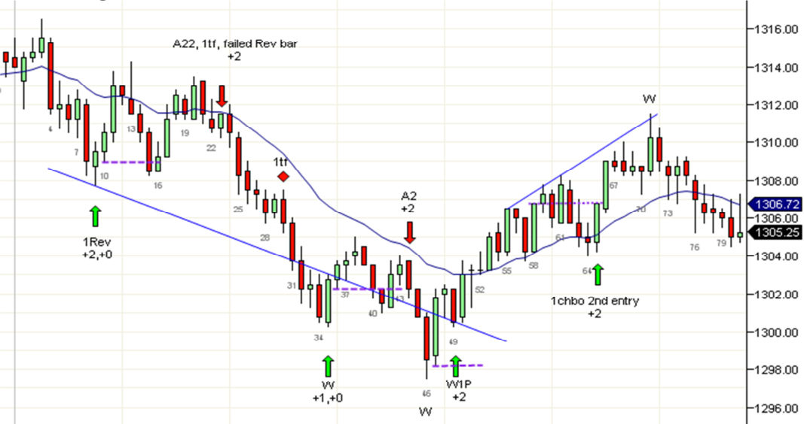

The reason I take W1P almost every time and Wedges only when the signal bars are very well formed is simply that I have a lot more information about the strength and sustainability of the reversal. Today's entry forms the blue bottom left and top right corners of the nine transitions. For example, b9 could have been a possible W (since there was no gap between yesterdays last bar and today's open bar, we can treat it like a continuation). However, by the time the possible W1P presented itself at b16, we already had many clues that this reversal attempt would fail:

- the signal bar was weak since it was smaller in size compared to recent bars and had a 2t tail on top.
- A shaved entry bar or an entry bar with only 1t on at least one side strengthens the W. b10 had 2t on both sides.
- A well formed W1P should not tick more than 1t below the entry bar b10. Price closed below it on a strong trend move.

This kind of W1P usually gives a scalp but is not advisable for a swing move. Another similar W occurred at b35. This was weak for several reasons.

- the down/up reversal at b34,35 is a possible trading range and there may be sellers above it. Its best entered on a second entry or after a 2 legged pullback (2L W1P).
- Entry bar was small compared to recent bars
- It closed several ticks below entry bar

The W at b46 however was very much the sign of extreme behavior and even though it wasn't bull bodied, it had a strong entry bar. A down/up bar must be of comparable size and should not give an entry far beyond both bars to be an up/down or down/up signal. So b29,21 for example was a good up/down signal but b47 is an entry bar. The pullback bar b49 or the inside bar b51 could be bought as a W1P.W1Ps tend to move till their move is terminated into another W or until the first pullback in the move down to the W. So for example if the W began at b3, then you could expect W1P to move till b13 high. Sometimes they end in a W as we did today at b71.

<!-- p.147 -->

## Inside bars

Thursday, February 24, 2011 · p.147

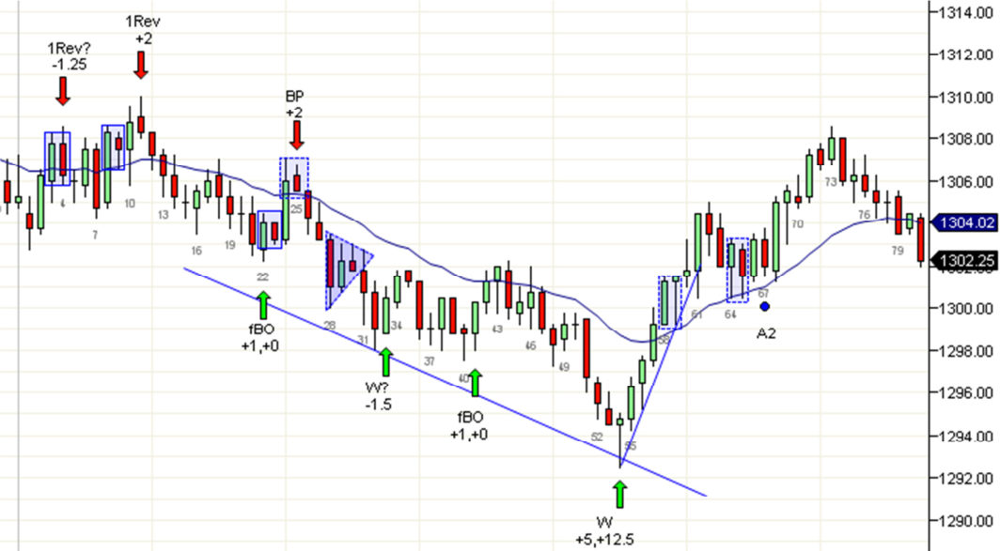

I've often mentioned how outside bars are trading ranges and you should always watch for failures or take second entries of their breakouts. Inside bars form an overlapping region and are therefore like a small trading range. Generally inside bars should only be taken as with trend entries. A counter trend break of an inside bar is likely to fail and trap you as in the short side breakout of b9.

When the body of a bar is inside the body of the preceding bar as in b4, it often acts as an inside bar even if it pokes slightly (but not a lot) outside the preceding bar.

Some down/up reversals are effectively inside bars if their sizes are not comparable as in b33. Their breakout can fail as well.

The chances of success of a trade off an inside bar is stronger if the inside bar is a small trend bar at the end of a large bar. In these cases, you could trade the breakout of the inside bar and not worry about taking an entry off the outside bar as in b25 and b35.

Inside bars that have both bars of the same color can be treated as a pullback and be entered with trend as in b59. Double bottom at the ema is also another acceptable entry as in b65.

Inside-inside bars as in b30 have a much higher chance of success than single inside bars, especially with trend. In this case, it works as a breakout pullback trade.

In summary, inside bars are best entered with trend or to fade large bars. It is simpler to understand when you look at inside bars as basically pullbacks. If you don't believe the trend has reversed, you can restrict your entries to higher probability trades.

<!-- p.148 -->

## Expecting pullbacks

Friday, February 25, 2011 · p.148

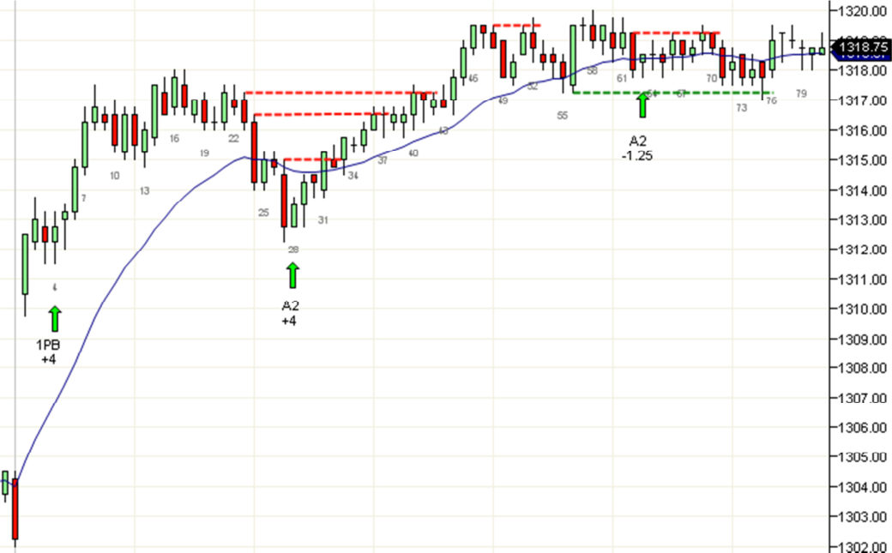

Knowing where to expect pullbacks has two benefits. One is that you may choose to lighten your holdings and take some profit. The second is to be able to add on or enter late if you missed the original entry.

When the price takes out the high of a bear trend bar or takes out the low of a bull trend bar, it may pullback a bit. The reason for this is simple. Traders who originally entered there are willing to enter again. Another way to look at this is that when the price has turned around from a bear move back upwards, the entire pullback is like a trading range and trend bars are like mini-trading ranges. They are traded in a similar way, you can fail their breakout or enter on a breakout pullback depending on how good or bad the failure signal is.

For example, with b32, it was a poor 1tick doji signal and effectively an inside bar. Sellers below were trapped and the price moved up. An aggressive trader would buy the low of that bar with a stop 1 or 2t below b31.

This is especially true for entry bars since traders like to add on at the original price. For example, b75 took out the low of entry bar b56 off a poor short signal and an aggressive trader could buy this with a stop below b44, another entry bar.

In general, this approach is best for entering with trend as in the first half of today or fading trading range breakouts as showed in the second half.

<!-- p.149 -->

## A weak move off the first pullback may indicate first reversal ahead

Monday, February 28, 2011 · p.149

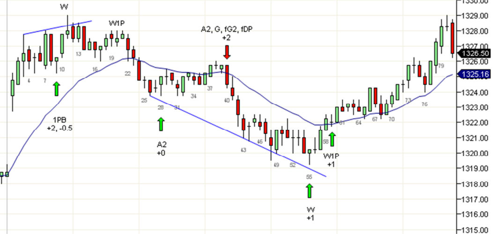

The first pullback, especially a deep one is often your best bet for a swing trade since by then everyone who has missed the early move will jump in for the ride. First pullbacks after the first reversals are usually the best, since the initial move gives traders a better price to enter.

Today's first pullback at b9 broke above the previous swing high, but the breakout bar was weak and overshot a trend channel line. Normally, this only means a 2 or 3 legged pullback and sometimes the second leg stops near the ema giving a gap bar. However, if it ticks below the entry bar by more than one tick, especially if it does it a second time (b17,b22), there is a good chance you just missed the first reversal. You should always exit your swing portion and look to enter short.

The weak A2 entry bar at b29 further confirmed more weakness to come and b40 provided a later entry on the short side.

First pullbacks without a first reversal and often even after first reversals are usually reversible trades. The idea behind a first pullback is that everyone by now has recognized the direction has turned and wants to get in the new direction. The move needs to be clear and strong. Any weakness indicates you have read it incorrectly and you should look to exit.

---

[← Previous](09-2011-01.md) · [Contents](00-目录.md) · [Next →](11-2011-03.md)
