[← Previous](10-2011-02.md) · [Contents](00-目录.md) · [Next →](12-2011-04.md)

# March 2011

Original pages 150–172

<!-- p.150 -->

## Keep the trend type in context while trading

Tuesday, March 1, 2011 · p.150

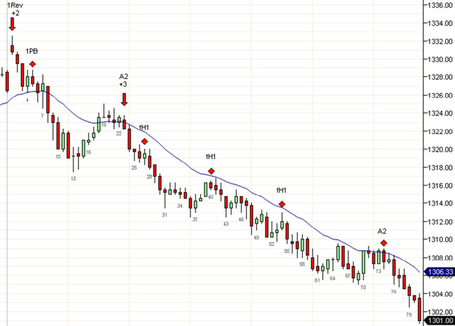

Trends come in three broad varieties. The usual most common is the elastic trend, which snaps back and forth based on buying and selling pressure. Most traders expect every day to act like this and will lose big on the other two type of days. The second type of trend is a soft trend which essentially maintains a slow grind (usually up) pulling back only a tick or two below previous bars. Shorting such days based on any standard setups is a recipe for bleeding your account every six bars or so. The third type of trend is a hard trend day which moves (usually down) relentlessly. There are up moves, but none of them are worth trading since they take your focus off what you should really be doing: wait for a with trend move and hold till end of day or climax. By the first two or three bars you should have already known that this was a hard trend day. And on hard trend days, there is only one rule: There are no counter-trend trades. Yes, the move from b15 to b19 was good but that was the exception. Most counter-trend trades lost today and almost any with-trend trade succeeded. The other interesting feature of hard trends is that overshoots need to be very deep to give pullbacks. And only an obnoxious overshoot with a large climax bar can terminate the trend. Hard trend days need to break and go into trading ranges before they can continue or reverse. On many days such as today, they will push relentlessly till the end of day. There are very few entries from the perspective of a normal or elastic trend. Today we had the 1st reversal on bar 1. If you watched the bar forming, You would see it popped up 4 ticks in the first few seconds and then stayed down. A reversal bar off a sharp overshoot above a gap is a signal any trader should take. b5 was a 1st pullback and if it wasn't for the impending news which often runs stops is the best swing entry of the day. If you missed that, there was an A2 on b23, which was also a good swing entry. The entire lunch move saw only failed H1s in a hard trend and you could short below any pullback that did not have a large tail. This takes some practice to do and I often let them pass. A final A2 at b75 gave 6 points. Its never too late to enter with trend on a hard trend day.

<!-- p.151 -->

## Wedges without overshoots, reversal bars or pullbacks

Wednesday, March 2, 2011 · p.151

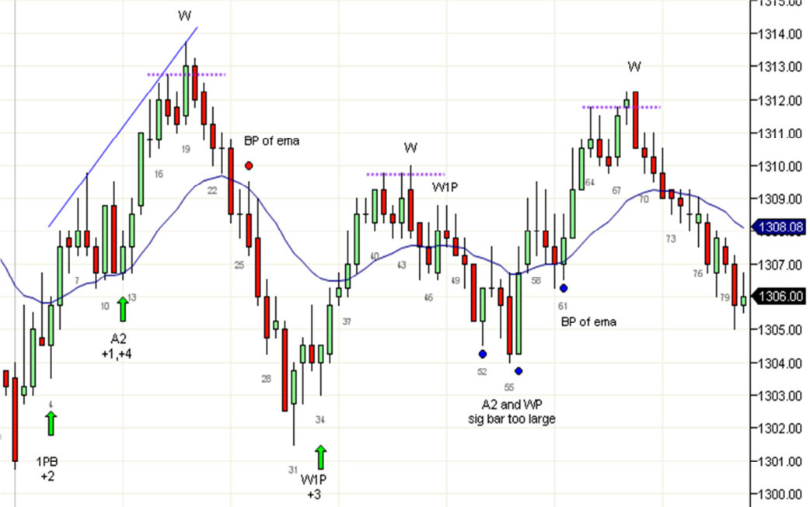

The ideal wedge has a clear overshoot on the third or fourth push and ends up in a clear reversal bar. The reversal bar's entry bar is a strong trend bar. A weak pullback gives a W1P that gives you an entry into the now reversed trend.

On trend days you probably will see a reversal like that. But on trading range days, you may have large swings that are best seen as 2 legs in each direction. None of the third pushes today resulted in significant overshoots, did not quite end in reversal bars and surprisingly sold off all the way down without any pullback. On days like this, you can pass up the wedge trades and simply wait for the next setup or if you are an aggressive trader, trade the third push as a W if it is a failed breakout.

The idea behind the failed breakout is that the breakout traders who buy above the previous swing high should not be able to make a scalp profit. You need a first entry that triggers and fails as in b18,b42,b65 and then a second entry comes into play very close to the previous signal. If the second signal bar has lots of overlap as in b44, you are better off waiting for a pullback above your entry bar and then taking the next signal. A very important requirement for a trade like this is prior strength in the new direction. A strong move in the later half of yesterday or early in the day are needed to enter this way or you may find yourself shorting a series of H1s on a strong day.

<!-- p.152 -->

## Trend terminations and breakouts

Friday, March 4, 2011 · p.152

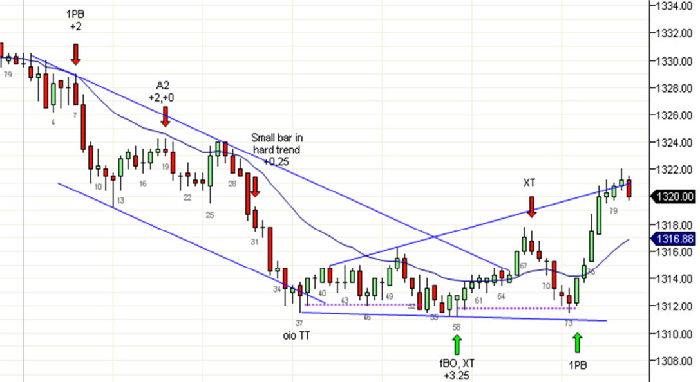

Today's post addresses the second row of the nine transitions.

The easiest type of pattern to read in real time is a continuation and the hardest type of pattern to read is the breakout and for a variety of reasons. The most obvious reason is that most continuations succeed and most breakouts fail. Breakouts can fail multiple times before they eventually succeed as was the case today.

Before you can read breakouts, you need to be able to detect when a trend has terminated into a trading range. The simplest and the easiest way is to look at the two recent highs and lows. If they are sideways, the trend has ended. Trends terminations (TT) usually have weak reversal signals that not many will take such as the poor oio reversal at b35-37 and give a weak continuation signal such as the bull bar A2 short at b44 that very few took. Trends can also terminate into TTRs or by eventually breaking a trendline. Although the trendline broke at b66, the trader should already expect a trend termination at the poor oio at b37 and confirmation by the weak A2 at b44 and the two legged failed breakout at b57.

The expanding triangle (XT) breakout is comparatively the easiest to detect and trade. An expanding triangle is simply a series of fBOs, each enlarging the range after trend failure. The trading range after trend termination begins with the reversal or climax pattern itself (b35 high to b37 low) and every move is just an attempt to expand the range. Once both ends of this pattern are taken out, you can take trades and expect them to move to the other end until you get both a HH and HL for a bull breakout or LH and LL for bear breakout into trend. Note that the breakout could be either up or down regardless of the direction of the previous trend. The HL or LH will usually be a two legged move and today the doji bar b70 separated the two legs down.

This point is the first pullback in the new trend and is the best swing entry for the rest of the trend.

<!-- p.153 -->

## oio reversals and failures

Monday, March 7, 2011 · p.153

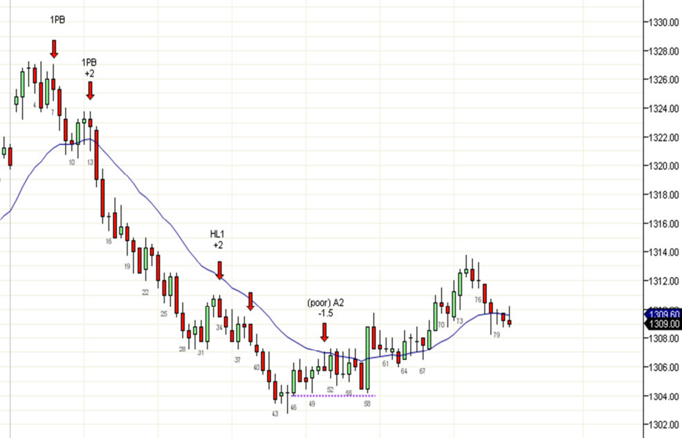

I've often spoken about how outside bars are trading ranges and are often fade candidates. I also mention oio reversals. How do you distinguish between a legitimate oio reversal and just a trading range bar?

There are several factors that may make an oio successful. For example prior strength, an overshoot, the two outside bars being of comparable length but the most important factors are the entry bar size and its low holding through pullbacks.

When the latter outside bar is large, the stop is too large and consequently many buyers will not enter, and those who do will use various money stops of 4t or 6t etc., in other words, these buyers are weak. If the entry bar is weak and its low is taken out as in b13 or gives a sell signal beyond its low as in b34, then its a high probability short.

If the entry bar is a strong trend bar as in b46 and its low cannot be taken out on multiple attempts, then the trend will terminate. A poor reversal signal b45 followed by a poor continuation signal at b51 is a sign of trend termination and one should be looking for breakouts into new trends at this point.

But until a trend terminates, oio failures are possibly your best bet to get into a hard trend move since they present such few opportunities to get in late if you missed the 1PB entries at b7 or b13.

<!-- p.154 -->

## The obvious first reversal

Tuesday, March 8, 2011 · p.154

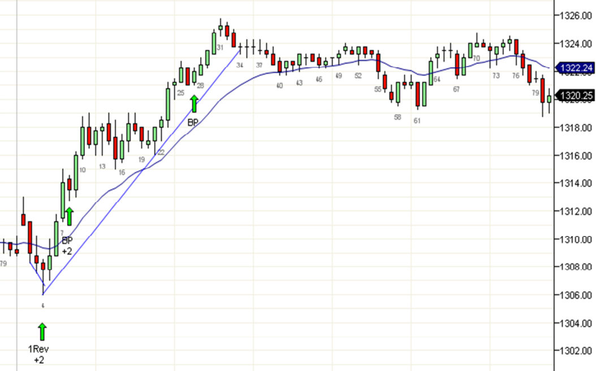

Days that have small trend bars that move 3 or more points from the open bar and reverse after a trend channel violation on a reversal bar that has at least a 2t body (regardless of color) are clear and obvious first reversals and should be taken. If the reversal bar is about the same size as the previous bar, it increases the chances of a successful reversal. These can be taken even if they do not have prior strength in the day as long as there is some indication of strength such as a prior attempt up (the gap) or strength from yesterday.

If on the other hand the first one or two bars is large, its possibly a trading range and you should look for an expanding triangle breakout into trend. When in doubt due to multiple large bars, if the second attempt in a direction fails, you can take a trade in the opposite direction. If nothing is clear wait for a breakout and then take the first pullback.

A clear first reversal is likely to bring in lots of traders and you can expect a strong trend in the new direction. A weaker first reversal may not go much beyond the first bar before it gives a pullback. So on most days, the first pullback is easier to read and safer to enter and you can avoid the first reversal completely.

<!-- p.155 -->

## The poor first reversal and triangle open

Wednesday, March 9, 2011 · p.155

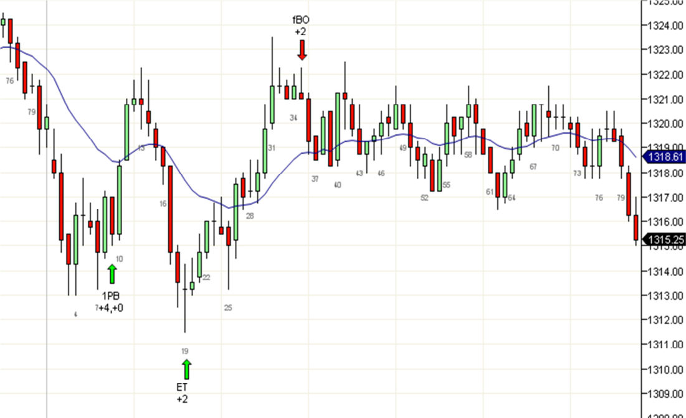

When a day opens right in the center of a previous day, the price will oscillate up and down trying to find resistance and often results in a trading range day. On such days taking every reversal is feasible if the swings are large (say 6+ points).

Usually, the price forms an expanding triangle as it takes out every new extreme. Occasionally such as today, we get a triangle breakout. Two lower highs interleaved with two higher lows form a triangle as we had at the open with b4,5,7,8,9 Triangle breakouts into trend often fail and turn into expanding triangle breakouts as we saw today but can result in a runaway trend if the open is on a large gap up or down from previous day.

When the first reversal is not clear as in b3 due to bear close, small reversal bar compared to previous bar and no overshoot of TCL, the price often fails after taking out the first bar as we did today at b13.

Once we got a poor A2 long at b40 that no one took, the trend basically ended and the best thing to do is to wait for a breakout. A late DP breakout at b78 may have started a late break into a down trend that may continue tomorrow.

<!-- p.156 -->

## Failed breakouts

Thursday, March 10, 2011 · p.156

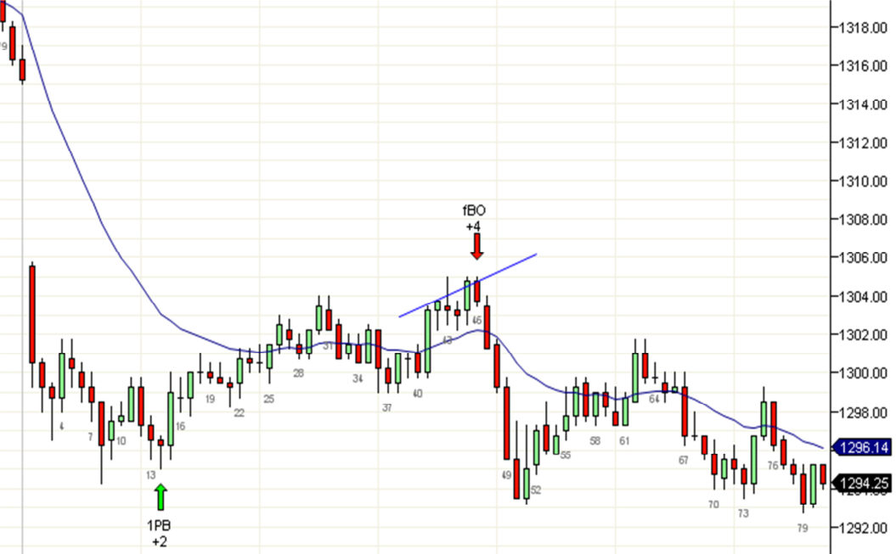

Today's entry represents the center square of the nine transitions. The trick to trading failed breakouts is to only trade them in trading ranges and when previous strength in your trade direction is proven. Trying to trade fBO in trends is disastrous, wait for overshoot or trendline break first.

Today's open bar was large and any large bar (3+ points where an average bar is around 2 pts) and large bars near the open are trading ranges regardless of the size of the opening gap. Since b1 is a trading range, it can be traded as a trading range. You can sell a breakout pullback of b1 by selling below b5 or buy b14 as a second attempt to fail the breakout. Note that if we did not have the strength of b4 and b11, this would be a low probability trade.

The move to b43 can be seen as a trend move from b14 to b31, its trendline break on the move to b37 and a move to a nominal higher high. This is a trend termination and possible reversal. b46 was a second attempt to fail the breakout after b44 and therefore a high probability trade. A first attempt can be taken if the signal bar is very well formed such as a reversal bar on overshoot. If not, its very likely a poorly formed first attempt will fail and possibly stop you out. A cursory glance at today's action will illustrate the importance of taking only well formed signal bars. Shorts below b16,20,24,27 all failed because they were essentially doji bars. Shorts below b31,b46 and b63 fared much better since they were trend bars. Lower bar quality is tolerable for the first hour and second attempts as illustrated by b14 and b73.

In summary, to correctly trade a failed breakout, you need at least two of prior strength, a great signal bar, an overshoot and second entry.

<!-- p.157 -->

## Triangle breakouts

Friday, March 11, 2011 · p.157

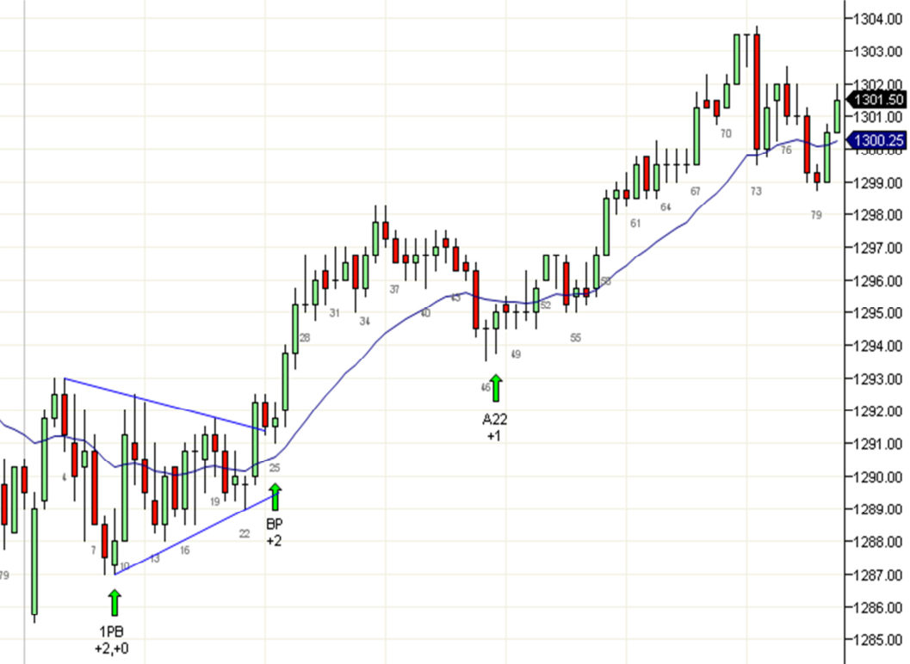

Triangle consolidations can be easy to identify such as the obvious one from b4 to b22 but their breakouts are tricky to predict. Although they could go either way, the relative strengths of bars will usually give an indication of which way they will break. The strong trend bars making the up moves while taily bars making the down moves such as today usually imply and upward break.

Triangle breakouts lead to very strong trends, and you should always take them, especially if you get a breakout pullback signal such as b25.

The biggest risk trading triangles is they often turn into expanding triangles. That is to say after the breakout at b26, it could have easily broken below b9 and then back up again. This is why you always need to take some profit on a strong breakout out of the triangle. If the pullback is not strong enough to turn into an expanding triangle, it often gives a 2 legged pullback such as the A2 at b46. This is usually an excellent trade if its deep since the ones who missed the breakout will enter with you.

<!-- p.158 -->

## Breakout pullbacks vs failed Breakouts.

Monday, March 14, 2011 · p.158

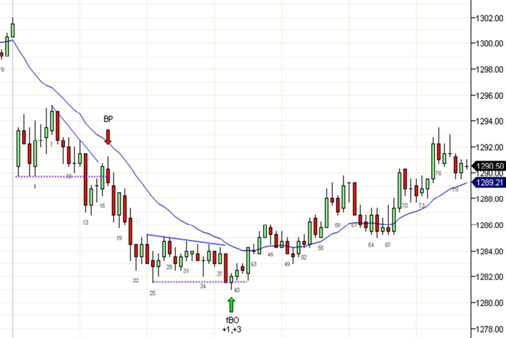

When there is a breakout you need to decide if you want to trade the breakout's failure (fBO) or if you want to trade a breakout pullback (BP), which essentially is a failure of the fBO.

In general, there are a couple of guidelines to help you make the decision. If the breakout bar was a strong trend bar that is halfway out of the previous range (or TL or ema) such as b13, there is a good chance you will get a breakout pullback entry that will take you to at least a measured move of the previous range. You should always wait for a pullback before entering if the breakout bar is large (say 3+ points). The second hint is the strength of the prevailing trend. If it looks like there is any sort of steep trendline, there is a good chance the breakout will succeed. If the trendline is very shallow, it does not contribute to the success of the breakout.

If the breakout bar is small (1 to 2 points) with a shaved close, you can enter right at the close or a tick beyond. This is especially true if the breakout is counter to the previous large move and closes beyond the ema.

If the breakout bar is medium size (2 to 3 points) or has a tail on the close wait for a breakout failure. If two attempts to fail the breakout are unsuccessful, you can enter in the direction of the original breakout.

Weak breakout bars often result in failed breakouts, especially a second attempt, which worked like an outside bar at b42. Note that to trade in the direction counter to the previous trend, the previous trend should have terminated (via TTR or overshoot or trendline break)

<!-- p.159 -->

## Wide range days

Tuesday, March 15, 2011 · p.159

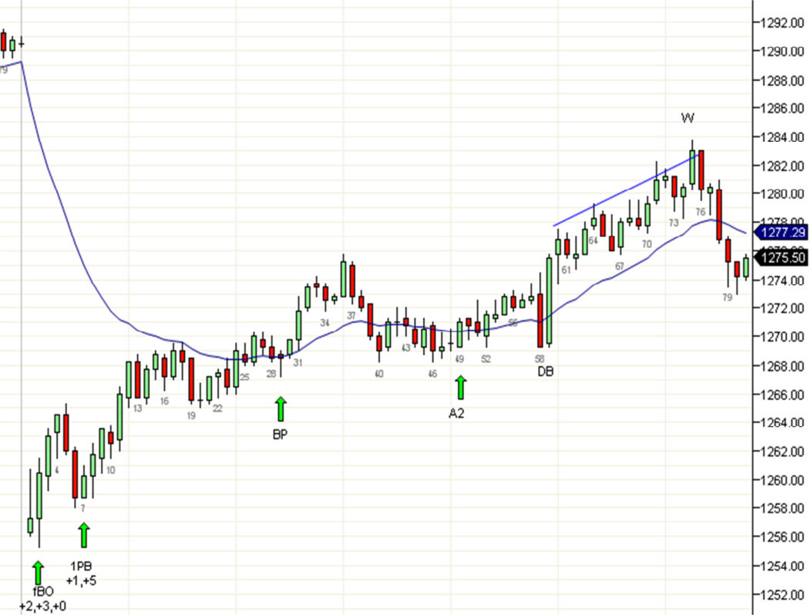

The first time a huge gap down appears in a down move, there is a very good chance it will be bought and turn into a bull day. Bear moves bring large range days and one needs to exercise great care when trading these, especially the first few bars. One option is to trade a shorter timeframe, but you need to be more agile and your failure rate could be higher. The second option is to trade fewer contracts, which is not usually an option for traders who are already trading small size. The best option therefore is to only enter on small bars and even on big days you will eventually get such a set up. When there is a strong trend move at the open, you should always take a 1st pullback and hold it till you encounter signs of trend termination. If you get a windfall because of a couple of large bars, its ok to exit and wait for the next trade or end your session.

On a FOMC day, its best to wait for a breakout bar and go with its failure. Today we had a strong bar b58 whose low did not trigger and the price broke above the trading range. a BP long trade at b62 gave a measured move of the trading range between b36 and b58.

Traders who held till the end of day or sold at the 3rd push of the spike and channel from b59 to b76 profited 30 points or so and this is something you can often see in wide range days of bear moves.

<!-- p.160 -->

## Trading strong bear days

Wednesday, March 16, 2011 · p.160

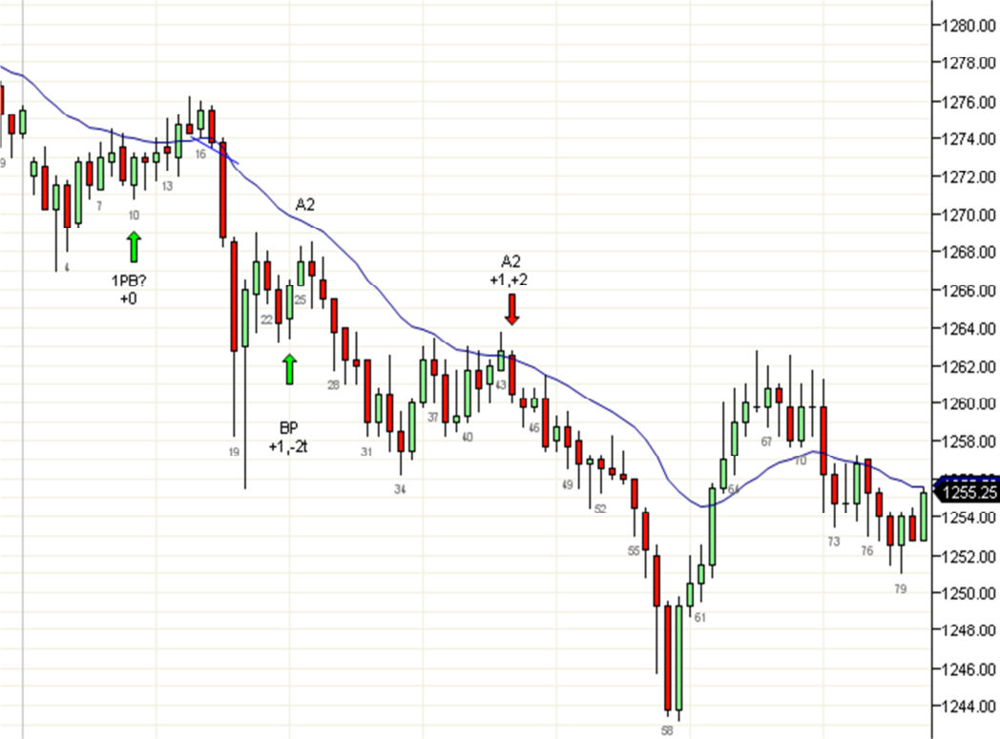

Trading strong bear days is one of the hardest things a trader can do for various reasons. The major challenge is that the price moves very quickly and pullbacks are equally violent. Shorting mid bar or below a large bar is extremely dangerous, as sellers near the lows of b19 and b58 were rudely reminded. Note that before b58 there were 3 other bars that would be considered large and only look small in comparison to the huge bars near b58 and 59.

When bars form on days like these, they wiggle a lot and will usually take out your breakeven stops so a better strategy is to take longer scalps and use slightly larger stops. When a trend is in motion, MTL breaks can be used to enter with the move. Almost every bar in the down move had a bottom tail or an inside bar following it. These are sharp intra-bar pullbacks, making it hard to enter a swing position and forcing the trader to scalp a point or two and look for the next entry.

<!-- p.161 -->

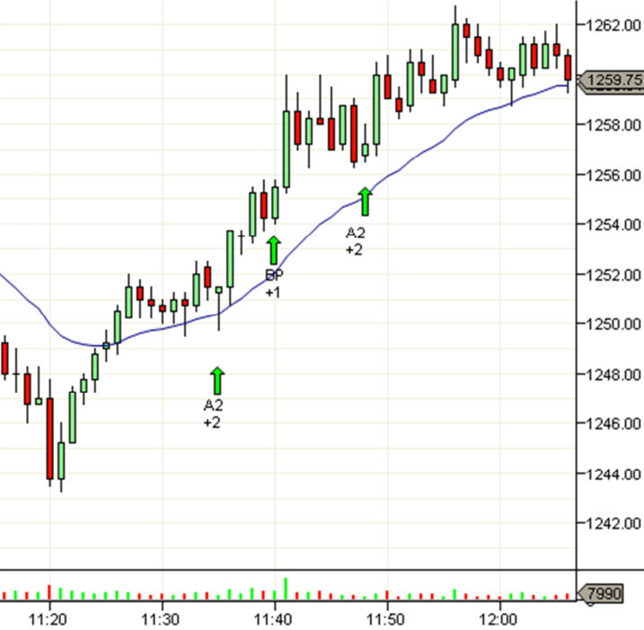

If you are an agile trader, you could probably trade a faster chart such as the 1minute chart. The intra-bar wiggles and sharp pullbacks form normal sized signals and can be traded for more entries. Tick charts and range charts can also be used, but price action varies slightly on such charts and its not something you would be trading on a day like this without a lot of practice.

<!-- p.162 -->

## Double top and double bottoms

Thursday, March 17, 2011 · p.162

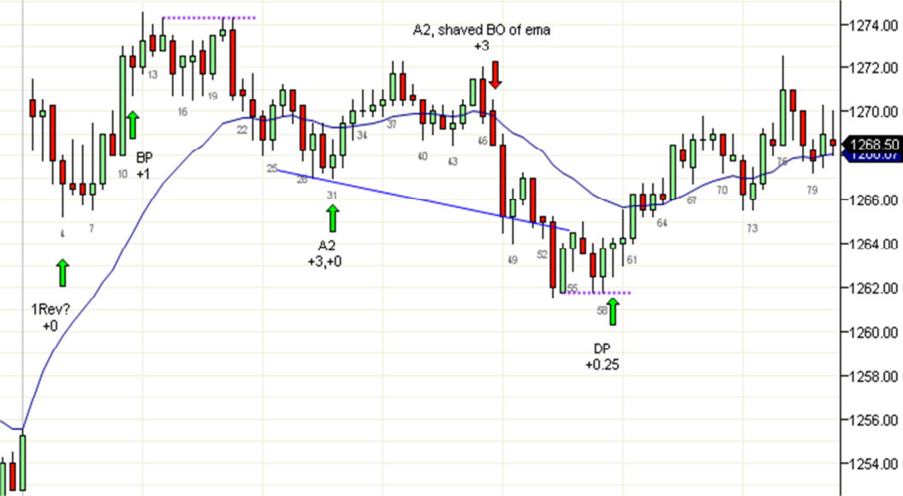

Double tops and double bottoms are important trend terminators and are the easiest to identify. Once the price forms a trend terminator, a transition from a trend to a trading range is complete and you should no longer be thinking in terms of trend continuation, but rather trend breakout. On a trend day, you usually find at most one of these. Trading range days can have two or even three.

Any overshoot of a trend channel line by the bars that form the DP increases the chances of a deep pullback and a wide trading range, allowing a possible trade off the double top or bottom.

On a trading range day, any 2 legged move to the other end of the trading range can still be traded as if they were an A2 (b31 and b46) even though they are strictly not trend continuation. Once a trend has terminated in one direction, the next breakout could be in either direction, so its a good idea to enter every 2 legged move if its sufficiently well formed.

Any pullback close upto midway of the bars forming the double top/bottom can be treated as a DP and shorted for a swing. An inside bar such as b59 serves as a pullback after a DB or DT so you could treat it as a DP signal.

<!-- p.163 -->

## Buy above bull bars, sell below bear bars

Friday, March 18, 2011 · p.163

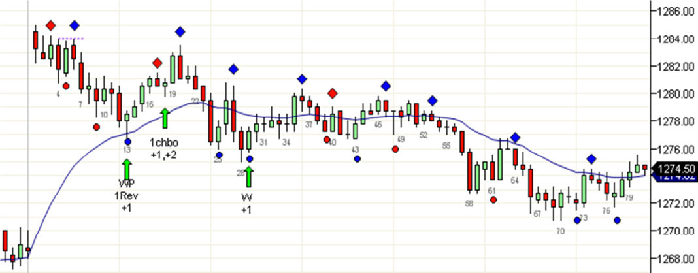

Buying above bull bars and selling below bear bars and avoiding any other bar is a critical component of price action trading. If you get eager and enter on marginal bars, you will reduce your success rate.

If you shorted only bear bars after a move up or bought only bull bars after a move down and hold for at least one point, you will make money on most days. Of course, on soft trend days or hard trend days you wouldn't want to do this but on the other 80% of the days this should leave you in the black at the end of the day.

In the chart above, successful buys are indicated by blue dots and failed buys are indicated by red dots. Blue diamonds signify successful shorts and red diamonds indicate failed shorts.

For example, even though today was an overall bear day, the only buy above a bull bars that failed were inside bars b5 and b70. These are not buys per price action principles and you wouldn't be buying them. Similarly the only bear bar that would fail was b17, an inside bar variant you wouldn't be shorting.

If you only took the longs on non-inside bull bars for 1 point you would have +5. Shorting below non-inside bear bars at a swing move would give you an additional +8.

Just don't forget the inside bar and doji exclusion rule. While they sometimes work, knowing when its appropriate to trade these exceptions takes quite a bit of experience.

<!-- p.164 -->

## TTR trend terminations

Monday, March 21, 2011 · p.164

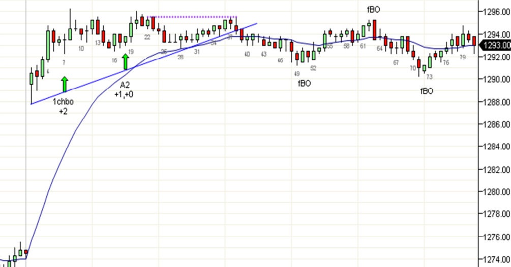

Trends can terminate into a TTR after a large move up and this includes large gaps. A TTR that slopes up after a pullback will often make a double top or nominal HH or LH. If on the other hand a TTR slopes down from the high of the day, then it may make a two legged or three legged move near the high of the day and then move down.

BW early in the day as we saw near b6 is often an early sign of TTRs and soft trends and one should take trades very carefully. Once the TTR has terminated the trend, the next move is to wait for a trend breakout such as expanding triangles or DP. Any two legged move can be traded if the range is large enough. Today the range was barely 5 or six points so you would risk about 2 points to essentially make 2 points or less. Normally, its best to avoid trading at this point.

A huge gap up day that does not go anywhere is often a consolidation and a gap on the next day is likely to extend the gap and turn into a trend day.

<!-- p.165 -->

## Small range days

Tuesday, March 22, 2011 · p.165

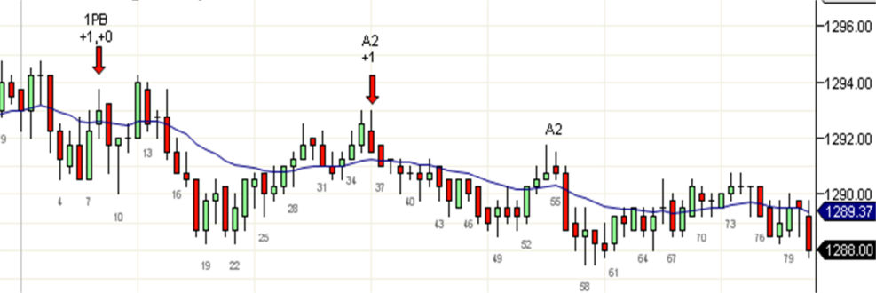

Small range days are extremely choppy and usually higher risk since every trade needs to be a scalp. Price action will be hard to read and bars will usually look terrible. In general I avoid trading these days and often take no trades. You need to be an excellent scalper with a high percentage of success to trade these days.

Bars that had a small range the previous day and open with no gap or tiny gap (less than one bar) are candidates for small range days. If the first few two legged moves do not go too far and are made of overlapping bars, there is a good chance it will be small range day.

On days like this, do not expect any move to go much beyond the previous swing point. Counter-trend trades are extremely unproductive since the price is unlikely to move beyond a couple of points off your entry.

<!-- p.166 -->

## The swing view

Wednesday, March 23, 2011 · p.166

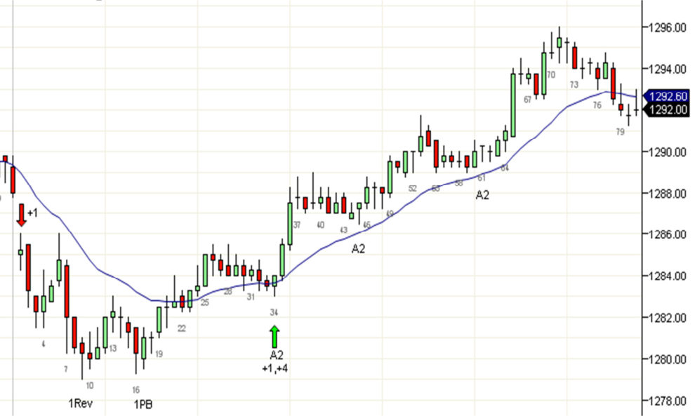

One of the reasons A2 is my favorite entry is that if you can get one relatively early on a trend day, you can choose to ride it till it stops you out by taking out a previous swing low. For example, if you entered above b34 today, you could move the stop every new swing low and you would finally be taken out at b78. On days when the A2 does not turn into a trend day, this may mean a loss of a point or two but on trend days you could take in 8 points or more.

For example, in our chart today, its quite OK to miss all the turns and bends before the A2 at b34 if you have the patience to ride it to the end. This is why mastering A2 is far more important than getting the first reversal and pullback right.

First pullbacks however, are crucial on large gap open days and possible hard trend moves. This is because the move after the 1PB could be most of the move of the day. When a 1st pullback signal bar is weak such as b6 today, chances are it won't be a runaway trend so its ok to skip it.

If you want to be a with trend trader, a good option is to wait for A2 for the first trade of the day. If there is no A2, chances are the day will not trend and its ok to sit out rather than get chopped by tiny moves.

<!-- p.167 -->

## TTRs are trading ranges

Thursday, March 24, 2011 · p.167

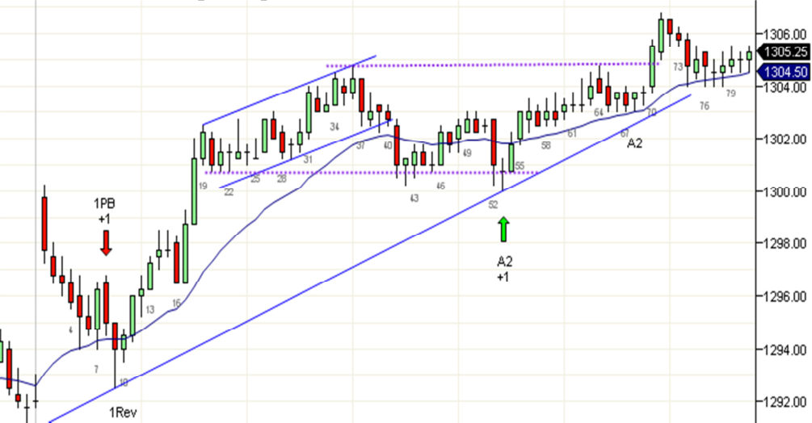

Trends can terminate into a TTR after a strong move when there is no real overshoot. The TTR could be flat, with trend like today or opposite to the trend. Either way, when a trend terminates in a TTR, you should exit at the next with-trend push and wait for a breakout pattern to emerge.

When a trend terminates rather than just reversing, it has turned into a trading range and will attempt to breakout of the trading range. A rising trend will test the bottom (b42 and b53) while a falling trend would test the top of the range. A successful break of the trend bottom may give a BP entry in the direction of the breakout. A failure will cause the price to test the other end of the TTR and breakout possibly giving a BP entry (b68)

If the TTR range is large enough, you can buy near the low of the range and sell near the top until you get a successful breakout.

Flat TTRs on the other hand almost always breakout in the direction of the previous trend. This is because they are ii or iii flags on larger timeframes. Another reason is a possible absence of counter-trend strength in a horizontal move.

<!-- p.168 -->

## Breakout pullbacks as trend generators

Friday, March 25, 2011 · p.168

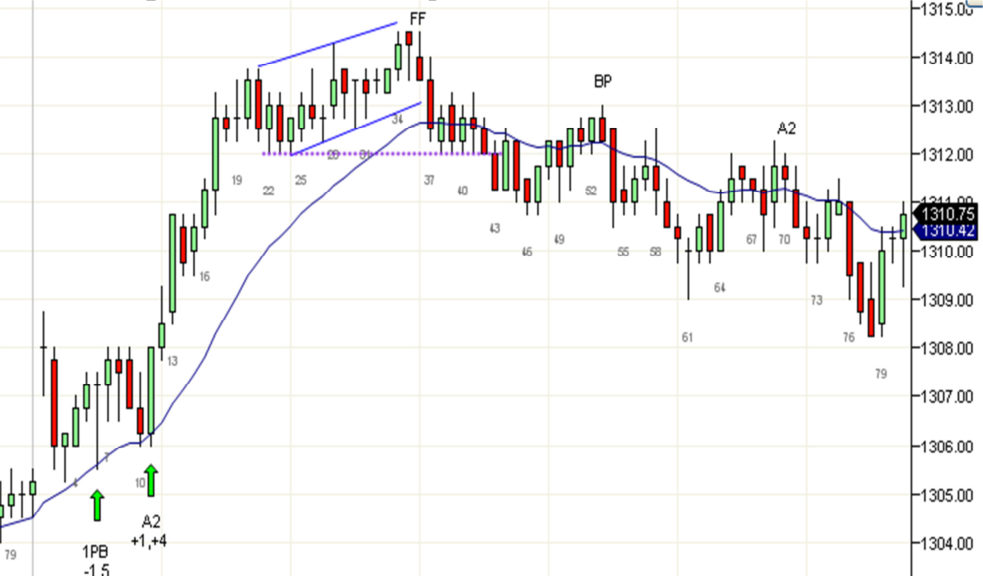

When a move ends in a TTR, the right thing to do is to exit your position, say near bar 20 or so and wait for more price action. Yesterday we had nearly similar price action with a pullback to ema followed by a rally that ended in an up-sloping TTR.

The TTR broke down to test the low of the channel and whereas yesterday it failed and moved to the top of the channel, today it succeeded as a breakout pullback. There were two clues to read this correctly. Two attempts to fail the breakout did not go anywhere (b44 and b47). This resulted in a breakout pullback trade that should give at least two legs down. The A2 pullback to b70 meant at least two more legs down that ended in bar 78.

Compare this to the price action yesterday at b42 and b53. The price couldn't even close below the BO point. The follow through on the second attempt was decent enough (no pullback below previous bar for many bars, multiple closes above ema, break above swing high) that the second attempt to fail the breakout was successful enough to warrant a test of the other end of the trading range.

<!-- p.169 -->

## Late trends

Monday, March 28, 2011 · p.169

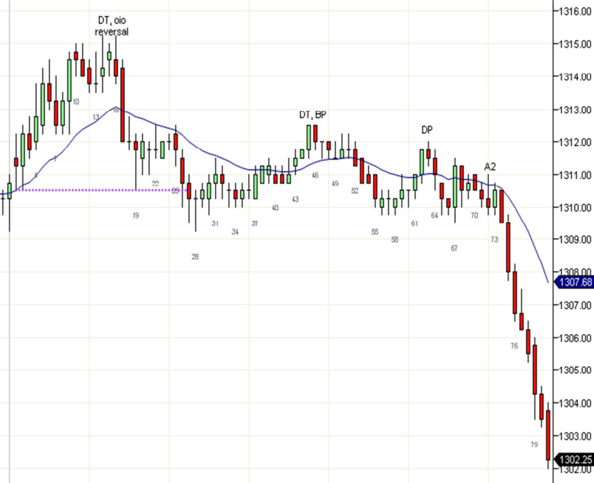

When trends breakout late in the day after an entire day of horizontal movement (as opposed to a late continuation or reversal move), they tend to go on till the end of day without any break or reversal. This is because scale in traders will not trade counter-trend since there is insufficient time to make scale in plays. This results in a sharp rally or sell off that you should hold till the close.

The early move from open to HOD was weak with overlapping bars and was essentially a test of yesterday's high. Once it failed, the price dropped to test the low of the trading range. A breakout below the LOD at b26 was sustained for two more bars, which is a good sign that a BP trade would set up and it developed at b46.

A DP trade, which by its nature is a higher probability trade developed at b63 followed by an A2 at b72,73. Note that every decent short signal since b16 has been successful, so the A2 was certainly a swing candidate.

Even if you missed all these, b74, a short shaved trend bar just below the ema is a fairly good entry bar and could be shorted on its own merit.

<!-- p.170 -->

## Classic trend day

Tuesday, March 29, 2011 · p.170

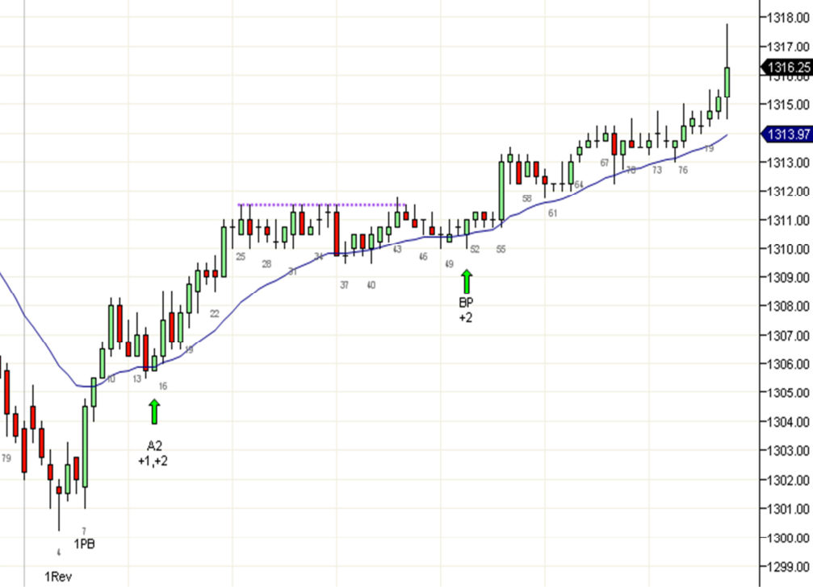

"In bear markets, stocks open strong and close weak.In bull markets, stocks open weak and close strong."

When the market opens close to the low, runs down and reverses near the low, its usually a good indication for a possible bull trend move. The safest entry is at the first pullback and you should be able to hold on to it till the end of the day or trend termination.

Sometimes horizontal TTRs will set in that almost always break in the direction of the prior trend. The best way to get in this move is on a breakout pullback like b51 today. A horizontal TTR is usually a shallow pullback on a higher timeframe chart. One way to save your self being chopped up is to look at a 30m chart and take an entry there. For example, today's move was a shallow A2 pullback on the 30m chart.

Nevertheless, if you only moved your stop below every two legged higher low, you could have held the swing portion of the trade till close.

<!-- p.171 -->

## Trading ranges: breakouts, fBO, BP and TT (trend terminations)

Wednesday, March 30, 2011 · p.171

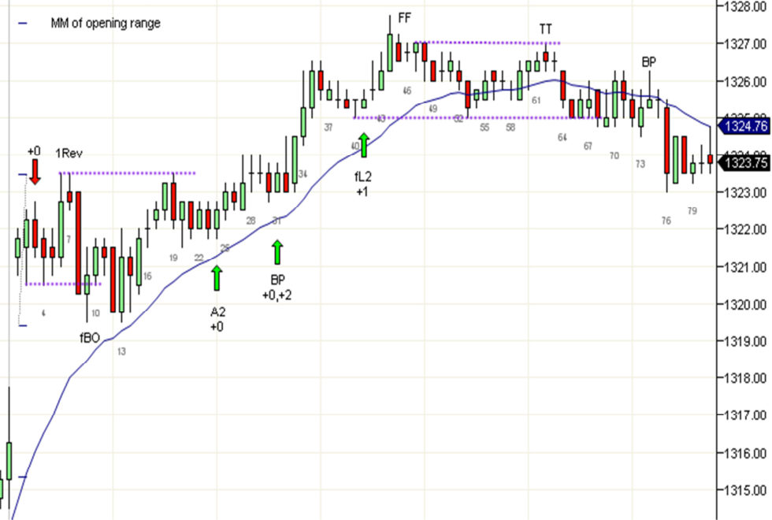

Trading range days can be traded well with some price action analysis. If the first few bars are taily and overlapping, there's a good chance you have a trading range day.

The trick to analyzing trading range action is to look at them as series of failed breakouts and breakout pullbacks. The very first bar was a trading range bar. The second bar ticked below the first bar, then ticked above giving two fBO of b1. b3,7,10 were also failed breakouts. Failed breakouts of a trading range can only be expected to test the other end of the trading range and sometimes they may not reach the other end but give a breakout pullback. If the signal bars are well formed, you can trade a second attempt to fail the breakout (b13 is a second attempt to fail the breakout below b4, the recent low of the day), but you should only expect it to go to the other end of the range (b7 high, reached at b19). When the other end of the range is reached, you may get a breakout pullback. This is a high probability trade and should be expected to go to a measured move of the prior range (b44). Trends terminate when you have highs and lows sideways rather than HHs and HLs. So at b62, we have two lows and two highs that are no longer in a trend. Often, this will breakout into a new trend in a breakout pullback pattern again. Often, its in the direction of the prior trend but if the price action has been marginal, it may break down as it did today. Regardless of whether b74 is an A2 or BP, its basically the same trade. The price tried to move twice in one direction and failed, so it tries to test the other end. If you already had a low that was close to the prior low(b53 near b40) and you get a two legged move to a LH (B62) or DT, its best to exit since the next move up may not go above this point.

So to summarize, BP are trend generators, fBO are fades, TT are exit (but not reversal) signals

<!-- p.172 -->

## Determining trend day versus Trading range day

Thursday, March 31, 2011 · p.172

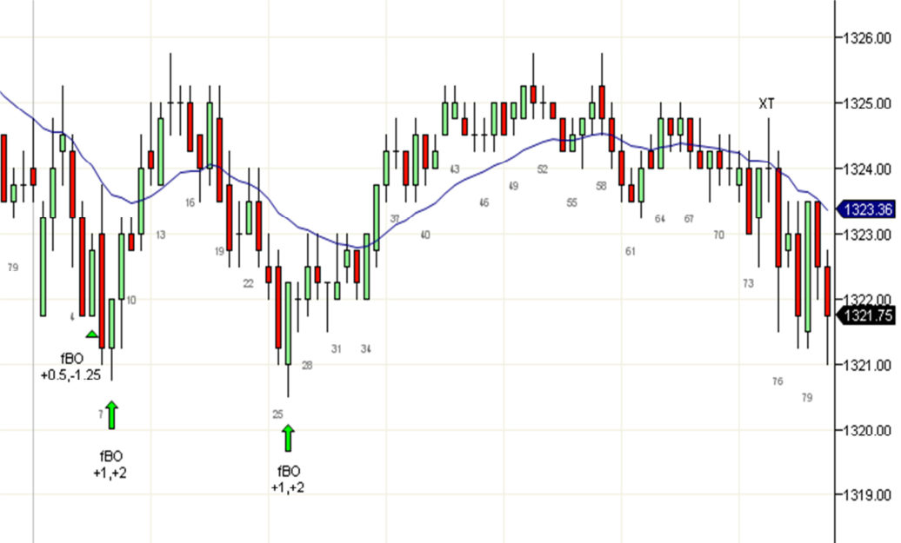

Trend days and trading range days require different kinds of trading and being able to recognize them early is essential for successful trading. On a trading range day, the range could be small like today and any swing entries are likely to be taken out.

The easiest way to differentiate between them is to take a step back and look at the chart after the first few bars. if the price hasn't moved a large distance from the opening bar, you are likely to encounter trading range action. If the price has moved 3 or more points beyond the first bar (even if it has subsequently turned around), its likely to give you some trending action. On a trending day, you can enter a swing entry on the first pullback and ride it till the trend terminates. You could also enter on A2 or other continuation setups and most trades are likely to succeed with trend. On a trading range day, you are essentially going to encounter a series of failures. Occasionally, a trend will breakout from a trading range but predicting breakouts is hard even for experienced traders and most breakouts fail (every breakout today failed). When the price tries to breakout beyond the trading range, you could enter with the second failure. This has a good chance of working if the signal bar has a strong close such as b8 and b26. When signal bars are poor or overlapping such as b52 ii or b58, you should trade lighter and take smaller profits. A fBO entry needs to be very strong to qualify for a swing move and while second failures tend to test the other extreme of the range, there is some chance it does not go that far. Most of your targets should be modest. If it does breakout strong and then gives a pullback, its a possible trend generator and you can enter with the new trend.

To summarize: Trend days give swings and continuations; Trading range days may only give fBOs. fBO are riskier, lower percentage trades that should only be entered on strong setups for smaller targets.

---

[← Previous](10-2011-02.md) · [Contents](00-目录.md) · [Next →](12-2011-04.md)
