[← Previous](11-2011-03.md) · [Contents](00-目录.md) · [Next →](13-2011-05.md)

# April 2011

Original pages 173–192

<!-- p.173 -->

## Trending Trading ranges

Friday, April 1, 2011 · p.173

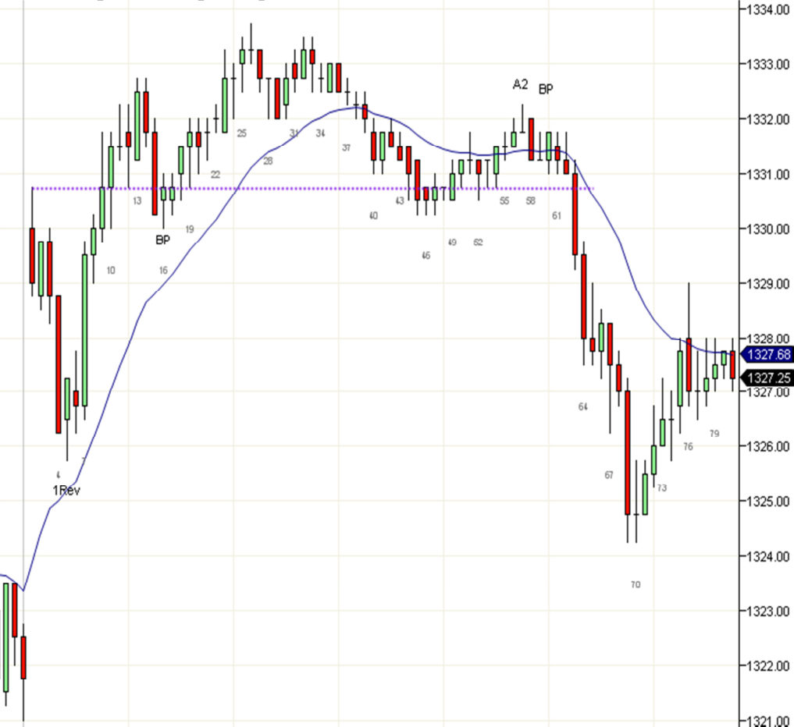

Trading ranges can break into trends from a BP but sometimes they break into higher trading ranges. Usually, there is one break back into a prior trading range during the day. Trending trading ranges are traded exactly like trading ranges. Once your get a breakout pullback, if the trend terminates for any reason (today, TTR b16 to b25) you should look for new breakouts or fBO trades.

Today, we got a breakout pullback back into the lower range at b58. A break into a prior range usually tests the other end of the range (b5 low). If you miss the initial BP or chose not to take it due to the BW price action, you could enter below the bo bar b63 as long as the bar is not too long (say under 2 points).

There were very few reliable trades today. The price action after the early move was poor consisting of 2 and 3 tick dojis and its usually a good idea not to trade them and simply wait for a breakout and then choose to enter a high probability trade.

<!-- p.174 -->

## Days with poor bars

Monday, April 4, 2011 · p.174

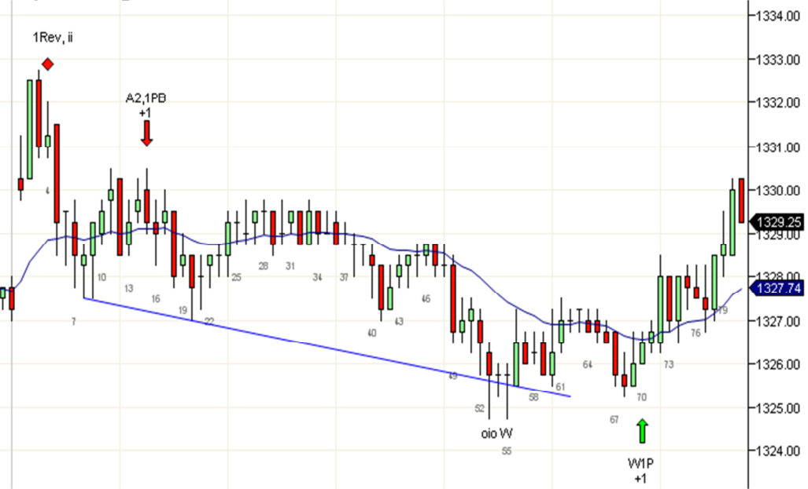

Sometimes for days on end, you can have days with bars that are four ticks or less and many are often dojis. Days such as these are not very productive and every breakout only goes a point or two. There are a few ways to deal with these days.

The simplest option is to not trade such days or trade very few setups. If you get in early, for example the 1st reversal below b4, you could hold on till you see a clear sign of reversal at say bar 55 and ignore all the poor bar setups.

The second option is to take modest profits, say 4ticks for every entry. You should trade smaller size say half your normal size, since you are likely to get stopped out. You could add on the other half where your stop would normally be taken out. This way, you have a better chance of exiting with a modest profit.

The third option is to fade poor setups using limit orders on such days. For example, b13 was a poor setup and it had a poor entry bar. A limit trader could short the close or high of b14 with the plan of adding on some more shorts if it moves against the trade. If you choose to do this, keep the trend direction in mind and take only with trend trades (dont short after the b55 reversal for example.)

<!-- p.175 -->

## Trend reversals

Tuesday, April 5, 2011 · p.175

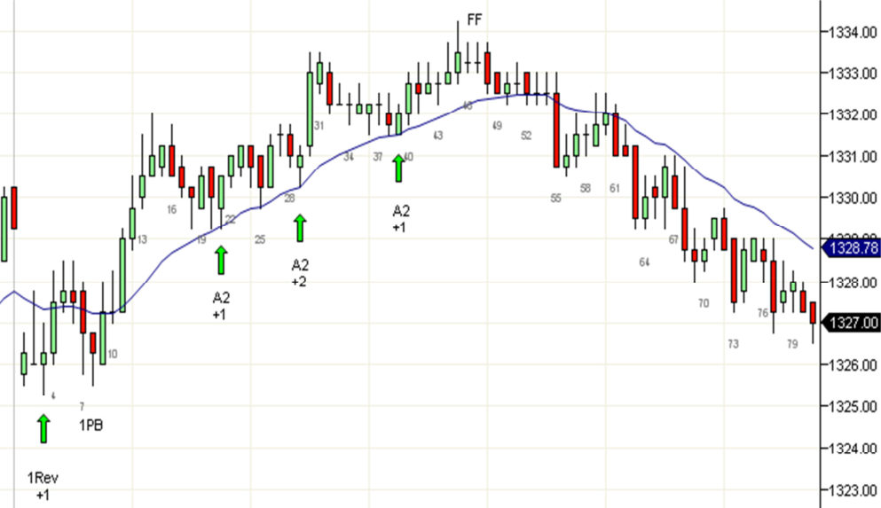

Most trend reversals you see intra-day are likely to be Wedge reversals. Often there is an overshoot and a reversal bar on the third push and this makes the reversal very clear. However, for bullish trends, there may be no overshoot at all. Three pushes up by itself does not make a wedge. You need something else, such as a TCL overshoot, a reversal bar or a final flag (FF) as in b47 at the end of the third push to qualify it as a reversal.

The three pushes also need to be counted from trend breakout, therefore b5 does not count as a push. Once the FF triggers, you can look to short. If you do not wish to short the BWish FF, you should simply wait for an A2 short entry such as b62.

The rate of success for shaved or trend signal bars are high and you should taken those rather than dojis. For example, b65 is an ii, but its an L1 and also a doji so you are better off waiting for a bar like b67 which has higher probability.

<!-- p.176 -->

## Two legged W1P

Wednesday, April 6, 2011 · p.176

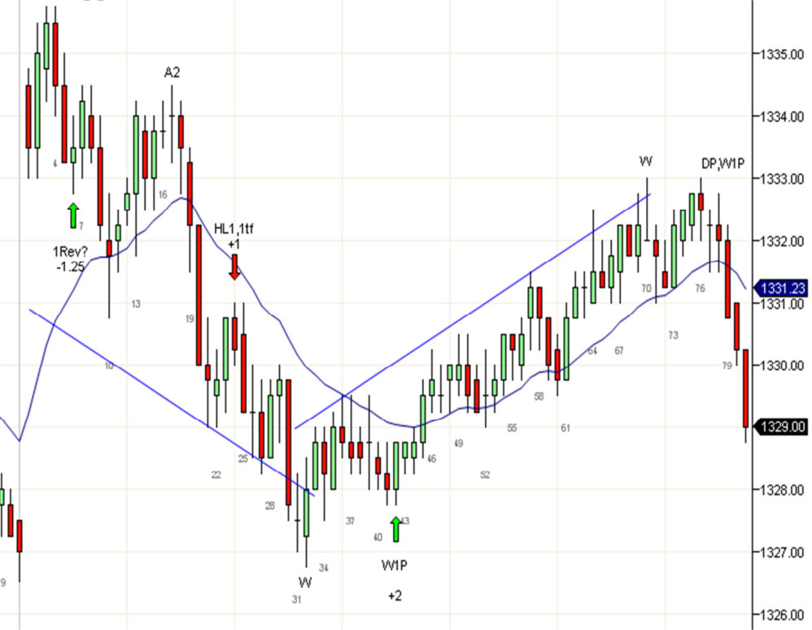

The best W and W1P are off strong reversal bars. Sometimes, the reversal bar could be an outside bar as in b32, which is a possible trading range. The entry bar could be small (b33) and its low taken out (b34). Normally, this is not a W1P candidate. However, due to the extensive overshoot, there will certainly be a bullish pullback at least.

When a bar such as b32 forms the reversal bar, due to the overlap, there is a very good chance the entry bar will be taken out. Next, if you get a failed continuation signal (such as the failed A2 short at b38), then there is a good chance it will act as a 2 legged W1P. Note that when the W signal bar and entry bar are strong reversal and trend bars, the pullback should not go more than 1t below the W entry bar.

If the W reversal bar was weak because it was bearish or a doji or too large or not a deep overshoot, this is no longer a W1P but simply a trend termination into a trading range and you should look for breakouts and failed breakouts.

<!-- p.177 -->

## Breakout tests as trend continuations

Thursday, April 7, 2011 · p.177

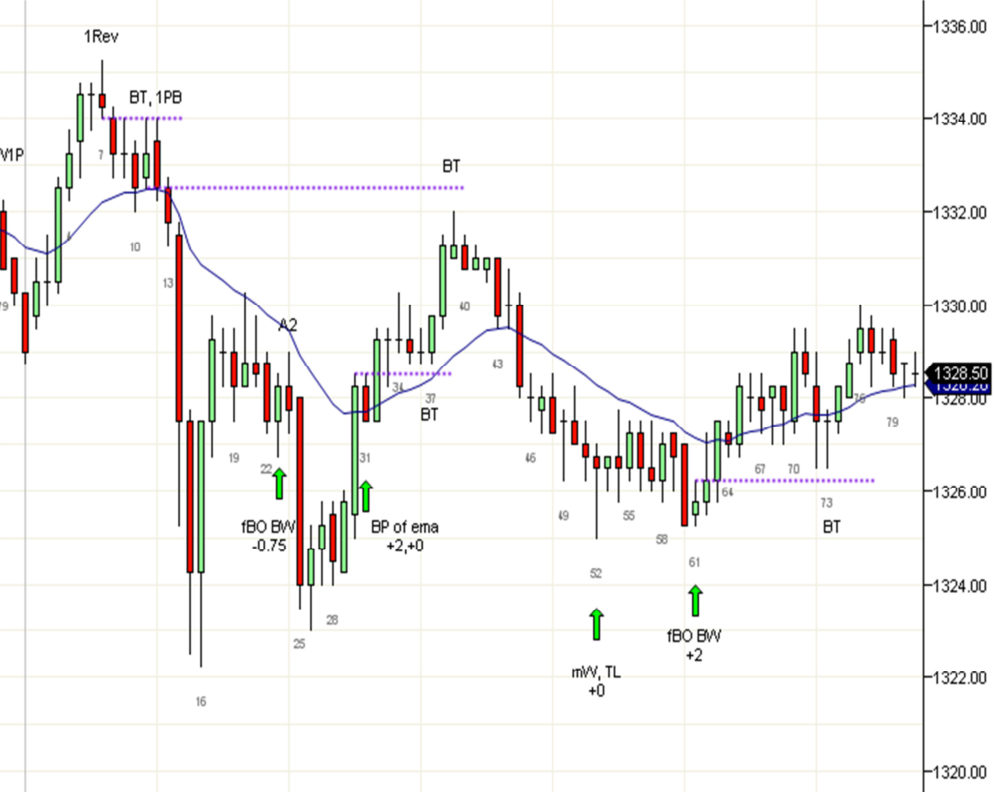

A breakout test (BT) is a pullback to -1t to +2t of your original entry. Essentially, this means that the traders are re-affirming the original trade and the price is likely to continue in the same direction. BTs are an important indicator or trend continuation. BT is one of the rare places where you can treat a doji bar as a valid signal bar.

A BT after a reversal bar is a form of 1st pullback trade and can lead to a large move. On a day that's essentially a large triangle day such as today, you can have BT on both sides as the price tries to consolidate.

BTs are a few places you can buy limit, since the stop is simply beyond the prior swing point. However, conservative traders can simply wait for the bar to form and then enter on a stop beyond the signal bar.

BTs are not limited to bars at swing points. Trend lines, ema (b31), and basically any barrier that the price breaks through can give a breakout test.

<!-- p.178 -->

## A channel like trend usually has a second similar leg

Friday, April 8, 2011 · p.178

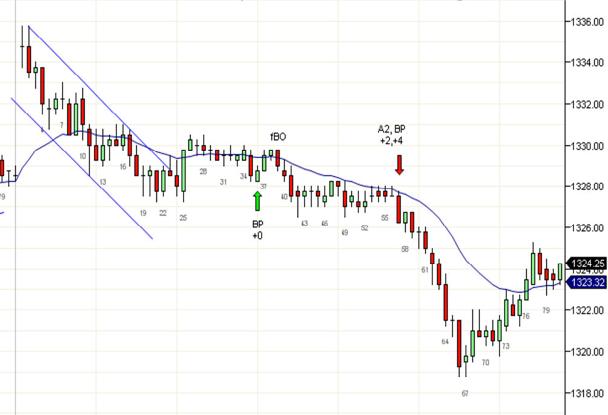

When a trend that is moving practically in a channel, it will effectively act as one leg (and usually is on a larger timeframe). When such a trend breaks, there is a very good chance that the break is simply a pullback and the trend will resume into a second leg of comparable size.

b25 broke the AM down trend and terminated the first leg. A strong outside bull bar in a bear trend is a trading range and you should trade it like a trading range. If there is a strong breakout, you could trade a BP (b36) and if it fails, you could trade a fBO that should take you to the other end of the range.

At this point, you could take a BP short. A second attempt (b57) is effectively an A2 and therefore a high probability short.

<!-- p.179 -->

## The first two legged pullback of the day

Monday, April 11, 2011 · p.179

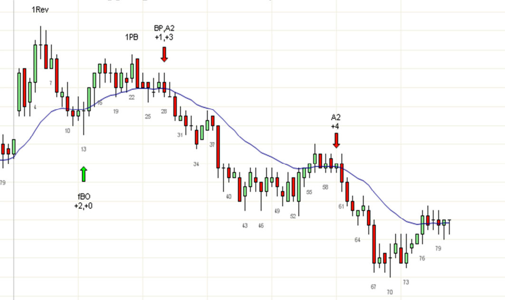

If you could only trade one trade a day, the first two legged pullback is the best candidate. You should take out at least 1 contract at +1 and let the rest run. Usually, if the day is going to be a trend day, this is your best chance at leaving a stop at breakeven and getting most of the move. If your breakeven stop is hit, there is a good chance this would not be a big trend day.

A second option is to move the stop after every new high or low. So for example, after b34, you could move your stop above b28, then move it above b37 when b38 makes a new low and so on. If you took some more off at a larger target, say +4, you could then move the stop only after 2 legged moves, so say above b56 after b64 made a new low.

On days that do not have a two legged pullback, well you dont need to trade since its possibly a hard trend day or a trading range day, which are not amenable to swinging.

<!-- p.180 -->

## Anatomy of a trading day

Tuesday, April 12, 2011 · p.180

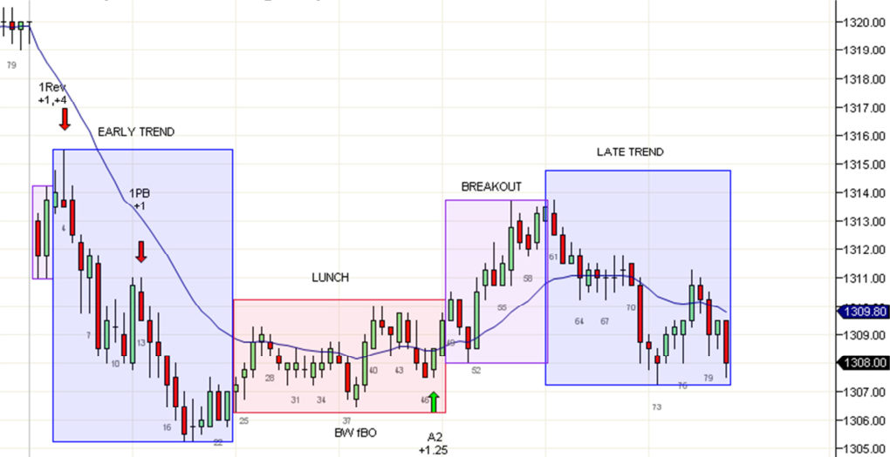

I generally view the trading day as a series of sections that are comprised of the following:

1. The opening bar
2. The opening range
3. Breakout and possible reversal of the opening range
4. The AM trend
5. Lunch consolidation
6. Breakout from lunch consolidation
7. The PM trend

This breakdown is a guide and not iron-clad law. Some days may look like lunch the entire day and we call those small range days. Some days will start with the first reversal and the AM trend may continue into the close. We call these trend from 1st bar days. You need to adapt your expectations to the price action you see early in the day. For example, a day with large counter-trend bars in the early trend may give a stronger breakout attempt from the lunch consolidation, while weak or no counter trend bars may result a shallower attempt.

How do you trade these? In general, if the first bar is a trend or reversal bar and has a strong close and is beyond the range of the previous day, you could trade its breakout, especially if its trying to close the gap. Often this is the best entry on such days. On most days however, its best to let the opening rage define itself and either fail its breakout or enter on its breakout pullback. This is your best chance of getting into the AM trend. On many days, if you have a winning day at the end of the AM trend (usually 2 hours after open), you can simply choose to end your trading session and enjoy the rest of the day. This is because lunch session is usually full of poorly formed bars and dojis and most traders get trapped and lose some of their earnings. Occasionally, there are trades and breakouts during lunch hour but if you want to trade, note that most trades are at best scalps on most days. The market will attempt to breakout of lunch and sometimes it succeeds, but often this move will fail and turn into a PM trend. The PM trend can run till close but occasionally, profit taking will cause a pullback.

Overall, your best strategy is to get most of the AM trend, sit out the lunch (or scalp if you are good at it) and fade the lunch breakout.

<!-- p.181 -->

## Signs of trend strength

Wednesday, April 13, 2011 · p.181

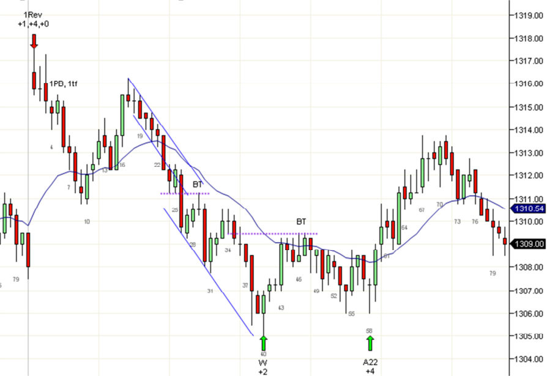

The first leg from b1 to b10 showed various signs of trend strength today:

- Reversal bar with strong close (1t or less tail on entry side)
- Trapped traders (b3)
- 1tf (b5)
- No counter trend bars (b5 was not a trend bar)

All these implied more down, despite the strong pullback from b10 to b16.

b23 was a double shaved ema breakout bar. Usually, these bars have follow through and can be traded on their own with high probability provided they are small and breakout at least 4t into the other side.

b26 was a rare range expansion bar. This is when a TCL OS expands the range rather than cause a pullback or reversal. Range expansion bars after a turn usually indicate increasing strength in the direction of the expansion. The width of the channel increased, indicating buyers did not step in where they normally do. (After an extended move, what looks like a range expansion bar is likely to be a climax bar and should not be taken as a sign of strength.)

Breakout tests are also strong continuation signals and can be taken on a single leg (L1/H1) and on marginal signal bars such as dojis. These may not work if the signal bar is not triggered on the very next bar (b46). A HL double bottom(b58) after a possible reversal (b40) indicates at least a comparable leg in the same direction (b59 to b67). Signs of strength can be used as a filter to avoid trading in the opposite direction in addition to trading them on their own. For example, a BT at b29 may imply that a b31 long is unlikely to be successful. Similarly, a HL DB at b58 may mean you should not fade the long breakout of the trading range from b43 to b58.

<!-- p.182 -->

## Trend trading

Thursday, April 14, 2011 · p.182

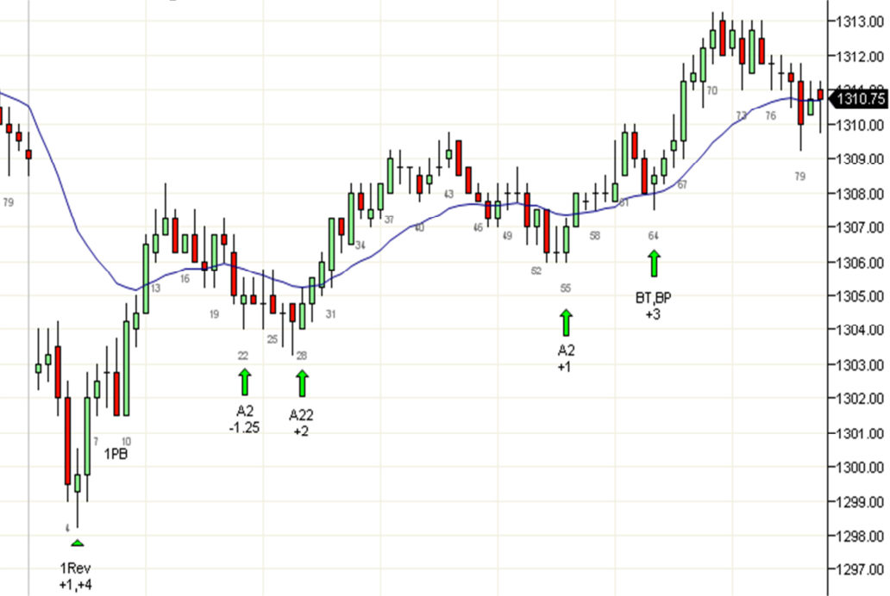

Trend days are easy to trade and you should make the best of it. Practically any with-trend setup will work and any style of trading is likely to work. Any trending indicator is also likely to work. On the other hand, counter-trend setups and oscillators are likely to give limited profit.

When the market opened well beyond the range of the previous day, there was a good chance this would be a trend day. The first reversal (b5) was a great place to get in. Buying the low of the first bear bar (b9) is a limit trading style that's usable in a strong trend and worked very well.

So did scaling in after every two point pullback through the pullbacks. So did buying two legged pullbacks on b28 and b55. Breakout tests worked well (b64) as did buying the ema and two points below the ema.

So did buying the first reversal and/or pullback and holding it till EOD.

The point is, you need to be very very bad to lose money on a day like this. When you do get a day like this, do not waste it, take every with-trend trade.

The most important question however, is when do you know its a trend day? Technically, a trend exists the moment you have a higher high and higher low. So by b14 we are pretty sure we are in a strong trend. This still leaves quite a few trades till the end of the day to make some profitable trades.

Anyone who is aware of price action trading realizes however, that the moment there is a large gap, its probably a trend day and the first reversal or pullback is a high probability entry and is worth taking.

<!-- p.183 -->

## Trendline breaks

Friday, April 15, 2011 · p.183

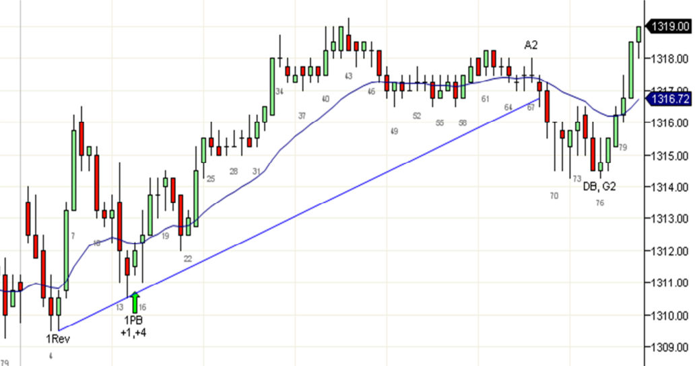

A hard trendline break has a comparable number of points before and after the break. For example, today the move from b43 down to b72 broke the trendline and there were about 2.5 points on either side of the break.

Breaks that are merely dips beyond the trendline don't actually break the trendline, rather they only shift the trendline to a shallower angle. What this means is that some of the counter-trend energy is absorbed but the market is able to continue on with the trend.

However, a hard trendline break terminates the trend. At this point the price will attempt to at least test the previous extreme (b43) and if it can only break out by a nominal amount (say a tick to a point beyond), then the market is likely to form a trading range between the two points. If any one of these points has a strong breakout, a breakout pullback could lead to a trend move.

If the newly formed trading range (b43 to b76) is large enough, say 3 points or more, you could take a failed breakout trade to the other side of the range.

If the breakout is very strong because it was a strong trend bar that closes many ticks beyond the previous high (such as b33 breaking above b8), then the trend is likely to continue, despite the trendline break.

Sometimes the market is too weak to break beyond the previous extreme and only succeeds in a two or three legged move that comes close to the previous extreme. This should be treated the same as a test of the previous extreme and traded similarly.

<!-- p.184 -->

## Trading TTR breakouts

Monday, April 18, 2011 · p.184

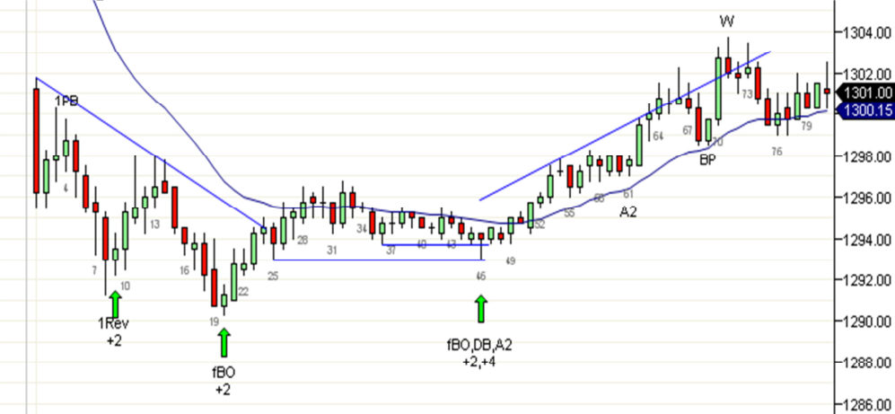

Breakouts are the hardest to predict and trade correctly and most people are better off simply taking the first pullback after the breakout. However, its possible to correctly read and trade breakouts in some cases such as today's extended TTR between bars 28 and 46.

The first clue was a channel move to the ema and three successful closes above it after three pushes down. The market then tried to sell off three times and failed. The first signal was an oio at b30, the second was an A2 variant at b34 and the last was an A2 at b43. True, they were all poor signals, but given the tenor of today's open and early move there was a good chance one of them should have at least given a scalp.

An extended TTR breaks the trendline even if the price had not done so explicitly at b24 today. b46 completed 2 legs down to a higher low. After multiple failures to continue in the previous trend, the price is likely to breakout and move upwards for at least two legs.

b46 was a weak bar if you judge it on its own but in the overall market context, it was a double bottom (with b25), a failed breakout (fBO) of the prior swing low and an A2 since its a two legged HL after a possible reversal (3 pushes down to a reversal bar at b20). Cautious traders can buy the next bull bar (b47) as long as its not too large.

Note that this is a specific case of TTR trend break and reversal after an extended move (b1-b20) and not to be applied anywhere you see barb wire. For most BW, you are better off fading a trend bar break out of the BW.

Getting into the right side of a breakout requires lots of experience and most traders can simply take the BP at b56 or b61 (which was also an A2)

There is one shortcut you can take if you recognize an extended TTR break of a trend. You can simply buy above any swing high (b47 or b42 depending on how liberal your read is) with a stop below the recent swing low (b46). You should move the stop below the entry bar (b49 or b51) as soon as it closes.

<!-- p.185 -->

## Failed Wedges

Tuesday, April 19, 2011 · p.185

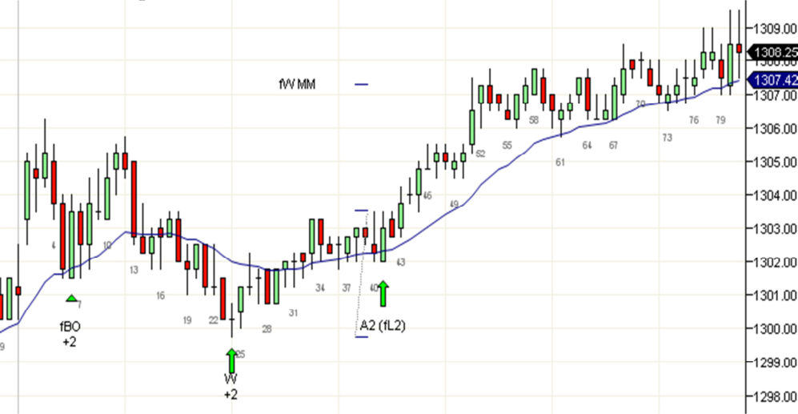

Wedges rarely fail, but when they do, they usually give a measured move to the other side of the wedge. The move from the LOD b24 to b40 was three pushes up and b40 both was the third push and the trigger of the wedge. When the price moved above it without first giving two legs down, it was a failed wedge that should be expected to go a measured move up.

Its important to note a few things about failed wedges.

1. Wedges rarely fail and well formed wedges -- with strong overshoots clear bars and strong reversal bars almost never fail.
2. If a wedge is triggered and moves at least two legs, the wedge condition is satisfied and if it then moves above the wedge its no longer a failed wedge and should not be expected to go to a measured move.
3. Most failed wedges are usually channels or channel like moves and are not overreactions.
4. True wedges represent extreme behaviors and these are unlikely to fail.

Whenever you see a channel that gives a wedge type move, it you trade it, remember that occasionally they fail and you should reverse your position and trade it to the measured move

<!-- p.186 -->

## Consolidation after gap

Wednesday, April 20, 2011 · p.186

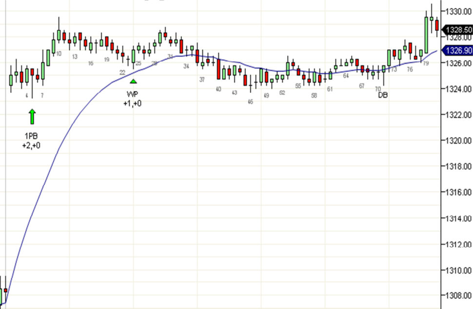

A narrow horizontal day after a huge gap up is usually a consolidation day. This is when the overnight traders take profit and the ones who missed out on the big move enter. Usually this leads to a large move in either direction in a day or two.

If the next day gaps down, this could lead to a large move down and in principle is similar to island reversals on daily charts.

A day like this is traded like a normal trading range day and if you traded any two legged move, you probably did well.

<!-- p.187 -->

## Trading tight trading range days

Thursday, April 21, 2011 · p.187

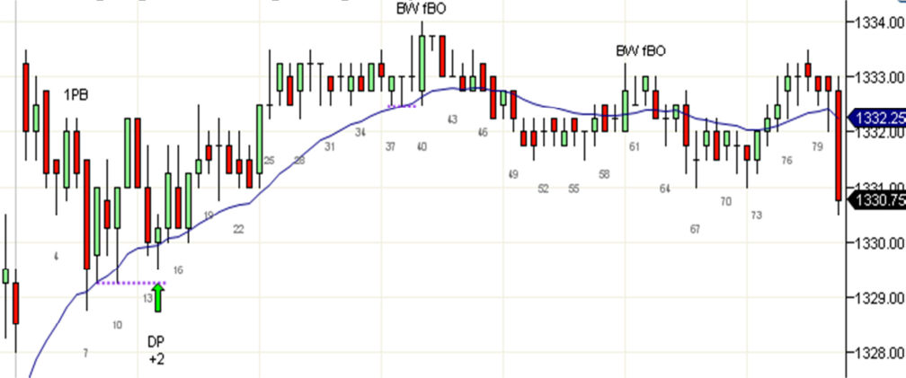

For most traders, the best way to trade a tight trading range is to not trade at all. If you do want to trade, the best setups are to fade the breakouts high and low of the day.

This approach raises the following questions:

1. how do you know its a tight trading range day?

2. what if there is a large breakout?

The answers are simple. When the size of bars falls under 4 ticks for many bars and the range of the day is small, its very likely to be a tight trading range day. Trading mid-range is extremely dangerous, since there is a very high chance of the trade failing even before it reaches the other end of the range for example by forming a higher double bottom. To maximize your chances of success, you should fade weak breakouts of the range or failed breakout patterns such as DP. You should never worry about missing strong breakouts out of a tight trading range. A tight trading range rarely breaks into a trend right away. The bar size may increase to above 4 ticks sustained for a few bars and the price may also break out of both sides of the range forming an expanding triangle breakout.

<!-- p.188 -->

## The importance of getting into the AM trend

Monday, April 25, 2011 · p.188

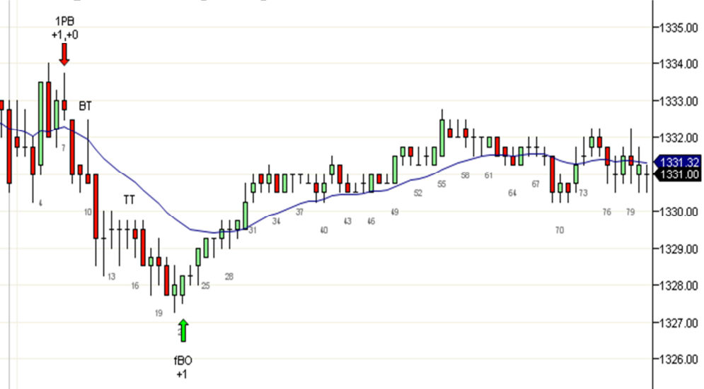

The price action on low volume days will not produce many clear signals. Even so, the first hour or two will produce a few trading signals and you should try to get in on them. For example, today gave a first reversal on b5 followed by a 1PB on bar 7. This led to the biggest move of the day. Unfortunately, it stopped out the breakeven stops of any entries below b7, but that is perhaps to be expected for a gapless doji open.

Anyone who hesitated to short b7 could short the b10 BT bar if they wished to. The move quickly trend terminated (TT) into a TTR from b12.

The trend breakout and failure the second time was worth taking at b22 but the price action quickly turned into successive 3t bars. This is a good reason to exit and stop trading since a low volume day is unlikely to produce large moves.

<!-- p.189 -->

## Spike and channel

Tuesday, April 26, 2011 · p.189

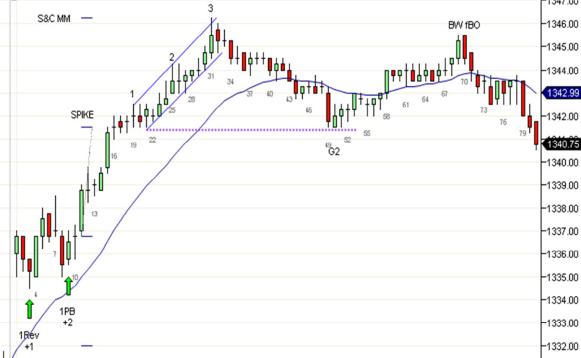

Any relatively large move in a short timeframe is a spike, usually a single bar but sometimes can be multiple bars. In today's example, the move from b11 to b15 can be regarded as a single spike. If the spike closes strong, i.e. near the top as in today's example, the strength will cause with trend traders to buy the close of any small bar and counter-trend traders will trade lightly, causing a channel move.

Spikes that close strong often (but not always) move to a measured move of a large spike. Spikes that close weak, for example a large bar that closes midway may simply channel to one of its extremes. Sometimes spikes will form in both directions and a channel will move to the extreme of one of the bars.

Spike and channels usually have three pushes and they will normally pullback to the beginning of the channel as we see at b49 today. At this point it is typical for the S&C to retrace at least half the move as we did upto b70.

There are many ways to trade spike and channels. You could enter with-trend after the first (b22) and possibly the second (b28) pullback. Normally, this should be done only with a strong close of a large spike. A small spike with a weak close may not move more than a point or two and may not be worth the risk. Aggressive scalpers can simply buy the close of any shaved bar or any pullback bar and exit on every push.

The second option is to wait until three pushes are complete and if the channel covers 3 points or more, fade it until it goes back to the start of the channel. Once the pullback is complete, you may have an opportunity to trade upto half the new trading range if you get a good signal such as the G2 at b50.

<!-- p.190 -->

## Trend strength is proportional to Bar size and Trading range size

Wednesday, April 27, 2011 · p.190

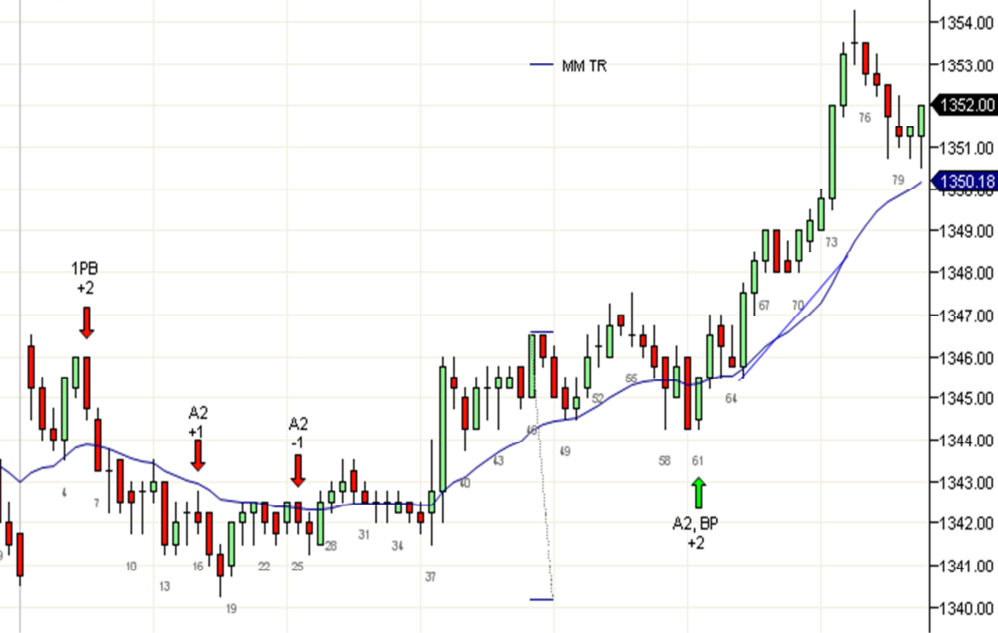

I have previously discussed Breakout Pullbacks as Trend generators. Today was essentially the same move after a successful break above the high of the day at b54 followed by a 2L PB. The best BP is one that occurs after an actual breakout like b61, rather than one which almost breaks out like b50.

Since a trend birth from a BP often goes to a measured move (b74) of the trading range, it follows that breaks out of larger trends result in stronger moves with shallower pullbacks if the BP is a late move. Any large bars with a strong close such as b38 today give an indication of the potential move.

When the move is potentially large, there may be no pullbacks or very shallow pullbacks (b68,69). You can buy above any small bar, regardless of color until the MM is hit.

<!-- p.191 -->

## Fading two legged moves in a Trading range

Thursday, April 28, 2011 · p.191

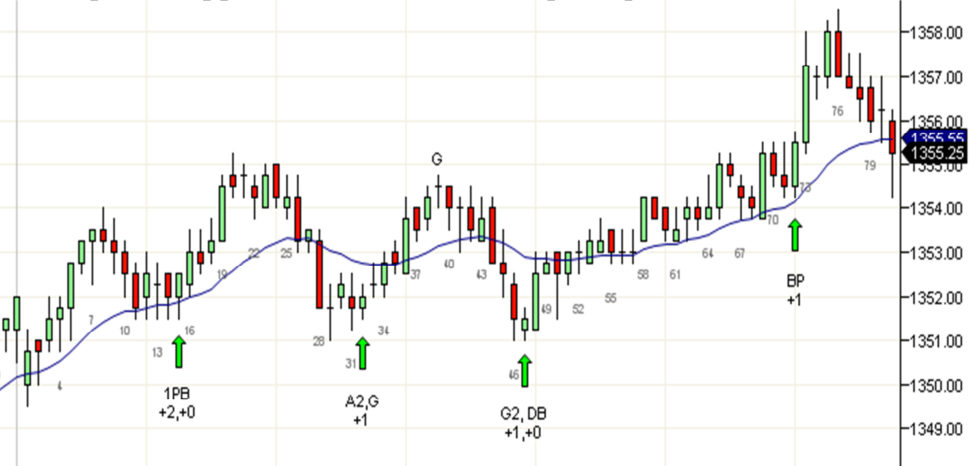

When the day opens within the range of the prior day, especially if there is no gap between the first bar of today and the last bar of the previous day, there is a very good chance the day will turn into a trading range day. That's not really surprising, since most days are indeed trading range days.

A trend day was still possible at the 1PB at b15 but the deep sell-off from the second leg at b24 is an indication of a trading range day. At this point any 2L PB can be taken in both directions until there is a breakout of the HOD b20 or LOD b1.

Similarly, a failed breakout also indicates changes to your trading pattern. A double bottom above the LOD (or DT below HOD) is technically the second failure to create a new extreme and is a form of a fBO. A DP is the first pullback after it and usually indicates a move to the other extreme of the range.

b47 buyers therefore should only trade long until a test of the HOD. A success and pullback is a BP trend generator and a failure is an fBO trade

<!-- p.192 -->

## The importance of good signal bars

Friday, April 29, 2011 · p.192

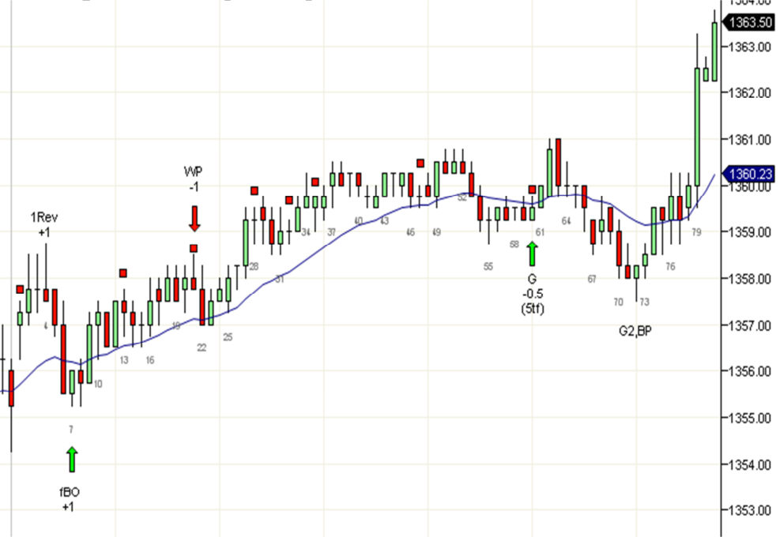

Some traders feel that they can read the general direction of the market correctly, but they always get stopped out of their entries. Attempting to solve this problem using wider stops usually means larger potential losses.

When using signal bar boundaries for stop and entry, you should not need a stop larger than the other end of the signal bar if you choose your entry correctly. A poorly formed bar is usually the reason for being stopped out including two of my trades today.

For example in the chart above, b1 is a poor buy signal since its a doji and resulted in a 5tf. b4 on the other hand is a fade of the 5tf since it closed at its low, a much stronger signal. b13 is a poor signal bar for 1PB and the right thing to do is to pass it up since the entry would force you to sell the ema. b21 is a overlapped doji and therefore is a marginal WP and fBO trade (1t below hod).

b28 was a poor BP signal and b29 is a poor fBO signal since they are both small dojis. All tiny bars that gave H1 signals all the way to b47 are poor signals and only b32 buyers possibly managed to scalp out.

All tiny bars should be considered to be dojis regardless of their shape.

The only acceptable place to take a doji is a second entry and after a deep pullback or extreme of a TR. Even then your trade can fail when the general bar formation is poor. For example, b55 buyers scalped out while b60 buyers hit a 5tf.

---

[← Previous](11-2011-03.md) · [Contents](00-目录.md) · [Next →](13-2011-05.md)
