[← Previous](12-2011-04.md) · [Contents](00-目录.md) · [Next →](14-2011-06.md)

# May 2011

Original pages 193–213

<!-- p.193 -->

## A second failed BP is a trend generator

Monday, May 2, 2011 · p.193

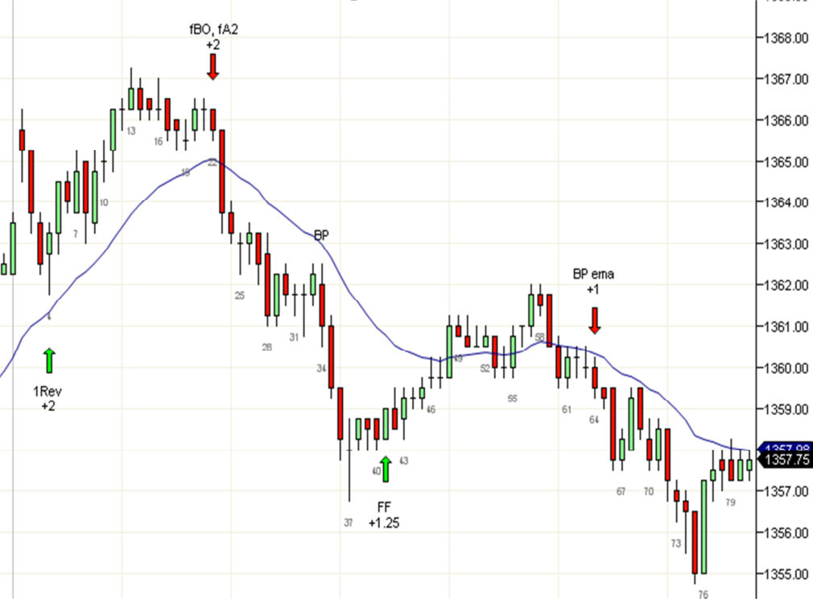

Breakouts of new trends need some experience to read correctly. Today b13 was a breakout above b1 giving a breakout and setting up a BP. b15 and b19 setup extremely weak BP signals that very few traders took. The second failed attempt to turn up makes this a failed A2 and sets up a trend move that is likely to test the low of the entry bar b5 at the very least.

When the range is wide enough and the bars are normal sized (6 to 8t), a fBOs on one side often results in a successful BP on the other. b33 provided an A2 that was similar but succeeded and went to a measured move of the opening range at b38.

The move was channel-like and in spite of the final flag that followed b38, there was a very good chance that its low would at least be tested.

To summarize, if a break above the HOD or below the LOD in the AM move gives a poor 2 legged pullback, its failure is likely to reverse the breakout and is a likely trend generator.

<!-- p.194 -->

## Choosing the right reversal

Tuesday, May 3, 2011 · p.194

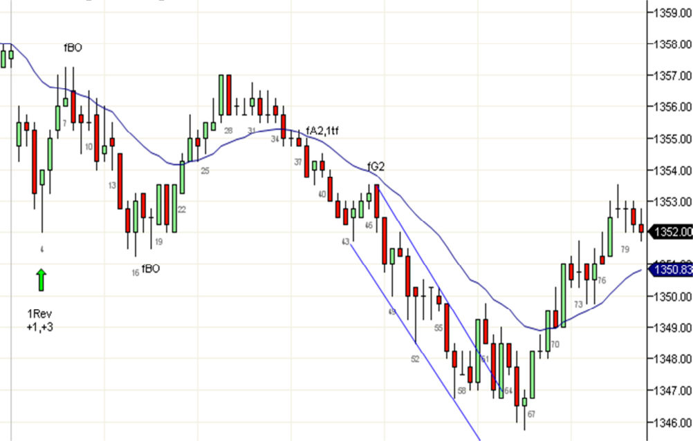

Most traders lose money trading counter-trend and this is mainly because they are trying to fade a trend that is still strong. The right time to change sides is after the trend is broken and its low is tested. Of course, an overshoot into a Wedge is the other possibility.

Today opened as an expanding triangle breakout and after the price failed to break to a new high at b28, moved into a test the low at b16. Until the price breaks below b16, its still not a real trend, since an expanding triangle can indeed become a narrowing triangle.

Once the price broke below b16 decisively on b48 which also happened to be a failed G2, the trend was in place and only short trades should be taken. Traders who bought anything that looked like a reversal bar lost on b49, b52 and possibly b57.

Once the trendline breaks, especially if the break is on a strong trend bar such as b60, the next signal is a high probability entry after a nominal lower low (b66). Any move that goes much lower should not be bought and a new trendline break is required before any counter-trend entries.

<!-- p.195 -->

## Large bars on open

Wednesday, May 4, 2011 · p.195

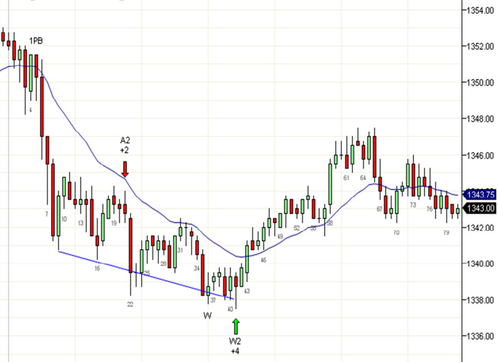

Large bars on the open are usually a sign of spike and channel action. The channel itself may go on until the end of the day, but its usually not a hard trend. The best option is to take 2 legged pullbacks and second entry with-trend trades such as b21.

A strong overshoot (b22) and a second entry (b41 same price as b36) are needed for a reversal entry as with any strong bear day. A trendbreak and test is likely to be rare. When the channel reverses, you should expect a pullback at the beginning of the channel, no matter how strong the reversal looks.

The most important thing to remember is not to take a first reversal (b9) on a day with large bars. Its unlikely to succeed on the first attempt.

<!-- p.196 -->

## Optimizing your stop size

Thursday, May 5, 2011 · p.196

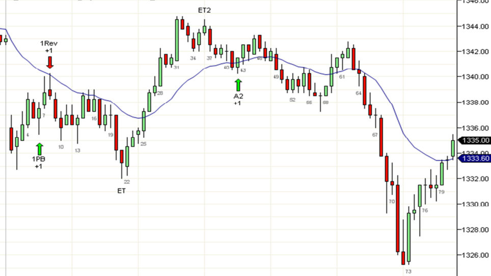

Price action trading uses the signal bar boundaries as entry and stop loss. Bars vary in size and a large signal bar could mean a large risk while a small signal bar could give a stop that gets hit simply because the signal bar is too small to represent real risk management.

Since larger stops represent larger risk, you can reduce your overall risk by picking entries that require smaller stops, thus improving your profitability. Suppose your entries consistently give +1 point profit before pulling back no more than 3 or 4 ticks, you should be able to reduce your stop size to 5t thus reducing your risk. Note that you need to be sure that if your stop is hit, there is a low probability of the price moving to your stop target.

One way to do this is to check the Maximum Adverse Excursion (MAE) if your trading platform supports it. Today for example, my maximum adverse excursion (the pullback after taking me into the trade) was 2t as shown below.

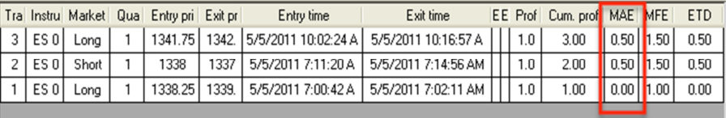

You should calculate the likely MAE for winning entries for every setup you do trade. If a setup is likely to fail after a MAE greater than a certain number of ticks, that is your best stop. Keeping an eye on MAE allows you to concentrate only on setups that have the smalles MAE and also tune your reading of signal bar quality that allows you to select entries that are likely to have a smaller MAE. Once you can consistently tighten your stops, you can trade larger size with the same account size. Also your average win to average loss will improve, enhance your profitability. If the price moves to a profit target after taking out your stop more than a rare occasion, you need to refine your entries a bit more or relax your stops a bit more.

<!-- p.197 -->

## Huge first bar

Friday, May 6, 2011 · p.197

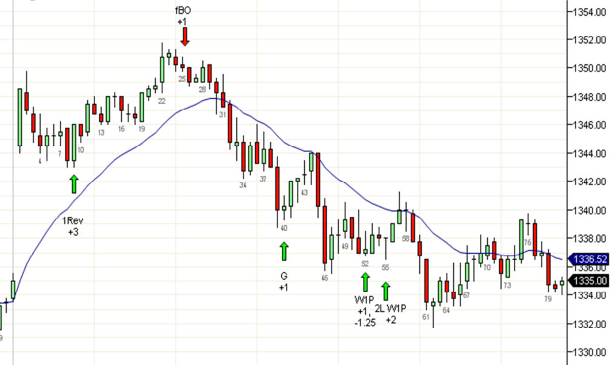

The first bar and the next few bars are often special, in that they indicate the possible kind of price action to expect for the rest of the day. A set of small dojis may indicate a tight trading range. A set of average sized bars may indicate a trend day. If the very first bar is a reversal bar off a huge gap, it could indicate a trend from the first bar. A large bar indicates lots of energy and possibly a wide range day.

A huge first bar is occasionally a spike but almost always a trading range. When its a spike it will channel up slowly to a measured move of the size of the bar. When its a trading range, it generally means traders are likely to buy near its low and sell near its high. This bar needs to be traded just like any other trading range. If the breakout of the bar is strong, enter with trend on a pullback else fade the breakout.

b2 was a 5tf for buyers above b1 and had a strong close. This itself is a reasonable entry if the entry price is near the top of the bar. You should never take the first failure near the center or low of the bar, since the very next bar could give a breakout pullback and therefore a 1PB with-trend entry. If a two legged entry sets up near one end of the bar (b9), you should take it and hold it till the other extreme of the bar. This is a kind of 1Rev trade.

cz< Once it takes out the other extreme, you could get a BP continuation of a trend of fBO (b25 or b29) back to the lower extreme. A second attempt to BO is usually successful (b34) and will give a BP (b38) into a new trend.

<!-- p.198 -->

## The first reversal

Monday, May 9, 2011 · p.198

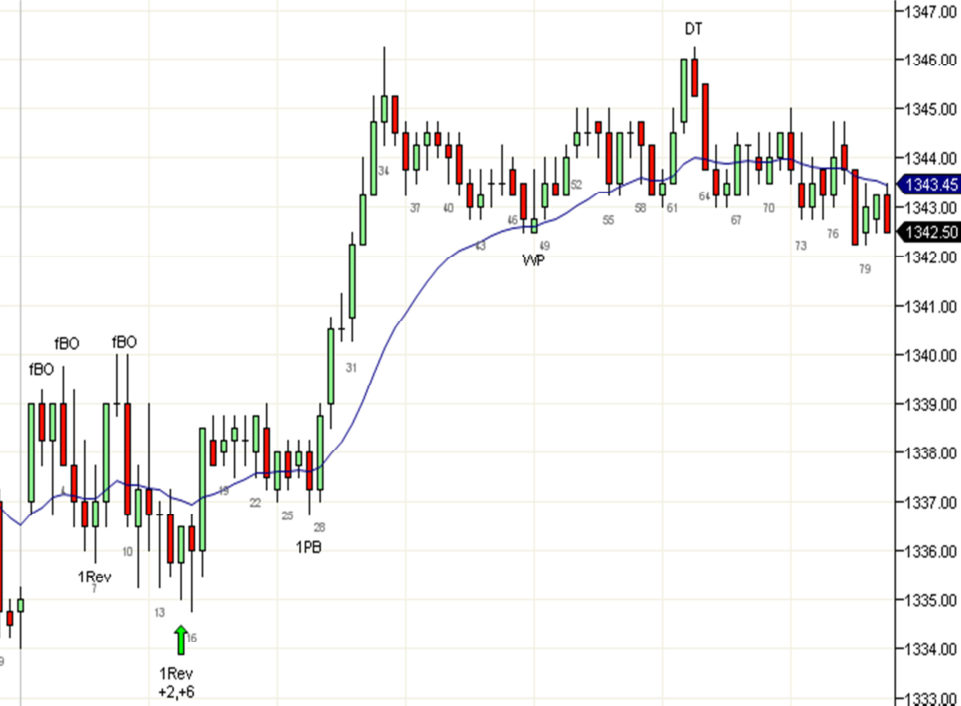

The first reversal (1Rev) is a reversal after the first trend move of the day. This should be distinguished from a simple failed breakout such as a 1tf or 5tf of the first bar of the day. A fBO of the first bar (or even later bars) cannot be expected to make a large move, but a first reversal of a trend move usually does.

There are many kinds of 1Rev. A reversal after the first successful scalp trade or at least a 6 tick move from the close of the previous bar is a type of 1Rev (b7). A reversal after a trend move however, is usually the best kind of 1Rev and is often the low or high of the day. A reversal bar after a large gap can be considered to be a first reversal since the large gap represents a trend move.

If the opening gap is small or non-existent, it is best to wait for a trend move away from the first bar and take its reversal. Reading all variations of this is complex, but a simple filter is to take the reversal after the first two legged move of the day (b15). If this reversal gives a small two legged move in the direction of the trade, you should consider the possibility of an A2 setting up and you should exit your position and reverse on the A2, which is a kind of 1PB trade.

Even if you never trade 1Rev or just scalp it, its useful to keep track of them since the 1st pullback after the first reversal (b27) is usually the best 1PB move of the day.

<!-- p.199 -->

## The channel open

Tuesday, May 10, 2011 · p.199

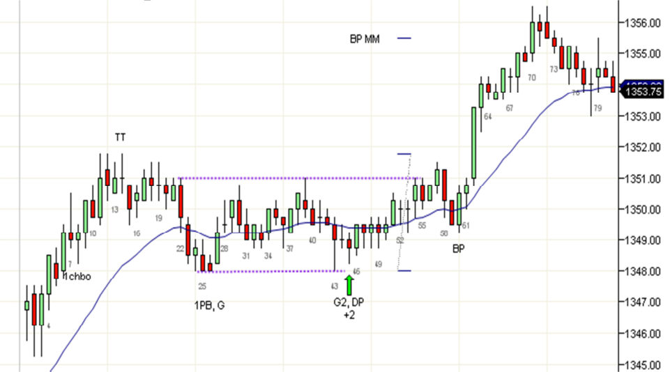

When the market opens and right away starts moving with overlapping bars with very small or no pullbacks below the previous bar, its opening into a channel. A channel move is simply a trend bar on a larger timeframe and usually there will be a second leg up if the channel breaks and moves sideways. A channel move should never be faded unless the channel gives an obnoxious overshoot.

Channels usually terminate into poorly formed double top or double bottom formations or a doji bar or both (b14). If the channel only pulls back part of the way, say 50%, there is a very good chance there will be a comparable move in the original direction later in the day. You should look to enter on a G2 if you get a deep pullback.

Often the pullback after the channel can go horizontal into a trading range if the channel gave a trend termination sign such as an ii (b13), DT (b14) or doji (also b14). Swing traders should wait for a breakout at this point and today we got a DP (b45), which is a trend generator.

A DP should be expected to give a BP on the other end of the trading range and can be held for a swing till the measured move of the trading range is hit or another trend termination signal (b72).

<!-- p.200 -->

## The first pullback

Wednesday, May 11, 2011 · p.200

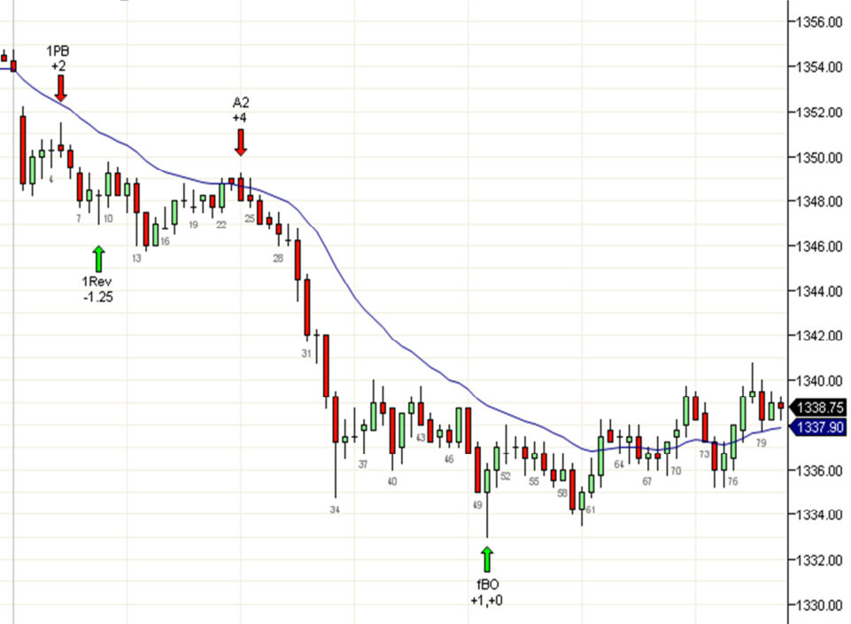

The first pullback after a trend move (1PB) is usually the best swing trade of the day. A trend move could be a large gap, a large trend bar or a channel move. The stronger the trend, the better the 1PB entry. This move is especially strong if it forms a 5tf off the first entry (1PB signal bar b5 hi was 5tf from b2). A second form of 1PB is the first 2 legged pullback (b24). When the 2 legged pullback is to the ema, its no different from an A2, but the first such entry is likely to give you the best swing move of the day. A 2 or 3 legged attempt to close the gap counts as both a 1Rev and 1PB and is usually a high probability trade.

The second attempt to pullback (b9) is sometimes a 1Rev trade and therefore, it may be advisable to exit some or all of your position on the first push down and re-enter on the first 2L pb (b24).

For new traders, 1PB is usually the best setup to take, if they are willing to not trade on days that do not present a clear 1PB.

<!-- p.201 -->

## The various types of 1PB

Thursday, May 12, 2011 · p.201

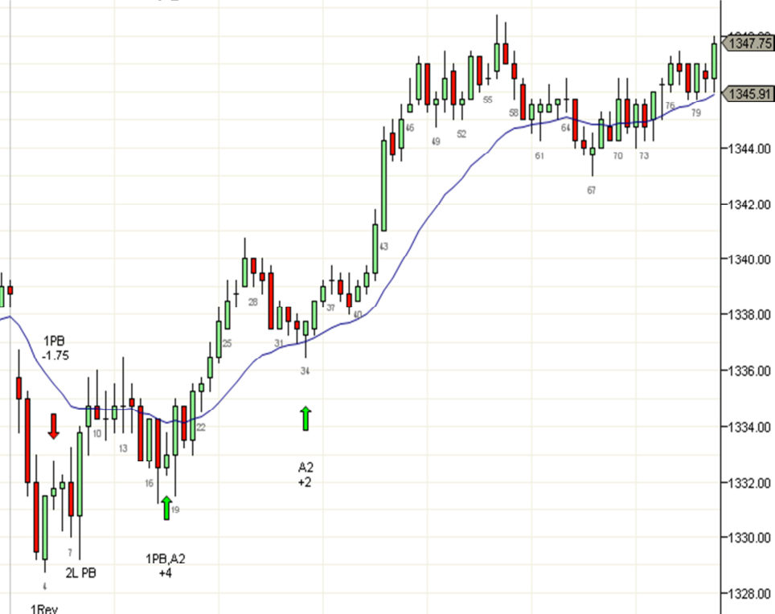

1PB normally denotes the first pullback after a trend move of the day. The idea behind 1PB applies to all trends and that is the first pullback in a new trend is a high probability trade. So the first pullback after a trend break or trend reversal are kinds of 1PB since they all represent the first pullback in a trend.

When a 1st leg of the day is a strong trend move, there is some possibility that it may break below the low for a second leg. A strong reversal bar would make it an obvious reversal and you should not take a trade in the direction of the prior move. However, when the lower tail is small it could just be a trend bar pullback. An immediate continuation signal could be taken as a 1PB, if the signal is strong. If b5 had a bear close with a small or no lower tail, it would be a 1PB signal for another leg down. b5 however turned bullish at the last moment and turned out to be a poor 1PB signal that failed. b7 was obviously not a signal bar since an outside bar near the bottom of a range is a fade setup.

b5 to b8 make a 1PB since they constitute a 2 legged pullback after a reversal. However, b8 was too large to buy and its best to wait for the next signal. b18 was a gap bar and an A2 and represented two failed attempts to selloff from near the open and the first PB with a reasonable risk, therefore a de facto 1PB.

b34 was an A2 but it was the first pullback after an obvious trend breakout and is also worth taking.

<!-- p.202 -->

## Obnoxious overshoots

Friday, May 13, 2011 · p.202

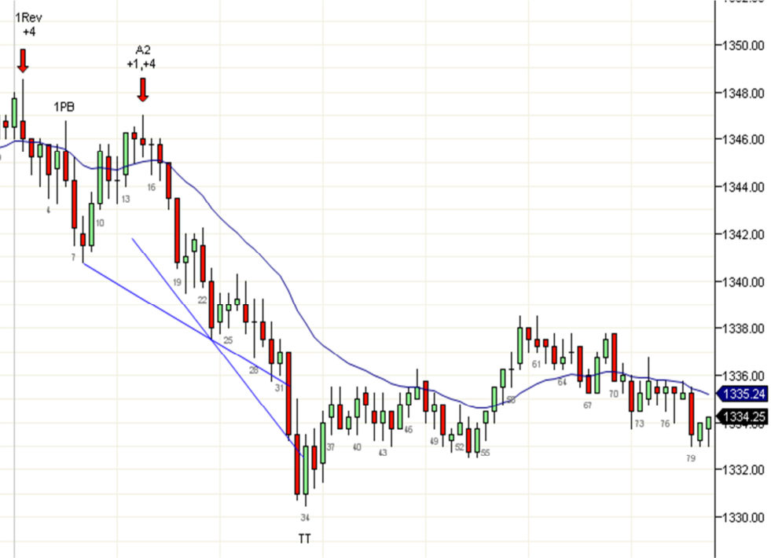

When the price overshoots a trend channel by multiple points and one or two huge bars, the overshoot is obnoxious. If the overshoot ends in a well-formed reversal bar, the trend reversal will be very strong and is likely to erase the entire move.

Often when the last one or two bars are very large, the trend will terminate but not reverse. The large bar(s) effectively form a trading range and the price action behavior resembles trading range movement. The price will try to breakout of either end and usually fail the first attempt. The best way to trade this is to scalp two legged moves and occasionally swing a failed breakout from one end if the range is sufficiently large.

If the range is extremely large, the price may try to consolidate in a narrowing triangle before it finds new direction.

<!-- p.203 -->

## Strong Wedge

Monday, May 16, 2011 · p.203

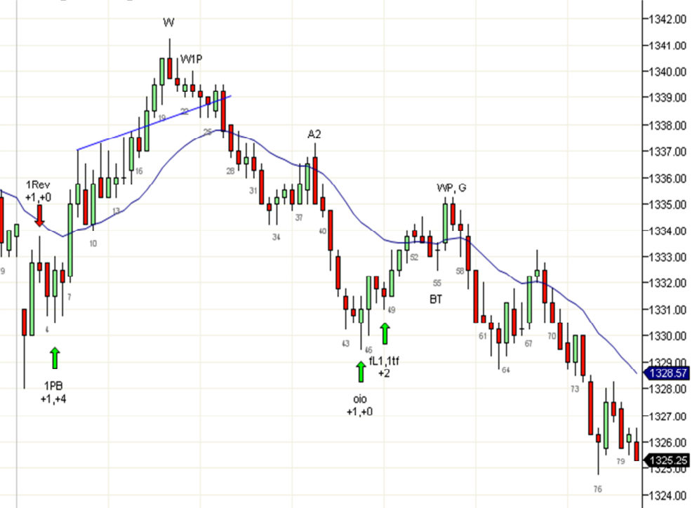

A wedge that moves well beyond the TCL but on reasonably sized bars is usually a very strong Wedge, especially if they end in a reversal bar. Such wedges may be hard to read since the test of the high after a strong move up is usually the rule and not the exception. A stronger entry bar at b21 would have perhaps made it easier to read this wedge reversal.

A normal wedge can be expected to retrace the move from the first pullback, i.e, b5 low today. This explains the buying activity from b45 to b56. However, the reversal of the wedge failed and the price moved below b45. This is indicates a very strong down move and usually a measured move to the top of the wedge.

<!-- p.204 -->

## Barb Wire

Tuesday, May 17, 2011 · p.204

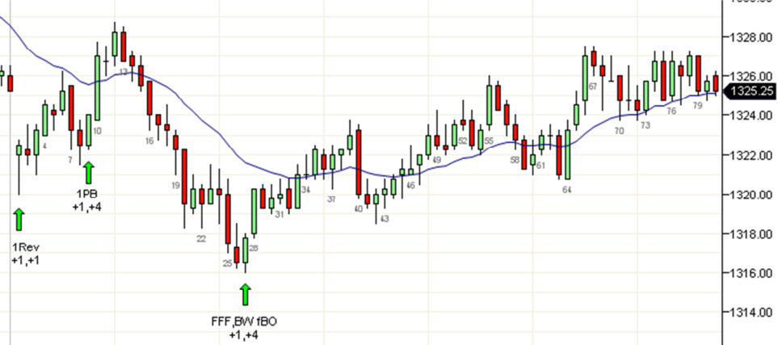

Any three overlapping bars where one is a doji can be called barb wire such as b1-b3, b20-b24, b29-b32. There is no real way to trade barb wire except to fade it. This is because barbwire is a trading range and most trading range breakouts fail.

There are two possible ways to fade barbwire. One is to fade any trend close. A trend close in a barbwire is likely to breakout on the other end. So you could sell the high or close a bull trend bar or you could buy the low or close of a bear bar. However, this is dangerous since there could be a breakout that takes your stop out.

A simpler strategy is to wait for a trend bar breakout thats more than two ticks beyond the barbwire and fade it. The longer the barbwire runs and the stronger the breakout, the higher the chances of success.

If the barb wire is made of tiny bars ( smaller than 4t ) there is a good chance that you will get a failed breakout multiple times, essentially forming an expanding triangle breakout. You need at least 6 to 8t to the other end of the barb wire to be able to fade the breakout.

A barbwire after an extended move at an extreme of the day (b21-b24) often causes a reversal and you can swing some portion of your trade.

<!-- p.205 -->

## Strong Trends

Wednesday, May 18, 2011 · p.205

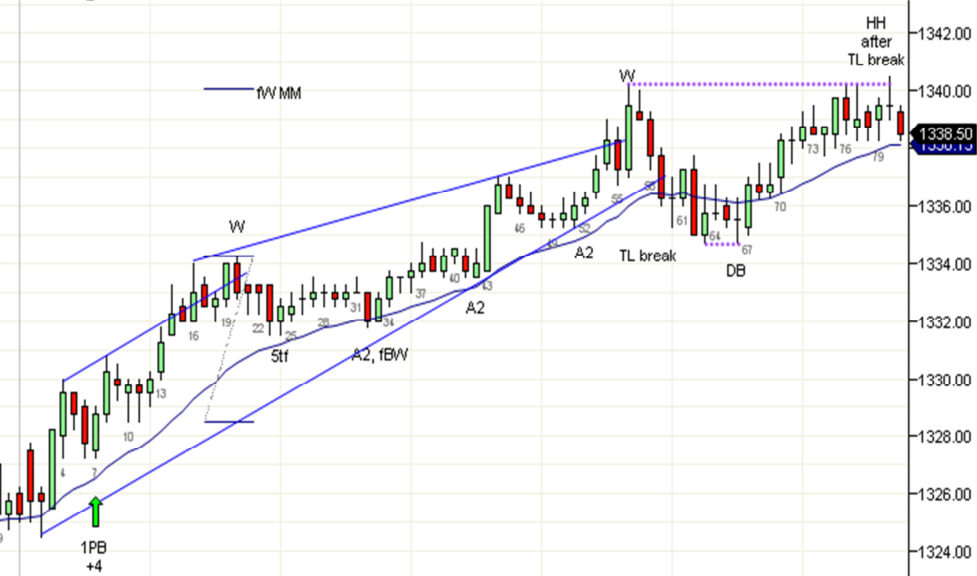

While a large gap often indicates the possibility of a trend day, its not necessary. If the first few bars move beyond the range of the prior day and give a breakout pullback (b7), the day is likely to be a very strong trend day. A reversal bar right at the ema (b2) also often indicates a strong move.

The only thing that you should never do in a strong trend is trade counter-trend. Simply stated, you could make far more buying pullbacks than shorting minor pullbacks.

An overshoot giving a sideways correction (b19 to b34) is usually the sign of a very strong trend and a possible fW should be anticipated. In addition when the first move up is a channel like move (b1 to b20), a second leg after a horizontal move is normal.

Possibly the most important sign of a strong trend is the absence of successful counter-trend trades. Until the second W at b57, not a single pullback went 6t below a swing high signal bar. This itself should assure you of the trend's strength and keep you on the right side throughout the move.

The trend weakens when you start seeing large bars (b43,b56) and two closes below the ema (b59,60). The move also broke the trend line, but such strong momentum practically guarantees at least a test of the high and usually a higher high (b80).

The single rule of taking only with-trend trades until at least one counter-trend trade has already proven successful would save many traders from fading an unstoppable trend.

<!-- p.206 -->

## TCL test on open

Thursday, May 19, 2011 · p.206

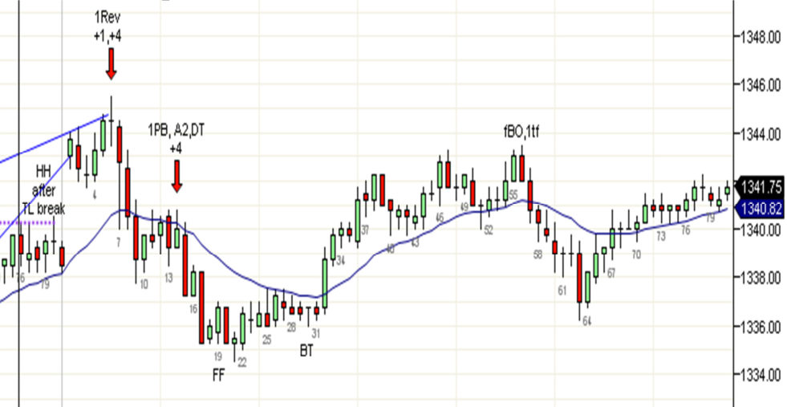

A TCL test on open may indicate the direction of the AM trend. A second failed overshoot of one or more TCLs from yesterday may indicate a reversal or at least a 2L move away from the TCL.

When the gap is small, this can be simply viewed as a climax bar and a W type reversal on overshooting the TCL. If the gap is large, this often leads to the formation of a reversal bar and a possible trend from the 1st bar.

Drawing the TCL from the prior day prevents you from taking an entry in the wrong direction and is especially helpful after a strong trend day or two.

<!-- p.207 -->

## The most swingable setups

Friday, May 20, 2011 · p.207

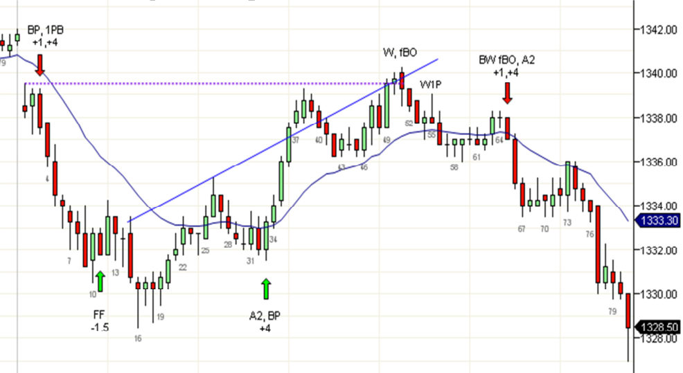

Until your winning percentage is very high, you should trade only swingable setups in order to be profitable. If you can make +2 or +4 on an A2, that's an average of +3 and if you lose -2 when you are wrong, you still come ahead most of the time even if your success rate is 50%.

The most swingable setups are the following:

The 1st pullback of the day. Includes an inside trend bar right after the entry bar as in today. This is basically an L2 and when close to the ema acts like an A2 or 2 legged 1PB.

The first A2 of the day. When there is a trend move followed by a 2L pullback, this is very likely to be successful and give a move similar in size to the first leg.

The first A2 after a reversal. When the price broke above b12 and the ema at b26 and gave a 2 legged pullback, this is a high probability swing setup likely to give 4 points.

Any W1P or the first A2 after a W, fBO or any kind of key failure. W1Ps often retrace the entire wedge, so you can hold part of the trade for many points.

All of these are basically the first pullback in a new trend and the only requirement is there is sufficient room for the price to move. A sharp AM trend increases the chances of any of these trades succeeding. If you have more than one reason to take a setup, then you could exit at +2 and +4 rather than +1 and +4.

<!-- p.208 -->

## Wedge failed breakout WfBO

Monday, May 23, 2011 · p.208

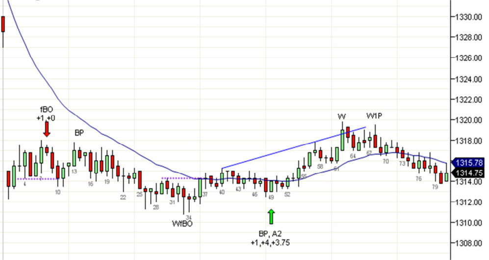

Just as a trend from the open can originate without a gap, so can a large gap fail to produce a trend. Within the first couple of up and down pushes (b5), its usually obvious its a trading range day. On a trading range day, the best trades are usually fades of breakouts and b8 was our first signal.

Failed breakouts are only expected to give two legs and there is no telling if the move will be shallow or deep. The highest probability fBO trades however are breakouts that occur on the third -- or if they are closely spaced -- the fourth push of the move, as in b33. These should be expected to fail and take out the other end of the range. Sometimes they may give a breakout pullback and a strong trend move on the other end but on other days such as today, they may fail on the other end as well (due to a second WfBO at b63 today).

While WfBOs are great entries, often they are scalp entries and can give a deep pullback as in b13 after the b8 fBO entry. If a trend line or a swing is point taken out (b4 low taken out by b10, also broke TL b1,b6), then a BP entry may give a trend move. This is usually stronger if the move was a clear 2 legged move as in b40-b49 after taking out the swing point at b30 and breaking the TL b19-b33.

When any fBO entry takes out the other end of the range, be prepared for failure and a move back into the range, especially in tight trading ranges since the magnetic effect of these is strong.

<!-- p.209 -->

## Channels are trends

Tuesday, May 24, 2011 · p.209

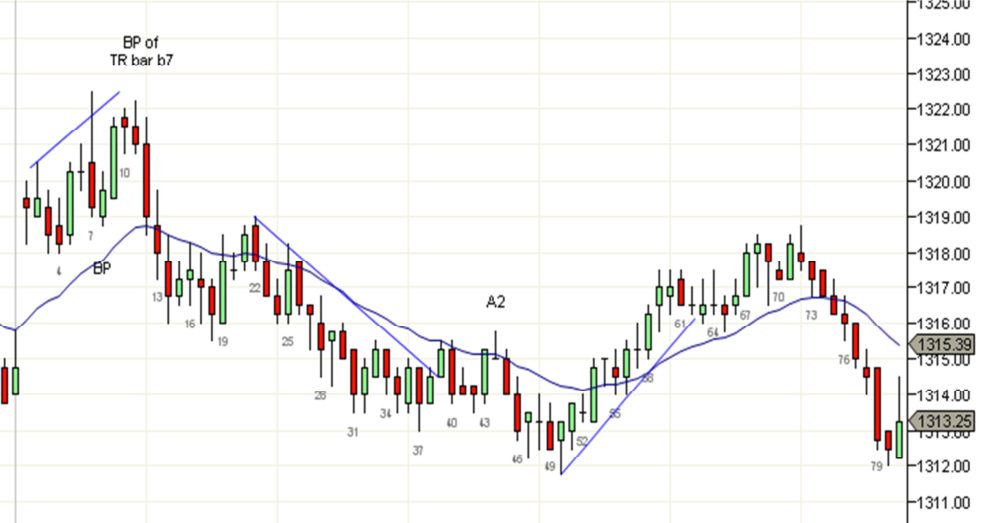

Channels are narrow trends and they should be traded just like trends. A channel after a spike often acts as a wedge consisting of three pushes. In general channels are basically trends and the momentum of the spike is what makes the channel after the spike move in three pushes and often overshoot a TCL.

Channels without a clearly defined spike should also be traded like trends. A 2 legged PB (b37-44) in a channel can be traded with trend as an A2 and a break of the channel (b39, b63) and a test of the extreme is a precondition to fade the channel. In case of channels, its counterproductive to count pushes and fade a perceived wedge (b31) simply because the entire channel acts as one push and a two or three tick push beyond the prior swing point is hardly a new push or extreme behavior.

<!-- p.210 -->

## Wedge pullback

Wednesday, May 25, 2011 · p.210

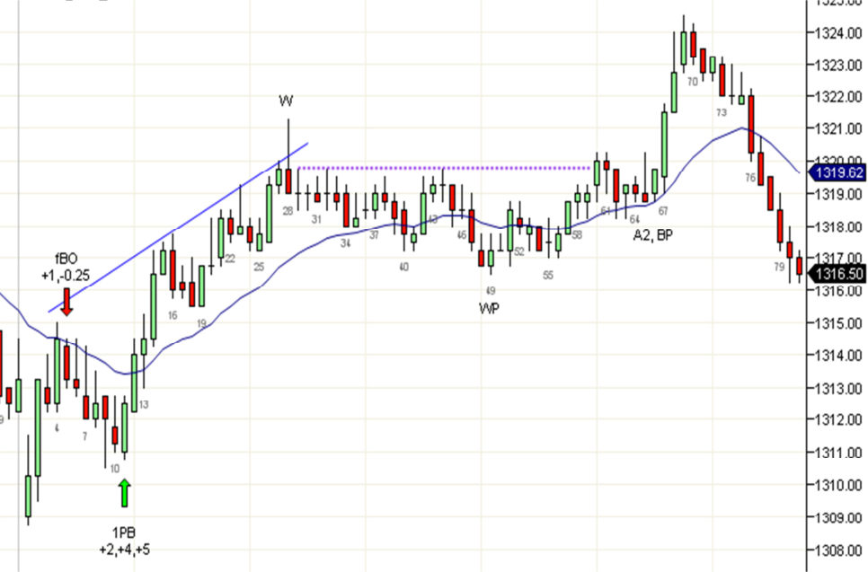

A low momentum, low volume, three push pullback mid-day (b34,40,48) is a wedge pullback and usually works like an A2. There are several positives for this trade. It acts similar to a BW fBO, an A2 and a W reversal all in one.

The probability of success of this trade increases if there is a sharp trend bar and no follow-through. A small inside trend bar or any small trend reversal bar increases the chances of a continuation. A Gap bar or a G2 entry increases the chances that the price will take out the extreme.

WP should be usually taken as a swing entry especially if the AM trend was strong.

<!-- p.211 -->

## Dont fade a trend till after a trendline break

Thursday, May 26, 2011 · p.211

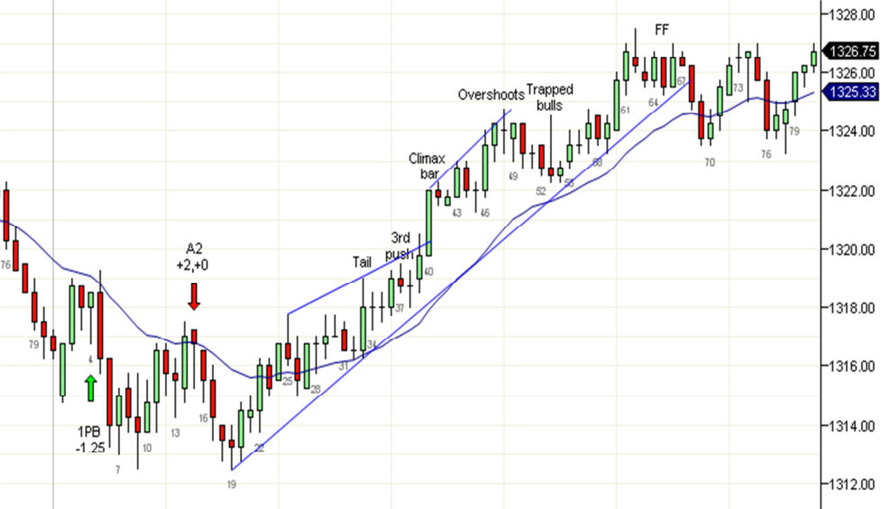

Repeatedly trying to fade a strong trend is the surest way to empty your trading account. If there is only one thing you ever take from this blog, let it be this: "Counter-trend trades are low probability until there is a trendline break."

Today was a very illustrative day and we saw almost every reason to fade the trend fail. Many traders will short a strong bar such as b40 assuming an overshoot and climax but when such a bar occurs right after the break of the prior HOD or LOD, its usually re-affirming the trend. Climax bars in general are fine to exit but they are unreliable fade entries. Often you will have another climax bar or two right after and even then, you may see sideways consolidation.

Minor overshoots (b46,48) and tails(b25,33) usually set up with-trend entries in a strong trend and you should never fade them.

A trap bar (b52) is an outside bar and trading range and is likely to fail from within barbwire. A better trap bar is b5, which did not traverse too far up before stopping out the 1PB traders.

The short below the small bar b67 near the high of the FF but even this is not a high probability setup until there is a trendline break. Once the move from b67-69 broke the trend line, counter-trend trades are acceptable and any reversal setup such as W or DT become tradable.

The right thing to do if your trend fade entry is stopped out is to right away draw a trend line and if it wasn't broken, enter with trend on every minor touch or attempted touch until you do see a trendline break.

<!-- p.212 -->

## 1PB as a reversible trade

Friday, May 27, 2011 · p.212

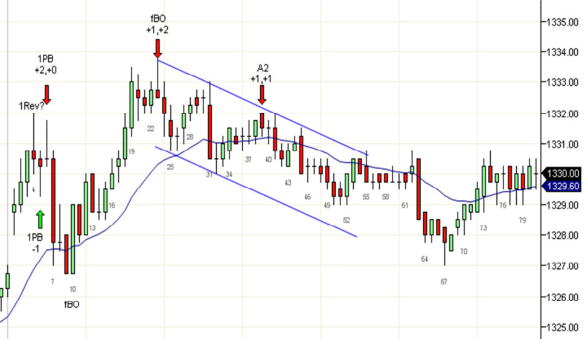

Some traders reverse their position if they are stopped out. This is usually a bad idea. Most of the time, traders are right about the direction, but wrong about the entry. Its usually better to take second entries for most trades and sit out on failures.

Some setups however, are inherently likely to make a large move on failure. In my experience, these are 1PB, A2 and W1P. A failed 1PB (long above b5) simply turns into a 1PB in the opposite direction (1PB below b6). This is especially true if the bar that began the pullback (b4) has a body in the new direction.

A failed A2 long (above b36) becomes an A2 short (short below b39). These need a little bit of experience to trade correctly. Usually, what looks like an A2 is actually a pullback in the new direction after a possible reversal (b23).

A failed W1P (b57, if W25,32,52) is also an A2 short (below b62) on failure. These are easy to spot since a real W needs to have a strong overshoot and a clear reversal bar pattern. The W1P should also be made of strong bars, since weak bars are show lack of conviction for the reversal.

Other setups such as BT, G2, 1CBO, etc are not inherently reversible and if you were wrong, its best to wait for more price action before taking the next trade.

<!-- p.213 -->

## Channel on reversal

Tuesday, May 31, 2011 · p.213

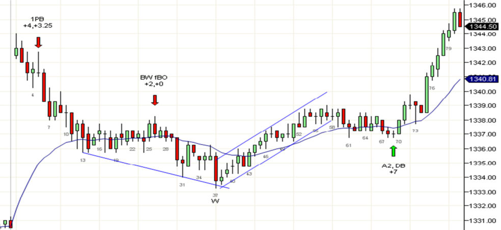

In a previous post I have described how channel on open leads to a second leg later. This is also true for a channel move for the first leg of any new trend, including a reversal.

Channels are typically strong trends on a higher timeframe and therefore a sideways consolidations are shallow pullbacks that typically continue for one more leg as shown in the 30m Globex chart to the left. b32 on this chart corresponds to the first 30 minutes after open and is a large shaved breakout bar. Typically (but not always) a sideways consolidation takes out the high of at least one bar, which on a 5m timescale corresponds to taking out a swing high thats six bars away. Therefore the correct way to trade a sideways consolidation is to wait for at least one swing point to be taken out and then take a trade in the direction of the original channel. The second leg typically only needs to take out the extreme of the first leg but unless first leg is weak, there will be at least two more legs in the direction of the channel, giving a W entry.

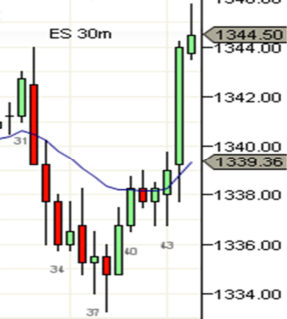

Similarly, the channel after reversal is represented by b39 and b40 on the 30m chart to the left and the sideways pullback took out the low of b41 on 30m chart. So the correct way to enter this is to enter after it takes out the low of b56 on the 5m chart. Once you understand how this works, you can trade the sideways consolidation following a channel without referring to higher timeframe charts. Just wait for at least one swing point to be taken out and take the next entry in the direction of the original channel.

Note that sometimes it may not take out a swing point and instead give an ii on the higher timeframe chart. This will work the same way, but is harder to read directly on the 5m chart. However, these are lower probability setups and while they do work, they often give other signals on the 5m chart.

---

[← Previous](12-2011-04.md) · [Contents](00-目录.md) · [Next →](14-2011-06.md)
