[← Previous](13-2011-05.md) · [Contents](00-目录.md) · [Next →](15-2011-07.md)

# June 2011

Original pages 214–235

<!-- p.214 -->

## Holding swings

Wednesday, June 1, 2011 · p.214

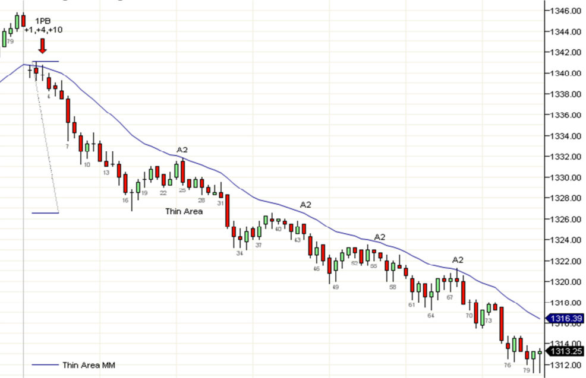

When the market has only one bull bar in the first couple of hours and not a single close above the ema, its an indication of a very strong trend. Extremely strong trends produce multiple A2 entries but it gets harder and harder psychologically to sell after a strong move down. Holding an early entry is easy, especially when there are no bars against your position. Once you have a possible trend break (b18-25), there's always a chance of imminent reversal so it gets harder to leave a huge open profit which could evaporate in the event of a sudden rally. Some days such as today, strong trends run till the end of the day and on other days like yesterday, they can reverse completely, so a simple strategy is to move the stop just behind every new swing point.

A psychologically seasoned trader however can hold a swing position in a strong trend until one of the following occurs:

- Strong TCL overshoot of 4t or more
- 2nd TCL overshoot of 2t or more.
- Trendline break and successful test of extreme (i.e., price does not break much below extreme)
- failed A2 (A2 triggers, approaches extreme, reverses and takes out signal bar)
- One legged close beyond ema
- Breakout bar taking out the ema by many ticks and one or more prior swing points
- TTR (bars suddenly become tiny and swings are only a few ticks from prior swings)
- Double top or double bottom followed by TL break.
- Major Measured moves met.

Of the above, measured moves are only reliable in very strong trends. Thin area measured moves and fH1 measured moves are the most reliable. Double bottoms require being in a trading range since within trends they are simply pullbacks.

<!-- p.215 -->

## Failed A2

Thursday, June 2, 2011 · p.215

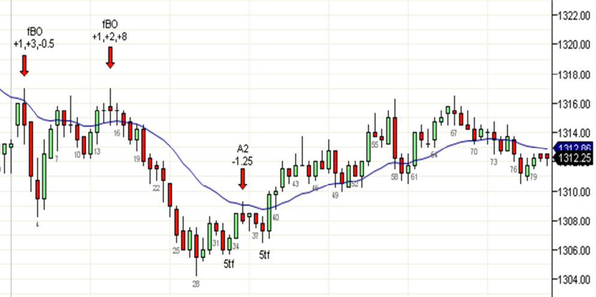

While an A2 in a trend is a reliable trade, they do fail and an A2 in a trading range is not really as high probability as an A2 in a strong trend.

An A2 is failed when it triggers, moves a few ticks towards the prior extreme and retraces taking out the stops beyond the signal bar.

When the first A2 after a breakout fails (b35), it is a strong signal of a failed breakout, no matter how strong the breakout may have looked a few bars ago. This is because in the absence of a trend, continuation trades are not really viable and you should look to fade breakouts.

Failed A2s in trends sometimes become WP if they are far away from the ema. A clear 2 legged move to ema (b28-35) should not need a third push and its generally safe to reverse above the signal bar. A fL2 (b36 and b38 ticked below prior bars) actually make this a bullish A2 and its an acceptable swing entry. During the lunch session swing moves are rare, so its ok to scalp part of such trades.

<!-- p.216 -->

## Major Reversal: Trendline break and test

Friday, June 3, 2011 · p.216

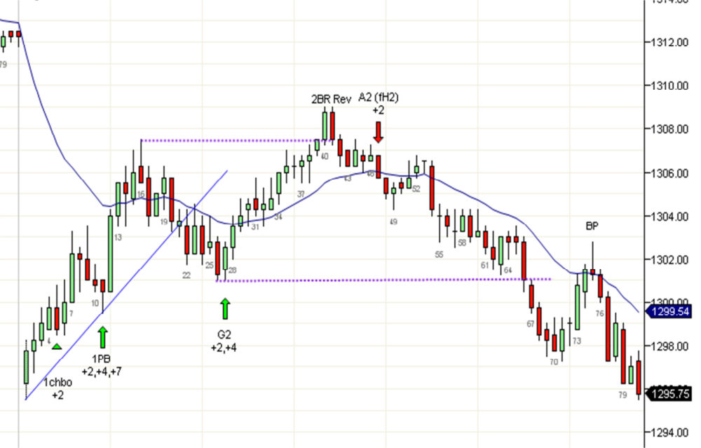

A trendline break followed by a test of the extreme is a major trend reversal and its very useful to be able to recognize it in real time. This allows you to exit your positions precisely and perhaps ride the reversal as well.

There are a few things to look for in a major reversal. The first is that the trendline break needs to be a strong break. This means the break is for several bars and several points. In general you want half the move on each side of the trendline. A slight break such as the dip of b11 below the trendline from b1 to b6 may not necessarily break the trend.

The second thing to look for is a failure to move much beyond the extreme before the trend break (b16 high). When you see a strong push at this point, its a great place to exit on strength. If the price is able to move many bars and many points beyond it, the trend should be expected to continue until another trendline break.

The last item to look for is a reversal signal just beyond the prior extreme. Today we got a 2 bar reversal at b40,41. A reversal bar or a weak bar followed by a small inside trend bar are also perfectly acceptable. If there is no reversal signal, its best to wait for a second entry or let the reversal proceed and enter on the first pullback.

Often the first pullback after a reversal is very shallow (b46), but will run for many points. This is usually a swingable trade to at least the swing point of the trendline break (b27 low).

<!-- p.217 -->

## 1Rev and 1PB considerations

Monday, June 6, 2011 · p.217

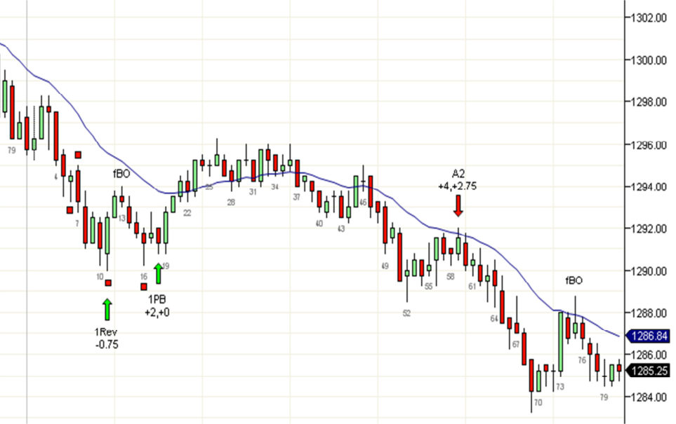

The first reversal and the first pullback generally give large moves in the AM and its necessary to correctly identify them. Often the price action regarding them are not very clear and today's action showed some of the things to watch out for.

b6 was a poor signal for a first reversal since it was a 1t doji bar with almost complete overlap. b7 was a poor 1PB since it forced an entry beyond the extreme of the day. In this special case, it was a 1tf, which is usually an OK entry in a hard trend.

b11 was an outside bar and is to be expected to act as a trading range. Although I did buy this due to the strength of the bar, its a poor entry and a 2L PB or a second entry would be a better choice.

Technically, b13 is a 1PB short, but due to the small bar size and the fact that its following a possible reversal, its OK to skip it. 1PBs that are far away from the open need to be deep pullbacks or 2 legged unless market is in a hard trend. Given all the above, b13 is a riskier trade and its best to wait for more price action.

b16 is a first attempt to end the pullback after 4 bear bars and is a poor entry. Although the 2L PB at b18 was a poor bar, it could be entered because it was a second entry at the same price.

<!-- p.218 -->

## Late swingers

Tuesday, June 7, 2011 · p.218

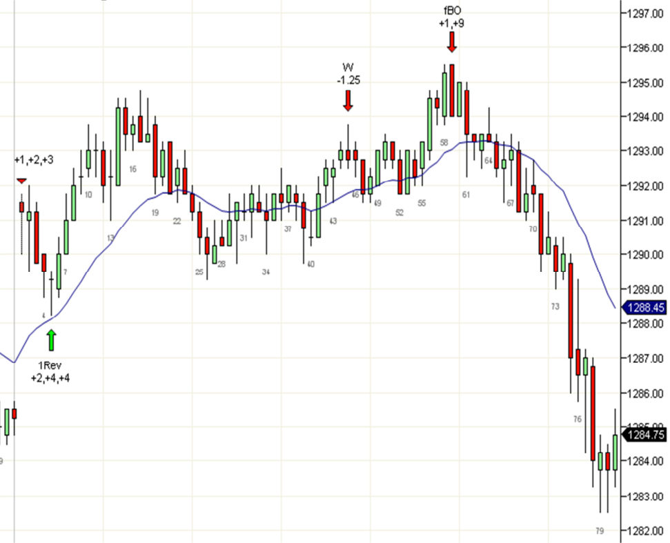

Correctly trading hard trends is ... hard. This is because hard trends are comparatively rare, and when they are running, traders fail to recognize them until its too late. Once they recognize a hard trend, they spend their time looking for pullbacks that never occur. Hard trends do give entries and today's late trend illustrates some of them. Trend breaks late in the day (90 minutes before market close) are often hard trends and its a good idea to swing some into the close. This is especially important for reversals and large gap fills. After your entry (b60) and scalp exit (b61) wait for at least one attempt to fail the trade (b64). Once this bar closes, you should move your stop above this bar. Every time the price makes a new low, you should move the stop beyond the last counter-trend swing (b67,b70). If you exited early or did not enter, there are some places for a late entry or add-on. Sometimes you may be able to detect the trend early and add on below the fH2 (b67) or once you recognize the hard trend due to multiple 1tfs (b67, b70) and lack of any trend bar of the opposing color, you can short below any small bar (b73) or any small counter-trend bar (b74) and move the stop above it. Large with trend bars such as b75 are often followed by strong counter-trend action but they almost always collapse before the bar closes in a hard trend.

When there is a large open profit and your swing stop is 4 points or so beyond as would happen near b76, it can be very hard to hold through but rest assured, a hard trend that originates late in the day rarely has a sudden reversal. Often the first large bar with a tail (b77) has at least one bar following it, so many traders simply exit on the close of the next big bar (b78).

<!-- p.219 -->

## A simple Trading Range day trading plan

Wednesday, June 8, 2011 · p.219

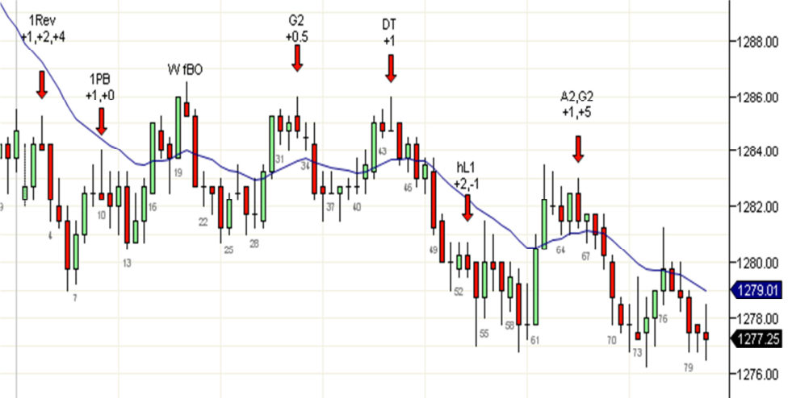

About 80% of the days are trading range days and its important to be able to trade them profitably. The first order of business is to identify a trading range day. My criteria is this: Wait for two up and two down pushes (b13 today). After this, if the price is very close to the open, there is a very good chance its a trading range day. Strong up and down bars early in the day (b2, b4) increase the chances of larger scalps (+2 to +4) between the moves. Naturally, trading range days can indeed break into trends but in most cases they will simply make two or three legged moves to the day's extremes.

Once a trading range day is identified, simply fade any two or three legged move to any extreme of the day. If the move is very channel like, you may choose to skip it since it may act as one leg. If a two legged move only reaches mid-range, it could give another push up to form a wedge so you could skip that one and take the wedge or enter on a second attempt (b66).

Occasionally, a strong signal such as a DT (b44) may develop that can result in a hard trend. If you suspect a hard trend may be developing ( shaved trend bars, no strong CT bars, no tick above prior bars), you can also enter on any small trend bar (b53) since a sharp trend could bring large profits.

<!-- p.220 -->

## Reversal bars in a strong trend

Thursday, June 9, 2011 · p.220

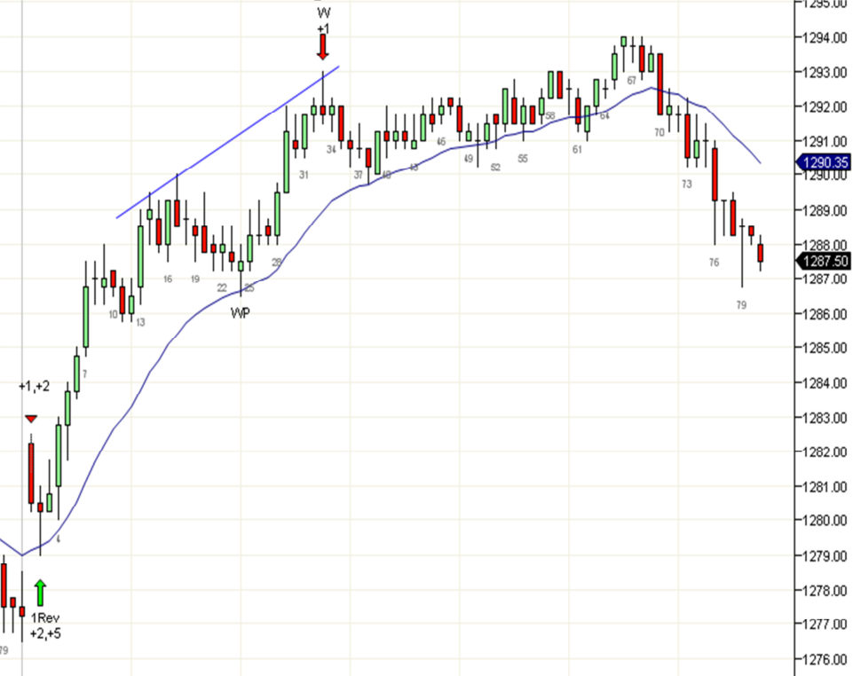

On days with extremely strong trends, reversal bars look great (b17,b33) but usually give no more than a scalp profit. With trend entries on the other hand look poor (b2, b12, b24, b38, b50) but tend to give reasonable profit.

When the with-trend entries suddenly look great (b62) and the reversal signal looks poor(b67) I am usually suspicious of a reversal. This is a great place to exit and depending on the price action, reverse your positions.

<!-- p.221 -->

## Failed H1/L1 in a strong trend

Friday, June 10, 2011 · p.221

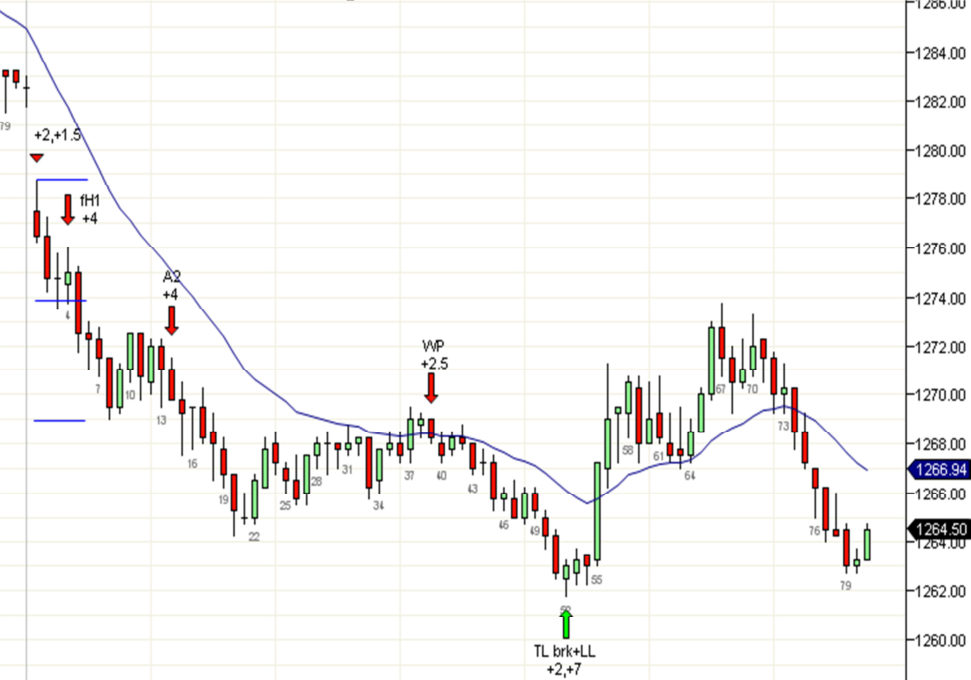

When the day opens with a very strong trend (large gap, strong closes on first 2 bars), there is a good chance that the first attempt to reverse this trend will not only fail, but fail spectacularly. In addition to a very strong trend, the reversal signal for the first reversal and its entry bar need to be poor (b3,4). A 1tf (b4) sets up an excellent fH1 and you should short below it regardless of how the bar looks.

An fH1 usually goes to a measured move from the beginning of the trend to the failed entry bar (b1 hi to b4 low) and usually reaches the measured move quickly (b8). At the measured move there could be a reversal or further move down, so its best to exit and re-enter on the next signal.

<!-- p.222 -->

## Failed Wedges

Monday, June 13, 2011 · p.222

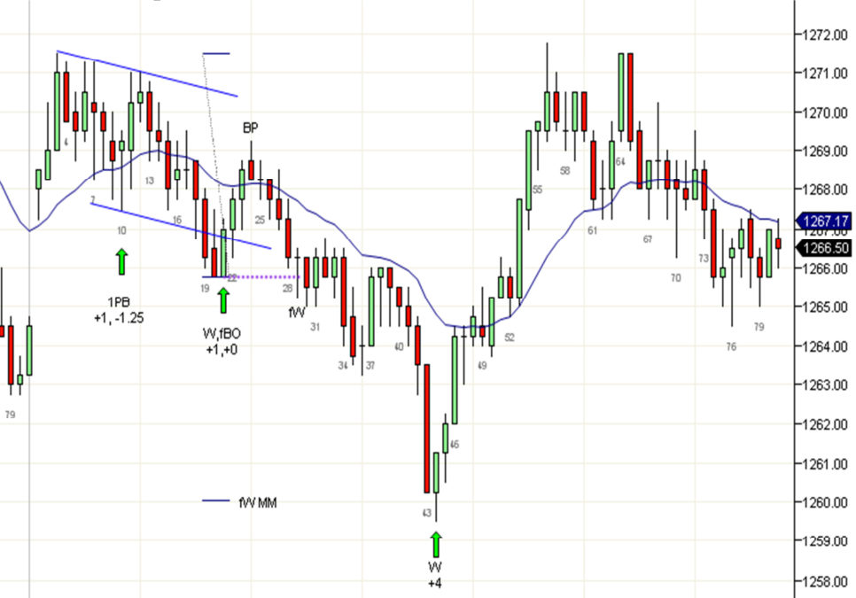

True failed Wedges are rare. Normally wedges that fail do so because they do not represent extreme behavior. Today, we had a W5,10,20 that did overshoot the trend channel line strongly and was expected to give two legs up. But after only a single leg to b24, it took out the low of the wedge (b29) thus giving a failed Wedge. Failed W are expected to go to a measured move of the wedge as we did at b44.

If the move to b24 was 2 legged, its no longer a failed wedge, but still a sell signal since a shallow 2 legged move after a wedge is a continuation signal. It just wouldn't be a measured move to the size of the wedge.

One of the reasons to enter after a pullback after the wedge reversal (W1P) rather than the W itself is to avoid a misread W or a failed W such as today. Its a good idea to enter a small position on a strong W if there is a strong signal bar such as b44. This is because there is a chance that the W could not pullback until much later (often above the ema).

<!-- p.223 -->

## Large gaps

Tuesday, June 14, 2011 · p.223

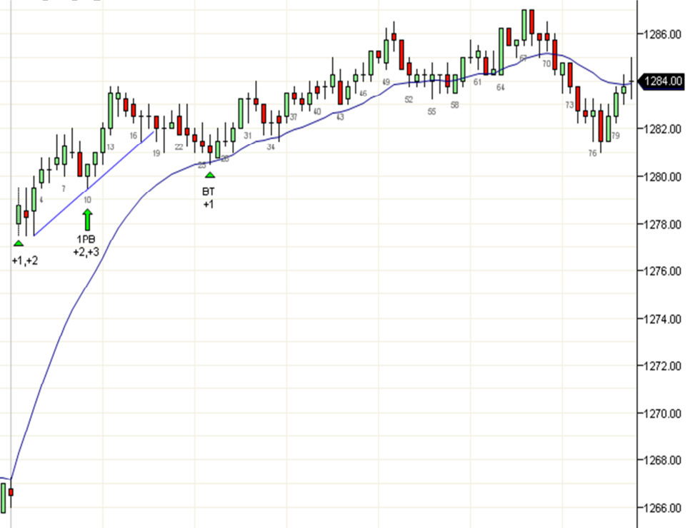

Large gaps -- gaps that are the size of an average day, currently about 10 points in ES -- are likely to move away from the gap rather than close it. This usually implies a trend day. A large gap day that tries to close the gap usually ends up moving far beyond the close of the previous day but a gap that tries to extend its self may find resistance and the early price action gives some clues.

A strong move up early on strong trend bars usually means possibly a large day and a early move of overlapping bars with tails may mean limited movement after the early move. A shallow trendline break (b15-25) may mean a trend termination without a reversal. Often on strong days such as this a strong AM trend and a shallow trendline break is followed by a channel type move. This is because on a higher timeframe this actually is a spike and channel. The channel should never be shorted until it has its own trendline break (b50-55) followed by a test of the extreme.

In general, large up gaps followed by a trend made up of average or small bars is fairly easy to trade if you take only with trend entries near the ema. A rough rule of thumb is to only trade with-trend near the ema until there is a successful close below the ema (b57) and then exit on the next push up (b67). Buying second attempts above bull bars only will usually protect you from being stopped out.

<!-- p.224 -->

## Large reversal bars are trading ranges

Wednesday, June 15, 2011 · p.224

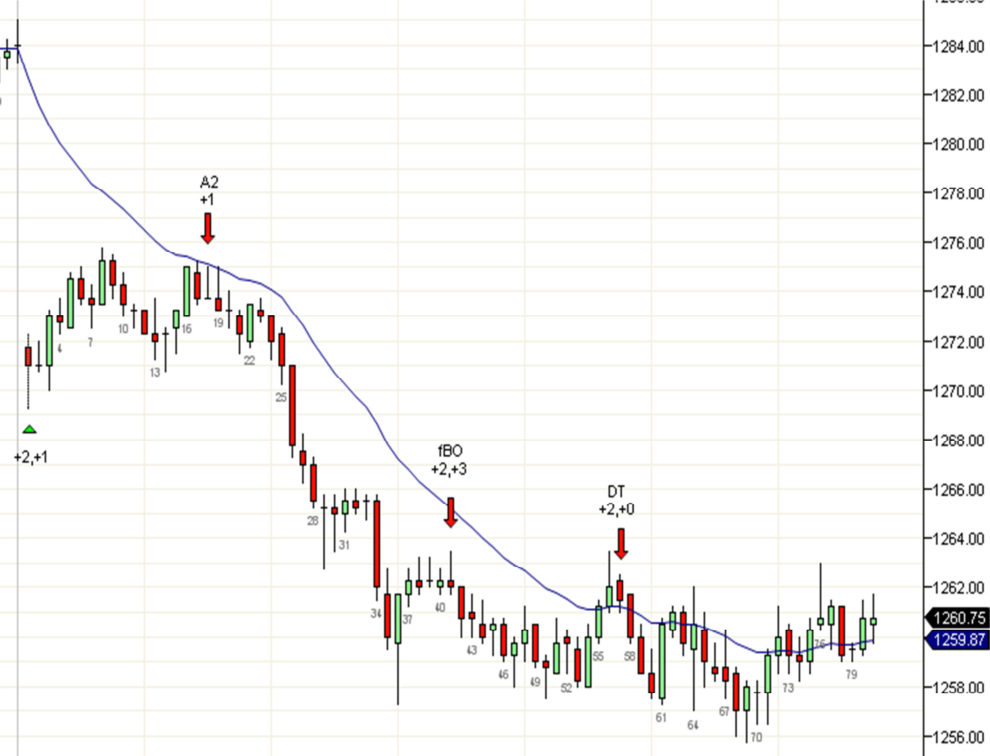

Large reversal bars(b36), especially after a strong bear move(b23-35) are often trading ranges. A strong overshoot with a very large reversal bar (anything over 3 points) will terminate the trend and turn into a trading range. The price action following such a bar is sometimes a breakout pullback into a trend on either side but usually failed breakouts of both sides of the bar and horizontal movement until a new trend breaks out.

The correct way to trade this bar is to take second failed breakouts (b41, b69) of any side and hold until a test of the other side. The size of the trading range may gradually increase with every failed breakout. Its usually best to skip the failed breakout trade until the range size is 4 points or more.

The larger the bar, the more confidence you can have that not too many will buy above it simply because the stop would be too large.

<!-- p.225 -->

## Major reversal: Double TL break

Thursday, June 16, 2011 · p.225

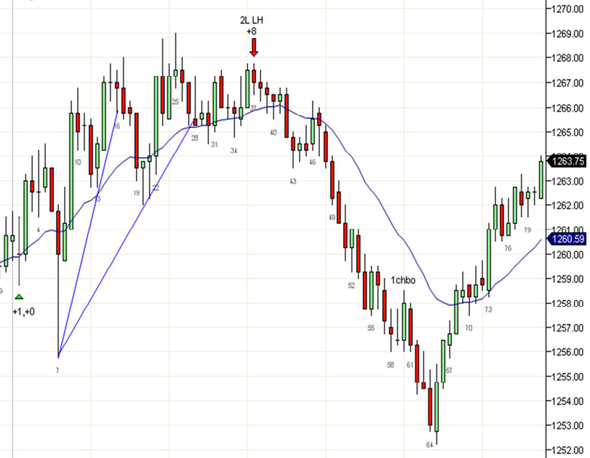

A trendline break (b19) followed by a test of the extreme (b23), followed by an additional trendline break (b30), followed by a 2L failure to reach the extreme (b37) is a double trendline break and a major reversal. You should always take these since they lead to strong trends.

While a trendline break and a 2L move to a new extreme (b25) is a signal in itself, the poor signal bar should keep you out. A second entry is acceptable even with a marginal signal but a 2L LH is a much better signal. A 1L LH (b32) should rarely be taken (for example when there is a strong overshoot). In all other cases, a 2L LH is an ideal entry point.

<!-- p.226 -->

## Triangle Breakouts

Saturday, June 18, 2011 · p.226

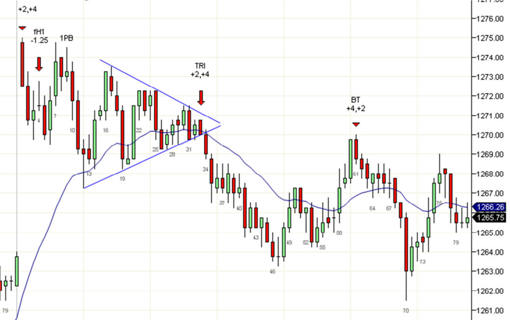

Breakouts are the hardest pattern to predict correctly and the one pattern that fails the most often. There are broadly three kinds of breakouts:

- Triangle
- Expanding triangle
- Trading Range breakout

Essentially, all breakouts are breaking out of trading ranges and a triangle breakout represents a narrowing trading range while an expanding triangle represents a widening trading range. A flat trading range breakout can be anticipated by its failure to breakout the other side or could be entered on a breakout pullback. This approach is unsuitable for triangles.

However, for a narrowing triangle, there is a simple guideline. It normally breaks (b34) in the direction of the previous trend (AM bear move b1-12). Sometimes the triangle will break and reverse right away, but if the breakout bar has a strong close and the stop beyond it (b34 hi) is not taken out, its usually a successful breakout and should run for at least 2 legs.

<!-- p.227 -->

## Anticipating trend from the 1st bar

Monday, June 20, 2011 · p.227

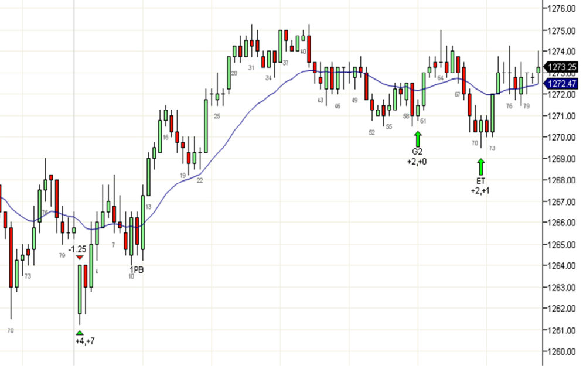

A large gap can help you anticipate a trend day but more important in predicting a trend is a reversal of an extreme of the day. Today's b1 reversed b70 lod from previous day and the latter part of the prior day demonstrated sufficient strength for us to expect at least a test of the high of yesterday.

A second attempt to reverse the extreme of the day if the first attempt fails is also a very good indicator of a possible early trend if it happens within the first hour. An entry here is swingable for many points at least above one or two swing points from the prior day.

Conservative traders can enter the 1PB above b11 after two failed attempts to sell off at the ema.

<!-- p.228 -->

## G2 after a deep pullback in a strong trend

Tuesday, June 21, 2011 · p.228

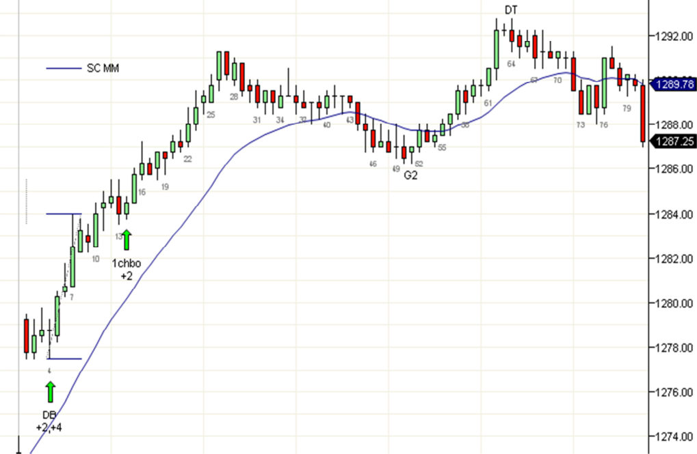

The first deep pullback of a strong trend is usually worth entering for another leg. When a trend is strong and has moved many points (b4-26), the first deep pullback (b28-50) is likely to be very deep and often moves below the ema. The second attempt to fill the gap (b52 after failed b49) usually succeeds and is a high probability trade that is likely to reach a new extreme (b62).

It is important to note that the first deep pullback may have broken the trend and reaching the new extreme may simply act like a trend termination and possible reversal. G2 is also something you should only take when the potential profit is 4pts or larger. If the pullback is not sufficiently deep, it may have another leg to go before the original trend resumes.

Additional reasons to take the trade will strengthen the trade. For example, today's b51 was a low momentum 3 push pullback and therefore a wedge pullback. b51 was also the first bull signal bar that actually triggered (b34 and b40 were entry bars).

G2 is a lower probability on days with weaker trends and on second deep pullbacks and you should look for additional reasons to take the trade.

<!-- p.229 -->

## Reversal of the extreme of the prior day as a trend generator

Wednesday, June 22, 2011 · p.229

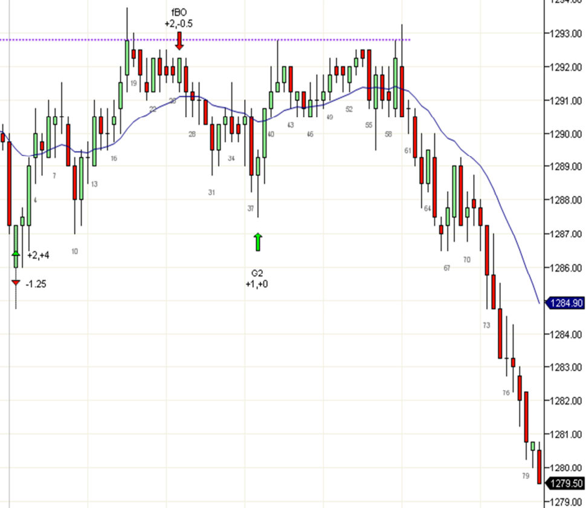

Days that open near the middle of the prior day's range are likely to be trading range days. If they test one of the extremes and reverse it, i.e., give a failed breakout of the High or Low of the previous day, its a potential trend generator.

Reversing the close of the prior day can sometimes result in a small move as today's open did, particularly as a continuation move of the overall trend of the prior day. However, the reversal of an extreme of the day, especially the second failed breakout is likely to attempt to take out the other extreme of the prior day.

When you see two failed breakouts of an extreme, its a very good swing trade for many points and you should always swing some contracts.

<!-- p.230 -->

## Trend acceleration

Thursday, June 23, 2011 · p.230

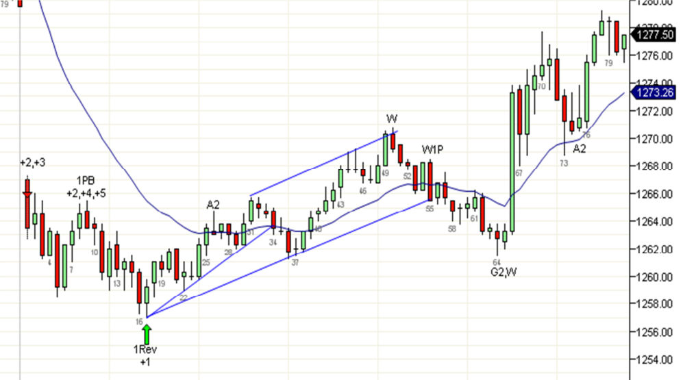

A trendline break (b7-9) followed by a successful test of the extreme (b17) is a major reversal. But when a trendline breaks (b32-36) but the test of the high fails (b41-44), the trend is likely to accelerate, giving larger swings. This is why its always a good idea to enter in the direction of the trend when the trend line first breaks. If the trend accelerates, it forms a new trend supported by a new trend line (b17,37).

Strength early in the day (b6-8) often gives an indication of strong moves later and without this, you may wish to pass up buying the trend break except under excellent setups.

<!-- p.231 -->

## A2 variants

Friday, June 24, 2011 · p.231

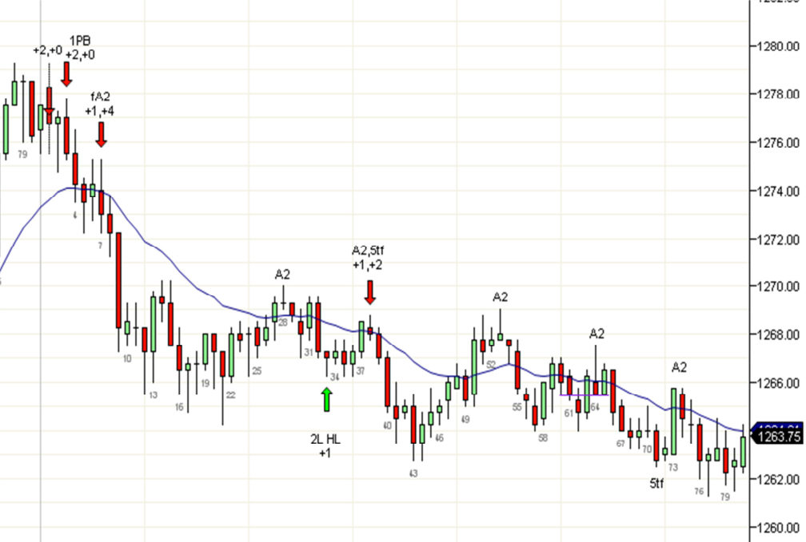

A strong tend day shows multiple A2s and today we got a great sampler of A2 variants.

The first and not very obvious is the fH2 at b7. This will act like an A2 and give at least 2 legs down. While today's formation is clear, on a soft trend day, it could manifest as 2 pokes beyond prior bars in a slightly sloping market.

The second is the classic A2, which is a 2 legged move(b21-28) in the direction counter to the main trend (b1-b21) .

Normally, its a good practice to count legs counter-trend only, i.e., reset your count on every new trend push. If not, you would be shorting b23 instead of b28. However on two variants, you do not have to reset your count. These are 5tf moves. The entry above b36 was a 5tf, this would allow b38 to be an A2, counting b35 as an L1, regardless of the fact that it was the same low as b33. Another variant is b64 acts as an A2 in spite of b62 having the same low as b57 since the entry below b64 was a second entry at the same price as b60.

Even better is b74, which is an A2 since the short below b70 was a 5tf.

Note that you should heed other confirming signs of A2 such as the move being in a trend, closeness to the ema (not too far above or below), decent trend bar PA (not too many dojis or overlaps) and good bar size (bars that are too small or too large must be ignored).

<!-- p.232 -->

## Final Flags

Monday, June 27, 2011 · p.232

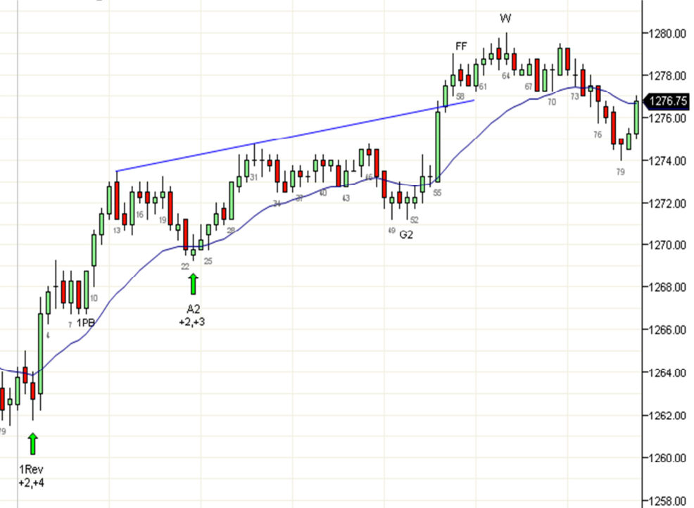

In a strong trend, a flag should move counter to the main trend, as in b13-23. As long as the flags move counter to the main trend, there is always the chance that the price will break back in the direction of the original trend. Even with a strong trend break, the expectation is that the previous extreme will nearly always be tested.

After a prolonged move, that is to say after many points and many bars and usually 2 or more pullbacks (although buy climaxes can have few or no pullbacks), a flag may move horizontal (b58-60) and then break(b61) in the direction of the original trend. Often this break will fail to give a scalp profit (b64 hi was 5tf above b60) and then turn down.

A FF can often turn into a W by giving two more pushes (b63, b64) and then turn down. Final flags that occur with TCL OS (b55,56) are often signs of trend reversal when they are preceded by a TL break (b46-49). A very large bar(b55) may precede the final flag and is usually the sign of a climax buying (or capitulation in a bear)

<!-- p.233 -->

## Choosing trades to swing

Tuesday, June 28, 2011 · p.233

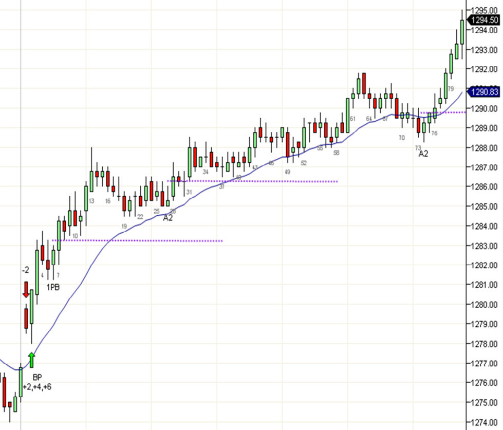

On trend days, swinging is far more profitable than scalping. However, you can't just swing every trade. For most entries, there is a very good chance that your swing stop at the entry price will be hit.

I use a simple heuristic to pick swing entries. If the pullback is 2 legged AND deep, I will add a swing portion to my size. Today these would be the A2 long above b27 and the A2 above b74. Once the price moved 6t above these bars and the scalp was filled on these trades, the stop could be moved to breakeven

Long entries above b41 and b52 were 2 legged but not deep enough to warrant a swing entry. These are scalps only and higher risk. Its perfectly acceptable to pass these up and stick only to the deep pullbacks.

In addition to the A2 trades, the 1PB trade above b6 is always a swing trade and is usually the best swing trade of the day.

<!-- p.234 -->

## Chop: Barb wire

Thursday, June 30, 2011 · p.234

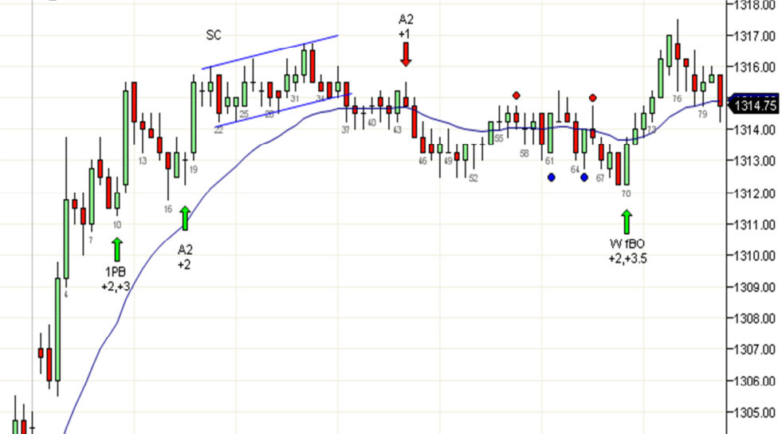

The most dangerous kind of price action is Barb wire. Barb wire is any three overlapping bars where at least one of them is a doji. This definition pretty much makes most of b20-b60 BW. Many traders lose their AM points trying to trade the lunchtime BW.

The correct way to trade BW is to not trade it. There were four failed trades in the region from b55 to b67. The first was a possible A2 short below b57. The second was a possible A2 long and failed A2 short above b61. b65 was a possible 2L pb after a breakout above a swing point. b66 was a possible second leg down from b62.

While they all would normally be OK trades, being in barb wire disqualifies them. Any setup can fail if its in barb wire, so you shouldn't get excited no matter what happens. The only time to enter a trade is when the BW stops being barby. At b70, we no longer had dojis and we had 3 pushes down to a failed breakout so its a possible failed breakout long. If b68 was a doji, then this would also have been a poor entry.

<!-- p.235 -->

## Two legged pullback to ema on open

Wednesday, June 29, 2011 · p.235

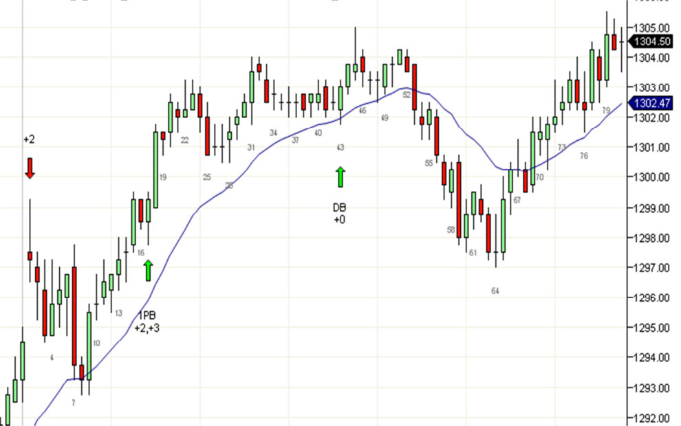

When the prior day had a strong trend move and the next day opens with a gap in the direction of yesterdays overall trend, any two legged move to the ema should be taken as a continuation signal. This is usually a good indication that at least the AM move will trend in the direction of yesterdays trend.

This signal is greatly enhanced if the last push of the previous day was in the direction of the trend and consisted of many average sized bars, especially a single leg move. If the pullback on open breaks below the close of yesterday and reverses (b7-9), this indicates a very strong signal.

If you miss the actual reversal due to a bad signal bad (b8), you can always take the first minor pullback (b12) or the BP after a break above b1.

---

[← Previous](13-2011-05.md) · [Contents](00-目录.md) · [Next →](15-2011-07.md)
