[← Previous](14-2011-06.md) · [Contents](00-目录.md) · [Next →](16-2011-08.md)

# July 2011

Original pages 236–253

<!-- p.236 -->

## 2 legged pullbacks in a trading range

Tuesday, July 5, 2011 · p.236

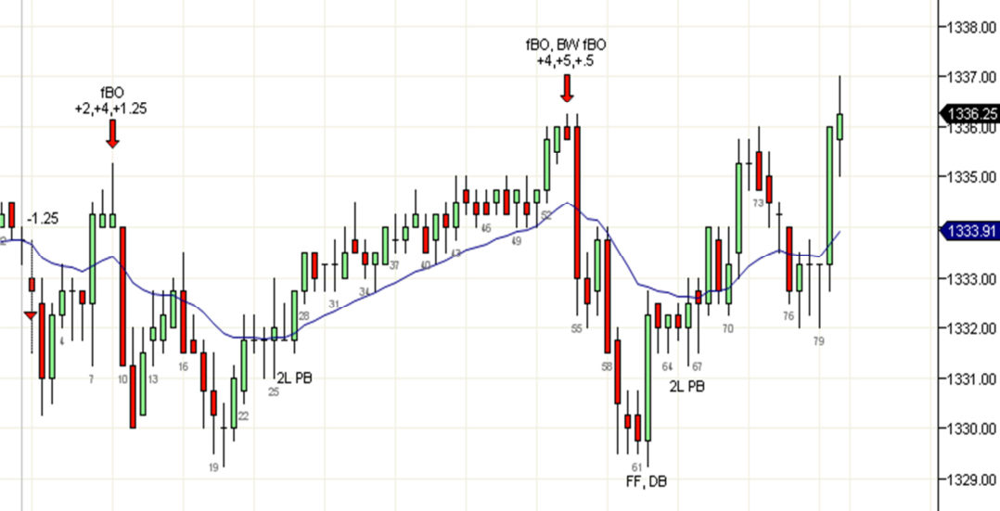

On a trading range day, there are no A2 setups, but a 2 legged pullback after a possible test and reversal near the extreme of the range can often work like one. For example, After a possible breakout and reversal on b20, there were two failed attempts to sell at b24 and b27. When they failed, it is equivalent to a 2 legged pullback and the price should be expected to continue in the new direction.

The pullback after b62 DB and possible reversal was a bit more clear since b63 was an L1 and b66 was an L2. Similarly b5,7 were two failed attempts to sell and so were b77 and b79.

When the Trading Range is large enough, an attempt to fade the breakout becomes attractive. A good rule of thumb is to take fBO trades when the trading range is at least 4 points wide.

<!-- p.237 -->

## Whipsaw

Wednesday, July 6, 2011 · p.237

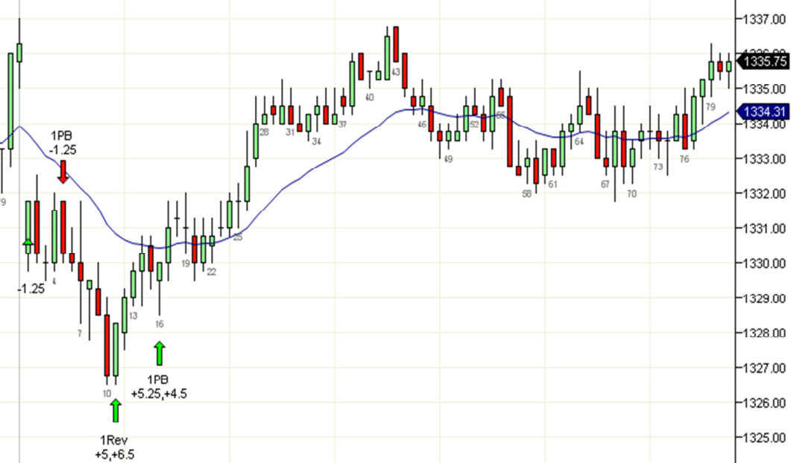

When the market swings up and down on every bar stopping out every trade, its in whipsaw mode. Whipsaw can be triggered or aggravated by news as was the case today.

Normally whipsaw represents strong conflict but is definitely a trading range (b1-b7). The most likely outcome is a breakout and reversal (b10,11) leading to a trend (b11-b43).

The market is possibly in whipsaw if two long and two short orders have been stopped out (b1 long stopped below b2, b2 short stopped above b3, b3 long stopped below b4, b5 short stopped above b6). At this point, the best course is to stop trading and wait for a breakout and its reversal. Whipsaws rarely breakout and continue in the direction of the breakout (but it does happen occasionally)

A safer entry is the first pullback after a reversal (b16) or if the breakout is towards the ema, a fade of a two legged move to the ema.

Whipsaws early in the morning can have aftershocks in the PM (b68-b74), so caution must be exercised once the trend breaks (b43-48) and forms a trading range.

<!-- p.238 -->

## Trade only with trend when bars are tiny

Thursday, July 7, 2011 · p.238

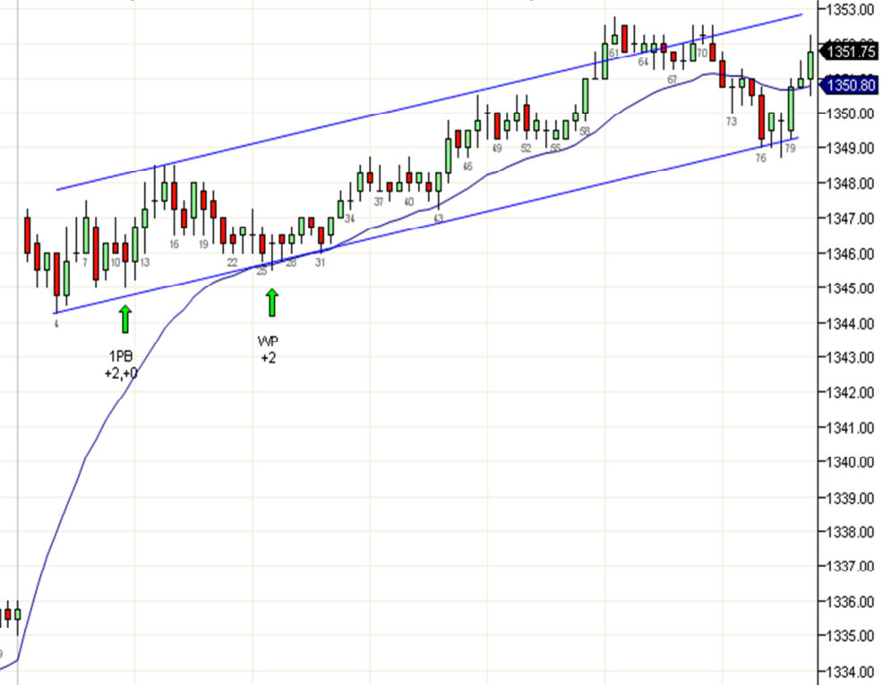

A large gap works like a spike and usually is a spike in pre-market trading. If the open does not produce significant selling, there is a very good chance the price will channel up. A sharp two legged move to the ema may produce a strong trend but a low momentum move with tiny bars may act like a WP and produce a channel type move

When most bars are small and have one and have one or two tick bodies, the trend is very likely continue in the direction if the gap for the rest of the day. If channel is narrow, every short signal gives an entry mid-range, something that's very likely to fail.

The best way to trade a channel is to buy any bull bar after a failed L2 near the ema or trendline. Usually when the L2 is off an inside bar near the ema, you can often buy the low of the inside bar on limit with a tight stop.

<!-- p.239 -->

## A 2 legged pullback after breakout is a good indication of a reversal

Friday, July 8, 2011 · p.239

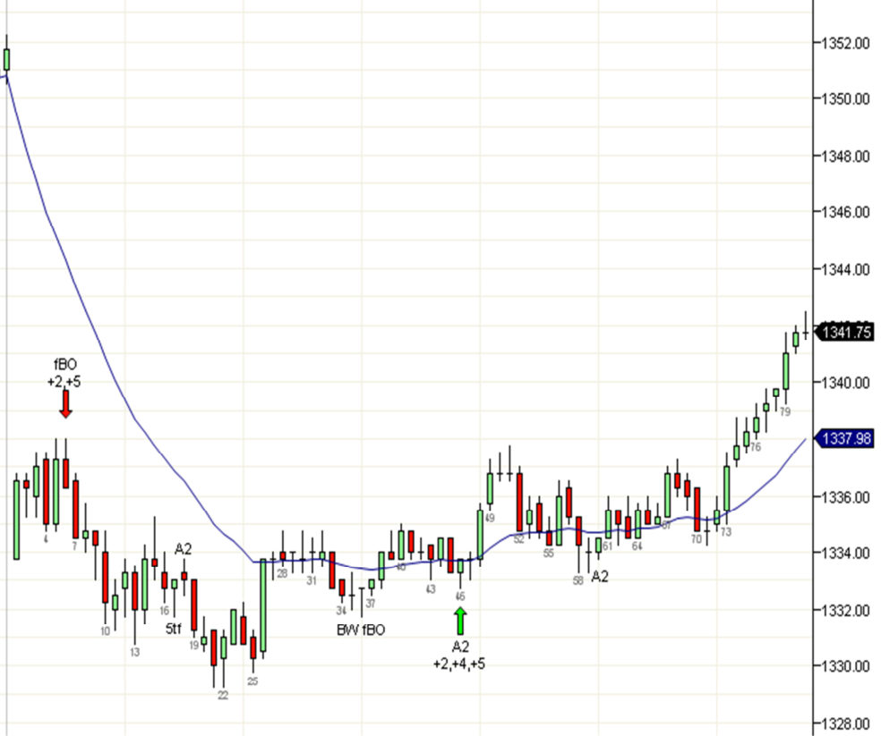

A trend break followed by a test of the prior extreme is a major reversal. Sometimes the break is so strong that the test is very shallow. For example, b26 broke a trend line and stopped short at the ema and went into barb wire. Often one bar breakouts fail and sell off rapidly but when it gave a 2 legged pullback (b28 and b32 found sellers) and the buyers were able to take out the prior swing high (b40 took out b28 high), a new trend was in effect (2 Higher highs and two higher lows).

So the next 2 legged pullback at b46 found lots of buyers and so did every pullback into the close.

<!-- p.240 -->

## Trends dont turn around easily

Monday, July 11, 2011 · p.240

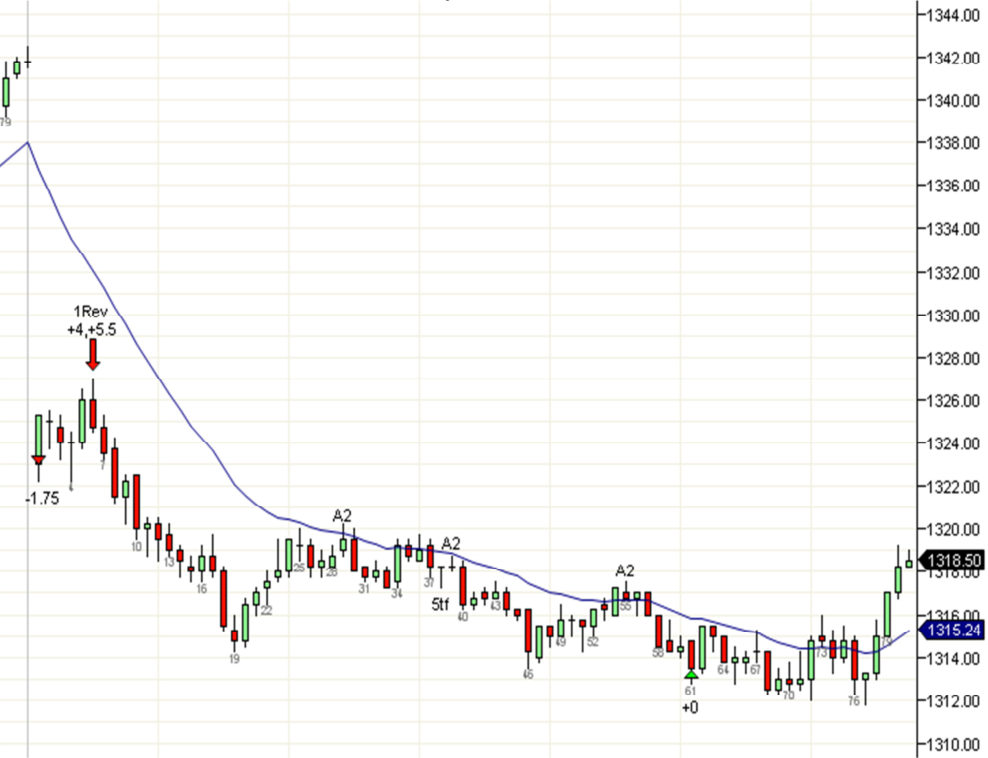

With-trend traders are always at an advantage and the reason is that trends don't turn around easily. Especially strong trends that have a strong first leg. Today there was a channel like move from b6 onwards until an obvious trendline break (b19-b29). The channel like move very likely means there would be a second leg down, which would take out b19 low. This was met at b46. However, buyers of b46 or b47 were disappointed when the trend did not just reverse to bullish. They may have tried again at b61 (3 pushes down) ad then again at b65, b68 and b72. All those attempts failed because trends don't reverse very easily. Most faders are in too early and pay for it. The large gap and the channel like first leg is an indication of strength and without a strong overshoot, the likelihood of reversal is low.

In general, a 1 legged move to and close beyond the ema (b72) is a good sign that the trend may have ended or at least the counter-trend trades are likely to be profitable beyond the one and two point scalps. Until then, every entry is speculative and if you do enter, exit unless the entry takes you beyond the ema without pullbacks.

<!-- p.241 -->

## A Wedge reversal of a weak trend may generate a strong trend

Tuesday, July 12, 2011 · p.241

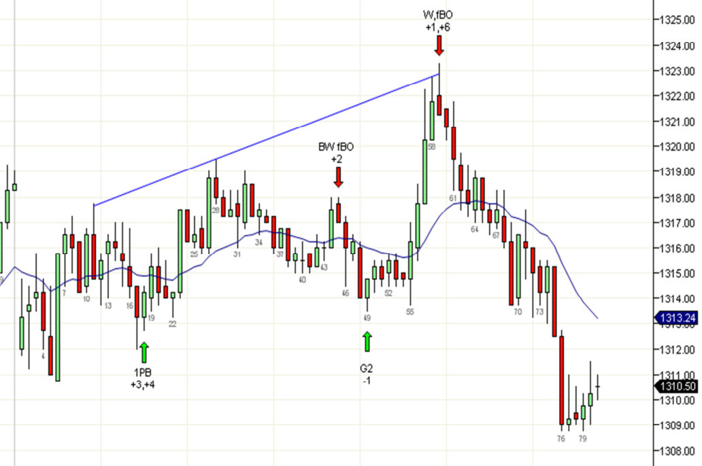

Often trading range days are weak trends with deep pullbacks. The price continues to make higher highs (b11,b28, b59) and higher lows (b17, b22, b49) etc. When such a trend has a Wedge reversal (W11,28,59), there is a good chance it will reverse the entire wedge. A strong breakout (b55-58) from an essentially horizontal movement on failure will produce a large move down. The reason for this is simple: The horizontal movement acts like BW and the breakout like a BW fBO.

The most important reason however, is that every new breakout on a trading range day that did not open with a large gap is far more likely to fail than to succeed.

<!-- p.242 -->

## TCL failure

Wednesday, July 13, 2011 · p.242

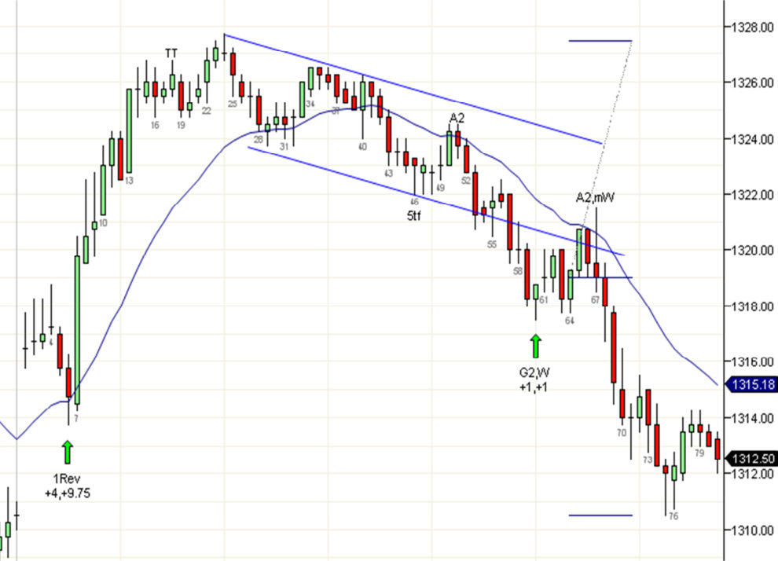

A channel is normally a flag and after 3 pushes or so will resume the prior move to at least test the original trend extreme. Any movement of the price outside the channel tends to push the price action to the other extreme of the channel (b29 to b34, b40 to b46). The more extreme the violation, the sharper the bounce.

Very deep excursions can result in a very sharp snapback especially if the price action early in the day (b7-13) showed strength in the same direction. However, if this snapback fails to rush to the other extreme of the channel and instead gives a 2 legged move (b60-67), then we have a TCL failure and the result is often a measured move of the extent of the channel (met at b75). This acts like a fH1 and usually is one on a higher timeframe.

The correct trade is to take both the expected snapback and reverse on its failure since both are likely to move around the same number of points (b16 hi to b24 hi is the same as b66 low to b75 low)

<!-- p.243 -->

## Trendline breaks end the trend but do not imply reversal

Thursday, July 14, 2011 · p.243

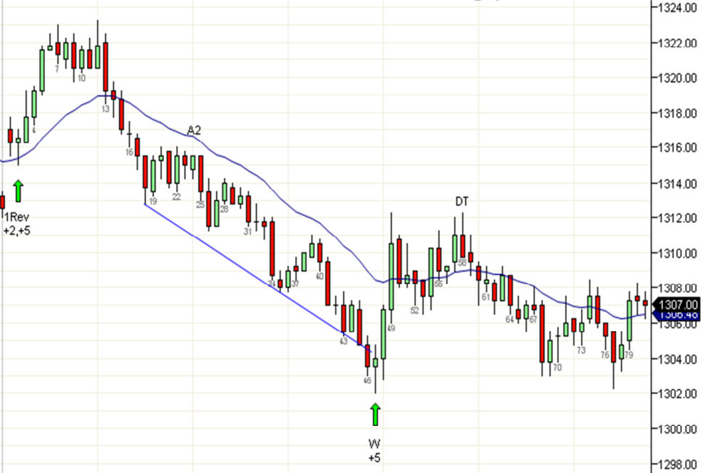

When the trend accelerates (b40-b46) after a sufficiently large move (b13-34), the resulting deep trend channel line violation (b46,47) will usually give a strong snapback move. The deeper the incursion, the stronger the snapback (b47-49).

When counter-trend traders are able to make a very strong move such as the snapback above, the result is a trend line break. Often, the break is obvious without the need for an actual trendline. This show of strength is usually sufficient to pause the trend for a while, however it may not reverse the entire trend right away. This is because at the point of the trendline break (b49 high), sellers will want to sell at a better price and the buyers who missed out will want to buy at a better price. The result is a test of the trend extreme (b47 low) or at least a test of the entry bar (b48 low). A second strong buying at this point will often but not always cause the trend to reverse.

This implies that most entries should exit when the snapback pauses and swing entries should wait for the test of the prior extreme.

<!-- p.244 -->

## BW midrange

Friday, July 15, 2011 · p.244

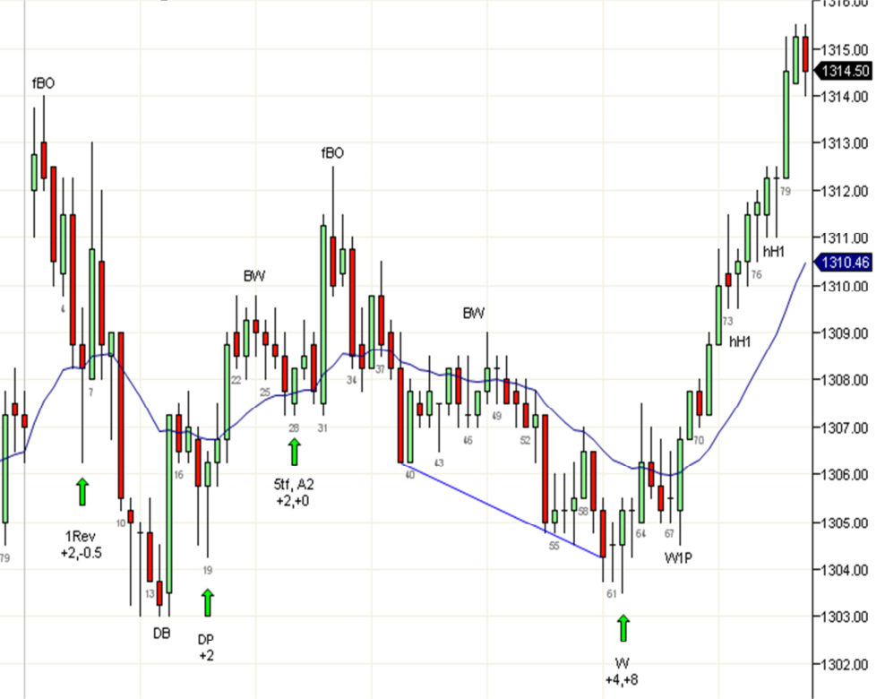

A mid-range barb wire (BW) pattern is a very common occurrence on Trading Range days. Most traders get chopped up trying to trade these such as the ones between b22-29 and b41-53 today.

Facts you need to know about barb wire:

1. They almost always break away from the ema rather than thru the ema.
2. A strong breakout bar from BW(b31,54), no matter how strong it may appear, is likely to fail and turn around to go through the BW. This is especially true on trading range days since you expect moves to ends of the range to reverse.
3. 2 failed attempts to break through the ema(b25,27) can be traded as if it were a minor A2 if additional indications are seen (TL touch, 5tf, shaved signal bar b28). This should be done with care since taking the fBO is always the better trade and you dont want to miss it by being on the wrong side.
4. A BW fBO late in the day is likely to give a much stronger move than one mid-day.

Note that hard H1/L1 entries in a hard trend (b74,b78) do not constitute BW. This is because trending dojis are a trend and BW needs to be somewhat horizontal.

<!-- p.245 -->

## Trendline breaks

Monday, July 18, 2011 · p.245

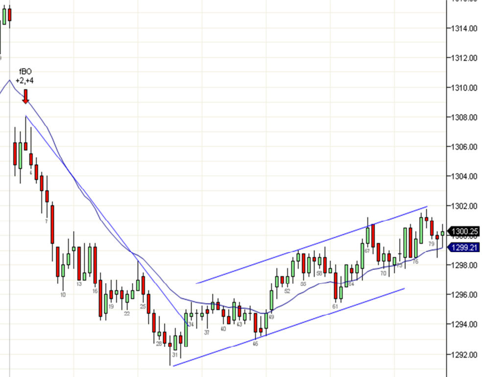

Trendline breaks, especially of trends longer than 20 bars or so should be carefully evaluated for continuation, reversal or trading range action.

A strong trendline break will go many points and many bars beyond the trendline, often closing above the ema in one leg. If this break occurs after a strong overshoot and reversal bar, its a very strong trendline break and reversal is likely. Any 2 legged pullback or any reasonable 1 legged pullback such as 1chbo should be taken.

A weak trendline break that occurs after a very large trend bar or a taily bar is likely to turn into a trading range. This is especially true if the terrible signal bar is followed by a 2 legged pullback to the ema that comes close to the extreme of the trend and fails to take it out or takes it out only by a few ticks and then reverses.

In between the two is a moderate break that gives a channel either in the same direction or the opposite direction of the original trend such as the one today. The break came off a 2 legged move (b30-34), after a doji bar and no real overshoot. However, the A2 that followed (b38) did not go far and started to move in a channel. Once you assess its a channel, you should trade it like a weak trend, buying 2 legged pullbacks to the trendline and ema and scalping most entries by exiting at the trend channel line.

<!-- p.246 -->

## Limit entries

Tuesday, July 19, 2011 · p.246

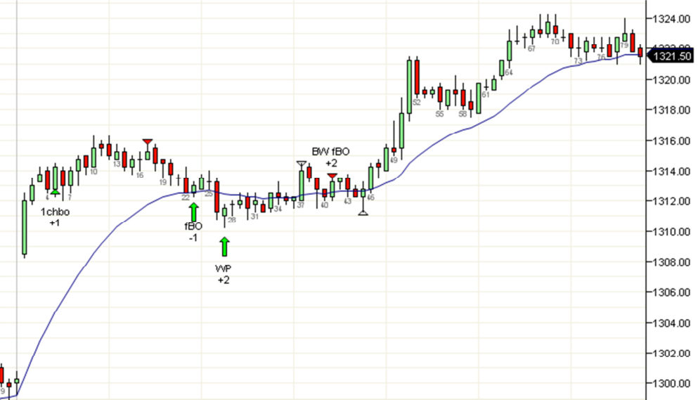

After experimenting with limit entries, I have narrowed down a few prospective entries that work somewhat consistently and when they do work, they give a slightly better entry than a preceding or subsequent stop entry. While the key to trading is to take the best setups, limit trading on small bar days can improve your win per trade by 4t or more. On large bar days this approach may not be very fruitful, simply because the momentum of every move can easily trigger tight stops. In general, I dont look for limit entries except when there is overlap since overlapped entries tend to give deep pullbacks. Limit entries are primarily a means to enter late, often at a better price.

1st Channel breakouts: When the momentum is strong and no bar has dipped below the low of the prior bar, the first bear trend bar close (b4) can be bought on limit with a stop below a recent trend bar (b2). If the stop is too far away, do not take the trade.

Entry bar tests: When an inside signal bar (b13, mDP) triggers, the entry bar's high will often be taken out by 1t (b14, b39). This provides a very tight entry at the high of the entry bar. The stop can be as tight as 3t, but if a trend bar is nearby, you could place the stop beyond it (b12 high, b38 high).

Breakout tests: When the highest low of the day or the lowest high of the day are approached for the first time, there is a good chance it will fail from 0-2t away. A BT entry can be placed 3t away from the breakout point with a stop 4t above. For example, b37 high would have been a breakout test of b11 low if it was the first approach. In general, BT is for breakouts and should not be expected to work unless a trend move did break from that point.

Double bottoms: A double bottom off strong bar can be expected to bounce at least as much as the size of the bar. For example, b45 low made a double bottom with b33 and is a possible limit entry. The stop would be below a recent trend bar (not-existent in this chart, so its not a real entry). The trick to taking double bottoms is to always take them on the 2nd or 3d push. For example, although b37 low did give 4t, you really want to buy on the second leg down at b45.

<!-- p.247 -->

## Micro-channels

Wednesday, July 20, 2011 · p.247

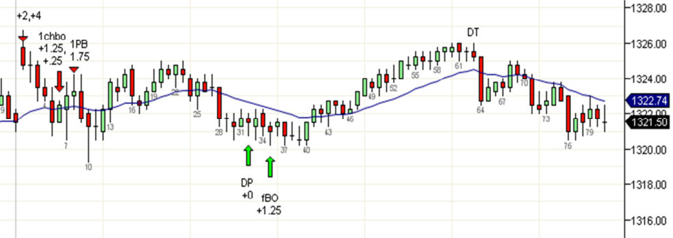

Extended micro-channels usually imply reversal and are often seen on both trend days and trading range days. After an extended trend move, a with-trend micro-channel represents a trendline break and and a higher high or lower low test and often will signal a reversal.

On trading range days, they represent a weak move to one end of the range, which usually breaks down and can break into a trend in either direction. A micro-channel beyond 20 bars loses any predictive value.

Micro-channels are traded like any other channel. A break and a 2 legged pullback is a with trend (in the direction of the MC) and a break and a 2L test represents a reversal.

<!-- p.248 -->

## Double bottom pullbacks

Thursday, July 21, 2011 · p.248

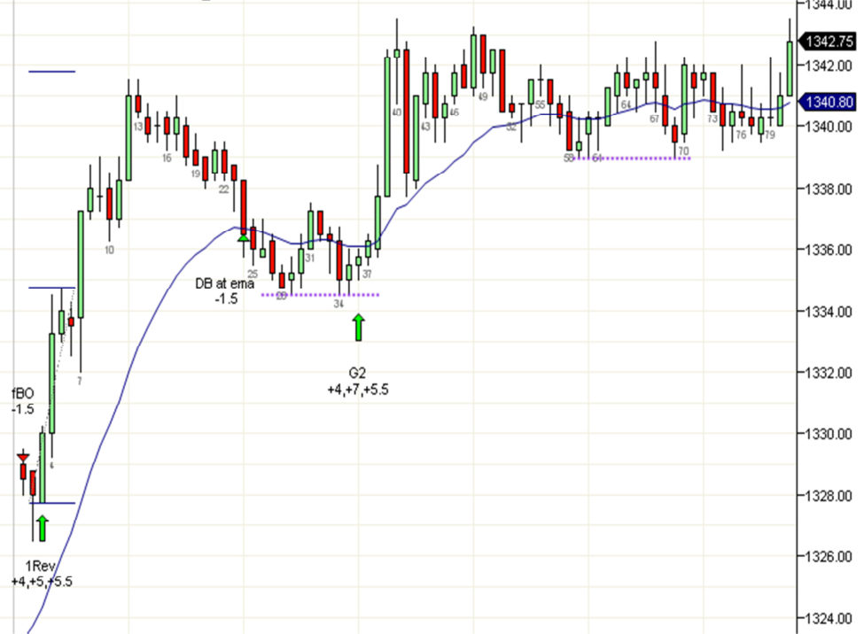

An important continuation signal on a bull trend day is the double bottom flag (double top in bear trends). These are especially strong when they occur at supports. For example, today we had two double bottom bull flags. The first at b29,35 was at the BT of the 1PB entry above b6 and the next at b59,69 was at a trendline.

A DB after a deep pullback has a lot of significance, since it implies traders are buying again or adding on close to their entry price. A DB followed by a small pullback that doesn't quite touch the bottom turns into a DP. An inside bar such as b36 or a miss by a tick or two such as b74 constitute a DP.

DPs are a kind of failed breakout and are expected to go to the other end of the range (b12 high for b35 and b40 high for b75) and should be taken if the range is large.

<!-- p.249 -->

## TTRs break the trend

Friday, July 22, 2011 · p.249

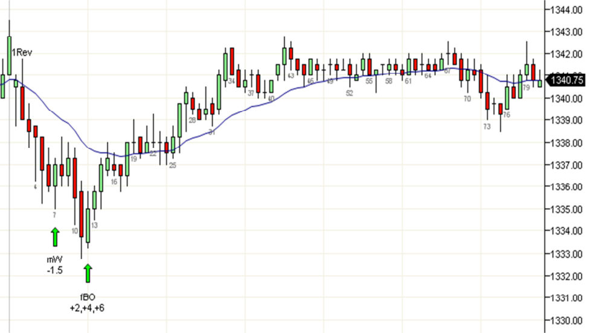

Any horizontal movement extended long enough will break a trend, including one bar trends and gaps. Its best to exit any positions near the top of the TTR and look for new entries after the next trend break.

A minor horizontal movement such b19-24 is simply a two legged pullback (b20 and b24 were two pullbacks) and should not be considered an extended TTR. On the other hand, when two up and down attempts failed (b46,47,49,50) There is good chance this is a horizontal flag and TTR.

Stop runs in a TTR (b54,55 and b56) should are not reversals and should not be taken. A breakout out of the TTR, especially a 2 or 3 legged BO can be faded (b69-75)

<!-- p.250 -->

## Trading barb wire

Monday, July 25, 2011 · p.250

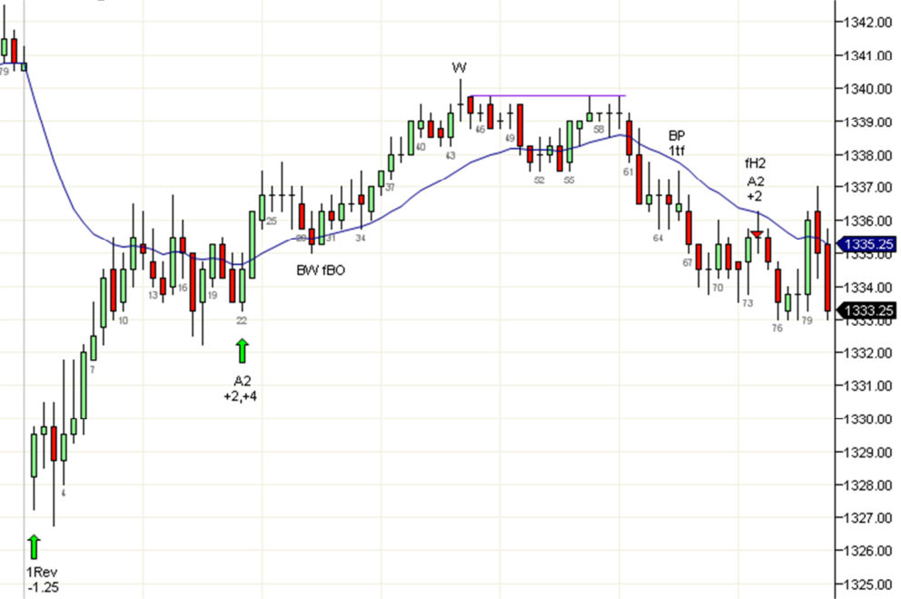

While its normally excellent practice to avoid barb wire, experienced traders can and do trade it profitably. On the occasions I do enter on barb wire, its often because I have missed an earlier entry in a trend and the barbwire is another opportunity for me to enter with the trend. I usually avoid barb wire mid-range.

For example, today's BW between b24-28 had a trend breakout to the ema and it bounced off and gave an fBO entry that is also a fL2 entry (b27L1, b29L2) for anyone who missed buying above b22. This sort of BP usually produces very short BW lasting 4 to 6 bars. A similar BP occurred at b66. AStrong breakout at b62 was followed by two feeble attempts to reverse the breakout (b63 is a feeble attempt to create a reversal bar).

b73 was a similar is a barbwire A2 in a trend that should be read as a fH2 and therefore two failed attempts to reverse the trend. (If you expect the bar to trigger, its quite ok to short the close on limit as was done here)

The last but somewhat rare scenario is that BW can be shorted when it repeatedly fails to run stops as in b45-60. How many attempts equate to repeated? That's yet unknown, but two failed attempts to break out up after at least one successful attempt to break down should suffice.

<!-- p.251 -->

## Wedge pullback

Tuesday, July 26, 2011 · p.251

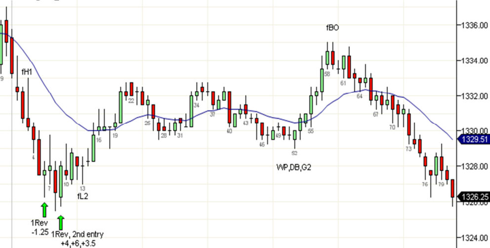

A mid-day low momentum three push pullback is a wedge pullback (WP) and usually is a good entry. On a trend day, this move will usually end close to the ema. On a trading range day such as today, it will usually give a three push fBO of the previous swing low (b52 broke below b27).

Often this may be a G or G2 trade as well and is usually a high probability trade given previous trend in the same direction. Often the WP makes part of a complex mid-day pullback.

<!-- p.252 -->

## Channel after a trendline break

Thursday, July 28, 2011 · p.252

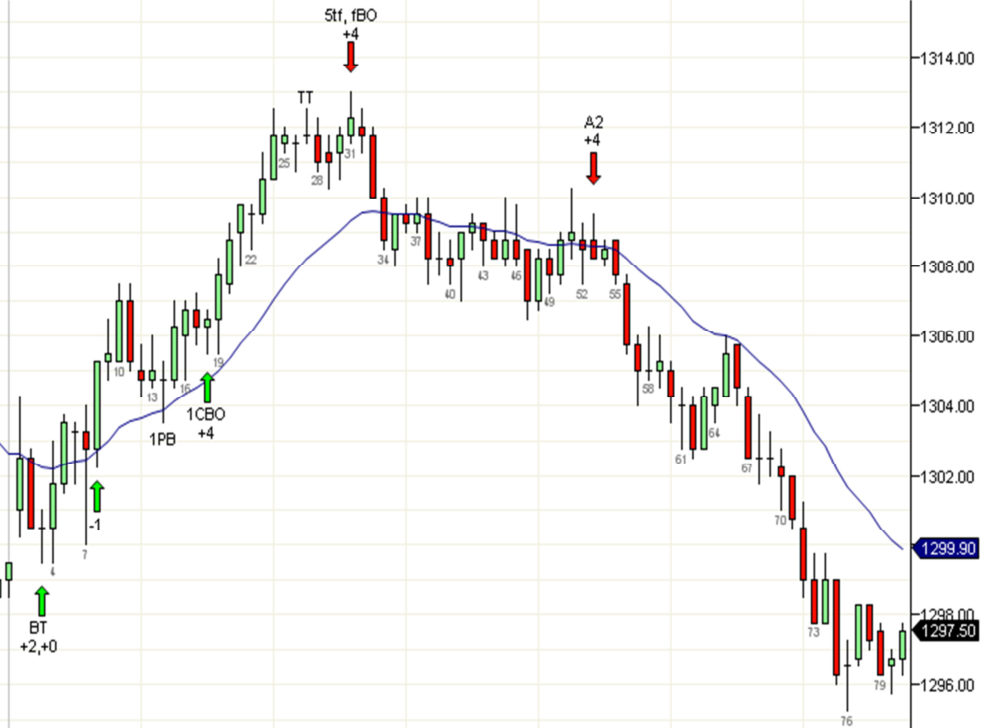

A channel after a trendline break (b35-48 after b32-34) is often the first leg of a new trend. If it gives a 2 legged pullback (b49-53), it should be taken for a possible second leg, which often is a much stronger move (b55-62). Regardless of the direction of the original trend, the new channel is more likely to be the determining direction of at least one more leg.

If the two legged pullback is very strong, it may break the channel trend and ultimately reverse the channel. This usually rare but does happen on occasion.

<!-- p.253 -->

## Inside bars

Saturday, July 30, 2011 · p.253

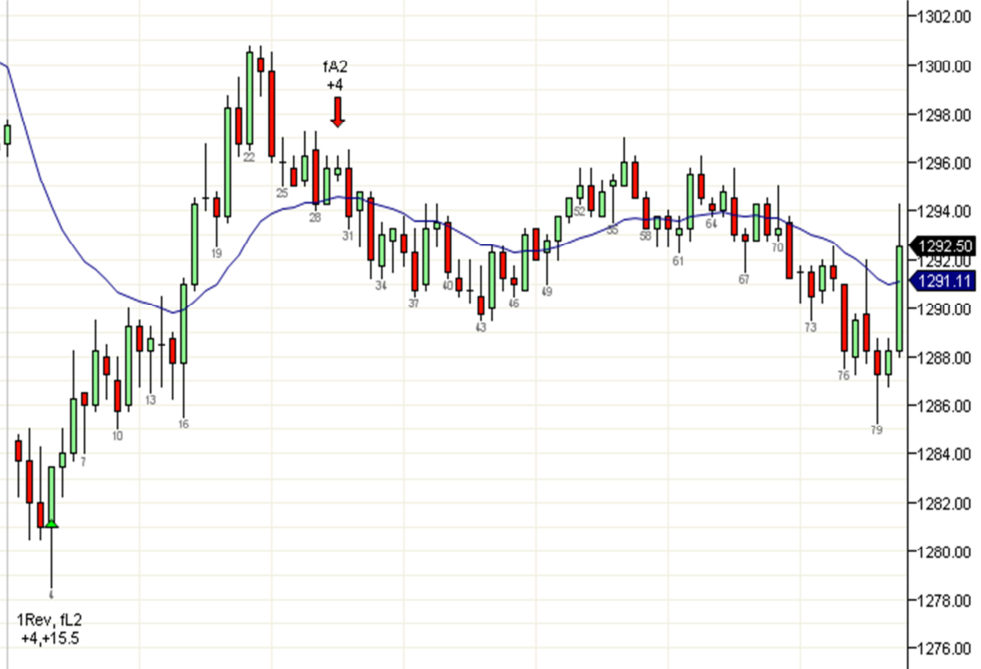

A small bar at one end of a large bar sets up a fade of the large bar, regardless of the color of either bar, but is a stronger signal when the entry is in the direction of the inside bar. For example b23 setup a fade of b22 and the price should be expected to at least take out the low of b22.

Sometimes, its perfectly fine to fade a large bar off an inside bar of the same color if the entry with in the direction of the overall trend. For example, b30 setup a fade of b29. While both were bull bars, the overall trend was already down (2 lower lows and 2 lower highs). The same with b39 fade of b38.

The most important criteria is that the inside bar should be less than half the size of the outside bar. For example, b9 and b45 are terrible entries simply because there is insufficient room to the low of the bar to eke out a profit. If the bars have more than a tick tail, you may wish to take second entry instead.

Small bars whose body is completely inside the body of the larger bar (b21 inside b20) also count as inside bars as long as their tails are not too long.

The simplest way to trade inside bars are to only take them where the inside bar is less than half the outside bar and only with trend (b30) or after a swing move or a third push up (b23).

---

[← Previous](14-2011-06.md) · [Contents](00-目录.md) · [Next →](16-2011-08.md)
