[← Previous](15-2011-07.md) · [Contents](00-目录.md) · [Next →](17-2011-09.md)

# August 2011

Original pages 254–275

<!-- p.254 -->

## Small bars

Monday, August 1, 2011 · p.254

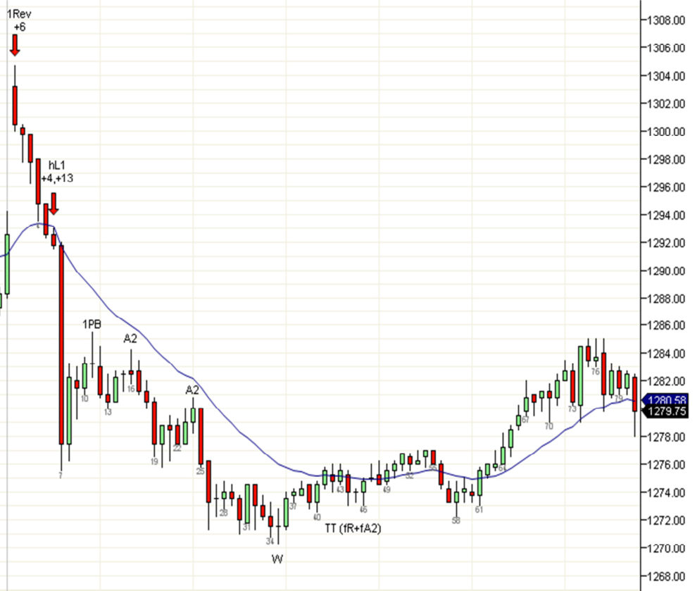

Small trend bars are very important signals and you should pay close attention to them. In a strong trend, a small trend bar is a with trend signal. These are often visible right after a breakout bar(b6 after b5 and b62 after b61), and should be always taken since the following bar is often a large bar (b7) or is followed by a large move (b63-67). Such small bars are safe to short at LOD or buy at HOD.

A small trend entry bar off a strong signal pattern indicate weakness (b10,b41) unless followed by more trend bars in which case its a sign of strength.

The first counter-trend bar in a channel can be entered with trend on its close if the close is strong (b39 close), since it will be viewed merely as a pullback.

<!-- p.255 -->

## Inside bar after breakout bar

Tuesday, August 2, 2011 · p.255

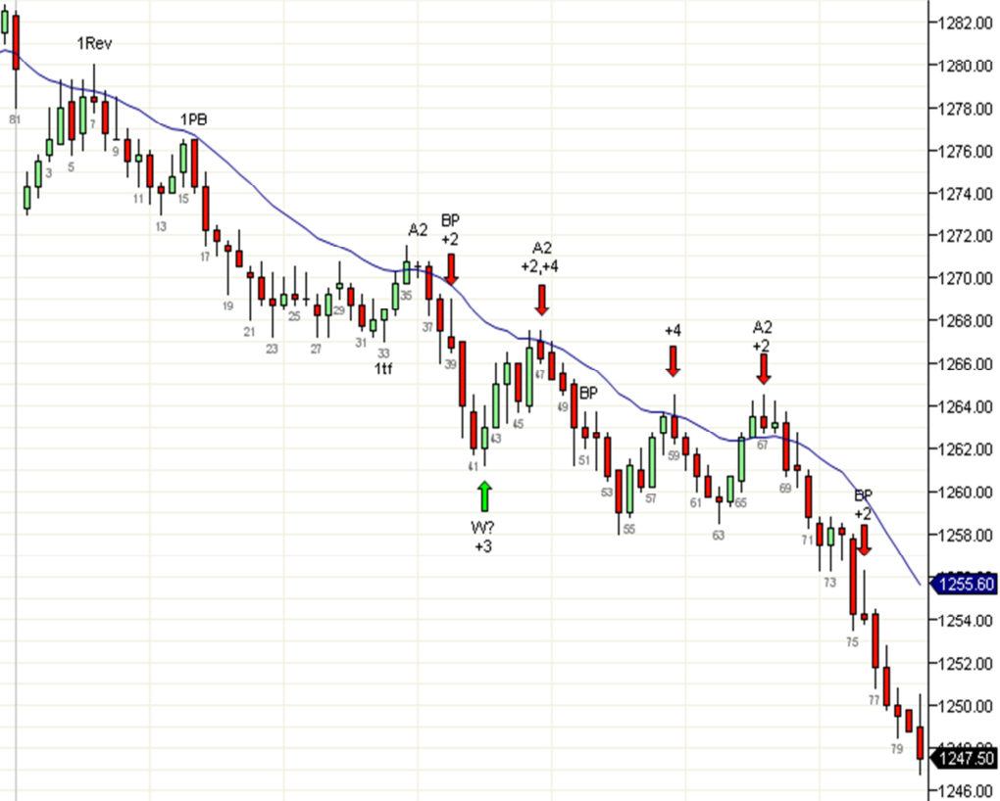

After a breakout in a direction, there is usually an attempt by the traders in the opposite direction to make a stand. This could result in a reversal bar, an inside bar or a small bar depending on the strength of the traders trying to fade the breakout.

A reversal bar after breakout usually implies a failure of the breakout and the failure is a decent with-trend signal by itself but is enhanced by being near a barrier such as ema (b59) or near a trendline (b36) or being a breakout test and so on.

A trend bar, especially a small trend bar after a breakout (b18) represents success of the breakout and may be entered with-trend if the bar size is small enough to represent moderate risk (around 2 points for normal day).

An inside bar after a breakout (b39, b51,b74,b76) represents a pullback and a possible failure and can be bracketed to trade either way. If both the breakout bar and the inside bar are bearish, its generally a good idea to take the trade only with-trend. If the inside bar after a bear bar is the bullish, it can be bracketed.

<!-- p.256 -->

## Trending dojis

Wednesday, August 3, 2011 · p.256

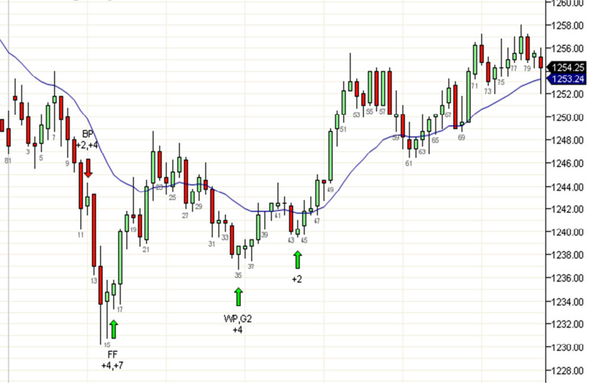

Trending dojis (b35-41, b61-66) are mini-trends. They are small trend moves on a smaller timeframe and a large trend bar on a larger timeframe. When you see trending dojis, the right thing to do is enter with the trend on a pullback bar.

Obviously, most traders did exactly that since the low of b43 and b68 were bought without hesitation for an excellent run each. If you are queasy about buying the close of a bear trend bar on limit, its perfectly fine to wait and see of the next bar is bullish and buy its close or above its high if its not too large.

<!-- p.257 -->

## Day full of large bars

Thursday, August 4, 2011 · p.257

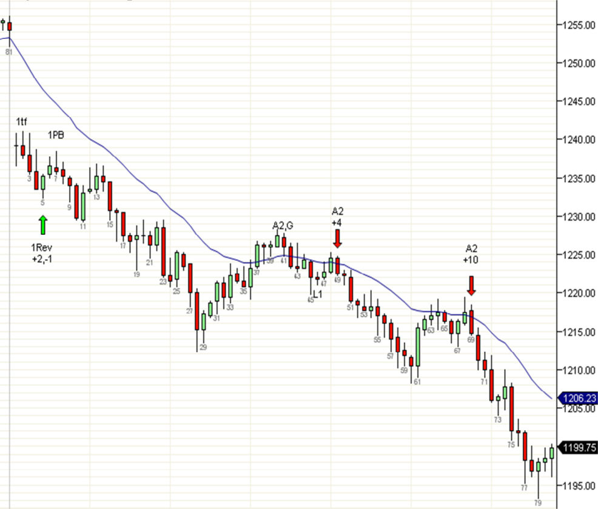

When bars are large, your risk is large and although in proportion to each other the bars may look reasonable, your monetary risk is larger per contract so you need to adapt by reducing size. The other thing you need to do is to only take trades where the risk of pullback is low.

A2 on trend days when correctly entered, tend to have low adverse movement (b49, b69). Even though b69 was 4.25 points, its adverse movement was only 1.25 points. Other low pullback setups are W1P and G2.

Its best to avoid setups with large pullback possibilities such as inside bar reversal (b29) and two bar reversals (b10,11).

<!-- p.258 -->

## Other options on wide range days

Friday, August 5, 2011 · p.258

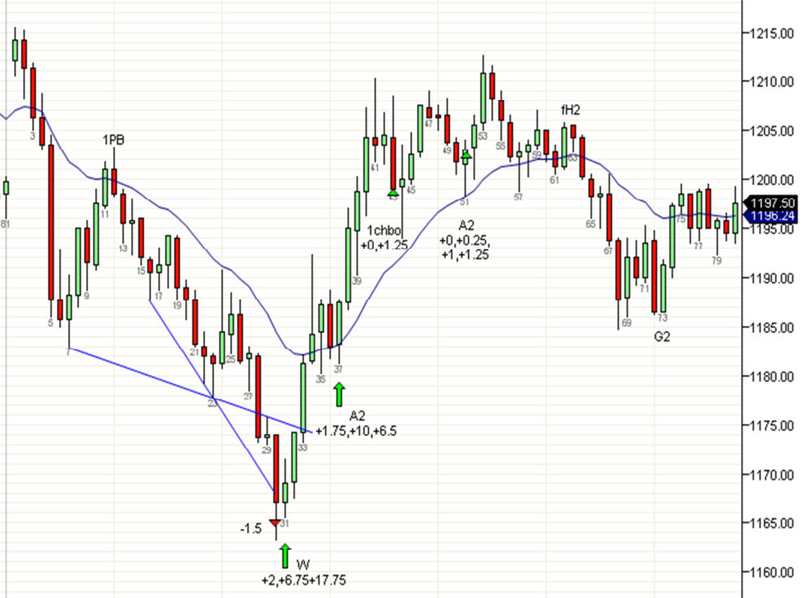

On days when many bars are the size of a normal day, I look to other options than the five minute chart for trading. I have used 1 minute chart, 4500 tick chart and recently, 20K and 10K volume chart. The 1 minute chart has the advantage of a fixed time before the print of the next bar but often gives poor signals, especially reversal signals. Tick charts have lost some of their relevance since the exchanges changed how they reported tick data and are now similar to volume charts. Although I do not have sufficient experience with any of these, I prefer volume charts slightly over the other two because of fewer bad signals. Today's entries have been off 10K and 20K volume charts and the markers on the charts represent the canonical entries rather than actual entries. (To some extent this is true of every day).

The advantage of volume charts and tick charts is that you can adjust the count to whatever gives you a bar size that you deem acceptable risk. The disadvantage is that bars can print very quickly. During b5 today, some bars on the 4500t and 20K volume chart printed in under a minute, so you have very little time to act and the pressure may force errors.

The second option is to actually trade options on the underlying -- SPY in this case. Option positions do not move as quickly with the underlying as futures do and are best used for swinging positions over a few days, but on large days like today, they become very viable. I personally only trade options after the day has proven to be a large day and shows the signs of a strong reversal. If the close is strong (unlike today where it pulled back before closing) its often a good idea to carry it to the next day except on Fridays since the option loses 2 extra days of time value.

<!-- p.259 -->

## Bear rallies

Monday, August 8, 2011 · p.259

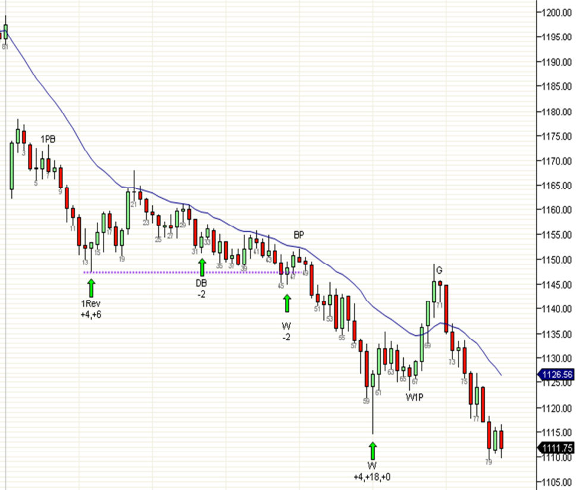

Often the strongest bullish moves occur as failed breakouts in strong bears. Moves such as b1-2, b14-21 and b60-70 look very strong but end up as failed breakouts.

b2 failed as a 1 bar bull move, b21 failed as an A2 and b71 failed as a gap bar. On a very wide range day such as this, its possible to swing a good distance even counter to the main trend. However, a swing with the main trend would have obviously fared much better.

When in a strong bear always watch out for a failed breakout. You an minimize your counter-trend position exposure by taking only 2 legged pullbacks. For example, b67 would be a 2 legged pullback after a possible reversal.

<!-- p.260 -->

## Risks and rewards of extreme volatility

Tuesday, August 9, 2011 · p.260

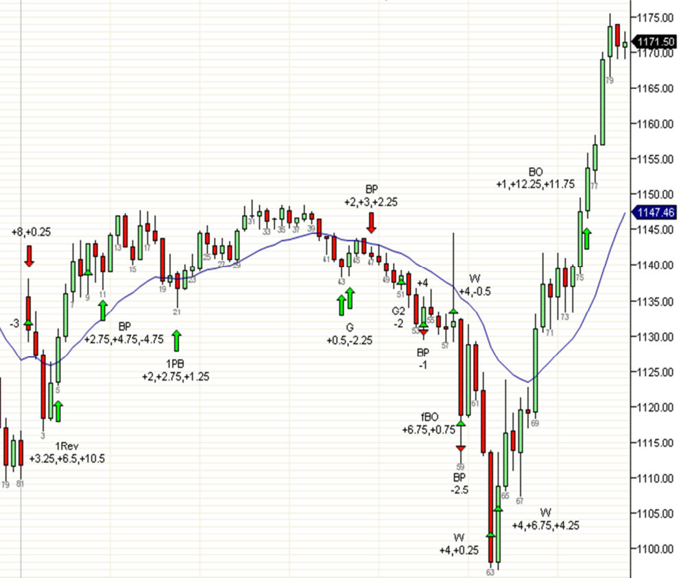

As expected, today was also an extremely volatile day and I was forced to trade on a 20K volume chart. So a lot of the entries were mid-bar and may not make complete sense on the 5m chart. Rather than omit the non-standard and experimental trades, I have included them all here in the hope that it will be more educational than distracting. Let me briefly discuss the non-standard trades today. The long on b1 was a possible 1Rev near ema and led to a 3 point loss. The G entry above b43 and 44 are not my standard trade but I expected a 2 legged move up to possibly a new high of the day. The G2 at b51 did not trigger on the 5m but triggered on the volume chart. The price action was so volatile that the short on b54 and b59 were simply mistakes caused by bars printing too fast. The BO at b76 was after assurance of low probability of pullback after taking out hod. Most of these trades looked reasonable on the volume chart and that's the flip side of using a chart that reduces your risk, it usually also reduces the probability of success. When the bars are printing quickly on the volume chart, its hard to look back at the 5m chart to verify before making entires. The biggest mistake was flattening my long position from b64 near the low of b67 instead of letting it take me out at b/e. This made me miss out on 40 points of the move up. Technically speaking, I could probably just ignore the fact that bars are the size of a weekly move and trade them just like any other bar with 18 point stops and have my normal success rate, but its very hard for me at this point and I'd rather take a few more small losses to get a defined smaller risk and a chance to swing for a big move.

<!-- p.261 -->

## Large inside day

Wednesday, August 10, 2011 · p.261

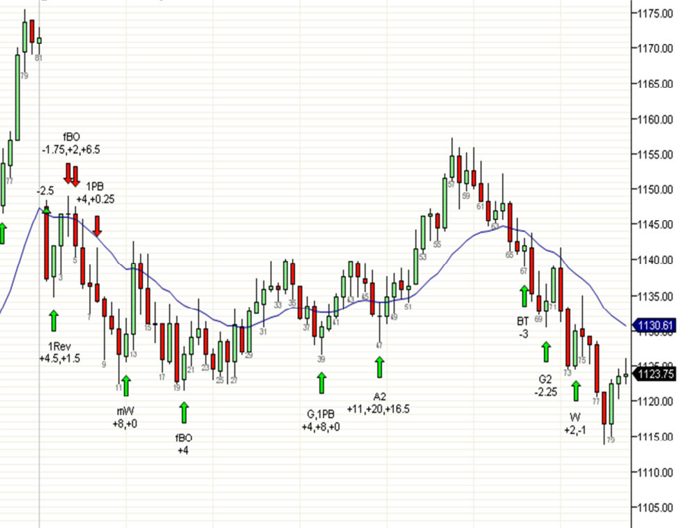

A small inside day would normally be a poor day but given today had a 40+ point range, riding a couple of swings can be fruitful. The trick on days such as these is to recognize a failed breakout and exit and possibly reverse off it.

The right move on the AM trade was to reverse long off the fBO on b20 and reverse short again off b60. The trouble with trading swings on trading range days is that a trader needs to develop flexibility regarding possible fBO. If I had correctly read b60 as a fBO signal, I would have reversed short instead of finding reasons to go long all the way down.

<!-- p.262 -->

## Failed breakouts and Breakout pullbacks

Monday, August 15, 2011 · p.262

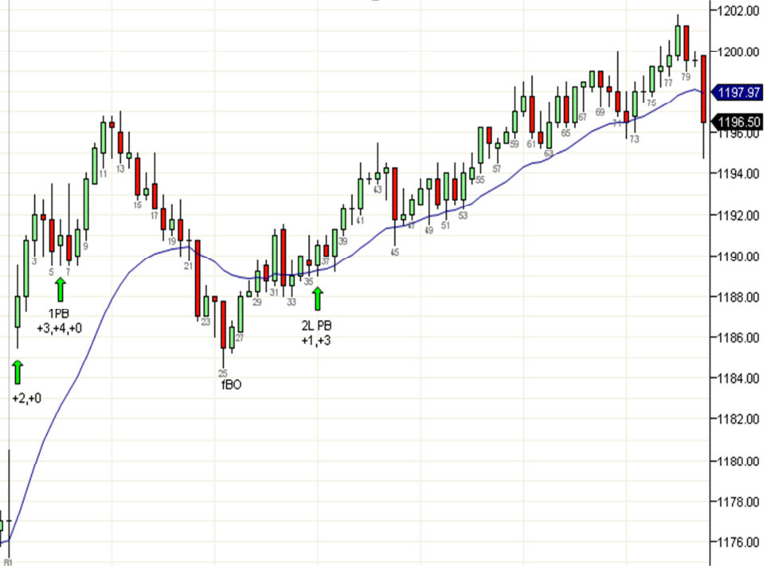

On a trading range day, a failed breakout such as b26 may be traded if the signal is strong. I often pass up the setup if the move I'm fading is channel like and wait for 2 failed attempts to continue the move first (b30,32). This is because the first attempt to fade the channel will usually fail.

On the other hand if the breakout gives a poor signal bar (b60) or does not trigger (b65) or otherwise fails twice to move back into the range, I will usually look for BP instead.

A second option is to recognize failed L2s as a soft trend move and buy above the next signal bar (b36 or possibly b38, b53, b73). The brave can buy the close of the second attempt on limit with a stop below the next lower bull bar or a tight money stop.

<!-- p.263 -->

## Comparison of alternate charts

Tuesday, August 16, 2011 · p.263

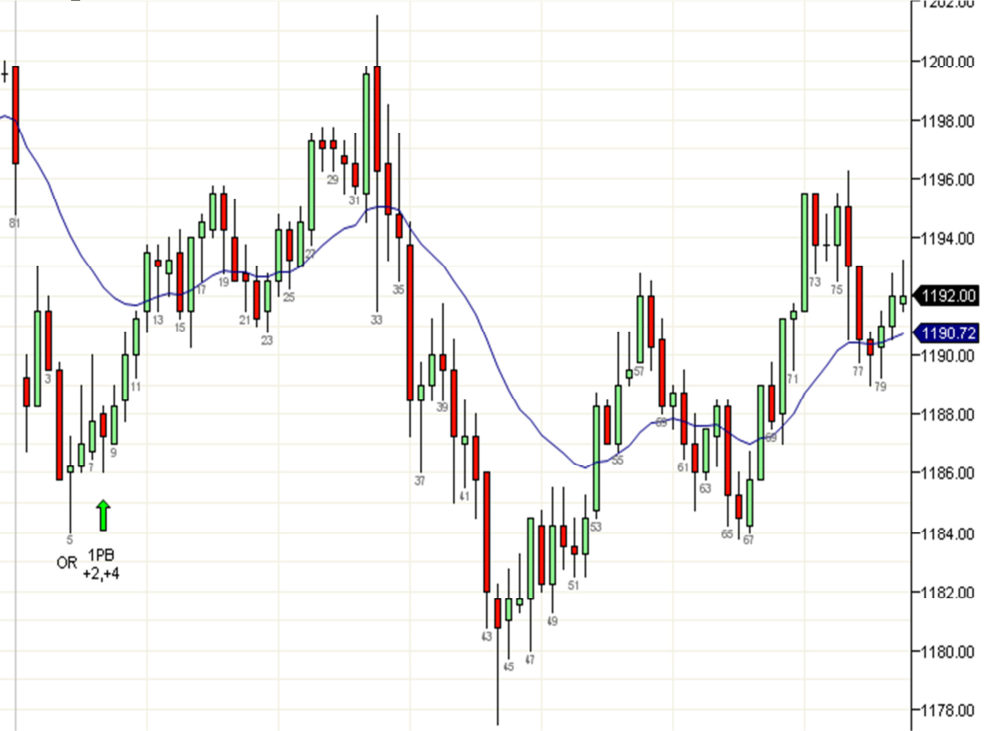

Today had some violent news related price action during lunchtime and unlike normal days when the lunch hour is the tightest, today's lunch hour had 'bars gone wild'. When there is a sudden increase in trading volume in a short span of time, time based bars are unlikely to provide meaningful signal bars. A comparison of alternative charts shows how you can still get a decent signal in times of heightened activity:

20K volume 3m 4500 tick 1m

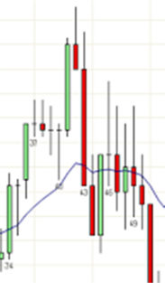

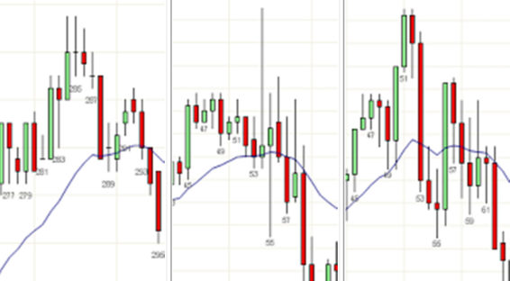

<!-- p.264 -->

Note how the 3m fails to give a tradeable signal. The 1m gives a weak ii doji which may be seen as a final flag. The 4500t is a lot better, its giving a 2 bar reversal. However the volume chart has given the best signal today with a clear shaved reversal bar. The stop at the entry price was not touched only on the volume chart, allowing a risk free swing trade.

The defects of a time-frame chart can only be addressed by a non-timeframe based chart and thats a necessity when bars are large or otherwise untradeable. I haven't collected a lot of

## Hard turn

Wednesday, August 17, 2011 · p.264

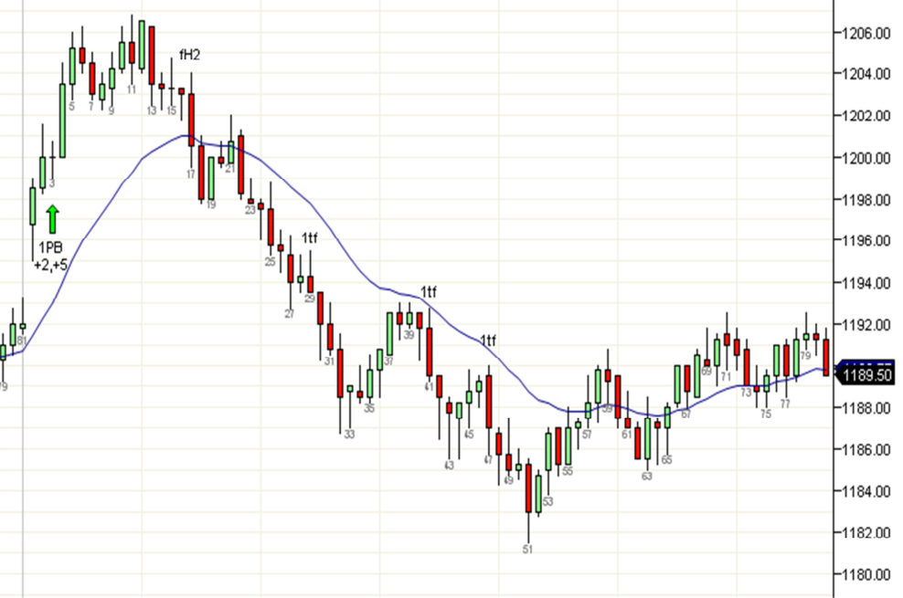

Normally hard trends open hard but today, the trend turned hard after reversal above the prior day's high. Unfortunately, I did not identify it on time and I missed the down move entirely waiting for A2s. The fH2 at b17 was probably the earliest clue that the trend was turning hard but at that point could have been simple BW.

Being a hard trend, any shaved or 1t low could be shorted namely, b21, b29 and b39. Also any 1tf could also be shorted below, regardless of how the bar closed but b41 and b47 were possibly too large.

Hard trends break but do not usually reverse (i.e., unlikely to go back to the upper part of the range) and therefore there was possibly only a weak play after the TL break at b58.

<!-- p.265 -->

## Trading large gaps

Thursday, August 18, 2011 · p.265

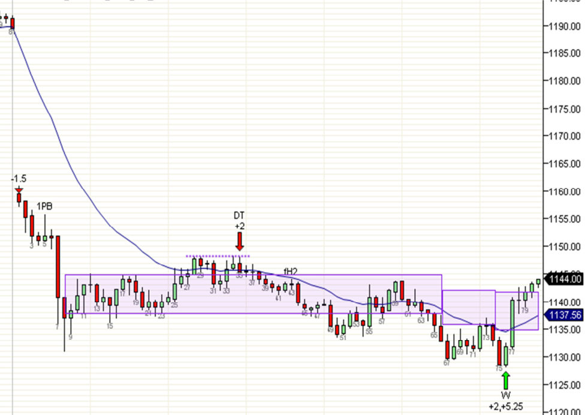

Small gaps narrow, large gaps widen. A currently experimental trade is to trade the open betting on the large gap widening with a 6t stop. The idea being the buy at open should not scalp out profitably. Today, this entry was stopped to the tick before the price reversed but overall this is worth the risk:reward since you are often getting the best entry of the day. However, this is still an unproven trade and not advisable for large size.

A1PB after a trend attempt is generally the safest trade and in the overall scheme of things, far better risk to reward ratio than entering on open. However when the signal bar is poor and news is pending, its often advisable to skip this trade.

Huge bars are trading ranges and at the close of b8, its pretty obvious that b7,8 form a large trading range and you should only buy in the lower 1/3 and sell in the upper 1/3. The only viable entries for the rest of the day were the DT at b35 and the W at b76. Honorable mention: b54 was possibly a W1P if you consider b41,46,51 a W rather than a channel.

<!-- p.266 -->

## Large Triangle Breakouts

Friday, August 19, 2011 · p.266

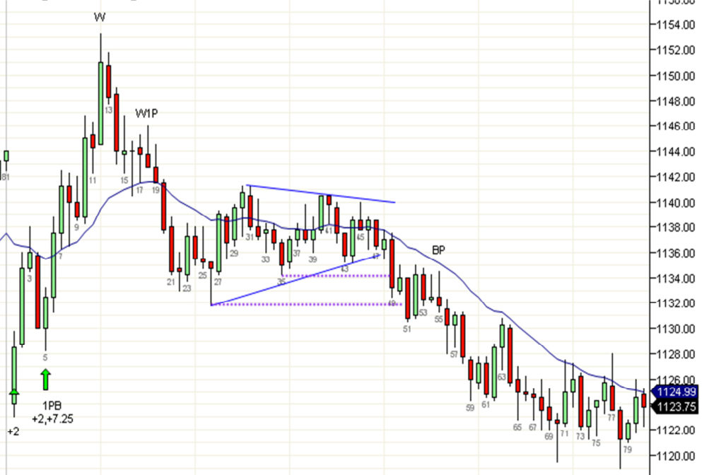

I have previously written about trading Triangle Breakouts. In general triangles break in the direction of the most recent trend (b13-b26). The optimal entry point is usually hard to determine since the actual breakout often has no signal bar. The correct way to enter is to wait for a clear breakout outside the triangle (below b26) or at least the last two swing points (below b35) and enter on the first pullback. On this day, it would be below b55. However, when the day is one with large bars, an earlier entry may provide larger profits.

One optimization is to enter in the direction of the previous trend on any signal bar that may be a failure such as below b45 (b45 was 5tf of buys above b44) or below b47 (failure of reversal bar). The only reason this is acceptable is because failures usually lead to at least two legs and if the trade does not pan out, you should be at least able to exit at breakeven.

<!-- p.267 -->

## Catching the AM trend

Monday, August 22, 2011 · p.267

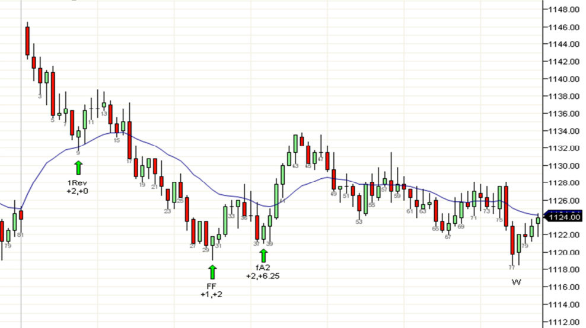

Most new traders should not be surprised if their winning percentage is around 55 to 60% with-trend and 40 to 45% counter-trend. Essentially, they are at 50% with a 5 to 10% trend skew. This means that the more trades you take, the higher your chances of losing money and the more your broker loves you. Holding for larger swings forces you to take fewer trades and make more points per trade. This also forces you to take quality trades and focus on the bigger picture, rather than be lost in the details of the most recent bar. Most days are like the chart above. There is a trend attempt early in the AM and then a trading range. Trading the 20% of the days when the move is continually in the same direction is important, but that is easier since you do get multiple continuation entries. On a typical day like today however, its very important to get in the AM trend and ride it till it terminates or reverses. If you missed b1 today, there was no real reasonable with trend setup until possibly b25. On the other hand, the market did give three counter-trend setups at b9, b30 and b38. These are much more modest in their wins than riding down the AM trend. This is why poor 1PB setups (b13) should often be taken and poor or weak 1Rev can be taken at support (b9). If you do successfully catch the AM trend, its usually best to trade small or none for the rest of the day once the AM trend terminates and turns into a trading range. Compared to the very clear price action in the AM trend, the lunch and afternoon session are fraught with overlaps, traps and poor signal bars.

Most beginners are best served by:

- trading the AM trend only by trading the 1Rev and 1PB and nothing else
- adding on A2 only on trend days
- After some consistency, add H1/L1 on hard trends and fL2 on soft trends.

1Rev and 1PB have various edge cases and are much more complex to read but they provide the best risk to reward ratio of any setup before the AM trend has run too far. Once a trend day is established, A2s are fairly safe with some experience. All other setups require experience to read correctly and should be taken only on small size at first. The trick to 1Rev and 1PB is to realize that on some days you will miss them and its fine not to trade on those days. Don't feel anxious to get into the market at any cost and enter on substandard setups.

<!-- p.268 -->

## Two legged pullbacks vs A2 vs G2

Tuesday, August 23, 2011 · p.268

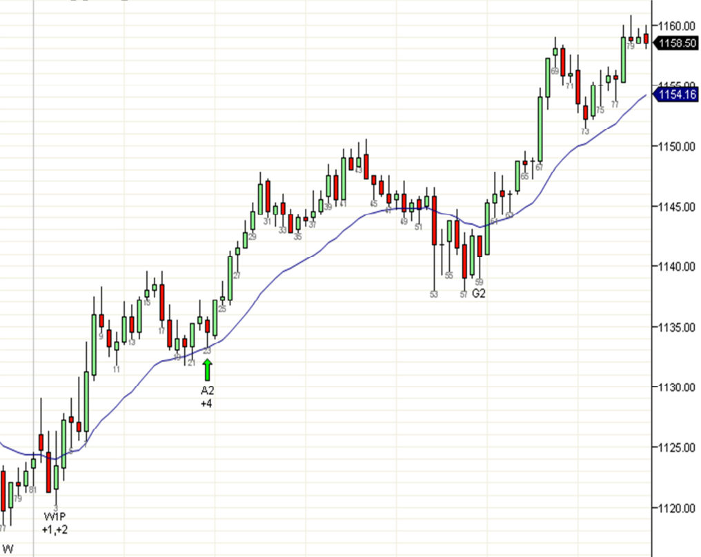

There are two legged pullbacks and there are A2s. The difference is that an A2 is around the ema, including just slightly above to overlapped. A shallow 2 legged pullback such as b13 or b36 is not an A2. An A2 is preferably deep and gives an entry near the low of the pullback. This is preferable since even a test of the high would mean a bigger payoff.

Shallow pullbacks such as b13 may be traded, but they should only be scalps. There is a very good chance that a shallow pullback entry's breakeven stop will be taken out except of course for soft and hard trends.

On the other hand, a G2 has relevance only in a very strong trend. An attempted sell-off gives a cheap entry for everyone who missed prior entries and they will rush to buy. If the trend is not strong, G2 cannot be taken on its own.

<!-- p.269 -->

## Confirming signs after weak signal bar

Wednesday, August 24, 2011 · p.269

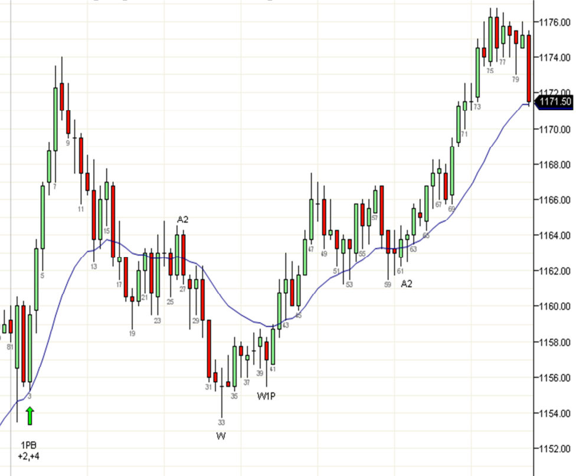

Sometimes, an otherwise obvious entry may have a poor signal bar such as b24 A2 or b33 W. In such cases, its best to look for a second entry. In the case of b24, a second 2 bar signal at b27 confirmed the entry. Often instead of a second entry, you get two failures in the counter-direction. For b33, there were 2 short entries that turned into 1tf (short below b34 and below b38). This is a very strong confirmation of b33 long. The price taking out b39 high also makes it a fL2, which is a reasonable signal in itself.

Similarly, the DP above the doji signal bar b62 was confirmed by the 1tf of the short below b64. A signal bar with a strong close should not need any confirmation.

<!-- p.270 -->

## A failed 1Rev can be a 1PB

Thursday, August 25, 2011 · p.270

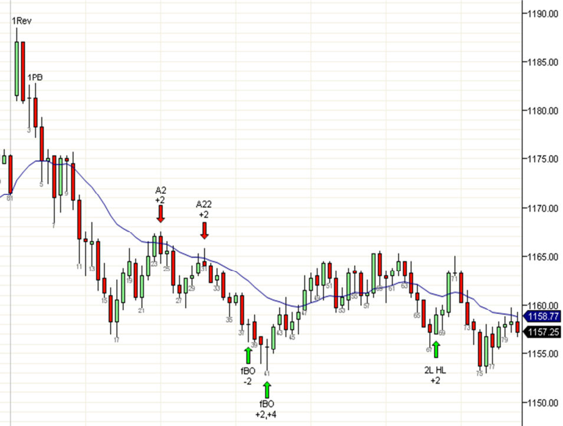

A 1Rev or OR needs to be at a place where a reversal would make sense. If not, it is likely to fail. Today, the opening 2 bar reversal probably was the first reversal, but if it wasn't, then b3 is an attempt to give a first reversal.

The three minute chart on the left shows this much more clearly. 3m b5 attempted to reverse the opening move but since it wasn't near any place where a reversal would make sense such as ema or the extremes of the prior day, it failed.

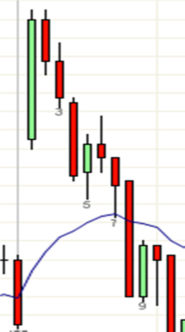

Given that it was the first attempt to reverse three bear trend bars with strong closes, this probably was expected but what's more important was that a failure is often a 1PB (3m b6) in the direction of the original move. The risk to taking this of course is that a second attempt and the ema are very close. However, when the second attempt to reverse it at the ema (b7) did not trigger, it was a confirmation of the 1PB and traders who were quick could probably sell below b7.

On hard trend days, the correct entries go far and go quick and there is really no latitude for delays. This is why new traders are better off trading off a single chart and try to focus on the best entries.

Fortunately, today we did get an A2 (b24), which is comparatively rare in a hard trend. Given the bar sizes, counter-trend trading was permissible after the trendline break (b17-23). On a normal sized day, fBOs should only be taken in the direction of the hard trend, since any counter-move is likely to fail or be otherwise unprofitable.

<!-- p.271 -->

## Managing risk on days with huge bars

Friday, August 26, 2011 · p.271

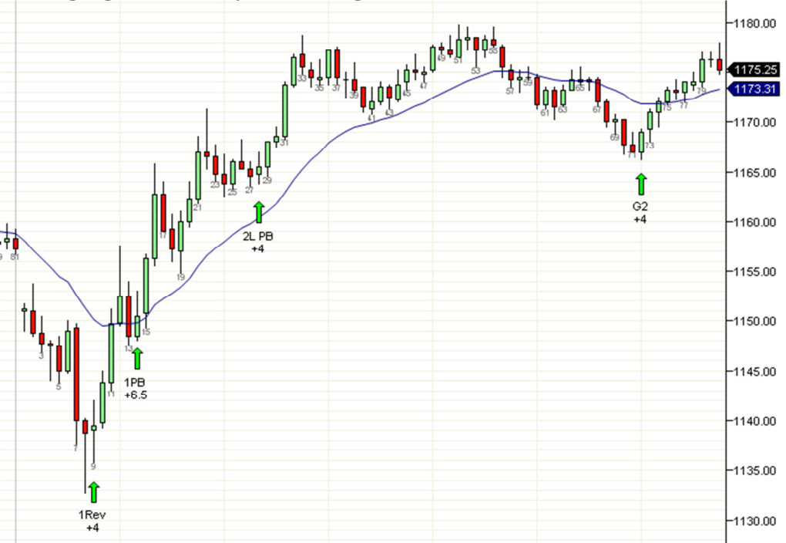

When bars are huge, I look to other options than the 5m chart. I have discussed volume charts and tick charts previously. In the first hour I also look at 3m charts for clarity.

On the 3m chart to the left, the 1Rev is very clear compared to the 5m chart. Also clear is the FF made up of alternating bull and bear trend bars (3m b6-9). An entry above b13 with a stop below is a canonical entry and has about 7 point risk. Since you can move the stop below the entry bar after the entry bar closes, an entry above 3m b14 is a valid entry with a stop below. This reduces your risk to 4.5 points. On a day such as this, when you are looking at a potential 20 to 40 point move thats a reasonable risk. Another option is to buy the close of b14 with a stop below its close. This reduces the risk to about 2 points. This is very reasonable given the potential upside.

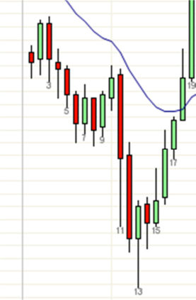

However, its hard to do given that its a potential 1tf. Conservative traders will probably want to buy above a bull bar with a strong close. Remember, all the above are effectively buying above b13, you are just managing your risk based on subsequent bars.

<!-- p.272 -->

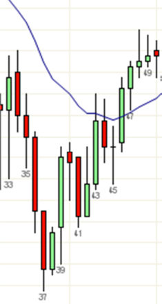

Yet another option is to buy on the 1-minute chart. It should be noted that trading reversals on the 1-minute chart should absolutely never be done since it is possibly the fastest way to blow your account. However, two failures to continue the trend after a potential reversal (above 1m b45 after 1m b38 reversal) is a valid entry. Note that is should only be taken after the 3m and 5m charts have already shown reversals. A 1m chart on its own can never be trusted for a reversal signal.

The 1m entry above b45 corresponds to buying at 1141, one point below the top of 3m b15 or 5m b9. As you can see, the 1m did not give the most optimal entry, the 3m did.

What the 1m does is allow you to pretend its a very fast moving 5m chart on a day with huge bars. Note that even on the 1m, bars were 2 to 4 points. It gives more entries and smaller risks. Fading 1m reversals in a very strong trend is also a very good play but only when the trend is super-strong such as this day.

The best option for most new traders is to only read the 3m chart for the first hour and then switch to the 5m chart and not even look at 1m chart until a potential signal sets up on the higher timeframe chart. Once bars start getting smaller or overlapped (b23-b27), you should no longer look at 3m or 1m chart or you are likely to lose due to many poor setups on a lower timeframe chart.

Don't forget that the 5m chart is your staple and you have much less experience with other timeframes. Your reads should consistently be off the 5m chart and use lower timeframes only for entries during extremely large bars and only in the early part of the day.

<!-- p.273 -->

## Poor 1PB setups on soft-trend days

Monday, August 29, 2011 · p.273

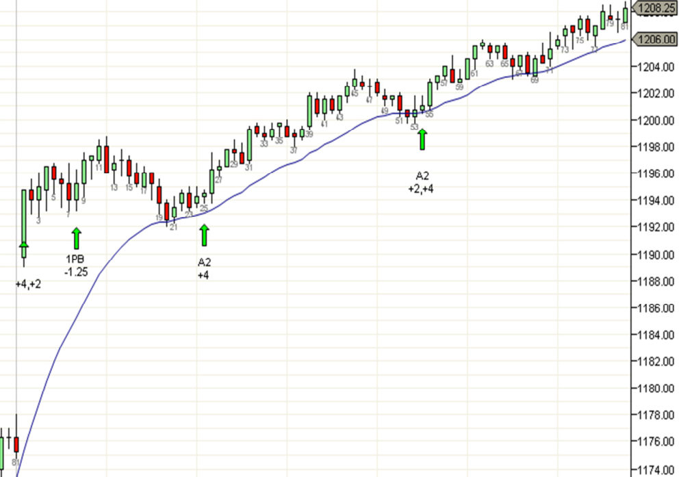

1PB is usually the best opportunity for a swing trade on a trend day and I normally take it even if it looks poor. A great example of a poor setup was this day. b6 and b8 are not really 1PBs because at that point, we are probably in what appears to be a trading range. 1PB is a setup in a new trend and it will usually fail in a trading range.

However on a large gap day and a strong b1, there is still some chance its going to trend (as it eventually ended up doing) and what could possibly be a 1PB may be worth the risk/reward.

A deeper pullback to the ema at b21 or 25 is a far better entry since its at a support, 2 legged and below the trading range.

The second feature of a large up gap followed by a large b1 is that there is a very good chance it will turn into a soft trend. This means any fL2 such as b38 and b43 are valid setups. However, I often will only scalp them or pass them up and wait for a deep pullback such as b54. This is because a deep pullback is more likely to allow my swing stop at my entry price unmolested while it grinds higher.

<!-- p.274 -->

## Rationale of the first reversal

Tuesday, August 30, 2011 · p.274

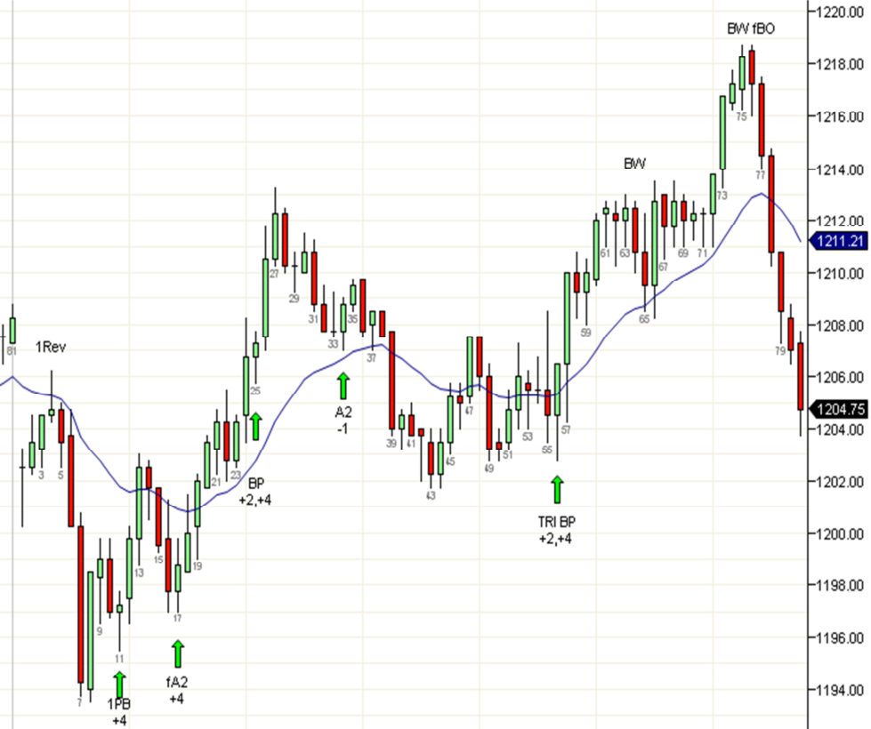

From the chart, its clear that today's bar is a doji on the daily chart. There were swings up and down and the price closed close to the open. Although this is a typical trading range day, it has a sort of upward primary trend. Lets call this the primary move.

The first reversal trade in general attempts to get the most of the primary move. When the market attempts to make a trend move in a direction and reverses, there is a very good chance on a trading range day that it will attempt to go about twice this range (as it did today) and then move back near the open.

In real time, you never know if the move from b1 to b4 will reverse and lead to the primary move down or another reversal below will take it all the way up. This is why any decent reversal signal in the first hour or so is a great setup. The larger the initial move, the larger the doji range and therefore, the larger the primary move.

On trend days, the opposite is true. The initial move is small and the reversal leads to a protracted trend.

<!-- p.275 -->

## 5tf, 9tf and 1tf

Wednesday, August 31, 2011 · p.275

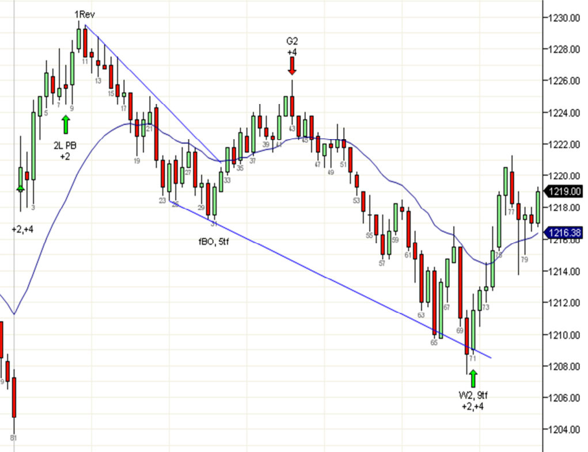

When traders take a with-trend setup, they expect to take profits at certain discrete number of points. The most popular targets are +1, +2, +4, +8, +10. Counter-trend traders know these locations and will place counter-trend entries at these locations, hoping the additional trades will cause a mini-pop that will allow them to take a profit.

When the number of contracts placed by counter-trend traders far exceeds the with-trend contracts, the price will refuse to tick beyond it. For example, breakout traders below b24 sold at 1218.25 and expected to cover at 1217.25. Counter-trend traders know this price point and will place their buys at the same price. If the price refuses to tick below 1217.25, then it is a good indication that many of the buys did not get filled. That includes the bears who shorted and the bulls who wanted to buy below the low of the day. So when the bar closes strong as in b31, both bulls and bears who did not get filled will place buy orders right away. This is clear from b32 which did not tick below its open. Such a failure is called a 5 tick failure or 5tf. A similar failure can be seen on b27 since the buy above b24 also turned into a 5tf. Analogous to a 5tf is the 9tf for targets of 2 points as can be seen at b70 for the short below b65. 9tfs often occur near large bars since larger signal bars cause traders to expect larger targets. Unlike 5tf and 9tf, a 1tf is caused by traders buying the bottom of a bar in a bull move or selling the top of a bar in a bear move. For example, when the price refuses to tick below b6 on what is so far a strong day, traders will treat the overlap b5-7 as a trading range and place buy orders at the low of b7. This causes the price to pop above the bar after ticking below the prior bar giving a 1tf. 1tf is usually the result of a counter-trend trade especially the first attempt before a trendline break.

---

[← Previous](15-2011-07.md) · [Contents](00-目录.md) · [Next →](17-2011-09.md)
