[← Previous](16-2011-08.md) · [Contents](00-目录.md) · [Next →](18-2011-10.md)

# September 2011

Original pages 276–286

<!-- p.276 -->

## The most recent reversal determines direction of 1PB

Friday, September 2, 2011 · p.276

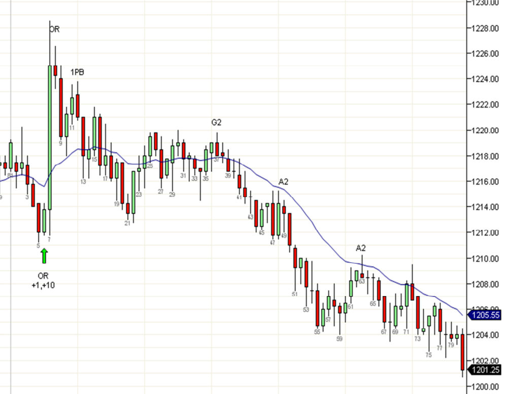

Everytime there is an opening reversal (OR) after a trend move (b3-b5, b6-b7), you should expect a 1PB in the direction of the latest reversal. This is because 1PB is the first pullback in a trend and when the trend reverses, the expected direction also changes.

1PB is usually reversible. This means that if your 1PB entry immediately gives a signal counter to your entry, you entered incorrectly and should probably reverse your position. For example, if you missed the inside bar reversal at b8 and took a 1PB long at b10, you should reverse short at the 1PB short on b12. This way, your 1PB entry is usually self-correcting.

<!-- p.277 -->

## Extremely strong trends

Wednesday, September 7, 2011 · p.277

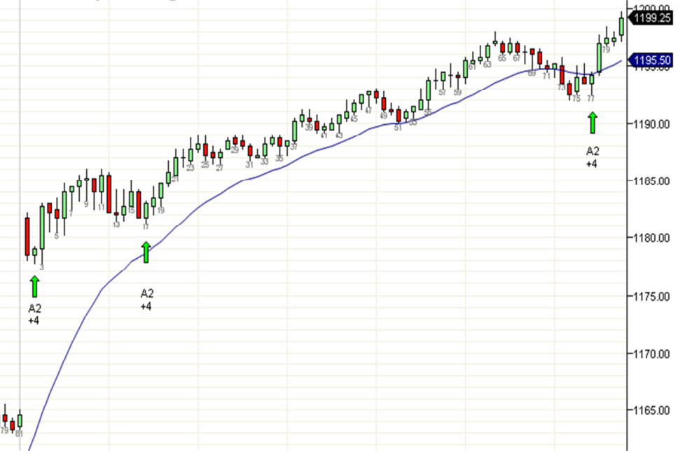

Soft trends and hard trends are two types of extremely strong trends. These should never be traded counter-trend. When you see a large up gap on the open and the first bar has a 1tf giving a fade entry near the low of the bar, there is already a very good chance it will turn into a soft-trend day.

When the second pullback is also a 1tf (b5), its a sign of a very strong trend. This essentially means bulls are buying the low of every short signal.

A well formed two legged pullback that does not quite reach the ema at b17 is another indication of strength. Often the first deep pullback is your best bet for a day long swing on a day such as this. However, any deep pullback such as b52 or b77 could be swung.

Folks who missed entering the first deep pullback can fade every L2. A soft-trend is the easiest to trade and you should take every deep 2 legged pullback even if you are conservative.

Avoiding counter-trend trading is very important. The first successful counter-trend trade was off b48. You should normally skip the first one and take the second one (b64 or b67). In general never attempt counter-trend trades until you see a one-legged move to ema such as b48-51

<!-- p.278 -->

## Large bars could turn into spike and channel.

Thursday, September 8, 2011 · p.278

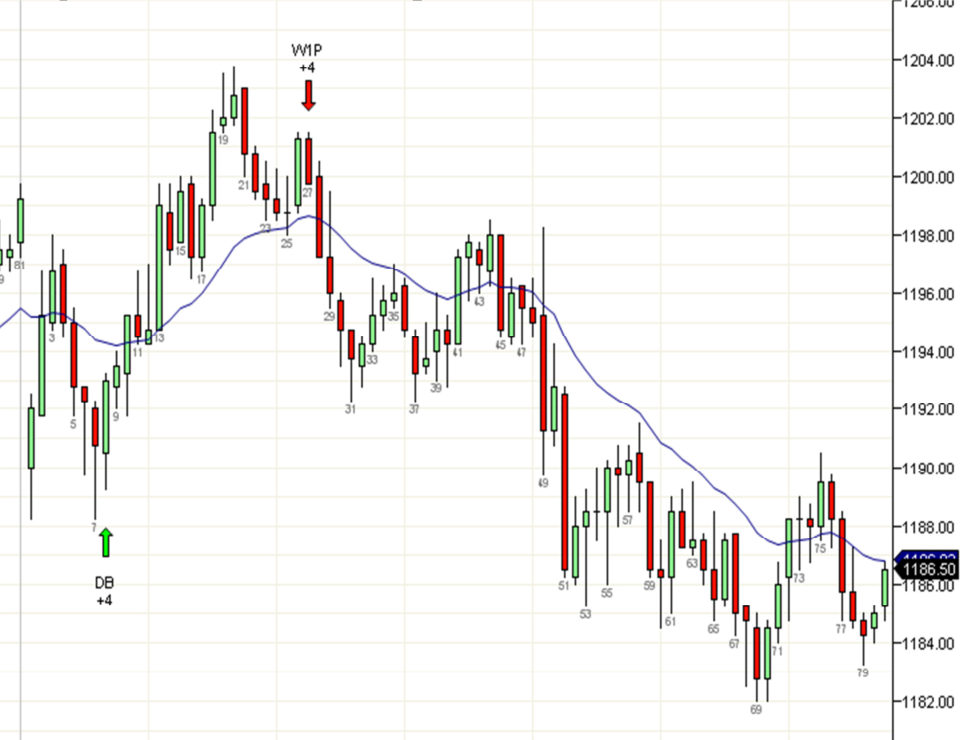

The bar b49 can be read in many ways. Its possibly an entry bar below b48, which was an A2 short second entry (with b45 as first). Its possibly a failed H2 with b44 as H1. In any case, its a trap bar that results in acceleration of the trend.

When a disproportionately large bar pops from nowhere as is the case with news related events, there is a very good chance it will turn into a spike and channel type of move. The exception is if it was a trend bar that triggered off a 2-legged pullback and has follow through.

Once the spike is determined, wait for a pullback and trade only in the direction of the channel. The channel (b58-69) will be in the same direction as the spike (b49) unless the pullback also had a large spike in the opposite direction.

Channels typically but not always consist of three pushes and will give a W termination (b70) and will test the begin of the channel (b75). They will then go to the mid-range of the channel (b81).

There is a good chance you missed out on the spike but the pullback and channel often go to a measured move of the spike.

<!-- p.279 -->

## Wedge Failed breakouts

Friday, September 9, 2011 · p.279

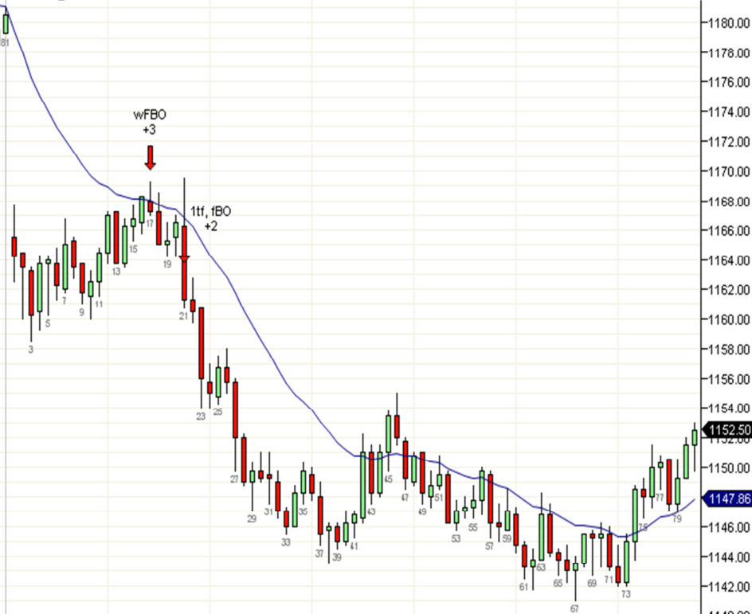

Often when the gap on open is large, there is an expectation of a trend move. While trend from the first bar is a reasonable expectation, some gap days will only result in a trading range. However, on some days you will see a wedge attempt in one direction that will take out the low of the day and often result in a measured move of the opening range.

The Wedge on open could form either with the gap or against the gap. When the wedge is with the gap as in today, it often appears as a variation of a 2-legged pullback to the ema.

To identify wedge on open, look for a large first bar (signifying TR), preferably with large tails (also TR) or overlaps (b3,4 -- also TR). After the initial move, the market will move in three pushes in either direction and give an entry fading the range. When the wedge move reverses the initial move and takes out the range extreme (b1 high), its a wedge failed breakout or WfBO. WfBOs are trend generators and should always be taken as a swing setup. At the very least they give two legs, often taking out the other end of the range. If the range is taken out in one leg, they often give a measured move of the range.

<!-- p.280 -->

## Major reversal: Bear Trendline break and HL

Monday, September 12, 2011 · p.280

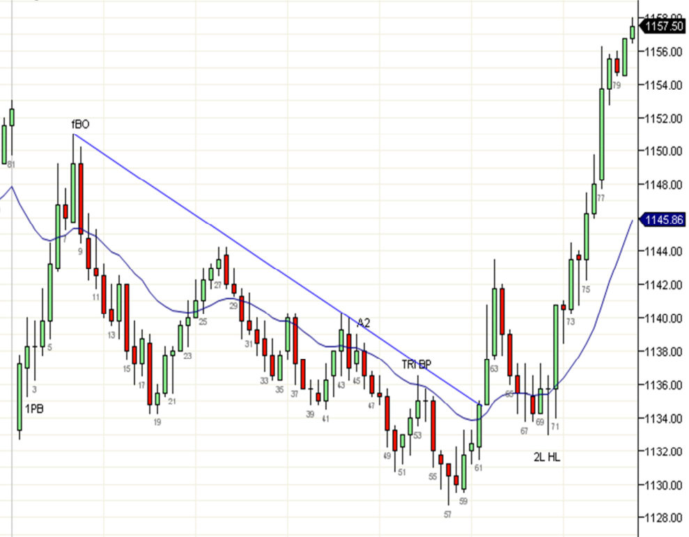

Usually a major reversal of a bear trend requires a strong break of the trendline and a LL test. But sometimes, there will no LL test and you would need to enter on a HL. These cases will run in a very hard trend for only one leg so you need to be able to identify these and enter on the HL.

The precondition to a strong reversal late in the day is a very strong move in the first hour (b1-b8). Without a prior show of strength, any reversal without a LL test is likely to fail.

The most important characteristic of a such a HL major reversal is that the trendline break will take out multiple swing points (b57-63 took out 3 swing highs). The second important characteristic is that the trendline break move goes well beyond the ema and closes many points above in a one legged move. A multi-legged failed breakout giving a possible W (b19,50,57) of the range is more likely to fail than a one or 2 legged strong break of the TR.

After b63, traders should buy a pullback to the ema and possibly any reasonable pullback. A 2 legged pullback (b69 ended the first leg) is very desirable and will usually give a hard trend. This essentially works as an A2 or fL2 (b68 was L1), which can be traded as a swing entry after a reversal.

<!-- p.281 -->

## Price Action Indicator

Friday, September 16, 2011 · p.281

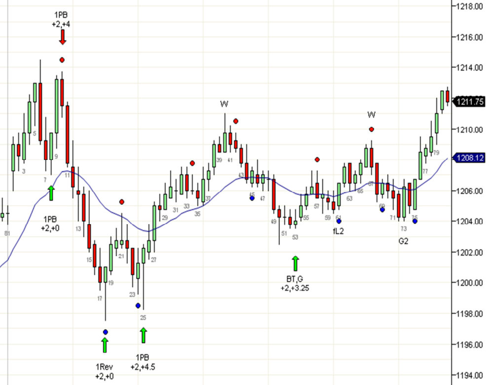

As many of you have guessed from the dots on the chart, I've been working on a Price Action Indicator for NinjaTrader. Currently, it only highlights reasonable signal bars as described in Al Brooks book and nothing else.

To mechanically trade the indicator, a scalp and a swing portion can be entered with a 6t stop. At +2 points the scalp portion exits with a profit and the stop moves to breakeven. Ideally, the scalp portion is twice the swing portion to get the best results. The swing portion should be exited at a fixed profit such as +4 or on a second attempt to reverse a trend if the entry is with trend, i.e, long at HL (b25) or short from LH (b10). If its a counter-trend entry, the first sell signal should cause any swing portion to be exited (entry above b18 or below b41) On a day with reasonable range such as today this should profit from most trades. For example, today the only losing trade was the short below b57. The short below b34 and the longs above b45 and b69 were first attempts (L1/H1) and would not be traded. One option is to mark the L1/H1 in a different color since eliminating them is not an option since that would eliminate any signals in a hard trend. A 2 contract scalp + 1 contract swing would have made +40 on the wins and -3 on the losses. But today was possibly an excellent day for the indicator and not all days are so generous. To collect more data, I would need to automatically trade it and run it over a couple of years worth of data. I expect poor performance on tight trading range days since two point scalps are probably hard on a 5 point day. Large range days would probably be indeterminate, causing stop outs before the profit target is reached but a single swing may compensate for many losses.

<!-- p.282 -->

## Overlapping bars produce poor signals

Monday, September 19, 2011 · p.282

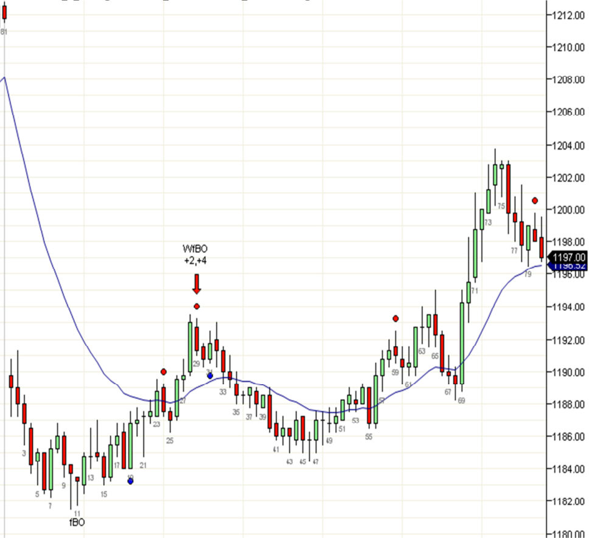

Somewhere bear b11 was a fBO or 1Rev. Unfortunately, the bars were overlapping and full of tails, so my indicator could not catch them. On such days, I look to see if the 3m chart has clearer bars. Today it did:

<!-- p.283 -->

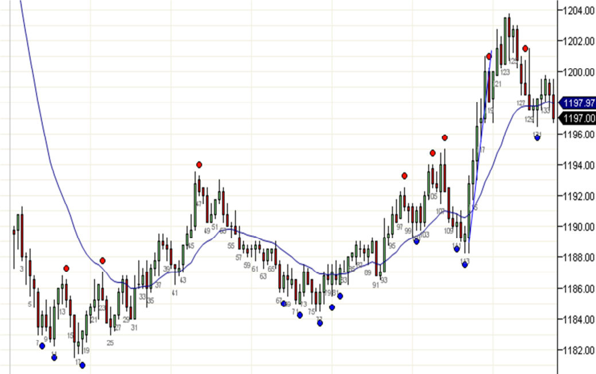

The risk of trading 3m chart is that they are unreliable after the first hour. For example, 3m b68, b72 and b105 entries failed even though there were reasonable bars. However, in the first hour and only if the 5m chart has overlap overflow, the 3m can be used.

Often setups that are unclear on the 5m are clarified on the 3m. For example the LOD reversal was a inside doji bar inside a bear bar on the 5m, but an ii FF on the 3rd push on the 3m. This may enable a great entry on an otherwise poor day.

The psychological risk of trading time-frames smaller than 5m is that you get addicted to the small risk and good prices and trade them beyond the first hour. This is usually dangerous, esp. during lunch hour where even the 5m chart is dangerous.

<!-- p.284 -->

## Early and late trend breaks

Tuesday, September 20, 2011 · p.284

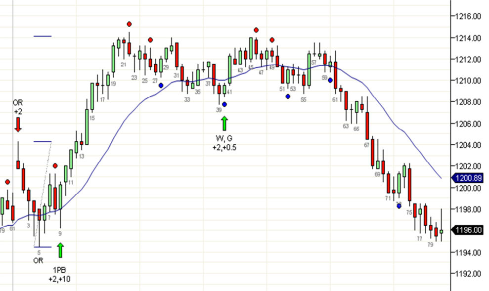

Early trend breaks are easier to spot correctly and the probability of them giving a sizeable trend move is high. Late trends are rather hard to predict and they will often go only a small distance or fail. This is why 1PB (b9) is a very vital setup to master. Catching the major portion of the early trend move allows you to relax and ignore the low probability setups during mid-day and optionally jump into any late trend break.

Late trend breaks are often very hard to spot and you will encounter may false starts such as the possible W at b40 or the second W at b55. The DP b22,46,49 was probably a decent signal, but the spike on b56 took out any swing stops.

The clearest and simplest entry for any trend break is a BP (b66). Even though it looks like the bottom of the range, a BP often is worth the risk given prior signals such as the failed W and the DP.

However, reading 1PB and OR are vastly easier than reading a breakout from an extended consolidation. If you cannot trade 1PB consistently, its unlikely you will be able to predict the BO from an extended TR consistently.

<!-- p.285 -->

## Risk of pullbacks and failures

Thursday, September 22, 2011 · p.285

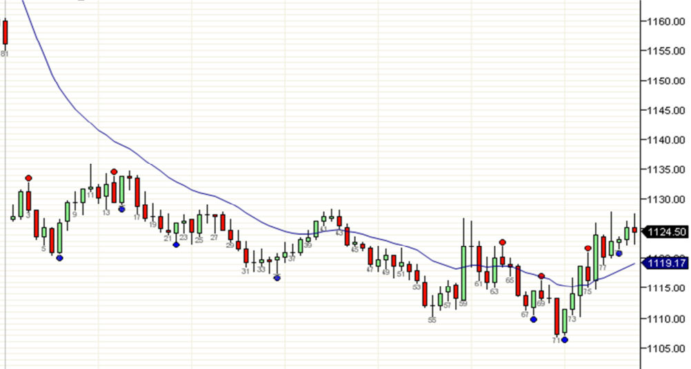

Traders are often surprised at how violently their stops are sometimes taken out such as the short below b14 or the long above b15. Signal bar selection is very important if you wish to use stop entries to enter on the breakout of signal bars. Almost all failures for stop entries have a few common characteristics and mastering them will reduce your error rate.

1. Overlaps: Overlaps, especially large bar overlaps are the easiest risk to recognize and evaluate. In general large bars are poor signal bars regardless of overlap. Any overlap practically guarantees the trading range attribute of the signal bars and you should wait for a small bar at one end of the overlap (b16, b26) and take the fBO of the overlap. Overlaps of small bars such as b47-51 are usually ok to take a second attempt with-trend. These should never be taken in a trading range (expecting a breakout for example) and never the first attempt.

2. Dojis before reversal bars: Dojis represent a trading range and a reversal bar after the doji does not invalidate this fact (b21-22). A second attempt, especially after trapping traders in both directions (b35) may be an OK entry to take even with dojis.

3. First attempts: Its clear from the charts that first attempts (b22, b33, b60) are highly likely to fail compared to second attempts. First attempts should be reserved for very clear and very specific cases such as 1Rev (b3), W reversals (b72) and 1PB or at the very least only for excellent signal bars.

4. Poor signal bars: Poor signal bars (b11, b60) almost certainly will give a pullback simply because some traders will fade its breakout. This is why a second attempt is recommended if the signal bar is the wrong color, has a long entry-side tail or is a doji. Even if the first attempt succeeds, there is usually a pullback before the market moves too far from the entry off a poor bar.

If you consider bars that had minimal pullback, i.e., went a large distance before a pullback and hence are swing candidates(b7,64,72), they usually are well-formed bars with a strong close or are second attempts (b16, 35). Restricting your entries only to such bars should greatly reduce your error rate, which is a precondition to increasing your trade size.

<!-- p.286 -->

## Good and Bad fBO

Friday, September 23, 2011 · p.286

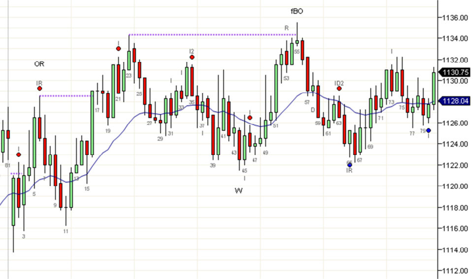

I've often mentioned that trading with-trend in a trend is the easiest way to trade and fBO are some of the hardest trades to take. The reason is very simple. Market inertia dictates that when in a trend, the market is likely to continue in the trend and the with-trend entry is a high probability setup. A fBO on the other hand could turn into a BP or fail on the first or second attempts and work only on the third attempt (as a mini-W).

This is why unless the range is large, you shouldn't even bother taking fBO trades. With that caveat, we can still attempt to deduce the best and worst fBO setups.

The first fBO setup is b2, the failure of the breakout of the large bar b1, which acts as a small TR. Since the entry would be in the lower half of the range, it is likely to fail, esp. since its a first entry. If the entry was very close to the high of b1, this would be worth the risk reward only because the bar is large. If the bar were 4 points or smaller, its best to ignore the fBO of b1. The second fBO is b6, an attempt to reverse the close of prior day and three pushes up (b2,4,6). This is a higher probability trade and can be labeled OR. The next possible fBO/BP was b16, which was a strong BO and did not give a decent BP signal bar. At this point, we have a higher high and a higher low and we are in a possible bull trend and should not look to trade fBOs. Rather we should look for 2L PB to ema or TL and take with-trend trades or watch for a trend break. This means we would ignore b21 and even b24 if it was well-formed. The one-legged move to and close below ema at b29 possibly broke the trend, so we should again switch to looking for fBO and BP. The three push to b45 is an OK setup, but normally, I avoid taking mid-range entries when the market is not in a trend. If we had been in a trend or the move to b23 was a strong trend, I would consider buying b47 as a possible G2. The fBO at b55 is the most desirable kind of fBO. The bar that broke above the HOD turned into a reversal bar with out overlaps of any other bar. (A doji is an acceptable fBO signal at extremes of the day). A reversal bar or inside bar after the BO bar would also be excellent signals.

To summarize, good fBOs are three pushes beyond the trading range or failures immediately after the breakout when you are certain you are not in a trend.

---

[← Previous](16-2011-08.md) · [Contents](00-目录.md) · [Next →](18-2011-10.md)
