[← Previous](17-2011-09.md) · [Contents](00-目录.md) · [Next →](19-2011-11.md)

# October 2011

Original pages 287–305

<!-- p.287 -->

## Traps I - Bars in the wrong place

Thursday, October 6, 2011 · p.287

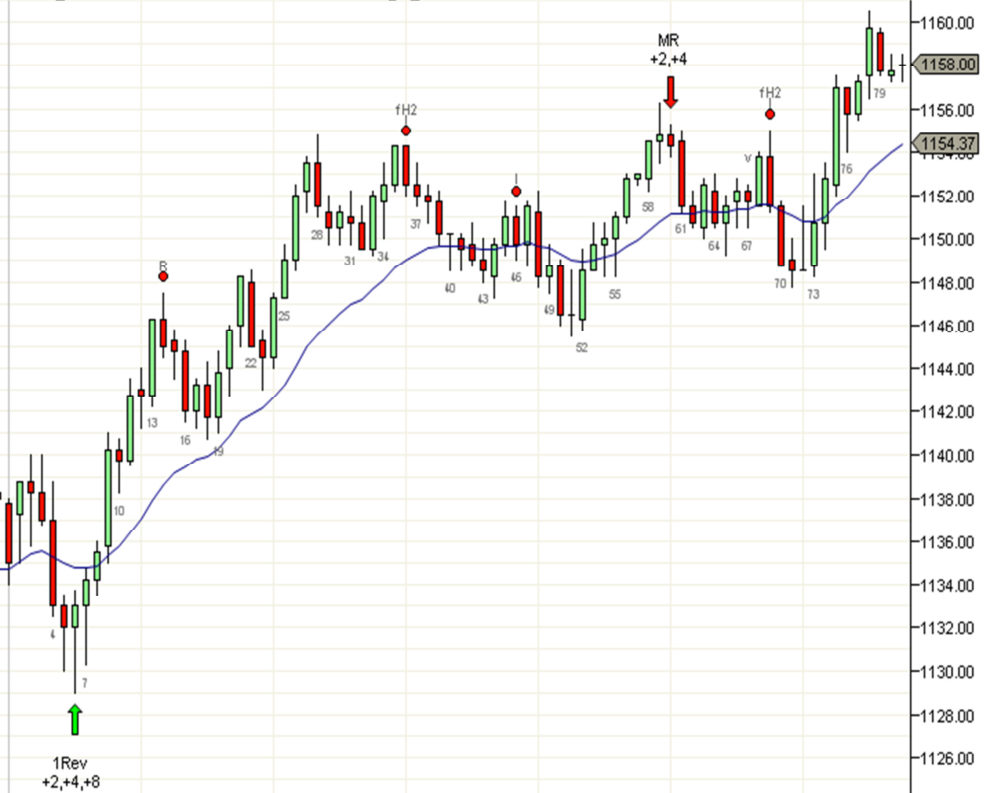

Many traders lose money because they do not recognize traps in time and once they are in, they will hold hoping for a miracle. With some experience and pain, any trader will eventually learn to recognize traps and avoid them.

There are many kinds of traps, but they have some common features. The first is that the bar taken alone probably looks great. For example, b1 today was a reversal bar at the ema with a very strong close. A new trader can be forgiven for assuming that its breakout will lead to a strong trend. However, a reversal bar needs to dip beyond a prior swing to be valid -- if not, its just a trading range bar.

b14 is a similar trap. Although it did give a decent scalp move, being the first attempt to reverse a strong move from the LOD is unlikely to succeed and strong traders added on at the ema instead of shorting.

b44 seemed to be a possible bull reversal bar at the ema but its placed after a long string of bear bars. What is more, b36 was a failed H2 and should lead to two legs down, so b44 is unlikely to be a successful trade.

b65 comes after a possible major reversal (MR) and is unlikely to turn around without at least 2 attempts down. b69 on the other hand would be an OK trade if it was a small bar at the top of the flag since its a possible failure after a second attempt up.

<!-- p.288 -->

## Traps II - Overlaps

Friday, October 7, 2011 · p.288

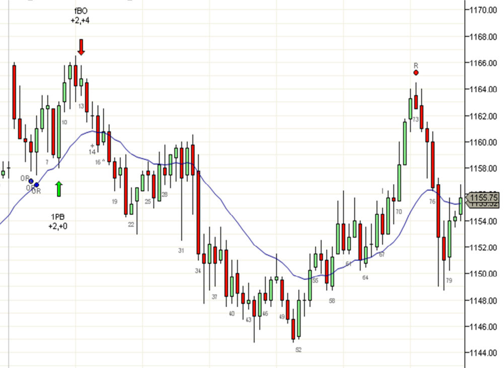

While traps made of bars in the wrong place need some experience to recognize, traps caused by overlaps are a bit easier. Basically as long as you remember overlaps are trading ranges and resolve to only buy below and sell above them, you can keep out of trouble.

For example, b9 is a possible 1PB but since its a mid-range overlap, there is a very good chance of it failing and you should watch out for a sell signal above. A failed breakout at b13 is very likely to at least take the stops out (low of b9) and you should exit any long positions and reverse here.

While b23 on its own may look like a strong reversal bar, most of it overlaps two bars and is effectively a trading range. Worse is buying above b27 assuming its a second leg or above b29 assuming its a shaved reversal bar. Moreover, b23 is the first attempt to reverse the leg down and is likely to fail, i.e., its low should be taken out (as it did during b31).

The only time you can take an entry on an overlap is if both bulls and bears are already trapped AND you are entering with-trend. For example, b64 was a possible long entry after bulls above b61 were trapped out and bears trapped below b62.

<!-- p.289 -->

## Traps III - Poor signal bars

Monday, October 10, 2011 · p.289

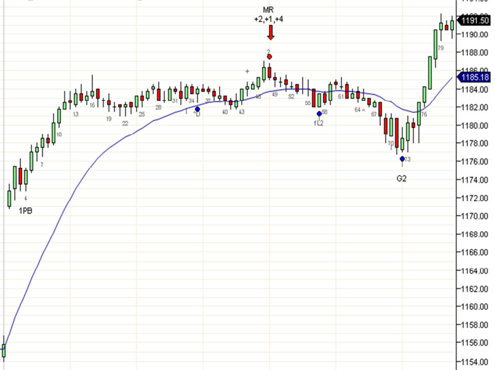

The hardest kinds of traps to avoid are ones that give good patterns but poor signal bars. Unfortunately, these poor bars work a sufficient fraction of the time that they are hard to resist.

For example, b22 was a poor looking buy bar but worked for a small scalp. b35 on the other hand failed despite being closer to the ema. b42 was a bar with a entry side tail and yet it worked. b61 was a doji but worked very well.

How then, is a trader to distinguish between signal bars when they could work or fail with equal probability? On many strong days, especially soft-trend days, good signal bars are rare. Is sitting out of most of the trading day the only option? It certainly is the safe option and for most traders, possibly the best option but there are some heuristics that allow you to select your entries with higher chances of success.

Overlapped signal bars such as b35 and one legged pullbacks such as b22 are weak. You should never buy a poor bar at the top of a flag. Combined signals such as b61 DT and G are strong. With-trend signals such as b72 G2 are strong. Counter-trend signals such as b16 and b57 are marginal and only CT signals after a clear break of the trend such as b48 should be traded.

<!-- p.290 -->

## Trend breakage

Tuesday, October 11, 2011 · p.290

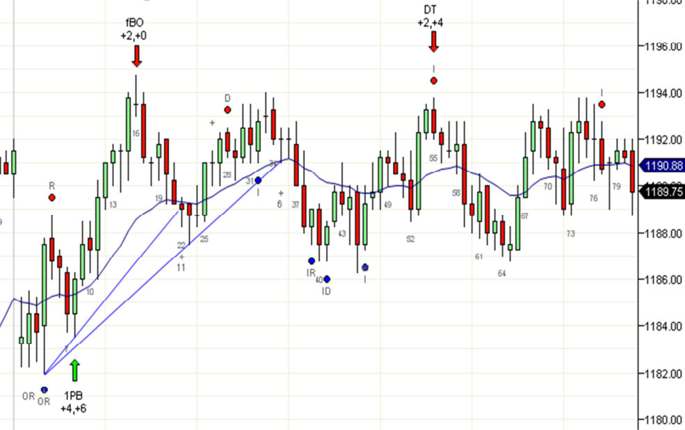

A small dip below the trendline such as b22 does not actually break the trend. A large move such as b34-40 on the other hand breaks the trend and the market becomes range bound. At this point, all with-trend entries are no longer viable. For example, b41, in spite of having a strong close is not an A2.

Once you notice the trend is broken, only take trades at the extremes of the trading range. Preferably, you should take fBOs of new highs or BP if the breakout is strong. Occasionally, you will be able to take a DT as in b55 today or possibly even a DP (if b69 was a stronger close).

Many setups in a trading range are actually traps. You tend to see a lot of setups such as b45,46 and b72,73. It may appear that another strong leg is imminent but the move usually fails if its mid-range or a successful break of the range is a requirement for success.

Even setups at near the end of the range need a strong bar (b55) to expect a reasonable chance of success. The possibility of overlap and pullback is very high, so trading is generally dangerous. Its especially dangerous if the range is small (5 points of less), mid-range and made of taily overlapped bars.

The patient trader should wait for a trend break and enter on the first pullback, swinging a portion of the total position. If you must trade, fade every two or three legged move.

<!-- p.291 -->

## Inside bar reversals

Wednesday, October 12, 2011 · p.291

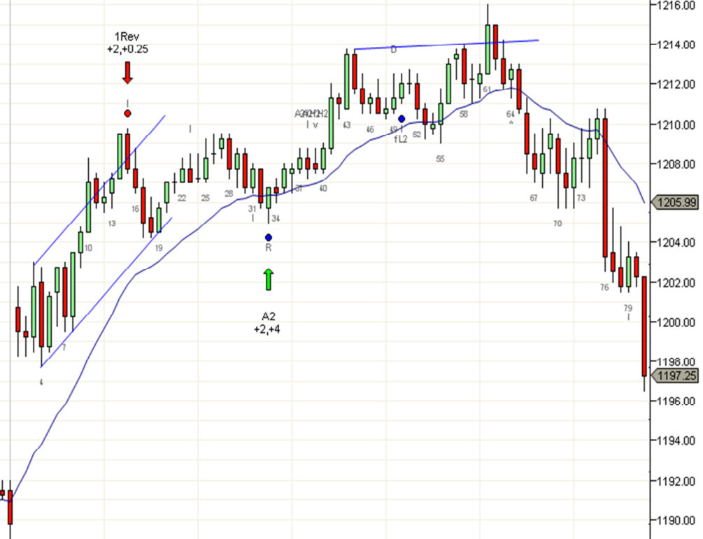

Inside bars reversals are pretty hard to read accurately. Why did the breakout below b11 fail but b15 give a scalp profit? Why did b44 take out the stop beyond the entry bar (b44) before giving a scalp profit making it a poor signal while b62 turned into a great swing trade?

All these bars had strong closes yet two failed and two succeeded. Using a little bit of common sense, we can reduce our chances of taking an unprofitable inside bar entry. b12 is the first attempt to break the trend and failure is expected. B15 was the second attempt and an overshoot, so it should give at least a pullback.

Similarly b44 was the first attempt to fail a strong breakout (b41 was 50%+ beyond prior HOD) and was unlikely to work. b62 on the other hand was a third push up after a trendline break (TL b4-b25) and a TCL overshoot.

Swing moves often end with inside bars and these are usually great with trend entries. For example, b19 ii indicated a possible swing end as did b54.

To Summarize:

- Inside bars are excellent signal bars for failed breakouts but not for any arbitrary reversal. It can be argued that b15 and b62 were breakout failures while b11 and b42 were not.
- Inside bars make good signals when there is a TL or TCL violation
- Inside bars are good signals with-trend or at the end of swings

<!-- p.292 -->

## Final Flags

Thursday, October 13, 2011 · p.292

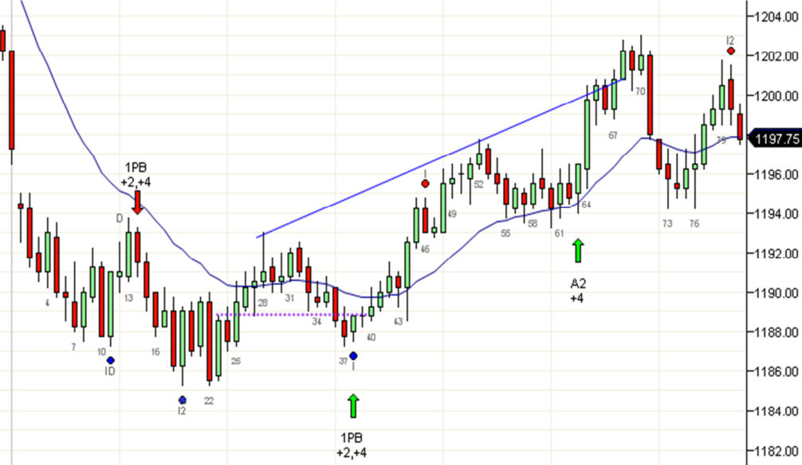

A final flag represents an area of high probability reversal. A classic final flag is a horizontal flag made of overlapping trend bars. These bars are likely to be large when a bear trend is ending (b18-23) but may be made of smaller bars when a bull trend is ending (b65-67). If the bars are not trend bars, a continuation is more likely than a reversal.

A normal flag moves counter to the direction of the main trend (b32-38, b53-b60) and represents early traders exiting, counter-trend traders being trapped in and new traders moving in, taking the price to a new extreme. The deeper the pullback, the more likely the with-trend pullback entry will succeed.

A horizontal flag on the other hand does not represent the early traders exiting. Their target is very close and they are holding to exit on the next push. Counter-trend traders do not get trapped and new traders are unlikely to enter on a very shallow pullback.

A horizontal flag on the third push is very likely to be a final flag and you should look for favorable entries. If the risk is too large as in b23, its best to wait for a second entry (b38) or enter on the first pullback after the trend has reversed. This is because there is a rather high risk of being trapped when then the entry is counter-trend and the risk is large (b19 buyers).

If the flag is made of smaller bars (b65-67), an entry after a with trend break and failure is preferable to avoid being trapped (shorts below b66 were stopped out). An ii variant such as b69,70 makes an excellent FF entry, especially when overshooting a TCL.

<!-- p.293 -->

## Limit entries in a channel

Friday, October 14, 2011 · p.293

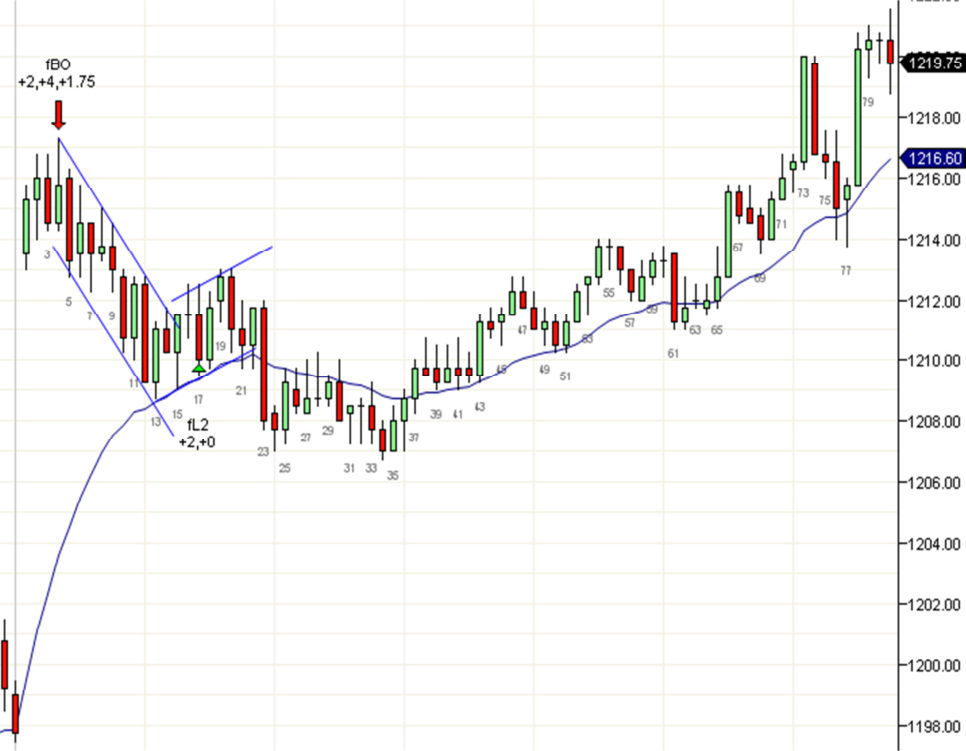

A channel is a leg made of overlapping bars with very little pullback. This means that channels do not give a clear entry. Occasionally, you get a small bar such as b8 and you could enter using it as a signal bar. However often you do not get any such bar and when it does you may find yourself buying at the top of the channel as the buyers above b22 discovered.

One of the characteristic features of channels is that their first breakout almost always fails. This allows us to enter at the channel trendline whenever a bar closes very near to it. For example, b11 close could be sold and b17 close could be bought. This works very well with the first close near the trendline. Subsequent closes such as b15 close did not fare that well.

Weak closes such as b21 or closes that are far away from the trendline such as b19 and b13 are suspect since there is still plenty of room to the trendline. These should be avoided.

Extending these to general trends is a bit harder. In theory, you should be able to buy any strong bear close near a bull trendline such as b49 or b61 and sell any bull close near a bear trendline. However, unlike channels, where the first breakout is a high probability failure, a general trend such as the one from b35 to b79 is not expected to fail any trendline break attempt with such a high probability.

<!-- p.294 -->

## Adding on

Monday, October 17, 2011 · p.294

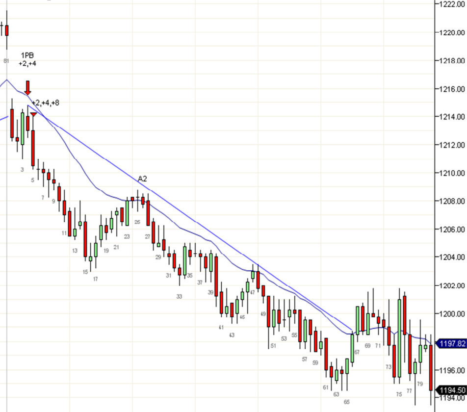

Many traders add on fresh contracts if the price moves against them. Personally, I think this is a poor choice to make. If you were wrong earlier, you are probably wrong now with a larger size. Occasionally, however, it makes sense to add on fresh contracts provided the odds are with you.

For example, today I went short below b4 and when the price moved against me I added on 1.75 points higher. Normally, I would be stopped out here but at this point it made sense to add on instead.

The conditions to add on for me are the following:

1. The potential reward for being right is huge and the potential loss for being wrong is small: After b4 triggered, my stop was above it, so my add on position had only 4t risk but since it was a 1PB setup, the potential reward was 4 points at least, possibly 8 points or more. 2. Entry is with-trend: The gap down, the strong b1 below ema, the failed H1 (already triggered) all point to at least a test of the low of b3, giving a with-trend entry.

<!-- p.295 -->

3. You were expecting a pullback due to price action: b4 had an entry side tail and most of it was overlapped by all prior bars so a pullback was very likely. Since you already expected a pullback you can enter lighter the first attempt and add on at the pullback. 4. You are trading within your comfort zone: If you cannot be comfortable holding the extra contracts, you risk being shaken out mid-bar.

The following are poor reasons to add on:

1. Your counter-trend trade went against you: This is the simply the best way to go bankrupt, throw good money after bad. Be a strong trader and let it stop you out. This will train your brain to enter on higher quality setups only. 2. You think this will be a huge move and want to add on more contracts after the price has moved in your favor: This is usually a poor move. You should be getting out of your scalp position once the price moves in your favor, not adding on fresh contracts.

<!-- p.296 -->

## Kinds of 1Rev

Tuesday, October 18, 2011 · p.296

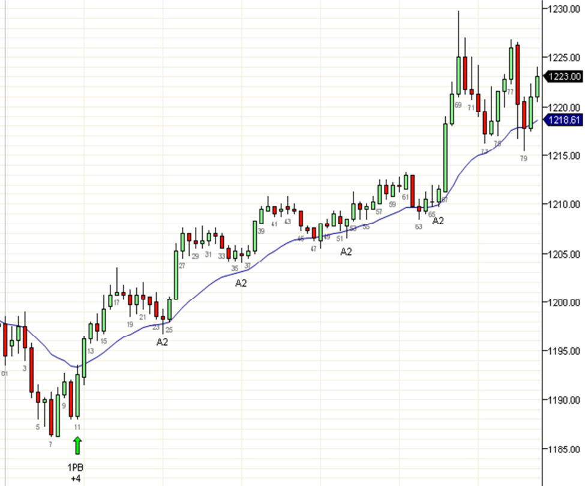

One of the reasons 1Rev has been hard to explain is that its really a composite of various kinds of setups that happen to reverse at the high or low of the day during the first hour. Some days have more than one kind of 1Rev, leading to multiple labels on the chart. To make it easier to explain, Im splitting it into simpler components, hoping this would easier to explain and adopt. The first kind of 1Rev is actually a fBO of the opening range. If the fBO produces a decent signal and the range is sufficiently large (say 4 points) then it should be tradeable for at least a scalp. This is best labeled as fBO instead of 1Rev. The second kind of 1Rev is a reversal of the HLC of the prior day. Normally a such a reversal usually seeks the one of the prior day's extremes. This should probably be called Opening reversal (OR). The third kind of 1Rev is a pullback from a gap to the ema and reversal. This can act like an A2 and is usually a high probability setup.

The last kind of 1Rev is a trend move from the open that violently reverses (b7,8). The last two are high probability high or low of the day and can lead to swing till end of day (as today did). The first should simply be labeled fBO. The second can be labeled OR. The third and the fourth are traded similarly and should probably be labeled XOD (extreme of day).

I will move to the new nomenclature and avoid using 1Rev as a label. When more than one kind of 1Rev occurs, I may simply put 1Rev for brevity but will try to put the individual components where possible.

<!-- p.297 -->

## The AM and the PM trends

Wednesday, October 19, 2011 · p.297

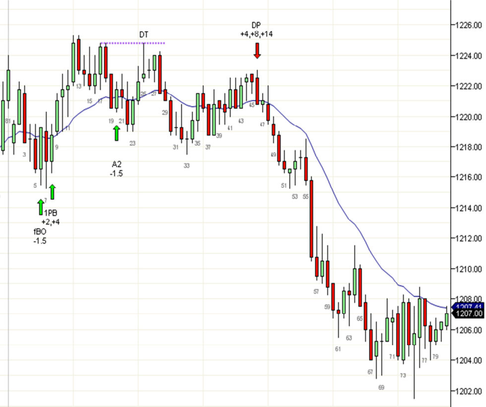

As I've posted before, the trader's best bet is to get on the AM trend and figuring that out should be the first goal of swing trading. On most days 1PB and occasionally, 1Rev turns into the AM trend. This is especially true if the day opens with a large gap from its close and especially if the open is beyond the range of the prior day.

When the open is near the close of the prior day, the AM trend may not be very strong unless the distance to one of the extremes of the prior day is large. On a day such as today, that sometimes can lead to a large PM trend.

Note that absence of an AM trend is no guarantee of a PM trend. Often there is no trend the entire day and the day may become a small pause bar or inside bar on the daily chart. However, sometimes trend generation patterns can cause a PM trend to breakout. The easiest trend generator to recognize is DP, the double top pullback on b46. This is the bearish analog of the double bottom pullback. A double top pullback is characterized by a double top that is well defined, i.e., several points and bars large and preferably the second low(b33) takes out the first low (b23). A two or three legged pullback (b33-45) that cannot reach the second high (b28) completes the DP. If this forms near the top of the trading range, its a high probability trend generator and should always be swung. The possible target is twice the prior range (b7-b13) and often this is a large move. DP should not be taken if its at the wrong end of the TR (i.e., bearish DP near the bottom of the TR) or the range is too tight (4 points or less).

<!-- p.298 -->

## Anticipating mid-day reversals

Thursday, October 20, 2011 · p.298

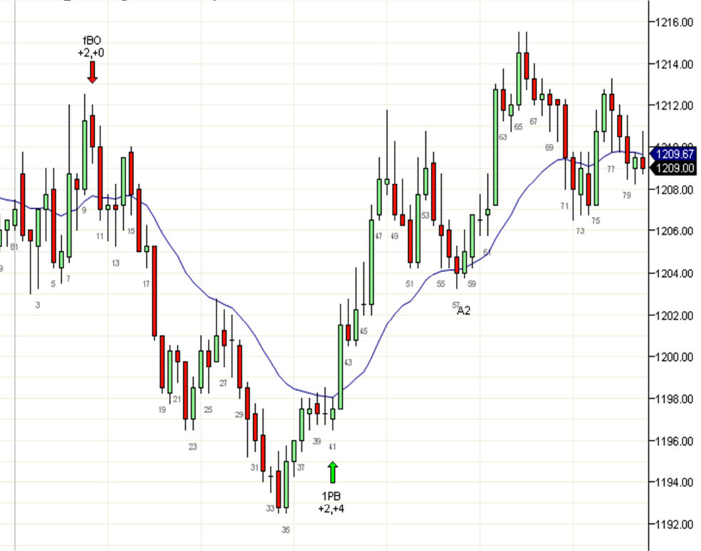

When an AM trend breaks out from the opening range, its very useful to know if the trend will run to the end of the day, break and turn into a horizontal range or reverse and attempt to take out the other extreme of the day.

One of the earliest signs of an impending mid-day reversal is display of strength in the early bars. b7 and b9 today demonstrated the willingness of buyers to buy with strength taking out stops of bears. Generally strong counter-trend activity at a given price indicates a potential stronger activity at a better price.

So when you see a potential reversal such as b34,35, its a good idea to exit your trend positions on the AM trend and look to enter on the reversed trend, which could run for the rest of the day or at least until it takes out the prior extreme (b62).

Days that open very close to the prior day's close and trends that break out of high areas of congestion are likely to reverse due to the magnetic effect of a tight consolidation area.

<!-- p.299 -->

## Channel pullbacks

Friday, October 21, 2011 · p.299

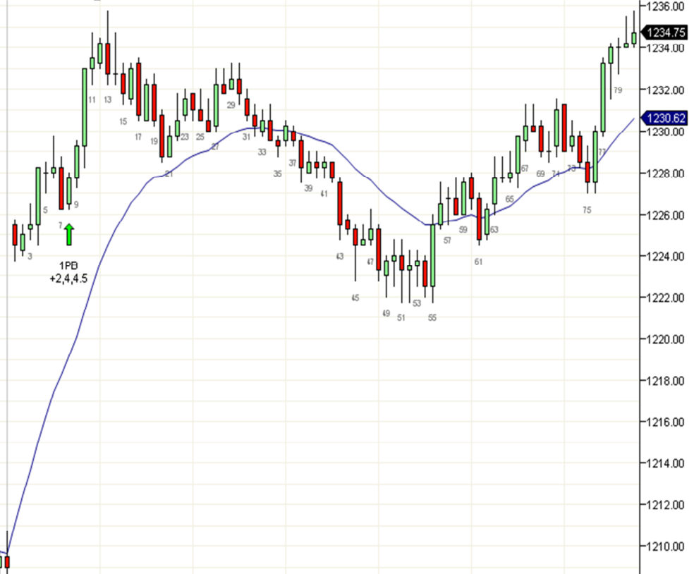

On a day that starts with a large gap and starts off with a strong trend, you probably expect a decent move off a the first two legged pullback. However, when the pullback looks like a channel, its a good chance will act like just one leg and a second leg needs to be complete before the trend resumes.

The outside bar on b18 and the distance from the ema precludes any entry above b18 so the next logical setup is b21. b21 is a possible WP but since it was really one leg and not a low momentum move (i.e., not tiny / doji bars) it is probably one leg and another leg down is to be expected.

A failed 2 legged attempt to take out the high at b29 is a failure and therefore high probability short for at least two legs down.

<!-- p.300 -->

## After the trendline break

Monday, October 24, 2011 · p.300

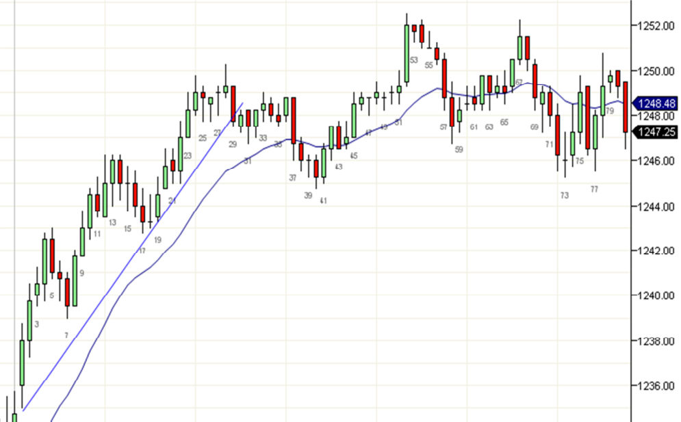

Regardless of how strong the trend was and how great the signal bars are, the trend terminates after a trendline break (b29-39). A trendline break that goes for several bars and several points should mean you no longer look for with trend signals.

There fore b35 is not an H2 or A2 and neither is b41. It however, is a good trade since a trendline break after a strong move is expected to re-test the prior extreme.

After a trendline break, you are in a trading range and you should only expect two legged moves that may not go to the other end of the trading range. For example, b53 gave two legs to b73; b59 gave two legs to b67; b73 gave 2 legs to b79. There is no telling how far any leg can go and b77 buy went only a point above prior swing high. This is why trades mid-TR should be avoided. They are unlikely to have many participants and their strength is suspect.

On the other hand, you should fade weak breakouts and take strong breakout pullbacks. Despite being a strong bar b52 was a weak breakout. It was on a third push up (b45,49,52) after a TL break. The oio after the breakout (b52,53,54) setup a reversal. The BP at b59 was weak (TR bars b58,59). b68 on the other hand, was a strong BP short.

In summary fade weak breakouts at ends of range and take strong BPs only after a TL break and avoid trying to find continuation trades.

<!-- p.301 -->

## Huge open bars

Tuesday, October 25, 2011 · p.301

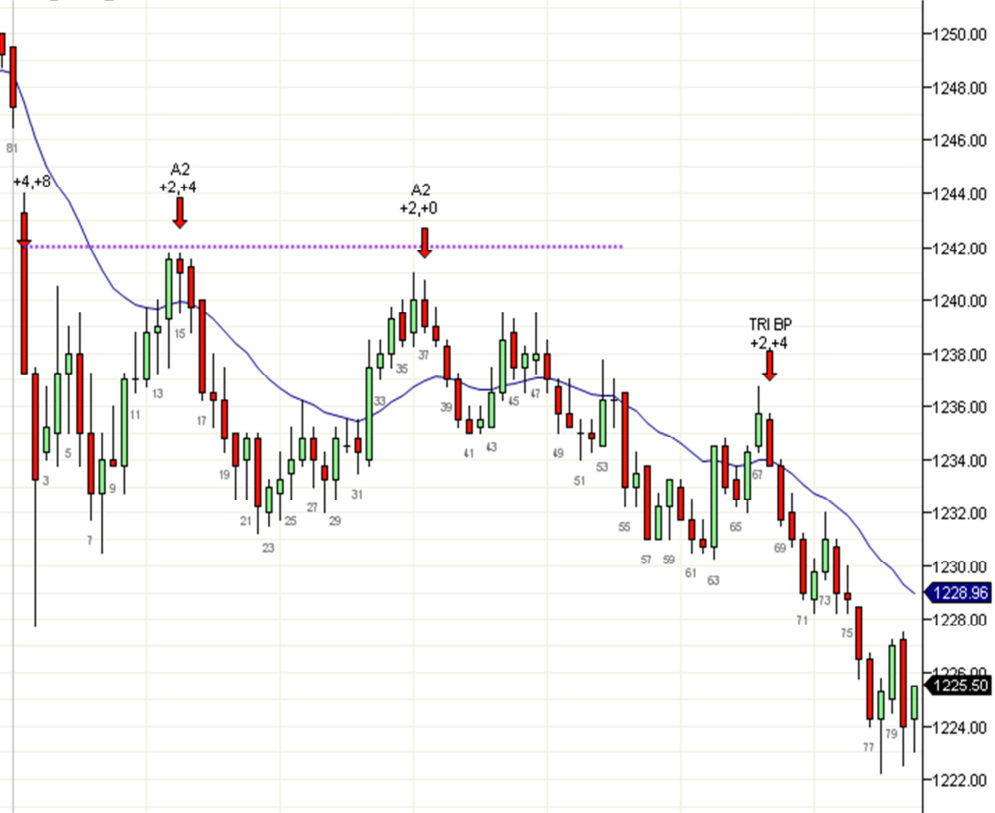

Large bars on open are rare, but when they happen, your best bet is to enter early. One method to enter is on a 5t move from the open and only in the direction of the gap. So for today, you would short when the price hits the purple line shown above. On most days with large gaps, the price will not take out a breakeven stop at this point for the rest of the day or until there is a W or other reversal. Large bars represent trading ranges and large bars on open are no different. A sequence of large bars is invariably followed by a pullback and a test of the extreme regardless of how deep the pullback is.

This is because the large bars represent a spike and with trend spikes are usually tested. A large range in one or two bars (b1,2) often sets up a narrowing triangle (LH,HL,LH,HL...) as the market tries to find a balance between the two ends of the range.

The safest way to trade a triangle is a triangle BP. Basically, wait for 2 HL or 2 LH to be taken out (b41,23 taken out at b62) and then take the next pullback. If the pullback is 2 legged as in b68, its usually an excellent setup.

Until the triangle breaks out however, you can take with-prior-trend entries only and best if they violate a trendline. Trading a triangle against the prior trend is dangerous and should be avoided. Watch the poor entry bars and pullbacks for buyers above b8, b23 and b58.

<!-- p.302 -->

## Anticipating AM trend reversals.

Wednesday, October 26, 2011 · p.302

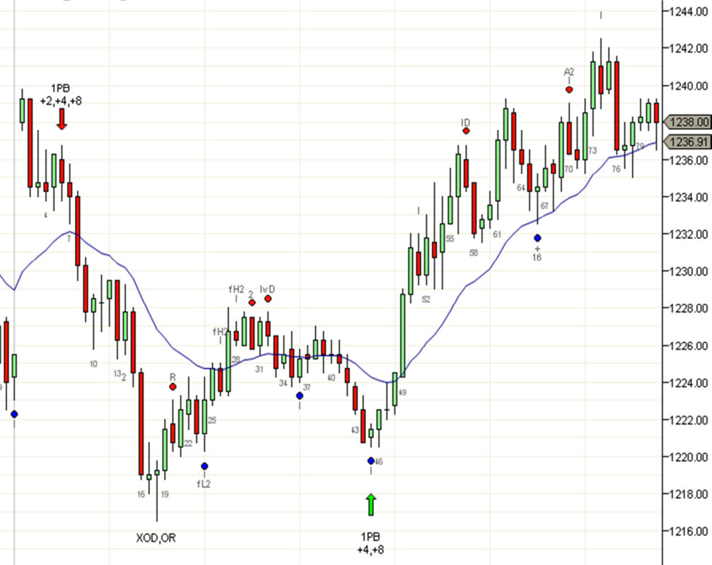

I have often stated that consistent success lies in the ability to get in on a trend early, especially the AM trend. Often an absence of an AM trend may mean a potential PM trend if the day opened on a large gap but on many days its just a TR day (regardless of gap).

Occasionally, however, we get an excellent AM trend which breaks and instead of turning into a trading range, reverses into another excellent PM trend.

To anticipate such moves, watch for a large gap and an open within the range of the prior day (b1). If the trend move breaks an extreme of the prior day in three pushes (b5,10,18) and gives a reversal signal (b18), there is a very good chance the next two legged pullback (b45) will break into a trend. This trend should be expected to at least take out b1 and therefore is an excellent swing candidate.

<!-- p.303 -->

## Very large gap up

Thursday, October 27, 2011 · p.303

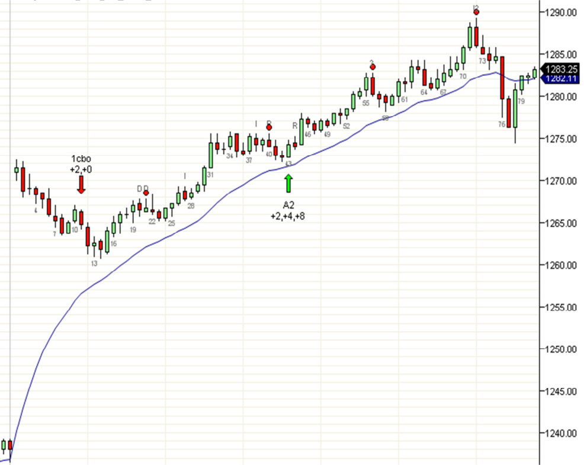

A large gap acts as a spike and if the price is very far from the ema, its very likely to pullback close to the ema. A 2 legged pullback to the ema is a very strong signal on a large gap day. The larger the gap, the deeper the initial pullback (b1-b14) and may look like a mini trend.

Just like a day that opens with a large spike bar, a very large gap day is likely to act like a soft-trend day with very shallow pullbacks. When the first higher low is a fL2 (b19,b22), its a very strong sign of an impending soft-trend day and you should never trade counter-trend.

On a soft-trend day, you can trade above doji bars (b42,58) as if they were bull bars provided they are close to either the trendline or the ema. When in doubt, you can always trade above a strong bull bar following the doji signal bar (b43,b59)

<!-- p.304 -->

## 1tf point to change in direction

Friday, October 28, 2011 · p.304

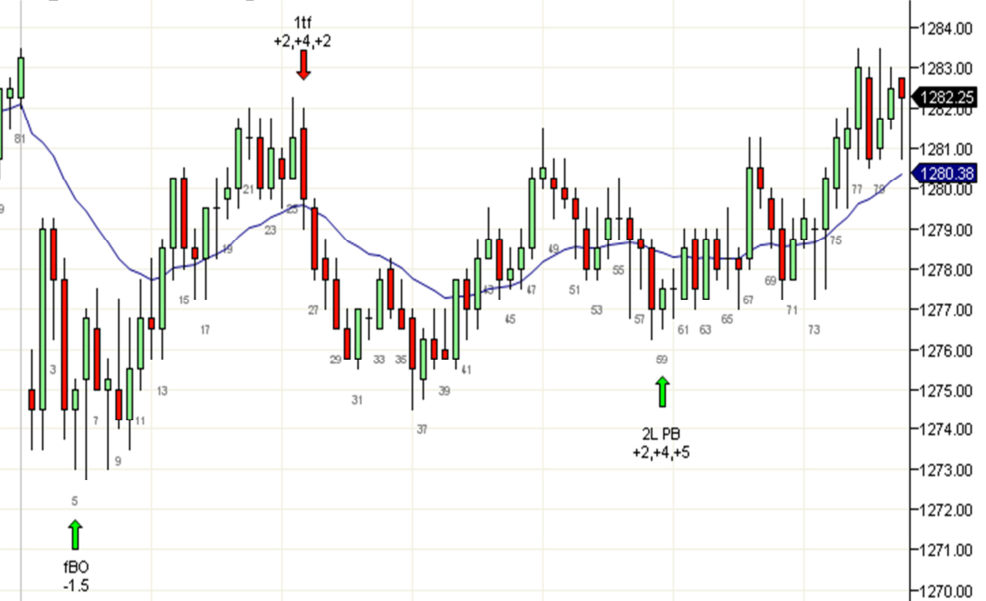

Failures often make very good signals and 1tf in particular make excellent markers of a turn in the market. 1tfs are also excellent with-trend entries, so you should be careful to distinguish between the two.

The classic 1tf is a failure caused by trying to take a reversal before a trendline break of sign of counter-trend strength. This is usually a continuation signal. Sellers below b14 (b14,15 inside bar variant requires an entry below b14) were trapped in a 1tf.

A 1tf can also be a reversal indicator in certain circumstances. For example, b25 was a 1tf above the prior swing high of b21 on an ii flag, which acts as a final flag. Similarly, the ii variant at b39 turned into a 1tf reversal. Final flag variants are often 5tfs such as b25 (went 5t above b24), but they can sometimes be 1tf as illustrated by b41.

There were another kind of 1tfs today. b6 trapped buyers in by triggering above b5 and took out its low by 1t before turning back up. Such a double trap followed by a 1tf is a kind of micro-wedge (3 pushes on 1m chart) and usually indicative of market direction change.

<!-- p.305 -->

## Anticipating late trend breaks.

Monday, October 31, 2011 · p.305

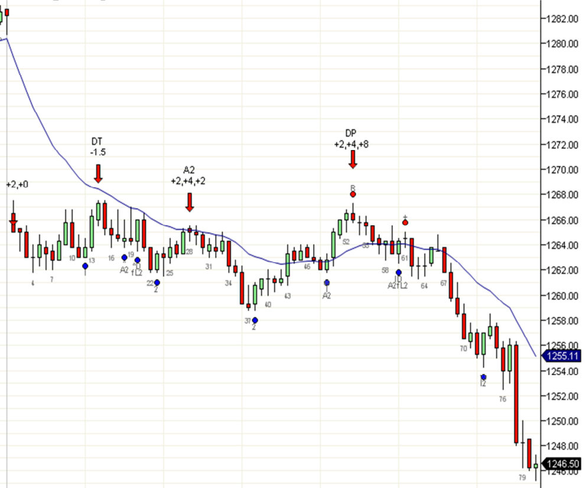

On a large gap day where the open is beyond the range of the prior day, the likelihood of trending is high. If the first bar does not lead to a hard trend, there is a very good chance it will at least attempt to pullback to the ema and then break into a trend in either direction.

Once the day has stalled into a trading range, any trend break is likely to happen from the other end of the range, i.e, bull trend breakout from the bottom of the range and bear trend from the top of the range. This is why you should only buy low and sell high in a trading range.

A 1tf such as the one on b24 could lead to a trend but when the range is small, the likelihood is lower. A trading range typically tries to widen before it breaks into a trend. A common way to expand the range is to take out repeatedly both ends of the range until the range is wide enough. This is an expanding triangle breakout and any sharp breakouts can be faded until an upside break and 2L HL or a downside break and 2L LH. The second option is to give a breakout pullback. b36 was a strong breakout of the trading range and gave a LH 3 push pullback to b53, which was also a DP. These are usually trend generators and should be taken. Entering mid-range such as the entry at b28 should be avoided unless you have reason to believe you are in a trend (LL and LH) or you are entering on a BP. In general your best swing entries are near the ends of the trading range after the trading range has been made sufficiently wide by prior failed breakouts.

---

[← Previous](17-2011-09.md) · [Contents](00-目录.md) · [Next →](19-2011-11.md)
