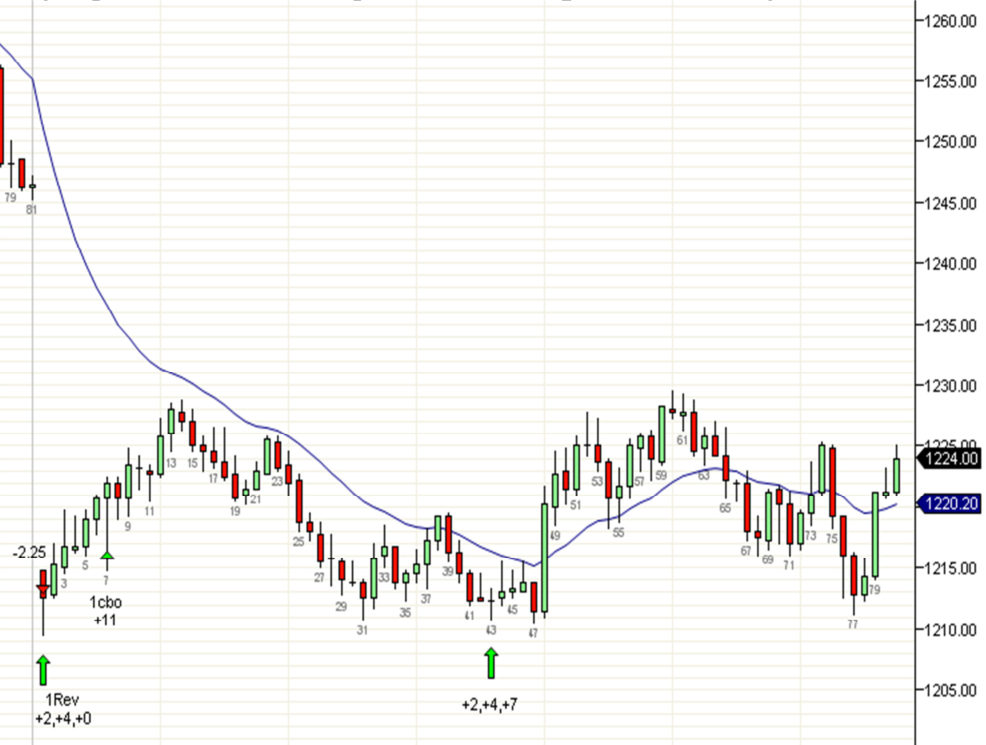
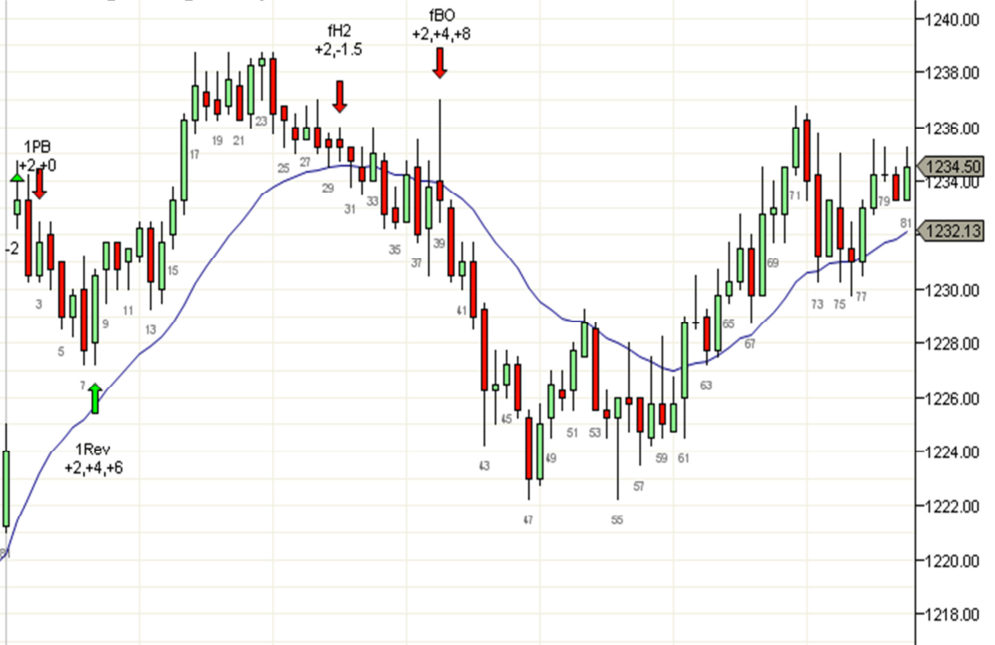
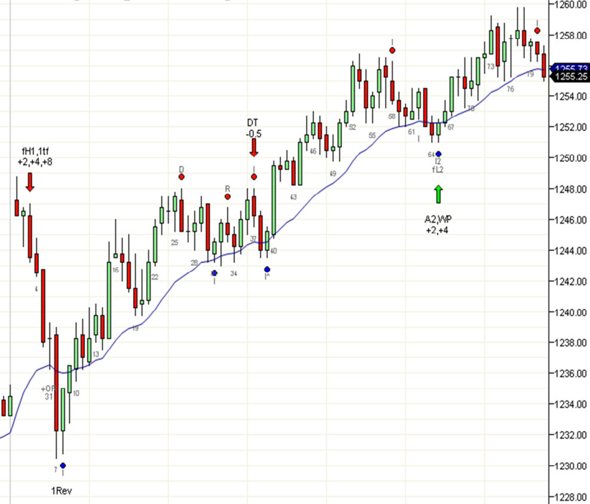
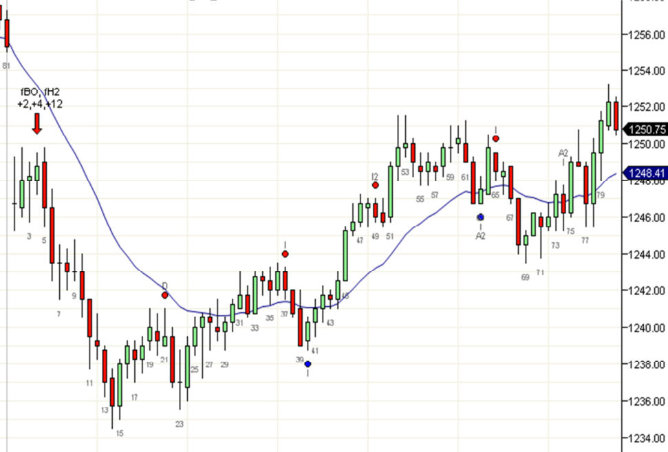
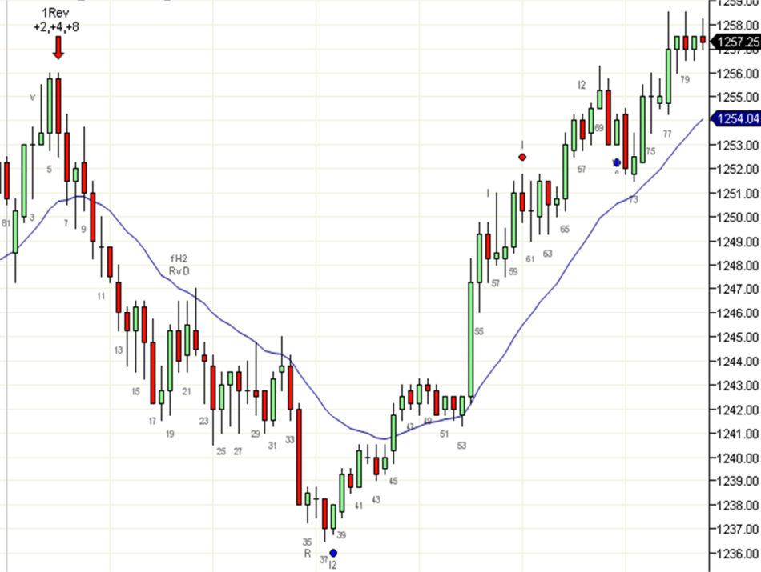
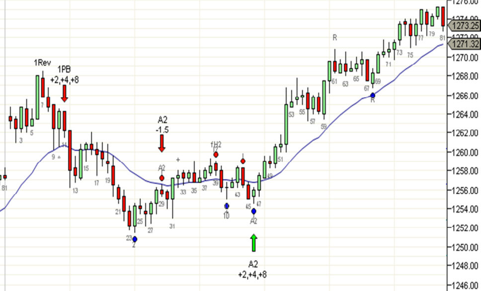
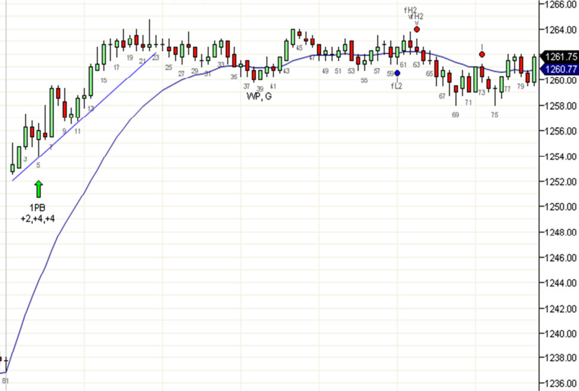
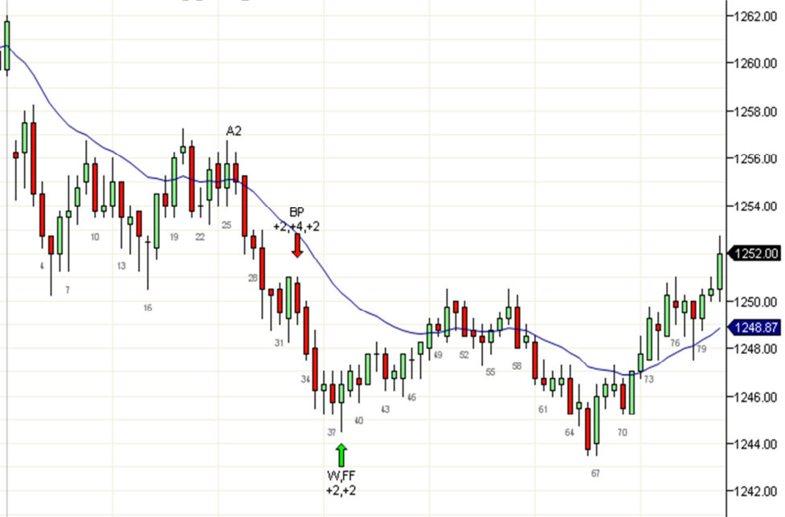
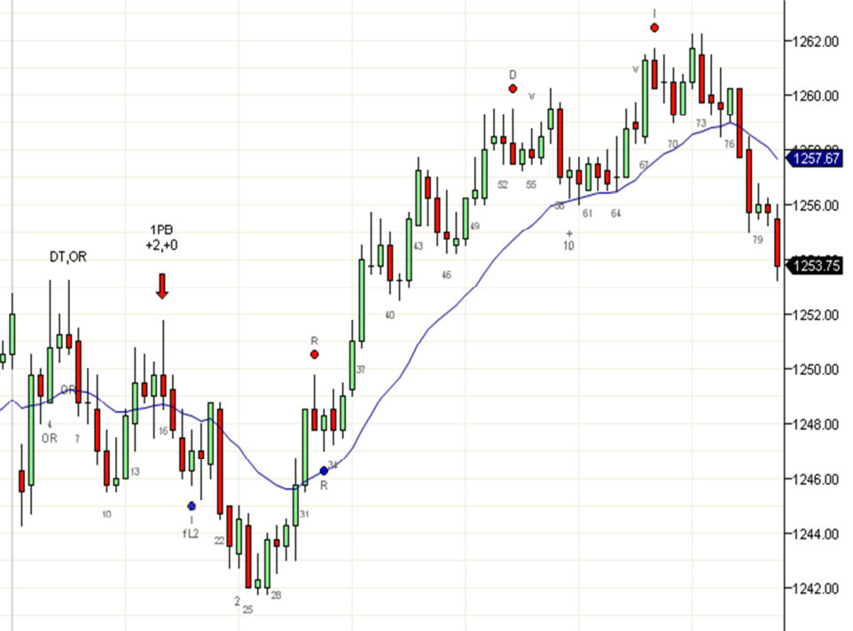
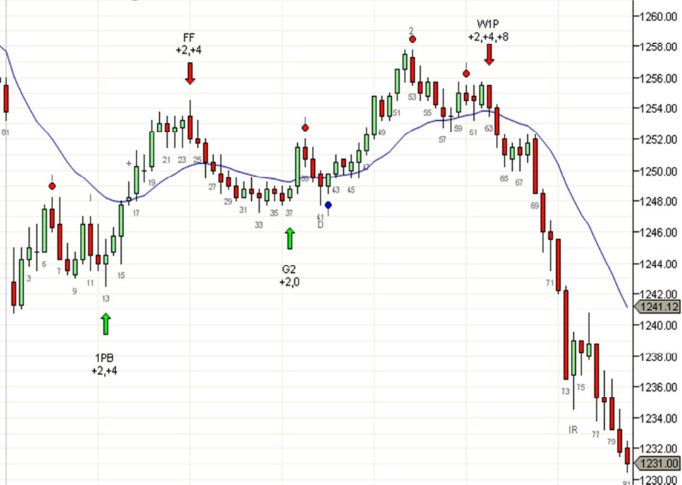

[← Previous](18-2011-10.md) · [Contents](00-目录.md) · [Next →](20-2011-12.md)

# November 2011

Original pages 306–315

<!-- p.306 -->

## Buying below and selling above overlaps on a TR day.

Tuesday, November 1, 2011 · p.306

Trading strong trend days is not necessarily easy but certainly simple. You can basically take every reasonable with-trend entry and chances of success are high unless you are near the end of the trend. On a trading range day, things become much more uncertain and swing entries will be stopped out all the time.

A simple heuristic to deal with trading range days is to buy below overlaps and sell above them. For our purposes, an overlap is any trading range bar such as the outside bar b7, any bars that overlap such as b54,55 or any horizontal range such as b69-72. The only restriction is that the overlap be large enough for a scalp profit, say 4 points. A trend bar such as b48 should not be faded in this manner since there is a very good chance it could turn into a spike and channel or otherwise turn into a BP.

Once the overlap is in place, resolve to sell above it and buy below it. On a trading range day, there is a very good chance of a failure of any breakout beyond these overlaps and a very good chance it will at least take out the other end of the overlap.

Conversely, an overlap whose breakout fails and successfully takes out the other end on a trend day such as the BO above b7 which consequently took out b7 low, transforms the day into a trading range day and you should only trade at the ends of the range.

<!-- p.307 -->

## Trading range day as a series of fBO

Wednesday, November 2, 2011 · p.307

Since most days are trading range days, the trader needs to have a realistic expectation of what happens once the market takes out the high or low of the day or a significant swing point. Usually, the breakout is expected to fail, but the precise entry point to trade the failed breakout should be determined after two failed attempts to continue in the direction of the breakout.

For example, the strong breakout above HOD on b16 stalled and the market failed to continue twice (b20,b22) in a horizontal flag that effectively acts as a final flag. At this point, it should be clear that the market will attempt to re-test the low and you should no longer look for long trades.

The break below LOD on b43 was on a large bar, but the second attempt to continue the selling failed giving a double bottom at b47,55. At this point, until the DB is taken out, the market is expected to test the high once again.

Trading range days may be viewed as a series of failed attempts to generate a trend after breaking to a new high or low. Naturally, a two or three legged approach to the high or low without breaking out can also be treated as a fBO.

Occasionally, the breakout will give a successful BP, which can lead to a trend, especially after a DP on the other end.

<!-- p.308 -->

## Choosing Scalp and Swing entries

Thursday, November 3, 2011 · p.308

The first hour of the day is likely to produce the high or low of the day and trades made then are most suitable for swinging. Occasionally, the AM fails to produce any trend moves and on such days, there may be a PM trend but normally the higher likelihood is the AM trend.

A 1PB is the best option for an AM swing trade, but on some days such as today, the 1Rev is the clearest swing entry. If the early trend move results in a strong reversal, you should always swing the 1Rev entry. If you miss the 1Rev and the 1PB, you should then look for the first deep pullback such as b20 today. Its a terrible signal (an overlapped doji), so its alright to skip it. The first 2 legged pullback such as b31 or b39 often provide a decent late entry into the trend, even though it may look like you are buying the top at that point. Lunch hours in particular are dangerous and many traders will correctly trade smaller volume or take only scalps. Shallow pullbacks are invariably scalp setups since your swing stops are likely to be taken out during the next pullback. A deeper pullback is more likely to have a strong entry bar, causing the next pullback to miss your breakeven stop. As the time left in the trading day diminishes, so do the options for a swing move. Unless you are in a late hard trend, you should be satisfied with modest profits. This is especially true for trends that broke early in the day since they should be expected to show some volatility due to profit taking.

<!-- p.309 -->

## 2 Failures to close gap

Friday, November 4, 2011 · p.309

On many days when the market opens with a reasonable sized gap (4+ points), the market will try to close the gap twice. If it fails on both attempts, there is a high probability of a strong trend in the direction of the gap before the market tries to move against the gap.

The larger the gap, the larger the trend move before any attempted reversal.

Today opened with a reasonable gap and a doji bar b1 with a close near the low of the bar, which is a poor signal for a long and was likely to fail. The second signal was another doji but with a higher close and was also a failure. The presentation of poor counter-trend signal bars is a strong indication of continuation of the trend.

Two failures led to the market breaking into a trend and extending the gap all the way to bar 14. On the way, a fH1 at b9 marked a precise exit near the low of b14.

<!-- p.310 -->

## Three push legs

Monday, November 7, 2011 · p.310

Three pushes with small pullbacks between them as in b8,15,18 or b57,60,69 may act like a poor Wedge. This wedge will basically act as a single leg and is likely to give a pullback and then resume the original move, taking out the prior leg extreme.

For example, the three push leg down to b18 gave another leg down to b24 before giving a two legged move to ema, as did the leg up to b69.

A three push leg to ema or other barrier may give rise to a deep pullback or even reversal, especially at the beginning of the day. On the other hand a three push leg in the direction of the ema slope may give a pullback thats stopped at the ema as it did today.

Trading such a leg is simple. If the leg stopped at a barrier, take the reversal if the signal is decent. If not, wait for a pullback and continuation for at least another leg.

<!-- p.311 -->

## Failed continuations confirm reversals

Tuesday, November 8, 2011 · p.311

When a possible reversal pattern has triggered such as b23,24 2 bar reversal on the third push down but the original trend is still unbroken (because a trendline has not been broken), a continuation needs to fail before you can trade in the direction of the new trend.

A 2 legged move after a wedge move such as b29 is often a very good continuation signal and should be taken since it often leads to a move of similar magnitude. If this move fails as it did when b31 took out b29, you should look for setups in the new direction only.

So for example, while b39 worked today, on days when bars are smaller it is likely to fail. The correct trade would be to buy the A2 above b46 in the direction of the new trend and swing it.

<!-- p.312 -->

## Trend termination (TT)

Friday, November 11, 2011 · p.312

Recognizing a potential trend is generally easy on a day like this: A large gap followed by two or three bars that close in the direction of the gap is a very strong trend attempt and taking the 1PB (b5) and holding it to swing termination or reversal is an easy decision.

Not all trends reverse and many of them simply terminate into a trading range. Determining the end of a trend requires some experience. There are primarily three ways a trend can terminate and today, we were lucky to have all three.

The first is a TTR made up of small overlapping bars made of mostly dojis. Given this criteria, we should already know around b22 that the trend has terminated.

The second is an extended trendline break. A move beyond the trendline for many bars and many points is a trendline break. The more number of bars it stays beyond the trendline, the fewer the points that need to be beyond the trendline to constitute a break. This means that a single bar thats sufficiently large can break the trend or a large horizontal or slightly sloping movement for about 20 bars (b21-39) can break the trendline without dipping too far below it

The last is a failed reversal followed by a failed continuation. b22 was a poorly formed W and FF that was followed by a WP at b39 which was unable to take out the reversal bar. Once you realize the trend has terminated, you should no longer be looking for with trend trades. Your best option is to wait for a new trend to break and enter on its first pullback. If the trading range following the TT is small, its best not to enter into anymore trades at all. If the trading range is wide (8+ points), you can consider fading the extremes of the new trading range. Note that in general, you should cannot expect any entry in a trading range to make a large move. In general, you should expect a move that's roughly half the size of the trading range.

<!-- p.313 -->

## The first two legged pullback

Monday, November 14, 2011 · p.313

On many days, the open may constitute an opening range made up of erratic moves (b1-25) that finally break into a trend (b26-b38). Some traders may get repeatedly stopped out on the initial range and their later trades will barely make up for their initial loss. The trick to avoiding being chopped up on the opening TR is to wait for a trend attempt and take a clear pullback on a strong signal bar. This is essentially the philosophy of the 1PB trade.

Determining if a leg is a trend attempt is a bit tricky. Any two or three trend bars are a possible trend attempt. One bar does not usually make a trend (unless its very large). Once a trend is attempted, it will either reverse and a new trend is attempted in the opposite direction or a pullback gives a possible continuation of the orignal leg. A strong reversal attempt is 1Rev. A pullback is 1PB. Today, there was a trend attempt from b3 to b5 and a weak reversal attempt on b5. Then possibly a second trend attempt from b6 to b9. Note that this bar is made up of weaker bars and is unlikely to succeed, especially in the absence of prior bull strength. b16 represents the first two legged pullback of the day and is a possible 1PB long entry of the long trend attempt. However, the signal bar was a doji and the reversal was fairly weak. However, this is still a viable long entry. When the long entry failed to take out the old high, it turned into a first 2 legged LH, turning into a 1PB short at b20 of the original short trend attempt.

Another way to read this is that b2 and b9 represent two failed attempts to close the gap leading to a bear trend. Even though many traders may have correctly read b9 as a possible 1PB short, waiting for a strong signal bar (b26) is usually the right thing to do for a profitable entry. This is because shorting below a bull bar is always subject to failure, regardless of the correct read of the market direction, especially on a choppy open.

<!-- p.314 -->

## Reversal bars

Tuesday, November 15, 2011 · p.314

Reversal bars often signal reversals, regardless of where they are. A well placed reversal bar (b6) can signal the end of a move (b1-b6) but so can an incorrectly placed reversal bar such as b15 signaling the end of the prior move (b10-b15).

A reversal bar followed by a reversal bar in the opposite direction (b15,16 and b32,33) is usually a very strong signal, especially if the second reversal bar can be viewed as a 1PB in a new trend move, i.e. its the first pullback after a possible reversal.

Similarly, reversal bar failures are very strong with-trend signals. Often after a recent possible reversal, the failure of a reversal bar can often be used as an entry. You could enter long on a stop above b32 (for example if you did not already get a buy signal at b33)

A reversal bar of the wrong color such as b39 are usually traps and if the trend has been strong, may be traded as a continuation signal.

Small reversal bars (compared to prior bar or recent bars) are subject to failure such as b68 and you should only take second entries. The only exception is when the tail is at least as long as the body and you have additional signs of strength in the direction of the signal.

<!-- p.315 -->

## Double Wedge

Wednesday, November 16, 2011 · p.315

A double wedge is simply two wedges that terminate at the same bar. In the chart above, it may be argued that there are two wedges W 6,24,52 and W 34,39,52 or other variant. A double wedge can lead to a large move (b63-b81)

For a double wedge to form, a pullback from a recent swing point (b24) needs to be deep enough that the next leg is likely to need multiple pushes to take out. A strong deep move (b24-33) consisting of CT bars may also demonstrate counter-trend strength that will encourage with-trend traders to exit and counter-trend traders to enter beyond the swing point (above b24).

---

[← Previous](18-2011-10.md) · [Contents](00-目录.md) · [Next →](20-2011-12.md)
