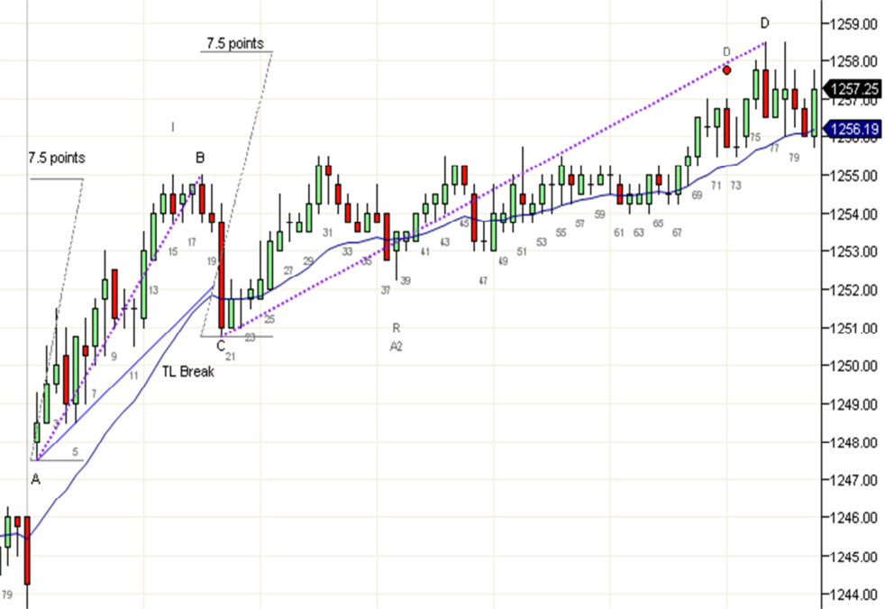

[← Previous](19-2011-11.md) · [Contents](00-目录.md) · [Next →](21-2012-01.md)

# December 2011

Original pages 316–316

<!-- p.316 -->

## AB=CD measured move

Thursday, December 29, 2011 · p.316

When the first leg of a trend move is reasonably strong (denoted by strong bars with closes near their highs, steep trendline, shallow pullbacks, etc), there is a very good chance that the first trendline break will result in a second leg that should go the same number of points.

The first leg today started with b1 and ended at the double top on b18 denoted by the purple line AB. The size of the leg was 7.5 points. This means the trader can expect the second leg to go about 7.5 points as well. The second leg denoted by the purple line CD also was 7.5 points and exceeded the expected move by 1t.

Measured moves are not guaranteed moves and sometimes the price fails to reach the target or moves way beyond the target. But on a reasonable day when the price action is normal, its a reasonable expectation.

The key to trading is to only take a deep pullback and only a strong leg's first deep pullback (i.e. TL break) at b21.

---

[← Previous](19-2011-11.md) · [Contents](00-目录.md) · [Next →](21-2012-01.md)
