[← Previous](20-2011-12.md) · [Contents](00-目录.md) · [Next →](22-2012-02.md)

# January 2012

Original pages 318–336

<!-- p.318 -->

## The January effect

Tuesday, January 3, 2012 · p.318

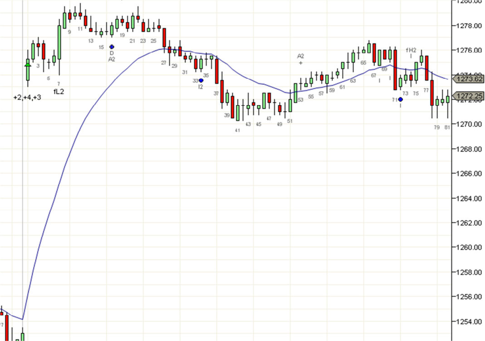

A large gap and a move up on the first trading day of the year is generally considered a good omen and a predictor of a bull move for the next few months. When the market closes near its low, the strength of this assumption is weakened.

On many years, this is an expected gap open and some traders will take a long position on the last trading day of the prior year and exit on the open for a very good profit. This is still gambling however, since a gap down can wipe you out.

Trading based on a large overnight move is speculation and should be done with caution. A small position may be taken using call options, but a larger position required a spread, butterfly or other limited risk option strategy. Earnings, interest rate changes, government announcements, etc can also be traded this way.

Correction: The original chart showed a buy above b6 on the fL2. The actual buy was at around the same price but above the first bar of the 3m chart as shown below.

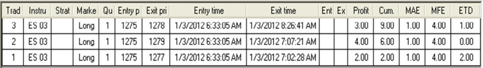

<!-- p.319 -->

## The opening fBO

Wednesday, January 4, 2012 · p.319

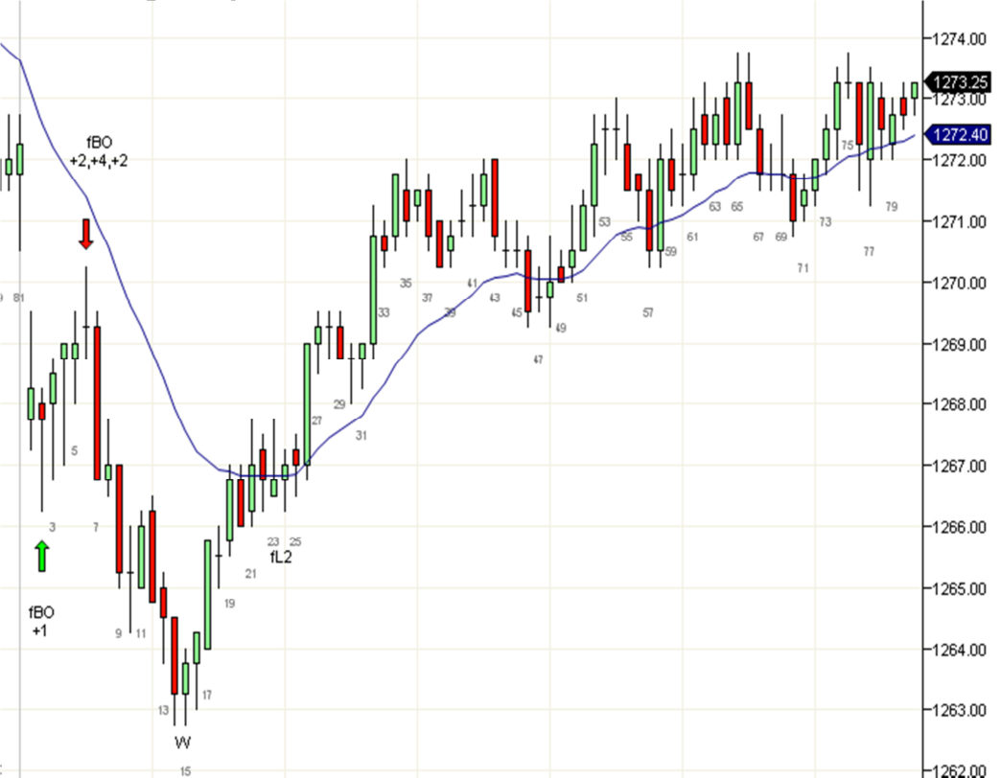

When the first bar is clearly a trading range bar, such as a doji, a large bar with tails on both ends or even a trend bar followed by a trend bar in the opposing direction, there is a very good chance that the first or second fBO of the opening bar can lead to an opening trend move, even if its a small one.

This is because a trading range has buyers below it and sellers above it. Today the buyers below b1 were weak and were overwhelmed by sellers above. This is to be expected and led to a large move that ended in a W reversal.

Many days, when the opening range is small, the market can create multiple fBOs generating an expanding triangle until one of the fBOs fails, resulting in a BP that in turn leads to a trend.

When the opening range (b1-6) constitutes a weak attempt to close the gap, there is a decent chance that its failure will lead to an attempt to widen the gap. This attempt (b6-14) is usually a tradable trend move.

<!-- p.320 -->

## A Higher Low after Bullish reversal is the best swing entry

Thursday, January 5, 2012 · p.320

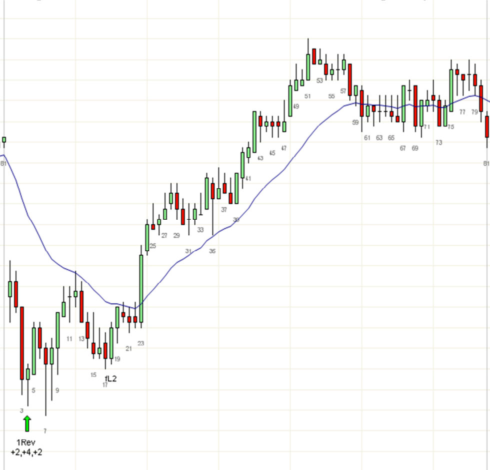

A HL after a bullish reversal or a LH after a bearish reversal present the best swing entry of any move. This is because they represent the 1st pullback (1PB) of the new trend.

When a day opens with an obvious trend attempt (b3) off an obvious opening TR (b1,2) and immediately gives a reversal signal (b4) it is a possible 1Rev. Ideally, the reversal bar needs to be as large as the prior bar and dip more than 1t below it. b4 therefore was a rather weak bar. However, 1Revs often are weak signals.

The second signal at b7,8 dipped lower than b4 and therefore was not a good swing candidate. The fL2 at b17,18 therefore was the first HL and could be held for a swing.

Note that even at the 1Rev a TL break (b7-b12 broke TL b1,6) is desirable for a swing entry (Its an absolute essential for other reversals).

<!-- p.321 -->

## Trading on small days

Friday, January 6, 2012 · p.321

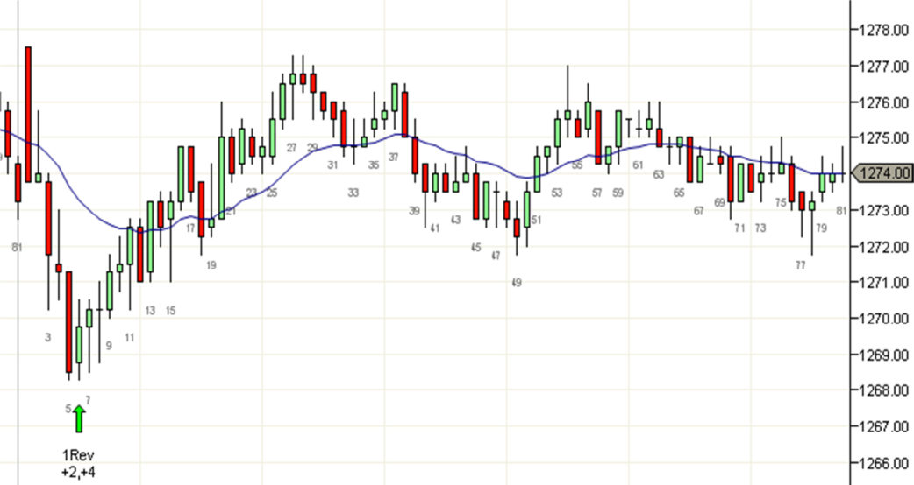

The summer and early fall of 2011 presented very volatile price action with huge range days. Those are characteristic of bear markets or markets in freefall. Its easy to trade any part of the day during such price action if you trade off bars with strong closes.

When the market normalizes and turns cautiously bullish, the range will narrow and it takes many bars to reach your profit target. During these days, usually the AM moves have the best chance of landing a profit before wearing you out.

Today's AM moves gave a modest profit and the price action dried up at two hours after open. Small overlapping bars moving a few points every hour are terrible for trading and will cause many traders to second guess their positions and get chopped up.

The difference in velocity of the move and adjusting to consequent expectations is hard for traders to adapt to. Traders always hope their entry will lead to the next big move, a breakout or a huge trend. The ability to gauge the price action and adjust targets down comes only with experience and no pattern can predict it. The closest sign is when bars become small and dojis.

The best way to trade these days is to expect a dampening after the initial moves of the market. The dampening may not happen, but any trader who entered near the open should be looking to get out and not get in and then stay out until a fBO or BP sets up.

<!-- p.322 -->

## The Grind

Monday, January 9, 2012 · p.322

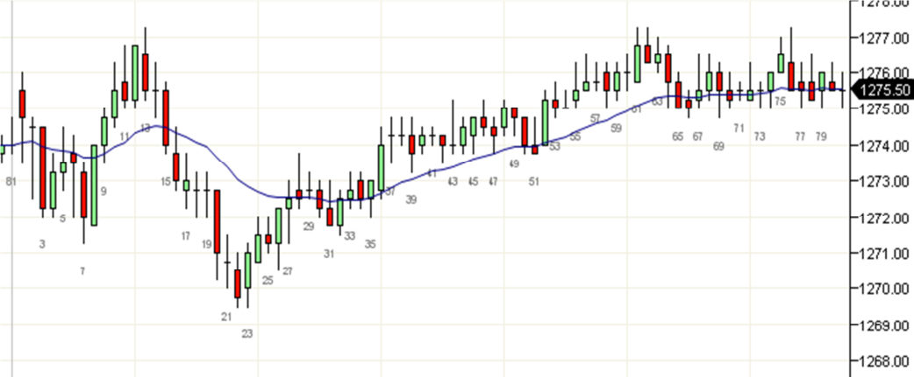

The worst possible price action is the slow grind. BW is more treacherous, but a cautious trader probably wouldn't have a position. In a grind, there is a good chance you do have a position and the price simply takes forever to move.

The fL2 at b35 setup a buy and many traders did not get filled on their +2 exit until b53, and if they held that long. If your charts are set to autoscale, the small bars may appear huge and give the impression of a large move against you. It is best to

The best way to trade a grind is to avoid trading it. Traders who correctly read b13 as a 1Rev got their 4 points and could choose to cease trading but anyone else had to sit through the grind. Some traders double their position and cut their targets when they see weak price action. This is usually a dangerous move since by the time the grind is apparent, adding on further may not produce rewards proportional to the added risk. The simplest thing to do is to cut your target and take a smaller winner.

<!-- p.323 -->

## Inside bar after BO bar

Tuesday, January 10, 2012 · p.323

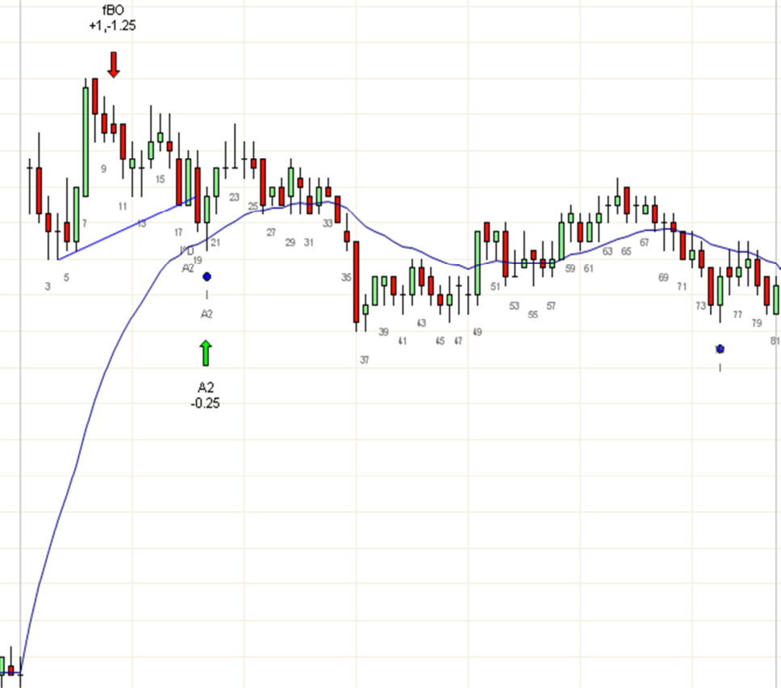

An inside bar right after a BO bar (b8, b37) often signals a failed breakout. A failed breakout does not automatically imply a trend move will setup, but since failures generally have at least two legs, a strong signal near a support such as b20 reversal bar at ema is an acceptable signal.

However, when the range is small, the market will often give a fBO or BP at the other end of the range as we saw at b37. This time it resulted in a complex pullback all the way to b67. One approach to maximizing fBO trades is to exit part on a strong push such as b17,b19 or b49 and exit the balance on any strong counter-trend signal such as b20 or b65.

<!-- p.324 -->

## 2BR signal bars

Wednesday, January 11, 2012 · p.324

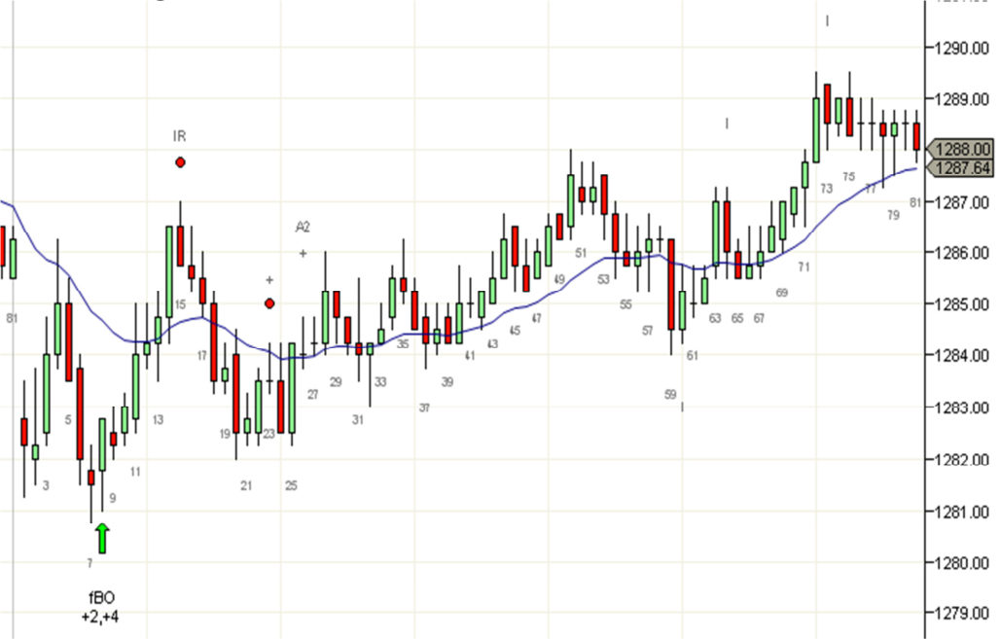

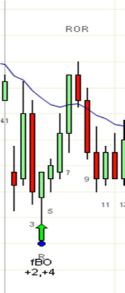

When two bars overlap, they may form an up/down short or down/up long signal. For brevity, they may be denoted as 2 bar reversal or 2BR. 2BRs are typically reversal bars on larger timeframes like b4 on 10m chart shown on the left.

Sometimes, the bars form a trading range bar such as a bar with large tails on both ends or even a doji. Its not practical to have multiple charts open all the time to verify the strength of the 2BR, so the ability to read them correctly off your primary chart (5m above) is important.

The first requirement of a 2BR is that the 2nd bar is shaved. The second requirement is that the first bar dip at least two ticks beyond the prior bar. These two requirements ensure you are not just buying above a flag and that once triggered, the move will have follow through. Occasionally, you can allow 1t on the second bar if you are otherwise confident of the signal.

The third requirement is that the second bar and the first bar are nearly the same size and are not misaligned by more than a tick or two. (5m b8,9 were the same size and misaligned by 2t).

In the beginning, you may benefit by comparing the bars on a 10m chart. But this is best done at the end of the trading session since most traders would impair their trading performance when watching more than one chart.

<!-- p.325 -->

## Measured move of opening range

Friday, January 13, 2012 · p.325

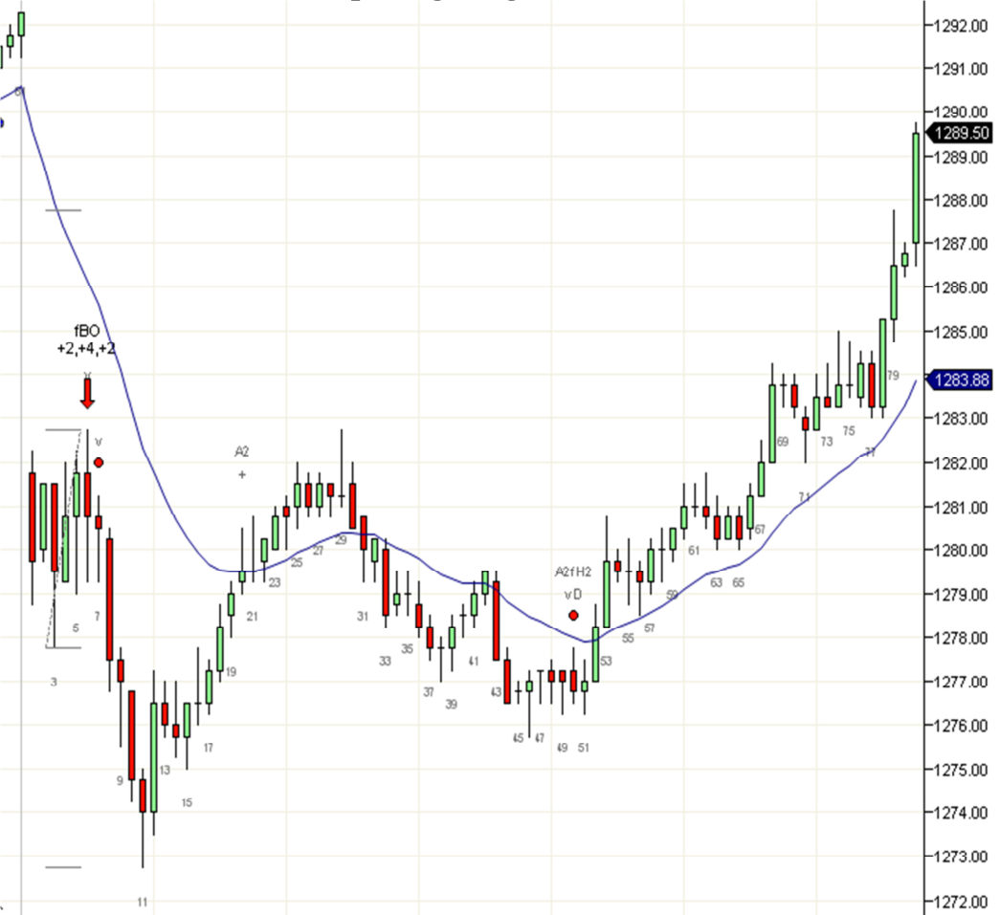

When the day opens with a clear trading range presented by multiple legs, there is a very good chance that any trend attempt away from it will at least attempt to turn back into the range due to the magnetic effect of the consolidation. Often, the trend will reverse exactly at the measured move of the opening range as shown today. If the reversal is successful, then it turns into a extreme of the day (XOD) 1Rev.

A successful XOD 1Rev will attempt to take out the other extreme of the day (b29) and will often result in a BP trend in the new direction. When the breakout attempt is during lunch hour, the pullback could be complex and drawn out (b29-46)

Sometimes, the attempt to turn back fails in a one or two legged move and results in a 1PB resumption of the trend move. The fewer the bars before the pullback, the higher the chances of 1PB resumption of the original trend.

<!-- p.326 -->

## Trading range BO vs fBO

Tuesday, January 17, 2012 · p.326

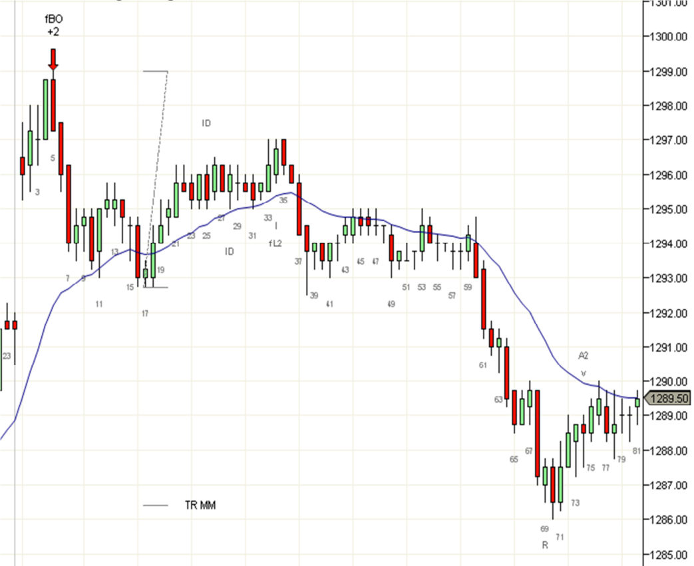

When the price attempts to break out of a clear trading range (b1-17), there are a couple of things that will help us to determine if we should look for fBO trades or BP trades.

Strength in the breakout is likely to result in a BP. Weak BO attempts are likely to result in fBO.

Signs of strength are:

- BO bar is shaved (either end, especially breakout end) (b7, b38)
- BO bar has at least half the bar beyond the breakout point (b7)
- The breakout attempt is a one-legged attempt (b5-b7, b35-b38)
- Second attempt to BO (b38 after b15)

In addition an A2 (b54) is also likely to result in a breakout.

<!-- p.327 -->

## Pause bars after breakout

Wednesday, January 18, 2012 · p.327

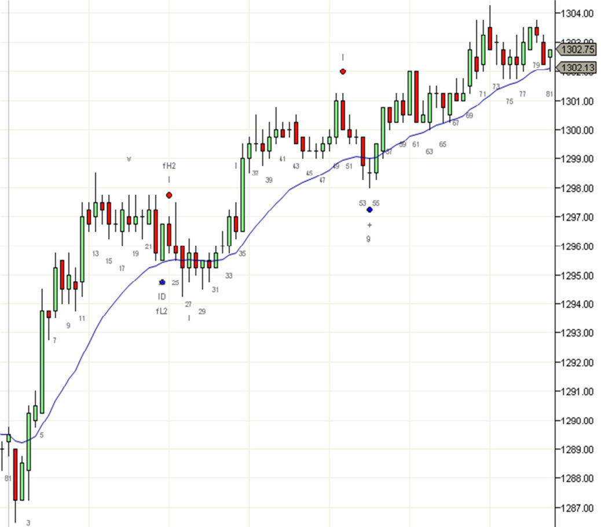

In general, the best entry after a breakout (BO) is a breakout pullback (BP). Some traders enter above the breakout bar and this is dangerous since the pullback could be large, potentially stopping you out. Sometimes there is a small trend bar right (b4) after the breakout bar(b3). This bar could be of either color, but best if its a non-inside bar of the same as color as the breakout bar. You can enter on this bar with a stop on its other end.

The reasoning is that a real strong breakout of a new trend is likely to continue further up before a pullback. Therefore, this is applicable to b4 for example and not b36. Note that the breakout bar preferably has to have a strong close (shaved or 1t). Tails on the breakout bar are likely to cause pullbacks, so you are better off entering on a BP.

If there is no pause bar or if you are uncertain if the pause bar is a proper trend bar, its best to let the breakout progress and wait for the first pullback. A pullback right after the BO bar can be shallow but acceptable as long as you are entering on a strong signal bar. If the pullback is after an extended move, you need to wait for a deep pullback. In today's trend break that would result in an entry above b29 (since b23 is not a deep pullback).

<!-- p.328 -->

## Trend breaks do not imply reversal

Thursday, January 19, 2012 · p.328

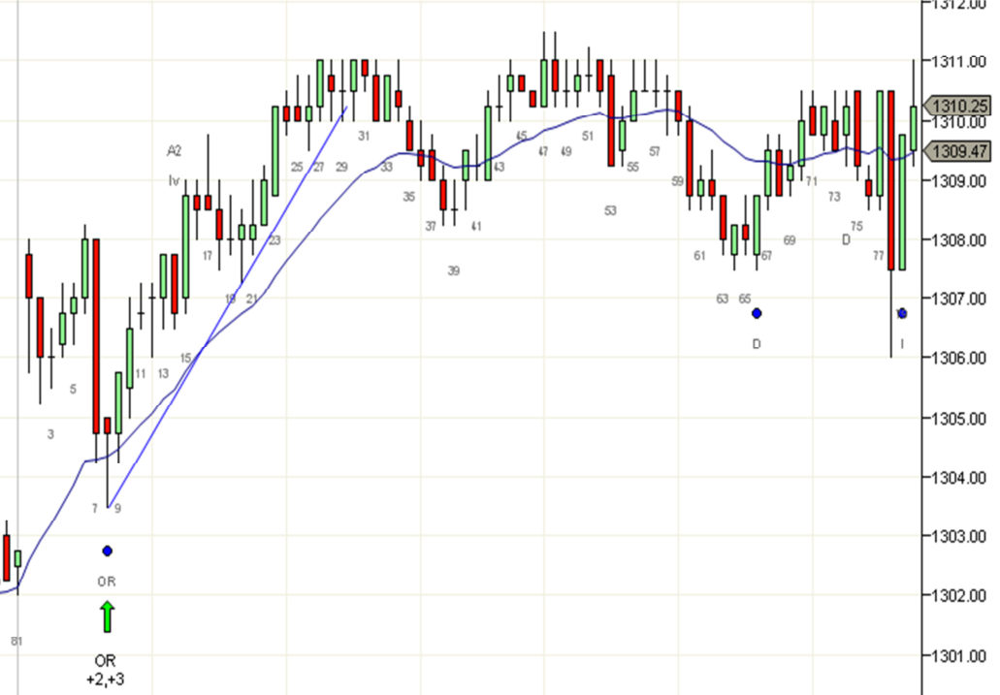

A trend break implies just that: The trend is no more. A reversal of the prior trend needs certain other things to happen. Even a trend break(b31-39) and a test of the prior high (b47) does not imply an imminent reversal. Often in a bull move on the daily chart, intraday moves are often bull trends that break and turn into a horizontal trading range. Today, after the trend break at b39, the price action turned into a series of fBOs that are typical of horizontal trading ranges.

In addition to a two or three legged test of the extreme after a trendline break, average sized, non doji bars are a good indication of a possible reversal. The abundance of doji bars indicates that any breakout (b53) is likely to fail and move back into the range (b54,55). The best entry would be a possible LH after a LL (b56).

Usually, on a small day, its best to stop trading after a trend break if the bars are dojis. Trading ranges are dangerous when the bars are small and you may need to use money stops instead of price action stops. The highest probability trades are usually in the AM and you should always look for a decent 1Rev or 1PB when the daily chart is in a bull mode since you may be unable to trade profitably in the PM.

<!-- p.329 -->

## The first close beyond the ema

Friday, January 20, 2012 · p.329

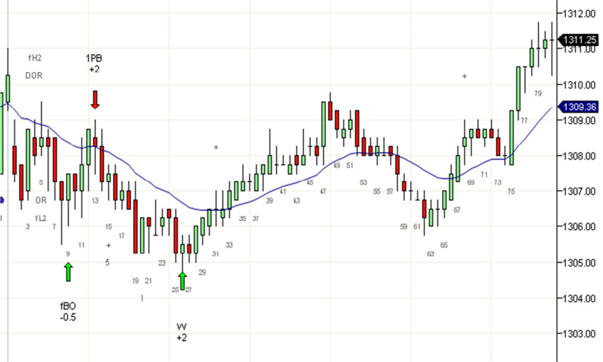

The 20 bar ema is the only indicator Brooks Price Action uses but this gives several signals including G, G2 and A2. In addition there is one tiny bit of information that it reveals thats very useful to price action traders. In many respects, ema is a barrier like a trendline, swing point, high and low of the day or prior day and so is subject to fBO and BP trades. In general, an A2 can be seen as a 2 or 3 legged fBO of the ema.

The ema represents a sort of average price and many traders and algorithms like to enter at a better than average price. So the first time the price touches the ema in a very strong trend, its likely to find support. Many traders (and algorithms) will only make a decision on the close of a bar, which gives us some clues about how the price reacts after closing beyond the ema.

The first close above the ema (b12) should find sellers. This implies any signal bar here is likely to have some follow through, especially a 2 legged LH such as b13. Often, a close beyond the ema is on a strong breakout bar and will result in a small or weak pullback bar (b31). This is a sign of strength and implies continuation. If the close after the ema breakout bar does not close reverse below the ema, it should be always be taken as a sign of strength.

Two or more closes beyond the ema should be seen as a sign of strength even if a pullback bar later reverses the BO (b55), the likelihood of the move continuing at least for a while is high. The only caveat is that BW often fails to obey these rules so its most useful when the market was recently trending.

<!-- p.330 -->

## Reading weak reversal signals

Monday, January 23, 2012 · p.330

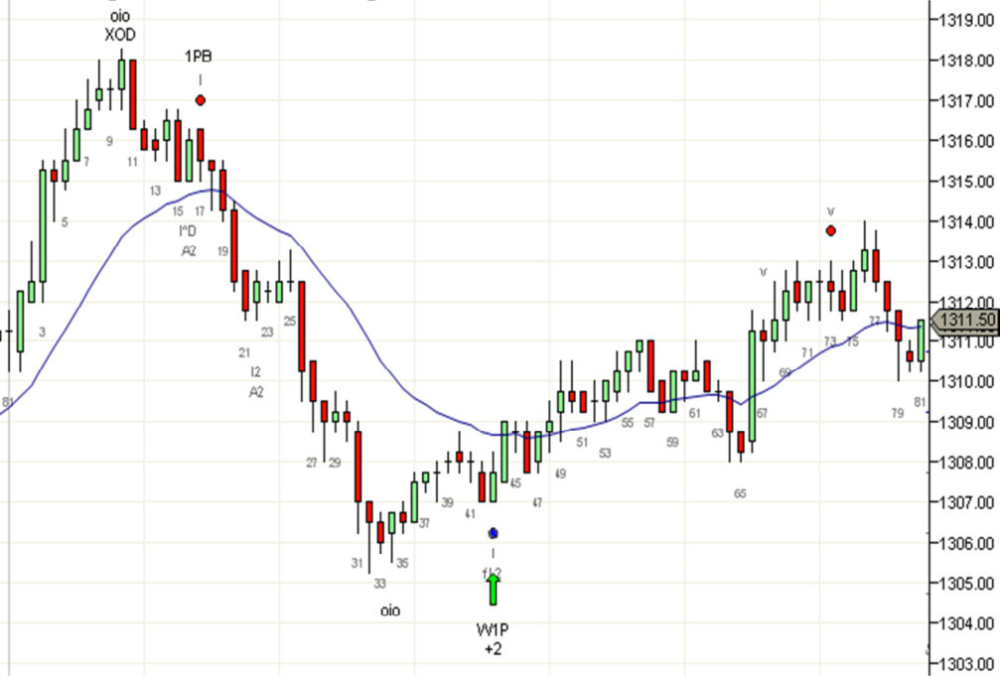

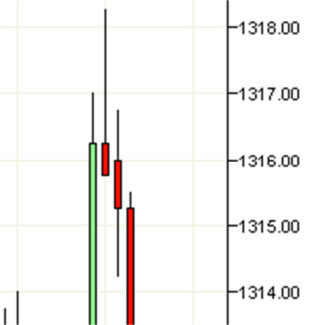

When a reversal signal looks weak, whether its an oio (b8-10, b32-34) or a regular reversal bar, if the entry bar has a strong close (shaved or 1t) like b11, then there is a very good chance it will act like a reversal bar with a strong close. Often, such a bar is a strong reversal bar on a higher timeframe when combined with the strong entry bar as the 30m chart on the left illustrates the opening reversal at b8-10.

2BR (b76,77) can be considered strong as long as the second bar takes out the first bar with a strong close and are of comparable size and not misaligned by more than 1t or 2t if shaved.

When a reversal signal that is poor has a poor entry bar (b28, b70), there is a good chance of continuation.

When the signal indicates a major change in direction (b11,b35), usually its a far safer option to take the first pullback in the new direction (b17,b43). When a signal is ambiguous, the chances of a pullback very soon after the reversal are high.

<!-- p.331 -->

## Signs of counter-trend strength in a gap open

Tuesday, January 24, 2012 · p.331

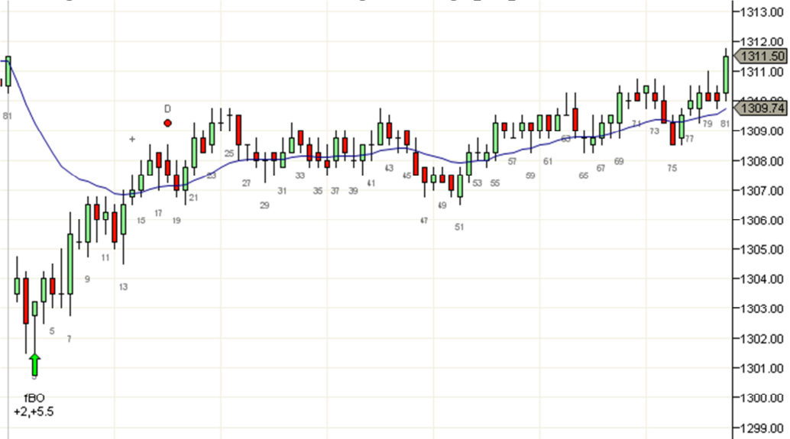

Large gaps tend to widen rather than close, since something fundamental would have changed to cause the large gap. However sometimes a large gap will attempt to close and will trend for the rest of the day, often closing at its high.

The first bar after open (b1) closing opposite to the large gap is usually the first sign of strength. If its an average size trend bar or a reversal bar, its a very strong sign. (If the gap is small, the bar could simply act like a pullback and should not be considered).

A b2 triggers such a b1 and closes strong is a second good sign. If b2 attempts to widen the gap and fails giving an fBO (b3) its also a good sign.

1tfs (b7,9) and 5tfs on attempts to widen the gap are the next signs to look for.

Strong trends will usually have shallow pullbacks and average sized bars instead of deep pullbacks and large bars.

<!-- p.332 -->

## Trading large and outside bars

Wednesday, January 25, 2012 · p.332

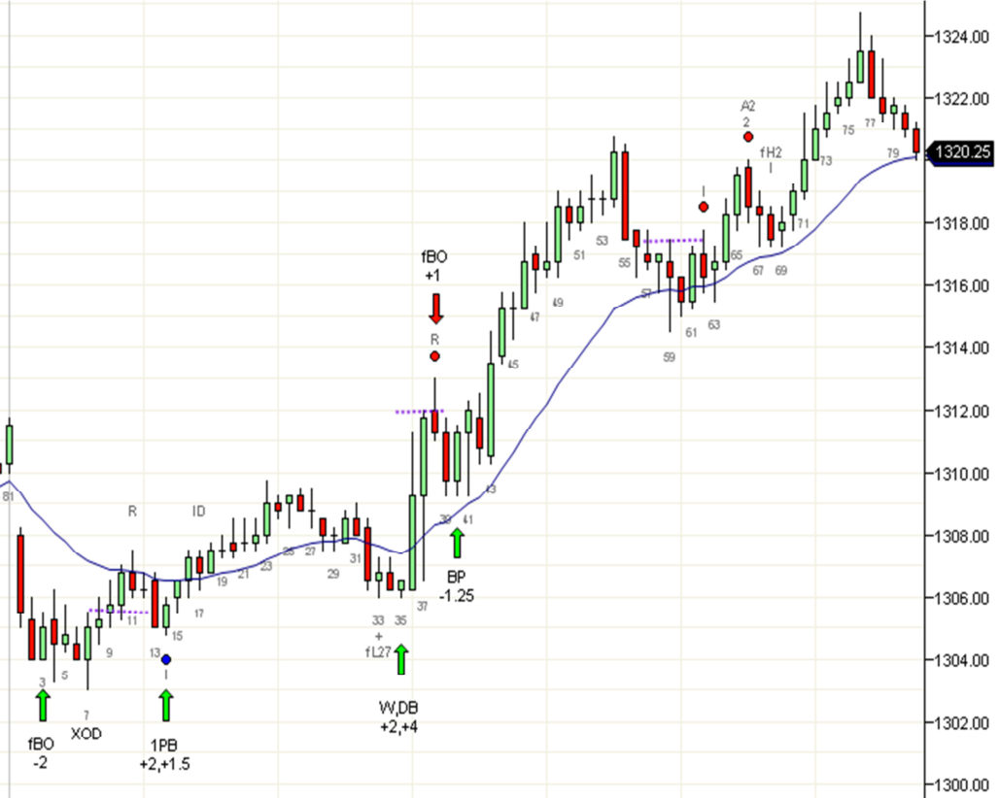

Outside bars often trap traders on both sides and since they have buyers below and sellers above, they are effectively a 1 bar trading range. Large bars are very similar. Any bar thats much larger than surrounding bars should be treated as a 1 bar trading range.

The correct way to trade such a bar is to look for a fBO or BP of the bar. When the outside bar's breakout is relatively strong, you should look for a breakout pullback. If the breakout is weak, look for a failed breakout.

b7 was an outside bar with a strong bull close. Its also a possible mW, so its a good candidate for a BP (b14). b37, which is a large bar also had a strong close but its BO was weak(b38) and could be shorted. However, it right away gave a BP (b40).

The context of the outside bar is also important. You want to buy low (b14) or sell high (b38). b62 is a poor short since its a sell low and also because you are expecting another leg up or at least a test of b54 after the strong move up.

<!-- p.333 -->

## Microtrendlines (MTL)

Thursday, January 26, 2012 · p.333

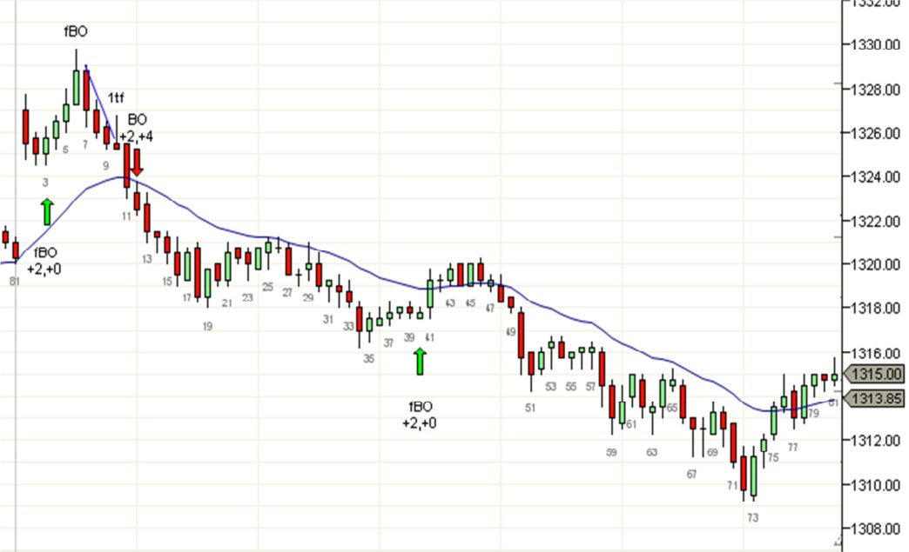

Microtrendlines are trendlines that are drawn on adjacent bars rather than adjacent swings as shown from b7-b9. An MTL right after a potential reversal is often found before a very strong trend. To correctly identify a strong trend from an MTL, the bars forming the MTL should have strong closes. Dojis, bars against the trend, etc. greatly reduce the strength of the MTL and could easily turn into a HL.

A failed violation of an MTL (b10) is an excellent entry. Often this is the few places where you could enter mid-bar on an outside bar (if b10 took out low of b9 for example). However, when it does not, you could still enter below the bar if it has a sufficient sized body and strong close.

If the MTL signal bar is a doji such as b10, you can opt to wait for the next entry such as the small trend bar b12 after a breakout bar.

While technically, you could draw an MTL from b13 to b16, these bars are not all made up of trend bars with strong closes so an entry of the MTL violation (below b18) is not a good entry. Neither is the bull MTL from b73 to b76 worth trading purely on being an MTL.

<!-- p.334 -->

## The most dangerous Price action

Friday, January 27, 2012 · p.334

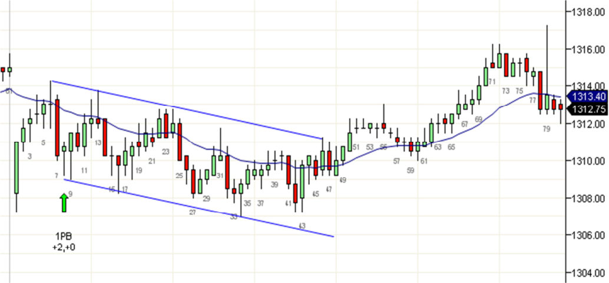

The most dangerous price action bar pattern is barb wire (BW) but the most dangerous larger price action pattern is a wide slightly sloping channel.

BW is fairly easy to recognize and avoid, for example, not many traders would short b40. A narrow channel such as b60-71 is also simple to trade: You can just buy near the low of the channel. However a wide slightly sloping channel such as b7-b43 tricks traders into thinking that a reversal is just around the corner and will force them to buy every new low. Typically, the counter-trend signals (b9,16,28,34,43) look far better than the with-trend signal bars (b6,13,24,31,40) trapping traders on the wrong side every time.

There is no easy way to trade such a channel. The simplest trend trading requirement of buying only higher lows and selling only lower highs would have protected you from every poor signal except b8. The first higher low at b43 actually did work if you used a price action or money stop of 2 points.

A patient with-trend trader would only take a long trade at b60 after the channel trend line was broken at b50 or so.

<!-- p.335 -->

## Opening range: 1Rev vs 1PB vs fBO

Monday, January 30, 2012 · p.335

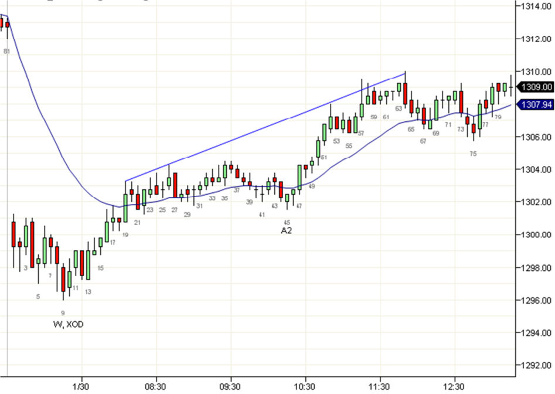

It is important to know the definitions of 1PB, 1Rev and fBO to correctly trade the opening range:

- 1PB is the first pullback after a strong or successful trend attempt
- 1Rev is a strong reversal after a weak or moderate trend attempt
- fBO is a failure to create a trend breakout of the opening range

If we look at b1 today, its clearly a trading range bar. There is no trend yet. Some traders will buy the low of b1 hoping for an fBO. However, this is dangerous since b2 can be a large trend bar that continues the downward move. b2 attempted to break into a bear trend and failed. At this point, we have a fBO. However, its not tradable since the signal bar is weak and we would be forced to buy mid-range. Note that this is not a 1Rev, since only trends can reverse and there are no reversals within a trading range. b3 is a trend bar, but since it did not breach the trading range, its not a successful BO. b3 is not a 1PB since there is no trend and its a bar of the wrong color in any case. If b3 was very high and a bear bar, you would be selling near the high of the trading range and you could argue its a 1PB even though b2 was a weak breakout bar. b4,5 again is an fBO but the signal bar is a weak overlapped doji and is not worth trading. If a trading range is at least 4 points and the other end is at least 2 points away, often the signal will work for about half of it (1 point in this case), but often its just a distraction because a clearer setup is usually just a couple of bars away. b6,7 is an inside bar and a LH after a LH and LL, so a possible trend. However, it would be a very shallow 1 legged pullback after a weak reversal bar b5. You don't really want to sell near the low of a trading range unless its at least a 2L pb. b9,10 is a W reversal and since we have a weak down trend, this can be labeled a 1Rev. Since the reversal was not near HLC of prior day, its not an OR; therefore it is labeled XOD (extreme of the day).

<!-- p.336 -->

## Trend termination (TT): Failed Reversal followed by failed A2

Tuesday, January 31, 2012 · p.336

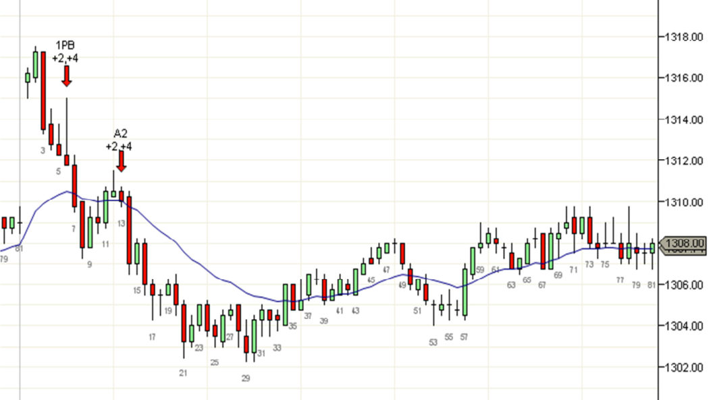

There are primarily three kinds of trend terminations that turn strong trends into trading ranges (rather than reverse the trend direction). The first one is a TTR, where the bars gradually become tiny and dojiish. This is rather easy to identify and is usually seen in bull trends. The second is a double top or double bottom that triggers but does not result in a breakout on the other side. The last one is a failed reversal followed by a failed A2. This is usually the case with the termination of a bear trend.

b22 was an inside bar signal following three pushes down (and a slight TCL overshoot). However, since it wasn't a bull reversal bar, a shaved inside bar near the bottom of b21 or a second entry, its a poor signal and unlikely to attract many bulls. This was followed by two sideways legs and the second attempt to sell off at b27 was off a poor signal bar (a 3t bull doji) in the middle of the range. This is unlikely to attract a lot of bears. This is the earliest indication of a terminated trend.

The 1t nominal new low (1tf) at b29 is caused by the remaining bears exiting at the low of b21 and confirms the end of the trend. From b30 to the end of the day is a trading range composed of small trend legs like all trading ranges. As expected almost all signal bars were very poor and there were no large moves.

---

[← Previous](20-2011-12.md) · [Contents](00-目录.md) · [Next →](22-2012-02.md)
