[← Previous](21-2012-01.md) · [Contents](00-目录.md) · [Next →](23-2012-03.md)

# February 2012

Original pages 337–348

<!-- p.337 -->

## Deep vs shallow pullbacks

Wednesday, February 1, 2012 · p.337

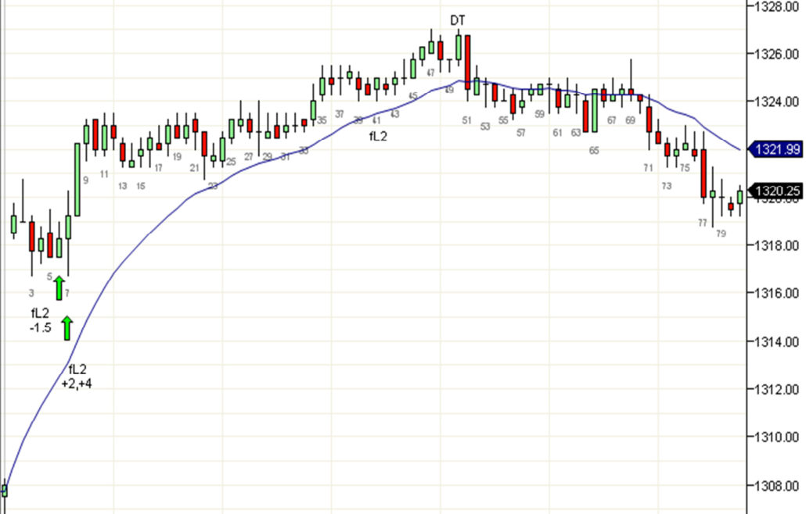

The most successful trades are off with-trend signal bars with strong closes and no overlap in a deep pullback. In particular, they give good swing entries that tend to go to 4 points or more.

The first requirement is that there is a trend. A trend should be fairly easy to spot. If the chart in front of you is moving from bottom-left to top-right or top-left to bottom-right, you are likely to be in a trend. The conventional definition is higher highs and higher lows for a bull trend and lower lows and lower highs for a bear trend.

The second requirement is a strong signal bar. A weak signal bar in a shallow pullback and overlap will work in a soft trend such as the earlier part of today (b23,33,41). However, once the trend is no longer soft, every such signal bar is likely to fail (b57,61,65).

The third requirement is no overlap, because overlaps are trading ranges and their breakouts are likely to be faded. However, if the signal bars are strong and at support, you can take some second entries since they can act like breakout pullbacks. If you are unsure, avoid overlaps.

The last requirement is a deep pullback. A deep pullback ensures there is sufficient room to the previous extreme to allow a profitable exit. For most trades, that equates to about 10ticks for a 2 point profit. However, as long as the pullback is deeper than a recent bar (b69) its likely to succeed with-trend.

Soft trends and hard trends are special in that they dont give deep pullbacks or good signal bars but nearly every signal works. But on the other 80% of the days, these rules will greatly reduce the number of trades you can take and greatly improve your consistency.

<!-- p.338 -->

## Horizontal Tight trading range (TTR) or Dojistan

Thursday, February 2, 2012 · p.338

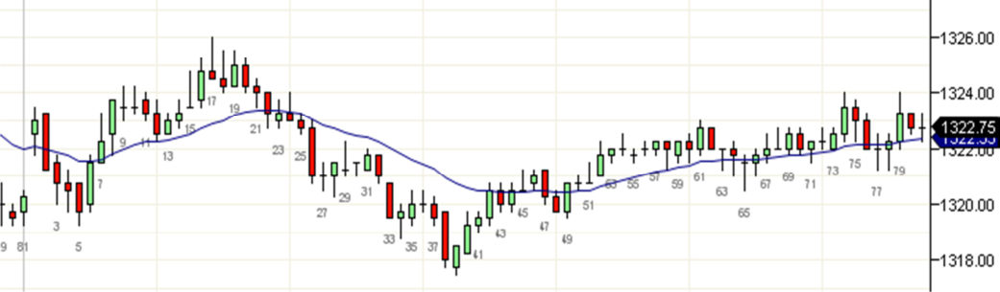

A prolonged horizontal barb wire pattern is nearly impossible to trade and can be labeled dojistan. Attempting to trade dojistan using stop entries will invariably lead to failures.

Anticipating dojistan is simple. The moment you see bars getting smaller than 1 point and when many of them are dojis, you should be cautious. Bars that are two ticks tall such as b55 are early warnings that indicate possible dojistan. Note that any bar thats 4t or smaller should be treated like a doji while in dojistan and is usually not a setup bar (b59, 62).

The only possible approach to trading the dojistan is to fade trend bar breakouts. By definition, dojistan is a tight trading range. Since most breakouts of trading ranges fail, you could simply sell the close of a trend breakout bar with a stop 1t beyond it. So for example, you could short b61 close and b74 close on limit.

The best approach however, is to do nothing. The one or two points you could make in a dojistan are not usually worth the risk and the energy you would need to put into it. Better price action is coming shortly, so just wait for it.

<!-- p.339 -->

## Trading range as a series of fBO

Friday, February 3, 2012 · p.339

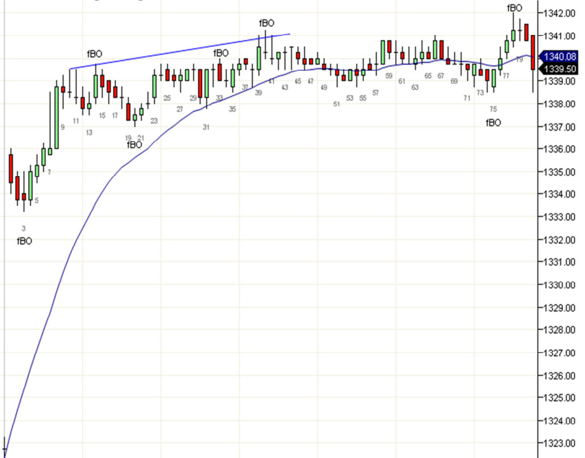

If trends can be seen as a series of breakout pullback, then trading ranges are a series of failed breakouts. I normally avoid trading fBO unless the range is wide enough to net an acceptable profit. In general that means if you like a profit of about 2 points, you want the range to be twice as much, i.e. 4 points.

The reason is that many fBO trades will fail to go to the other end of the range (b33,b40). Thus narrow trading ranges cannot be profitably traded using stop entries with consistency. Even weak wedges such as b40 are usually not worth trading.

The quality of signal bars is very important in entering any trade as it is directly correlated to success rate. The quality of the bars around the signal bars is equally important. On a chart with mostly well formed bars, you can take any decent signal bar but on a barb wire chart you cannot expect a move large enough to justify a trade.

But eventually, the market will move out of the tight range and create bars that become tradable (b75-81). If this occurs with sufficient time before the close unlike today, you can look for high probability trades.

<!-- p.340 -->

## Liquidity effect

Monday, February 6, 2012 · p.340

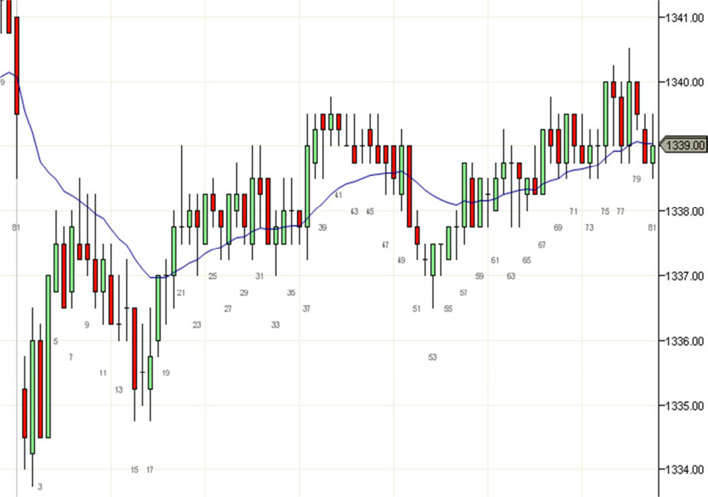

Stampedes are caused by a large number of people running in the same direction. Any lone person standing in their way will certainly be trampled. This is essentially what a trend bar is. A large number of traders advancing in one direction.

When a stampede encounters a stampede in the opposite direction, the crowd usually wont go anywhere. There may be some pulling and pushing but nothing really happens. These are small doji and other trading range bars.

On thinly traded instruments, liquidity is low and even small number of people can stampede without encountering resistance easily (until they tire and rest). This is why the thinner the instrument, the more volatile it is. Liquid instruments however, move very slowly and small days are a necessary component of their overall move.

Price action within these small bars are murky as the chart today shows. There is pushing and pulling from both directions and one of them has to give very soon.

Even on a day like this, the best moves are simply bars with strong closes on deep pullbacks (b53). With the usual exception of 1PB (oio at b17), the best trades are usually with-trend, deep pullbacks on a strong close.

<!-- p.341 -->

## Trend termination (TT): TTR

Tuesday, February 7, 2012 · p.341

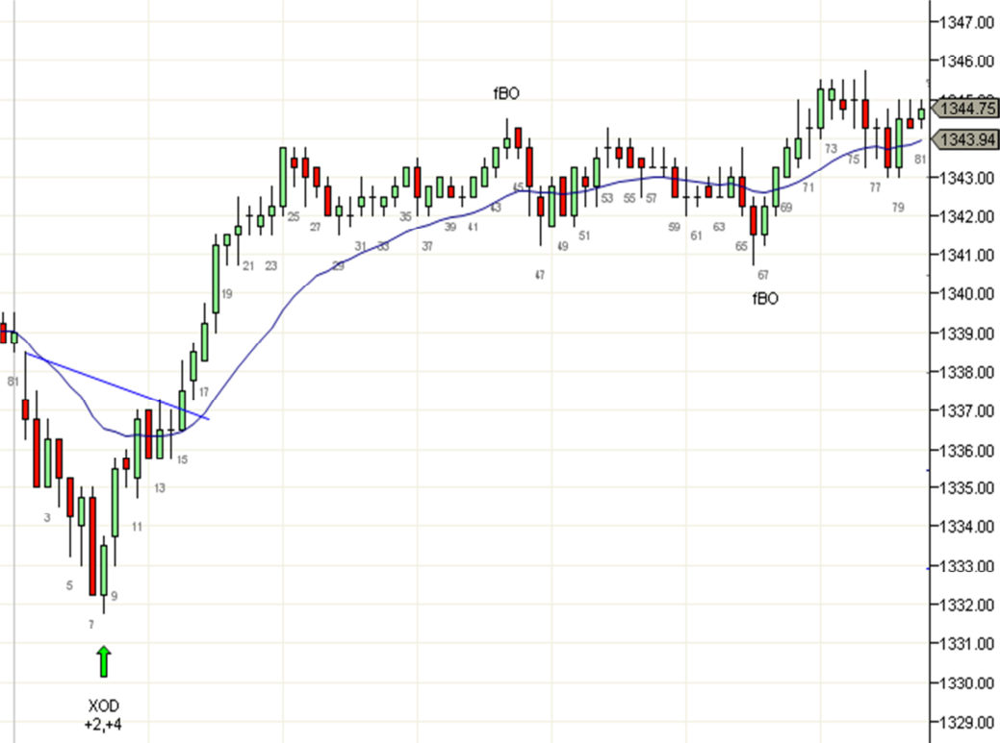

We clearly know that when a trendline breaks, the trend is over. There could be a reversal if the break was strong and if not, a trading range. Often the trendline break is obvious even when a trendline is not drawn on the chart. For example, today, b46,47 broke the trendline decisively.

If you were holding a long position, when do you get out? You could wait for a test of the high and get out at b70, but you would need to hold for most of the day just to get a good price. You could also perhaps exit on any strong bar such as b50 or exit on the next L2 such as below b55. However, it does not save you much time.

Ideally, you would exit on the close of b24. How can you predict the trend move will not go much further for a while? A trend by definition should have mostly trend bars. When the bars turn into a TTR (b19-23), there is a good chance that the trend is nearing termination or at least a deep pullback. Any strong bar after it is a very attractive exit for someone who bought the reversal at b8.

Usually, there is a second chance if the move up was very strong (no deep pullbacks). You could also exit at the high of b24 or a tick below it and would be filled at b44.

Remember that trend termination is not reversal. Its just an indication that the best option is to exit your positions and wait for a fresh trend to break.

<!-- p.342 -->

## A2 variants on small bar days

Wednesday, February 8, 2012 · p.342

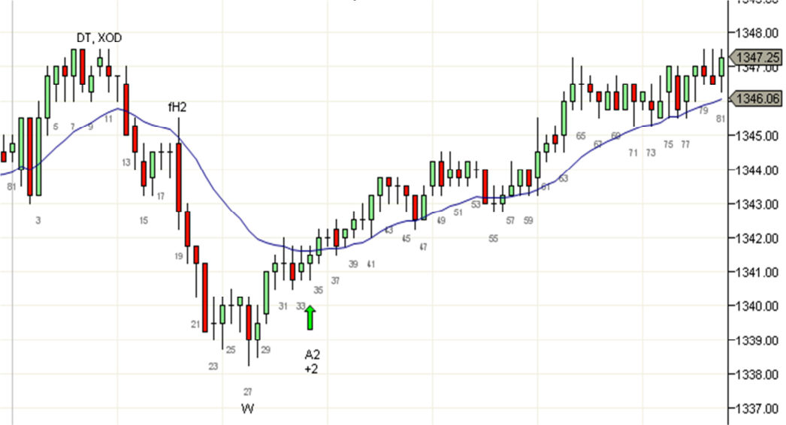

When bars are relatively small, A2 can form that are hard to read and enter. This is particularly true for the first pullback of a new trend since its hard to anticipate. There are two methods to attempt to read these.

The first is a fH2 or fL2. When a trend has just started and the first pullback is near the ema, if it attempts and fails to move against the trend twice, you have an fH2 or fL2. For example, b17-b19 was an fH2. If b19 was a smaller bar (even if it was an outside bar) it would be an acceptable entry. When the bar is larger, the risk of a large pullback reduces the probability of success of entering on an outside bar, even when its an fH2 near the ema.

The second is an A2 variant where the first attempt is an inside bar. For example, b33 was an inside bar with a higher low and higher close. This makes it an H1 and the next attempt above b35 effectively makes it an A2.

The most important precondition is that a trend should exist or have recently broken out. The DP at b13 is a trend generator, so the next fH2 is a high probability trade and the W at b27 reverses the trend and therefore the A2 at b35 is a high probability trade.

<!-- p.343 -->

## Trend termination (TT): Double Top

Thursday, February 9, 2012 · p.343

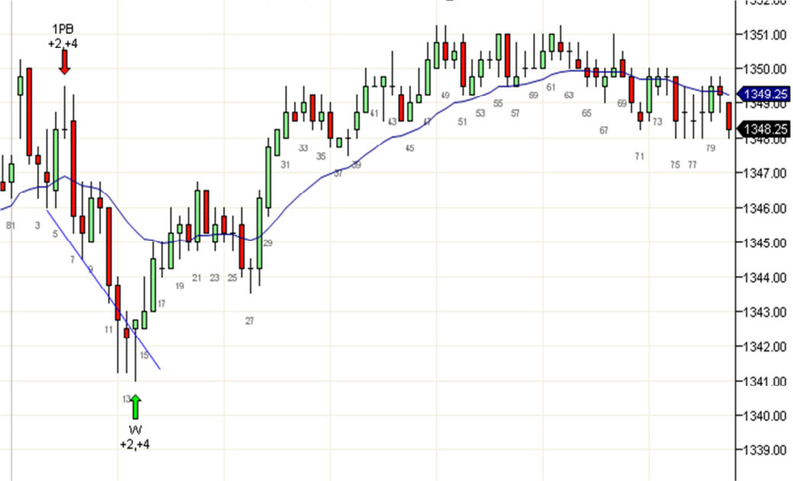

The first pullback in a new trend is usually the deepest and the following pullbacks get shallower. As pullbacks get shallower, they attract fewer new buyers since profitability of buying a pullback is proportional to the depth.

Eventually, the pullbacks are so shallow (b52, b58) that they do not find buyers and early buyers will exit near the high. This will lead to a double top or double bottom and terminate the trend.

Since this is a termination and not a trend reversal, you would need to wait for a new trend to break out before entering a new trade or only trade fBOs.

<!-- p.344 -->

## Narrow range days distort your perception

Friday, February 10, 2012 · p.344

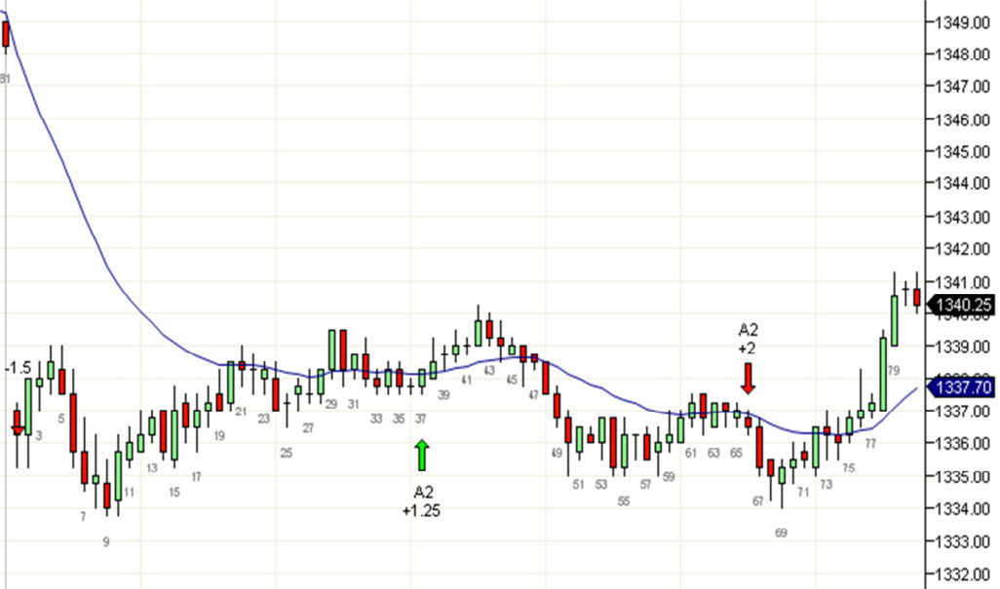

Narrow range days are typically terrible for me and force a lot of errors. I have learned to cope by sitting out most of the day. If the first two hours have a range of 6 points or less, its best to be very cautious and only scalp every trade. The reason is simple. The tight range will act as a magnet and will cause any breakout to fall back into the range.

One of the hard things about trading a narrow range day is that it distorts your perception. For example, b37 was a possible BP trade with b29 being a possible BO above HOD. If the range was wider, it would be fairly obvious to trade only shorts near the upper part of the range and b37 would be a poor decision. Similarly, the second fBO at b43 may have broken into a trend and b66 is a possible A2 but if the range was wider, it would be obvious that b50-65 was a horizontal flag and a possible FF.

Tiny bars, shallow pullbacks, poor signal bars distort your perception and force many incorrect reads of patterns and signals and the narrowness of the range reduce profit potential and probability of every trade.

<!-- p.345 -->

## When reversal bars dont trigger

Tuesday, February 14, 2012 · p.345

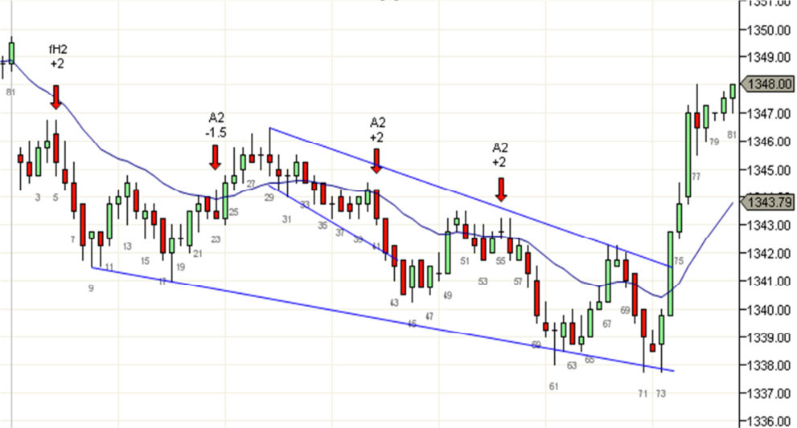

Shallow sloped, wide channels fool even the best traders into thinking a reversal is just around the corner. There are some ways to guess if a reversal would fail and one of them is that a reversal bar with a strong close refuses to trigger. Today for example, b9, b18,b45 refused to trigger despite having strong closes. This usually means that sellers are selling the close of the strong bar instead of buying it. It also shows lack of confidence on the buyers side and you should look for continuation trades in the original direction.

An overshoot of the TCL and a strong signal such as the oio at b73 is an essential requirement to take a reversal trade with any hope of success.

<!-- p.346 -->

## When reversal bars don't trigger - II

Thursday, February 16, 2012 · p.346

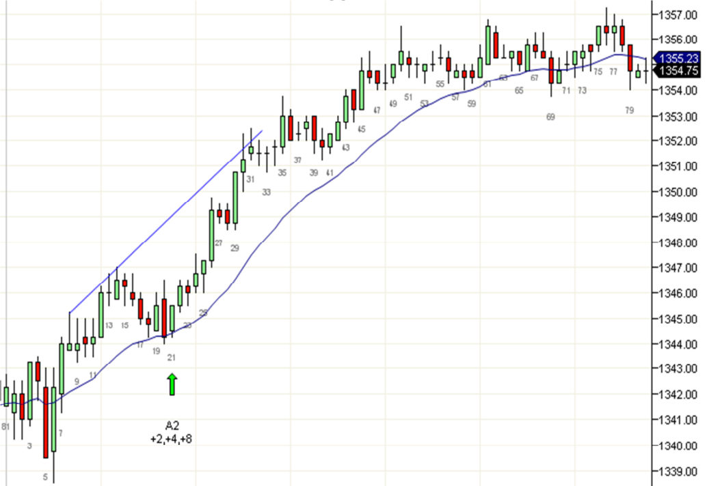

One of the surest signs of a strong trend is that reversal signals will have no takers. This is because traders find the bear close to be a buying opportunity and in most cases, you should cancel an order if it does not trigger from the signal bar. For example b36,37 was a possible sell signal after 3 pushes up, However, since it did not trigger, you should consider going long instead. This would allow you to buy above b41, a strong close after two legs down in a strong trend. Similarly b62 was a possible 1tf after a shallow TL break making it a major reversal candidate. But since it did not trigger, you should not go short. However, due to the trend break, you should not look to go long either.

The right course of action is to wait till the range is 4 points or larger and then trade fBOs or wait for a BP or other new trend.

<!-- p.347 -->

## Choice of trading instrument: Is thinner better?

Friday, February 17, 2012 · p.347

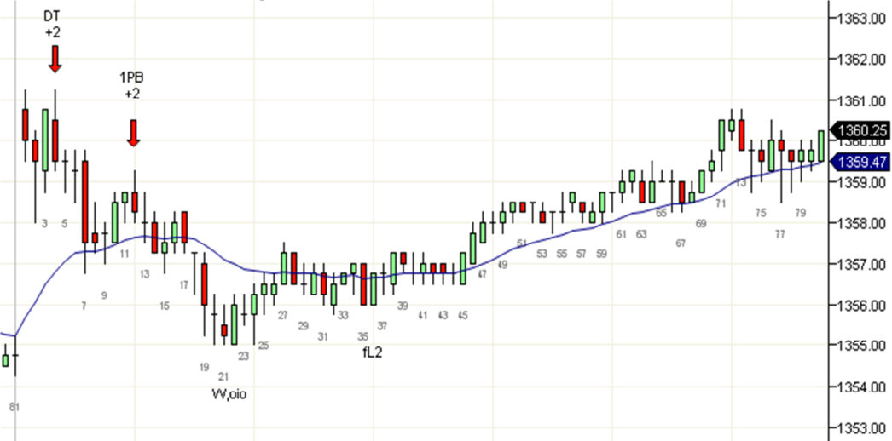

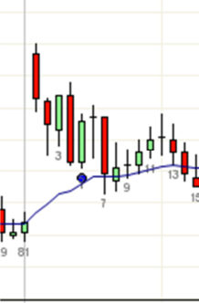

A highly liquid instrument such as ES can form tiny bars and give weak moves. A thinner instrument such as TF (shown left) usually shows clearly formed bars and often results in strong moves. So what should a new trader trade?

An experienced and profitable trader can probably trade any instrument with some adjustments to his technique. Some momentum type trading also works better on thinner instruments.

For a new price action trader, the correct answer is the more liquid instrument. Why? For many reasons, but mainly because while the bars look great on a thinner instrument, the information they carry is unreliable.

Take b5 today. It was a doji on ES but It was a nice strong bull bar on TF. At first glance it may look like a 2 legged move to the ema or otherwise a sign of strength. The bar triggered and stopped out buyers. On the other hand b5 was a doji on ES and more important, it did not trigger. Shorts below b4 did not get their stops taken out. Pullbacks after entry are of acceptable size. Stops on thinner instrument need to be larger and unless you are capable of consistently taking targets larger than your stop, you should avoid trading thin instruments.

A new trader should not focus on making money but on doing the right thing and trading correctly. Once your percentage of wins is high, you can simply trade larger size to make the same amount of money that a thinner instrument would provide.

Once your size increases, (a good problem to have) you may not be able to trade thin instruments without significant slippage. That said, a thinner instrument with a small tick size such as NQ is often a good choice for new traders.

<!-- p.348 -->

## Breaks of Steep trends

Monday, February 27, 2012 · p.348

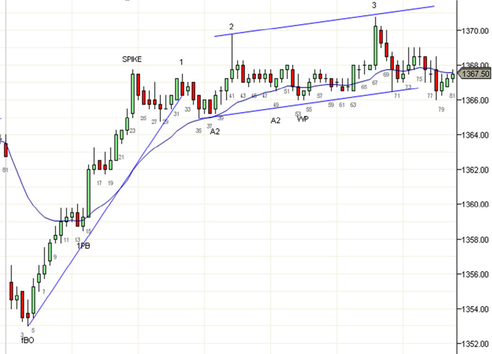

When a trend is very steep such as the move from b5 to b23, the entire move acts like one leg and often act like a spike and channel with the channel acting like a second leg to the spike. Typically, most of the momentum is exhausted at the spike, causing the channel to be comparatively shallow in slope.

Since the channel is a W, you should expect 3 higher pushes and then a test of the channel start (b35 low) which could occur in the next day.

Since the channel is a weak trend, if its wide enough to trade, you can still take A2 and other deep 2 legged pullbacks until the third push is complete.

---

[← Previous](21-2012-01.md) · [Contents](00-目录.md) · [Next →](23-2012-03.md)
