[← Previous](22-2012-02.md) · [Contents](00-目录.md) · [Next →](24-2012-04.md)

# March 2012

Original pages 349–360

<!-- p.349 -->

## The first bar: Trend bar

Monday, March 5, 2012 · p.349

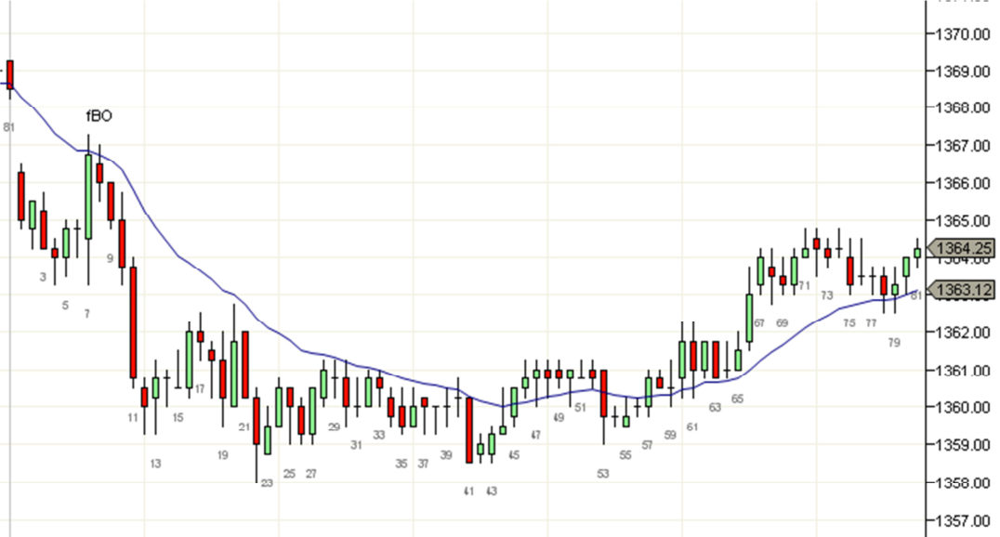

The first bar, regardless of appearance should be considered to be a 1 bar trading range. Most traders would agree that two opposing trend bars make a trading range. This is true everywhere and when there is only one bar, you dont have information about the second bar to assume it would be continuing trend bar.

When the second bar is an opposing bar, regardless of appearance, chances are very high that what you have is a trading range. A buy above b2 would therefore be a buy mid-trading range, which is a low-probability trade. You need to buy near the low of b1 for a higher probability setup.

The right approach to trading two opposing bars would be to treat it exactly like any other trading range. Fade a weak breakout or enter in the same direction on a breakout pullback. So if b4 had a strong close near the low of b1, it would make a nice second attempt to fade b1.

<!-- p.350 -->

## 3 small pushes: Channels, Micro-wedges and wedges.

Tuesday, March 6, 2012 · p.350

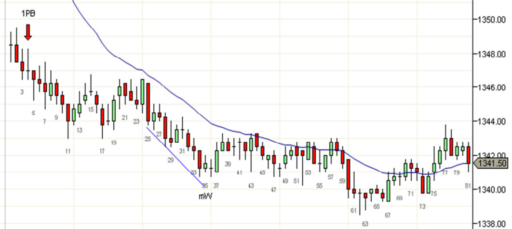

Three pushes in the same direction should not be automatically labelled a wedge. All three pushes do is to terminate a leg. After termination, the move could continue after a pullback or move in a horizontal trading range until a fresh breakout.

For example the channel from b2 resulted in three small pushes (b5,7,11), which resulted in a termination of the leg. The micro-wedge (b13-15) terminated the counter-trend leg.

The weak wedge (b26,29,34) terminated the second leg of the full move down from b2 and the price moved horizontally in a trading range for several bars.

The key takeaway here is that none of these three pushes were automatically tradable. the channel to b11 continued after the pullback to b24. The mW to b15 continued backup after a two bar move and the mW or small W to b34 simply terminated the trend without any clear direction.

A wedge needs to be very strong and end with a clear reversal bar for a high probability reversal trade. Even then, most traders are better off entering on the first pullback after the W reversal (W1P). If you are in the old direction, You should consider exiting on the third push near the TCL (b11). or you could wait for the bar to close and exit on its close if the bar has a strong close (b34).

<!-- p.351 -->

## Preferring deep pullbacks

Thursday, March 8, 2012 · p.351

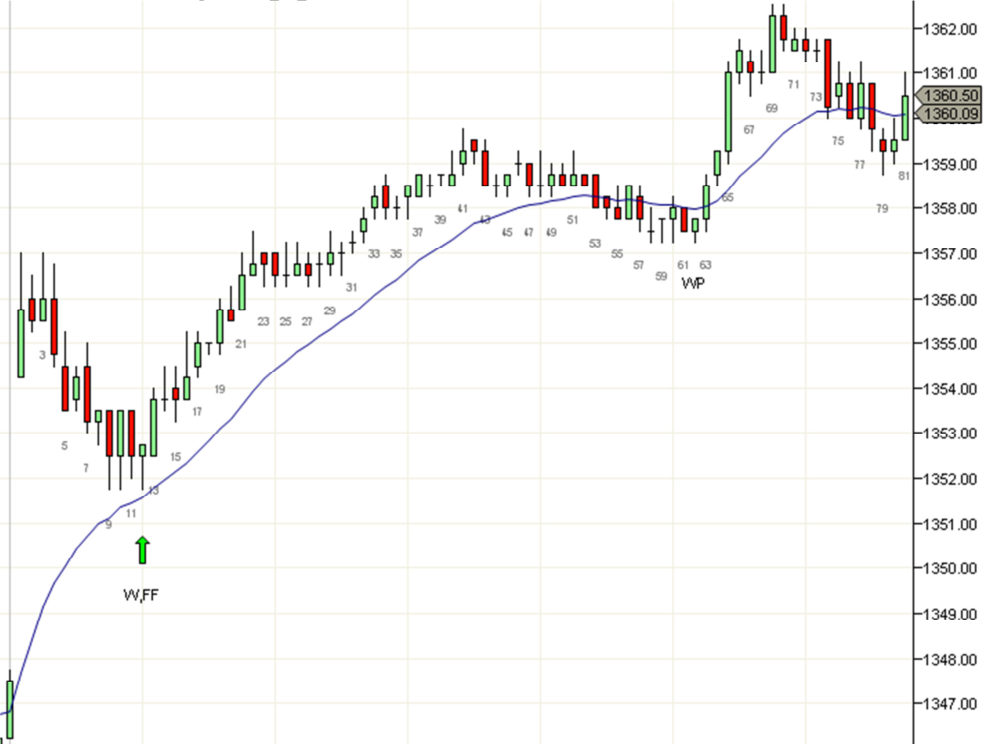

The most important skill to master trading with trend is selection of the appropriate pullback to enter on. Depending on where you are in the trend, you have a few options. For example, let us suppose you determined that the W move and FF to b12 ended the bear move and is setting up a reversal of the opening trend. If you did not buy b12, you could always enter on the very first pullback. b15 high was lower than b14 on the March contract and you could have bought above it. i.e, Shallow, 1 legged pullbacks are acceptable right after the trend begins.

Often you can also buy the first 2 legged pullback. For example, b28 was the first 2 legged pullback and in this particular case, there is always the risk that the breakout above b1 would fail and give a deeper pullback or reverse the move up but in many other cases, the first 2 legged pullback of a strong move often works even if its not deep. Normally, I will not trade a pullback that's not deep even if its the first 2 legged pullback. Exceptions are when its a soft-trend day, when the pullback is at ema and the signal bar is strong. b28 presented none of those conditions. But what you definitely can buy is the first deep pullback. All shallow pullbacks (b15,18,28,30,35,39) can be considered part of the same larger leg and the first deep pullback should usually gives at least one more leg in the same direction.

A deep pullback is one where the pullback is at least 2 points from the extreme of the day and deeper than the size of at least one recent bar. Breakouts of deep pullbacks, (especially the first) are stronger and fill your targets quicker with a smaller risk of pullback to your entry price. This makes them excellent swing entries. If the breakout from a deep pullback goes much beyond the previous extreme, the chances of the trend terminating on a test of the prior extreme diminish and you can take the next deep pullback with higher confidence.

<!-- p.352 -->

## Anticipating DP setups

Friday, March 9, 2012 · p.352

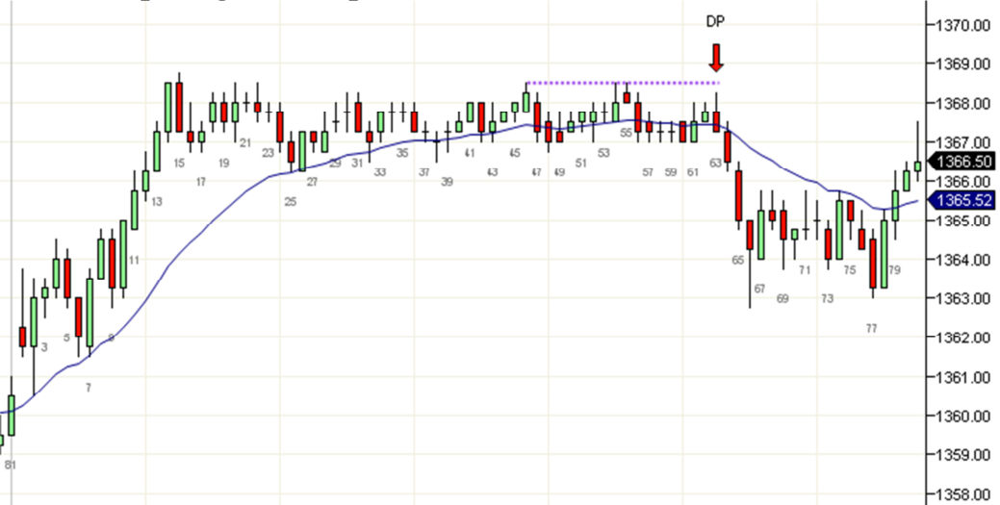

A prolonged horizontal move breaks a trend, but you dont need to wait that long to detect a trend termination. Any poor reversal (b66) followed by a poor A2 (b71) is sufficient criteria. Any cluster of dojis after a pullback starts (b15-b23) is usually also sufficient to declare a trend termination.

At this point, you are in a trading range and no longer in a trend. Any A2 or other continuation trade is likely to result in failure. Even if you missed reading the termination, entering only on strong signal bars would protect you from poor setups. For example, b26 did not trigger, b32 was a bear doji, b38 had a doji before it, b52 is an iii in BW. None of the buy setups were acceptable, so you wouldn't be buying them.

Sell signals were pretty poor as well, most triggering off bull bars or had dojis preceding them. The first acceptable sell was b55 inside bar and the next attempt was b63. A simple filter of not selling before a 1 legged close below the ema (b47) would have also kept you out of trouble.

At some point you would figure out that the trend has ended, regardless of your method of determination. At that point, you are waiting for BP or fBO. A DP is a kind of fBO that results from two failed attempts (b46,55) to break a barrier (b22 high) and a third attempt (b63) that falls short of the prior two attempts.

So while the DP at b63 is clear, its important to note that b32,38,51 is not a DP long. The reasons is that DPs only fade trading ranges and never extend them. So if the TR is narrow such as the horizontal move today, there's a very good chance that any DP like setup to go long will fail. A DP to go short however is more likely to succeed since the move up simply has brought us to the top of a trading range.

<!-- p.353 -->

## Trading FOMC

Tuesday, March 13, 2012 · p.353

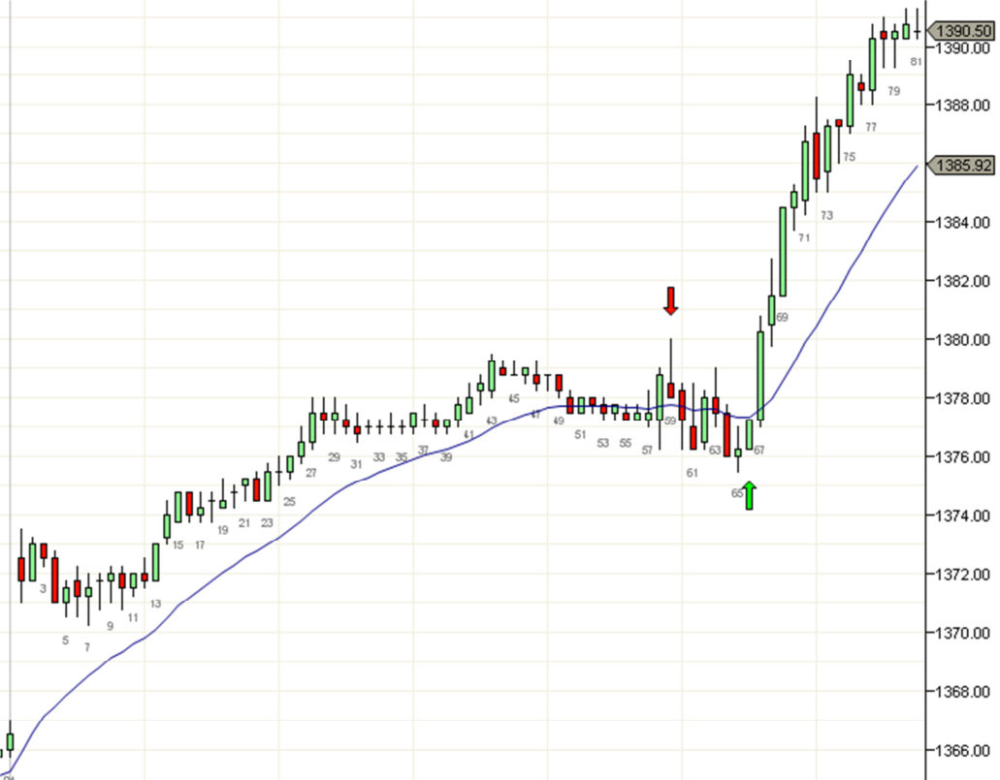

Trading FOMC is rather tricky. I used to trade breakouts of prior swing points during FOMC before I was a price action trader but have since moved to the more accurate method of treating FOMC initial bars as a trading range and trading their fBO and BP.

For example, the actual FOMC announcement resulted in b58, which was a large outside bar. Such a bar is a trading range and its BO can usually be faded. b59 was a rather weak bar with a small body compared to its tail size but had a strong close. If this bar was near the high of b58 it would be ideal since it would not force a short mid-TR.

On the other hand a 2L fBO at b65 provided an fBO entry on the other side of b58, which resulted in a large rally.

Note that not all FOMC announcements result in large moves but when they do, its usually a good risk to reward ratio. I recommend fixed size stops especially for large bars to limit your losses.

<!-- p.354 -->

## Kryptonite days

Monday, March 12, 2012 · p.354

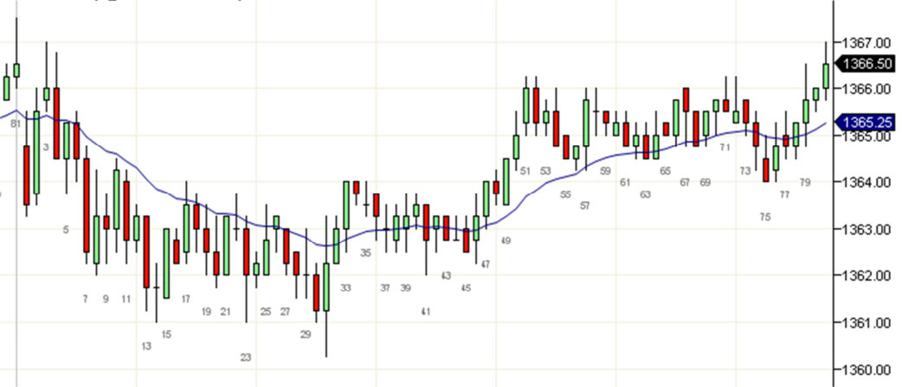

A trader eventually graduates from having mostly losing days with a few winning days to the inverse: mostly winning days with a few losing days. But the losing days are likely to be disproportionally large. This happens occasionally due to the trader not being physically or mentally in top shape on that day due to lack of sleep, illness, relationship issues etc. But usually, this is because the trading system has a real weakness under certain kinds of price action that has been exposed by the market.

If you find yourself at this point, you are probably already a break-even trader. If you can tame or eliminate these disastrous days, you probably already made it as a consistent trader. The first one or two disastrous days can be pretty devastating. This is because your initial success has encouraged you to increase size and your growing P&L has given you an enormous confidence boost. This probably meant you traded large size and re-entered every time you lost and at the end of the day were shocked to see a week or two's profits wiped out.

The very first thing you need to ask yourself is if you have lapsed into old habits. Confidence and a high win-rate can make you feel invincible like Superman and you may have lapsed into your old habits. Eventually Superman is taken down by Kryptonite. If your discipline has been good and you haven't yielded to the temptations of poor habits, there is a good chance that certain kinds of price action may simply destroy your success rate.

For example, today's wide slightly sloping channel is a kryptonite to AM trend traders such as myself. Narrow range days are also kryptonite for traders who like to take 2 points or larger on each trade. Overlapping signal bars are kryptonite for traders who like to enter on stops with a price action stop. Today was all three and if you know your kryptonite you can avoid it by not trading. Similarly, trend days are kryptonite for traders who like to fade every breakout. Soft-trend days are kryptonite for traders who rely on only patterns for their trading decisions. Hard trend days are kryptonite for traders who take every reversal signal and so on.

The key is to know what kind of price action is unsuitable for your style and avoid trading on that day. Since realization comes too late, the best course of action is to exit after a certain number of losing trades on any day. Barring this, the second approach is to not take another trade for at least two swings after you are stopped out.

With experience, it may be possible to recognize the kind of price action and switch to a different style that's conducive to the current price action.

<!-- p.355 -->

## The ideal first reversal

Thursday, March 15, 2012 · p.355

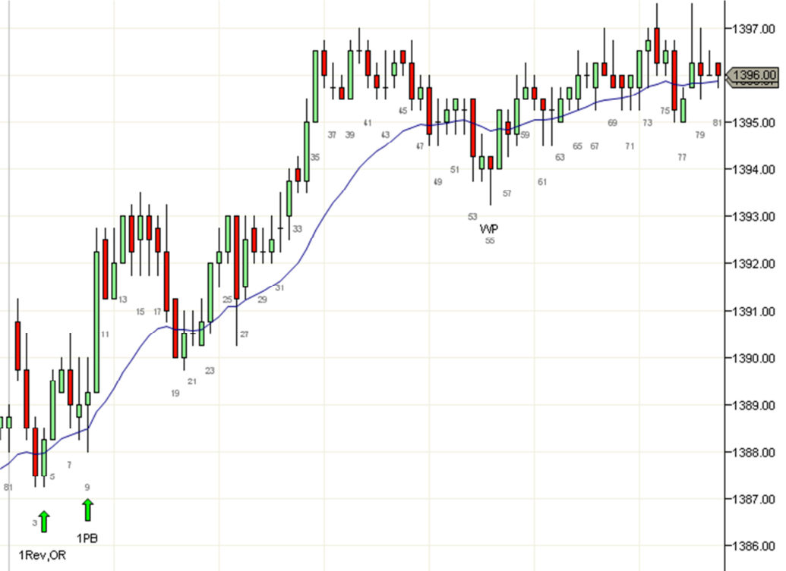

The simplest to read kind of first reversal is a trend move from open consisting entirely of trend bars that penetrates a support such as HLC of prior day or ema (today was both C of prior and ema) and gives a reversal signal.

If the reversal signal is weak (for example, it has a large entry side tail or is a bar of the wrong color), it is likely to take out the low and try a second time.

Such a 1Rev is often the low of the day and will close near its high so its a good candidate for a day long swing. In practice, if you get a very sharp move (b31-35) that looks like an overshoot and gives a decent profit, its a good practice to take some or all off and wait for more price action.

<!-- p.356 -->

## First bar: doji - Tight days.

Friday, March 16, 2012 · p.356

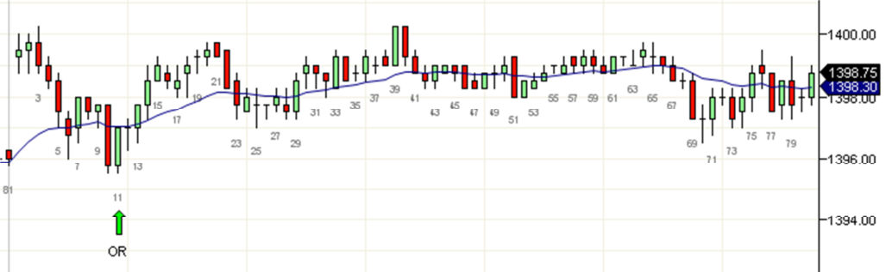

A doji first bar can give a diverse range of days from tight ranges such as today to large trend days and wide trading ranges.

A tight day such as today is extremely dangerous to trade if your first target is 2 points or larger. Halving your target is poor risk management since you cannot practically also halve your risk. So a 6t risk with a 4t profit potential requires far higher probability of success and even then the rewards are usually not worth the pursuit.

Any trend attempt that rapidly degrades into doji bars (b16-20) should always raise suspicions of poor trading action and you should sit out until the bars become normal or price breaks out. Most bars after the initial move were in a 3 point range and the probability of success of price action entries is extremely low so its best to sit out.

<!-- p.357 -->

## Simple 1PB

Monday, March 19, 2012 · p.357

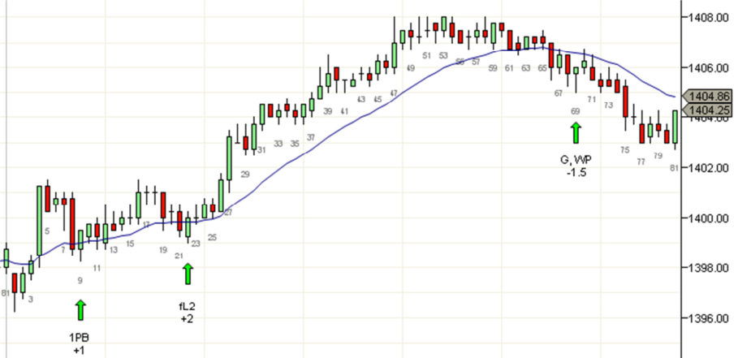

The simplest 1PB consists of a trend move from the first bar, i.e., at least two trend bars that break beyond the first bar (b2-b4) and then a pullback to a higher low. If the bar that began the pullback is a reversal bar (b5), then its best to take a 2 legged PB or a second entry. A mW such as b6,7,9 today can also act like a 2L pb.

Factors strengthening the 1PB signal are:

- A two legged PB or a mW PB
- strong close on signal bar
- signal bar not too large
- signal bar at ema or trendline

A 1PB that takes out the prior extreme of the day in one leg can often be held till the end of the day. A 2 legged move however often stalls or reverses at the extreme of the day and its best to exit and wait for the next signal.

<!-- p.358 -->

## The first opposing trend bar in a channel

Thursday, March 22, 2012 · p.358

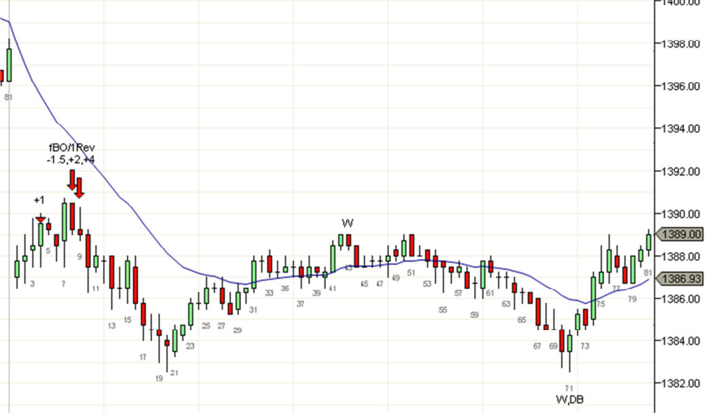

A channel provides few entries and can drag for many points. One of the most reliable entries in a channel is to fade the first opposing trend bar (b15, b27, b60). You can usually sell the close on limit with a tight stop say 2 or 3t. This works particularly well if there were no opposing bars since channel inception.

The reason it works is because this is essentially a first channel breakout that you expect to fail. Note that you need a trend bar with a strong close. A doji such as b57 or a weak close such as b11 is usually not reliable. Often this is just an optimization since you get a signal right after (b16, b30, b61) and you can simply choose to trade it with a normal stop entry.

<!-- p.359 -->

## Signs of an extremely strong trend

Monday, March 26, 2012 · p.359

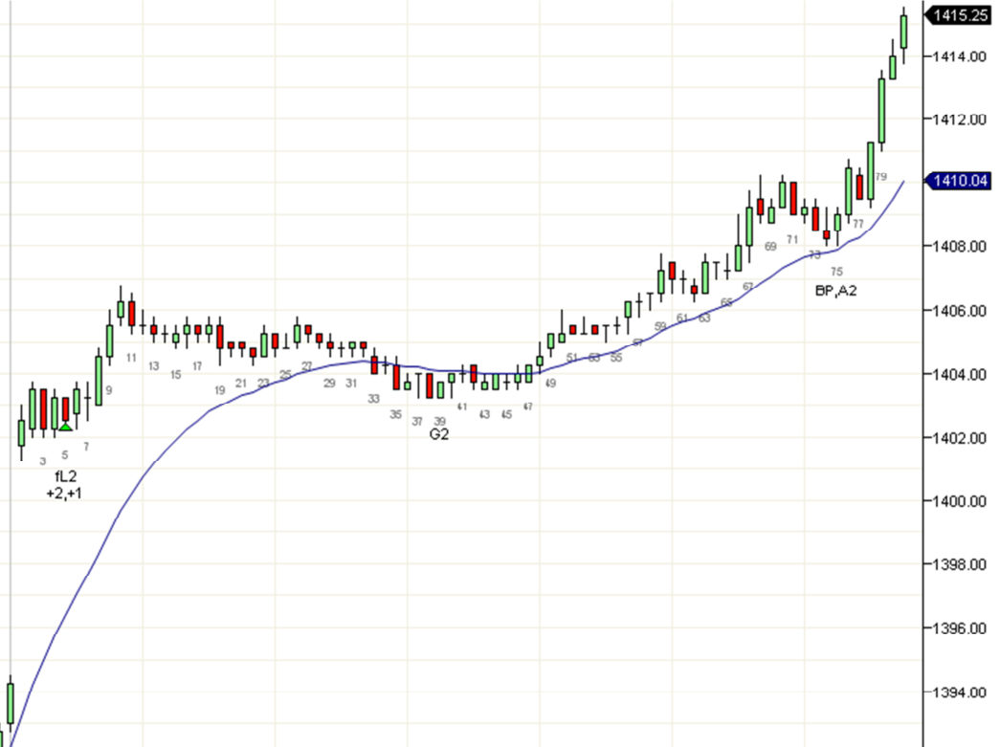

When the prior day has formed a strong signal bar on the daily chart, the next day can often be a large trend day. A large trend day can often be held for a swing till the end of the day.

Signs of a strong trend:

- Strong close prior day (b81)
- Large gap, no selling (b1, b3,5)
- Strong breakout from opening range (b8-10)
- 20 bars or more before reaching ema (b33)
- Multiple A2 and fL2 (b47,54,62,75)
- Small moves off counter-trend signals (b22,28,33,64)
- Sideways pullbacks (b43-47, b51-54,b61-65)
- failed W (possibly W42,50,59)

On a very strong day, its acceptable to trade overlapped signal bars and doji signal bars as long as they are with-trend.

<!-- p.360 -->

## Two swing trades a day

Thursday, March 29, 2012 · p.360

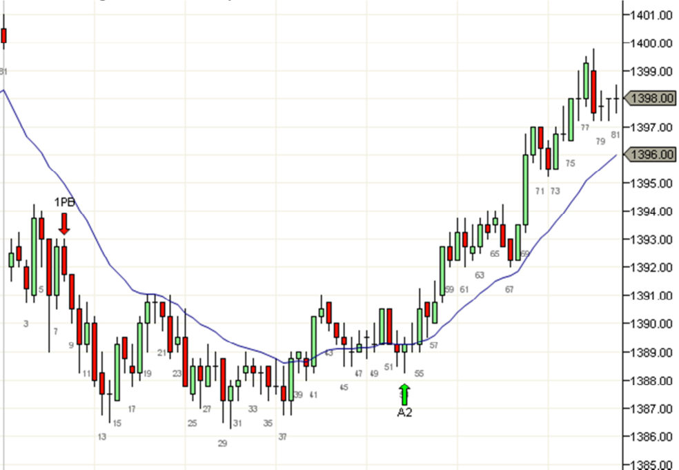

A swing setup is one where after filling your scalp target, the price does not come back to test your entry price. This enables you to move your stop to breakeven and let the market take you to higher profits.

In general, there is a swing setup in the early part of the day and one in the late part of the day. Often one or the other could be missing. If both setups are in the same direction, its a trend day and could consist of multiple small with trend entries where you could enter and ride the trend. If the setups are in opposite directions such as today, its a trend reversal day.

Its a valid trading plan to only enter on these two setups and hold for 4 points or more after taking a scalp profit of 2 points. The trick to doing this consistently is to ignore reversals and only take the first pullback after a proven reversal.

For example, if you had to guess that b2 was a reversal, you would be sorely disappointed. b5 also would knock your breakeven stops out. The first pullback to a LH at b8 is the high probability swing setup.

Similarly, if you guessed b14 was a reversal, you would be disappointed. Even if you correctly assessed that b30 marked the low of the day, a buy above it failed to give 2 points and your stops below the entry bar were taken out. If you had the patience to wait for the first viable signal bar b53 at the HL, you would be able to swing till the end of the day.

In summary, a great way to take swing setups is to take the first pullback after a trend breakout or reversal and to ignore the actual lows and highs of the day.

---

[← Previous](22-2012-02.md) · [Contents](00-目录.md) · [Next →](24-2012-04.md)
