[← Previous](23-2012-03.md) · [Contents](00-目录.md) · [Next →](25-2012-05.md)

# April 2012

Original pages 361–371

<!-- p.361 -->

## Late entries in a channel

Monday, April 2, 2012 · p.361

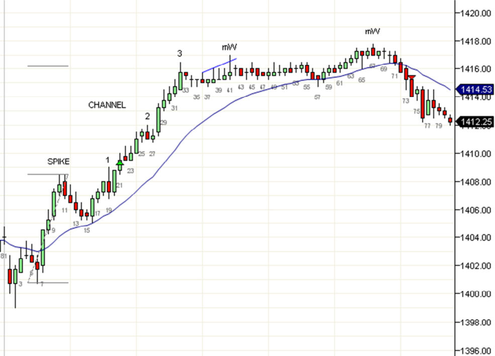

I normally avoid late entries since they are usually dangerous. However, if you have a reason to believe an extended channel is setting up, for example due to the spike b7-10 you could look for mid-channel entries.

First you need to recognize a channel is in effect. In general if prices are moving in the same direction but most bars are overlapped except for a tick or two, you are probably in a channel. Unlike the move from b7 to b10, the move from b16 was clearly a channel.

A classic mid-channel entry is to fade the 1st breakout of a channel or 1chbo. This occurred possibly at b20. If you missed it, you can always fade opposing trend bars in any channel, the first one is the best. Today, the closest we got to an opposing trend bar was b26.

A first tail in a channel in the direction of the channel (b21) works very similarly to the first opposing bar. Its represents a pullback in a channel and an opportunity to buy other than the worst price. Occasionally, a 1tf (b27) sets up which is usually a high probability trade. Care must be taken not to enter too close to end of expected channel move, such as the measured move of the length of the spike or the third push (b19,26,31). Often, a strong channel will continue after a trendline break as a much shallower channel (possibly b37 to b67) so you should exit your positions but never fade a strong channel until the trend breaks. A prolonged horizontal movement such as today, breaks a trend but you could probably already guess around b36 or so when you get a series of dojis that the move was probably over for a while. Even so, SC days are notorious for continuing to keep moving till end of the day on terrible signal bars so caution is to be exercised when trading counter-trend.

<!-- p.362 -->

## Early strength indicates strength late in the day

Tuesday, April 3, 2012 · p.362

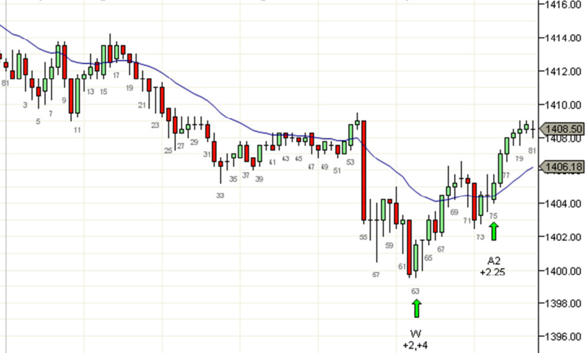

When a day breaks into a trend (b18-62) and presents a reversal signal (b63), you need an assessment of the chances of success and a possible swing add-on. Will this attempt only go to the ema? Will it fail after a couple of weak attempts to go up and continue the slide down?

There are a few indications you can use to make such assessments. First of all, was there a trendline break? (b33-b54). If not, the chances of a successful reversal are probably low. The trend could terminate and move horizontally, but a trendline break greatly adds to the chances of a successful reversal.

The second thing you need is a Wedge (b33,57,63) with a strong signal bar (b63) or a successful test of the swing point that led to the trendline break (b33).

To swing your position, you need indications of strength early in the day (b5-10,b11-15). If there was no early strength, its unlikely that your move will get too far. (It does happen, but is rare).

<!-- p.363 -->

## Trading a broken trend

Thursday, April 5, 2012 · p.363

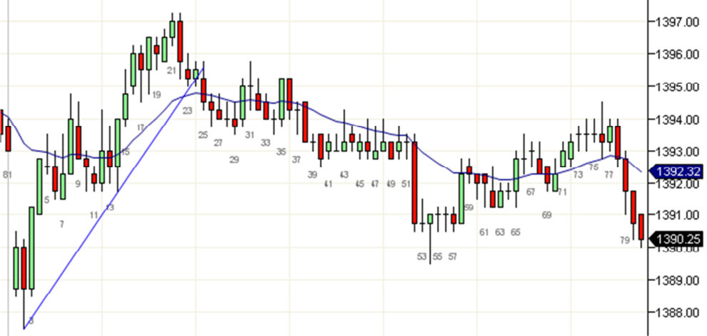

Once the price moves many bars beyond the trendline, the trend should be declared broken. When the market touches a live trendline, it reacts like it touched a live wire (b12,b15). When the market closes below the ema in one leg and stays below it and well beyond the trendline, the trend is likely over.

A broken trade is inherently hard to trade since its not really a reversal and its not really a pullback. When the original trend is strong, there is a possibility that the market will present a slow channel moving in the same direction as the original trend. Occasionally such as today, the channel may be in the opposite direction.

These channels are inherently hard to trade and most moves would take a really long time to give a 2 point profit. The right way to trade them is to realize that channels are wedges and wait for three pushes (b29,40,54) before trading against the channel. The best option is to wait for a test of the prior extreme or wait for a new breakout and enter on a pullback.

<!-- p.364 -->

## First bar: Reversal bar

Monday, April 9, 2012 · p.364

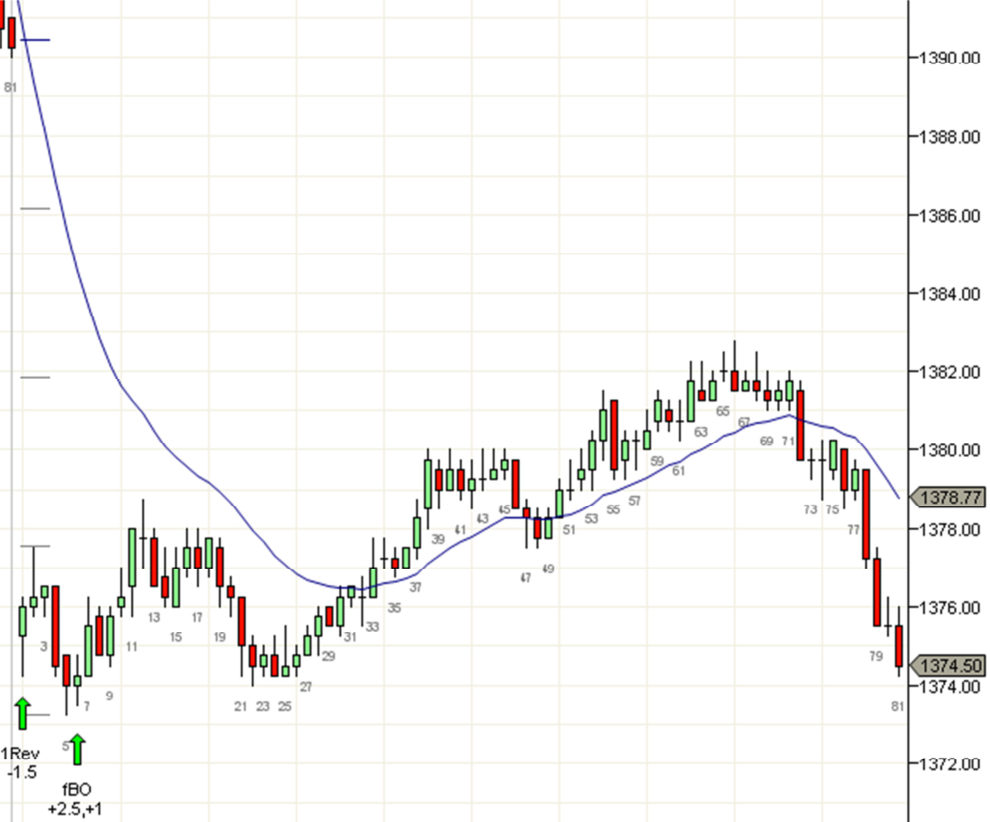

When the first bar is a reversal bar in a place where it does not make sense such as a bull bodied reversal bar above a gap or overlapping the prior day's range, there is a good chance it is a setup for failure. On the other hand, a bull reversal bar below a large gap will often begin a trend from the first bar.

When it fails to produce a trend from the first bar, chances are high that the day will turn into a trading range day. This means whenever there is a new breakout, you can look for a fBO trade is the range is large enough (4+points).

Occasionally, such a breakout gives a BP trade such as b26, which can be held often to the measured move of the opening range.

<!-- p.365 -->

## First bar: Outside bar

Tuesday, April 10, 2012 · p.365

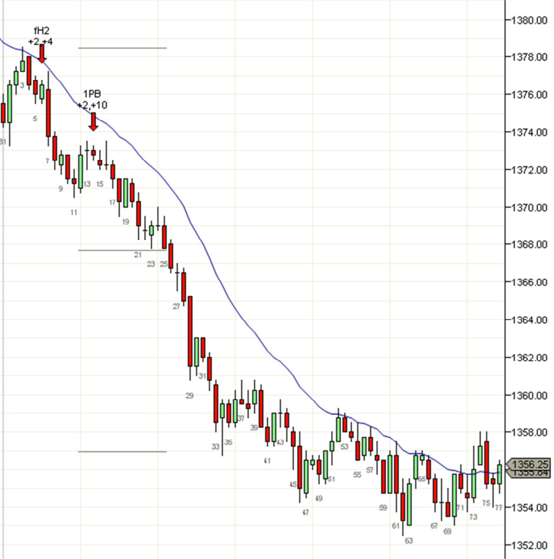

When the first bar overlaps the prior day's last bar completely, it should be treated as a trading range. This means you can fade its breakout or take a breakout pullback if the breakout is strong.

An outside first bar, especially if its a large bar (and indeed any large first bar) is a fade candidate. You should never trade its breakout and if you do, take a fixed (scalp) profit. A breakout pullback, especially a 2 legged BP of a large b1 could be taken, but unless your entry bar is large, you are likely to encounter a deep pullback.

When the large bar's BO is large and gives a successful HL, there is a decent chance of spike and channel developing is high. Often the channel will be a measured move of the spike.

<!-- p.366 -->

## Bar Strengtheners: 5tf

Wednesday, April 11, 2012 · p.366

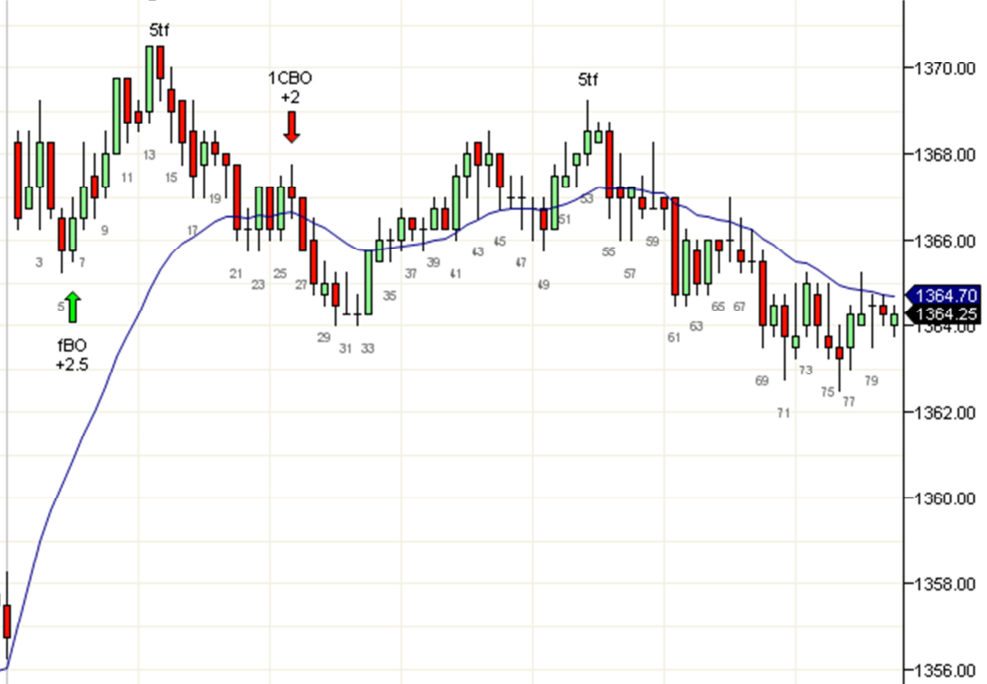

Ideally, signal bars are well formed and obvious, have a strong close and have a great looking entry bar. In the real world, signal bars are often less than ideal and your ability to read their strength from signs other than their close greatly increases your trading opportunities.

A very simple to observe sign is a 5 tick failure, which occurs when a breakout goes 5 ticks above an entry and turns down. A 5tf means several traders did not get filled on their exits and are likely to be forced to exit when price fails by taking out the breakout bar.

Ideally, a 5tf gives a bar that can be construed to be a signal in the opposite direction. A bear inside bar (b14) after a 5t breakout above the prior swing (b3 high) is a very good example. Naturally, this is probably a valid signal even if it was not a 5tf.

b54 was a 5tf after breaking 5t above the signal bar b52. It was a bull inside bar, and therefore a weaker signal, but the 5tf gives it additional strength and allows for a short setup.

b5,6 formed a 2bar reversal after a 5tf below b4, which increased the chances of a successful fBO trade. Similarly b32 was a 5tf below b5 and succeeded despite being a poor bar.

Note that 5tf is not a magic formula that guarantees successful trades. It only gives some additional strength to the signal bar. You should be happy to pass on a trade that otherwise does not meet your criteria. For example, b71 was a possible 5tf below b32 but it made a poor trade since 71 was probably too large and too close to the end of the day. It was also possibly just one leg when at least two were expected off the A2 variant short below b68.

<!-- p.367 -->

## Trading a trend from the first bar

Thursday, April 12, 2012 · p.367

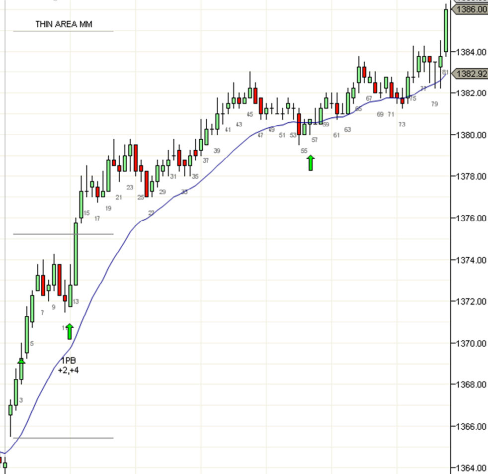

A trend from the first bar is rare and treasurable event. When one of the first one or two bars are near a support such as the ema or low of prior day and form a strong reversal bar, there is a chance of a trend from the first bar. Once there is a trend breakout above the reversal bar (b2), there is usually an attempt to fail the breakout. Its usually a prudent approach to wait for at least one more bar (b3) before jumping on the trend. If the next bar has an upper tail, you can usually buy its close with a stop below the bar. This is not a high probability setup, but the risk to reward ratio is usually high enough to justify the trade (often 10x).

The conservative approach is to wait for any pullback such as an inside bar, a bear trend bar or any 2 attempts to fail the trend (b7-11). This is essentially a 1PB setup and should usually take you to a decent profit, often the best swing entry of the day.

On an obviously strong day, you can add-on or re-enter on any deep pullback for a swing such as b27 or b55. Counter-trend trading on a day like this is dangerous and you will miss many great with-trend moves.

<!-- p.368 -->

## Your trading edge

Friday, April 13, 2012 · p.368

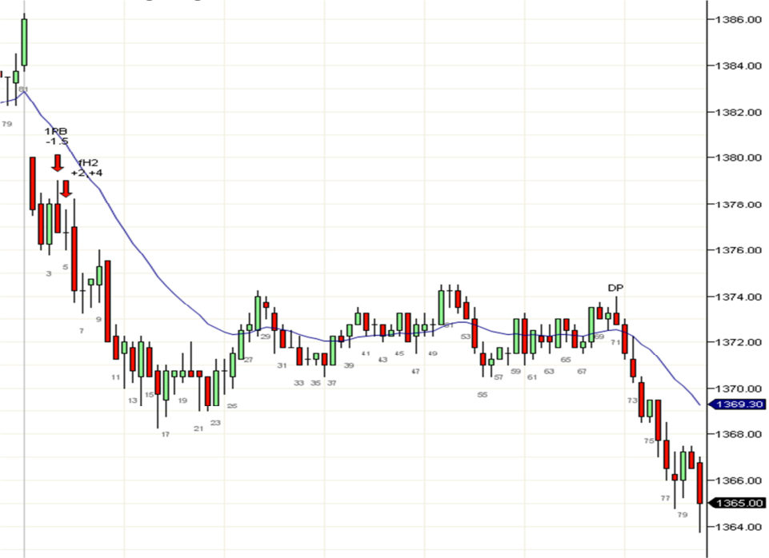

A trader will pick up a few skills after trading for a while. If those skills are better than the average trader, he gains a small edge over other market participants. These skill sets are common across trading systems:

1. Correctly determine market direction
2. Roughly estimate how far the market is likely to move
3. Find precise entries
4. Determine stop size for an entry.
5. Hold through the trade and not be shaken out by any minor pullbacks or loosen stops
6. Hold a winner for extended duration
7. Gain important market information from losing trades and apply to next trade

Once you have identified your edges, tailor your trading to amplify those edges and insulate yourself from market action where you don't have an edge.

For example, if you can gauge market direction and estimated move accurately but your entries usually get stopped out, consider trading options instead. For example, if you estimated a 10 point down day in the first few bars but would usually be stopped out if you tried a price action entry (as I was on my b4 short), you could simply buy SPY puts in the AM and hold it till it reaches your target or till end of the day and exit with a profit.

On the other hand, if your sense of direction is weak and consequently you have no ability to hold a position for too long, but you can enter and exit precisely, you can take multiple small scalps with small fixed profits.

<!-- p.369 -->

## Spikes as trading ranges

Tuesday, April 24, 2012 · p.369

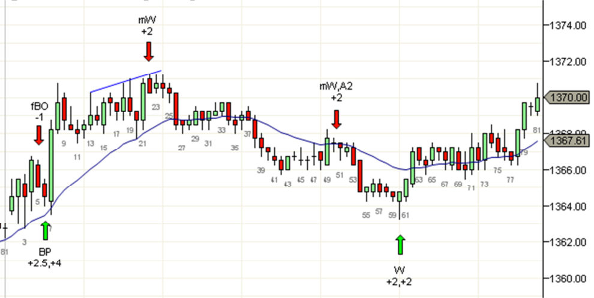

Large bars in the first hour such as b7 potentially setup a trend, often a spike and channel in the direction of the bar. If the bar has good follow through, then you can expect potentially a move up thats equal to the measured move of the spike.

Sometimes, the spike is seen as a fade opportunity and the price will struggle to stay above it. When that happens, a fade of the spike should try and take out the other end of the bar (at b60). A strong reversal at that point could lead to a reversal of the entire down move (completed at b81) if there is sufficient time left in the day.

So whenever you see a large bar in the early part of the day, remember that its a potential trading range. Its successful breakout could go to a measured move in the direction of the bar and an unsuccessful BO could fade the entire bar. This estimate can be used as a guide for holding swings.

<!-- p.370 -->

## Failed trades reveal market information

Wednesday, April 25, 2012 · p.370

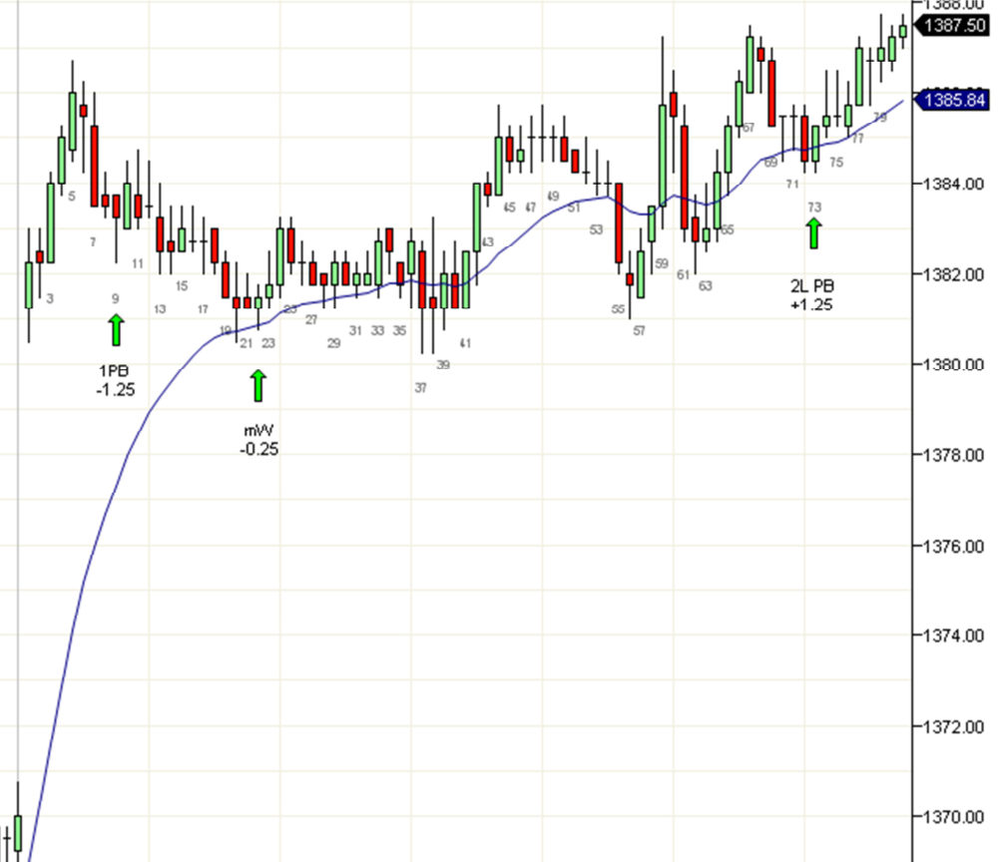

When a trade fails, it should give you some information that you can use in subsequent trades. If a failure does not give you any information, you should avoid trading it. Most of my setups give certain definite information about market structure when they fail.

For example, b9 today was a possible 1PB setup. Its a poor bar, being essentially a red bar, the pattern is a 1 legged deep pullback and the location is a double bottom with a strong trend bar. Even though I never usually buy 4 red bars, during 1PB I relax my rules a bit not because the trade is higher probability but if it works, the risk to reward ratio is usually worth it.

When b9 triggered and took me into a trade, if it works I expect a large bull day and given the recent deep pullback on the daily chart, it could be a 10 point or larger move. However when the gap open is large, there is always the risk of it being too expensive for fresh buyers and the trade could fail. The trade did fail when b13 stopped me out.

The failure gave me new information: Today would not be a trend day but rather a trading range day bounded by the AM spike (b1-b5). The only acceptable trades now are buys in the lower third of this range (b22, b41) and sells in the upper third until a breakout and BP sets up (b73). A marginal setup such as b50 can be passed up since its not high enough in the range and in barb wire.

<!-- p.371 -->

## Predicting breakouts

Monday, April 30, 2012 · p.371

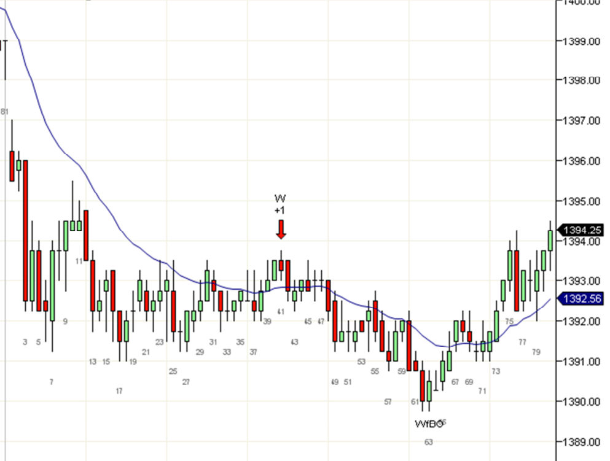

As repeatedly posted, predicting breakouts is one of the hardest tasks a trader can do. Even when you do predict it, its often better to wait for the breakout to fail or give a breakout pullback and enter after the price action has moved from chop to trending.

The simplest way to look at chop is to view it as a trading range. Taking a signal only at its very top (b41) or bottom (b63) is the best way to avoid being chopped up. Chops are often ill-formed channels and are often variations of three push Wedges. For example, b41 today was a 3 push wedge (b20, 23,41). However, reading wedges in chop is very hard in real-time and requires a lot of practice.

A strong trend entry bar confirms your entry was a good read (b42 was a trend bar compared to other entry bars null or bear), however holding through choppy waters is harder since effectively your trade is a fBO trade and it only needs to give two legs.

When the signal bar is clearly beyond the chop (b63) it is a far better entry and should at least retest the start if the last move (b41 high)

---

[← Previous](23-2012-03.md) · [Contents](00-目录.md) · [Next →](25-2012-05.md)
