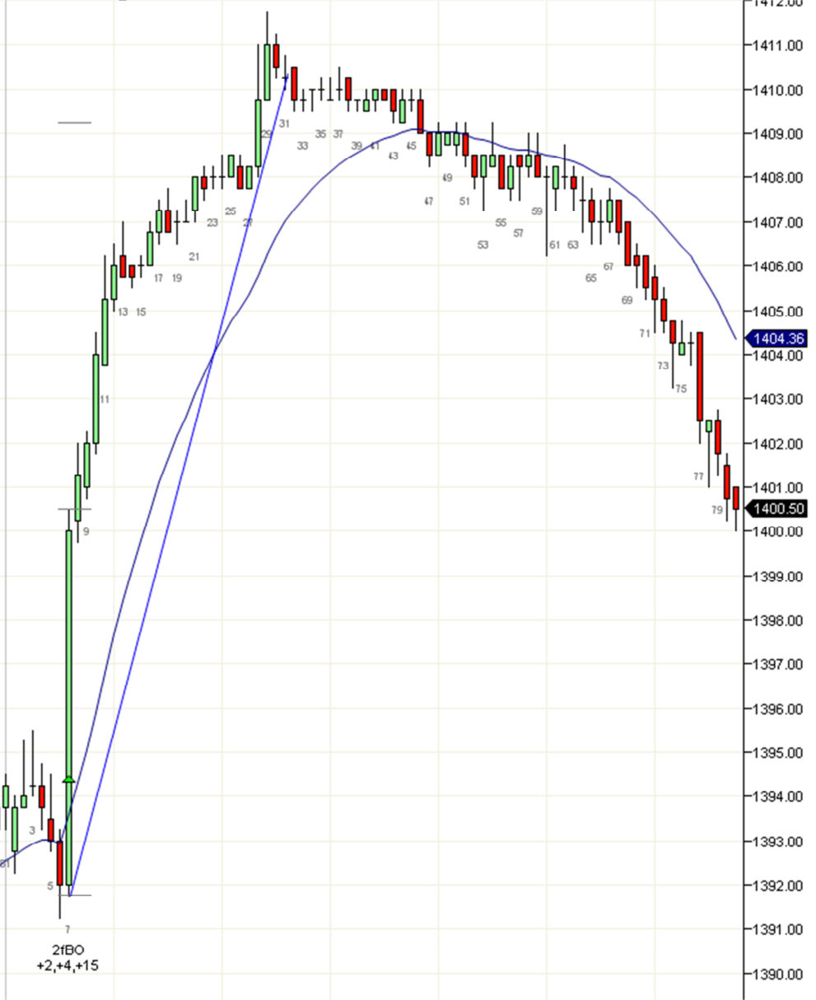
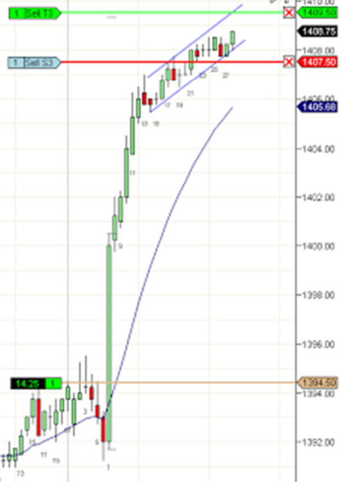
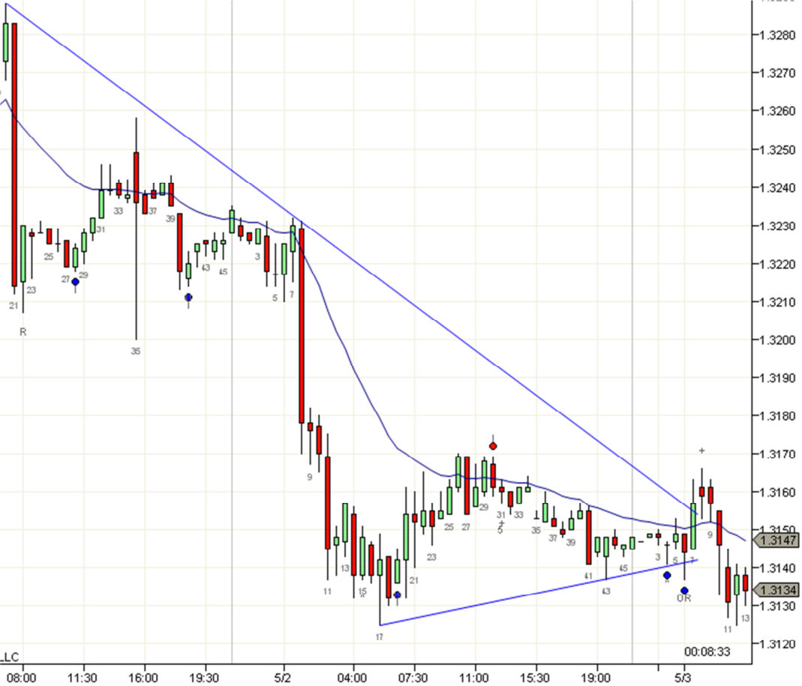
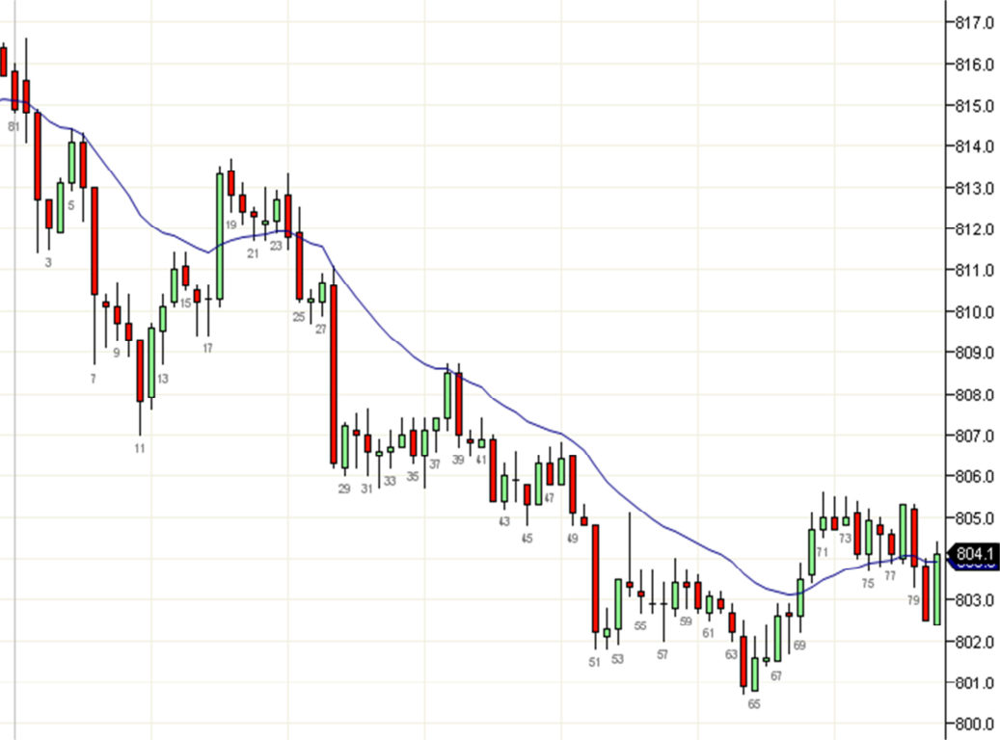
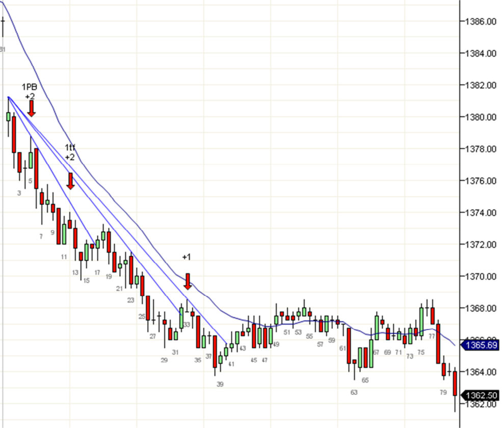
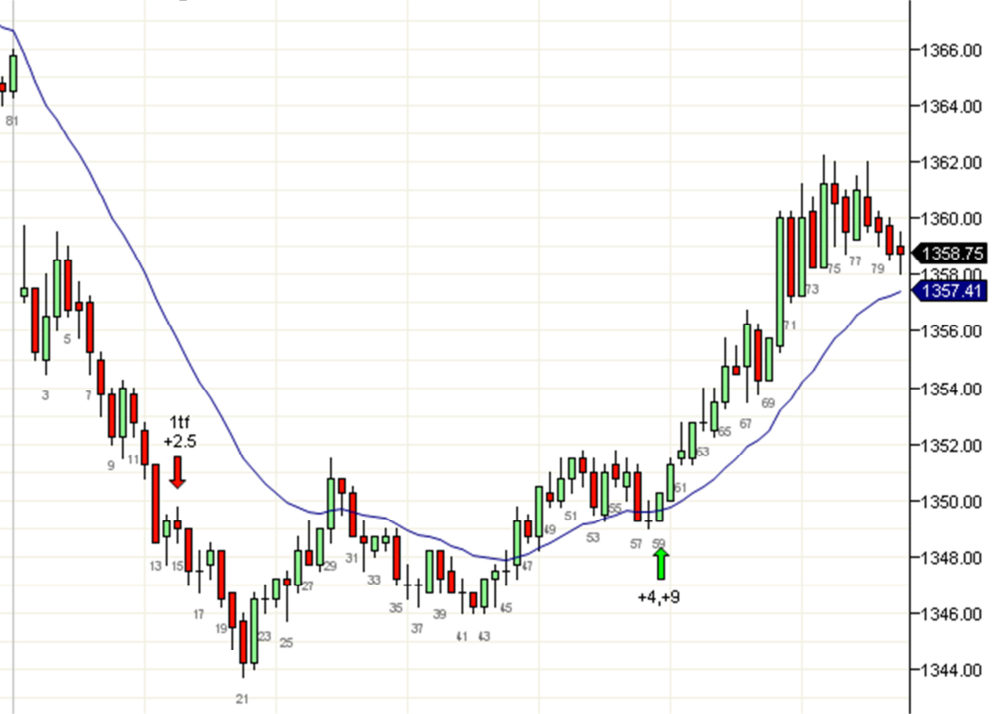
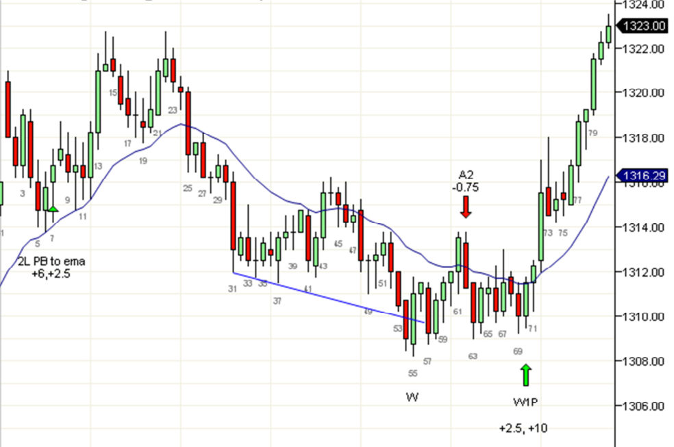
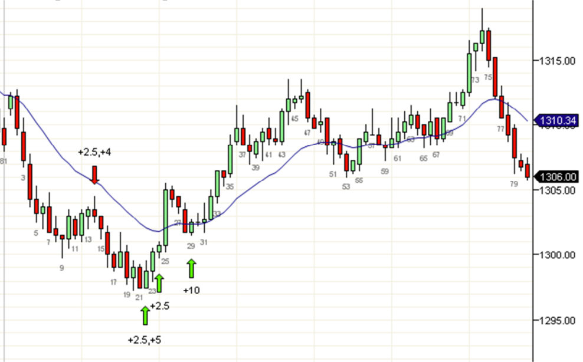

[← Previous](24-2012-04.md) · [Contents](00-目录.md) · [Next →](26-2012-06.md)

# May 2012

Original pages 372–379

<!-- p.372 -->

## Climax top

Tuesday, May 1, 2012 · p.372

Occasionally, you will hold through a large move that will give you decent profits. At a certain point, you would need to make a decision to either exit or to hold for even more. There have been many times when I have exited at a decent profit and the price has ended up moving beyond my target by many points. I never regret it, simply because a guaranteed good profit is far better than a theoretical great profit with the real risk of losing all your gains.

<!-- p.373 -->

However, optimizing exits is a very important part of trading and I've been able to approach it from many angles. The simplest way to exit is to wait for a trend termination signal. On a strong bull move such as the AM trend, if you see bars getting smaller (b13-25), there is an excellent chance that the termination will be in the form of a TTR (b33-37).

When buyers are no longer able to create healthy looking bars, the move is over. If you see three or more dojis in a pullback, its best to exit right away or on the next push.

Barring this, if the price has moved sufficiently through the trendline (b31-47) and especially if the move has its own trendline in a counter direction, there is a very good chance the trend is over and you should look to exit.

While those are great places to exit, sometimes you get what I call an undeserved gain. A push that comes from nowhere (b28-29) and this is a form of climax and you can exit anywhere during the push. Sometimes a climax bar can be a trend bar or two such as b29 and you can easily exit on its close. You can also exit on the first L1 after the climax (below b30). My preferred method is to exit on the push if my original target is close because a climax can quickly turn into a reversal bar.

<!-- p.374 -->

## Alternative Instruments I - Micro contracts

Wednesday, May 2, 2012 · p.374

A new trader to futures risks losing a significant chunk of his capital in his early trading years. One option is to trade on SIM for a while and get used to price action and correctly handle trade management. But after a certain point, one has to risk real capital to learn to trade.

To avoid blowing up your account very quickly, you could trade the micro-contracts. Micro-contracts are a tiny fraction of their regular size contracts. The micro version of 6E is M6E pictured above. Every tick is just $1.25 and a 10tick loss will set you back $12.50 plus commissions.

To make your winnings count, you should trade M6E on larger timeframes. The 30m chart shown above shows sharp movements especially around European and US open that you can hope to catch if you read the market correctly.

Larger timeframe also forces you to hold for longer and gives fewer better setups. Once you reach some level of consistency, you could switch to the regular contracts.

<!-- p.375 -->

## Alternative Instruments II - Thin volume contracts

Thursday, May 3, 2012 · p.375

Warning: TF trades are experimental at this point. The recommendations in this post may need to be revised in the future.

Thinly traded instruments are inherently volatile. This is because any disproportionately large order can easily start a stop run that can move the bar several ticks or even points in seconds. This makes it a great option for momentum traders.

A chart of the Russel contract TF above shows large moves today. The risk of slippage is very high on a stop market order. A stop limit order will usually save you from slippage but very often prevent you from getting into the trade. In my experience, you are better off allowing a 1t slippage on a stop limit and widen your stop by 1t. (Ninjatrader and many other platforms allow you to set a default value for stop limit.) You effectively need about 12t stop to trade TF correctly.

After the AM session, TF is quite dangerous since bars in chop look like they are ready to breakout into a strong move (b29, b35, b36), whereas in a thicker contract such as ES, those bars would usually look poor. Fading poor setups and other scalp tricks that may work on ES simply will fail spectacularly and your account will die a death from a thousand cuts.

The simplest way to trade a thin instrument is to take only two trades in the AM. Basically take the second attempt down (b6 short) or the second attempt up (b12 long) depending on the strength of the prior attempt and the strength of the setup bar. If you get stopped out on both, you lose twice. If one of them works, you will usually make a decent profit.

<!-- p.376 -->

## Trendline tests and break

Friday, May 4, 2012 · p.376

When the price dips beyond a trend line and gives a continuation signal right away (within a bar or two), its a test of the trendline and the test has succeeded b18,b33. A successful test invites fresh orders in the direction of the trend. Every tiny dip beyond the trendline that sets up a with trend trade is often a swing trade and can be held until a definitive trendline break.

When a trendline test fails, such as the move from b39 to b49, the trend is broken and you should no longer be looking for reversals or continuations. The market is now in a trading range and you can only trade fBOs at the extremes of the range.

A trendline break is a trend termination (TT) and does not automatically imply a reversal, even with a test of the prior extreme (b63 was a test of b39). Only fBOs can be traded and all fBOs should only be expected to give two legs.

In the event of an fBO trade taking out the other end of the range in one leg, especially with a strong breakout, you could expect a BP setup and a continuation of the trend. If the new breakout is in the opposite direction from the old breakout, it may work like a major trend reversal. If its in the same direction, it works like a trend continuation.

<!-- p.377 -->

## Definitive signs of successful reversal

Tuesday, May 8, 2012 · p.377

Most reversals fail and every pullback is simply a failed reversal. b3, b10,b14 all had a decent chance of reversing the down move but failed. b22 finally succeeded but taking every reversal hoping to catch "the one" is a terrible way to trade. After a couple of failures (b3 and b10), its simpler to assume every reversal attempt would be a failure and trade with the prior trend and stop when the market proves you wrong.

Using this approach, you have flipped your odds from many failures followed by one success to many successes followed by one failure. And if the trend line is obviously broken before a signal sets up (b30) you can choose to not trade in the old direction any more and look for signs of a definitive reversal.

A bear move is definitively reversed once the market has put in 2 higher highs (b29, 51) and two higher lows (b43, b58). At this point there is a good chance that bulls and bears both agree that the tide has turned and enter in the new direction.

A higher low is always better than trying to capture the exact reversal, since you will eventually see a two legged pullback in the new direction. You may have missed b22, but you could get in above b43 for just a few more ticks. Or you could wait for a 2L pb to the ema (b59), which is likely to give a stronger move.

<!-- p.378 -->

## Selecting the optimal entry

Thursday, May 24, 2012 · p.378

One of the most challenging tasks for any trader including experienced traders is to hold through what looks like chop and take their trade all the way to a swing. Sometimes this is easier when the pullback and congestion is far away from your entry price or you are already in a trend and the price moves away from you favorably right away.

When a trend terminates, determining which entry will lead to a large move is called "The breakout problem" and is a considerably difficult task. To do this, you need to be able to first determine when the trend has actually terminated.

A failed reversal followed by a failed A2 (b54,55 and b61,62) is a classic sign of trend termination. Waiting for a trend to terminate before taking a trade saves you from two non-swing entries (b58 and b64).

Once the trend is terminated, you need to evaluate the chances of a reversal. On a trading range day with bull strength displayed earlier in the day (b6-22) and recently (b55-61). The chances of a move to the other end of the range are decently high. On a strong bear trend day, this would be a lower probability trade.

<!-- p.379 -->

## Exiting and Adding on

Thursday, May 31, 2012 · p.379

In general, I try to exit when my trade has shown strength and more correctly, undeserved gains. When I'm surprised by the strength of the move, its a good sign that I'm better off exiting. Therefore bars like b25 and b72 which shock the trader with good fortune are often signs of being exit candidates. When the move is nacent and especially one-legged as in b25, chances are good that you can expect another leg or even a sustained trend after a deep pullback. A large bar after a sustained move such as b72 on the other hand is most likely a sign that the end is near.

The first pullback (b29), the first two legged pullback (b14) and the first trendline break (b46-53) but only after a strong move (b22-46) are usually good candidates for continuation trades. Of these, The first pullback after W or W1P (b29) is often an excellent candidate for adding on even if all your targets have not yet been met.

Any small bar with a strong close in a trend (b24, 29, 71) can be used for adding on as long as they are not inside bars (b39) or doji (b45).

Some traders add on any strong trend bar (b2,3,4). I avoid this because a pullback can come at anytime and you may not be able to hold through for example, if you bought b35 or b55. The theoretical stop for adding on a trend bar is the other end of the bar so its best to do it on a small bar.

---

[← Previous](24-2012-04.md) · [Contents](00-目录.md) · [Next →](26-2012-06.md)
