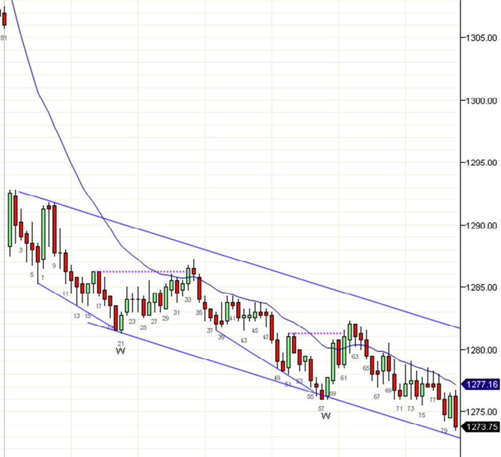
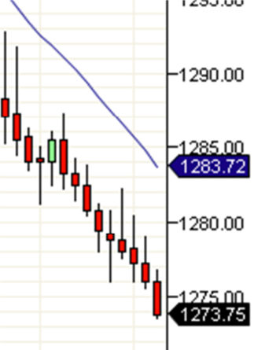
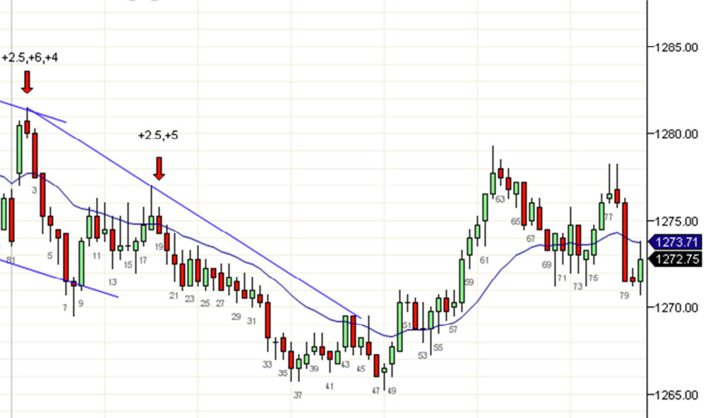
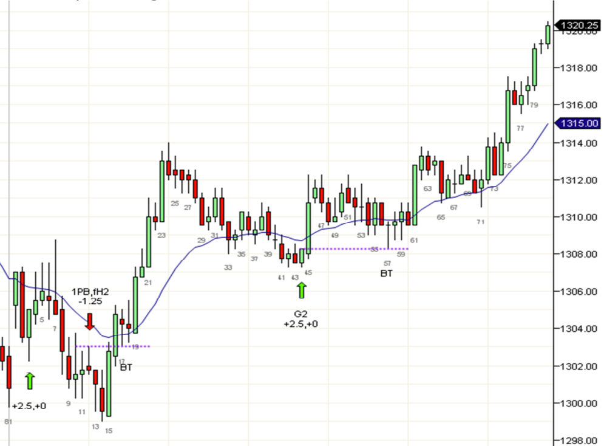
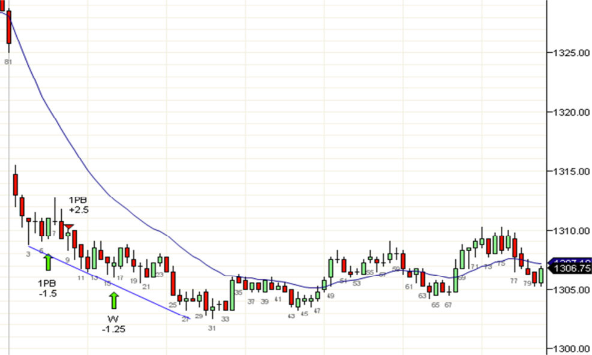
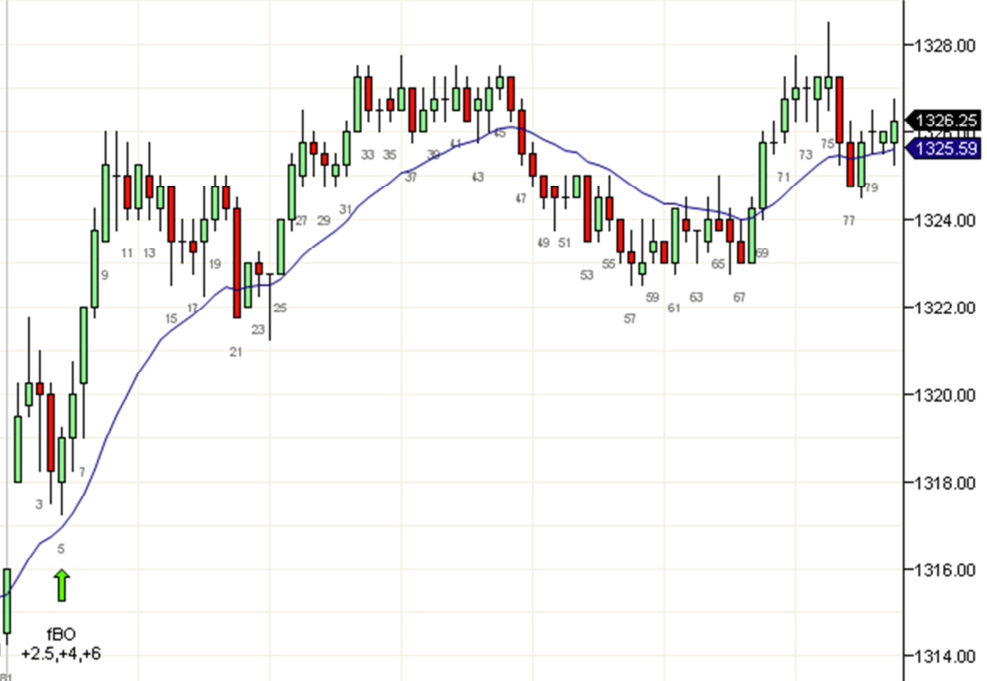
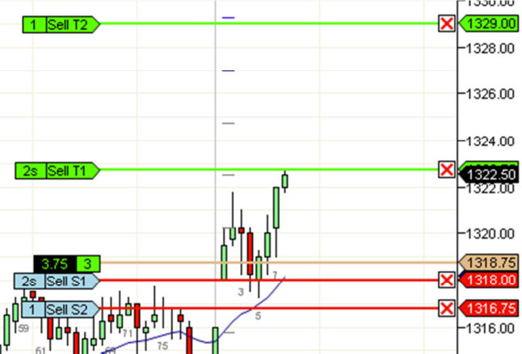
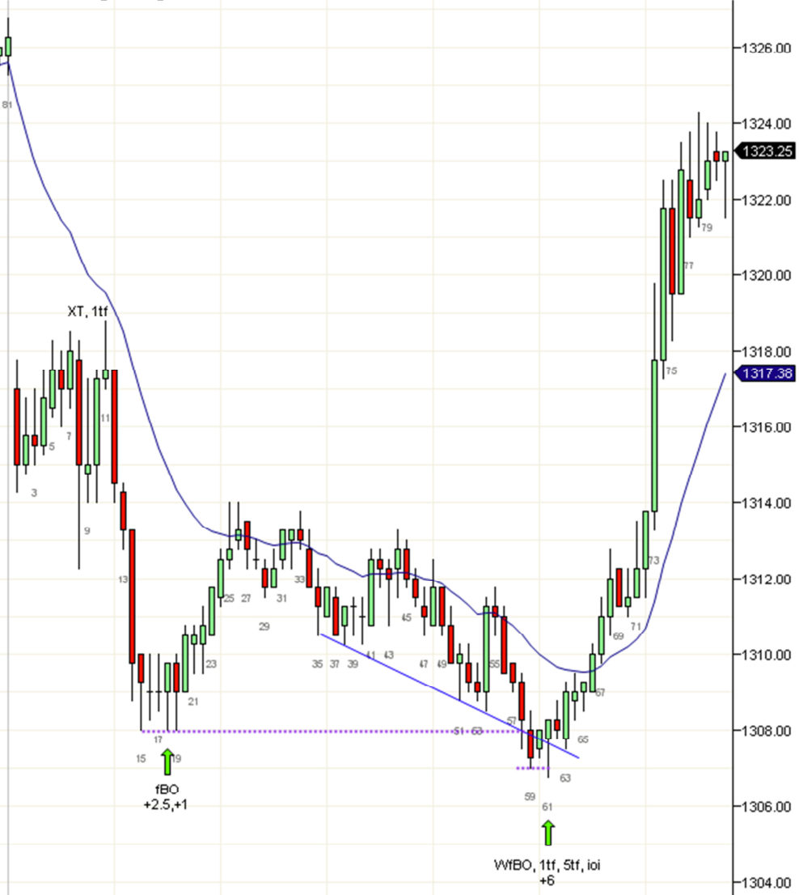

[← Previous](25-2012-05.md) · [Contents](00-目录.md) · [Next →](27-2012-07.md)

# June 2012

Original pages 380–387

<!-- p.380 -->

## Channel Risks

Friday, June 1, 2012 · p.380

Shallow sloped, wide channels are very hard to trade, primarily because they don't always obey many price action rules regarding trends. For instance, a bear trend is defined as a move with lower lows and lower highs. This implies that when a counter-trend move takes out a swing point, the trend may have terminated. Shallow sloped trends routinely take out swing points and continue in the direction of the original trend (b33, b61).

Second attempts can fail (b31) while first attempts succeed (b52,69) and stops need to be larger than 6t (b63). Apparent wedge reversals can fail (b21,58) . The price will often not touch a trendline or ema before making a continuation move (b17,52) causing traders to miss a lot of entries. Stops beyond swing points are routinely stopped out (b33,61) making it very hard to swing even if you do get in at the right price.

While all this looks like chop, its a very strong trend on a higher timeframe. The chart on the left shows the current day's 30m chart. Its obviously a very strong bear channel and the entire day had only one bull bar. What looked like strong bull moves on the 5m chart were only up-tails on the 30m chart.

<!-- p.381 -->

A move above a swing point, which would be trend break in a normal chart is only a poke above a prior bar and is effectively a 1CBO type continuation setup.

The trendline itself has remained true and has never been broken the entire day. A channel remains in effect until a counter-trend move results a sustained trendline break.

The way to enter trades on days like this are no different from any other day. The best entries are two or three legged moves to the trendline or ema (b34, 63). Since counter-trend swings are huge, you should simply exit on the second or third push in the direction of your trade (b49 or b55) and wait for a new setup. The single most important rule regarding shallow wide channels is to never trade counter-trend until the shallowest trendline (b1-b9) is broken.

<!-- p.382 -->

## Small or no gap

Monday, June 4, 2012 · p.382

When the gap between the last bar of the prior day and the first bar of the current day is very small (overlapped or less than recent bar), You can treat current day's price action as an extension of the prior day's price action, at least for the first hour or so.

Therefore, when a small reversal bar forms at the trendline from yesterday's down channel, its usually an acceptable trade, even on the first attempt as long as the signal bar is not weak (doji or overlapped). If you take it as a setup, you should expect it to take out the last swing from the prior day.

As the day progresses, a newer clearer trendline will form (b2,18) and will take precedence over prior day's action. Future trades should be evaluated using the recent price action of current day.

<!-- p.383 -->

## Correctly reading a breakout test

Tuesday, June 12, 2012 · p.383

Price action can be arbitrarily defined a set of breakouts and breakout failures. There are breakouts beyond bars, swings, high and low of the prior and current day, the trendline and popular indicator values such as emas, collectively called barriers. Breakouts in a trend in the direction of the trend are likely to succeed until the trend breaks. Breakouts in a trading range are likely to fail until a trend is birthed. This is true for any barrier, but some are easier to see and more reliable than others. For example, the three push pullback (b24-44) after a strong move up (b15-23) gave an attempt to BO into a trend at b45. The market tried to reverse this breakout but found buyers exactly at the old entry price (b57). Such a setup is called a breakout test (BT). BT can also occur at the breakout of swing points such as b17 testing the BO above b12. This is possibly also a BT of the ema. A breakout test is one of the few places where a doji signal bar should be considered strong as long as its close is near the entry and not overlapped (i.e, it can be treated as a 2BR). The way to anticipate a BT is to note any strong BO bar and if necessary mark its breakout points. For the BO bar(s) b15,16 since there was no buy signal bar, there is only one breakout point, the swing high of b12. For the breakout bar b45, both the swing point b40H and signal bar b44H are BT points. Limit traders can simply place a limit order to enter at this price with a 3t or 4t stop. Stop entry traders should enter on the breakout of the bar that touches but does not dip below the breakout point. Missing the breakout point by a tick or two is preferable to a pullback beyond it. Once a trend is established, it does not make sense to call every pullback a BT since a trend is expected to continue, its just a regular pullback and not anything special. That is, there is no point in calling b71 a BT since its basically just a 2L pb in a trend.

Note that a trend can develop without any breakout tests and therefore BT are not a requirement for trending price action.

<!-- p.384 -->

## Channel risks

Monday, June 25, 2012 · p.384

A large gap up or down often does not result in a steep trend but rather in a shallow sloping channel. Of course, all moves can be contained in a generic parallel trend and trend channel lines and be called a channel but for the purposes of this post, a channel is a specific type of price action that represents a very hard to trade move.

A channel can be easily distinguished from a trend by the following characteristics:

In a channel, most with-trend bars overlap each other. In a trend most bars don't. Compare the leg from b7 down to b12 vs the leg up from b47 to b50. Notice the almost complete overlap of bars in the former.

Most bars in a channel have tails on one of both ends. A strong trend should be made of trend bars, at least in the trend direction. Notice the strong closes on the up legs b47050 and b68-72.

Channels are highly likely to take out fixed stops and breakeven stops. Shorts below b7 were triggered and unless they had a large stop of at least two points or more, were probably stopped out. Strong signal bars at b14 and b18 had their breakeven stops taken out. Such price action can make it hard to catch a swing using the normal trade management style.

Channels can reverse on the most unlikely bars. This makes channels very dangerous to trade. For example, today the channel reversed on b31, which was a bull doji not unlike b9,16,27 before it.

The only way to trade channels is to get in early and trail behind every new swing point (b14,18,23,28 for b7 shorts). Channels can reverse at anytime and channel in the opposite direction and that makes taking a potential early reversal (say within the first hour or two) potentially a day long swing.

<!-- p.385 -->

## Wierd old trick for estimating targets

Wednesday, June 27, 2012 · p.385

One of the most challenging and error-prone tasks a swing trader needs to perform is to estimate his target. Over-estimation forces you to give up a lot of your gains waiting for your magic number to hit. Under-estimation is slightly better since you can always look for a fresh entry.

<!-- p.386 -->

For strongly trending days, this is a fairly easy task. On most strong days, you can often swing till the end of the day.

At the very least, you can swing till you meet a sustained trendline break and then exit near the prior high.

For example today we had a very strong trend move up from b5. The sustained trendline break b45-57 was obvious even without drawing a trendline. Therefore, the trader should expect to exit near the prior high (b63H).

Trading range days are harder and your ability to judge the moves are far more important since the trend break is likely to break all the way and take out the other end of the day. One trick is to use the observation that trading range days are usually proportional in range to the first bar of the day. If b1 is 2 points then the daily range could be expected to be around 10 points. Therefore you can simply exit when the range comes close to the expected boundary. For example, today's b1 was 2.25 points. Since the low of the day was at 1317.25, you should expect the high of the day to be around 1317.25 + 2.25*5 = 1328.50, which was indeed the actual high of the day.

Note that this is a guideline and not some magic formula that is infallible. Very large and very small first bars are obvious exceptions to this rule. Even so, you should always exit a partial position when you have a decent profit and your swing stop is very far

<!-- p.387 -->

## Choosing target for W and WfBO

Thursday, June 28, 2012 · p.387

A wedge in general is probably the single easiest setup to swing trade. This is because you have a dependable target for a W reversal. In general, a W reversal will attempt to reverse the entire wedge move. If the Wedge reverses the move in one leg, you can expect an additional measured move in the same direction.

---

[← Previous](25-2012-05.md) · [Contents](00-目录.md) · [Next →](27-2012-07.md)
