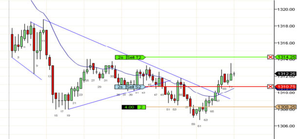
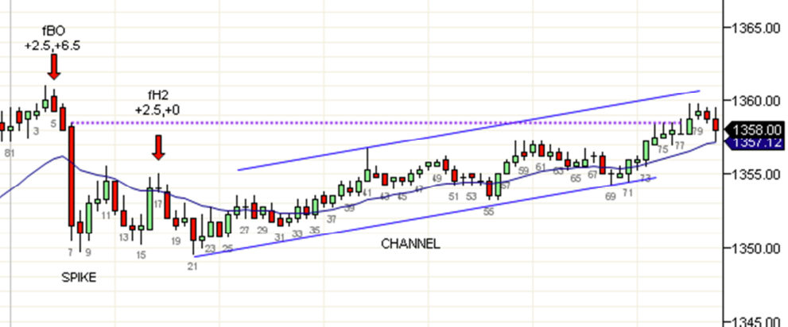
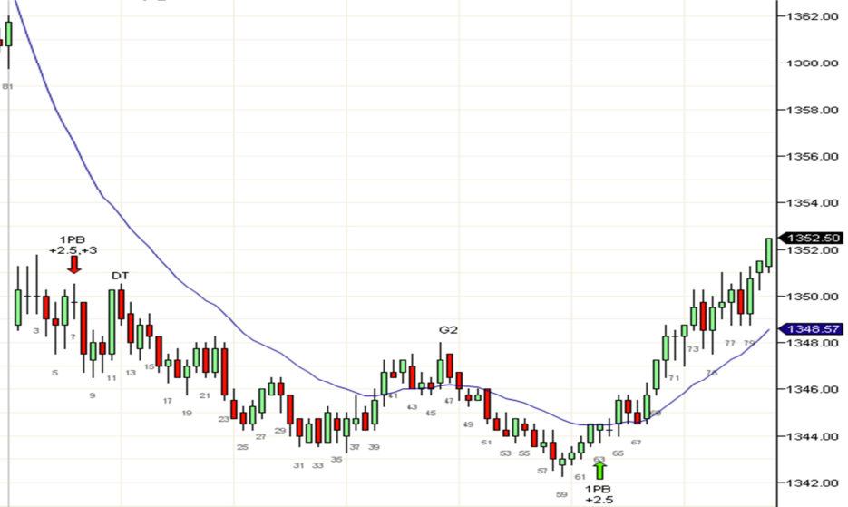
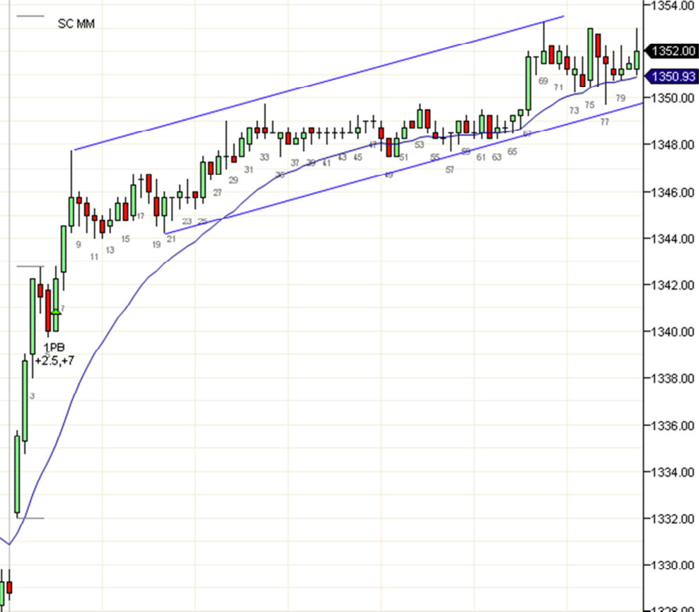
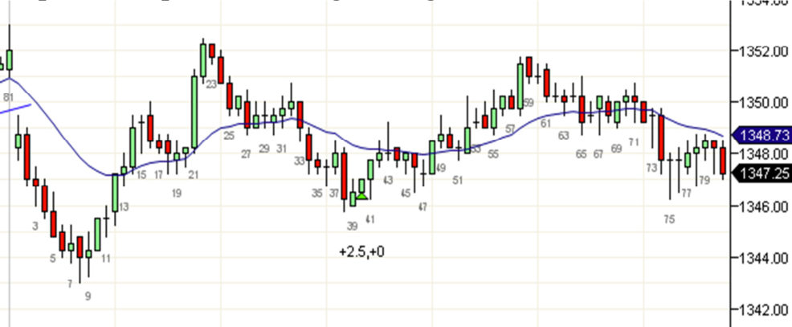
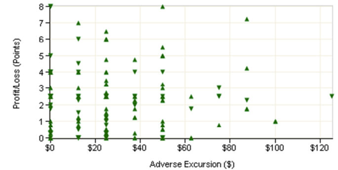
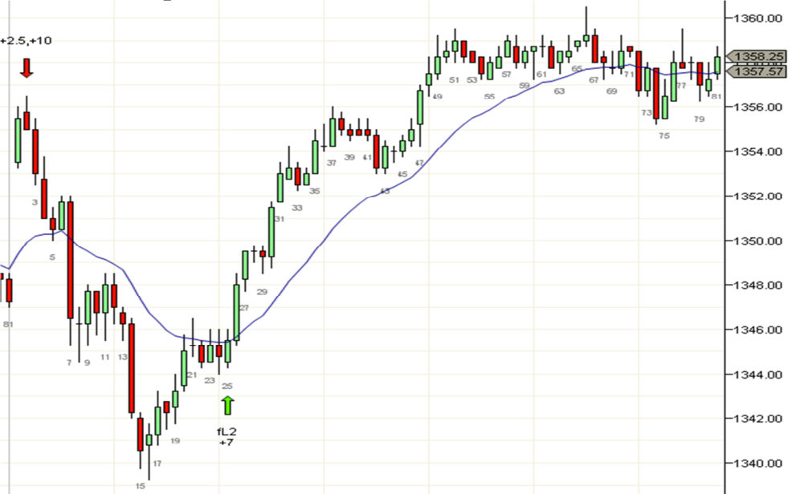
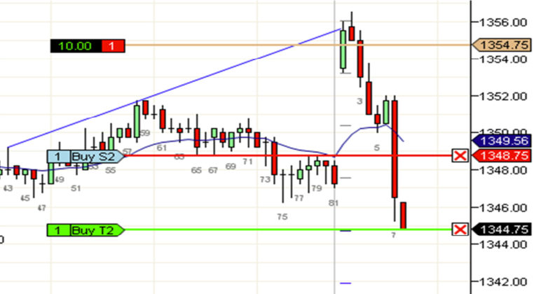
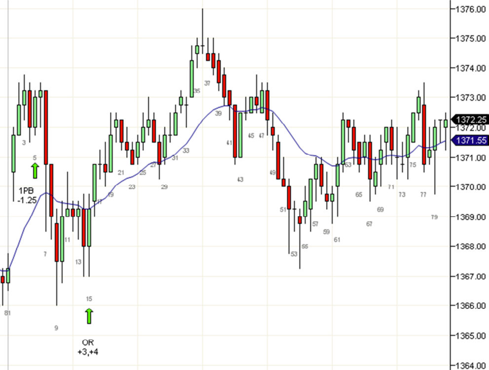

[← Previous](26-2012-06.md) · [Contents](00-目录.md) · [Next →](28-2012-09.md)

# July 2012

Original pages 388–394

<!-- p.388 -->

However, if the W approaches the start of the W move in multiple legs, especially three legs, its usually prudent to exit and look for fresh trades. For example, the W35,51,61 was an extremely strong signal and should be expected to reverse the move all the way to b25 high. Therefore the high of b27 and perhaps a tick or two above are reasonable targets. Since the move up was possibly more than one leg (two bear bars b62,69 make it a mW). The prudent thing to do is to exit. Occasionally such as today, when the move is strong enough to that the

## Spike and inverted channel

Monday, July 2, 2012 · p.388

A strong spike can give a channel in the same direction of the spike if the price continues to move in the direction of the spike. Occasionally, such as today, we get a channel in the reverse direction of the spike.

A channel in the direction of a strong spike often goes to a measured move of the entire spike. Traders expecting a channel in the bear direction today were probably surprised to encounter the rarer inverted channel. There is one clue that foretells a possible inverted channel: A smaller spike in the opposite direction (b9-11). If the spike is followed by a spike of any reasonable strength in the opposite direction, you would be cautious of a possible inverted channel.

A with-trend channel often (but not always) goes to a measured move of the entire spike. So for a 10 point spike such as today, traders could expect a channel lasting 10 more points down. An inverted channel similarly will reverse the entire spike and is often a good swing at the first pullback (b32) or first deep or 2 legged pullback (b56).

<!-- p.389 -->

## Channel Types

Friday, July 6, 2012 · p.389

Channels occur very often and trading them profitably is presently an area of research. In general, there are three kinds of channels and they are traded similarly from a higher level view but the specifics are different.

Trading Range Channel (TRC): A TRC is a shallow sloped wide-range (3+ points between swings) channel made of large bars (2+ points). The move from the open to about b31 today is a classic TRC. For most traders, TRCs are the most dangerous form of price action. This is because they always appear to be just about to reverse and most of these attempts fail. A new trader may be trapped trying to trade today's AM several times: fBO b5, 2L reversal b9, HL after strong reversal b14, W b19. Note that most of these bars were fairly decent and patterns looked clear. a TRC will trick and frustrate traders over and over. These are dangerous to trade because the stops required are large.

Leg Channel (LC): A leg channel has a slightly steeper slope and usually smaller bars. Most bars are however overlapped and there are many bars with tails. The move from b47-59 is a good example. These are fairly easier to trade since the stops required are smaller. You can enter after any pullback or small bar as long as its near the channel trendline. For example, b50, b55 but not b52 since it was away from the trendline. A small poke beyond a prior bar sets up a 1st channel breakout setup (1CBO). The first BO against the channel is a high probability failure so you should take a trade in the direction of its expected failure. You can also fade the close of the first opposing trend bar (b54).

Trend Channel (TC): A trend channel is actually a regular trend move with very small bars. They appear to overlap but each bar dips only a tick or two below the prior bar implying traders entering aggressively on the close of the prior bar. b59-b64 is a very good example. These can be traded like any strong trend. Enter on the first pullback (b63) or the first opposing strong close (b67) or the first tail in the direction of the move (for example if b64 had a 1t bull body). Channels types are all related to each other. A TRC is a LC on a higher timeframe, which is a TC on a higher timeframe. TCs in turn are regular trends (such as b65-73) on a yet higher timeframe. Therefore trend strength from weakest to strongest is TRC->LC->TC->Trend. As you see the price action change from one type to another, it may be an advance notice that a trend is likely to breakout as today or when it moves in the opposite sequence, it may indicate that the trend is about to terminate into a trading range.

<!-- p.390 -->

## Breakeven odds

Friday, July 13, 2012 · p.390

Some of you may have noticed me go from +2 scalps to +2.5. This represents a shift in my risk management strategy that was under extensive testing. Previously, I have posted a risk management system that could be used by traders to take a moderate fixed profit with a small fixed risk.

That system works because every win is larger than every loss and a breakeven trader should still accumulate points. However on some days such as today, the price action obviously favors swinging your position.

Traders who wish to swing should use the following risk management strategy. This strategy is methodology neutral, i.e. it should work with any kind of trading/entry system.

- Initial Stop is -5t for full size.
- 1st target is +10t for half size.

Never loosen or tighten the stop until the first target is filled or stop is taken out. If not, you lose the benefit of the math. When first target is filled, move stop on balance to your entry price and let it run. The swing portion can be exited at any price above your entry price but you should try to get at least 4 points.

<!-- p.391 -->

In the breakeven case:

- 50% of trades stop you out without filling first target. (10t loss)
- 50% of trades fill first target and pullback to take your breakeven stop. (10t profit)

This means even if you can never ever swing a trade, the worst you can have is breakeven as long as your win-rate is at least 50%.

If you can manage to keep your win-rate above 50%, your account should slowly accumulate winnings. You can do the following to keep a better than 50% win rate:

- Trade only after an obvious trend has broken out.
- Trade only deep pullbacks in the trend.
- Never take reversals.
- Extreme caution between b24 and b60.
- Avoid poor signal bars (overlapped, tails, too large, wrong color, etc.)

If your win rate is less than 50%, just stop trading anything else except an obvious trend and first get above 50%. A win rate under 50% means you are doing something very very wrong.

## Stop and Scalp size for swing trading

Monday, July 16, 2012 · p.391

In a previous post, I discussed a way to optimize your stop size. From an extensive history of trades, including various experimental trades, I deduced that my best entries pullback 4t or less after entry. This implied that I could possibly get away with a 5t stop for most trades.

<!-- p.392 -->

On the left you see a chart displaying the Maximum Adverse Excursion (MAE) of over 100 winning trades. (Losing trades are irrelevant since they always have MAE of where the trade was stopped out.)

The most striking feature of this chart is that most trades are crowded in the first 5 columns (0t, 1t, 2t, 3t and 4t). Entries that have pulled back beyond 4t after triggering and have eventually been profitable less than 10% of the time. Out of those only 3 have managed to give more than 10t profit. I have not made a lot of trades with stops larger than 2 points recently so the sparsity on the far right is probably simply insufficient data. But when I did the same analysis long ago with price action stops (beyond bars) I noticed a similar pattern.

I focus on large market moves and signal bars that lead to large market moves pull back very little after a they trigger. The obviously important turns and their pullbacks today were b8(4t), b23(2t), b40(0t) and b59(1t). If you notice, they pulled back very little after they triggered. For swing trading, you need to only focus on the large moves and ignore small moves, i.e. your aim is to buy a bar like b40 and hold it till b59 rather than buying the low of b50, b54 and selling at +1 profit each.

Therefore, if you are looking to swing and the price pulls back more than 4t from your entry price, it may not end up being a good swing at all. The next step then is to tune your trading to accurately assess the largest market turns of the day and take only those setups.

Once you have a fixed stop size, then your scalp size is automatically twice the risk if you want to swing half your contracts. (If you want to take a fixed profit, anything larger than your risk is acceptable). This gives a 5t fixed stop and 10t scalp target for my style of trading. Since most of my entries eventually end up being large moves, on an average I'm always better off swinging at least half.

Naturally, 5t/10t above is determined based on my personal trading history and for my strategy of trying to only trade major swings. Your mileage may vary and you would need to determine your stop and scalp points based on your own trading data and strategy

<!-- p.393 -->

## The ideal price action

Tuesday, July 17, 2012 · p.393

I have mentioned wide channels with narrow slopes as the most dangerous price action. In contrast, a steep narrow trend with clean bars and no overlap of swings is probably the safest price action and the most profitable.

Clean signal bars (b2) leading to large trend entry bar (b3), with good follow through (b4), shallow pullback that does not overlap prior swing (b6), these are the mark of a very clean and easy day. On such a day, there are few traps. All signals probably work when strong. The W reversal at b16 or the fL2 at b25 for example, while definitely grounds for suspicion on most days ended up working despite the weak close and overlap. Until the price action finally became choppy after lunch, the action was clean and clear. If you encounter such a day, take any with-trend signal since it probably will succeed. When possible swing at least one contract to a decent profit. These days are rare, so make the most of it.

<!-- p.394 -->

## Risks of fBO

Thursday, July 19, 2012 · p.394

An fBO trade requires the highest amount of skill to swing and the least amount of skill to scalp. The reason is that fBOs are expected to give two legs but that's all. There is no expectation of a target. There is no expectation that the other end of the trading range would even be tested.

Since legs can be fairly complex and contain mini-legs, the end of an fBO move is highly subject to a trader's experience and judgement.

For example, the fbo trade below b37 today was expected to give two legs down and it did go sharply to b54. At this point, a trader needs to assess if there would be one more leg to the low of the day or a turn right here.

If the trader correctly guesses the price would turn and buy b54 or the HL at b60, then at b63, the question becomes: will this move end here or was this just a minor pullback in the larger trend down and is likely to result in another move down.

The complexity can be dealt with by assuming that every second push against the traders position forces an exit. For example, b37 sellers would exit above b54. b54 buyers would exit below b63 and so on. Such a strategy requires the trading range to be wide to be profitable. The trading range needs to be roughly the size of a day's move (8-10 points). An opposing strategy is to trade every fBO as a trend and exit when the price takes out a stop beyond a swing point. This means b54 buyers would hold until their stops below b74 are taken out at b79. None of these are easy and fBO trades certainly need a scalp target since the potential for large swings is undefined.

---

[← Previous](26-2012-06.md) · [Contents](00-目录.md) · [Next →](28-2012-09.md)
