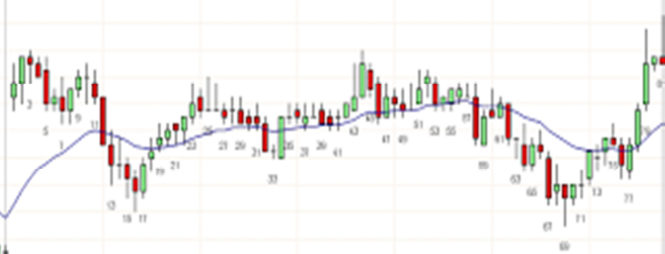
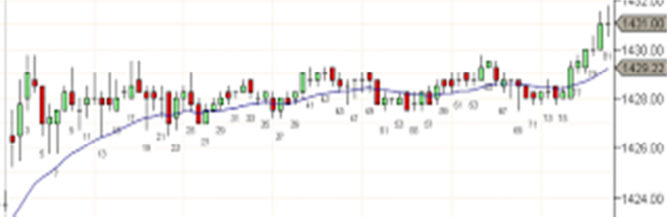
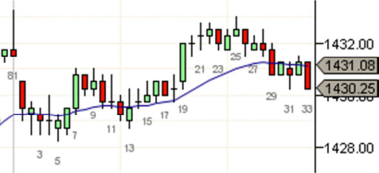
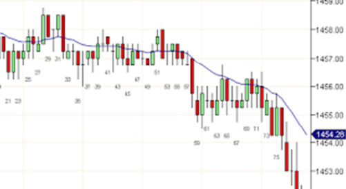
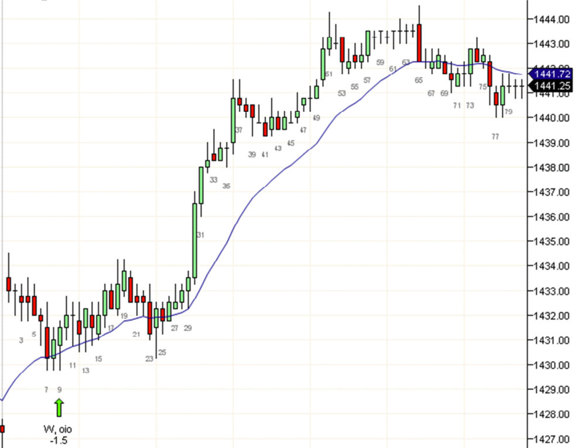

[← Previous](27-2012-07.md) · [Contents](00-目录.md) · [Next →](29-2012-10.md)

# September 2012

Original pages 395–398

<!-- p.395 -->

## The road ahead

Saturday, September 22, 2012 · p.395

My frequency of posting has reduced in the past few months but rest assured, with the generous help from my small research team, I'm actively working on bringing several important facets of trading to light.

A small selection of currently active research areas are listed below:

Trading Channels:

One of the most important problems in price action trading is to trade channels using a small fixed stop without resorting to scaling-in or other poor habits. Since channels are common, this is a top research priority.

Predict tight days that aren't worth trading:

Some days are extremely tight and on a day with a four point range with choppy overlapped price action, trading is dangerous. Predicting such a day early enables us to stay out and skip trading.

<!-- p.396 -->

Predict choppy opens that are likely to result in stopped out trades:

Opens that otherwise look like potential setups may never generate a profit and may stop you out or enter a chop zone. Correctly detecting this enables you to skip trading until price action becomes more amenable to trading. This chart is the AM of the FOMC day that eventually led to a huge rally.

Predicting Breakouts:

One of the hardest problems in price action is predicting which bar would lead to a successful break-out. For example in this chart, b57 short led to a breakout while every other signal prior to it failed. A high probability prediction of a breakout enables us to judiciously enter a profitable swing trade.

And more: I'm also working on exiting losing trades for breakeven or a few ticks loss by detecting trade failure early. The setups 1Rev and 1PB have been further broken down into a small set of distinct setups that enable the trader to anticipate and trade them bar-by-bar. As soon as these setups complete the requirements of rigorous testing, they will be published here in a series of blog posts.

<!-- p.397 -->

## Components of a successful trade

Thursday, September 27, 2012 · p.397

A trader needs to determine 4 important attributes for a successful trade:

- Direction
- Probability
- Room for profit
- Stop

Direction is obvious. If you are on the wrong side of the market, your chances of a scalp trade are smaller and chances of a swing trade are nil. A simple way to determine direction is to draw a trendline and trade only when the price tests the trendline. Trendlines should be drawn from the start of the move. Most days, this would be from the LOD or HOD but some days such as today, the beginning of the move could be a different bar such as b24. Experienced traders can also detect a reversal such as the three push reversal at b9 and trade the reversal of a trend. New traders should skip reversals and take the first reasonable pullback after the successful reversal (b24).

Probability of success takes slightly more experience to judge. On most days, after determining the market is in a trend, you can take every two legged pullback such as b44 until the trend breaks (a sustained move beyond the trendline). On hard trend days, you can take any pullback and any small signal bar in the direction of the trend as long as the entry side of the signal bar does not have a large tail.

<!-- p.398 -->

Room for profit takes quite a bit of experience to judge. In a normal trend, a pullback can be expected to at least take out the prior extreme by one tick and therefore a deep pullback is likely to give sufficient profit. However in hard trends and large gap opens, even a couple of ticks may give a decent profit. High volatility and clean patterns are friends when it comes to profit targets. Barbwire and tiny bars are terrible enemies and greatly interfere with profit target estimation.

Stop size is possibly the hardest to correctly determine. Signal bar stops often work but could be too large from a risk:reward perspective. A fixed stop is easy to use for clear patterns and strong bars but very hard for channels and overlapped bars. For example, despite correctly reading the low of the day today, my stop was short by 1t resulting in a losing trade and missing out on a great swing setup.

Taking a fixed stop and continuously keeping track of market direction using the nine transitions means you only look for probability and profit target when entering a trade. Passing up shallow pullbacks means you only need to focus on probability, which boils down to looking for a clear set of patterns and strong signal bars.

The fewer parameters involved in your decision making, the more confident you will be in your decisions and help you become a successful trader.

---

[← Previous](27-2012-07.md) · [Contents](00-目录.md) · [Next →](29-2012-10.md)
