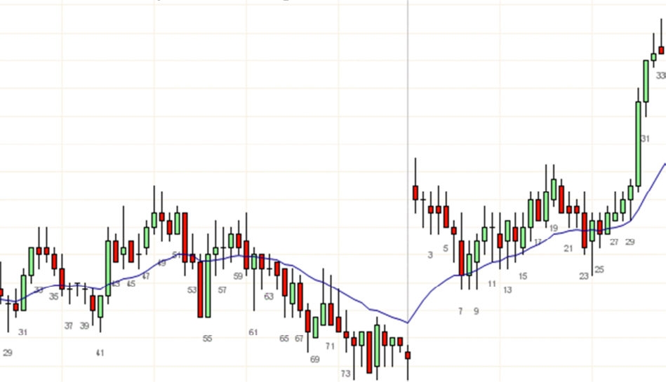
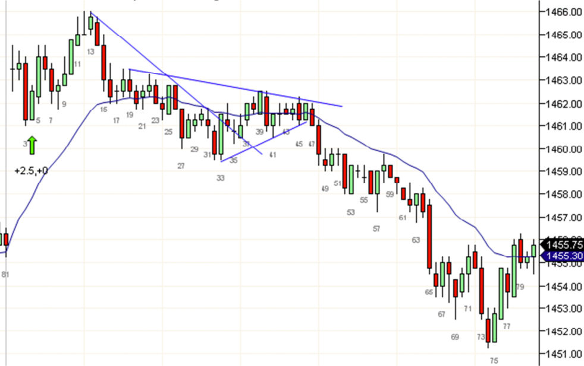
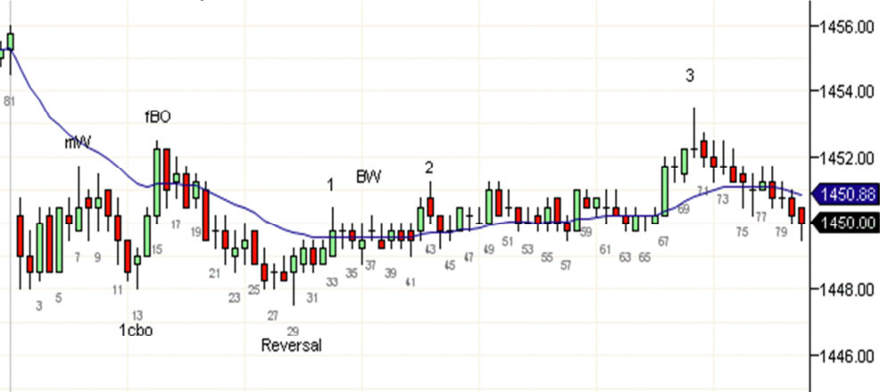
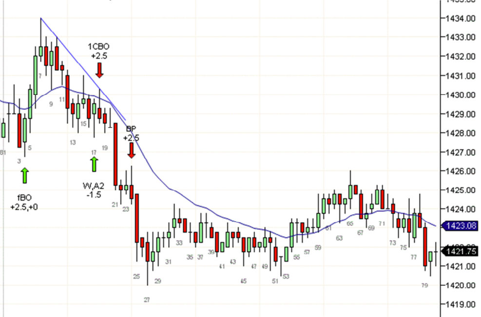
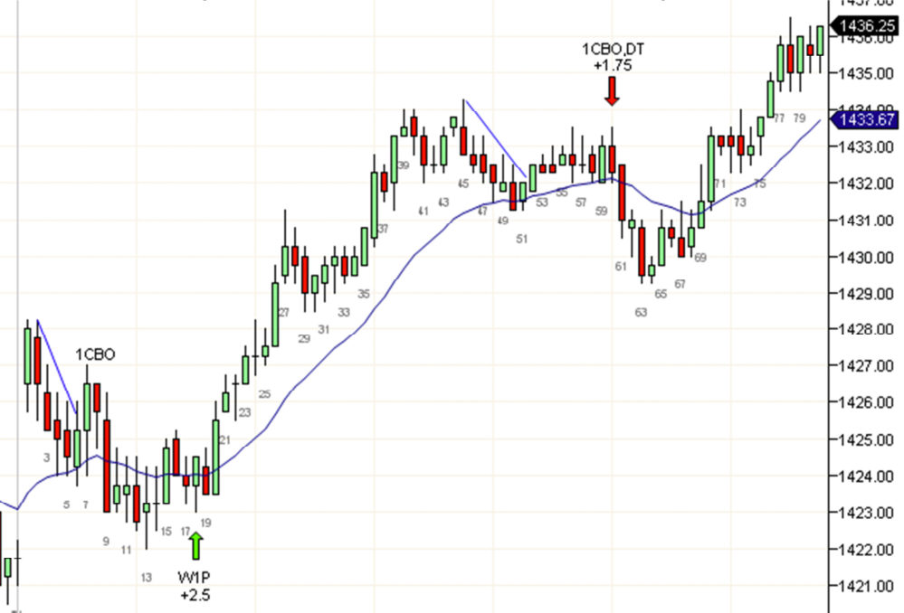
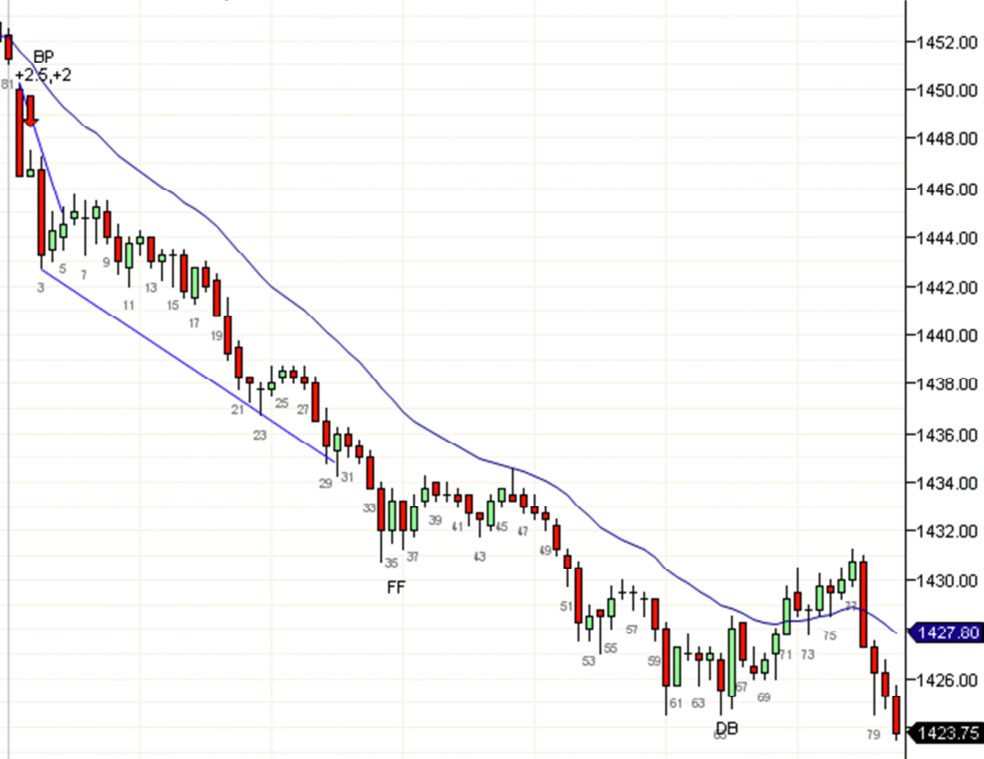
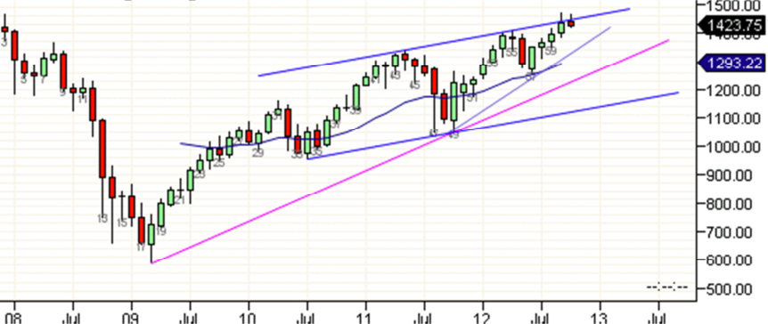

[← Previous](28-2012-09.md) · [Contents](00-目录.md)

# October 2012

Original pages 399–405

<!-- p.399 -->

## Channel Theory I - Defining channels

Thursday, October 4, 2012 · p.399

Channels are heavily overlapped regions of price action that drift up or down in a chart. If the region did not drift, it would simply be BW. Channels are important because unlike BW which can only be scalped for a few ticks or a couple of points, channels do trend and can be traded for enough points to justify the risks of entering a trade. The goal is to trade channels with a fixed size stop such that the potential profit is larger than the risk taken with a high probability of success.

Channels generally have the following characteristics:

Multi-bar overlap: It is common for a bar to be overlapped by many following bars. For example, on the day on the right, b7 was overlapped by every bar except b1 and b19 until it finally broke out of the channel.

Tails: You are likely to encounter bars with tails on both sides, regardless of color. These tails look like a trend is just about to break when watched mid-bar and then the bar will close with the opposing color, leading to poor mid-bar decisions. Never make mid-bar decisions, especially in a channel.

Alternating bar colors: True channels have alternating colored bars with some dojis thrown in. Channels without opposing colored bars are Trend Channels (TC) and are actually simply trends. You can trade with-trend on the close of any small bar in TC but in a true channel you are likely to be stopped out if you use a fixed size stop. True channels that form a leg are leg channels (LC). Sometimes a channel is so wide that it looks like a sloping trading range. These are trading range channels (TRC).

Unpredictable behavior: Channels may reverse (b19), break out (b30), may turn into any other type price action and are generally hard to predict.

The primary goal of trading channels is to determine the following:

1. Origin: Detect PA turning into a channel and determine direction.
2. Reversal: Channel may reverse direction while remaining a channel.
3. Breakout: Channel breaks into a steep trend move. This is the most important.

<!-- p.400 -->

While even simple detection of a channel is valuable because it enables you to avoid getting chopped up, detecting breakouts and sharp moves intra-channel allow you to maximize your profits if you wish to trade channels. In the coming days, we shall see how each of these may be achieved.

## Channel Theory II - Origin

Friday, October 5, 2012 · p.400

Once we have a definition of a channel, we can apply that to detect when price action displays signs of turning into a channel. In general, when the signal and entry bars are poor, i.e. overlapped and taily, I watch for channel formation.

Since in normal trends signal and entry bars are clearly not overlapped (b4,5 or b6,7 or b8,9), any heavy overlap of signal and entry bars should put you on guard. In particular if the entry bar and the next two bars overlap the signal bar, you have certainly entered a channel. Therefore on this day, at b20, you have already detected a channel. Detecting channels is not complete until channel direction is also determined. This is trickier to do in real-time since what looks like a channel down simply completes a structural requirement of say three legs and then changes direction. A channel direction is canonically determined when you can draw a channel trendline. The earliest direction estimate comes from two LL and a LH or two HH and a HL. Therefore today you would confirm a downward channel at b24. Sometimes what looks like a channel can quickly turn into a triangle or expanding triangle and trap you if you enter too early. Conflicting channel trendlines (shown above) are common during the nacent phase of the channel. This is a common cause of stop-outs and finding oneself on the wrong side of the market. While the trendline from the start of the move (b13) is usually the best trendline for big picture, channels often test the trendline from channel start (b19).

Never get trapped into thinking that a channel has reversed on the first attempt and trade the newly turned trendline (b33-41). These succeed rarely.

<!-- p.401 -->

Once you are in a channel, you need to switch your trading to channel mode. Practices that are poor in normal trading such as fading bars become viable in channels and practices that are good in normal trading such as fixed stops and entering on signal bar breakouts lose their strength in a channel. You could simply wait for price action to break out of channel mode and then look for an entry. When a pullback no longer overlaps the signal bar (b47) you can safely take with trend entries without fear of being stopped out (b59 s, b64s).

## Channel Theory III - Transitions

Monday, October 8, 2012 · p.401

Once we detect price action has entered a channel, we should be able to follow its transitions just like regular price action. Anything you expect to see in a normal price action, you can also see in a channel.

Channels are often wedges and most channel moves can terminate on 3 pushes. This is not very simple to read since each push could be composed of complex legs and pullbacks. For example, on the chart today, we have a W33,43,72 from b29 where each leg is made of tiny overlapped legs and extended pullbacks such as the one from b43 to b57.

True channel reversals on the first attempt such as the one at b29 are rare except at a significant support or resistance (LOD in case of b29).

Channels are often very tiny trends and like their bigger cousins can terminate without real reversal. For example, the sustained move beyond the TL to b33 broke the channel down and the price moved horizontally waiting to breakout. Channels may attempt to breakout into regular trends (b14-15) and often succeed in exiting channel mode.

Continuation trades in channels are fairly hard and usually not worth the risk:reward. (This is still an area of research at present and we may be able to trade these in the future). Quite a bit of the issue is due to the inability to predict the slope of the channel. A steep slope such as the channel down from b18 may be worth taking the effort but an extremely shallow channel such as the one up from b29 will usually mentally exhaust the trader waiting for profit to be reached.

A much better option is to attempt to predict breakouts. Correctly predicting a breakout at b67 for example, would allow us to enter precisely for the best results and avoid prior attempts. Some breakouts of channels are large and expand the day's range by more than twice the prior range.

<!-- p.402 -->

## Channel Theory IV - Tradable Channels

Friday, October 12, 2012 · p.402

One way to characterize channel activity is to define them in terms of volatility. While normal clean trends have high inter-swing volatility and low inter-bar volatility, channels have the reverse. From a visual perspective, this means that every swing in a channel goes only a few ticks further than the prior swing (b36,40) but the pullbacks are deep enough to possibly stop you out. This means that any arbitrary entry in a channel is at a higher risk to take out a fixed stop even if it respects a bar stop.

The risk of stop out is inversely proportional to the slope of the channel and directly proportional to the bar size and overlap. For example, you are at a higher risk of being stopped out of a short in the channel down from b33 than in a short in a channel down from b10.

The probability of profit is higher if there were recent large trend bars. Any large trend bars (b12) that follows a channel activity (b7-11) show energy and interest and the chances of a failure of such a trend bar (b17) or a continuation (b18) leading to a trend breakout are high.

Channel activity in the absence of large bars is highly susceptible to random drifts and reversals (b27-79) and chances of a break into a large trend are lower.

In summary, tradable channels are steeper, have recent large trend bars and have smaller bars compared to their swings.

<!-- p.403 -->

## Channel Theory V - 1st Channel breakouts usually fail

Monday, October 15, 2012 · p.403

Channels with small trend bodies such as b21-25 obviously constitute a larger trend bar in a higher timeframe and you can often buy above any small bar with a strong close with a stop below that bar. Such channels are called Trend channels (TC) and often are the easiest to trade. In particular, a small trend bar with a strong close that touches a trendline or a micro-trendline is likely to give a large trend bar after it and makes an excellent swing entry (b34).

On the other hand, bars with tails on both ends such as b2-5 and b45-49 should be viewed as sloping barbwire or barb wire channels (BWC). These should be traded just like BW. The first break against the channel is likely to fail and can be taken for a second leg down (b60) unless its against support such as ema or close of prior day (b8).

A second attempt to break is often successful (b15) and a HL after a successful reversal (b18,b68) are often the safest entries.

<!-- p.404 -->

## Channel Theory VI - Channels are forever

Friday, October 19, 2012 · p.404

A channel after a strong spike such as today should be expected to last forever. While its true that often channels end up breaking (such as the move from b66-77 today), the fact of the matter is channels last forever because they constantly attempt to reverse and fail. The very uncertain nature of channels can trick you into reading all sorts of reversals if you just look at it the right way. For example, is b4-7 a trendline break followed by a test of the low at b11 and a strong reversal bar? Is b30 a 3rd push and TCL OS and therefore a W reversal? is b34-37 a FF and therefore end of the trend? is b66 a DB? Yes, they were all potential reversals and yet the market made new lows well into the close. You have to realize that every reversal signal in a channel is a trap. Traders who are used to trading counter-trend at bottom of trading ranges will find themselves buying all the way into the hole on a day like this. The trick to trading a channel such as this is to expect every reversal to fail and take the failure in the direction of the channel. So for example, while b13 would be hard to enter due to overlap, b18,26 were acceptable signals. b46 certainly was a 2L pb to ema. b77 was G2 (deep PB after strong move). The only time you can actually take a trade opposite to the channel is after a sustained break of the channel and a HL. So if the move down from b77 had given a 2 or 3L HL, you may take it for another leg up. A 1L move should never be taken since it can fail and result in a 2L move very quickly. If you missed an entry, you can often enter beyond a small trend bar as long as its not too far from the trendline or ema. For example, b19 and b29, b47, b50 are ok entries. But the best way to trade such a channel is to swing a contract from an early entry and hold it till the end of the day or an obvious reversal.

<!-- p.405 -->

## Predicting longer term moves

Saturday, October 20, 2012 · p.405

Its easier to make predictions on long term moves than to be able to successfully capitalize on it. That's not saying much because longer term predictions often are apparent only post-facto.

The above chart is a monthly chart of the ES 12-12 contract and note that the last bar is an incomplete October bar (i.e. we are mid-bar).

From a structural view, we have had a spike or trending channel from around Mar of 2009 to Apr 2010 and then we have a channel phase. The channel lines are shown in blue. At present, we have poked above the channel line on the third push. We should likely get at least two pushes down. Often the lower trend line (blue) is the target. The most pessimistic scenario is that the move will test the start of the channel near Jul 2010.

Given that this is a monthly chart, this could mean a big drop if this happens suddenly or a prolonged horizontal to down move over the next year or so. A bit more optimistic scenario is that the magenta trendline from the start of the move acts as a support (especially on a 2L or 3L approach) and continues to push the market up. Even more optimistic scenario is that the steep purple trendline combined with ema arrests any down move and continues the move up.

The most optimistic scenario is that the upper TCL will fail to contain the move up and give a rally up by an equivalent amount as the last up move. Such failures are extremely rare and only occur after a lot of violent up and down moves.

Given we have three pushes in a channel and there has not been any recent violent up and down move, my guesstimate is that we will dip below the magenta line and probably also test the channel trendline.

The summary here is that there is lot of good trading in store for 2012 Nov and Dec is unlikely to be a dead market.

Long term investors could take puts on their positions unless they want to exit them. The proceeds of these puts can be used to add on to the same stock positions when the market bounces at long term support.

---

[← Previous](28-2012-09.md) · [Contents](00-目录.md)
