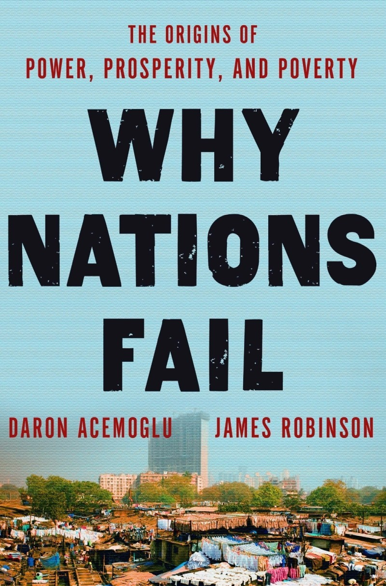
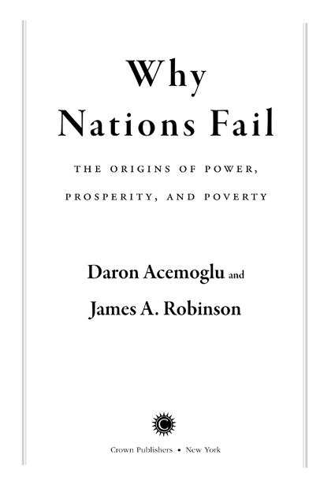
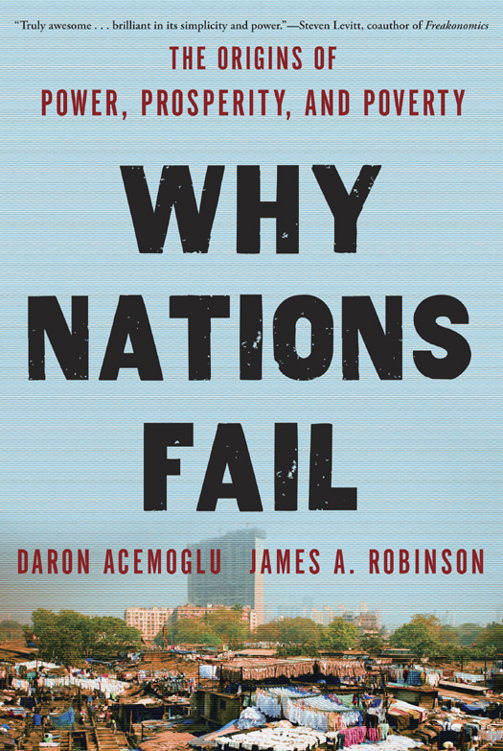

# Front Matter

# PRAISE FOR Why Nations Fail

“Acemoglu and Robinson have made an important contribution to the debate as to why similar-looking nations differ so greatly in their economic and political development. Through a broad multiplicity of historical examples, they show how institutional developments, sometimes based on very accidental circumstances, have had enormous consequences. The openness of a society, its willingness to permit creative destruction, and the rule of law appear to be decisive for economic development.”

<strong>—Kenneth J. Arrow, Nobel laureate in economics, 1972</strong>

“The authors convincingly show that countries escape poverty only when they have appropriate economic institutions, especially private property and competition. More originally, they argue countries are more likely to develop the right institutions when they have an open pluralistic political system with competition for political office, a widespread electorate, and openness to new political leaders. This intimate connection between political and economic institutions is the heart of their major contribution, and has resulted in a study of great vitality on one of the crucial questions in economics and political economy.”

<strong>—Gary S. Becker, Nobel laureate in economics, 1992</strong>

“This important and insightful book, packed with historical examples, makes the case that inclusive political institutions in support of inclusive economic institutions is key to sustained prosperity. The book reviews how some good regimes got launched and then had a virtuous spiral, while bad regimes remain in a vicious spiral. This is important analysis not to be missed.”

<strong>—Peter Diamond, Nobel laureate in economics, 2010</strong>

“For those who think that a nation’s economic fate is determined by geography or culture, Daron Acemoglu and Jim Robinson have bad news. It’s manmade institutions, not the lay of the land or the faith of our forefathers, that determine whether a country is rich or poor. Synthesizing brilliantly the work of theorists from Adam Smith to Douglass North with more recent empirical research by economic historians, Acemoglu and Robinson have produced a compelling and highly readable book.”

<strong>—Niall Ferguson, author of</strong> <strong><em>The Ascent of Money</em></strong>

“Acemoglu and Robinson—two of the world’s leading experts on development—reveal why it is not geography, disease, or culture that explain why some nations are rich and some poor, but rather a matter of institutions and politics. This highly accessible book provides welcome insight to specialists and general readers alike.”

<strong>—Francis Fukuyama, author of</strong> <strong><em>The End of History and the Last Man</em></strong> <strong>and</strong> <strong><em>The Origins of Political Order</em></strong>

“A brilliant and uplifting book—yet also a deeply disturbing wake-up call. Acemoglu and Robinson lay out a convincing theory of almost everything to do with economic development. Countries rise when they put in place the right pro-growth political institutions and they fail—often spectacularly—when those institutions ossify or fail to adapt. Powerful people always and everywhere seek to grab complete control over government, undermining broader social progress for their own greed. Keep those people in check with effective democracy or watch your nation fail.”

<strong>—Simon Johnson, coauthor of</strong> <strong><em>13 Bankers</em></strong> <strong>and professor at MIT Sloan</strong>

“Two of the world’s best and most erudite economists turn to the hardest issue of all: why are some nations poor and others rich? Written with a deep knowledge of economics and political history, this is perhaps the most powerful statement made to date that ‘institutions matter.’ A provocative, instructive, yet thoroughly enthralling book.”

<strong>—Joel Mokyr, Robert H. Strotz Professor of Arts and Sciences and Professor of Economics and History, Northwestern University</strong>

“In this delightfully readable romp through four hundred years of history, two of the giants of contemporary social science bring us an inspiring and important message: it is freedom that makes the world rich. Let tyrants everywhere tremble!”

<strong>—Ian Morris, Stanford University, author of</strong> <strong><em>Why the West Rules—for Now</em></strong>

“Imagine sitting around a table listening to Jared Diamond, Joseph Schumpeter, and James Madison reflect on more than two thousand years of political and economic history. Imagine that they weave their ideas into a coherent theoretical framework based on limiting extraction, promoting creative destruction, and creating strong political institutions that share power, and you begin to see the contribution of this brilliant and engagingly written book.”

<strong>—Scott E. Page, University of Michigan and Santa Fe Institute</strong>

“In this stunningly wide-ranging book, Acemoglu and Robinson ask a simple but vital question, why do some nations become rich and others remain poor? Their answer is also simple—because some polities develop more inclusive political institutions. What is remarkable about the book is the crispness and clarity of the writing, the elegance of the argument, and the remarkable richness of historical detail. This book is a must-read at a moment when governments across the Western world must come up with the political will to deal with a debt crisis of unusual proportions.”

<strong>—Steven Pincus, Bradford Durfee Professor of History and International and Area Studies, Yale University</strong>

“It’s the politics, stupid! That is Acemoglu and Robinson’s simple yet compelling explanation for why so many countries fail to develop. From the absolutism of the Stuarts to the antebellum South, from Sierra Leone to Colombia, this magisterial work shows how powerful elites rig the rules to benefit themselves at the expense of the many. Charting a careful course between the pessimists and optimists, the authors demonstrate history and geography need not be destiny. But they also document how sensible economic ideas and policies often achieve little in the absence of fundamental political change.”

<strong>—Dani Rodrik, Kennedy School of Government, Harvard University</strong>

“This is not only a fascinating and interesting book: it is a really important one. The highly original research that Professors Acemoglu and Robinson have done, and continue to do, on how economic forces, politics, and policy choices evolve together and constrain each other, and how institutions affect that evolution, is essential to understanding the successes and failures of societies and nations. And here, in this book, these insights come in a highly accessible, indeed riveting form. Those who pick this book up and start reading will have trouble putting it down.”

<strong>—Michael Spence, Nobel laureate in economics, 2001</strong>

“This fascinating and readable book centers on the complex joint evolution of political and economic institutions, in good directions and bad. It strikes a delicate balance between the logic of political and economic behavior and the shifts in direction created by contingent historical events, large and small, at ‘critical junctures.’ Acemoglu and Robinson provide an enormous range of historical examples to show how such shifts can tilt toward favorable institutions, progressive innovation, and economic success or toward repressive institutions and eventual decay or stagnation. Somehow they can generate both excitement and reflection.”

<strong>—Robert Solow, Nobel laureate in economics, 1987</strong>

## Title Page

## Copyright

Copyright © 2012 by Daron Acemoglu and James A. Robinson

All rights reserved.

Published in the United States by Crown Publishers, an imprint of the Crown Publishing Group, a division of Random House, Inc., New York.

[www.crownpublishing.com](http://www.crownpublishing.com)

CROWN and the CROWN colophon are registered trademarks of Random House, Inc.

Library of Congress Cataloging-in-Publication Data Acemoglu, Daron. Why nations fail : the origins of power, prosperity, and poverty / Daron Acemoglu, James A. Robinson.—1st ed. p. cm. Includes bibliographical references. 1. Economics—Political aspects. 2. Economic history—Political aspects. 3. Poverty—Developing countries. 4. Economic development—Developing countries. 5. Revolutions—Economic aspects. 6. Developing countries—Economic policy. 7. Developing countries—Social policy. I. Robinson, James A., 1960–. II. Title. HB74.P65A28 2012 330—dc23 2011023538

eISBN: 978-0-307-71923-2

Maps by Melissa Dell Jacket design by David Tran Jacket photograph by Kirk Mastin/Getty Images

v3.1

## Dedication

<em>For Arda and Asu</em>—DA

<em>Para María Angélica, mi vida y mi alma</em>—JR

## Cover

