

# Photo Inserts

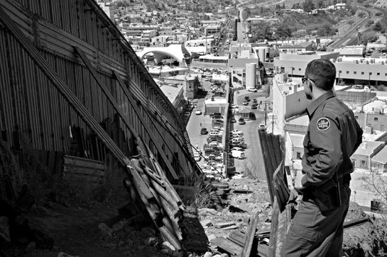

North of the fence: Nogales, Arizona Jim [West/imagebroker.net/Photolibrary](http://West/imagebroker.net/Photolibrary)

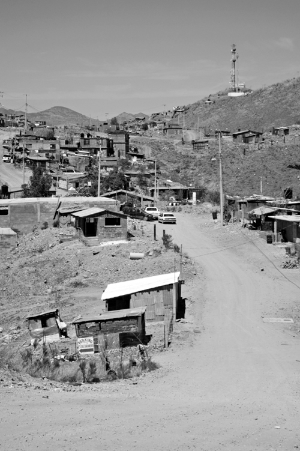

South of the fence: Nogales, Sonora Jim [West/age fotostock/Photolibrary](http://West/age%20fotostock/Photolibrary)

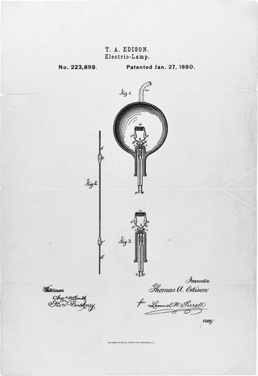

Consequences of a level playing field: Thomas Edison’s 1880 patent for the lightbulb Records of the Patent and Trademark Office; Record Group 241; National Archives

Economic losers from creative destruction: machine-breaking Luddites in early-nineteenth-century Britain Mary Evans Picture Library/Tom Morgan

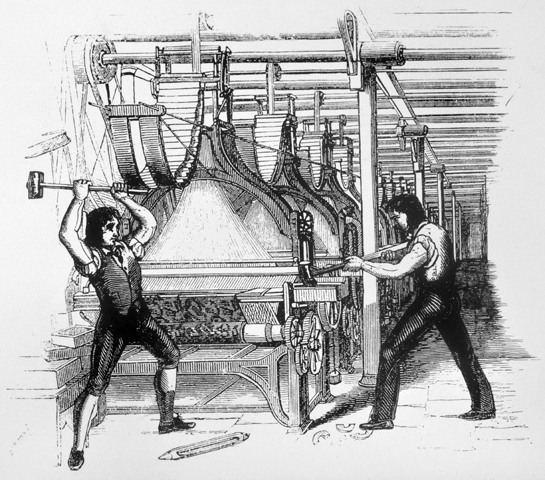

Consequences of a complete lack of political centralization in Somalia REUTERS/Mohamed Guled/Landov

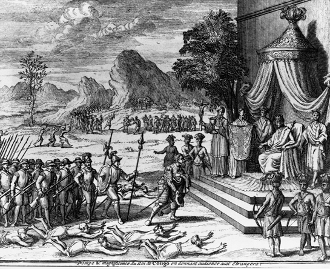

Successive beneficiaries of extractive institutions in Congo:

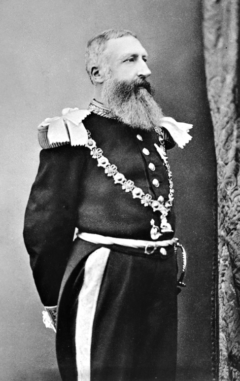

King of Kongo © CORBIS King Leopold II The Granger Collection, NY

Joseph-Désiré Mobutu © Richard Melloul/Sygma/CORBIS

Laurent Kabila © Reuters/CORBIS

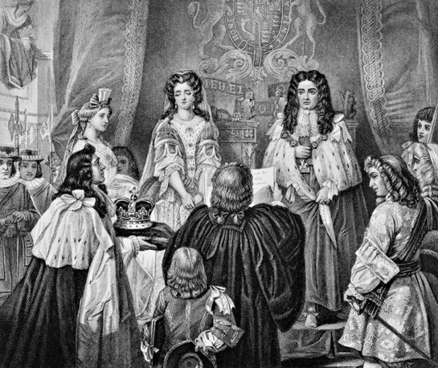

The Glorious Revolution: William III of Orange is read the Bill of Rights before being offered the crown of England by parliament After Edgar Melville Ward/The Bridgeman Art Library/Getty Images

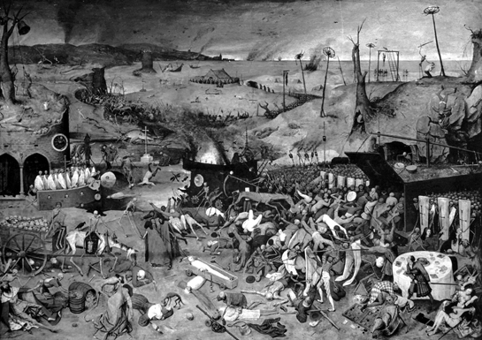

The bubonic plague of the fourteenth century creates a critical juncture (<em>The Triumph of Death</em> painting of the Black Death by Brueghel the Elder) The Granger Collection, NY

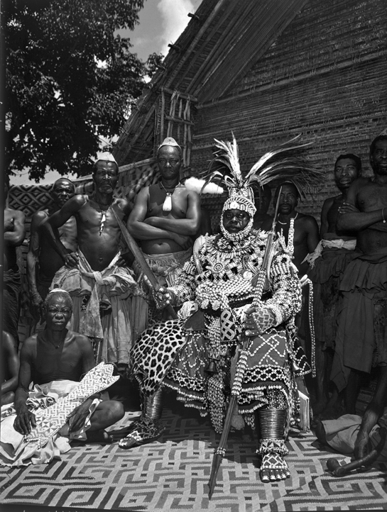

Beneficiary of institutional innovation: the King of Kuba Eliot Elisofon/Time &amp; Life Pictures/Getty

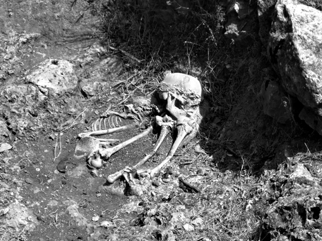

The emergence of hierarchy and inequality before farming: the grave goods of the Natufian elite [http://en.wikipedia.org/wiki/File:Natufian-Burial-ElWad.jpg](http://http://en.wikipedia.org/wiki/File:Natufian-Burial-ElWad.jpg)

Extractive growth: Soviet Gulag labor builds the White Sea canal SOVFOTO

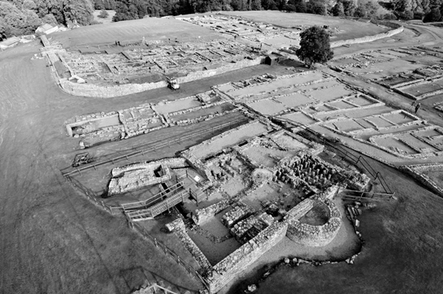

Britain falls far behind: the ruins of the Roman empire at Vindolanda Courtesy of the Vindolanda Trust and Adam Stanford

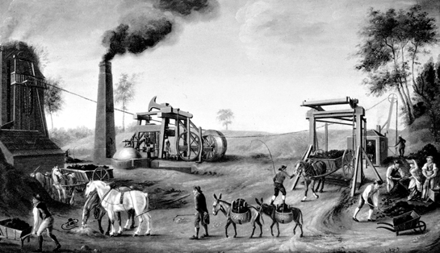

Innovation, essence of inclusive economic growth: James Watt’s steam engine The Granger Collection, NY

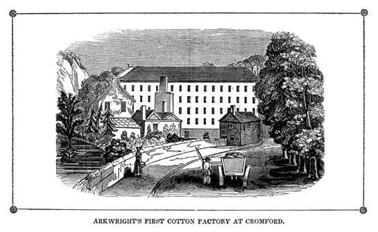

Organizational change, a consequence of inclusive institutions: the factory of Richard Arkwright at Cromford The Granger Collection, NY

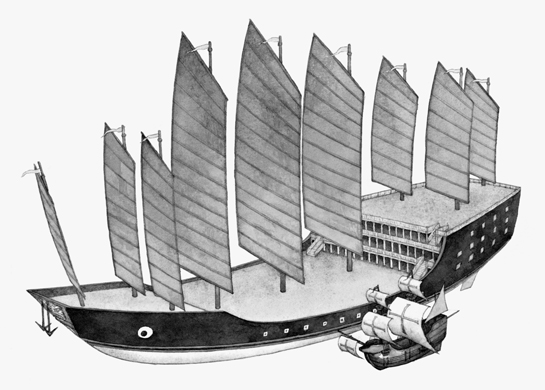

Fruits of unsustainable extractive growth: Zheng He’s ship alongside Columbus’s <em>Santa Maria</em> Gregory A. Harlin/National Geographic Stock

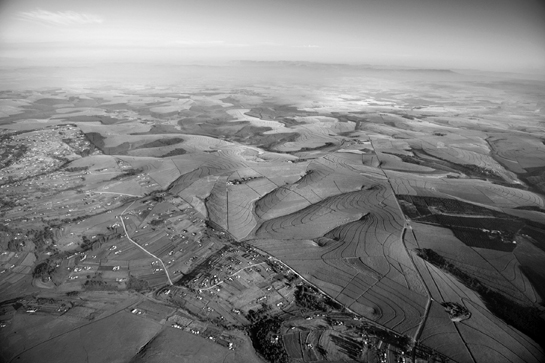

Bird’s-eye view of the dual economy in South Africa: poverty in Transkei, prosperity in Natal Roger de la Harpe/Africa Imagery

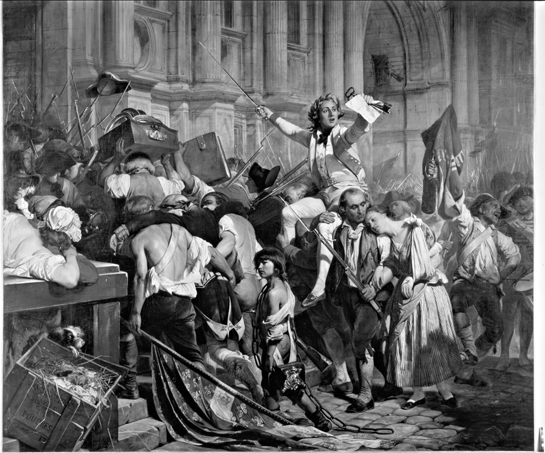

Consequences of the Industrial Revolution: the storming of the Bastille Bridgeman-Giraudon/Art Resource, NY

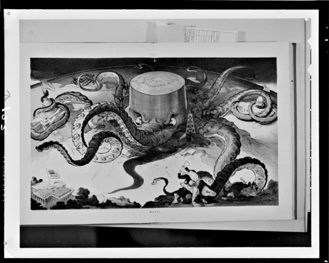

Challenges to inclusive institutions: the Standard Oil Company Library of Congress Prints and Photographs Division Washington, D.C.

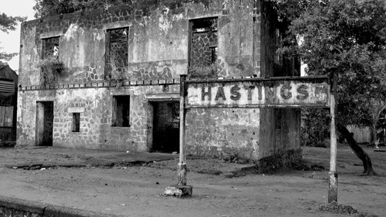

Noncreative destruction: abandoned Hasting railway station on the way to Bo in Sierra Leone © Matt Stephenson: [www.itsayshere.org](http://www.itsayshere.org)

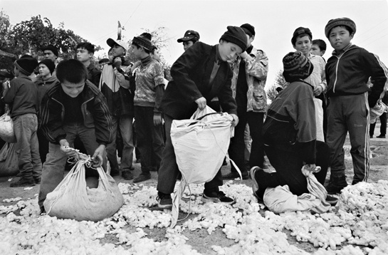

Extractive institutions today: children working in an Uzbek cotton field Environmental Justice Foundation, [www.ejfoundation.org](http://www.ejfoundation.org)

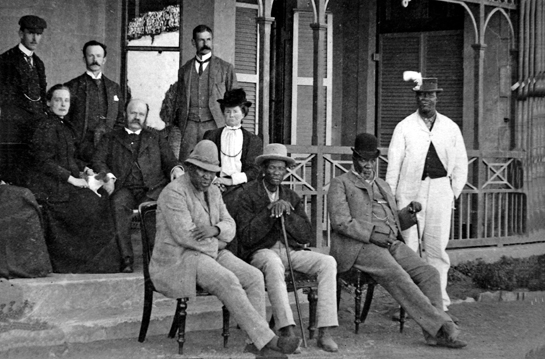

Breaking a mold: three Tswana chiefs on their way to London Photograph by Willoughby, courtesy of Botswana National Archives &amp; Records Services

Breaking another mold: Rosa Parks challenges extractive institutions in the U.S. south The Granger Collection, NY

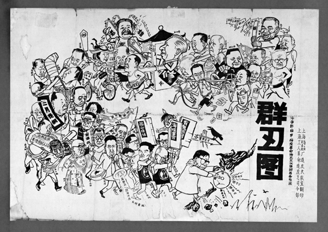

Extractive institutions devour their children: the Chinese Cultural Revolution vs. “degenerate intellectuals” Weng Rulan, 1967, IISH Collection, International Institute of Social History (Amsterdam)
