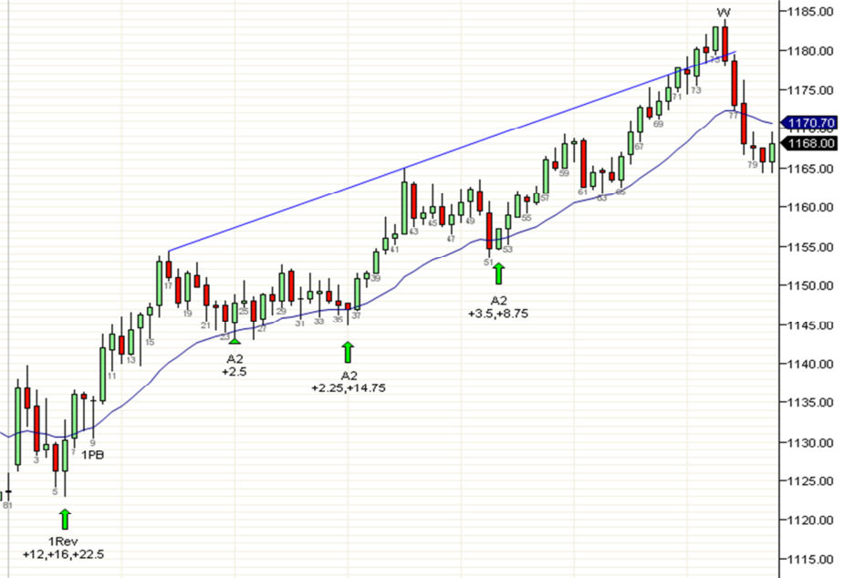

[目录](00-目录.md) · [下一章 →](02-术语表.md)

# 九种转换

原书第 1–6 页

**Emini 价格行为交易 — 2010–2012 文章汇编**

市场在任何时候都可能朝三个方向中的一个方向移动：上涨、下跌或空仓。在此基础上，它可能转换到任何其他方向，或者在现有方向上延续。

因此，价格可能出现九种可能的转换。

“Cadaver”

<http://ninetrans.blogspot.com>

---

[目录](00-目录.md) · [下一章 →](02-术语表.md)
