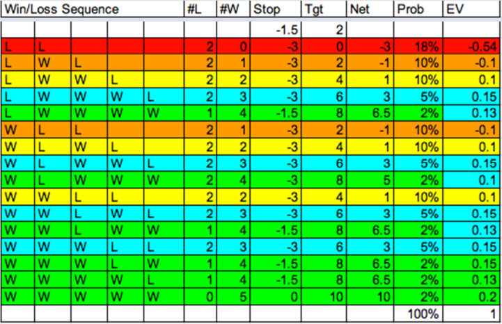

[← 上一章](03-价格行为交易.md) · [目录](00-目录.md) · [下一章 →](05-交易指南.md)

# 1.3 建仓形态图

原书第 12–13 页

<!-- 原书第 12 页 -->

请先阅读：四笔交易 off 九种转换

|  | UP | FLAT | DOWN |
| --- | --- | --- | --- |
| **UP** | A2, 1CBO, hH1,G2,BT | TT | W,W1P |
| **FLAT** | BO | fBO | BO |
| **DOWN** | W, W1P | TT | A2, 1CBO, hL1,G2,BT |
| **BO** | TRI | XT | BP |
| **fBO** | WBO | 反转k线 | DP |
| **TT** | DT/DB, 1pb | TTR | fRev+fA2, 1rev |

行为原方向，列为转入方向。

此图表描述了我从九种转换中的所有建仓形态。当趋势上涨时，我会在正常趋势中寻找 A2 ，在通道走势中寻找1chbo，在强势趋势中寻找 H1 ，以及在深度回撤中寻找 G2 。我还会在趋势以趋势终结（TT）的走势结束时寻找退出和保持观望，例如双顶、TTR 或弱反转后跟随弱 A2。如果存在楔形走势和反转，我将寻找 W 和 W1P 入场以进行反转。下跌趋势非常相似，只是所有的入场都是互补的。

当市场横盘或处于交易区间时，我正在寻找趋势突破。通常这些是三角形突破、扩张三角形突破和突破回撤。

如果区间足够大，我可能会考虑 fBO 交易。这些交易包括突破时的反转K线、双底回撤和两到三条腿的失效突破（WBO）。通常我不会进行这些交易，而是选择突破区间另一侧的交易。

TT 不是用来交易的，而是退出趋势头寸的信号。双顶或双底、TTR 移动或反转和延续交易但都没有后续跟进，是趋势终结最常见的信号。

除了以上内容，我还交易开盘时的当日首次反转和当日首次回撤，但这些都是复杂的主题，值得另辟文章详述。

<!-- 原书第 13 页 -->

## 两次止损

原书第 13 页

一个不错的胜率以及有利的盈利大小/亏损大小比例是积累利润的关键。胜率低的交易者很可能会进行极大量的交易。首先，一旦他被止损出场，他会立即寻找机会再次入场，并且常常处于情绪痛苦的状态，注定会加剧错误。讽刺的是，他交易的次数越多，他的表现可能就越差。交易者需要采取一些步骤来避免落入这个非常普遍的陷阱。第一，交易者应该寻找方向上的主要转折，而某一天不太可能出现超过五次。因此，交易者应该问自己的问题不是他是否认为市场会在接下来的一个或两个k线内上涨，而是这是否是方向上的主要改变。发现这些转折的能力要求交易者比平时交易得更少。一个交易者，如果他在顺势交易一个不重叠信号k线，且该k线在指数移动平均线或趋势线附近有强劲收盘，那么他很可能至少有50%的成功率。因此，如果你的成功率低于50%，首先要做的是什么都不交易。接下来你可以做的是采用“两次止损”政策。如果你亏损两次交易，当天就结束交易。如果你总共进行了五次交易，也应该当天结束交易。刚开始的时候，你可能会在前一个小时就完成你的交易额度，但随着时间的推移，你将能够占据更长的时间并专注于大行情。

上面的图表旨在说明，但展示了两次止损策略如何在一个-1.5 止损和一个+2 目标下运作。从上面的图表可以看出，在很多天里，您很有可能两次止损，反之，在一些罕见的情况下，您可能会获得四次或五次盈利。近一半的时间，第一次交易预计会亏损，而近四分之三的时间，第一次或第二次交易会亏损。即便如此，每天的期望值（EV）约为一个点。上面的亏损策略可以缩写为2/5 （五次交易最多两次亏损）。您可以尝试其他变体，例如3/6 或多合约和多目标，或任何适合您交易风格的策略。请注意，正期望值是一个副作用，而这里的主要目标是提高您持续进行好的交易的能力，并专注于主要行情。请注意，很多日子里可能只有三到四笔交易，所以如果您获得的收益少于期望值，请不要惊讶。

请注意，-1.5 止损是根据我已验证的建仓形态调整的。其他建仓形态可能需要更宽的止损，但你的止损不应大于你的目标。更宽的止损很可能会对你的期望值产生负面影响，因此止损更宽的交易应具有非常大的期望值（例如 1 PB 或 W1P）。

---

[← 上一章](03-价格行为交易.md) · [目录](00-目录.md) · [下一章 →](05-交易指南.md)
