[← 上一章](05-交易指南.md) · [目录](00-目录.md) · [下一章 →](07-交易心理学.md)

# 1.5 价格行为基础

原书第 16–33 页

<!-- 原书第 16 页 -->

## 价格行为基础 I - K线选择

2011年9月13日 星期二 · 原书第 16 页

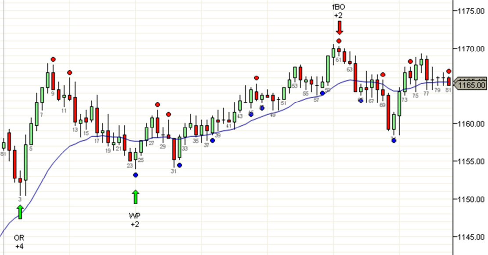

关于价格行为交易要学的最最重要的一点是信号K线选择。如果你只交易每一个形态良好的K线，你大多数日子都会赚钱。如果你只顺势交易形态良好的K线，你将持续盈利。在多头信号K线上方入场，止损设在其下方，反之亦然，用于空头K线。如果K线过大或过小，或有大量重叠，请使用 8 跳的金钱止损。

上方的指标会在任何合理的空头K线上方绘制一个红点，并在任何合理的多数K线上方绘制一个蓝点。自然，这意味着它会错过我一些重要的建仓形态，例如 b3 处的 OR/1反转，以及可能的 1PB 建仓形态。

如果你只交易这些K线，你的大部分交易都会盈利。你的亏损仅来自于 b45-47 震荡和可能的 b 74 L1。如果你将之前任何交易的合约进行了隔夜持仓，你可能整体上是赚钱的。

让我们加入一些常识来排除逆势交易以及强劲走势中的高点/低点。这只会产生亏损交易。再增加一个常识规则，不要在接近指数移动平均线或趋势线且你已经全胜日的情况下，进行浅的高点/低点顺势交易。

<!-- 原书第 17 页 -->

## 价格行为基础 II - 趋势中的反转和回撤

2011年9月14日 星期三 · 原书第 17 页

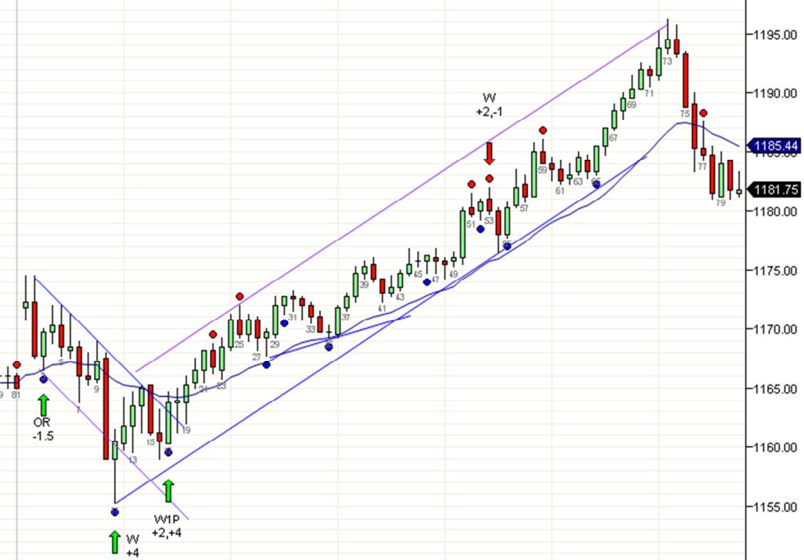

当市场处于趋势走势中时，它将继续保持趋势，直到出现非常强劲的过冲或非常清晰的趋势线突破。在趋势中，每一个逆势信号都可能是套牢，你应该忽略它并等待其失败。即使在明显的买入高潮之后出现了非常清晰明显的 W 形态，失败的风险也很高。在尝试任何逆势交易之前，需要出现像 [v2] 这样的明显过冲，或像 [v3]-[v4] 这样的明显趋势线突破并成功测试了极端高点。在看涨反转 [v7] 之后，失败的低点 \[v5\](\[v6\]) 是反转的有力确认，下一个买入信号通常足以进行波段交易。W 形态入场是你唯一需要的逆势交易，因为它通常会提供一个确认和一个随后的顺势 W 形态 [v8] 突破。在趋势中，每一个反转信号都可能只是一个回撤，而不是其他，直到逆势力量得到证明。你应该寻找接近指数移动平均线或趋势线的顺势信号。忽略远离它们的信号（[v9]），因为它们可能意味着回撤的另一条腿。

<!-- 原书第 18 页 -->

## 价格行为基础 III - 1次反转或开盘反转

2011年9月15日 星期四 · 原书第 18 页

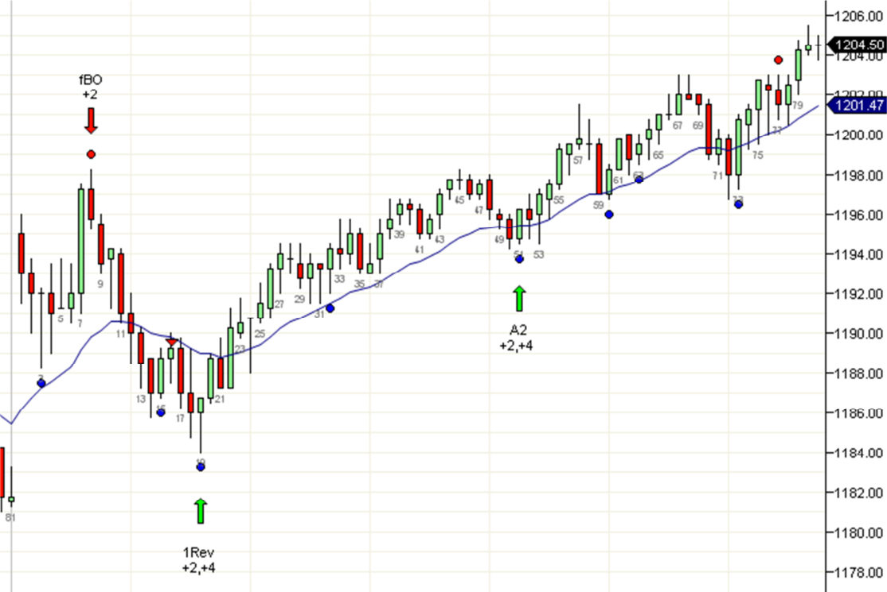

当交易日开盘时，一种选择是将其第一根k线视为一个交易区间，并观察b1的fBO和BP。如果BO 或fBO看起来有吸引力，它可能导致趋势，你应该抓住一个强烈的信号k线，例如b8 或b19。到日内另一极端的价格距离越大，趋势发展的几率就越高。因此，忽略b3 这样的信号，等待突破 HOD（此时是b1 ）并等待失败或BP是完全可以的。当波动可能是趋势走势（b8-b19）时，无论多么小，其反转都是一个1Rev，很可能导致当天的主要走势。由于1Revs可能失败，保守交易者可以在fBO或BO成功后采取1PB。换句话说，只在看涨反转后买入HL，在看跌反转后买入LH。今天的1PB将是b24, ，它不成形，因此可以接受跳过它并等待下一个建仓形态。只有当交易日另一极端被突破时，你才应该采取与主要趋势相符的建仓形态。此策略适用于几乎所有交易日，除了带有微小k线的窄幅交易区间。在那些交易日，很少有东西有效，价格行为入场有很高的失败率，所以如果前一两小时的区间非常小，最好跳过交易，尤其是如果开盘时没有缺口。

<!-- 原书第 19 页 -->

## 价格行为基础 IV：交易区间、趋势、fBO 和 BPs

2011年9月26日 星期一 · 原书第 19 页

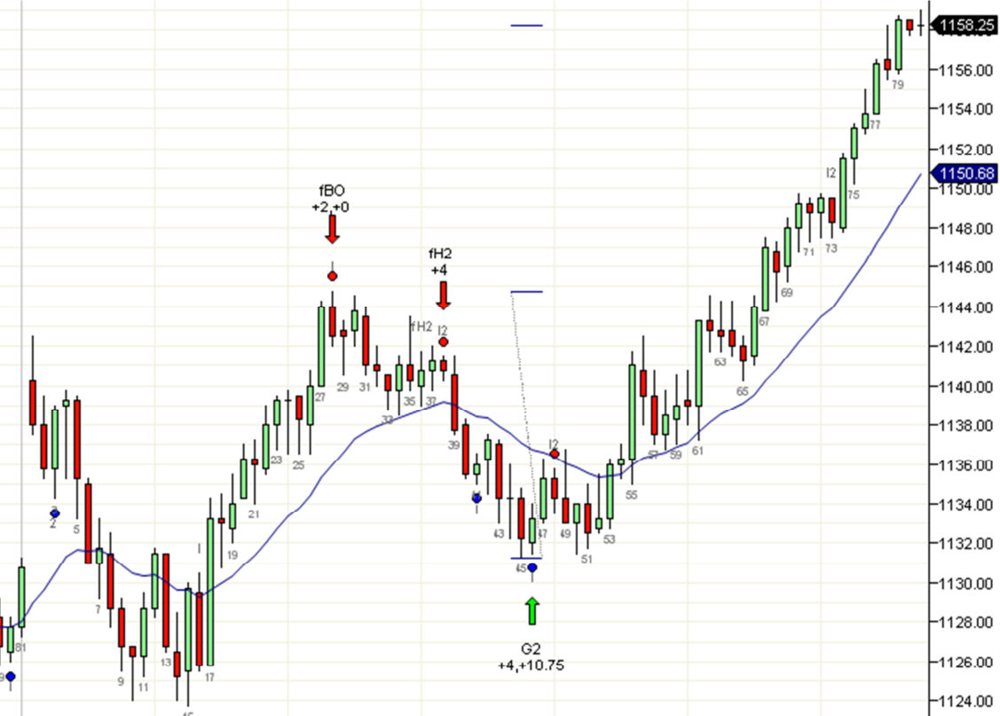

从交易区间突破是试图创造一个趋势，而其失败是回归交易区间内的走势。成功的突破导致趋势。同样，成功地未能恢复趋势导致一个交易区间。今天，b15 和b28 未能恢复趋势，而b67 是趋势的成功恢复。

每次突破后，交易者都需要决定是逆势交易突破还是在回撤时顺势进入。总的来说，在交易区间内，交易突破失败的交易更有可能成功，并且需要一些重要的信号来顺势交易突破。

这些信号是：

1. 突破强劲（即突破k线的一半或更多部分超出突破点）
2. 强劲收盘
3. 第二次尝试突破
4. 尝试失败的弱势

<!-- 原书第 20 页 -->

让我们逐一来看：

1. 强劲突破：b27 和b67 都是非常强劲的突破k线，但b67 超出突破点一半以上。即使b27 仅超出不到一半，但出现一次2 或3 腿回撤后进行第二次尝试上涨仍有很大可能。另一方面， b10 是一次带有弱势收盘的弱势突破
2. 强劲收盘：突破点之上的强劲收盘表明在突破点处没有足够的逆势订单。弱势收盘后紧随深度回撤（如b29-46）可能表明突破失败。像b10这样的弱势收盘表明有逆势订单在等待，而失败的第二次尝试（b15）很可能会寻找区间的另一端
3. 第二次尝试：第二次尝试比第一次尝试更强劲，而强劲收盘后的第二次尝试通常非常成功。未能突破区间另一端（b15 低点）的fBO（b28）应视为深度回撤，并可能预示趋势突破（ HH后的HL）。在出现类似b50的fL2 之后尤其如此
4. 尝试失败的弱势：b11 和b15 是强劲尝试突破失败的例子。通常，当第一次失败明显时（b11,12），第二次通常会走得更远（b15- b27）。如果突破k线之后的k线是反转k线或内包k线并且带有强劲收盘（如b28, ），则很有可能出现至少2 腿下跌，甚至可能是深度下跌。如果尝试突破失败的力度很弱（如b67, ）且未触发，则价格很有可能寻求前期区间的衡量移动（b28-45 在b79处达到）

<!-- 原书第 21 页 -->

## 价格行为基础 V：开盘缺口

2011年9月27日 星期二 · 原书第 21 页

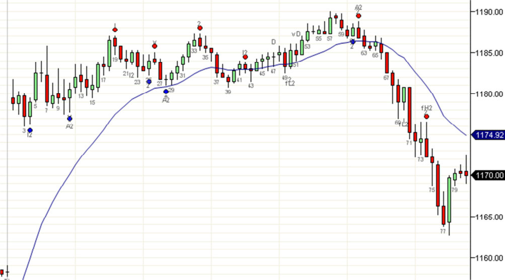

开盘是一个非常复杂的话题集，开盘缺口是当日价格行为信息的重要来源。有时，市场开盘价非常接近前一天收盘价（小于一个平均k线）。这通常可以像没有缺口一样进行交易，开盘仅仅是前一天价格行为的延续。通常，开盘价几乎总是离前一天收盘价有几个k线长度的距离。这是一个小缺口，通常这就像一个突破或趋势线突破。通常，市场试图回补小缺口，导致从缺口突破处回撤或在缺口趋势线突破后进行再测试。有时小缺口会延伸然后回补，这会导致反转后的长期趋势。当一个小缺口延伸时，你通常不知道它会走多远，但你总是知道反转将测试前一天的收盘价。给出开盘价在前一天实体内的缺口，尤其是中实体内，是可疑的。无论它们朝哪个方向趋势，它们很可能在当天某个时候反转。

换句话说，大多数交易日都会尝试趋势以收盘填补缺口。当然，如果尝试在两到三次内收盘填补缺口但失败，市场通常会朝相反方向出现大幅趋势。牢记以上几点对于正确确定 1Rev 非常重要。最后一种情况是大幅缺口（大约是当日的区间）。大幅缺口可能导致大幅趋势，如果它试图收盘填补缺口。如果它试图扩大缺口，它通常会表现为急速加通道，并以缺口作为急速的一部分。这通常意味着这是一个软趋势日。大幅跳空下跌可能会导致强势趋势，如果它试图扩大缺口。

然而，一个大的缺口只会形成一个交易区间，这可能导致在当天晚些时候出现缺口回补（就像今天的图表一样）。衡量一个大缺口趋势性好坏的一个好指标是第一根k线，如果它是一根平均大小的趋势k线，很可能导致一个大的趋势日。十字星或其他不好的k线，比如今天的 b1 ，通常预示着上午趋势不佳。确定当天可能的初期方向会提高你成功的 1Rev 和 1PB 入场的机会，进而让你能够追求更多的点数，并提高你的盈利能力。

<!-- 原书第 22 页 -->

## 价格行为基础 VI - 第一根k线

2011年9月28日 星期三 · 原书第 22 页

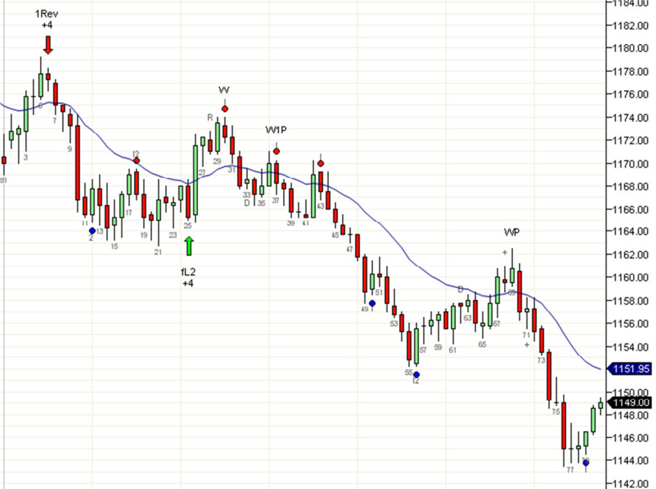

根据 Al Brooks 的说法，在大多数日子里，第一根k线就概括了这一天。如你所见，今天并非如此。我的修改是，第一根或前两根k线代表了上午的走势。如果前几根k线是同方向的强劲趋势k线，那么很可能出现趋势走势（与前两根k线同向或反向）。如果第一根k线是交易区间类型的k线，或者前两根k线颜色相反且相互重叠（即使它们是趋势k线），那么市场就形成了一个开盘区间，而不是开盘趋势。第一根k线是特殊的，因为它唯一保证会产生新的日内高点 (HOD) 和日内低点 (LOD) 的k线。从这一点开始，你可以交易突破 (fBOs) 和支撑和阻力 (BP) 的突破 (b1 )，并随着每一个新的 HOD 和 LOD 继续交易。像今天 b1 这样的带有引线的k线应该被视为一个小交易区间。这样的开盘常常会导致扩张三角形开盘，这本质上是一系列的突破 (fBO)，直到其中一个产生了两到三腿的日内高低点 (LH)（如 b30）或日内高低点 (HL) 并开始趋势走势。开盘时的趋势k线显示出能量，并常常导致上午趋势。这些趋势往往会反转，并导致可能持续一整天的长期趋势。开盘时的反转k线常常会产生一次剧烈波动，然后反转并触及 b1 的另一端。如果反转k线出现在错误的位置，例如在区间中段，或者一个多头反转k线出现在一个小的缺口上方等，这种情况尤其如此。

十字星 b1 可以在k线的一端形成小的 fBO，然后随着k线的另一端突破而产生大幅波动。但它也可能导致 BW open。无论如何，b1 的大小和形态只是一个参考，不应被盲目依赖。存在各种各样的特殊情况，数量太多无法一一列举，只能通过经验来掌握。处理 b1 的正确方法是将其视为一个交易区间，并像对待一个小交易区间一样对其进行交易。也就是说，如果有强劲的突破，则在回撤时入场；如果有疲软的突破，则逆势交易突破。请记住，小区间突破 fBO 通常不值得冒险，这同样适用于 b1 。

<!-- 原书第 23 页 -->

## 价格行为基础 VII - 初始趋势，1反转和1PB

2011年9月29日 星期四 · 原书第 23 页

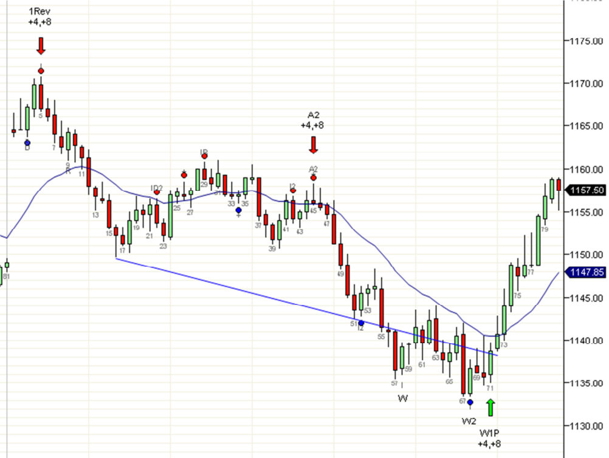

在当天第一根k线出现零次或多次突破（fBOs）后，市场可能会尝试趋势。这被称为初始趋势，如果它很强劲，它可能会持续到一天结束。然而，大多数日子里，都会有反转趋势的尝试。如果b4 是初始趋势尝试，那么b5 就是它的反转。另一方面，b4,5 可能只是另一个突破（fBO），而b5 到b8 可能是初始趋势。b9 将是反转趋势的第一次尝试。如果这次尝试很弱，它就会失败，并变成趋势的第一次回撤或1PB。通常，1PB上方的保护性止损在当天剩余时间（包括今天）内不会被破坏。这使得1PB通常是当天最好的波段交易入场点。出于实际原因，第一次深度回撤通常是更好的波段交易候选。

b29 的W形态或b36 的W1P形态是极佳的1PB入场点，并且通常是当日最佳的实用波段交易入场点。这是因为深度回撤的保护性止损不太可能在产生波段利润之前被触发，而深度回撤比一个k线回撤（如b9）更容易入场。今天出现了一个极佳的下午走势，但在许多日子里，上午趋势是唯一的大行情，午餐和午餐后的时段不会产生任何不受震荡行情和止损扫荡干扰的大行情。这就是为什么掌握1PB入场点对盈利能力至关重要。

<!-- 原书第 24 页 -->

## 价格行为基础 VIII - 开盘区间及其衡量移动。

2011年9月30日 星期五 · 原书第 24 页

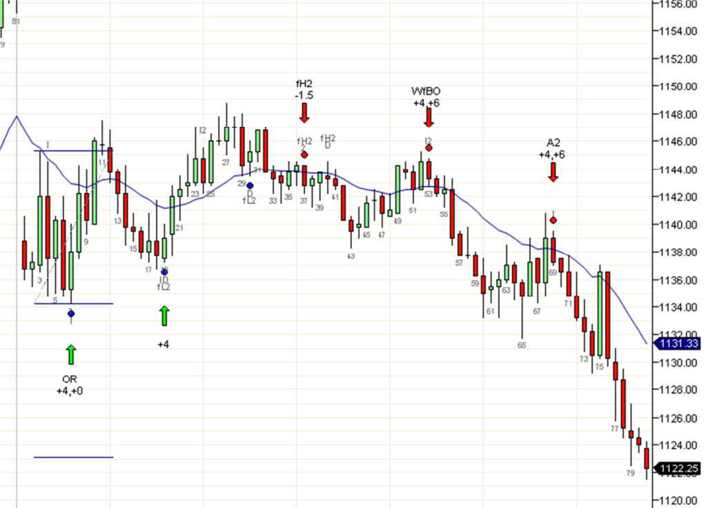

在某些日子里，没有清晰的初始趋势，当日前几个k线只是一个交易区间。两次上涨和两次下跌的波动，且离开盘价不远，构成了开盘区间。在许多日子里，区间不会出现成功的突破，市场会在区间的边界之间振荡，并且每一次突破尝试都会失败。

当市场两次未能突破（b11 和b27）时，通常会测试另一端（b61）。然而，当市场成功突破时，它通常会达到开盘区间的衡量移动。

交易区间（TR）一端的三推失败（b3,11,27）通常会导致另一侧成功突破。一种简单但相当成功地交易这些波动的方式是，在当天开盘后的第一个高低点（HL）做多，在第一个高低点（LH）做空，只要它们接近之前的波段，并一直持有到另一端被突破。例如，你会在b19 上方做多，在b37 或b53下方做空。

突破(b69)后的两腿回撤可能是一个新趋势的第一个腿，并且是一个高概率交易。

<!-- 原书第 25 页 -->

## 价格行为基础 IX - 刮头皮交易和波段交易入场

2011年10月3日 星期一 · 原书第 25 页

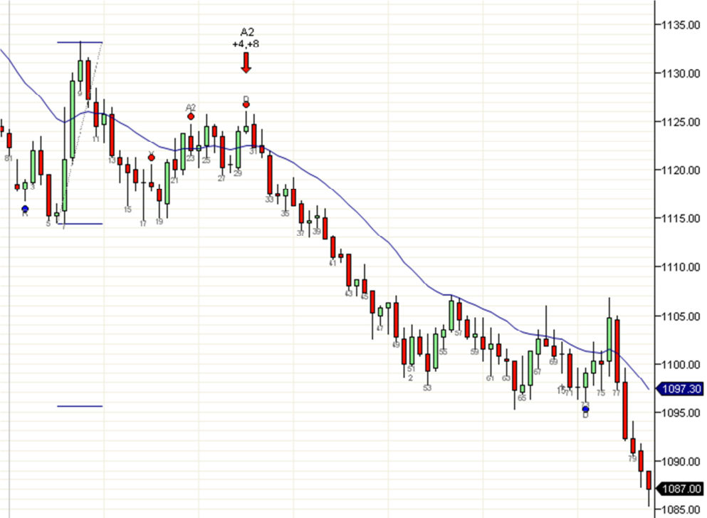

刮头皮交易是用户预期获得的预定利润量，无论交易参数如何。ES交易者通常以一点作为他们的刮头皮交易头寸大小，外汇交易者有 10 点，依此类推。从技术上讲，期货中最小的刮头皮交易是 1 跳，股票中是 0.01 。通常，刮头皮交易的大小与风险（从入场到止损的距离）大致相同。在信号K线之上通过止损入场的交易者需要调整他们的交易，以适应信号K线大小的变化，从而调整他们的刮头皮交易头寸大小。波段交易是一种很大的、不确定的波动，通常是初始风险的许多倍。作为一名盈利交易者，波段交易入场至关重要，因为对于新手交易者来说，刮头皮交易入场最多可能只会盈亏平衡。并非所有入场都适合波段交易。要适合波段交易，您应该有理由相信下一次回撤不会触及您的盈亏平衡止损。例如，今天的 b23 甚至 b26 都不是波段建仓形态，只有 b30 是。只有趋势延续建仓形态（即可能延续趋势到新极端的建仓形态）才适合波段交易。最好的适合波段交易的建仓形态是：1PB，A2, W1P。尤其是 BP 和 fBO 通常不适合波段交易。通常，二次尝试、失败（例如 b30上的 1tf）、新趋势中的第一次回撤都适合波段交易。除非您预期交易会是适合波段交易的，否则您无需费心为您的交易添加加仓。仅进入适合波段交易的交易，除了提高每笔交易利润外，还能大大提高您的胜率。在下单前，请务必尝试正确判断一个建仓形态是否也适合波段交易。长引线信号K线、错误颜色的K线、外包K线或形态不佳的其他K线，存在回撤或失败的高风险，不应作为波段交易入场。

<!-- 原书第 26 页 -->

## 价格行为基础 X - 不只是K线

2011年10月4日 星期二 · 原书第 26 页

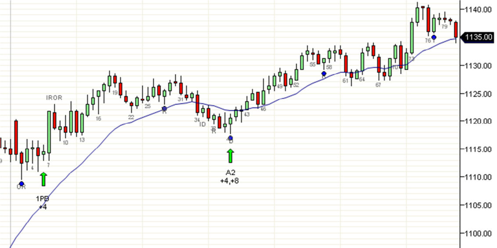

正如我之前多次发帖所述，你可以通过关注好的K线和常识来很好地进行交易。然而，K线并不总是告诉你全部故事。每根K线的背景以及市场在九种转换中所处的位置，对于区分强弱K线至关重要。

例如，b13 和b72 是重叠K线，指标将其过滤掉了。然而，b8-13 代表一次强劲突破后的两腿回撤，应该像突破回撤一样运作。同样，b72 是第二个高高点之后的第二个高低点，是一个趋势突破。这两根K线都非常适合波段交易入场。

另一方面，b19 尽管在W形上涨中是一根强劲的内包K线，但其造成的回撤却触及了保本止损，而b30, 尽管是一根十字星K线，却让波段头寸毫无阻碍地推进了+8 点。原因很简单。在b19, 时，我们仍在多头趋势中， b22被视为深度回撤并吸引了买家。而b30 则是趋势线突破（b19-22）后的高低点推升，吸引了卖家。

b51 是一根不错的内包k线，但它出现在一根 3 上涨突破交易区间之后。虽然这次交易成功了，但它的概率很低，因为一根 3 上涨突破交易区间很可能会失败并寻找交易区间的另一端。

虽然K线可以过滤掉不良的入场，但如果你想进行很少的交易但获得大量的点数，你就需要能够流利地解读九种转换，以做出最佳决策。切勿进行波段交易，因为你不想因为单根K线而错过大的波动。在犹豫不决时，只选择接近支撑位的深度回撤，例如指数移动平均线、趋势线或先前波段。

<!-- 原书第 27 页 -->

## 交易计划：交易区间日

2011年8月12日 星期五 · 原书第 27 页

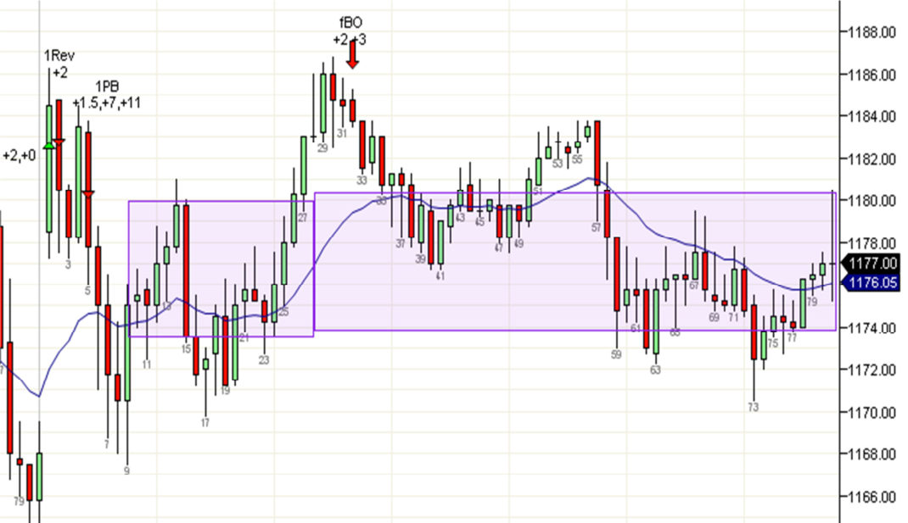

由于大多数交易日都是交易区间日，因此制定好交易它们的计划至关重要。识别交易区间日要容易得多：如果不是趋势日，那么它很可能就是交易区间日。我没有采用默认方法，而是使用了一个更简单的启发式方法。在最初的两次上涨和下跌波动（包括任何缺口）之后，如果你回到了起点，那么这很可能是一个交易区间日。例如，今天的第一次上涨波动是缺口和多头趋势K线 b1 ，第二次下跌波动是 b8。此时，你已经回到了起点，因此这很可能是一个交易区间日，而 b1-b8 则为开盘区间。

在交易区间日，最初的几根k线很可能有很多重叠和引线，这使得无法出现清晰的信号k线。解决这个问题的一种方法是交易更小的时间周期，例如图3m。这里的入场点是在5m图的K线中间，意义不大，但在3m图上则清晰得多。一旦第一小时左右结束，您就不应再看3m图，因为那里的建仓形态成功的概率较低。交易区间日通常在每个方向都有两段式走势，然后是另一个方向的两段式走势，但整体波动范围不大。大多数波段交易入场很可能会失败，并且您的盈亏平衡止损很可能会被触及。因此，一个有效的计划是抓住每一次两段式走势，并在第二次推升时退出。例如，如果您在左侧图表中做空3m b2 ，您将在第二次推升结束时退出，无论是强势收盘于3m b9 ，还是当一根k线突破了之前一根k线（高于3m b14）。

<!-- 原书第 28 页 -->

然而，我避免这样交易，仅仅因为我更喜欢更大的波动。一个可行的计划是在区间低点附近做多，在区间高点附近做空。简单来说，交易区间的突破失败，并试图持有到区间的另一端被测试。因此，例如，5m b32 出现了日内高点b1的突破失败。正确的做法是做空它，并试图持有到b9 低点被测试。

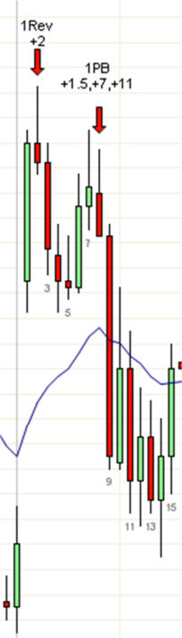

为了将自己限制在仅在交易区间的两端附近进行交易，请将开盘区间分为三部分，并标记出中间部分。仅在该部分下方获取买入信号，在该部分上方获取卖出信号。一直持有，直到价格跨越到另一侧（b27）或第二次尝试反弹（b50）。忽略所有发生在中间区域的入场。这应该能让你在交易区间日也能进行波段交易，并避开大多数混乱的入场。当新的日内低点或日内高点（b30）扩展了区间时，相应地调整你的框。

使用这个系统，你只会做多 b17 上方和做空 b32 以及 b56下方。这些也恰好是今天最适合波段交易的交易。请注意，这在 TTR 日可能不适用，即当当天的区间为 5 点或更少时。最好完全不交易 TTR 日，因为任何交易的概率都很低。

正如你在趋势终结为交易区间时停止交易趋势一样，当交易区间突破为趋势时，你也需要停止交易该区间。抓住第一次合理的调整，然后顺应新趋势，避免试图强行使其回到交易区间。

配合交易计划：趋势日，您已覆盖了90%的日子。其余的趋势包括强趋势、软趋势、急速加通道和TTRs。识别这些趋势并正确交易它们是成功交易的关键。

<!-- 原书第 29 页 -->

## 交易计划：趋势日

2011年8月11日 星期四 · 原书第 29 页

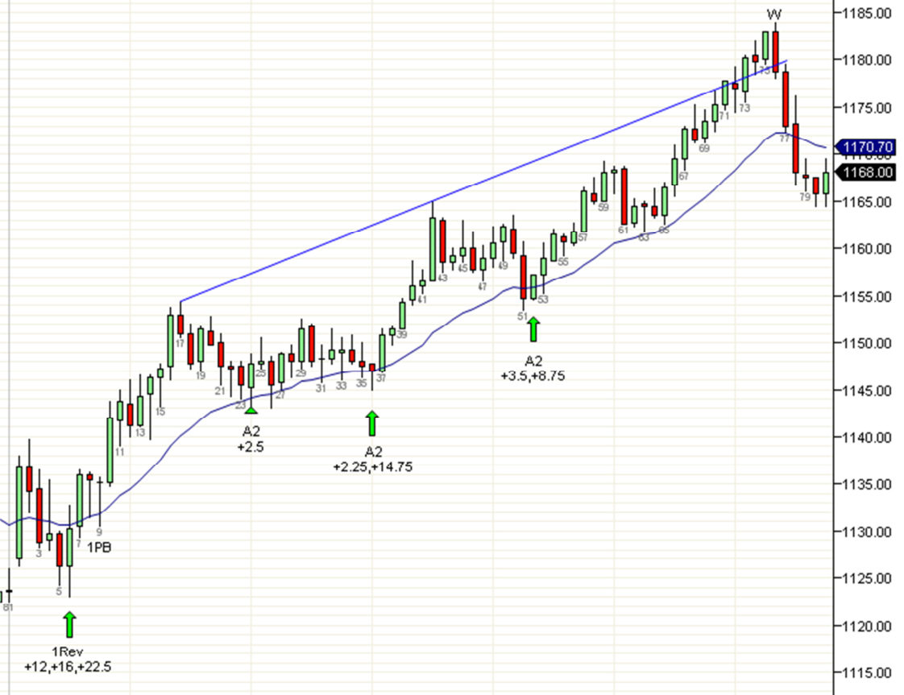

在趋势日进行交易相对容易，只在趋势日交易而在当天的剩余时间持观望态度是一个可行的交易计划。唯一的问题是趋势日不常发生（约占交易日的20%），但在日线图上的急剧波动中，趋势日可能发生得更多。

第一步是识别趋势日。总的来说，有一些共同的特征，但这些并不能自动保证趋势日。

- 一个大的缺口（超出前一天的交易区间）和一个扩大缺口的大型开盘k线
- 一个大的缺口，在 2 腿或 3 腿的走势中未能回补
- 一个小的缺口，逆转了前一天的高点、低点或收盘价
- 一个小的缺口，向指数移动平均线移动并反转
- 第一个3 或4 k线构成趋势走势

<!-- 原书第 30 页 -->

在以上所有情况中，你都可以简单地进行1次回撤和波段交易，度过当天剩余时间。1次反转（b5 或b6）和1次回撤（b9）通常是非常差的k线，所以保守交易者可能只会等待第一次2 腿回撤。在很多天里，这意味着错过上午行情的大部分，但2L回撤更容易进入。

在2 腿回撤中，需要注意信号k线的质量。通常第一个信号k线会是一个陷阱。例如b24 是一个外包k线，b33 是一个十字星。b47 在入场边有一根引线，远离指数移动平均线，并且被前期k线强烈重叠。在这些情况下，你应该耐心等待下一个信号。当你的信号k线强劲（b37）并且在其收盘后，入场价的盈亏平衡止损未被触及时，你就知道你的入场是正确的。

你应该时刻警惕可能的趋势终止，例如双顶、W形态（b75）、TTR或趋势线突破。在此之后，可能不会再有A2了。

一旦你能交易趋势日，再交易交易区间日就更容易了。在建仓形态图上，大多数建仓形态都出现在趋势走势中。在交易区间内，基本上只有突破和失败的突破，而这些需要更多的经验才能盈利交易。如果你能够回避 80% 的交易日，那么即使不交易交易区间，你也可以成为一个盈利交易者。

<!-- 原书第 31 页 -->

## 强势趋势识别与交易

2011年7月27日 星期三 · 原书第 31 页

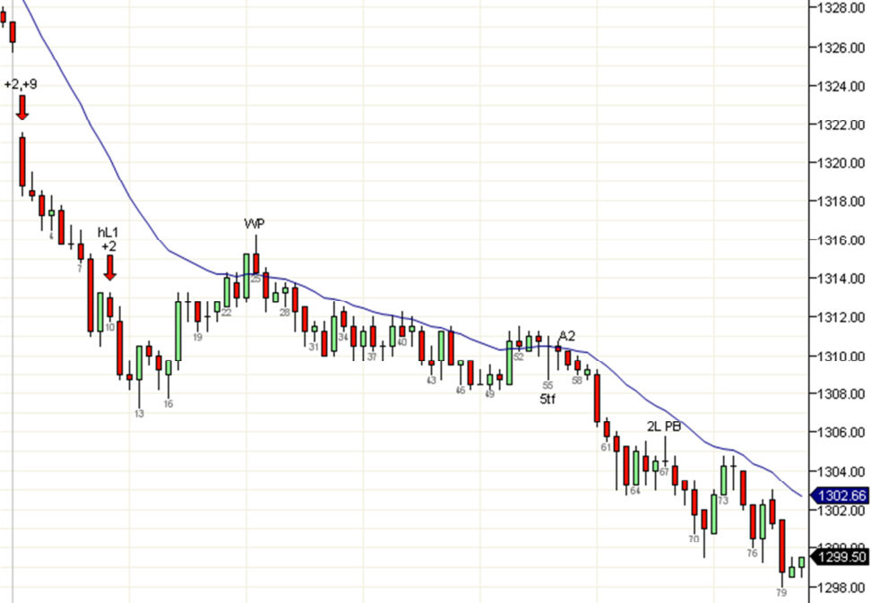

强趋势是那些开始强劲且持续强劲很多k线的趋势。这意味着最小的回撤和大行情。这样的交易日由于几个原因而难以交易。首先，它们相对罕见，所以交易者没有相关的经验。其次，2 腿回撤和回撤到指数移动平均线的情况很少见，而且由于距离指数移动平均线很远，回撤到指数移动平均线就足以构成一个迷你趋势，可能是一个反转。第三个也是最重要的一点是，强趋势很少反转。它们可能会突破进入一个交易区间或变成一个通道，但反转很少见，而且它们几乎总是需要先在交易区间或TTR内存在几个小时。

判断是否为强势趋势日（hard trend day）的第一个线索是出现一个大的缺口，并且开盘价超出前一日的交易区间。第二个线索是出现一根强劲的1k线。第一根k线不能太大（理想情况是2 至3 点），否则它可能演变成一个交易区间或发展成急速加通道。最后一个线索是任何试图制造的回撤都演变成了一个十字星或内包k线。因此，通过b4, 你应该已经识别出了一个强势趋势。

交易强势趋势非常简单，但又难以执行。你可以于任何带有光头或1引线的k线下方建立空头头寸，并将止损设在该k线上方。因此，除了像b8 这样的大k线（它们提供较差的风险回报比）之外，很少有强劲收盘会令人失望。

当强势趋势被打破时（例如，b16-25, 的波动），趋势就已经结束，将进入交易区间或通道。今天，我们形成了一个通道（b28-50），然后进行了一次突破尝试，但失败了，并出现了第二段下跌。通常，强势趋势突破后会简单地形成通道直到一天结束，而不会有容易的波段交易入场。这就是为什么在上午早盘入场并将一部分仓位尽可能地进行波段交易很重要。

<!-- 原书第 32 页 -->

## Correctly trading a soft trend

2011年3月3日 星期四 · 原书第 32 页

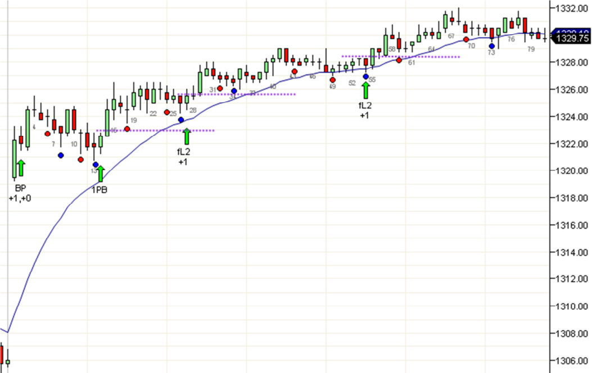

交易软趋势的第一步是正确识别它。除了第一次可能较深的 pullback 之外，软趋势的显著特征是 pullback 只会比前一根k 线低一到两个 tick，并且通常不会收盘在前一根k 线下方。第二个显著特征是，逆势交易很少成功，因为总体的 pullback 大多不会比任何k线的低点低 4 或 5 个 tick。强势趋势和软趋势之间的主要区别在于，在软趋势中，pullback 和 breakout 在每一次波动中都不会走远。强势趋势和软趋势的交易方式相同，只顺着趋势的方向交易。

By k线 24 or so it was obvious that today was a soft trend and the correct way to trade this is to buy above any k线 with at least 2t body (regardless of color) after an L2 (failed L2 or fL2entry). In the chart above, the red dots represent L1 and the blue dots represent L2. If you correctly enter your trades, none of your breakeven stops should be taken out as illustrated by the dotted lines. Entering above a doji bar or overlap usually means sitting through a pullback as with b47 and should be avoided.

由于你的出场点非常接近你的下一个入场点，很多人会一直持有到收盘。这通常需要经验才能在下一个回撤时不出局，但交易者至少应该用 1 合约来尝试一下。

<!-- 原书第 33 页 -->

## 急速加通道日

2011年7月1日 星期五 · 原书第 33 页

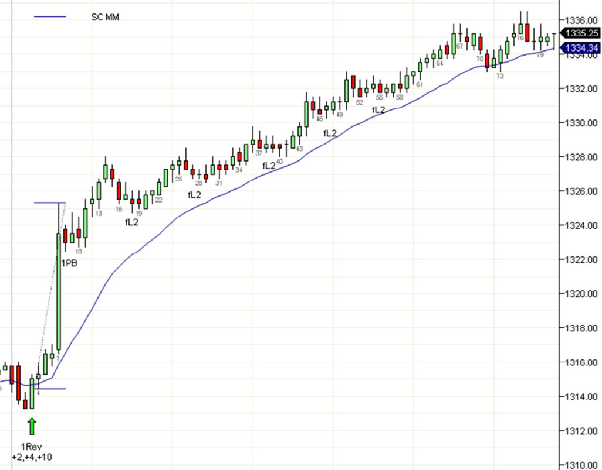

优秀的交易者懂得规则，而伟大的交易者也懂得这些规则的例外。交易铁丝网的一个例外是在非常强劲的软趋势中，在浅度回撤时入场。通常，我偏爱深度回撤，因为它们为波段交易入场点提供了最佳机会。然而，在急速加通道日，最好尽可能地持有。当尖峰强劲（入场k线到 1次回撤， b4-b7）且回撤浅（b8-10,约占大k线的 1/3 ）时，很有可能出现急速加通道日。尖峰越强劲，回撤越浅，通道运行到收盘的可能性就越大。如果你在尖峰前入场，在尖峰顶部附近获利大部分是合乎逻辑的，并可以选择保留一个加仓到收盘。如果你错过了突破，你应该在第一个 2 腿回撤（b10 或 b20）时入场。急速加通道日通常是软趋势，出现小k线和非常微小的回撤。通常回撤仅比前一根k线低一个跳或两个跳。这是为数不多能以限价做多任意k线低点的机会之一，即 L2 on limit。一旦你入场，只要收盘价不低于指数移动平均线，你就应该持有。请注意，技术上来说，在软趋势中几乎每一次回撤都是铁丝网，你可以买入每一个失败的 L2 （b20,b29,b40）上方，如果你不习惯在 L2突破时以限价买入。

---

[← 上一章](05-交易指南.md) · [目录](00-目录.md) · [下一章 →](07-交易心理学.md)
