[← 上一章](06-价格行为基础.md) · [目录](00-目录.md) · [下一章 →](08-2010年12月.md)

# 1.6 交易心理学

原书第 34–88 页

<!-- 原书第 34 页 -->

## 发展您的交易技巧

2011年2月5日 星期六 · 原书第 34 页

拥有交易计划和最佳建仓形态列表并不能保证交易成功。几乎每个人都知道常见的建仓形态，例如在趋势中在ema附近入场或沿着趋势线入场，或者在交易区间内逆势突破。然而，大多数人在交易中亏损。原因是学习交易不像记住电话号码，而更像学习游泳。你可以阅读所有关于各种游泳风格以及手臂应以正确的角度切入水中的信息，但一旦你跳入水中，你可能会在最初几次差点溺水。重复交易相同的几种建仓形态，比做你听说或读过的任何事情，是一个更好的训练。即使是世界上最好的交易者告诉你他的最佳秘密，在你足够频繁地交易该建仓形态并掌握它之前，你仍然会亏损。建仓形态本身并不重要。你的练习和对其的掌握远比建仓形态本身更重要。学习交易是关于提升自我，而不是获得某种让你富有的神奇秘密。有些人就是不适合交易，并最终会放弃或破产。成为一名交易者所需的心态可以通过练习来发展，但对某些人来说，这是他们天性的一部分。以下特征定义了一位优秀的交易者：

- 冒险欲望
- 亏损承受能力
- 概率理解

冒险欲望并不意味着你热爱赌博。风险意味着你愿意在某个东西上线以获得更高价值的东西。当你乘坐飞机旅行时，你面临着极小的丧命风险。然而，这种风险即使很严重，也足够低，不会困扰你，而且回报足够高，让你愿意承担。第一次登机时，可能会让你感到兴奋和恐惧，但反复乘坐飞机消除了航空旅行的情感因素。在交易世界里，你的风险是你入场点和止损点之间的距离。它更小，但更有可能发生。你应该愿意损失这么多而不会遭受严重的痛苦。如果你非常规避风险，你最终会在交易中失败。在你的交易生涯中，会有持续的成功和持续的亏损时期。对亏损的容忍度不仅仅是能够承受它。这意味着你已经在你的交易计划中为此做好了准备，也许是有一个第二份工作，或者从盈利的年份里存下充足的资金。你应该能够回到你的笔记并阅读它们，也许切换到模拟交易几周，直到你找回你的状态。所有建仓形态，无论多么好，都会偶尔失败，有时会反复失败。你需要理解，你承担的风险和预期的回报最终会得到回报，并且反复的盈利和亏损都是可以预期的。如果它们给你带来痛苦，你需要退后并切换到模拟交易。当你痛苦时，你就是情绪失控，更有可能爆仓。

<!-- 原书第 35 页 -->

风险与概率之间的关系是这样的：

回报 * 概率 > 风险或回报 > 风险 / 概率

所以，如果你的胜率为 50%，并且你预期获得 4 跳，你的风险需要小于 2 跳。另一种看待方式是，如果你的胜率为 50% 且你的风险为 8 跳，你需要至少获得 16 跳才能持平。这也是我停止接受任何不太可能让我获得至少 4 点的入场点的原因之一。当你提高胜率时，你可以进行预期波动较小的交易。一旦你理解了这些数学，你就可以自信地进行交易，知道只要你遵循这个简单的规则，最终你将盈利。

总结来说：交易是一项你需要习得的技能，而练习是关键。从小处着手，循序渐进，最终走向成功。

<!-- 原书第 36 页 -->

## 较少, 更好的交易。

2011年11月9日 星期三 · 原书第 36 页

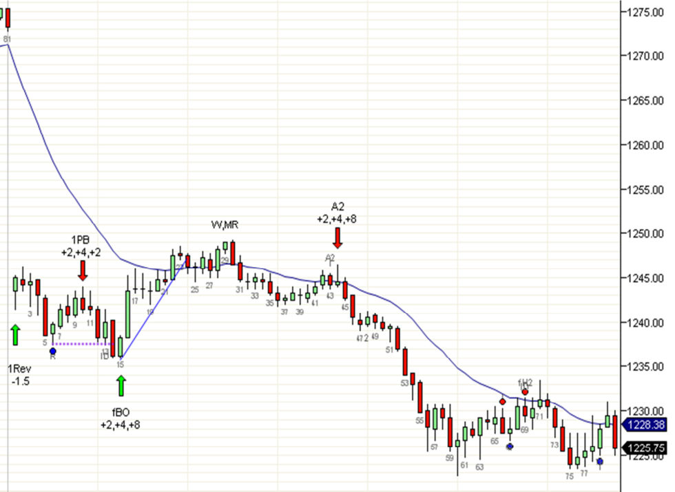

新手交易员最大的错误之一就是过度交易。过度交易会蚕食你的盈利交易，并从整体上阻碍你保持一致性。交易员的首要目标之一应该是将每天的交易次数减少到大约五次。想想这个问题：你一天会预期多少次主要的交易方向的改变？

减少交易次数可以让你专注于更大的波动，而不是在每根K线之间犹豫不决。如果你是一名新手交易者，这也有助于限制你的亏损。

你需要采取的第一步是淘汰限价入场。在价格行为交易中，有一些合法的限价入场，但试图节省两个跳是不应该成为其中之一的。能够持续在限价入场中获胜所需的市场解读技能水平非常高，我并不耻于承认我还没有达到那个水平。如果你想进行限价交易，请记住，你应该只在K线收盘时入场，而不是在你幻想价格可能在K线中间反转的地方。你需要采取的第二步是仅在信号K线入场，该信号K线应具有强劲的收盘价和较少的重叠。唯一的例外是1在指数移动平均线的反弹，1的突破以及任何在弱趋势日的顺势入场。如果你的强信号K线没有触发，就让它过去。即使它出现了一根带有同样强劲收盘价的强劲内包K线，此时它也处于重叠状态。这条规则唯一的例外是在大波动之后的FF。

最后一步是只交易经过验证的建仓形态，例如A2, W1P等。“我认为现在会涨”不是一个经过验证的交易。你可能注意到一些看起来可靠的模式，但它们可能因各种原因而无法交易。你首先应该在SIM上尝试交易它们，然后以约100 倍的小仓位尝试，之后才能将它们添加到你的已验证列表。

<!-- 原书第 37 页 -->

## 枪响人走

2011年11月10日 星期四 · 原书第 37 页

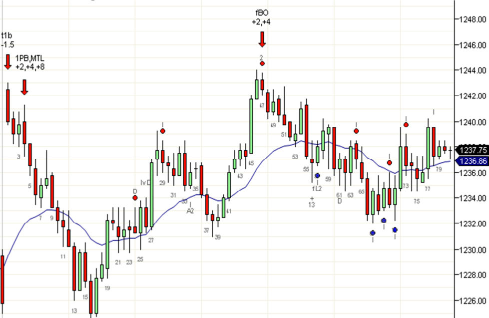

交易者过度交易的原因之一是他们对市场方向的判断过于关注小的波动。第二个原因是，一旦市场走势与他们预期相反，他们就会感到痛苦并怀疑自己的入场。他们可能常常在每根k线或隔一根k线时就反转仓位。

正确的做法是记下建仓形态的类型，然后让市场来决定。如果您的交易失败，它会触及您的止损位将您剔出；如果交易成功，它会达到您的目标位将您剔出。这将使您能够准确衡量您掌握了哪些类型的入场，以及您还需要在哪些方面下功夫。

如果您是一位只关注波段交易入场的交易者，您就有机会获得非常小的止损（例如，在ES上为 -1.5 点）。例如，在今天的图表上，在b1下方做空需要一个7点的止损，但是b4 (1PB)、b17 (W)、b47 (fBO)的入场只需要非常小的止损。这些建仓形态通常会带来大量的点数盈利，所以如果您的止损被触及，请不要感到沮丧；这意味着无论如何更大的止损可能也会被触及。1Rev 和 1PB 可能需要更大的止损，但 - 2 点通常就足够了。

大多数交易平台都支持OCO订单，您可以在其中设置止损和目标以相互取消。一旦您设置了订单，就将其遗忘，等待下一个建仓形态。如果下一个建仓形态与您持有的仓位方向相反，则平仓并进入新订单。

这样，您就会停止关注盈亏，而是专注于k线。

<!-- 原书第 38 页 -->

## 贪婪

2011年11月24日 星期四 · 原书第 38 页

交易者不应该为承认贪婪是促使我们许多人进入交易领域的原因而感到羞耻。毕竟，交易承诺能带来轻松的金钱，或者说，我们通过交易可以获得大量轻松的金钱。贪婪或许是好的，但它会迫使交易者犯下许多错误。

交易者最常犯的错误之一是在糟糕的建仓形态下入场，因为“这里可能会起飞”。你害怕被落下。这引出了我们的第一个认识：贪婪只是延迟的恐惧。

然而，当你因为信号k线糟糕、回撤过浅或其他任何原因而在糟糕的建仓形态下入场时，你可能在糟糕的价格点位入场，并且一次可能的回撤就会触及你的止损，除非你使用大止损。由此我们推断：贪婪迫使我们在高风险下入场。

通常，即使是大止损也可能被触及，你可能会采取放宽止损的方式，当然这仍然可能被触及，所以你最终会承受远超预期利润的止损。入场时的止损设置表明，如果入场正确，价格不应该触及止损。如果你习惯性地放宽止损，你实际上并没有用止损进行交易。因此，贪婪迫使我们忽略止损。

一些交易者在面对较宽的止损时，会在更差的价格点位加仓，以便有更大的机会实现盈亏平衡，并获得更紧的净止损。这意味着贪婪迫使我们将金钱投入到无谓的亏损中。

理想情况下，你应该非常挑剔你的入场点，并且明白成功在于一致性（稳定、更高比例的盈利），而不是依赖于任何一次“起飞”的交易。实现这一点关键在于在深度回撤时或交易区间结束时抓住强劲的K线。然而，如果你在不好的K线上入场，并且它没有起飞，请记住，及时止损就是最好的止损。接受亏损并等待下一个建仓形态。拒绝承认错误并重演上述亏损情景是导致爆仓最快的方式。

“别人贪婪时要恐惧”是一个过于简化的说法。恐惧同样是无益的。应对贪婪的正确方法是保持谨慎。当你感到有紧迫感想要进场时，除非信号良好且风险可接受，否则不要进场。不要因为错过一个大的波动而懊恼。很快就会有另一个交易机会出现，并且信号更好。一旦进场，就让交易顺其自然，如果需要失败就让它失败。如果你不让市场止损出场，你永远不会知道自己能够正确解读和进场的交易有哪些。

<!-- 原书第 39 页 -->

## Fear

2011年11月27日 星期日 · 原书第 39 页

几次止损出场会摧毁你的信心，交易者可能会变成恐惧的受害者。恐惧是一种即时的情绪，它会让你麻痹，并阻止你进入可行的建仓形态。很多非常好的建仓形态在触发后会立即启动，而你的犹豫会让你错失机会。恐惧会让你错失许多稳健的交易。

由于好的建仓形态通常会给出一个强劲的入场k线，而入场k线在交易触发后通常会迅速增长，您可能会责备自己，并在K线中间、触发价位之上几个跳或一点的位置入场。这也意味着您的风险现在会增加约一点。这意味着恐惧迫使您承担更大的风险入场。

除了少数例外，入场触发后的轻微回撤是正常现象，而K线中间入场可能会导致您的止损被触发。一个陷入恐惧的交易者不太可能像陷入贪婪的交易者那样放松止损或加仓，而是很可能会在止损时反向操作。恐惧会让您在市场的每一次回撤和强劲波动中被牵着鼻子走。

每隔两三根k线就反向操作会摧毁您对解读市场方向能力的任何信心，并使您损失惨重。与账户被少数大额亏损摧毁的贪婪交易者不同，恐惧交易者的账户则死于一千次小额亏损。如果您深陷恐惧，则绝不应反向操作仓位。对恐惧的交易者来说，一次亏损会让他“心态失衡”，如果他当天剩余时间继续交易，很可能会犯下更多错误。恐惧相当难以克服，唯一的出路是认识到每个建仓形态都有一定的盈利百分比，其余的必然是亏损。一些亏损会足够接近，以至于看起来您已经失去了交易该建仓形态的能力。最好的方法是在亏损后停止交易一定数量的k线，并在当天剩余时间停止交易一定数量的亏损交易。知道在最坏的情况下，您每天的亏损是有限的，这对您的心理是一种稳定力量。

“他人在恐惧时要贪婪”说起来容易，做起来难，因为你自己才是那个恐惧的人。恐惧的解药是风险管理。一旦你理解并接受了每次交易和每日的最大亏损，你就已经知道了在任何给定时间段内的最坏情况下的亏损额。如果这是你已经接受的交易成本或学习交易的成本，那么恐惧将更容易控制。

## 不耐烦

2011年11月29日 星期二 · 原书第 39 页

成为一名成功的交易者的一项关键要求是耐心。即使是经验丰富的交易者也会承认，如果他们能提高自己的耐心，他们的交易会更好。

新手交易员是不耐烦的，渴望进行交易，并且在没有建立仓位之前，倾向于将每一次跳视为机会的流失。一旦建仓，他们会变得非常不耐烦，希望交易立即生效并带来利润。当他们退出一笔交易时，无论是达到了目标还是止损出场，他们都想立即再次入场。因此，不耐烦会导致交易者过度交易。

<!-- 原书第 40 页 -->

不耐烦，再加上贪婪和恐惧，会迫使交易者做出错误的判断，导致表现不一致。一个每隔两三根 k线就进出一次交易的交易者，其成功率很可能不高。即使有很高的成功率，如果只关注小行情，也可能被几笔糟糕的交易抵消。

交易者的耐心是指能够长时间无所事事地等待一个已证实的建仓形态形成，并在其出现时迅速采取行动。入场后，除非触发了反向建仓形态，否则交易者不应退出，只要止损未被触及。交易应在达到目标或被止损出场时结束。耐心和对建仓形态的信心将使您能够获得更大的利润。

不耐烦可以通过关注大行情来解决。寻找一个大的波段行情将考验您参与交易的冲动，因为在一个交易日中，大行情数量很少。至少持有一部分用于波段交易，也将满足您参与行情的需求，而

## 纪律

2011年12月1日 星期四 · 原书第 40 页

纪律是指通过成功地忽略短期诱惑来坚持长期目标的能力。您可能已经知道自己是否具有一定的自律性。您能否成功地坚持饮食或运动计划？您是否是一个能够坚持做出永久性生活改变的人，例如在工作日早上 5:00 点起床，或者彻底戒烟？

大多数人会在这里停下来思考，这意味着不行。纪律就像肌肉力量一样，需要训练和培养，并且在停止锻炼时会萎缩。

对于交易者来说，纪律是坚持执行计划并且只执行该计划的能力。例如，让我们来看一个非常简单的交易计划：交易当天的第一个双腿HL或LH，止损和利润目标各为+2 点。您可以额外要求入场侧引线小于或等于2 跳。

如果您想遵循此交易计划，您会等待一个双腿HL，并在任何多头K线之上做多，设置2 点的止损和目标。同样，您会等待一个双腿LH，并在任何空头K线之下做空。如果模式没有触发并转变为HH或LL，您将不再进行该交易，并且当天剩余时间内不再进行任何交易（除非您计划中还有其他建仓形态）。

: 另一方面，如果触发了，您只有三种方式退出交易

1. 您已止损出场
2. 您的目标已完成
3. 一个与您的仓位方向相反的信号已建立并被触发

纪律是一致性的先决条件。纪律本身并不能带来一致性，但它可以告诉你你的任何建仓形态是否值得继续研究，或者是否应该从你的列表中删除。你仍然需要找到有效的建仓形态，一旦找到，你就在通往一致性的道路上。你想尝试的新建仓形态可以一个接一个地添加，而纪律可以帮助你剔除那些不值得交易的建仓形态。

<!-- 原书第 41 页 -->

## 交易纪律

2011年12月3日 星期六 · 原书第 41 页

在交易BPA时，我尽量遵循以下规则：

1. 清晰度：我不会在没有读到我经过验证的建仓形态之一的情况下进行交易。我希望建仓形态尽可能清晰。任何模糊不清都可能意味着该波动不会走太远。我希望回撤是深度的，信号 k线是强劲的，没有太多重叠。如果这些特征缺失，我通常会等待第二次尝试。如果建仓形态很差，我通常会放弃。我乐于在任何交易日都不进行任何交易
2. 可波段入场：总的来说，我只偏好入场那些可以波动四点或更多的建仓形态。我也希望只在价格在远离信号k线后，我认为价格不会回撤到我的入场价时才入场。通常这些是二次尝试
3. 坚定的止损：止损只能收紧。一旦价格从入场价波动一定距离（例如2 点）后，我会将止损移至盈亏平衡点，并在每个新的波动点之后锁定收益
4. 少数好的交易：总的来说，我宁愿进行少数好的交易，而不是许多平庸的交易。这是因为只要我的盈利交易中有一些能够达到风险的2倍到4倍，我就可以成为一名盈利交易者
5. 每日亏损限额：每日止损至关重要。有些日子，我的状态就是不好，可能是由于休息不足或意料之外的价格行为。我宁愿休息观望，保留我前几天的盈利，也不愿每天交易而损失掉我过去几天赚到的一切

请注意，上述规则适用于任何交易系统，重要的是坚持这些简单的规则，因为它们将帮助您衡量您的成功并识别盈利的建仓形态。

规则 1 和 3 帮助您衡量您的成功并识别盈利入场。规则 2 和 3 提高您的盈亏比。规则 2 和 4 帮助您关注更大的波动，而不是被当前一两根k线迷惑。规则 5 有助于保护您免受价格行为不利于交易的异常交易日的影响。您可以通过记录每笔交易的记分卡来衡量您的进步，看看您是否遵守了您制定的规则。很快您就能发现需要改进的领域。

## 过度自信

2011年12月5日 星期一 · 原书第 41 页

一致性需要练习，您只需要对各种价格行为积累经验。当价格行为发生变化，无论是放缓至微小 k线还是因巨大k线而波动，您的一致性都会受到一定程度的损害。这将持续下去，直到您的交易经验积累了足够的记忆，使您能够毫不费力地做出反应。对于许多交易者来说，一致性的开始会带来一个新的敌人：过度自信。这会诱使交易者尝试新的建仓形态，激进地增加头寸，承担更大的风险，总而言之，会努力进行自我破坏，并损失来之不易的一致性。

例如，一位交易者通过交易当天的前两次两腿回撤，稳定地获利 2 个点，可能变得足够成功，以至于他认为自己可以增加一个新的建仓形态，或者融入新的交易风格，例如交易K线中间或限价。很可能的是，新增加的因素会对他的交易结果产生负面影响，并可能使他重新变成一个亏损交易者。

<!-- 原书第 42 页 -->

随之而来的可能是严重的破坏和信心的丧失。一个交易者可能会发现自己在一致性和不一致性之间摇摆，并失去能够靠交易为生的一丝希望。过度自信很难治疗，因为它很难在需要自我评判时将其与纯粹的自信区分开来。处理这种情况的方法是一次只尝试一个新的建仓形态，并且每天只尝试一两次。像限价交易和K线中间入场这样的新风格不应该被尝试，因为它们是微观优化。如果你的大部分建仓形态预期能获利 4 个点，那么通过限价入场额外获利一点通常不值得额外的风险。通过在纪律的模拟交易中首先尝试所有新的建仓形态来证明它们，并记录结果。其中许多可能根本不值得尝试。

请记住，成功在于进行几次有利可图的交易并努力增加交易量。一个只有一种建仓形态，成功率为 70% 的交易者，比拥有 100 种建仓形态但总体成功率为 50% 的交易者要好。

你只需要一两种好的建仓形态。即使是单一的建仓形态也可能需要数年才能精通，所以在你掌握了当前的建仓形态之前，不要试图学习新的技巧。

## 情绪失控

2011年12月19日 星期一 · 原书第 42 页

扑克玩家明白，当一个玩家遭遇特别糟糕的运气时，他很可能会“情绪失控”，尤其是在大额彩池的情况下。这通常意味着该玩家很可能会在接下来的几手牌中，用较弱的牌积极地进行交易，并总体上做出糟糕的判断，试图赢回自己的金钱。当牌桌上的任何人遭遇糟糕的运气时，牌桌上的其他人就会像秃鹫一样盯着他，希望能赢得他剩余的筹码。

这与交易者有关，因为许多交易者对待交易的方式就像对待赌博一样。坚信运气和其他迷信，在糟糕的运气（bad beat）之后加大交易规模，吹嘘自己的巨额盈利却不提自己的亏损等等，这些都是您可能将交易视为另一种赌博系统的迹象。

和赌博一样，大多数玩家最终大部分时间都会亏损，偶尔会赢一些钱并大肆吹嘘。如果这对您来说是这种情况，您最好去赌场玩二十一点（blackjack）——至少您还可以获得免费的饮料。

糟糕的运气（bad beat）的一个重要原因是结果的意外性。玩家原本期望获胜——可能还会大胜—— 但却震惊地发现自己变成了输家。这动摇了玩家对自己解读牌面、分析对手的行动以及总体上成功玩牌能力的信心。此时，他只需要获胜来恢复信心，而且需要尽快获胜。这种紧迫的需求会损害他的判断力并导致许多错误。在交易中情绪失控（going on tilt）在心理上非常相似。

处理这种情况的方法是避免出现大的亏损。始终以固定风险和固定仓位进行交易。随着你的一致性随时间提高，你可以选择增加仓位，但不应该因为“感觉运气好”而随意交易仓位。你也绝不应该放宽止损或在亏损的仓位上加仓，因为大的亏损会从心理上打击你。

此外，你的每日亏损限额需要固定。就像你意识到自己是牌桌上最差的玩家时就会离开牌桌一样，如果你一天之内被击败了 2 次或 3 次，就应该停止当天的交易。随着时间的推移，知道你的下行风险在每次交易和每天都有限制，而你的上行潜力要大得多，这将给你信心，并消除赌徒心态。

<!-- 原书第 43 页 -->

## The need to be right

2011年12月21日 星期三 · 原书第 43 页

当交易失败且市场朝着交易者不利的方向变动时，她可能会一次又一次地以相同方向重新进入。到了日终，交易者可能会意识到她一路做空到顶部，通常在一个强劲的多头日里并未成功。同样，一些交易者会在空头日买入每一次下跌，认为“现在随时都会反转”。

固执于偏见是一种常见的失误。交易者坚持认为自己比市场更懂，市场应该很快会反转并朝着他期望的方向前进。未能认识到市场永远是正确的，而交易者永远是错误的，这是一个根本性的错误，可能导致一次亏损交易和一系列亏损交易的区别。这种心态也可能促使交易者在亏损头寸上加仓，因为如果价格最终会反转，每一次失败的入场都会带来更优价格。

一种简单但困难的处理方式是消除偏见。这意味着忽略新闻、电视、经济和政治分析，例如为什么市场会因为政客的劣迹而下跌，为什么欧洲注定要完蛋，或者几乎任何其他事情，因为新闻是耸人听闻的，并不反映即时供需。

即使你有偏见，如果交易对你不利，出现大量的点数损失，你应该在出现明显的趋势线突破和极端测试之前，不要进入相同方向的交易。

最重要的是，不要因为你的交易失败而感到震惊。没有人能一直都是正确的。通过及早止损来控制亏损，如果需要清空思绪，可以退出市场几个k线。退一步看看整体图表或更高的时间框架，通常可以重置你的偏见，让你识别趋势线并顺势进入交易，或者避开震荡的变动。

<!-- 原书第 44 页 -->

## 我理解建仓形态，但无法进行交易

2012年2月11日 星期六 · 原书第 44 页

许多交易者私下联系我，并提到虽然他们理解建仓形态，并且可以在盘后或盘中实时识别它们，但却无法交易。其中一部分原因是处于反向头寸，但很大一部分原因则是各种心理原因。

一些症状和原因包括：

1. 犹豫不决/无法下单：这是由于害怕犯错
2. 冲动/追涨：犹豫不决常常导致追涨，即在应该退出时进入。这是害怕错过。K线中间的迟入场属于此类
3. 被震出：你还没有在心理上接受你的风险
4. 无法持仓，过早离场：你对自己的判断没有信心
5. 报复性交易：因亏损而情绪激动，想立即获胜！
6. 做空强势趋势而非顺势交易：完美主义者容易陷入此境，因为他们希望市场证明他们预测市场反转时机的非凡能力
7. 让赢家变成输家：由贪婪和过高的期望引起
8. 在亏损头寸中加仓：这是由于需要正确。交易者会继续加仓，直到亏损金钱的痛苦大于犯错的痛苦
9. 在亏损时反向操作：一些建仓形态是可逆的，例如失败的 A2通常表明在新方向上有两条腿。然而，这里说的是在任何失败的交易中反向操作，而不知道它是否可逆

此外，还有导致成功率下降的糟糕交易习惯：

1. 交易糟糕的信号K线：糟糕的信号K线有时会奏效，但需要经验才能正确交易它们。特别是，它们需要有一些增强因素，例如是BT或在ema上。大多数交易者最好跳过交易，让它在你不在的情况下进行
2. 交易BW/OL：BW/OL中的大多数交易很可能失败。是的，确实会发生一些突破，但你通常最好交易突破的失败或BP
3. 在信号K线触发前入场：一些交易者急于获得更优价格，因此在信号K线触发前买入

我想在各种博文中解决这些问题，展示图表上出现此类错误的地点以及如何避免它们。这将改变图表格式几天。如果你在某一天犯了某个错误，可以告诉我，我会将其添加到当天的图表中。

如果您有任何常见的错误希望我加以说明，请在此博文下评论，我将把它们添加到列表中。

<!-- 原书第 45 页 -->

## 逐一消除你的错误

2011年7月3日 星期日 · 原书第 45 页

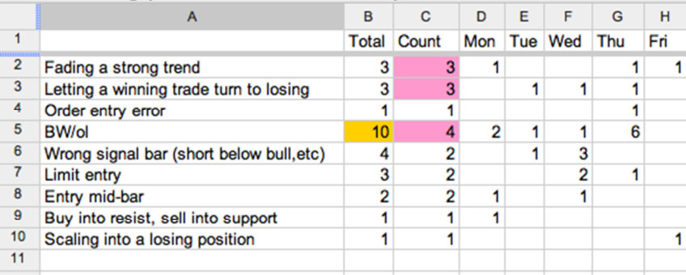

当您亏损一笔交易时，您必须问自己，您是入场正确但市场走势不利，还是这是一次情绪化或草率的入场。那些 otherwise 能够很好地解读价格行为的交易者仍然会无利可图，因为他们缺乏只在好的建仓形态入场的纪律。

作为交易者的首要任务是评估你在固定时间框架（例如一周）内的胜率。你的胜率是否低于50%？在这种情况下，你当前的交易风格可能不适合你的性格。你是在交易突破，但在价格向你预期的相反方向移动时就惊慌失措？也许你更适合买入回撤。你是否一直在进行逆势交易？也许切换到顺势交易可以提高你的得分。你的首要目标是找到一个系统，让你在大多数日子里至少有50%的时间是正确的。

下一项任务是评估每天结束时的每一次亏损交易，并更新如上图所示的图表。列出你常见的错误以及每天犯错的次数。错误分为两类：一类是你大多数时候都会犯的错误，另一类是你很少犯的错误，除非在某些日子里你犯了很多错误。有些错误兼具这两类特征。

例如，在上面的图表中，交易 BW/OL 几乎每天都会发生，尤其是在特定的价格行为（示例中的星期四）中。买入错误的信号K线仅在两天内触发，但在星期三它触发了 3 次。你每天都犯的最重要的错误是必须修正的。选择那个给你造成最大亏损的错误，并在每个交易日有意识地去修正它，直到它每周不发生超过两次。然后转向下一个。

你在特定类型的交易日会犯的错误更容易修正。你只需要识别触发大量错误的交易日类型。在一个急速加通道日里，你是通过做空来触及顶部吗？一旦你看到了通道，就停止交易，或者只进行通道内的交易。如果你必须这样做，就在你的显示器上贴一张便利贴警告：“注意通道！”。在一个强劲的空头市场里，你买入每一个多头突破吗？那就应该逆势交易突破。

一个真正的建仓形态，如果你在其他情况下会执行，但它恰好朝着与你相反的方向变动，这并非错误。这是交易的一部分。但你应该将此单独记录。这些信息可以帮助你选择最适合你的建仓形态，并且一开始你应该只选择最好的2 ，随着交易的提高再慢慢添加其他的。

<!-- 原书第 46 页 -->

## 犹豫不决，下单困难

2012年2月13日 星期一 · 原书第 46 页

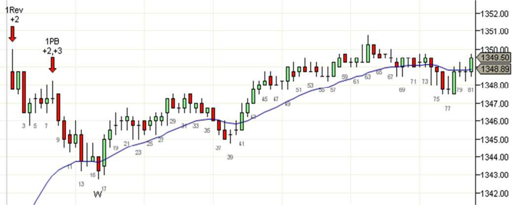

交易者经常抱怨他们无法进入一个可能不错的建仓形态。有时信号K线很弱，或者变动本身很难辨别。首先要知道，这些都是非常合理的担忧。你的身体已经学会了谨慎，并且会本能地做出反应，导致你在之前错误的累积压力下而犹豫。原则上，这就像触摸金属表面时触电一样。如果这样做足够频繁，即使你命令你的手去触碰，你的身体也会拒绝接触该物体。

您可以通过减小交易规模来减小此反应的影响。只交易 1c 或交易 100 股 SPY，甚至 10 股。如果您愿意，一开始甚至可以在模拟器上交易，不冒任何金钱风险，然后慢慢地以非常小的规模转向真实资金交易。

一种解决犹豫不决反应的方法是客观地评估您的建仓形态，而不是主观地评估。通常情况下，没有完美的建仓形态，等待非常清晰的建仓形态往往意味着您很少交易。对于新手交易者来说，这其实并非坏事。

或者，交易者可以选择让其他因素来弥补疲软。例如，如果形态清晰，您可以选择交易一个疲软的K线，例如在 b8处的 1PB。它实际上是在强劲K线 b3后的低高点形成的 L2 。另一个强化因素是 ema，所以例如 b16 处的 FF 和 W 可能因处于强劲位置而可以交易。

反之，交易者可能选择即使形态看起来不确定，也要选择强劲K线，例如 b1Rev at b1 或 fBO at b65。因此，像 b39 这样的弱形态和弱信号可以被忽略，直到您积累了正确解读它们的经验。虽然 b39 确实有效，但这将避免您将 b33 解读为 A2 。但是，一旦您有了客观的交易规则，您就应该遵循它们。

交易成功的关键在于有纪律地遵循您的客观标准，并在您出错时让市场止损。没有这一点，就无法衡量哪些建仓形态对您有效，哪些无效。一旦您有了数据，您就可以筛选您的建仓形态，只交易最适合您的那些。

不要关注盈利或亏损。你正在收集有关你的建仓形态的数据，而亏损者是数据中必不可少的一部分。一旦你接受亏损交易是你所追求的一部分，你的犹豫不决的反应就会随着时间推移而减弱。

<!-- 原书第 47 页 -->

## 易怒

2012年2月15日 星期三 · 原书第 47 页

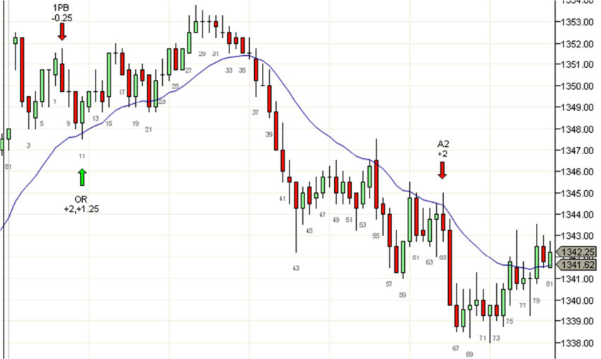

英国人有两个特质我很钦佩：谨慎和勇气

--拿破仑

没有勇气的谨慎是胆怯。没有谨慎的勇气是鲁莽。交易者需要培养在勇气中掺杂谨慎，以防止被情绪所左右。与害怕进入任何交易的交易者相对的是，进入每一个可能交易的交易者。事实是，过度交易者只是害怕错过一个他认为“随时会发生”的大变动。幸运的是，一旦交易者爆仓了他的第五个或第六个账户，这个错误就会很快得到纠正。但到那时，他已经变成了一个恐惧的交易者。

例如，一个易怒的交易者可能会在b1 的收盘时买入，认为这是一个反转k线和强劲收盘，表明从第一根k线（T1B）日开始可能出现看涨趋势。令他恐惧的是，b2 从开盘就开始做空直到收盘。此时，他可能会在b1 下方或b2下方转为做空。如果他幸运，他通过刮头皮交易已经接近盈亏平衡，并在b3收盘时平仓。如果不幸运，他可能会买入b4, 然后卖出b8 ，等到b11 出现时，他已经筋疲力尽，当天可能已经亏损了几点，并且已经彻底用尽了他所有的脏话词汇。

交易者在迄今为止的每一次交易中感受到的紧迫感正是他失败的原因。这正是汽车销售员在经销商处试图在顾客身上诱发出的感觉。“如果你现在就买，你就能得到这个和那个”或者“明天，我们可能无法提供这么好的融资”等等。没有了紧迫感的情绪，我们的交易者可能会对图表有不同的解读。例如，如果一个月后逐k线呈现，由于他没有被赚钱的紧迫感所折磨，那么很明显 b1 是一个十字星而不是一个反转k线，它的收盘价或突破价不值得买入。同样，第一次尝试在十字星下方做空是危险的。

过度交易者思考方式像赌徒。对他来说，任何交易都有相同的成功或失败几率，有点像在轮盘上押注红色。他会押注每一次旋转，因为每次旋转本质上都是一样的。然而，交易者需要像扑克玩家一样思考。只玩好牌，弃掉差牌。一个更好的类比是把交易看作狩猎。发现一头可以做成美味佳肴的猎物是不足够的。在冒着生命危险去追逐它之前，一切都应该为一次成功的狩猎做好准备。

<!-- 原书第 48 页 -->

成功交易的诀窍在于只接受你确定会成功的建仓形态。正确判断市场走势的方向是不够的。一开始，这可能意味着你只是日复一日地观察市场，而不进行任何交易。这一点非常重要，你不应该跳过它。你正在做的是去除心中的狂热，培养猎人的耐心。随着时间的推移，你将能够识别出成功概率很高的形态。准备一份已验证建仓形态的列表。当你想进入时，问自己：这是一个我已知的、高概率的建仓形态吗？如果不是，就放弃这笔交易。不值得去找出答案。如果你觉得自己无法控制自己，可以在模拟交易上进行。但最终，你需要放下它，甚至不诉诸于在模拟交易上进行。一旦进入，严格遵循你的风险管理。如果它让你止损，那就这样吧。这些数据将进入你的统计数据库，对选择最适合你的建仓形态至关重要。

<!-- 原书第 49 页 -->

## 被震出第一部分 - 大风险。

2012年2月28日 星期二 · 原书第 49 页

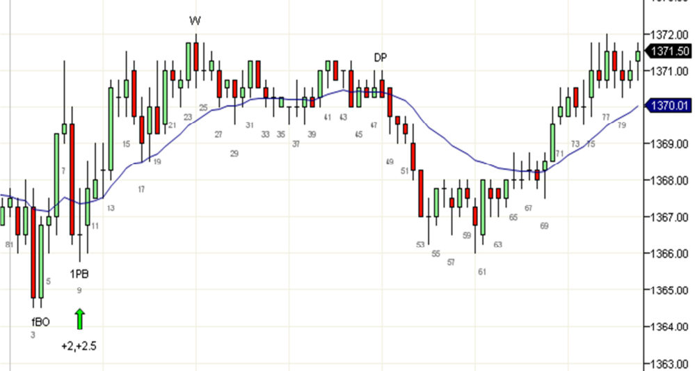

大的建仓形态k线在入场后或直接失败时，经常会有大的回撤。原因很简单。当风险很大时，风险管理规则会阻止许多专业交易员在突破该k线时入场。（新闻相关活动是一个显著的例外）。知道大的k线不太可能成为成功的建仓形态，也会鼓励逆势交易者去逆势交易大的k线，导致大的k线经常成为交易区间。

限价交易员经常在突破后买入回撤，并且经常在更小的时间周期内，回撤可能是两腿或三腿。这通常会导致大的k线的突破回撤成功。

无论潜在利润如何，如果一笔交易的理论风险很大，交易者很可能会在入场后不久市场开始回撤时感到非常沮丧。这是非常自然的，你的身体在警告你，这可能是一笔基于先前经验的糟糕交易。

如果您交易过大k线并多次亏损，您的身体会学会在贪婪驱使您下单时产生警惕。这是因为风险会带来压力，而大风险会带来大压力。当回撤接近您的生理承受极限但未触及您的宽幅止损时，您可能会绝望而离场，因为您无法再承受。通常，市场会以一两个跳的价格将您震出，然后立即反转。从中得到的教训是，大于您生理承受能力的止损可能毫无用处，而且适得其反。

这其中一个简单的教训是，不要交易信号K线较大的交易。另一个可能的解决方案是为您的所有交易使用固定止损。如果您只使用6止损，您的身体就会习惯于风险，让您的头脑专注于高概率的建仓形态。

<!-- 原书第 50 页 -->

## 被震出 II - 糟糕的建仓形态K线。

2012年2月29日 星期三 · 原书第 50 页

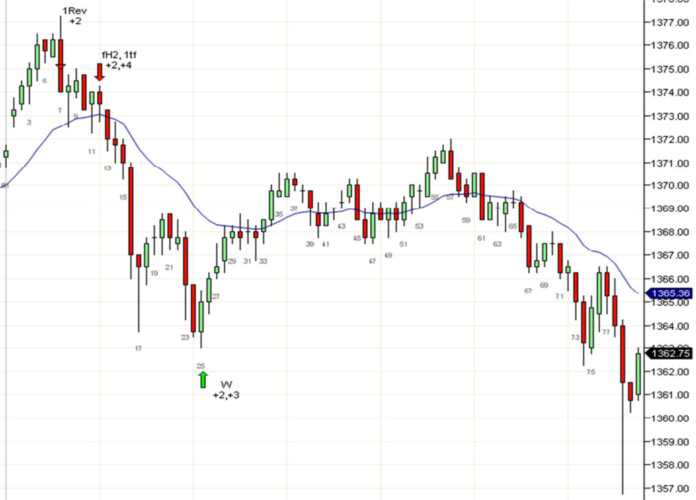

通常在紧要关头，或者因为无聊、绝望或害怕错过，您可能会进入一个不理想的建仓形态。这种情况会发生在最优秀的交易者身上，我也不确定是否有办法根治。尽管这些交易最终可能会成功，但您可能不得不经历一个多根K线的回撤。您不得不经历的回撤K线越多，您被震出交易的可能性就越大。一个很好的例子是b29。在W形态的一个非常强劲的腿之后，这是一个内包k线。您可能会在其上方买入，期望出现一个大型突破K线，但在入场后不久，它就变成了一个看跌外包十字星 K线。这样的入场K线会极大地打击士气，交易者将开始看到建仓形态K线可能存在的各种错误。它是一个3十字星K线，其实体在ema处。入场K线与前期波段高点形成双顶。第二次L可能变成A 2 卖空，等等。可能的结果是交易者会以小额亏损退出，而价格立即开始上涨。第二个例子是买入b46 （而不是b47）。鉴于b46 是一个空头K线，在其上方进行H2 很可能会导致回撤。交易者可能会开始看到与入场错误的类似论点，并在价格开始上涨之前以盈亏平衡或大额亏损退出。从技术上讲，两次入场都奏效了。b28 低点和b46 低点得到了尊重。但是6止损被触及了。当信号 K线较大时，较大的固定止损也可能被触及。请注意，等待一个强劲的K线（b33, b47）本来可以避免糟糕的入场。像b47 这样的强劲K线通常可以使您免受糟糕入场的影响，因为卖家可能会在 K线收盘时卖出，从而阻止其触发。糟糕的入场通常会提供第二次入场（b49 与b46），通常会有一个更好的收盘价或更低的风险。这些应该能帮助您避免被震出。总的来说，只交易那些可能出现强劲入场K线的建仓形态是避免被震出的唯一方法。这些包括A2, G2, W1P和1PB。

<!-- 原书第 51 页 -->

## 被震出 III - 不提前止盈

2012年3月7日 星期三 · 原书第 51 页

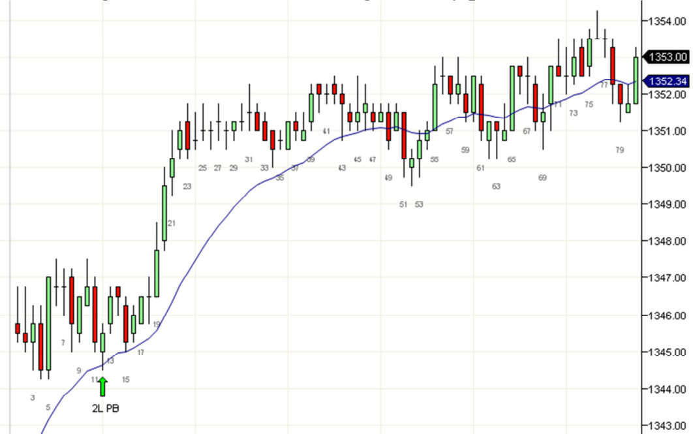

当你只交易一份合约时，你应该随时提前止盈。合理的提前止盈可以是你的风险或略高。当你交易多笔合约时，你应该为至少一部分合约提前止盈。对于一个 -1.5 止损，我倾向于提前2 点止盈。从心理上讲，这一举动可以让你比仅仅持有到最终目标更能轻松地承受回撤。

提前止盈通过几个途径缓解你的压力水平。首先，它能给你带来成就感，标志着成功，并提升你做正确事情的信心。其次，它会降低你的持仓量，减轻市场回调时你感受到的压力。

例如，假设你今天买入 b52 ，并且没有在 b56的接近高点处卖出 +2 。你的理由很简单。这是一个在三腿回撤后的单腿突破，应该至少再有一腿上涨。然而，当价格回调到 b62, 的入场价以下，并且 b62 K线中间看起来像一根空头K线时，你恐慌并在平仓或亏损一跳时退出的几率，远高于你在 +2卖出一半头寸。

如果您在+2、处卖出，您会更放松，并且可以轻松地将止损设在盈亏平衡点。即使触及止损，您也不会太在意，因为您的交易已经盈利。如果您选择承担4额外的风险，也许您会看到新高。即使交易失败，您仍然会净赚+1。这些知识让您更容易承受回撤。

在盈利交易面临更大盈利交易与更小盈利交易之间选择时，其持有难度远低于在盈利交易与亏损交易之间进行选择。

<!-- 原书第 52 页 -->

## 被震出 IV - 最近的亏损交易

2012年3月14日 星期三 · 原书第 52 页

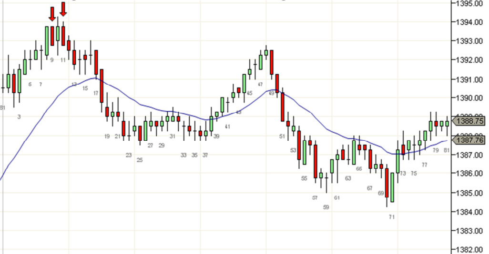

最近的亏损会动摇你对下一次交易的信心，而且你常常不会注意到这一点。例如，假设你卖空了 b9 ，并在下一个k线以b10 高点被止损。紧接着又出现了一个建仓形态k线，你重新进入。其他的空头趋势k线很可能会迫使你过早退出。因此，当b16 形成并且看起来像一个接近其高点的多头 K线时，你可能会决定在下一个跳时退出，并正好在更强的交易者增加其空头头寸的地方退出。

很可能，如果你没有最近的亏损，这次回撤就不会让你那么烦恼。重要的是要知道盈利和亏损如何影响你，并学会不要在盈利后过于自信，也不要在亏损后害怕。一种解决办法是在一次亏损交易后让一些时间过去。如果你选择等待两个波段（b10h 和 b15 l）然后才入场，你可能会正确地解读 fH1 at b16 并持有更久。

如果您是一位交易者，并且经常或偶尔在每几个k线出现一系列亏损，那么您需要在退出任何交易（无论是盈利还是亏损）后，遵循“两次波段交易等待”规则。

<!-- 原书第 53 页 -->

## 被震出 V - K线中间的决策

2012年3月20日 星期二 · 原书第 53 页

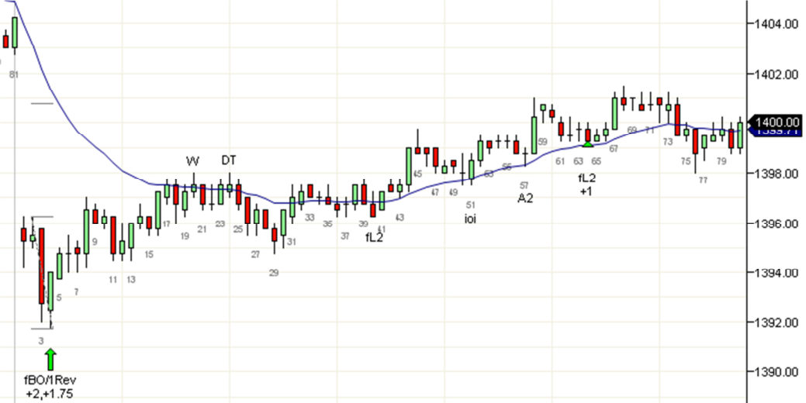

困扰主观交易者的一个问题是，他们会受到市场每一次跳动的影响。k线是上涨还是回调，由红翻绿，接近止损还是远离止损，都会引起他们各种各样的欣喜和焦虑，这常常驱使他们做出鲁莽的决策。

例如，今天如果一个交易者在它收盘后买入b4 并将止损移动到b5 下方，他应该简单地等待，直到他的目标被实现或他被止损。一个不坚定的交易者可能会看到b6 接近底部时变为红色，并想知道它是否会变成一个1PB卖空头寸。他可能会觉得有必要退出他的多头头寸，甚至在K线中间反转 b6。他可能会买入b7 进行多头反转，并在b11 被止损，等等。

这种交易包括在每一次跳动时不断地自我怀疑，并根据K线中间的外观改变你的决策。请注意，大多数交易方法都是基于K线收盘时的样子，而不是它在K线中间的样子。因此，在K线中间做出决策绝对没有必要。

一旦你进入一笔交易并设置了止损，这意味着你愿意承受一定程度的回撤直到你的止损位。如果你不能容忍更小的回撤，那么你需要找到一个允许更小回撤的交易系统。

正确的做法是让市场要么填满你的目标，要么在你是错误的时候让你止损。你唯一应该提前退出的时机是，当市场出现一个合理的反向交易，而如果你是空仓可能会进行该交易时。例如，b24 处的 DT 和 W 让我提前退出了我的波段做多，在 b64 低点附近的那个多头在末端旗形/1tf/W 大约在 b72 之后不再可行，所以我提前退出了它，而不是等到目标被填满。

能够接受在止损位止损，也能让你持有到目标价成交。如果你的止损经常被触发，你可以直接放弃该建仓形态。如果你的目标价总是达不到，你可以学会放低一些期望。

<!-- 原书第 54 页 -->

## 无法持仓，过早离场 I - 耗时过长的走势

2012年3月21日 星期三 · 原书第 54 页

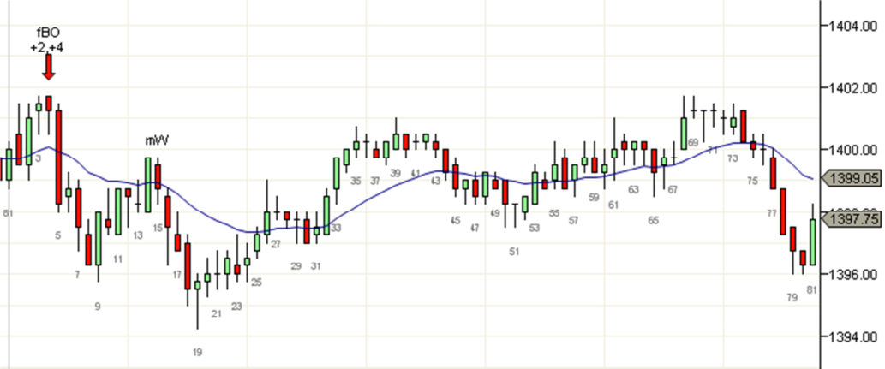

人类天生Impatien，这往往不利于交易利润。虽然无法持有到长时间比被震出要好，但这通常会大幅削减利润，足以引起一些担忧。

例如，今天如果一个交易者买入并持仓度过了 b20-24, 附近的横盘，他可能会计划在信号良好时在 L 2 处离场，或者在第三次推升时离场。技术上，他应该在价格触及 b37 下方或 b35 上方（在 b39 期间）时离场，然后等待更多的价格行为。

然而，入场后不久的横盘很可能会让他感到沮丧，并质疑建仓形态的强度。他可能会将此视为 BW，并预期任何向上突破都将失败，导致市场跌破。他可能会将空头K线 b23 解读为趋势中断，或者将 b21 和 b23 解读为两次趋势中断，使得 b26 成为向 ema 的第三次推升并离场（或者更糟的是反转头寸）。毕竟，b10-13 的情况正是如此。如果 b21 是一根大型趋势K线并且收盘强劲，他就会更容易坚持他的计划。

解决办法是理解 b20-24 到底是什么。它试图促成反转失败，许多反转在入场K线并非大型趋势 K线时，往往会紧随其后出现此类形态。 b15 是一个 fH2 ，它在 b9 处的第一次反转尝试被触发，并成功促成了反转尝试的失败。 b23 是一根信号K线，它试图促成 b19, 处的反转失败，如果触发，则使其成为一个 fH2 。

价格行为，例如 b20-24 ，在反转后不久就可能出现，如果入场k线很小，交易者可以采用两种技巧来应对。首先，在 +2 处获利，并为剩余头寸移动止损至盈亏平衡。获利这一行动本身就会增加你对建仓形态和整体交易的信心。移动止损至盈亏平衡这一行动可以缓解焦虑，因为大脑会感知到较小的风险。一旦你持仓度过首次回撤，坚持你的计划就会容易得多。

<!-- 原书第 55 页 -->

## 无法持有，过早离场 II - 近因偏见

2012年3月23日 星期五 · 原书第 55 页

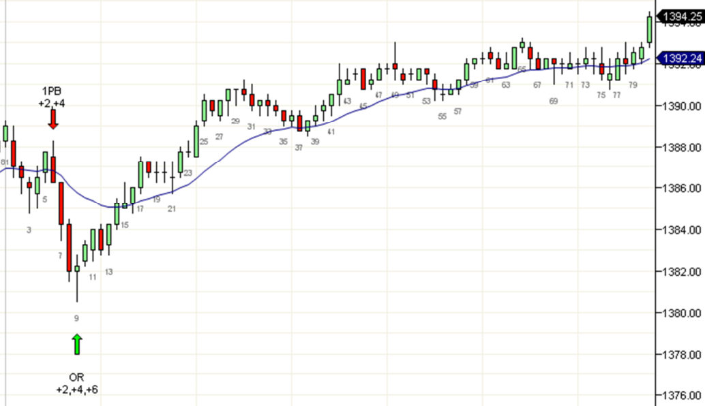

近因偏见是我们更容易回忆近期事件和经验的能力，而对早期事件的记忆则相对较弱。这意味着，你最近的任何经历都可能比过去的事件对你的决策产生不成比例的强烈影响。近因偏见非常难以克服，因为它是我们认知和学习过程的一个基本组成部分。

例如，今天我在买入 b9上方时比我本可以的要早一点退出了。当第一次反转（b9-29）后的初始走势强劲时，你通常可以持仓到收盘或明显超出 TCL。然而，在适应了最近的窄幅震荡日后，我在 b24 上方 +6 处退出了，而不是我计划的 +8。

对此的永久解决方案是积累经验并培养快速回忆和适应不断变化条件的技能。积累的经验越多，近因偏见对您的影响就越小。然而，战术解决方案是机械地进行交易并坚持计划。至少，我应该在b30 之前的L2 （在fL2 b21之后）退出我的波段头寸。

<!-- 原书第 56 页 -->

## 无法持有，过早离场 III - 近期亏损

2012年3月28日 星期三 · 原书第 56 页

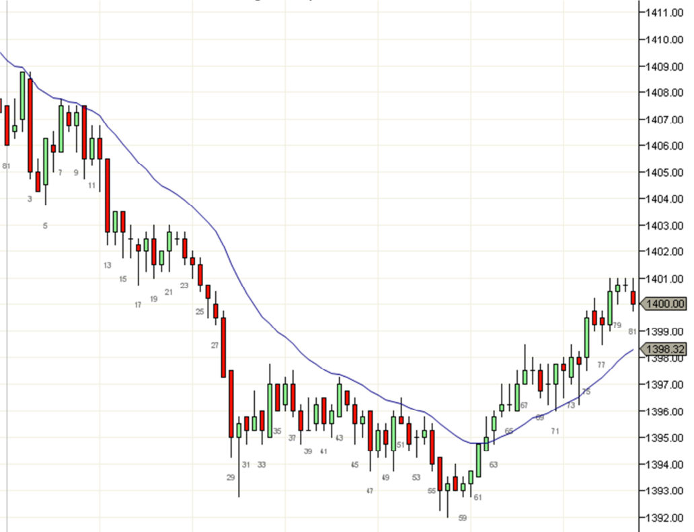

交易者面临的最困难的任务之一是不要让最近的结果影响他们当前的决策。例如，一个交易者可能已经卖出了b3 并买入了b5 并且两次交易都亏损，他也可能在b8之下进入了一个卖空。但是，他可能不愿让它继续，而是 tempted 快速获利并完全退出他的头寸。这主要是因为尽管他可能没有有意识地意识到，但最近两次亏损的后果已经相当强烈地影响了他的情绪和判断力。人类的生存机制启动，迫使交易者以小的、确定的利润退出，并使当天更接近空仓，而不是冒险使亏损更大。

很难克服这种情绪影响，并且可以说是从新的开始，因为交易者没有足够的时间冷静下来并恢复镇定。我的应对方式是避免进行至少两次波段交易，或者等待价格远离你出现亏损的区域。

暂停几个波段的交易可以避免你进入失控状态。不在同一价格附近交易可以避免你陷入震荡的行情。如果你抓了一个看起来不错的信号但被止损，那么很有可能你正处于震荡行情中，并可能再次被止损。让价格远离可以消磨一些时间，并可能为你提供下一个交易的更好建仓形态。

<!-- 原书第 57 页 -->

## 过早离场

2012年7月9日 星期一 · 原书第 57 页

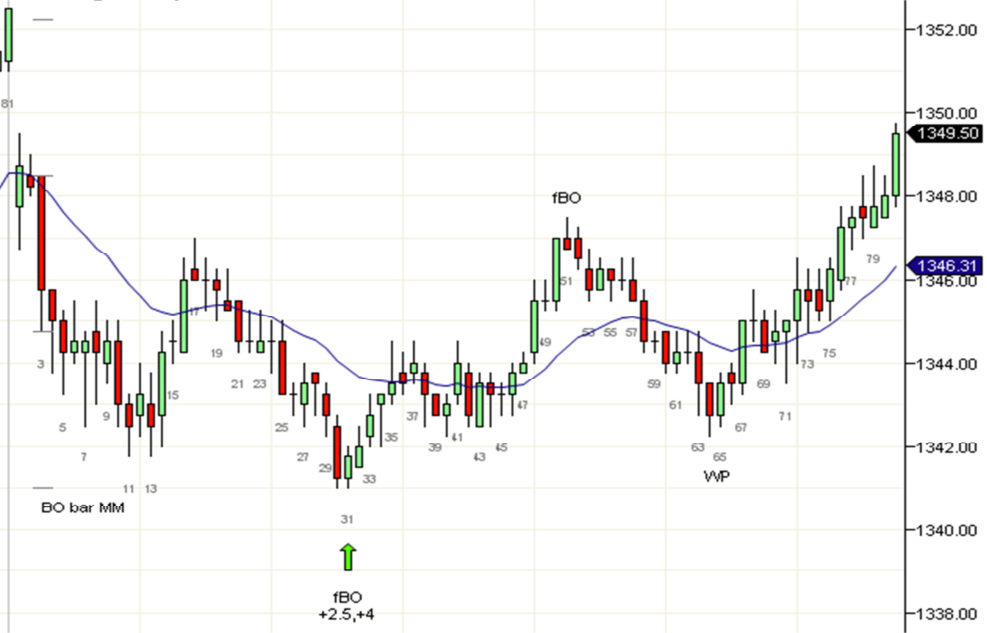

尽管我倾向于波段交易大多数的交易直到趋势结束，但有时提前退出是明智的。总的来说，当市场处于交易区间时，你不能期望大多数交易能真正发展成非常强劲的趋势，并且你可能需要考虑提前退出。

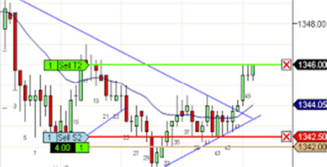

fBO交易是该规则的一个经典应用。由于fBO只能期望给出两个腿，并且这两个腿可能取向任何目标（即最近的波动点或高/低开数据），因此通常最好是获取大量已实现的利润。例如，今天的fBO建仓形态在b31 处出现，然后在b48处上涨了一腿。理论上的波段止损位于前期波段（b43）下方，当价格接近潜在目标（b17H）时，提前退出并在预期的深度回撤（最终在b65处发生）时重新进入是明智的。一种选择是在强势时退出（插入图示），或在价格出现对你不利跳动时退出（最终在b51下方）。我更喜欢在出现潜在的FF类型建仓形态（内包k线b49 可作为FF）时，在强势时退出。即使在趋势日，当市场出现不成比例的强劲走势时，你也应该预期会出现延长的回撤，这可能是一次快速的深度回撤，也可能是一次漫长的浅度回撤。如果你的波段止损和价格距离很远（4+ 点），通常最好是提前获利，而不是经历可能漫长、深度或复杂的回撤。一个值得注意的例外是后期趋势，它很少回撤。

<!-- 原书第 58 页 -->

## 情绪化交易与预防

2012年3月27日 星期二 · 原书第 58 页

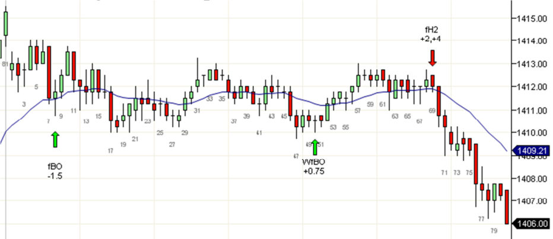

一个人被击打一次，他可能会反击；如果他在来不及反应的情况下被迅速击打两次，他可能会试图逃跑；如果他在来不及反应的情况下被击打三次，他可能会变得疯狂，试图杀死对方或被对方杀死。在某种程度上，这是一种生存机制，适用于大多数人际互动。对某人反复骚扰也可能导致自毁模式的启动，我曾讨论过扑克玩家在经历不幸的败局时是如何情绪失控的。交易亏损会引起与输掉一副扑克牌类似的反应。这是因为一个中等水平的交易者期望他的交易能够成功，并且经常对连续几笔交易接连失败感到震惊。你连续亏损的交易越多，你就越可能不顾一切，在糟糕的建仓形态下进入交易，试图赚回你亏损的钱。像今天这样的窄幅日对任何交易风格都极其危险，无论是刮头皮交易、波段交易、顺势还是逆势。你可能甚至没有意识到自己是一个会情绪失控的交易者，但从你的交易历史中可以看出。如果你的大多数日子里，通过几笔交易获得稳定的小额利润，但有几天却通过大量交易造成了巨额亏损，那么你就容易情绪失控。所有你认为已经根除的糟糕交易习惯，在情绪失控时都会重新出现，你会一笔接一笔地亏损，甚至可能在一天之内爆仓。有一些简单的方法可以尽量减少情绪失控时的损失。防止连续亏损的一个非常重要的技巧是，在一次亏损后，至少等待两个波段再进行交易。例如，在我于b12, 亏损了b8买入后，我需要等到 b17才能交易。除了少数例外，除非失败走势超过你的信号K线几个点，否则不建议立即接受下一个信号。当你亏损一笔交易时，首先要问自己是否犯了错误（糟糕的信号、错误的解读等）。如果是，请立即在日志中记录下来。记录错误的这个行为本身就能让你的思维脱离图表，迫使你承认你的错误。接下来，你要从电脑前走开，也许喝一杯水，或者做几个俯卧撑。这就像被击打后走开，而不是冒着生命危险去搏斗。这也平息了你立即想进入交易的紧迫感，并帮助你避免进行两次波段的交易。如果你在返回后立即遇到第二次亏损，你就不太可能情绪失控。两次或三次亏损后，就停止当天的交易。情绪失控的交易者如果能及早停止，通常造成的损害最小。他们越是交易试图弥补损失，他们的每日亏损就越大。很少有交易者在情绪失控后能够及时恢复并弥补损失，并在一天结束时成为大赢家。除非你也能在亏损后退一步并执行上述仪式，否则你永远无法在两次亏损后停止交易。经常，你连续亏损的原因是你可能没有意识到的。也许你睡眠不足，或者饥饿，或者前一晚喝得太多，或者你的网络连接不稳定，或者你交易的是错误的合约。无论如何，如果你的盈亏模式有很大不同，你应该停止当天的交易。固定的每日最大亏损是固定每笔交易亏损的完美补充。当你达到这个目标时，庆祝你从交易台解放出来，出去享受你的生活。

<!-- 原书第 59 页 -->

## 报复性交易 - 在你止损的地方反转

2012年3月30日 星期五 · 原书第 59 页

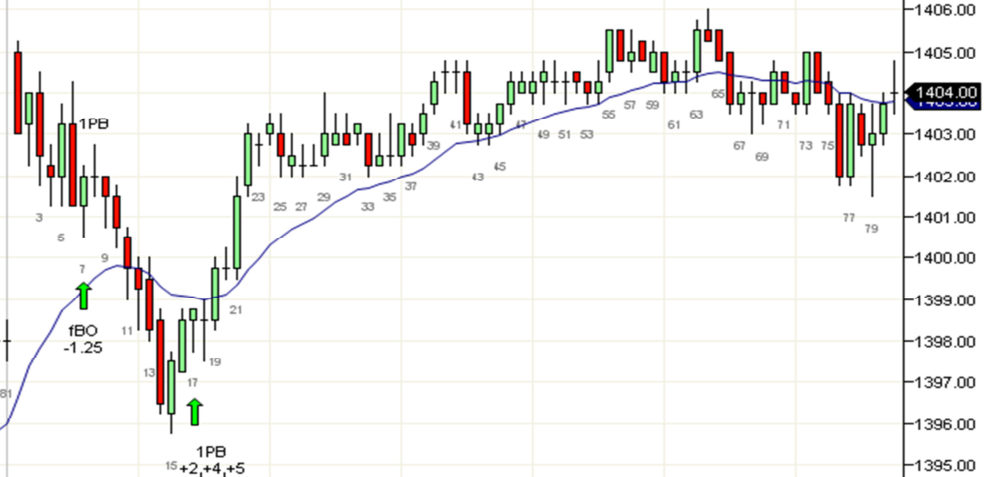

正如我之前发布的，趋势首根K线只是一个交易区间。然而，一根强劲的空头收盘价突破了前一天的多头通道TCL，这是一个下跌的信号。如果交易者选择在 b1 下方卖出，而不是等待 b1, 的突破回撤，他可以遵循标准的图表行为原则，并将止损移至 b2上方。由于 b2 出现了强劲收盘，他可能只是决定在他被止损的地方反转。这是一笔未计划的交易，属于报复性交易的一种形式。

这是因为交易者制定了成功计划，但没有制定失败计划。他非常仔细地可视化了他的建仓形态、入场和目标。他可能选择了止损，但由于对自己的交易过于自信，并不真的期望止损会被触及。毕竟，这个建仓形态实在太完美了。怎么会失败呢？一个完美的建仓形态的失败通常意味着你仍然处于一个震荡的交易区间，并且任何在这一区域附近的建仓形态都很有可能失败，无论方向如何。正确的做法是等待两个波段，或者直到价格从震荡行为中移动一段距离。由于我进了 b7 并且被止损了，我的计划要求我等待两个波段，或者直到价格从这个建仓形态中移动一段距离，这两者都意味着我将在反转于 b15后的第 1个PB时入场。虽然一些交易者在亏损后能够保持思维清晰，但许多人却无法做到。例如，一个经验丰富的交易者在读到 b71 是 A2 卖空（因为 b69 是 L1 的变体）并在其下方做空后被止损，他可能能够保持头脑清晰，在 W 回撤的 b74 处正确地卖空。（但他很可能无法做到，如果他在 b73期间反转并做多的话。）然而，在大多数情况下，最好还是等待两个波段。一个在 b50DT 下方的卖空在 b55处被止损。很自然地，在 7 根多头K线之后的卖空很可能会失败，即使这不是 BW。等待两个波段，即 b63, 收盘后，成功的交易机会会增加。价格也已经远离了原始价格一段近期K线的大小，并且也给交易者一些时间来恢复镇定。

总结一下，遇到亏损时，务必避免立即重返。要有重新入场标准。在亏损后情绪化和急切地反应的可能性非常高，这会使您处于严重劣势。在这种状态下，您不太可能以最高的技能水平解读市场。暂时让市场走，等待更好的价格行为。在强劲K线上入场是过滤疲软的价格行为区域的好方法。强劲的建仓形态K线失效实际上为您提供了更多关于市场的信息，因为疲软K线可能在任何地方失效，而强劲K线只在交易区间/通道中失效。

<!-- 原书第 60 页 -->

## 逆势而为，而非顺势交易

2012年4月4日 星期三 · 原书第 60 页

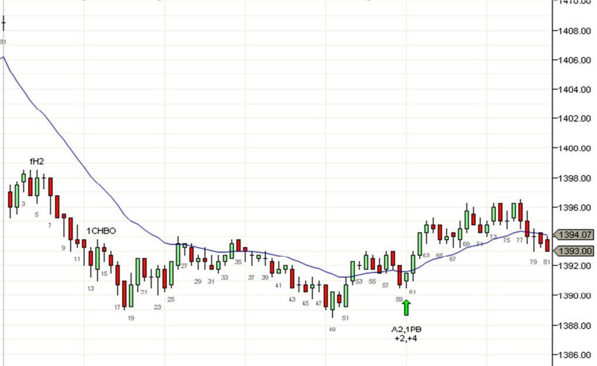

交易者经典的错误之一是爱上他们的第一个头寸。如果一个交易者买入了，因为他可能期望缺口回补，或者作为第二次回补缺口的尝试，或者PB，当市场止损并突破当日低点时，他可能会感到惊讶。当他后来看到反转k线时，他可能会看到一个反转k线。在可能出现缺口回补后，这可能表现为一个反转k线。这可能看起来是一个相当强劲的反转k线。交易者最终可能会买入所有这些，并每次都被止损。（另一种选择是不断加仓，这更加危险）。我更喜欢在信号K线突破时交易，而不是简单地收盘买入，原因之一是这可以防止我进行许多错误的交易，例如这些。相反的情况是，交易者最初的方向判断是正确的，但未能看到趋势突破（趋势突破 - 趋势反转）和测试（测试），并坚持做空每一个上涨的变动。在出现重大反转后，不再有做空交易，因此不是一个做空交易。（导致交易失败的常见原因是对趋势终止或趋势反转的否认）。这种行为的常见原因是交易者对市场方向的偏见。这种偏见可能是由于阅读了太多的经济博客或观看电视，或者对世界经济的强度或弱点存在固有的偏见，而交易者希望在今天的市场中看到这种偏见。不看新闻的交易者可能受到技术偏见的影响。他们可能对某种形态或指标有固有的信念，并期望强烈的反应。交易这些是正确的，并且其中一些失败是自然的。然而，交易者不应假设自己最终将被证明是正确的，而是在同一方向上反复进入交易。这就是对接受的需求，并且是一种强烈的人类特质。您不应该让它干扰您的交易，因为市场过于不讲情也无法接受或拒绝您。交易者需要认识到，所有偏见和观点，无论方向如何，总是错误的。只有市场是正确的，对于日内交易者来说，经济的强度和支撑是毫无意义的。形态和指标是工具，它们偶尔会失效，无论它们曾经多么可靠。正确的交易方式是只接受市场所呈现的，并意识到趋势可能会被打破，交易区间可能会被突破，没有任何东西保证会永远运行或最终反转。

<!-- 原书第 61 页 -->

## 交易错误的类型

2012年5月7日 星期一 · 原书第 61 页

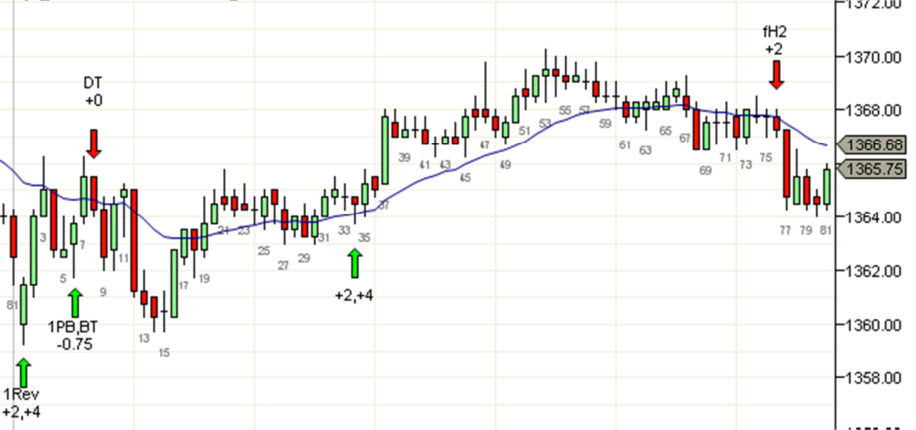

我已将交易错误任意分为以下几类：

1. 方向错误：交易者对主要市场方向的判断错误
2. 入场错误：交易者入场过早或在错误的k线上
3. 止损错误：交易者使用的止损太宽或太窄
4. 执行错误：交易者过早地放宽或收紧止损，或被震出

方向错误：交易者错过了趋势的尾声，或者错误地将回撤解读为反转。将交易区间误读为趋势，反之亦然，也属于方向错误。经过几年交易后，交易者会大致了解市场的走向，这些错误应该会越来越少。例如，向b68 突破趋势，即使没有趋势线也很明显。此时，任何顺势建仓形态，例如 b69 ，都应该被怀疑。b69 买入是方向错误。

入场错误：交易者通常对市场的方向判断正确，但却在不当的k线上入场。例如，在上午两次尝试卖出失败后（b3 和 b8），市场很有可能向上走高。一个买入 b12 的交易者犯了入场错误。

止损错误：交易者在方向和入场上都是正确的。然而，他的止损设置得太严格或太宽松。一个买入 b28 并设置了 5t 止损的交易者，其止损过于严格，会被止损。重叠行情需要更大的止损，至少 6t。内包k线的理论止损位于前一根外包k线的下方。同样，一个在 b6 上方买入并将其止损设在 b6 下方的买家，其止损设置得过大。执行错误：入场过晚（超过 1t 的k线，除非是滑点原因）、在首次回撤时被震出（第二次回撤时退出是允许的）、在价格变动或出现首次回撤前就收紧止损、放宽止损导致回撤未能触及止损、在只有微薄利润时就退出，这些都是常见的执行错误。大多数执行错误是由于心理压力造成的，这通常意味着风险对你来说太大了，难以承受。

交易者通常会在克服上述错误的过程中不断成长，顺序也往往是相同的。如果你的方向感普遍是错误的，你将永远无法通过波段交易获得多点收益。你应该考虑其他的交易风格，例如通过刮头皮交易赚取一两点，并努力达到高准确率。入场错误通常是由在第一笔建仓形态时入场造成的，而这通常是一个糟糕的建仓形态，原因是信号K线过大或存在重叠。你最好的选择是严格限制自己只关注非常清晰的建仓形态K线或第二次入场。止损错误很大程度上可以通过使用固定止损来消除，对于内部重叠和边界重叠的K线使用 6t，其他情况使用 5t。执行错误则更难解决。改进执行错误的最佳方法是采用固定止损和目标的“即设即忘”交易风格，并且只通过完成OCO止损/止盈来退出。

<!-- 原书第 62 页 -->

## 让赢家变成输家

2012年6月5日 星期二 · 原书第 62 页

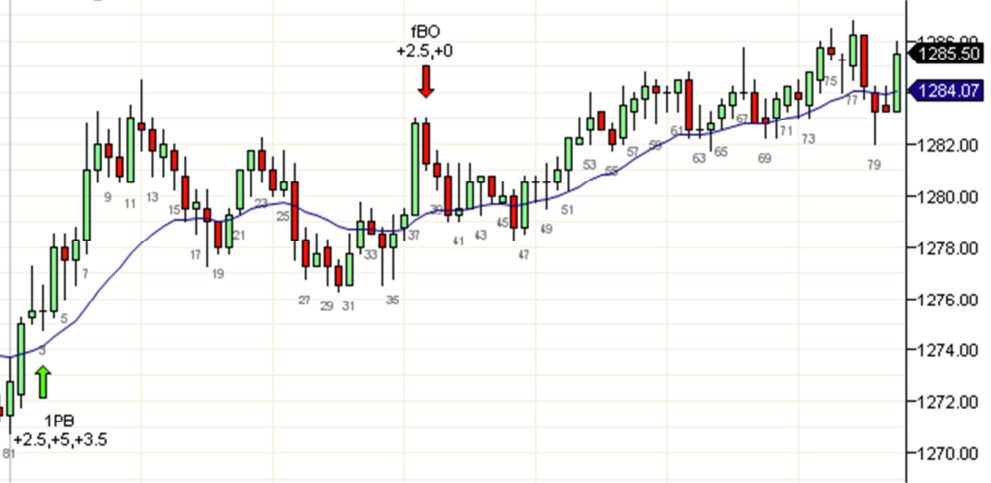

贪婪、恐惧和希望是困扰交易者的可怕诅咒。希望可以通过清晰的固定止损来消除。贪婪和恐惧需要相互平衡，并且永远不会真正消失。

并非每笔交易都能获利，对于许多交易者来说，止盈第一笔利润可以极大地改善他们的权益曲线。这对于反转和试图突破交易区间的情况尤其如此，因为这些建仓形态经常失败。

例如，期望交易区间即将反转的交易者（因为b38 出现了一个在趋势线突破后的2L LH——一个重要的反转建仓形态）通常会全仓持有，并且拒绝获利。这样的交易者甚至可能将止损保留在信号 K线之上，直到形成另一个LH。这些交易者今天会亏损。另一方面，提前获利的交易者则小有收益，尽管他们都对整体市场方向判断错误。

如果交易者卖出b38, ，那么在他判断正确时获利，并在目标被满足时将止损移动至盈亏平衡，这是最明智的做法。如果市场两次反向移动（即，两次跳动超过K线，背离他的交易方向（高于b48）），如果他没有被止损，他就需要退出。如果他被止损，他应该将剩余头寸的止损移动至盈亏平衡。

一位交易者在今天对W形态后的首次回撤进行了卖出b23 ，获得了4 点的利润。他应该将任何剩余头寸的止损设在盈亏平衡。将止损设在信号K线之上，甚至更糟的是，设在前期波段之上，是希望而非客观性的症状。无论反转在b12 以及第一个LH在b23 看起来多么明显，交易总是可能失败，最好是让它触发止损，然后寻找新的交易。

即使在非常强劲的高动量趋势中，您通常也最好选择提前止盈。这是因为如果您在变动早期进入，趋势持续的可能性是未知的；如果您在后期进入，趋势反转或出现深度回撤导致您止损的可能性始终存在风险因素。

<!-- 原书第 63 页 -->

## 加仓亏损头寸

2012年6月6日 星期三 · 原书第 63 页

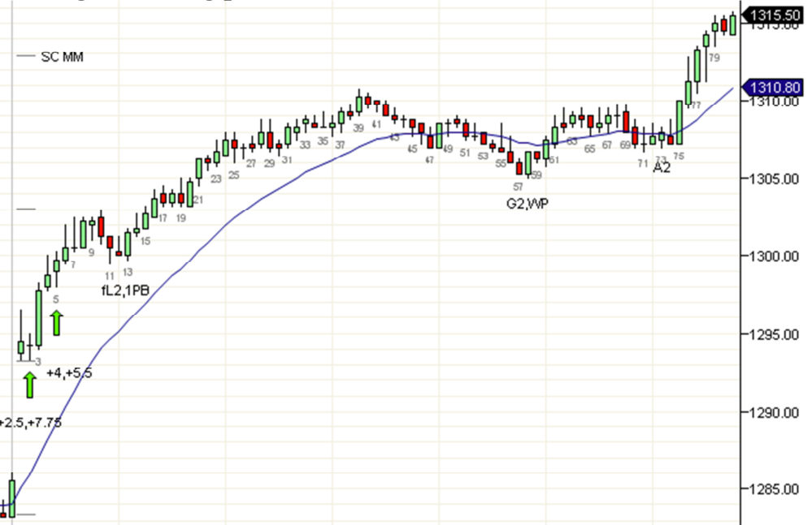

在所有的交易中的罪过中，没有比为了获得更好的平均价格而加仓亏损头寸更严重的罪过了。在交易区间日，加仓最终可能会奏效，尽管交易者在看到比其平均价格更好的价格之前，会一直交易到超出其舒适区。在许多日子里，他可能只勉强保本（持平交易）。

在今天的趋势日里，逆趋势交易者如果在交易中任何时候出现逆势变动，他们很可能都会被淘汰。例如，一个交易者可能会卖空b10 作为反转的首次尝试（这在很多日子里都是有利可图的），但当交易出现逆势变动时，他可能会决定将止损大幅上移，并在将被止损的价位或下一个信号处加仓，而不是让市场止损。

当前存在的心理问题是渴望抓住变动的精确最高价或最低价，以获得尽可能好的价格。这一点加上方向感错误，将迅速摧毁交易者账户。

解决这个问题的办法是决心永远不交易反转。交易者应该始终等待反转成功，并建立一个成功的相反方向趋势，然后在首次回撤时进入。除非反转非常明显，否则它很可能失败。

在今天这样的日子里，一个想要做空的交易者，如果等到空头趋势（b41-47）确立后再入场，远比在b1 试图捕捉精确的转折点而做空每一次上涨的空头K线要好得多。

<!-- 原书第 64 页 -->

## 在亏损时反转头寸

2012年6月7日 星期四 · 原书第 64 页

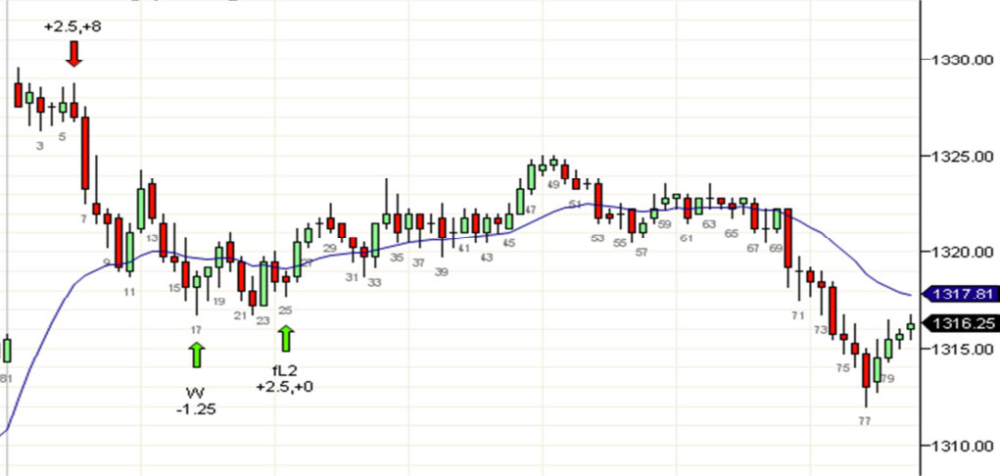

过度交易的普遍原因之一是，交易者每次被止损后就反向操作。许多交易者会陷入这种陷阱，因为他们只关注K线，别无选择，只能对任何看似反转K线的走势进行反向操作。例如，如果一个交易者在熊市的两条腿上涨时做空了b29，然后在b32 时，他可能会认为趋势可能已经反转，于是买入b32 ，然后卖出b34 ，如此循环。交易者陷入此境的第二个原因是，他们听说失败是一个强烈的信号，失败的失败是更强的信号，而同方向的两次失败则极其强烈等等。因此，如果一个交易者在W24,29,34 时卖出了b34 ，他可能会将b37 看作是两次下跌，然后反向做多。该区域的震荡可能被解读为fL2 或fH2 ，或许多其他情况，导致他用每一根K线来解读新的方向。这里真正的问题是，交易者关注的是微观层面。交易者始终需要牢记市场是在趋势（b1-b17）还是在震荡（b25- b45），是在突破后失败（b46-53）还是在突破后继续（b56-70）。了解这九种转换可以减少方向错误。频繁反向操作源于害怕错过即将到来的巨大行情。这种症状也表明交易者对市场方向的感觉尚未成熟。通过认识到如果在同一价格区域附近两次被止损，那么你可能处于震荡行情中，而你的入场实际上是在试图预测突破，从而可以对抗这种状况。预测突破是交易中最困难的事情之一，而等待突破发生并跟随首次回撤则容易得多。我避免陷入这种陷阱的方法是假设如果我的交易失败了，市场很可能处于震荡行情中，除了第一个小时，我都会避免再次入场，直到价格远离该区域。例如，如果我将b34 解读为W并卖出，我不会交易，直到价格远离b34, ，即直到b49。这个规则有两个例外。如果一个反向交易两次失败，我可能会考虑在相同方向再次入场。例如，我做多b17 后被止损，b20 设置了一个空头头寸并失败了两次，直到b25 触发。只有在预期有巨大行情时才应这样做。

在第一个小时，如果止损是由于固定止损而非理论止损触发的，我通常会重新进入。例如，如果我做空 b1 并且我的 6t 止损被触发，那么直到 b2 高点被触发，该交易才算理论上失败。即使价格没有远离我的亏损交易，我也会在 b6 处进入。

请记住，一天通常有一次、两次，偶尔会有三次好的波段。重点在于抓住其中一部分。这能确保非常高的风险回报比，并最终带来非常高的胜损比。

<!-- 原书第 65 页 -->

## 通往一致性的艰难之路 I - 过度交易

2012年7月20日 星期五 · 原书第 65 页

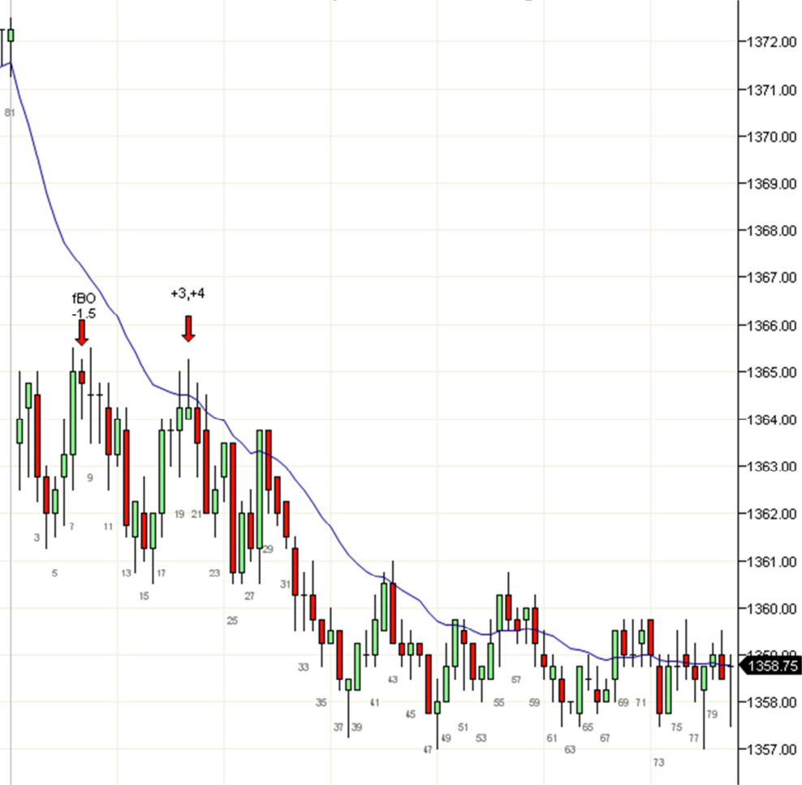

交易的麻烦在于，你拥有做任何你想做事情的头寸，并且需要挣扎着培养出不去做伤害自己的事情的纪律。这与现实世界正好相反，在现实世界中，你能做的事情非常有限，并且需要挣扎才能去做你想做的事情。

你会很快明白，做任何你脑袋里冒出来的事情都会迅速走向毁灭。唯一的出路是学会停止做事情。你的重点需要转移到停止做那些即使有时会奏效但却让你亏钱的事情。

在交易中，没有什么是保证的。没有一个建仓形态能保证每次都奏效，即使是最好的建仓形态也可能出现多次亏损的连续序列。一切都取决于概率，而概率只有在大量的样本中才起作用。即使是50%的建仓形态，也应该预期在100 次尝试中至少会出现6 次连续亏损。（继续，抛硬币100 次）。

<!-- 原书第 66 页 -->

尽管拥有一个盈利的系统，但许多交易者仍然失败，这是因为他们无法遵循自己的规则。交易者需要找出哪些习惯在损害他们的交易，并根除它们。

最危险的不良习惯是过度交易。过度交易的定义取决于您的交易风格。如果您旨在进行日内3 至 5 的大波段交易，那么每天交易超过10 笔可能就是过度交易。如果您是追求日内10 笔交易的刮头皮者，那么20 笔可能不算什么，但40 笔绝对是。衡量过度交易的最佳指标是差的胜率/交易比。一笔交易获利2点尚可，但20 笔交易仅获利2 点则不然。

过度交易通常是由交易者对亏损反应不当（情绪化）引起的。对亏损交易有两种反应：重试和摇摆不定。一个已经判断市场将下跌的交易者会不断地重复卖空，而不顾止损出局。他认为自己对市场方向的判断是正确的，但对入市时机或止损大小的判断是错误的。下一次肯定会成功！

摇摆不定者的情况更糟糕。如果一个卖空交易被止损，他就会反手做多，反之亦然。如果一个绝佳的多头建仓形态被止损，那么市场肯定会下跌，对吗？（答案：错误。参见 b14）

面对亏损的正确反应是客观地看待市场，并且只有在有极其充分的理由时才进入。容易过度交易的交易者即使出现看似有利的重新进入机会，也应该观望几个k线。通常，如果你在一次不错的建仓形态中被止损，市场可能处于震荡状态，你应该暂时观望，不要交易。

等待价格远离你被止损的区域，或者在导致你止损的k线之后出现两个方向相反的波段。大多数在被止损后立即重新进入的交易者，其心态可能是失望、惊讶、紧迫感和绝望的混合体，所有这些都可能影响他们的判断力。在你变得稳定之前，保持观望，直到价格远离或者在一次亏损交易后出现两个额外的波段。

心态将亏损视为一种小型创伤，需要时间来恢复。过度交易导致的大多数亏损是由近期亏损导致的糟糕判断力造成的。

您还需要保护您的账户免于爆仓，因为您无法接受亏损日，并且会不断尝试交易以摆脱回撤。过度交易者应该制定关于每日亏损交易数量的严格规则。如果您处于一种导致您一再亏损的心态中，那么更加努力很可能会使情况变得更糟，而不是更好。

要明白，你作为交易者的主要目标是管理风险，一旦你连续出现一定数量的亏损交易，如果你继续交易并进行风险管理，停止交易，那么你当天承受更大亏损的风险就会更高。

<!-- 原书第 67 页 -->

## 通往一致性的艰难之路 II - 状态不佳的一天

2012年7月24日 星期二 · 原书第 67 页

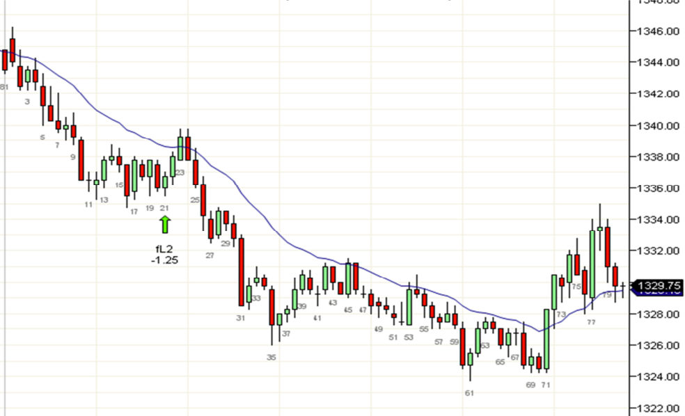

“撒马利亚战士不怕死，也不急于求死”

--野蛮人柯南

交易要求你保持最佳状态。你需要保持警觉和专注。你需要得到充分休息并且不受干扰。你需要已经进食，并且身体健康。除非第二天市场收盘，否则不要参加聚会。尽管你努力保持警觉，并且经过多年良好的交易，但你仍然不可避免地会遇到偶尔状态不佳的一天，届时你就是无法进入状态。许多交易者在早期体验到一致性后，会积累足够的点数，认为自己已经成功，并开始增加交易规模。这是危险的，因为一天状态不佳就可能让你出局。关于初步的一致性最危险的事情是，你不会相信自己会在同一天反复出错，并且会自信地认为自己能够赢回所有亏损。

这就是为什么我设定了严格的两次失败交易限制。如果你在上午交易亏损两次，可以在下午交易，前提是有一个绝佳的交易机会出现（每天最多亏损三次）。

出现以下迹象，表明今天可能是状态不佳的一天，应引起您的警觉：

1. 您已经有理由相信自己可能状态不佳（睡眠不足/饮食不当）
2. 您又开始了一些曾经以为早已改掉的坏习惯
3. 您反复解读市场，其准确性比平时差
4. 您已经触及了最大亏损

当你意识到自己状态不佳时，就需要停止交易。即使多年以后，你也会遇到一天，你就是无法适应市场。在进一步损害自己之前停止交易。从赚钱的压力中解脱出来，专注于研究你新发现的情况。这一天是一个糟糕的交易机会，但也是一个绝佳的学习机会。研究你的行为和市场的行为。

<!-- 原书第 68 页 -->

## 一致性的艰难之路 III - 教育的沉重代价

2012年7月30日 星期一 · 原书第 68 页

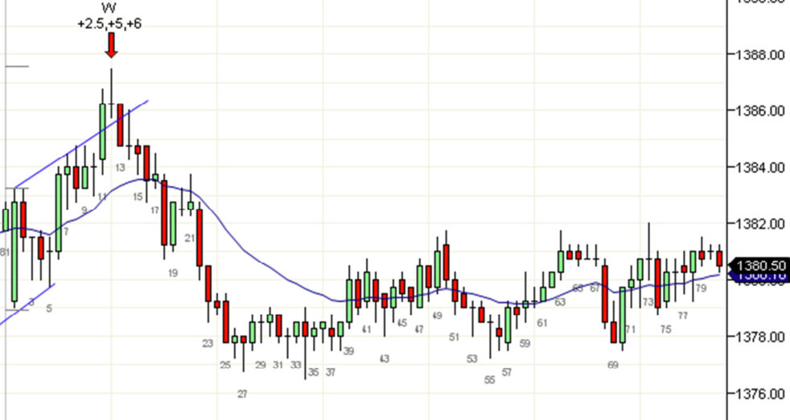

交易的学习成本非常高。交易的方法数不胜数，其中许多方法无利可图，另许多方法仅对其唯一的使用者有利可图。在这些数不胜数的方法中，可能只有一两种适合你。大多数未经自我验证就尝试交易系统的人，最终都会赔光投入的一切。

我个人认为，几次对市场行为的观察不足以被标记为建仓形态并进行交易。这就像观察到数字十三是不吉利的，或者狮子座的人天生就是领导者。由于选择性偏见，这看起来可能是真的，但更有可能只是一种简单的迷信。许多交易建仓形态都是迷信，在了解每种建仓形态的概率之前，你不应该进行交易。

无论你观察到什么建仓形态，在博客上阅读，从某个王牌交易者那里听到，或者以其他方式获得，都需要经过测试和衡量，以确定以下几点：

- 潜在风险回报比（至少需要 1:1, 2:3 或更好，推荐）
- 所需的止损大小（越小越好，否则你可能会被震出）
- 成功概率：(理论上50%+ 但60%+ 推荐)
- 无效化条件和细微变体（越少越好）

获取此信息的最佳方法是实际交易这些建仓形态。20 笔交易的样本将快速排除糟糕的建仓形态。 40 笔交易的样本应足以计算概率。100 笔交易的样本应足以计算止损。

建仓形态具有微妙的变体，这些变体使特定的建仓形态清晰或强劲，而另一些则浑浊或虚弱。例如，今天从 W 形反转的下跌趋势 b12-27 被一次逆势走势 b35-49 打破，然后我们得到了一个深度的 mW b50-55 （两个内包k线 b52,54 构成了三推）。三推结束一个波段与趋势的实际反转之间的细微差别需要经验，许多交易者可能未能意识到这不是一次实际的反转。如果他们没有进行一次刮头皮交易获利，他们很可能已经被止损了。这样的亏损会增加你交易教育的总成本，只有盯盘时间才能让你变得更好。

<!-- 原书第 69 页 -->

我相信交易的第一年可以完全在模拟交易中进行，并且可能会为普通交易者节省数万美元。我还没有遇到一个交易者在第一年就能实现盈利。在你了解自己正在做什么之前，请节省资金。现代模拟交易极其逼真，可以让你保留相同的详细获利、所需止损等记录。唯一缺少的是你的心态和像真实交易一样进行交易的能力。如果你愿意，可以抛硬币并在实盘交易和模拟交易之间任意切换，直到你的心态不再区分。

大多数交易者失败是因为他们资金枯竭，而前几年交易的巨额亏损让他们放弃。通过仔细评估和选择建仓形态，并练习你的系统直到你向自己证明它，来降低教育成本。

<!-- 原书第 70 页 -->

## 通往一致性的艰难之路 IV - 极少低风险交易

2012年8月3日 星期五 · 原书第 70 页

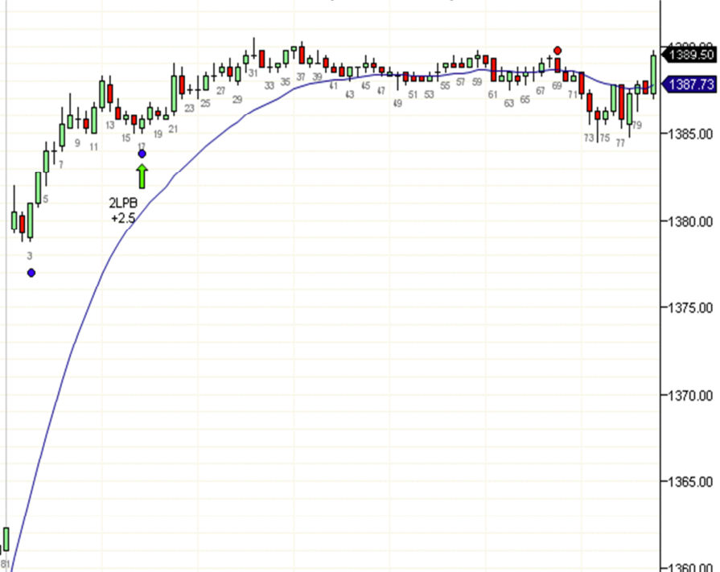

你的一致性只有在你的心态从渴望获利转变为谨慎规避风险时才会提高。在交易似乎不符合风险回报预期时放弃交易，是任何盈利性交易系统的基本框架。

只要你尝试识别每一个可交易的形态并据此行动，你很可能保持一个盈亏平衡交易员或略好一些的水平。一旦你能够舒适地放过一些交易，你就会成为一个更好的交易者。你的风险越大，你的交易成功的机会就越高，但如果建仓形态失败，你的亏损也会越大。ES 的最低风险是 5t。如果你才刚起步，你的胜率可能接近 50%。在 50% 的情况下，像上面那个多头 b11 这样的 1 点收益，相对于 5t 的亏损，实际上对你不利。为了计算佣金和其他成本，你至少需要 6t 才能达到盈亏平衡。你真的需要寻找那些能给你风险 2 倍回报的交易。在平均一天中，大约有两到五笔低风险/高回报的交易。你的目标应该是关注它们，不要理会那些次要的交易。

例如，今天只有三个建仓形态提供了 10t，同时遵守了 5t 的止损（在图表上用点标记）。技术上来说，一些其他的k线，例如 b60 和 b20 ，可能也有效，但它们是第二次入场或者不是清晰的建仓形态。

最佳的风险回报比出现在新变动的第一个深度回撤中。b17L 是多头变动的第一个深度回撤，b69 S 是空头变动的第一个深度回撤。衡量风险也意味着知道何时可以交易，何时需要观望。当 k线较小（b23-60）时，最好是观望，直到 k线恢复正常。否则，你可能面临建仓形态如预期发展但无法达到目标的风险。等待有合适大小的 k线，然后寻找建仓形态。

<!-- 原书第 71 页 -->

## 通往一致性的艰难之路 V - 糟糕的价格行为日

2012年8月6日 星期一 · 原书第 71 页

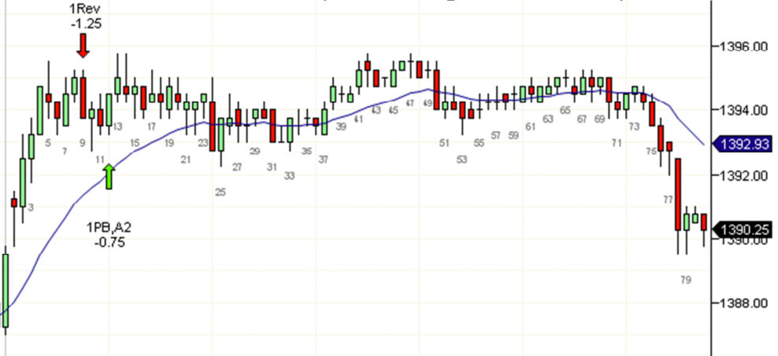

在《状态不佳的一天》一文中，我谈到了交易者尽管价格行为有利于他的交易类型，但却不在状态。反过来说，当交易者专注且准备就绪，但价格行为却非常糟糕。今天 ES 就是这样的一天。当然，何为糟糕的价格行为取决于交易策略。对于那些进行极少交易并将其波段交易到最大化的人来说，一天内大部分时间出现 TTR行为重叠的窄幅震荡日可能是最糟糕的价格行为。另一方面，剥头皮交易者可能会喜欢这样的日子。

全天都没有出现清晰有效信号，最大的变动1 和74可以说都不是基于清晰信号产生的。新手交易者可能会在这种日子里被震荡，损失掉一周的全部收益。这主要是因为过于关注形态而忽略了市场背景。应对这种日子的风险管理策略与状态不佳的一天完全相同。你需要止损两次交易后停止交易。

偶尔，如果出现一个好的下午建仓形态，你可以寻找额外的下午建仓形态（今天没有出现）。经验丰富的交易者（我不算）可能能够切换思维模式，转而关注反转入场k线，从而在相当多的交易中获利（例如，通过卖出b23 的收盘价或买入b31 的收盘价，并承受 4的风险和 8的目标）。请记住，并非每天都必须是盈利日。有些日子根本不适合波段交易。由于我选择在潜在回报是风险的 2倍时才进行交易，因此我宁愿保持观望并减少我的敞口，而不是接受较小的回报（有一些 1:1 建仓形态）。

<!-- 原书第 72 页 -->

## 通往一致性的艰难之路 VI - 您的权益曲线作为价格图表。

2012年8月9日 星期四 · 原书第 72 页

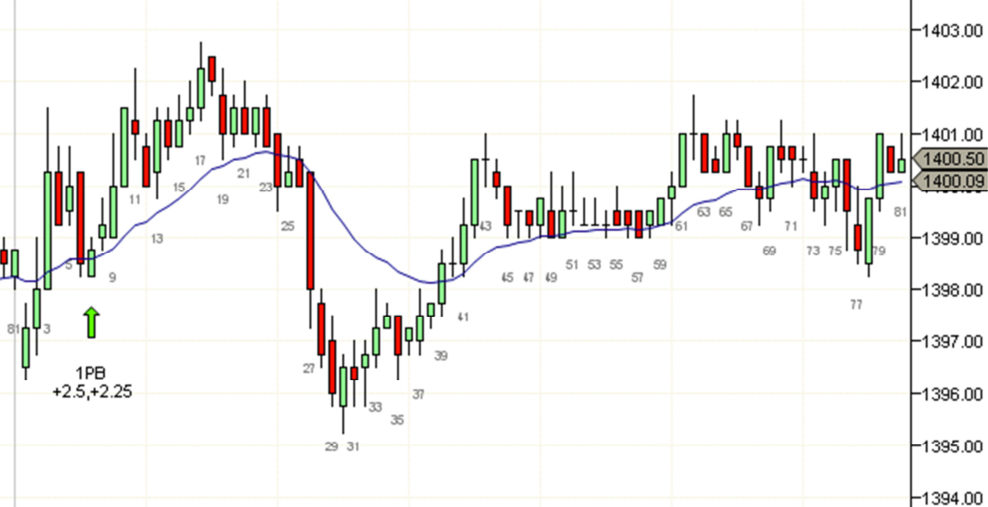

如果你将盈利日绘制成绿色k线，亏损日绘制成红色k线，你将得到一个账户规模图表，它看起来类似于上图所示的价格图表。使价格图表上下波动的原因也使你的交易账户余额上下波动。当你的交易处于上升趋势时，你大多是盈利日，偶尔会有亏损日。亏损日越少、越小，你的账户增长得越快。因此，盈利交易者账户的累计图表看起来像b1-17。

一名盈亏平衡交易者可能会经历盈利日和亏损日的交替，今天的收益可能在第二天就丢失，例如在 b45- 59 之间的区间。一名亏损交易者可能会亏损几次（b18-25），然后情绪失控（b26-29），接着停止交易或改变交易风格。显而易见，要想让您的账户增长，您需要减少亏损日并缩小其幅度，同时增加盈利日的数量并扩大其幅度。虽然您可能无法控制初期盈利日与亏损日的数量，但您绝对有能力控制亏损日的最大幅度。限制您每天的最大亏损可以防止情绪失控的日子，从而有效减少类似 b27 这样的日子，使其变成一个小小的空头K线，这意味着在价格行为更适合您的交易风格和技能水平的日子里，您能更快地恢复。

一个大型亏损交易者首先需要做的是成为一个小型亏损交易者，然后转变为一个盈亏平衡交易员。如果你进行的交易中，盈利是亏损的两倍，那么你很难成为一个亏损交易者，除非是因为情绪失控而进行可疑的交易。最差的情况下，你也应该是一个盈亏平衡交易员，有盈利日也有亏损日。一旦你成为一个盈亏平衡交易员，你就可以无限期地留在游戏中，磨练你的交易技巧，直到你开始慢慢看到利润。一个盈亏平衡交易员可以详细记录尝试过的建仓形态、使用的止损大小、胜率、对读盘的信心等，并缩小选择范围，只选择一小部分适合他的建仓形态。随着时间的推移，持续专注于这一小部分建仓形态，将慢慢地将这些建仓形态从净盈亏平衡转变为净盈利。

<!-- 原书第 73 页 -->

## 保持一致性的艰难之路 VII – 没有好的信号K线

2012年8月13日 星期一 · 原书第 73 页

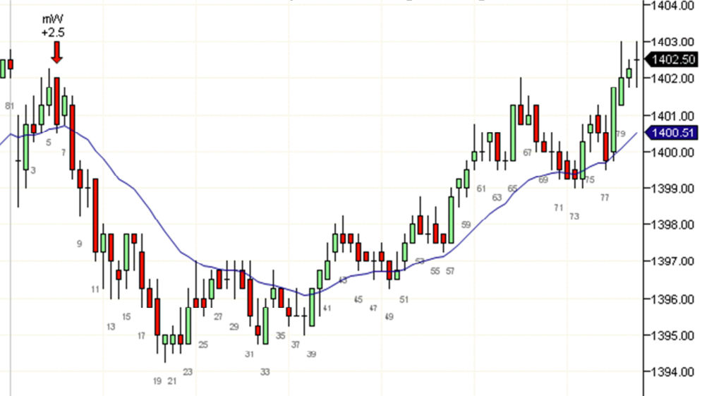

对于交易者来说，最令人沮丧的事情之一是在趋势中缺乏一个好的信号K线。一个好的信号K线是任何入场边带有剃刀式或 1引线的信号K线，并且至少有一个2的实体。理想情况下，信号K线相对于近期K线来说，既不太小也不太大。

我总是建议在好的信号K线上进入交易，原因有几点。当市场尚未准备好朝着你的方向趋势时，强劲的信号K线不太可能被触发（b12, b66）。这将保护你免受许多糟糕交易的困扰。好的信号K线的第二个重要特征是，对于任何给定的工具，它们很可能会遵守一个固定的止损（ES为5t/6t）。

然而，在某些日子里，趋势方向上根本没有好的信号K线（b10,16,20,38,50,73），但反转方向通常会提供看起来很棒的信号K线（b12,27,30,44,53,66,76）。

这是通道类型价格行为的典型特征。坚持要求绝佳信号K线的交易者在通道日可能只会进行很少的交易——这不一定是坏事，因为通道对于大多数交易者来说都非常难以交易。

一种方法是通过3 标准来评估信号的强度：位置、形态和信号K线。如果位置和形态都很强，则接受一个顺势的糟糕信号K线。对我们而言，位置是指支撑位，例如前一日的高低收盘价、ema、趋势线、突破点（例如在BT中）等。形态是指任何两腿或三腿回撤。

因此，即使在弱K线的情况下，也可以在支撑位采取任何两腿或三腿回撤。例如，这使我们能够做多。请注意，只有当信号K线较小并且您可以使用价格行为止损（在信号K线之外）而不是固定止损时，才能执行此操作。

<!-- 原书第 74 页 -->

## 通往一致性的艰难之路VIII - 心理学的暴政

2012年8月24日 星期五 · 原书第 74 页

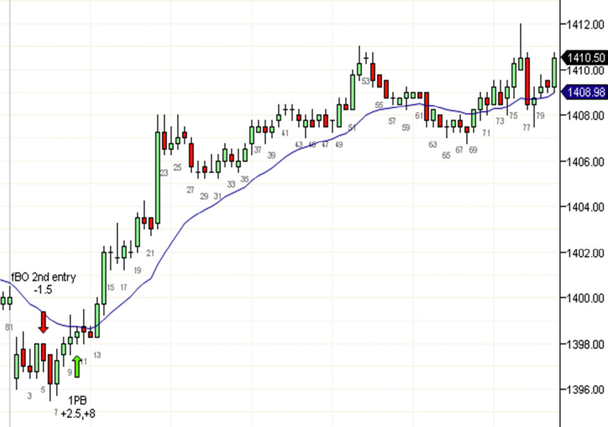

交易世界中的许多交易者和其他专业人士告诉我们，糟糕的交易主要是一个心理问题。虽然这句话有些道理，但它不完整且不准确。否则，所有心理学家都应该是优秀的交易者。

交易的现实要复杂一些。显然，你首先需要一个系统并理解交易机制。你需要良好的风险管理和交易管理实践，因为拥有最好的心理状态也无法替代止损。

我曾广泛搜寻有关交易的心理学文章，找到了许多书籍、文章和网络研讨会，其中一些具有深刻见解。然而，大多数心理学家并非交易者，他们对心理问题的治疗是学术性的。大部分材料是泛化的，而不是可操作的。例如：“提升幸福感比交易中减轻压力更重要”或“在采取任何行动之前问问自己，我是否在做符合我最大利益的事？”

<!-- 原书第 75 页 -->

这些观察大部分是不可操作的，或者没有实际用处。与实际交易无关的处方的好处，例如标记你的交易区域、风水等，可能提供边际效益，但应被视为近乎迷信。

交易者的整个发展过程分为两个阶段：

1。开发或学习一个被证实的获胜系统2。加强遵守它的纪律

开发一个获胜系统是复杂、枯燥且耗时的。你最好是找一个导师，学习一个被证实的系统，并根据你的个性进行调整。

一旦你有了系统，纪律就能让你严格遵守它。什么是纪律？纪律就是为了长期目标而抵制短期诱惑的能力。纪律是可操作的。只需遵守你的系统规则，别无他法！

最重要的是要注意，许多系统只在特定类型的价格行为期间有效，并且在不满足先决条件时你不应该进行交易。例如，我的系统在趋势日和大区间日表现非常好，而在小区间日表现不佳。反转系统在交易区间日表现非常好，而在趋势日则会失败。跳和k线刮头皮者几乎可以交易任何价格行为，但他们的胜率/交易较低，因此他们需要租赁交易所的一个席位才能盈利。

在不适合您系统的价格行为出现时选择离场，这是一种纪律。坚持止损和每日止损，这是一种纪律。抵制糟糕的行为（追涨杀跌、对亏损单加仓、一路做空到顶部等），这些都是纪律。

例如，当你追逐一笔交易时，你就推翻了你对错过先前信号的判断。如果你轻易被单根k线所动摇，你永远无法建立对市场判断的信心。接受你的系统无法探测到每一个建仓形态，最多只能捕捉到高比例的变动。例如，如果将b22 视为一个糟糕的信号而错过，就不要买入b21。相反，将这个观察添加到你的情况列表中以供研究。随着样本的积累，你最终将能够捕捉到此类变动。你应该始终预见到变动，而不是带着紧迫感去反应。

Over 随着时间的推移，这些观察将为您的系统增添价值，使其更加丰富，您也将成长作为一名交易 der.

<!-- 原书第 76 页 -->

## 通往一致性的艰难之路 VIII - 心理的桎梏

2012年9月3日 星期一 · 原书第 76 页

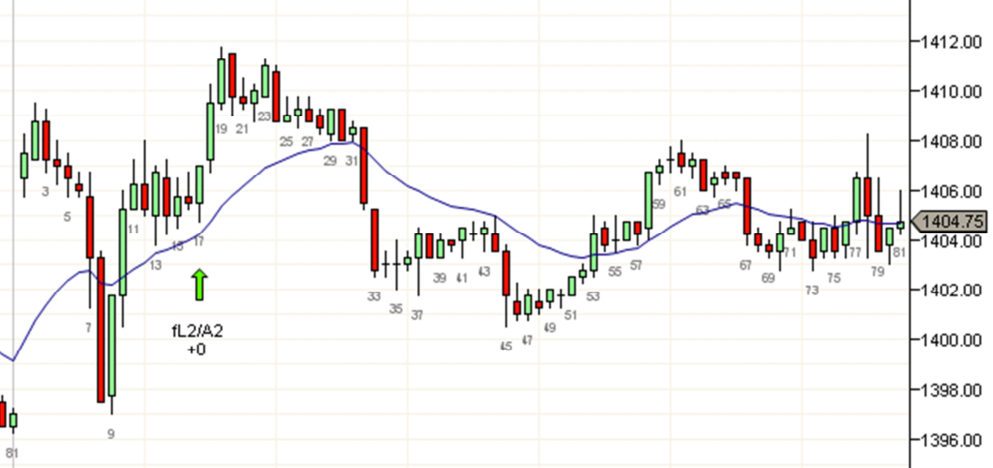

交易者应该料到，自己需要不断地学习和重新学习经验教训，这只是学习交易的一部分。其中一部分原因是对情绪反应过度。一个交易者看到像 b8 这样巨大的 k 线，可能会在它下方卖出，并且很可能被止损。同样，一个交易者可能会在一个上升趋势中一直卖空到顶部，最终爆仓。

第一步是了解是什么让你失败。你是不是因为害怕错过（FOMO）而入场，而不是等待建仓形态？你是否在价格行为原则上有欠缺？（一路做空到顶部= 的人不明白趋势可以无限持续）。你的止损是否太紧？你的目标是否太高？你是不是过早进入？你是不是喜欢抄顶抄底？你是不是在信号K线收盘前入场，结果发现收盘前几秒看起来不错的做多K线30现在变成了一根做空K线？你是不是指望凭预测反转到最后跳动（tick）的能力而设置限价单入场？你是不是误读了重叠和震荡，将其视为形态？

无论你的错误是什么，你首先需要识别它们。下一步是弄清楚交易这些情况的正确方法。忽视实际的反转，只抓取成功反转后的1次回撤，就能消除上面超过一半的错误。使用正确的交易管理可以消除剩下的大部分错误。如果你能做到这一点，你大多数日子应该能达到盈亏平衡或略有盈利。但要做到这一点，你需要反复练习，只有持续的努力才能打破你的坏习惯。

价格行为暴露了您经验中的巨大缺口的日子（在趋势日进行逆势交易）很可能会产生巨额亏损日，因此，您应该切换到模拟交易，以便在这些日子里收集数据。识别导致巨额亏损的市场结构并对其采取行动是一项更艰巨的任务，但您在两次亏损交易后切换到模拟交易这一事实使您能够留在游戏中，并找出识别和交易这些特殊日子的方法。

即便如此，仍会有罕见的交易日，例如闪崩，可能会给你带来一些麻烦。但你会在交易中变得更加自信，并欢迎从特殊事件中学习的机会。

<!-- 原书第 77 页 -->

## 成功之路 X - 纪律的难以捉摸

2012年9月5日 星期三 · 原书第 77 页

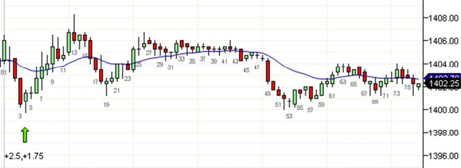

交易中一个令人惊讶的事情是，知道做什么和能够做到是两件毫不相关的事情。知道做什么就是知识，能够做到就是技能。事后诸葛亮地描述价格行为是相当容易的。如果你没有持有头寸的压力，那么在回撤时持仓或在下次上涨时退出是很容易知道的。

交易者需要努力提高交易水平，以尽可能接近理想的盘后决策。在大多数情况下，这是一个持续的挣扎。信息总是不完美的，决策往往难以正确做出。在所拥有的信息下做出最佳决策的过程，就是交易者不断所做的，这可以简单地称为培养纪律。

纪律不仅仅是遵循规则。它还包括在最近的失败面前做出正确决策的能力。即使是最有经验的交易者也会受到连续失败或错失机会的影响。

例如，一个在 b1CBO 买入上方 b14 被止损的交易者可能会犹豫买入 b19。一个错过 b13 反转的交易者可能会在 b27, 上建仓更多，他可能将其视为深度 2L 回撤。每一次亏损和错失的机会都可能在最有经验的交易者的心中造成一些沮丧，最终导致越来越多的错误。同样，一笔执行良好的交易可能会带来高度的自信和无敌的感觉，迫使产生鲁莽行为。

抵抗这种压力是需要努力改进并只能通过练习来培养的能力。独立于近期价格行为和您与市场的较量之外，看到一个交易建仓形态的能力是您需要不断关注的重点。

做到这一点的方法是将市场走势视为信息，而忽略交易本身的需求。“我今天需要获得2 点”或“我最好再进行一笔交易，这样我就可以在没有亏损的情况下结束一天”都是糟糕的建议。

关注你从市场获得的信息。不断努力使你的评估尽可能客观。忽略关于经济、外国危机或其他交易者和新闻正在讨论的任何事情的言论。与市场告诉你相比，它们完全没有分量。培养纪律就像戒烟。对于那些不必这样做的人来说很容易，但对于那些必须这样做的人来说却极其困难。可以预期会持续出现纪律上的失误和打破自己的规则。看看你身边的一些成功的例子以获取灵感，并继续努力。要知道，即使在纪律方面有微小的进步也会累加起来，并使你成为一名优秀的交易者。

<!-- 原书第 78 页 -->

## 交易者心态 I - 交易矛盾

2012年10月27日 星期六 · 原书第 78 页

交易者面临的一个真正的矛盾是，吸引人们交易的力量恰恰是导致他们在交易中亏损的原因。

对大多数交易者而言，交易之所以有吸引力，是因为他们可以：

- 赚大钱
- 快速致富
- 拥有最佳的通勤
- 通过每天 2 小时的交易来谋生。
- 随处可住
- 无需老板或员工
- 不受经济、政治变动、自然灾害等影响。
- 不需要固定资产、办公空间等。

您是否希望在家两小时的距离，一边浏览电脑，一边为自己工作，从而获得 10% 的顶尖收入？那么，谁不愿意呢？

让我们退后一步，看看交易世界之外的人可能会如何评估这些标准：

- 赚大钱 - 贪婪
- 快速致富 - Impatient
- 拥有最佳的通勤 - 懒惰
- 每天只交易2 小时就能谋生。 - 超级懒惰
- 随处可住 - 善变
- 无需老板或员工 - 社交技能差
- 不受经济、政治变动、自然灾害等影响 - 恐惧
- 不需要固定资产、办公空间等 - 不执着。

正如你所见，发展完善的个性中最糟糕的特质自然会被交易吸引，难怪80%的交易者会失去他们在交易中投入的一切。要取得成功，你需要克服那些让你最初开始交易的特质。这就是交易者在开始交易的第一天就面临的矛盾。

以上每种特质都会对你的交易产生以下影响：

- 贪婪 - 导致你在盈利交易中停留过久，直到它变成亏损。
- Impatient - 强行交易，在不良信号时过早进入
- Lazy - 不努力提高对市场和交易系统的理解。
- Mercurial - 情绪化交易，报复性交易，在每个转折点都追逐价格。
- Poor social skills - 无法从其他交易者的经验中学习
- Fearful - 无法进行交易，过早退出交易，无法在回撤中持仓
- 不执着 - 每当当前交易系统出现糟糕的一日时，就从一个交易系统跳到另一个交易系统

我知道没有一个交易者一开始没有至少一半的这些毛病。

<!-- 原书第 79 页 -->

一旦你承认，仅仅选择成为一名交易者就会让你注定失败，你就有了机会修正那些促使你进行交易的特质，并修正自己成为恰恰相反的人，从而获得成功。

## 交易者的心态 II - 兴奋感

2012年10月31日 星期三 · 原书第 79 页

当交易者开始交易时，无论成功与否，他都会体验到一种兴奋感。新手运好的交易者很可能会体验到突然获得意想不到的金钱所带来的兴奋。这会让他认为交易很容易，并有意识或无意识地承诺将交易作为一种职业。

交易带来的兴奋感与赌博和其他成瘾行为带来的兴奋感类似。这会促使他在不真正理解每笔投资的风险的情况下进行大量投资。即使是谨慎的投资者也会承担更多风险，并转向风险更大的投资，直到失败来临。

这种行为是自动发生的，是人性的一部分，大多数人都能理解。

可能令人意外的是，强烈的 emozioni 体验会导致人的行为发生持续的改变。交易者会渴望刺激和兴奋感，并继续进行交易，只是为了感受交易带来的兴奋。这会自动让交易者走向一些非常糟糕的习惯。

例如，大多数新手交易者会过度交易。一位持续盈利的交易者一天可能进行四到十笔交易，而一位新手交易者很可能会进行40笔。这是因为最初的兴奋感在驱动着交易行为。第二个常见的习惯是出于无聊而进行交易。交易者对刺激和知识的渴望（知道什么才是有可能的）驱使他一次又一次地寻求这种体验。

结果，交易者甚至没有意识到自己已经过度交易。他可能认为自己进行了10 笔交易，却震惊地发现自己进行了40 笔交易。一旦交易者以这种方式进入交易世界，他注定会过度交易并情绪失控。许多交易者在几天内就亏光了他们的账户，并在发生时感到震惊。

如果你处于这个阶段，停下来问问自己，你是否真的想通过交易来摆脱生活的苦差事。买一辆摩托车要便宜得多。交易必须是一个经过深思熟虑、审慎考虑的商业决策。你需要像赌场一样思考，而不是像赌徒一样思考。

<!-- 原书第 80 页 -->

## 交易者的心态 III - 渴望与绝望

2012年11月8日 星期四 · 原书第 80 页

最终，交易者安下心来，意识到交易并非易事，但他能更清晰地看到各种模式。这是震荡；这是突破等等。然而，由于急于交易，交易者过早入场。市场止损出局交易者，然后在提供更好的入场点后恢复变动。

交易者可能会在此刻感到绝望。一个情绪敏感的交易者可能已经反转了他的头寸，认为一个绝佳的建仓形态的失败是一个非常强的信号，并且可能会第二次被止损。如果这种情况发生得足够多，交易者会发现他的信心动摇且薄弱。

好消息是，市场会按照你预期方向发展的根本原因在于你现在能够读懂市场。坏消息是，人脑在识别形态方面极其高效，并且会尽快发出警报。这是一个生存优势。越早发现捕食者或猎物，你获得美餐并看到下一个日出的几率就越大。正因为如此，你会更早地发现形态，而你的渴望会迫使你过早行动。

你需要做的正确的心态调整是将模式识别与行动分开。一旦识别出形态，就将其视为方向性建议，并等待明确信号。一些交易者通过使用大止损来管理。虽然这可能对许多人来说效果不错，但我更喜欢精确入场，因为它最大限度地提高了我的风险回报比（R倍数或RX）。对我个人而言，在各种价格行为中获得更大的RX对于自信地进行大额交易至关重要。

耐心和愿意放弃潜在的大行情对于一致性至关重要。一旦你能够耐心等待，并对任何信号做出理性选择，如果RX在第一个小时非常大，例如 1回撤，你就可以进行概率稍低的交易。耐心——等待正确建仓形态的能力取决于超然——放弃一笔交易而错过巨大利润的能力。结合纪律，即通过抵制短期诱惑来实现长期目标的遵守自己规则的能力，是成功交易行为的关键。

<!-- 原书第 81 页 -->

## 交易者的心态 IV - 便宜货

2012年11月9日 星期五 · 原书第 81 页

如果黑色星期五购物的疯狂抢购能说明什么，那就是人类喜欢便宜货。谁不喜欢以 $80 买到 $100 商品呢？这相当于 20% 的折扣！你可以用省下的 $20 去买别的东西。

人们喜欢便宜货，因为这能最大化你的购买力，是一种内建的效率行为。效率不仅限于购物。在其他条件相同的情况下，你理应选择一个能更快烤面包的烤面包机、一次更短的通勤等等。

一个能更有效率地花费其资源的人拥有更高的生存能力，因此有效利用我们的资源是一种人类的内建特征。

在交易方面，交易者高效的心态让他倾向于低买高卖。低买是好事，除非你处于下跌趋势，价格还在进一步下跌。寻宝者迫使交易者进入危险的交易模式，例如：

抄底 -- 从 $10, 下跌到 $3 ，真是便宜货！（各种逆势交易）

- 加仓亏损头寸 -- 在比1 便宜3 倍的时候，当它回到$10时，我的利润将是3倍。
- 在信号K线形成前入场 -- 无论如何都会是多头K线，不如现在就买入以节省3时间

我个人为了改掉这些习惯而挣扎了几个月，才最终取得成功。关键在于认识到价格本身并不重要，重要的是入场价和出场价之间的差价，以及你的止损在两者之间不被触及的概率。

将重点放在概率上，仅此而已。通过在采取行动之前进行模拟交易来衡量成功概率。你需要具备一定的纪律性才能做到这一点。专注于概率将自动将你的心态导向正确的方向。

<!-- 原书第 82 页 -->

## 交易者的心态 V - 锚定

2012年11月12日 星期一 · 原书第 82 页

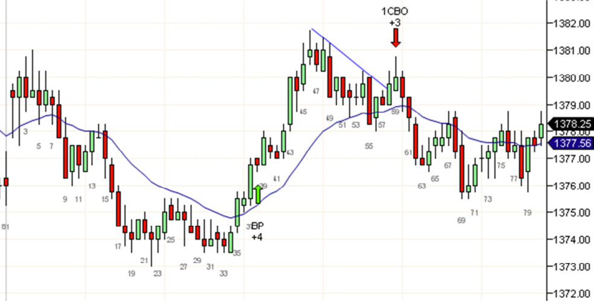

人类实际上并不具备衡量任何物品内在价值的能力。实际上，所有估值都是根据该人可能遇到的任何价值主张模糊计算得出的。

例如，如果我展示一个前所未见的物品并询问其价值可能是什么，人们很可能会茫然不知。当被进一步追问时，他们可能会根据其大小、重量、光泽和美观程度来猜测。你可能有这样的祖父母，他们渴望回到咖啡一杯才5 美分的黄金时代。在星巴克支付5 美元的整个概念对他们来说是荒谬的。而且实际上排队支付那么高的价格，在他们看来简直是疯了。这是因为你爷爷的估值电路卡在了1950年代。同样的事情也会发生在我们在更短的时间尺度上。这被称为锚定。当你看到一件商品（比如一磅咖啡）以5, 美元的价格出售时，你会期望它保持在5美元。如果突然涨到10, 美元，你当时不会买，你会等着价格回落。但如果价格在几个月内保持在10 美元，你很可能会屈服并以 10美元的价格购买。你的头脑现在已经锚定了新的价格。商店一直在巧妙地利用锚定。50%的折扣告诉我们，那顶200 美元的漂亮帽子很便宜，因为它的真实价值是400美元。我们很幸运能以半价买到。哇，这就像我们赚了200美元。我们所要做的就是花200美元来赚取它。商店已经巧妙地将该商品的价值锚定在你的脑海中的400 美元。如果没有折扣，你不会买，因为200 美元看起来很贵。这就是为什么JC Penny决定放弃打折，转而采用日常低价时，他们遭受了巨大的损失。没有人有理由购买，因为没有什么看起来便宜。

锚定效应是导致市场停留在交易区间（咖啡应该是$5）和趋势（$10是新常态）的原因。锚定效应也是为什么回撤，尤其是深度回撤效果非常好的原因（打折$50%）。事实上，锚定效应是价格行为普遍有效的原因。对于交易者来说，这意味着他可以简单地想象自己是咖啡或任何他熟悉的商品的卖家或买家，并且大多数时候都能正确地猜测人群行为。如果价格突然变得过高或过低，就会遇到阻力，价格会回撤。然而，如果价格停留足够长的时间，它就可能成为新常态。深度回撤和剧烈回撤更有可能继续，而缓慢下滑则可能因此打破趋势。

一旦你能理解价格变动，你就会发现价格行为更容易解读和理解。

<!-- 原书第 83 页 -->

## 交易者的心态 VI - 信念与怀疑

2012年11月13日 星期二 · 原书第 83 页

在交易之外的世界里，坚持和信念是很好的特质。一个坚持不懈的人很可能会解决问题，赢得心仪对象的约会，或者找到一份工作。我们通过他们捍卫自己观点的能力来评判人们对其头寸的信念。一个典型的例子是，一个候选人被描绘成一个摇摆不定者，导致其选举失利。固执己见地坚持错误信息被视为一种更强大的品格，而非根据新证据改变立场。

你对自身观点的信念或信心会让你与你的社交圈更加亲近。保守派喜欢与其他保守派在一起，绿色（环保主义者）喜欢与其他绿色（环保主义者）在一起。这种人性是我们从小就学会的，并用它来Adopt各种身份特征，并终生坚持。

我是大都会队的粉丝。我是一个自由意志论者。我反对死刑，等等。Adopt身份特征是一种自动的社会行为，其主要功能是社交。

当这种行为延伸到交易世界时，它从一开始就对交易者不利。就你的账户而言，交易最终是一种非社交功能。你的亏损是你的，在任何情况下都坚持己见都会让你吃亏。

一位坚信市场已上涨过多的交易者可能会做空市场，当被止损后，他在下一个高点再次尝试做空，并最终通过做空而走向顶部。一位经验丰富的交易员通常对市场的整体强弱没有自己的观点，而是遵循“ 交易你所见的，而非你所想的”这一原则。

为了培养在犯错时放弃有害观点的能力，请采纳一条规则：如果你连续两次犯错，在价格大幅远离当前位置之前，不要顺着同一个方向进行交易。请记住，你总是会犯错，而市场永远是正确的。

信念的另一面是怀疑。连续遭遇亏损的交易者（包括那些一贯盈利的交易者）会对其交易系统、解读市场的能力以及遵循自己交易系统的能力失去信心。这样的交易者在进入交易后会立即产生买家后悔，在即使是最小的回撤时就被震出，并过早地收紧止损，从而在市场大幅朝着其交易方向移动之前就退出并产生亏损。

即使市场朝着有利于他们的方向移动，他们也无法持有足够多的点数。首次回撤就会让他们倍感沮丧，迫使他们在小额利润时退出。想象一下，看到有四个点的浮动利润，然后恐慌，在市场回撤时以 +1 的价格退出。为了建立信心并使自己能够经受住回撤，请始终在价格朝你的方向移动的第一次推动时，先锁定部分利润。尤其是在第一个小时，反转可能很突然，会触发你的止损并将你的盈利交易变成亏损交易，这会进一步损害你的信心。

部分利润使您能够将持仓延长至首次回撤之后，之后会变得更加容易，因为一旦形成下一个波动点，您的波段交易止损就会进入利润。采取部分利润并坚持您的交易管理规则可以建立信心。

总的来说，你需要努力摒弃你对经济、新闻、政府或你认为可能影响市场的其他任何事情的宝贵观点。这些事情可能长期影响市场，但你必须认识到，你的观点和身份关系对于交易市场是毫无价值的。你只能依靠你所看到的，你的交易管理规则和你的纪律。

<!-- 原书第 84 页 -->

## 交易者心态VII - 追逐

2012年11月14日 星期三 · 原书第 84 页

到目前为止，我们已经看到了交易者固有的性格问题，这些性格在外部世界中表现得很好，但在交易世界中却导致交易者失败。这些是多年来形成的性格问题，很难摆脱。然而，通过仔细规划规则和纪律，交易者可以避免触发它们。例如，只在突破信号K线或突破信号K线之后进入，我们可以防止交易者的讨价还价行为造成亏损。

在本文中，我们将探讨交易者心态的一个互补部分，即交易者对市场的反应性。当交易者观察市场并期望大幅上涨时，他会保持纪律，等待一个好的信号或形态。K线一张接一张地形成，交易者选择错过，因为它们不符合他的标准。突然间，一个大型突破K线出现，交易者措手不及，他无法袖手旁观，看着市场似乎在飙升。他屈服了，在远高于他原本会买入的价格买入。市场随即在一次大幅的盘中回撤中让他止损，然后该交易要么失败，要么继续上涨。

这是许多交易者反复经历过的熟悉场景。当市场以你意想不到的方式变动，你感到被迫采取行动时，你很可能会犯错误。即使你没有被止损，如果K线开始回撤，你的信心就会很弱，因为这不是你经常进行的交易，也不是一个对你来说自然的建仓形态和管理。你的心态在这个点上很容易犯下几个错误。处理这种情况的一种方法是认识到弱势突破会失败，而强势突破很可能形成趋势，并且趋势中的首次回撤是一个好得多的入场点。

另一种经典的反应是针对延长通道。你在通道中看到一个重叠度很高或设置很差的建仓形态，然后进行交易并被止损。你一次又一次地进入，试图这次做对，但几次亏损后才能最终找到正确的入场点。这会导致一种惨胜，因为盈利交易的收益不太可能大于累积亏损。交易者经常“坚持”，因为他们知道方向是正确的，他们只需要弄清楚如何正确进入通道。除非你想进行逆势交易并刮头皮交易，否则进入通道的唯一合理方法是等待尝试突破通道或等待通道演变成趋势。

要认识到仅仅对方向判断正确是不够的。交易聊天室里充斥着准确预测上涨或下跌的交易者，但却无法找到一个带严格止损的好入场点。使用宽幅止损入场可能让你几乎在任何地方都能进入，但这种交易带有大额回撤的风险，不适合新手交易者。耐心以及在建仓形态出现前愿意等待的意愿对于一致性至关重要。

在交易之外的世界里，坚持和追逐梦想可能是很棒的特质。对于交易而言，耐心和纪律更为重要。

<!-- 原书第 85 页 -->

## 交易者心态VIII - 情绪基础

2012年11月15日 星期四 · 原书第 85 页

情绪究竟是什么？我们为什么会感到情绪？情绪是一种自我沟通。当我们的祖先是面对不确定世界的原始生物时，大脑会感知到迫在眉睫的危险和机会，并激活身体进行立即行动所需的身体变化。

很明显的例子是，当感知到捕食者时，身体需要迅速切换到战斗或逃跑模式。同样，当发现食物或交配机会时，大脑会变得警觉和渴望。

实际上，你所有的情绪和行为都源于数百万年的生存适应。在古代世界，对好或坏情况立即做出适当反应意味着生存而非死亡。现代人类很少面临这样的挑战，并且已经发展出一定程度的情绪控制能力。偶尔，边缘系统会不断升级情绪，这可能让你难以控制。

情绪关乎预期和准备。如果你清楚某些事件很可能发生并且做好了准备，它们就不会引起强烈的情绪反应。例如，如果亲近的人突然离世，你可能会感到震惊和绝望，并哭上几天。另一方面，如果他们患绝症多年，他们的离世反而可能让你感到解脱和宽慰。同样，如果你不中彩票，你也不会真的情绪失控，因为你从未期望过会中奖。但当你中奖时，你会非常高兴。

你没有准备好的事件会让你的身体进入“赶紧行动”模式。例如，有防火演习的国家在火警响起时会系统地疏散，而没有演习的国家可能会发生踩踏事件。

这对一个交易者意味着什么？当你关注市场时，你的大脑处于一种类似于寻找交配机会的心态。你可能会尝试每一个潜在交易，直到其中一个奏效。一旦你进行了交易，你就会焦虑地寻找猎物或潜在的危险。这会迫使你过早地退出交易，避免亏损，而不是坚持下去而被止损出局。当你止损出局时，你的大脑就像一只幼崽被狼袭击的母瞪羚。你的大脑会进入“赶紧行动”的危机模式。这也被称为经典倾斜模式，即几次亏损迫使交易者放弃所有风险管理和交易管理规则，只想收回资金。

我们将这三种情绪称为贪欲、恐惧和绝望。其中，绝望是最难控制的。你的头脑处于一种愿意不惜一切代价、冒着严重风险来赢回其宝贵资金的状态。在这种状态下，你对你的账户造成的损害最大。恐惧会阻止你遵循你的交易计划，最终你会导致小赢大输，从长远来看你会成为一个净亏损者。贪欲会把你引入一次又一次糟糕的交易，你的账户会缓慢流失，遭受千刀万剐。

那么，我如何在我的交易计划中解决这个问题呢？一旦你理解了驱动你的力量，你就可以着手管理它们。管理这些力量的一种方法是尝试观察自己，看看自己的行为。观察本身就会改变被观察者（观察者效应）。

绝望：当你处于绝望之中时，你不太可能观察自己并理性思考。让别人观察你通常有助于现实检验。这个人可以是导师或交易伙伴。重要的是，你要向你的观察者披露你所有的交易，否则它将无法产生全部效果。你的交易伙伴可以留意不良情绪状态的迹象，并通过反馈支持你。设定每日最大交易次数和最大亏损限制将极大地保护你的账户免受过早的损失。

<!-- 原书第 86 页 -->

恐惧：比进入一笔交易更重要的是你在进入之后做什么。如果这笔交易是错误的，并且是由追逐意外的大k线引起的，你最好尽快以最有利的价格退出。如果这笔交易是一个合法的建仓形态，你需要有纪律地执行你的交易管理。只有纪律才能帮助你克服恐惧并建立信心。将交易管理机械化，设置固定止损和目标，可以让你摆脱恐惧。

贪欲：在您进入交易以及在您当日未出现亏损的交易之前，您的大脑最适合做出清晰的判断。如果您能合理地解读市场，请抓住每一个清晰的建仓形态，直到您达到您的每日亏损限额。刚开始时，您对市场的解读自然需要大量改进，亏损是常事。您不想做的是对意外的走势做出反应。在预期走势中进行的任何交易都比在意外走势中进行的交易更有可能成功。驯服您参与市场活动的欲望。只选择明确定义的建仓形态。从一种建仓形态开始，随着时间的推移再增加更多。

自然，这些并非您面临的唯一情绪。贪婪，会让您持有仓位远超您的预期目标，是另一个主要的杀手。希望，会说服您放宽您的止损，从而阻止您培养任何纪律。所有这些都需要被理解和解决。

总之，要认识到你的情绪在告诉你，发生了一件你没有预料到并且没有准备的事件。从事件中学习，并将其纳入你的交易计划，而不是立即通过交易来应对它。运用理解、准备和纪律来驯服你的情绪。

<!-- 原书第 87 页 -->

## 交易者的思维第九篇 - 持续盈利的交易者

2012年11月16日 星期五 · 原书第 87 页

持续盈利的交易者用耐心和谨慎取代了急切和不耐烦。从心理上讲，你能为你的账户做的最简单的事情就是首先避免进行糟糕的交易。

永远不要急于交易，但当你的建仓形态出现时，要毫不犹豫地行动。这似乎是反直觉的，但这正是许多捕食者运作的方式。你可能在探索频道看过节目，其中一条伪装的鱼一动不动地待着，直到猎物足够接近，然后它突然跳出来吃掉它。这基本上就是交易者试图成为的样子：耐心但警惕。除了一些例外情况，错过一次交易通常比进行一次交易然后被止损出局要好。

一旦进入交易，一位盈利交易者就会简单地遵循固定的交易管理规则。例如，价格要么达到固定的目标，要么止损出局。这里的判断应该很少，因为你的判断力在进入交易前最强，现在最弱。每一点不利于弱势交易者的价格变动都会让他恐慌，并想以盈亏平衡或微薄的利润出局。每一点有利于他的价格变动都会让他把目标推得更远。持续盈利的交易者两者都不会。并不是他有什么过人之处，只是他利用数学来确保他达到利润的几率高于被止损的几率，随着时间的推移，他会累积盈利，而不管这次个别交易的结果如何。个别交易并不重要，亏损是交易的一部分。现在不要试图使用你的判断力，它最弱。使用经过充分测试的交易管理规则。

盈利之后，表现不佳的交易者会兴高采烈，并交易更大的仓位和较弱的建仓形态（交易赢来的钱）。在一次亏损交易后，他会感到绝望，而且奇怪的是，他可能会做同样的事情：交易更大的仓位和较弱的建仓形态来“收回资金”。这是通往爆仓的一条捷径，很多人都走过。

持续盈利的交易者则不会这样做。他只是试图回到交易前模式，在那里他既有耐心又保持警觉。

盈利交易者也知道何时停止当天的交易。避免出现大额亏损日和一天中过多的亏损交易至关重要。你的大脑在某个点之后无法控制你的情绪，因为你甚至可能没有意识到自己处于绝望状态。盈利交易者会在明确设定的每日亏损限额处停止交易。

最终，盈利日大于亏损日，交易者开始盈利。对一些交易者来说这是一个突然的转变，但对大多数人来说，这是一个逐渐发生并随着交易技巧的提高而出现的转变。

<!-- 原书第 88 页 -->

## 交易者心态 X - 走向成功

2012年11月18日 星期日 · 原书第 88 页

既然您已经了解了新手交易者和成功的交易者在心理构成上的区别，那么让我们看看如何将您的思维从前者转变为后者。

用谨慎和怀疑取代贪欲。第一步是限制你交易的数量。当交易者说过度交易是一个非常普遍的交易错误时，这只说对了一半。许多交易不佳的弊病表现为过度交易。通过限制你的交易次数，你可以防止一次交易对你的账户造成的损害。但更重要的是，你的思维需要从进入这个波动转向进入当天最大的波动。由于前几个小时只有一到两次大波动，可能在最后的一个半小时里还有一次，你的方法转变为寻找高质量的交易和大波段交易。这对你的账户来说意味着，尽管胜率较低，但如果你的盈利至少是亏损的两倍，你仍然可以成为一名盈利的交易者。作为一名新手交易者，你的目标应该是专门关注大的波动。如果你不确定这个波动是否会很大，不参与交易也没关系。如果错过了大波动，不用担心。这是交易的一部分。学会放下。同样，你可能会止损出局几次，而紧随其后的波动会很大（或不）。没关系。你正在学习判断大波动的确切位置。随着经验的积累，它会自然而然地到来（但如果没有足够的屏幕时间，则不行）。

用纪律取代恐惧。一旦你的判断力得到提升，更大的盈利和更小的亏损将使你成为更好的交易选择者，然而，你的交易管理需要极其严格的纪律。请注意，只要你在有波动性（体面的波动幅度及k线）的趋势市场（高高和高低或低低和低高）中交易，并且靠近支撑位（趋势线/指数移动平均线/波段点），你的成功几率至少应该略高于50%。加入良好的建仓形态和信号k线，你的胜率应该在60%左右，甚至更高。你决定进入交易是你的大脑需要处理的一切。一旦你设置了止损和目标，就不要改变它们。你在交易时大脑很脆弱，容易出现判断失误。你应该只让数学为你服务，让市场来填补你的目标或触发你的止损。如果你的建仓形态确实是60%，你将在长期内积累盈利。

用接受取代绝望。许多在事业上取得成功的人士投身交易，他们正确地认为毅力是一种美德，正是他们顽强的坚持使他们获得了成功。要认识到在交易中，毅力是不适用的，而绝望很可能是你会陷入的境地。学会接受今天是个亏损日，并停止交易。如果你愿意，可以寻求交易伙伴的帮助。披露你的亏损交易，让他们告诉你停止。很快，你就能自己停止。同样，不要对连续的盈利过于自信，最终导致承担未经测试的建仓形态。许多交易者在经历大额盈利日的右侧往往会迎来大额亏损日。如果你容易受到这些影响，在大额盈利日或亏损日之后，只需休息一天，或者第二天只进行一次交易，无论盈亏。

持续改进你的交易方法。随着时间的推移，你可以对上述规则进行微调，并优化你的建仓形态。例如，你应该始终跟踪你个别建仓形态的成功率以及你每个建仓形态的平均盈亏。这样，通过一个预期较低的建仓形态，或者在一个信号k线有疑问的情况下进行一个好的建仓形态，都会变得更容易。在改进你的方法时，始终牢记你的交易目标。例如，你应该优先改进你的系统以获得更高的概率，而不是以更好的价格成交，因为在一个更高概率的交易中增加一个合约，比在现有仓位上多赚几个跳（tick）更能赚取更多的钱。随着时间的推移，你的方法和心态将转变为一个成功的交易者。然而，这并不容易，而且会是一场持续的斗争。即使你已经赢了一段时间，也有可能出现失误，回到你旧的习惯。只要你是一名交易者，你就应该时刻保持警惕，保护你的思想免受有害习惯的侵蚀。

---

[← 上一章](06-价格行为基础.md) · [目录](00-目录.md) · [下一章 →](08-2010年12月.md)
