[← 上一章](07-交易心理学.md) · [目录](00-目录.md) · [下一章 →](09-2011年1月.md)

# 2010年12月

原书第 90–110 页

<!-- 原书第 90 页 -->

## 一个艰难的楔形反转

2010年12月9日 星期四 · 原书第 90 页

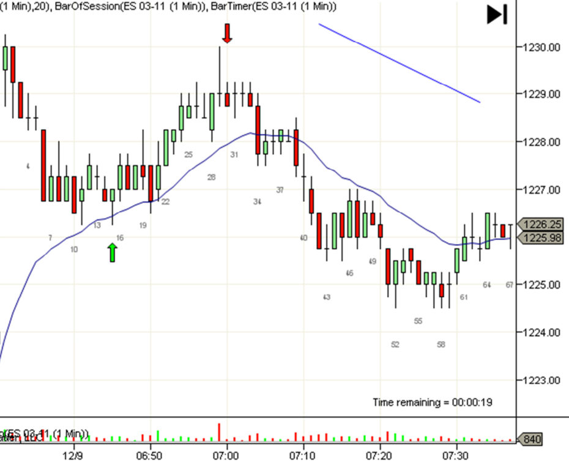

由于开盘的大缺口，我可以在开盘时交易 1 分钟图。开盘区间（b1 到 b8）出现了一个失败的突破，并在 b15 形成双底。

从那里，价格向上推了三推，形成了一个楔形（W）在b点30。这个做空交易可以持有到当天晚些时候的W反转。

<!-- 原书第 91 页 -->

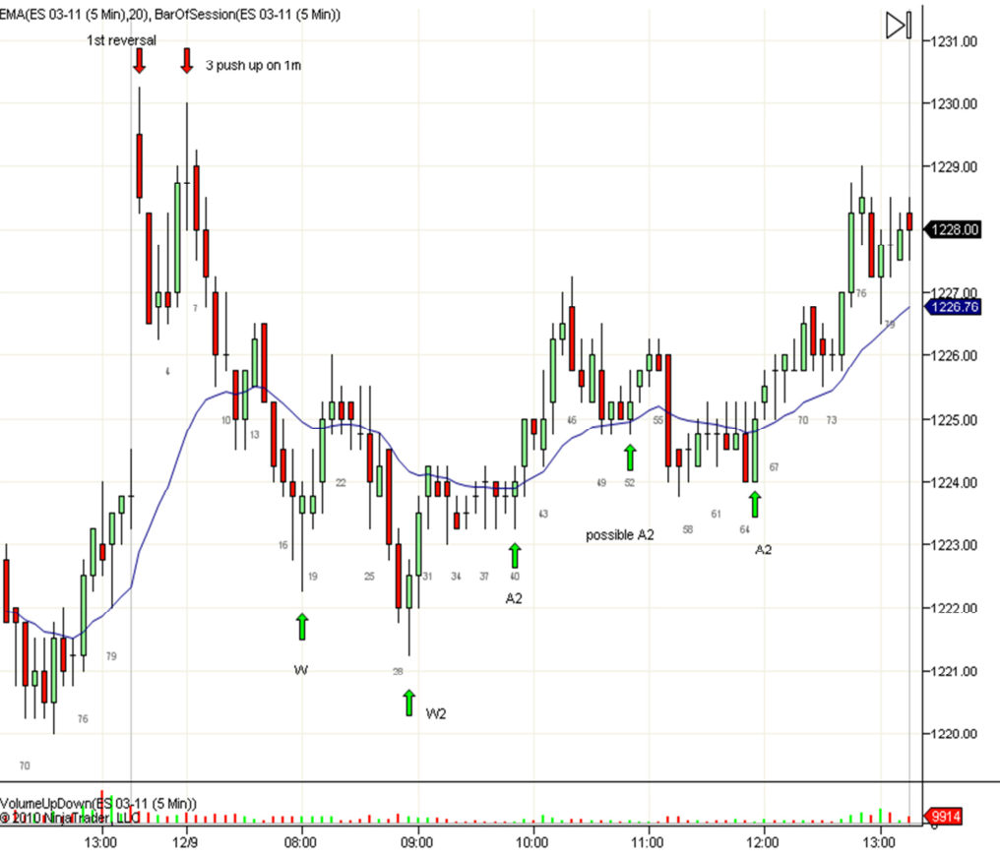

一个大型缺口上方的反转k线至少总是刮头皮交易的好机会。今天，你的刮头皮交易会成功，但你的长线交易部分会止损出局至盈亏平衡。在这样的日子里，许多交易者会错过一个好的长线交易，除非他们在1 分钟图上重新进入，该图提供了一个W型入场。即使在5 分钟图上，由于向上有三个尖峰，一个微型W型也很明显。

双底向上向下在 b11,12 是一个可能的反转，但随着 5 空头K线对抗买家，它最终像一个交易区间一样奏效。一个成功的短线交易。

b18 技术上是一个 W，但它的信号和入场k线收盘疲软。这导致了在信号k线不理想的情况下，b24 上出现了进一步的 A2短线。

b29 是一个非常强劲的楔形，是一个绝佳的潜在波段交易。A2在 b4也是如此 0 and b65.

今天做空 b22 和 b55 被证明是盈利的，然而总的来说这些交易是危险的。在 b22 和 b55 可能出现 W反转之前，这可能是一个诱使再走一段的陷阱。这些交易只能用轻仓进行，但在长期来看，放弃概率较低的交易是最好的选择。

<!-- 原书第 92 页 -->

## 在弱势趋势日放缓步伐

2010年12月10日 星期五 · 原书第 92 页

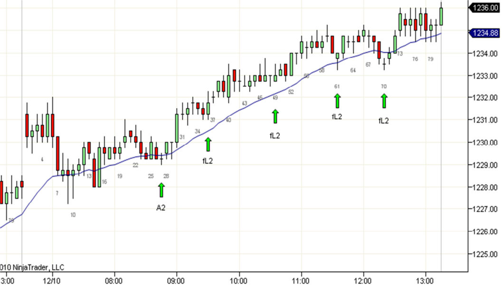

有些日子，例如 2010-09-09 是强劲趋势日。信号清晰，交易通常会顺势或逆势成功。相比之下，像 2010-09-10,这样的弱势趋势日运行速度慢得多，有很多重叠k线，在两个方向上都套住交易者。

除了明显的 A2 在 b27, 处，其余的都是糟糕的多头信号。几乎所有的做空信号都失败了，而那些一直做空到顶部的逆势交易者损失惨重。在有大量引线的重叠k线日，逆势交易者表现良好。今天可能是通过限价在失败的 L2 处入场的好日子。

<!-- 原书第 93 页 -->

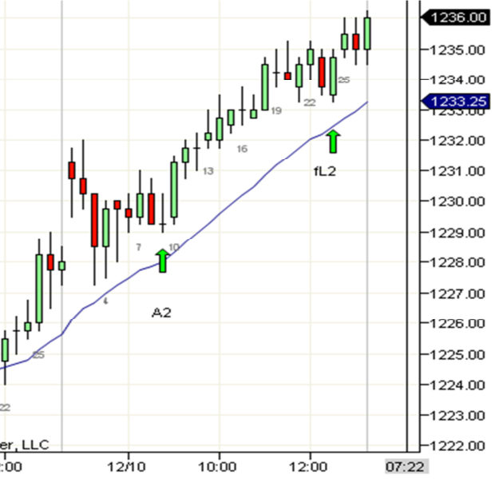

另一种绕过重叠日的方法是放慢速度，转到 15 分钟图。在这种日子里会让你支离破碎的交易方式，在更慢的图表上会效果很好。

今天在 b9 处给出了一个 A2 多头信号，在 b24 处给出了一个失败的 L2 信号。和较慢的图表一样，信号会变少，但它们往往会更有效。正如你所看到的，直到 k线 21，没有一根k线跌破其前一根k线的低点。

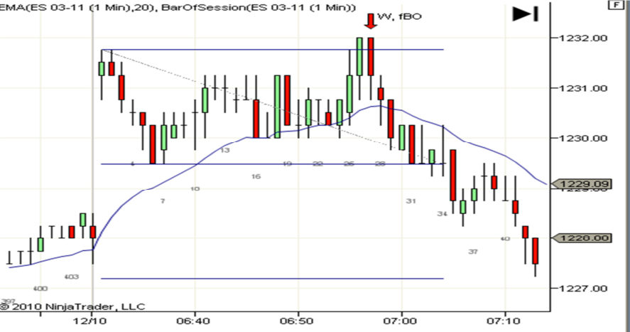

正如你在缓慢的市场中放慢速度一样，你在快速的市场中应该加快速度。开盘一小时通常是快速变动的，在 1 分钟图上放慢速度会揭示一些有趣的交易。开盘的 k线形成了一个交易区间，然后 b27 突破了上方并且失败了，给出了一个假突破 (fBO) 信号。这个走势达到了与区间大小相当的度量移动。

<!-- 原书第 94 页 -->

## 交易区间日

2010年12月13日 星期一 · 原书第 94 页

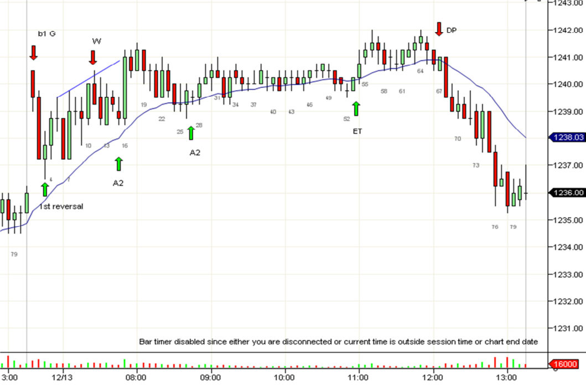

看起来像是一个强烈的信号和入场k线后的趋势日，但很快就变成了一个小的区间日。第一次反转通常看起来很糟糕，但会反转并测试日内高点。b16 突破了日内高点，并给出了一个可能的突破失败（BF）在k线25, ，但午餐时段的跟进非常少。三角形整理在b52, 中被打破，形成了一个扩张三角形，导致第二次尝试突破日内高点。当第二次尝试失败时，市场迅速下跌。

通常，交易区间失败会给出区间大小的度量移动，因此我们预计价格将在今晚或明天达到1228 左右。

<!-- 原书第 95 页 -->

## 联邦公开市场委员会日

2010年12月14日 星期二 · 原书第 95 页

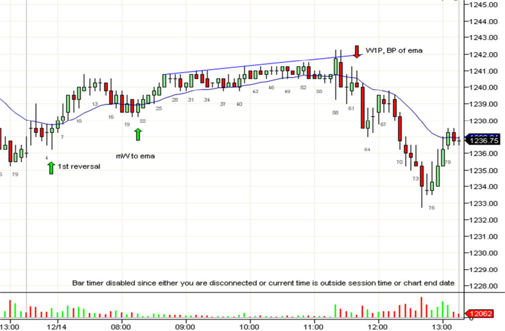

今天开盘走弱，在指数移动平均线处出现了一个十字星K线。考虑到昨天收盘前的强劲走势，有可能出现第二次下跌腿。然而，b1 两边都出现了虚假突破，并在b5上给出了微楔形 (mW) 的首次反转信号。这可能是上午最好的交易。

下次回撤是指数移动平均线（ema）的回撤，以一根下跌反弹信号K线结束，这是今天的好交易。虽然这最终会给+2, 任何人设置了波段止损的人，在市场第二次反向运行时，很可能已经退出了b33。

通常会有一个高潮来反转窄幅交易区间 (TTR)。上升的 TTR 通常是楔形，联邦公开市场委员会（FOMC）的声明触发了趋势通道线 (TCL) 的突破信号，这在 b58 上得到了体现。

b62 是一个非常强的信号（A2, W1P，ema 的突破信号），所有人都抓住了。盈亏平衡止损没有被触及，交易可以一直持有到 b74 的过冲/高潮。

总的来说，今天的联邦公开市场委员会（FOMC）行动很平静，至少对于第一个信号K线而言。窄幅交易区间 (TTR) 使得联邦公开市场委员会（FOMC）声明的突破交易不切实际，因为市场能量不足。 TTR 突破通常会失败，因此突破交易美联储会是一个糟糕的主意。

盘尾反复的卖出通常是价格的坏兆头，这可能意味着近期会有一些下跌日。

<!-- 原书第 96 页 -->

## 陷阱

2010年12月15日 星期三 · 原书第 96 页

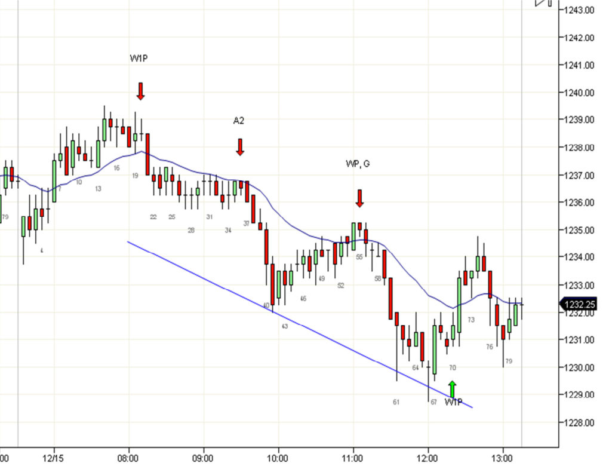

今天是非常艰难的一天，但那些抓住弱信号的人做得很好。 b1 是昨天区间内的一个看涨反转k线，几乎没有缺口，因此不符合首次反转的条件。许多这样的k线最终会很快失败并走出其低点（例如 2010-12-06 ）。然而 b2,3 套住了买家和卖家，在 b3 上方做多可能是可以的。

b6 是一根突破k线，价格很有可能在反转前达到一个量度升幅。这就是为什么b1 的低低（L）和b8 的低低（L）都不是好的做空信号。b12 可以被解释为一个A2 多头，并且可能存在2 腿上涨，但并没有。 b15 是一个糟糕的W信号，随后在b19出现了一个糟糕的W1回撤。W1回撤向下突破，一个窄幅区间提供了一个A2 空头。这是当天最容易的交易。在跌破昨天的低点后，出现了一个楔形回撤（WP），提供了一个缺口（G）内包k线做空信号。b49 是一个可能的多头A2 空头，一些交易者可能在b54被止损出局，然后价格继续下跌。市场在b44 给多头提供了一个刮头皮交易机会，然后价格又开始下跌。

b61 处的过冲以及做多说服了大多数空头在b66下方离场。b66 上的刮头皮交易成功了，但这是一笔风险更高的交易，因为没有太多时间进行波段交易。b70 处的楔形 (W1P) 后的首次回撤是更好的交易。

<!-- 原书第 97 页 -->

陷阱：

1。今天有一些陷阱。b1 的买家获得了糟糕的入场k线，如果他们将止损移动到入场k线下方，就会被止损出局。教训：在价格移动5t.2之前，不要将止损移动到盈亏平衡点。认为他们在做空L2 的b17 空头在b19被止损出局。b16 没有价格行为入场，因为它没有低于外包k线b14。在交易者入场之前，没有好的L1。b20 是正确的L2 入场（低于b19）3。49 是一个可能的 L2。然而，当实体在前一个实体内部时，它是内包k线的一种变体，入场将在b48下方。

## 扩张三角形开盘

2010年12月16日 星期四 · 原书第 97 页

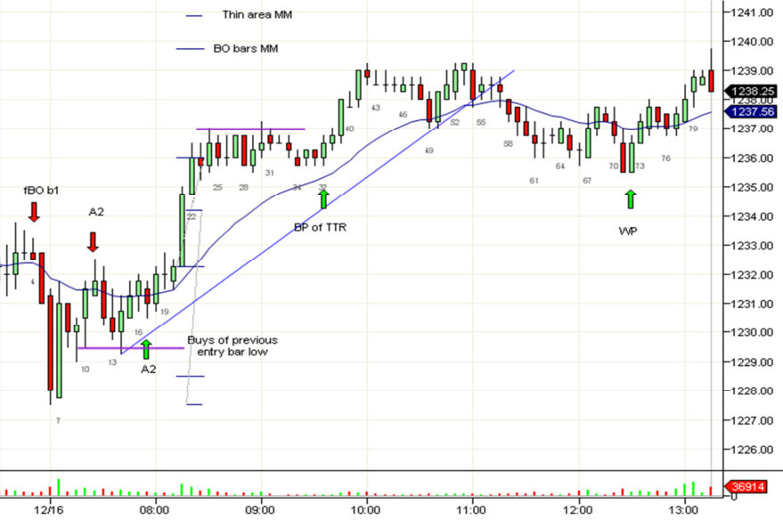

当市场收盘价接近昨日收盘价，并且伴有像今日十字星这样的边缘K线时，市场将尝试向两侧突破，直到遭遇强力反转。今日开盘价与昨日收盘价相差一个跳，十字星很可能突破失败，但如果能提供一个不错的入场点，则具有交易价值。b4 的ii K线带有光头收盘，是一个不错的入场点。

新闻相关的下上反转高达4 点，这可能意味着存在转变为交易区间的风险。两腿上涨提供了一个在b11 的A2 做空机会。然而，入场K线b10 收盘强劲，因此存在买入其低点（紫线）的可能性。b17 处的较浅回调是一个A2 做多机会，也是一个非常好的建仓形态。市场上涨+4 并转变为一个交易区间反转。 b30 突破了交易区间反转，并在b36 的ii处给出了一个突破信号。由于没有过冲，b42 对于W来说将是一个糟糕的做空机会。b53 形成了一个双顶，但这是一个边缘做空机会，因为没有表现出空头力量。 b56处的双顶回撤（DP）ii做空也显得边缘，但可以选择在双顶上方反转。b63 是一个边缘的G，而b 66 是一个边缘的G2 入场，因为它们迫使在旗形上方和中部买入。在三连跌之后，b72 处的上下k线是一个好的信号。从技术上讲，这是第一个在指数移动平均线下方触发多头头寸的看涨k线。价格突破了日内高点 (HOD)，并回补了昨天全部的下跌行情。

<!-- 原书第 98 页 -->

## 突破交易和窄幅交易区间

2010年12月17日 星期五 · 原书第 98 页

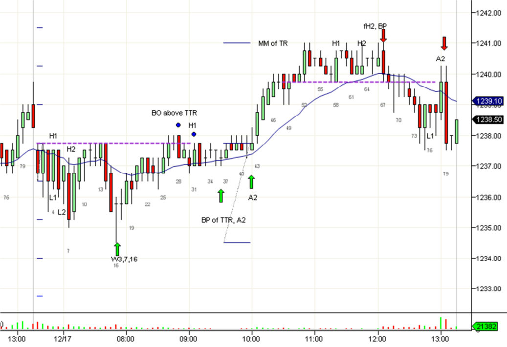

长期以来，突破（BO）和窄幅交易区间（TTR）的交易一直让我难以捉摸。交易这些需要大量的练习，但当你掌握了诀窍，你就能以低风险抓住一波好行情。交易突破的技巧是只交易突破回撤，偶尔也交易假突破（fBO）。最安全的交易是那些尝试反转两次然后失败的突破。这些交易还有额外的好处，就是作为突破后的 2 腿回撤，因此是高概率交易。

另一个需要注意的点是突破发生的背景。市场是否曾试探性地卖出几次但都失败了？在这种情况下，突破很可能成功。请注意，今天几乎所有的突破都失败了。今天以一根在指数移动平均线下方运行的空头趋势k线开盘。许多交易者在此下方做空，认为从第一根k线开始出现空头趋势的可能性很大，但当昨日收盘价触手可及时，在至少两次尝试收复之前，价格不太可能下跌。b1 的突破失败了，但未能突破b1 并止损了b1交易者。正如b2 是一次失败的突破，跌破b1, 一样，b3 也是一次失败的突破，跌破b2 ，以此类推。

b4 是一个H1 变体并形成了一个L1。b7 同时提供了H2 和L2。在经历了两次下行腿后，任何仍然存在的b1 交易者都会以他们的刮头皮利润退出，所以限价交易者可能在这里买入。b11 和b13 处的突破尝试失败了两次，并形成了一个ii形态的假突破做空。b16 处的第三次下行形成了一个弱势楔形（W）建仓形态，最终以一个弱势入场k线收盘，这意味着它未能形成失控趋势。在b26, 处出现了一个突破区间的尝试，在b28 和b32 处两次尝试失败。b31 触发了H1 ，但b34 未能触发H2 ，因为它没有超过b32。b36 形成了一个H2, 、一个失败的L2和一个2 腿回撤。这是今天最强的信号。突破区间通常会上涨到度量移动（MM），就像今天一样。在1241, 的MM处，它在b58 和b63 处尝试了两次突破但失败了，在b67下方形成了一个假突破入场。

<!-- 原书第 99 页 -->

## 趋势反转

2010年12月20日 星期一 · 原书第 99 页

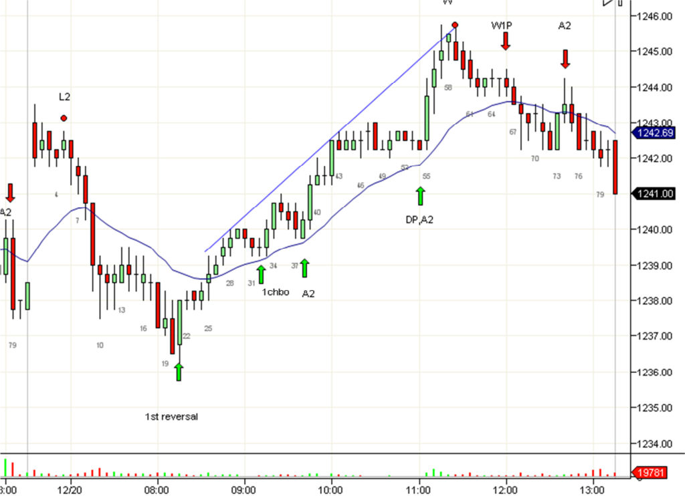

当趋势k线试图收盘一个中等大小的缺口（比最近的一根k线大，但比最近的一天小）时，开盘趋势很可能在第一个小时内反转。这是因为买家不会在小缺口上方做多，并预期它会收盘。当它收盘时，他们有可能入场。

今天的b5 在趋势k线后形成了一个2 腿回撤，并在旗形底部附近提供了空头入场。保守交易者应错过此机会，因为我们可能会看到区间假突破，并导致市场上涨。然而，考虑到昨天的收盘价在第一个小时内处于区间内，这很有可能成功。b21 处的首次反转可能是一个W4,19,21。在强劲收盘后出现一个2 或3 跳十字星通常会像一个W1P一样奏效，并且通常有利于波段交易。b31 处的首次通道突破被买入，但买家未能刮头皮退出，也没有被止损出局，使得b38 成为一个A2 多头。这是今天第二次可波段交易入场。

一个下降通道在 b54 突破了一个差的信号k线，并越过了趋势通道线，突破了日内高点。这次突破在 W 中失败，在下跌途中形成了 W1P 和 A2 。

<!-- 原书第 100 页 -->

## 冰川

2010年12月21日 星期二 · 原书第 100 页

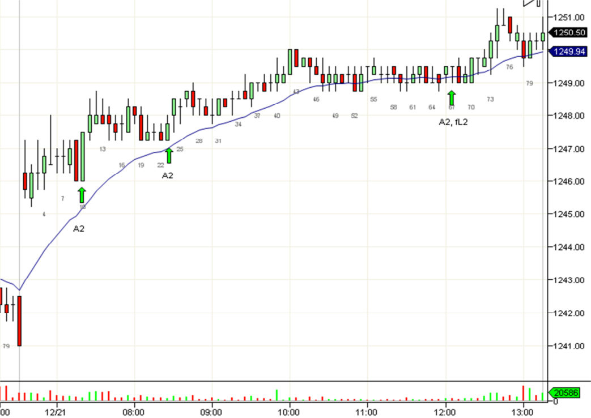

冰川的碾磨过程非常缓慢，会摧毁挡在它前进道路上的一切。偶尔它似乎会后退一点，但你还没反应过来，它又会继续碾磨。出于某种原因，只有看涨的冰川。空头们往往会快速下跌，这使得交易者们比起做多更喜欢做空。

如何在一天初识别一个冰川？一个失败的 L2 是一个很好的迹象。一个没有触及低点的修剪过的空头 K线是另一个很好的迹象。低于前一根k线的单跳和双跳回撤是非常强的迹象。今天，所有这些迹象都在第一个小时内显现出来。第一个失败的 L2 给出了当天第一个强烈的买入信号。在 b22 附近的指数移动平均线处，一个非常明显的 2 腿回撤可能是当天最容易读懂的信号。最难读懂的信号是失败的 L 2 ，然后是 b67处的 A2 。当存在重叠和内包k线时，每一根内包k线都是一个可能的信号。如果触发，它将成为一个 L 或 H。基本上 b55 触发了第一个 H1 ，而 b59 和 b65 触发了一个 L1 和一个 L2。b 68触发了一个 H2 ，并几乎失败。将 H 和 L 读入窄幅交易区间是很容易出错的。在突破和失败的突破方面来看更简单。b55 尝试了首次突破。b58 和 b65 是两次尝试失败突破。失败的突破应该导致一个向下的度量移动，所以两次失败都是不成功的。 at this point the next breakout is a high probability candidate for success. 下一次突破发生在 b68 ，鉴于重叠，可以预期会有回撤。

b75 内包k线是一个非常强劲的退出信号，也是结束平淡无奇一天的绝佳时机。冰川被一些人视为机构的做多行为，也被其他人视为派发。通常在冰川出现后的两到三天会出现下跌日。

<!-- 原书第 101 页 -->

## Another soft trend/glacier day

2010年12月22日 星期三 · 原书第 101 页

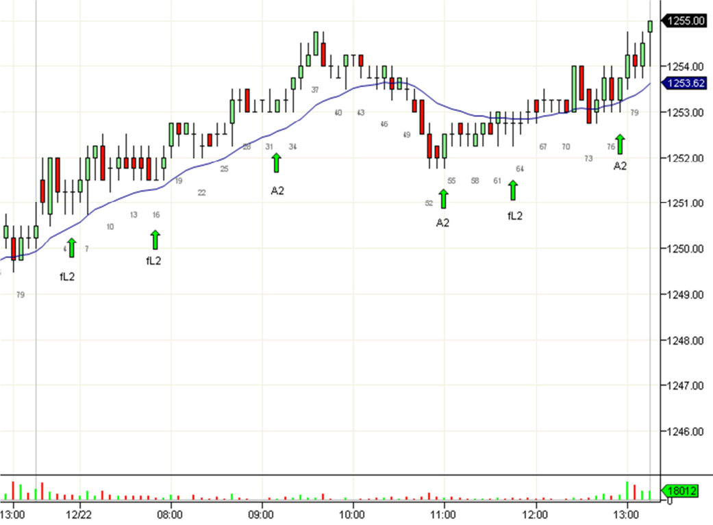

今天的开盘价非常接近昨天的收盘价，这应该提醒交易者注意可能出现的反复震荡日。失败的 1t L1 多头 k线 2 和 L2 多头 k线 4 证实了今天价格行为的预测。每一次失败的 L 都可以被买入。b32 是一个罕见的 A2 多头，但它是一个水平旗形，预示着可能的末端旗形。b38 和 b42 处的可能的 W 和 W1P 做空入场点是危险的，鉴于糟糕的风险回报比，不应被采用。向 b52的深度回撤提供了今天的第一个深度回撤，也是今天最容易的交易。激进交易者可能也在收盘前买入了 b76 A2 。

总而言之，今天是一个只涨不跌的一天，k线的跳数都很小。限价买入并预期一个L2 失败的交易今天每次都成功了，除了显而易见的b43。

<!-- 原书第 102 页 -->

## 小的十字星日

2010年12月23日 星期四 · 原书第 102 页

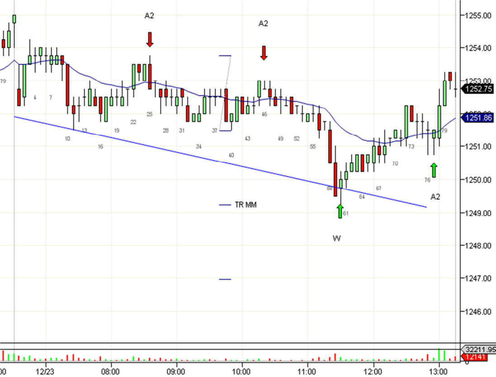

今天收盘价与其开盘价持平，上下波动，日线图上形成了一个十字星或加号。前两个k线明显是一个交易区间，所以市场必须守在交易区间上方并出现一个两腿回撤才能做多，或者更可能出现的情况是突破失败。突破确实失败了，并且测试了区间的另一端。此时，市场两次尝试失败，一次是在上涨到k线14 时，另一次是在上涨到k线 22时。此时，这是一个接近指数移动平均线的空头走势中的两腿回撤，因此是一个有效的做空信号。然而，这接近午餐时间，而且很可能在接下来的几个小时里不会有真正的行情。等待下一个信号是一个明智的决定。

市场出现三次下跌至 b40, 双底，表明可能出现反转或上涨。然而，它未能成功形成双底回撤，因此跌破了双底，这通常会导致以区间大小进行的向下测量移动，价格正好到达跳。在这一点上，我们还出现了一个 TCL 过冲，所以即使反转k线很弱，也可能是一个可以接受的做多。楔形（ W1P）后的首次回撤迫使在旗形顶部做多，但这可能是可以的，因为旗形仅有两跳长。谨慎的交易者可以观望，并在 a2 和 b77的 ema 双底处入场。

<!-- 原书第 103 页 -->

## 抓住早期波动的重要性

2010年12月27日 星期一 · 原书第 103 页

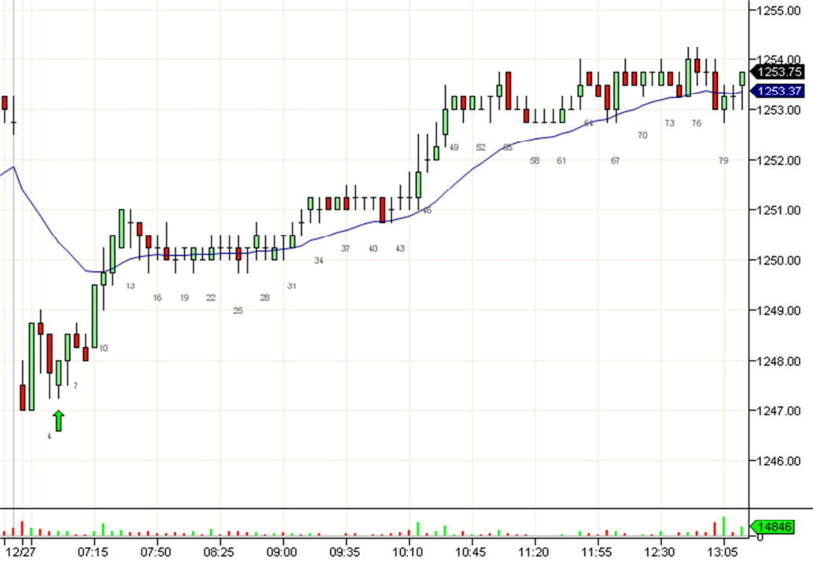

通常，第一个好的信号是唯一值得进行波段交易的信号。学习正确地捕捉第一个信号，也能让你开局就盈利，从而让你放弃那些不够好的交易。今天是一个三角形开盘。扩张三角形开盘更常见，而三角形开盘相对少见。今天我只进行了一次符合要求的入场，这是一次二次做多入场。二次入场是指在之前的入场有效且入场K线收盘强劲的情况下，在与之前相同价格进行的任何入场。例如，今天的 b2 突破了一个反转K线（看涨信号）并强劲收盘。这根K线是一根 7光头K线，并且很有可能在回撤时买入进行波段交易。b5相比于 b1 （带有 1引线的带有引线的光头多头K线）提供了一个更强的信号K线。b1 和 b2 构成了开盘区间，b3 则是一个失败的向上突破。b5 有效地提供了一个突破回撤入场。在 b7 及其下方出现的疲软的 1引线回撤，以及其失败，是两次尝试来失败突破，而在此之上买入 b8 是一个高概率交易，即使它是一根空头K线。价格迅速达到了预期的度量移动（MM），达到了开盘区间的两倍。

当天剩余时间里的交易机会都很差，虽然我能看懂它们，但它们的风险回报比不值得。尽管水平TTR通常会沿着先前趋势的方向突破，但b3 和b12 已经向上推了两次，存在向上推失败的风险，而无法达到一次刮头皮交易的获利目标。

其余的走势来自一跳或两跳的十字星k线，并且通常不可靠。今天错过了 b5 或 b8 的谨慎交易者可能不会再进行任何其他交易。一个可能的例外是 b42 在 ema 和 TTR 的 BT 处的双底，但即使是这样，在一天的区间可能不会很大的情况下也应该避免。

<!-- 原书第 104 页 -->

## 首次反转

2010年12月28日 星期二 · 原书第 104 页

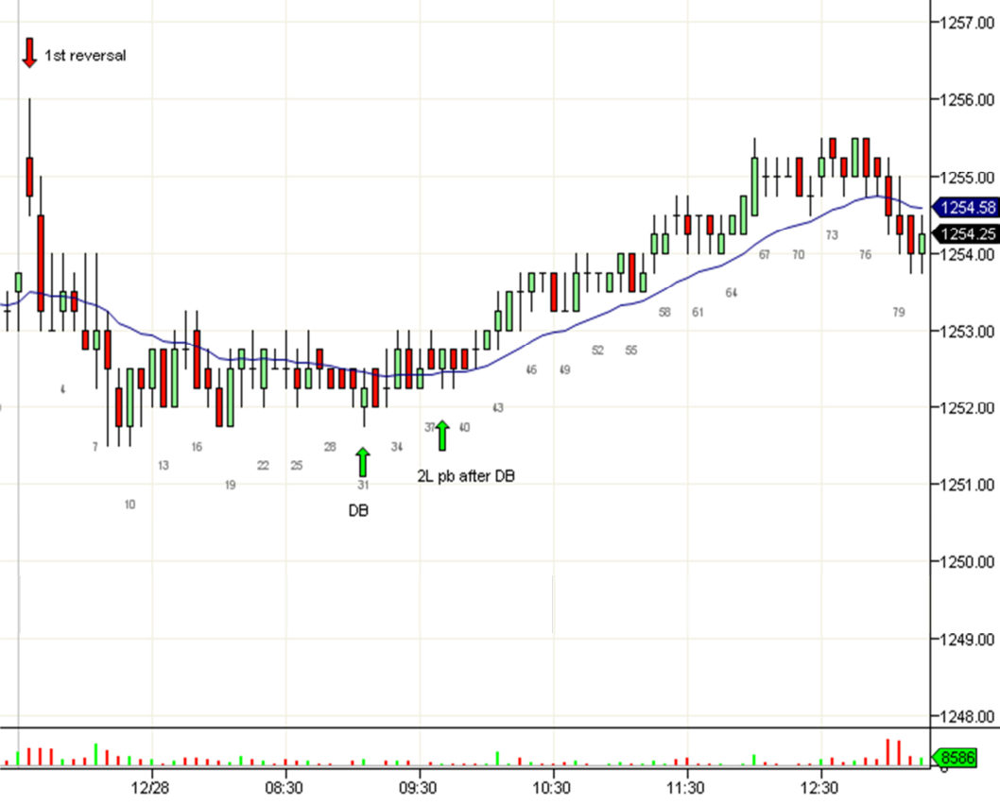

当出现一个大的缺口（大于最近的一天）并且第一根k线形成一根反转k线试图反转缺口时，可以认为它是首次反转。今天仅仅是勉强算是首次反转，因为缺口点数相对较小，并且k线收盘价仅仅高于昨天收盘价。当不确定一根反转k线是否值得介入时，有时查看1 分钟图的前五根k线会有帮助。

<!-- 原书第 105 页 -->

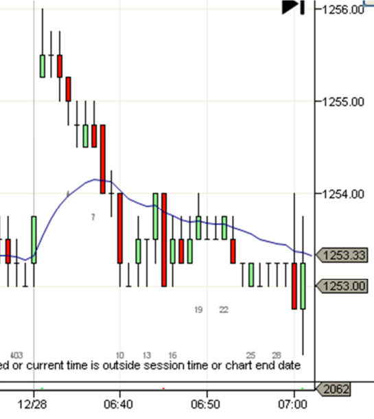

正如你从图表中可以看到的，在最初的 5 1 分钟k线中没有表现出多头强势。没有任何k线上涨超过前一根k线，也没有强劲收盘。这样的第一根k线值得做空。

On 2010-12-21, 我们有一根类似的k线，但其下方的空头止损最终在一跳失败 (1tf ). Yes, 这根k线与前一天的k线只是稍微有些重叠，但这本身并不是一个会阻碍交易的因素。

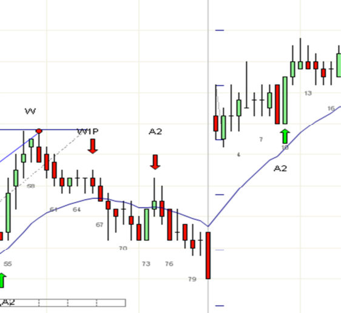

放大到 1分钟图，我们可以看到k线是如何不同的。最初三分钟有强劲的多头行情，多头们只是将空头K线视为以更优价格做多的机会。

<!-- 原书第 106 页 -->

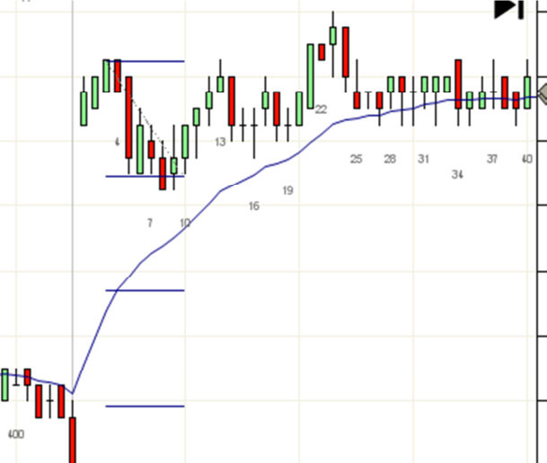

尤其是在一个可能的区间日里，尽早抓住可能的上午行情非常重要。首次反转是这个交易原则的重要组成部分。

<!-- 原书第 107 页 -->

## 开盘区间突破和回撤

2010年12月29日 星期三 · 原书第 107 页

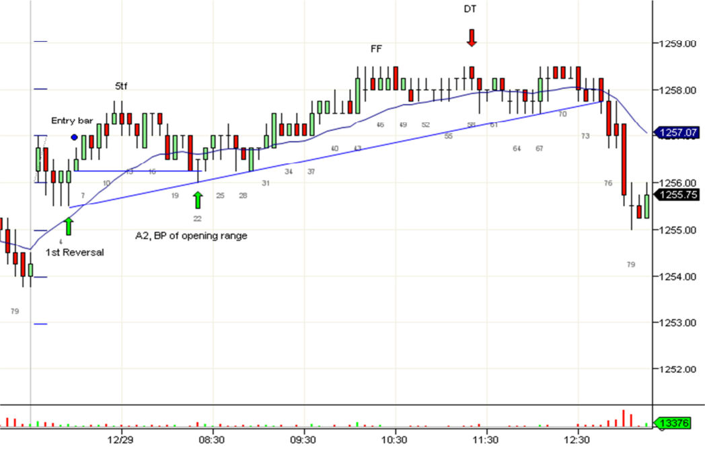

通常第一根k线本身就构成了一个开盘区间。第一次突破该k线失败，价格会尝试突破另一端。如果另一端收盘强劲，即收盘价高于区间，并且出现两三根k线没有反转突破的走势，那么最终的回撤就很有可能被交易成一个波段仓位，目标是区间大小的度量移动，特别是当回撤是两腿的时候。

今天的走势是该情景的小区间版本。bar1的低点被突破但随后变成了首次反转。正确的入场点在 b3, 之上，但并未触发，不过我们在 b5之上获得了入场。当反转k线之间存在大量重叠时，价格通常会向下触及入场k线下方止损位，就像今天的 b22那样。当入场k线的低点与之前的波动低点之间的距离很小时，这是一个很好的限价入场机会，止损设在之前的波动低点下方。无论如何，回撤到 b22 是一次 2 腿回撤，形成了一个高低点，并吸引了买家。

价格走了三段腿到一个末端旗形 (FF)，在 b43 到 49。双顶在 b58 是尝试突破 FF 失败。市场最终第二次尝试突破区间，并在当日低点下方失败。

<!-- 原书第 108 页 -->

## 趋势重生

原书第 108 页

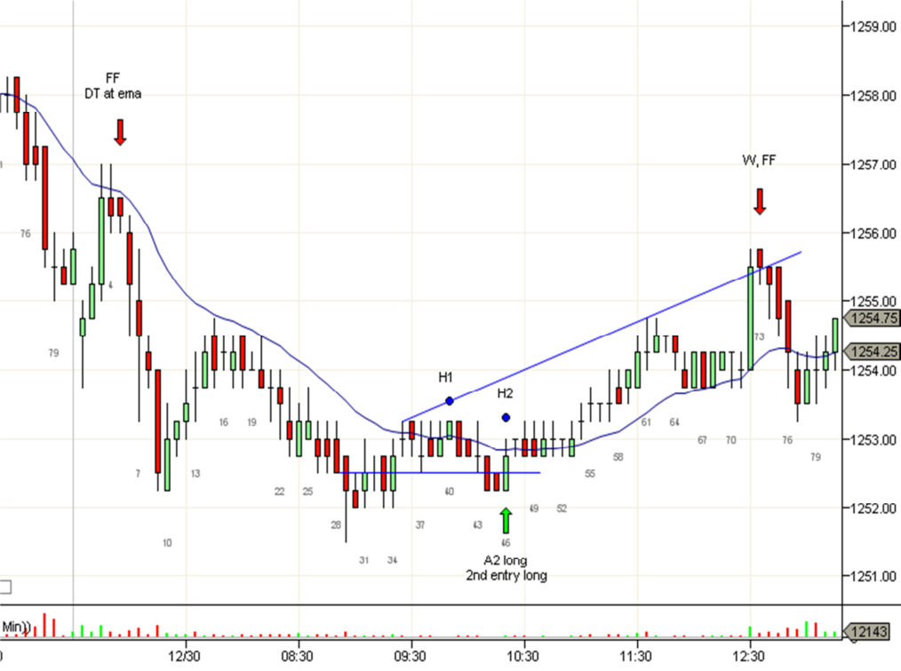

当一天的收盘 k线构成大幅度移动时，即在一天晚些时候出现急剧趋势，并且当天收盘时未突破趋势线，那么下一天很可能出现一些跟进。

此外，如果第二天开盘时跳空幅度很小或没有跳空，你或许可以像昨天走势的延续一样交易早盘的k线。

从这个背景来看，b4 的走势是一次空头趋势中的2 腿回撤。指数移动平均线处的ii信号k线是做空的一个非常好的建仓形态。

从b10 到b15 的走势突破了趋势线，我们最终测试了前一走势的低点。没有过冲的趋势线突破通常会以交易区间结束，而今天的区间在b10 低点和b15 高点之间。b29 也是这个区间的失败突破。

之后，k线46 出现了一个多头。这也是继34之后第二次2 腿的更高低点。失败的突破通常会尝试突破区间的另一侧，因此预计会出现2 点的移动。在第三次上涨时，突破成功，并以楔形反转。

<!-- 原书第 109 页 -->

## 趋势突破与趋势形成

2010年12月31日 星期五 · 原书第 109 页

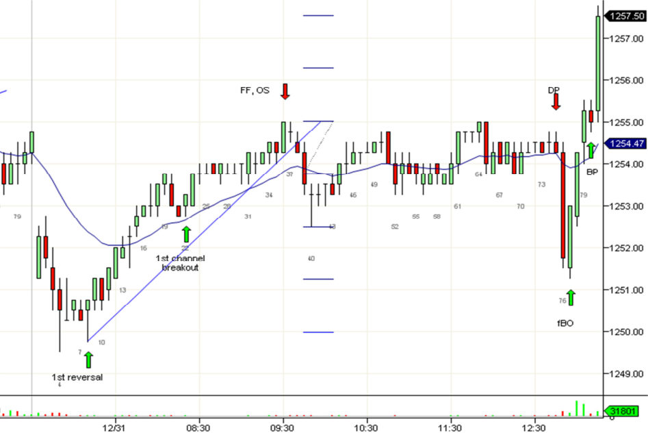

价格行为交易者首先学到的是，市场要么在趋势中，要么在交易区间中。如果在趋势中，只做顺势交易。如果在交易区间中，则进行逆势交易突破，即进行逆势交易。

当然，许多交易者发现自己陷入困境，因为他们发现自己在试图顺势交易，但趋势已经结束，或者他们试图逆势交易突破进入新趋势。因此，了解趋势何时结束以及何时从交易区间中形成趋势至关重要。许多趋势终结相当明显，因为它们以楔形或过冲结束然后反转。然而，趋势常常在盘整中结束。趋势已结束的决定性标志是趋势线被破坏。如果价格跌破先前单腿走势的波动低点，就像今天从 b37到 b40那样，那么被破坏的趋势线就很清晰明了。事实上，它是在水平末端旗形的失败突破之后发生的，这增加了趋势结束的可信度。此时，市场处于一个交易区间，受近期波动高点 b37 和波动低点 b40的限制。对该区间边界的任何移动都可以进行逆势交易。如果区间大小很小，就像今天一样，那么使用价格行为入场的刮头皮利润可能空间不足。限价交易者可以自信地逆势交易第一次尝试，因为他们知道第一次尝试很可能会失败，并且他们有一个合理的止损，比近期波动点高出一两跳。趋势通常在突破区间边界失败后产生。今天，我们进行了两次尝试突破区间，分别在 b51 和 b65 ，这形成了一个 DP（双顶/底和回撤），位于 b75。DP 常常是趋势生成器，并且在先前趋势的方向上效果最好。今天的走势出现了跌破区间的突破，但以交易区间的一半作为度量移动而失败。这次失败导致了对区间另一侧的突破尝试，并形成了一个突破回撤多头入场（本质上是 b80的暂停K线）。交易区间一端的失败突破通常会在区间的另一端产生突破回撤，特别是如果第二端的测试是单腿走势。这些也是非常强劲的趋势生成器。

<!-- 原书第 110 页 -->

---

[← 上一章](07-交易心理学.md) · [目录](00-目录.md) · [下一章 →](09-2011年1月.md)
