[← 上一章](08-2010年12月.md) · [目录](00-目录.md) · [下一章 →](10-2011年2月.md)

# 2011年1月

原书第 112–133 页

<!-- 原书第 112 页 -->

## A2 作为可反转交易

2011年1月3日 星期一 · 原书第 112 页

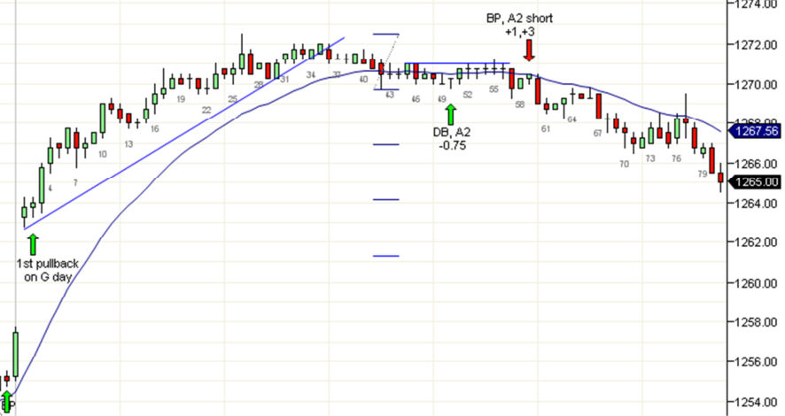

今天从第一根k线开始就有一个非常清晰的趋势，第二根k线给出了一个内包k线买入信号。买家在k线 1 以上可以持有，直到趋势线突破、趋势通道线过冲或其他明显的趋势终止信号。

第一个信号今天出现在 b19 ii 可能的末端旗形信号。然而，它未能触发 b20 ，导致旗形出现 2 次突破，最终在 b26 (在持续上涨后出现的大成交量大K线尺寸) 形成高潮k线。这反过来又给出了另一个 ii 信号。这次信号触发了，现在大多数多头应该都已经离场了。

接下来我们得到了一个在 b36 的双顶，但未触发，随后在 b40出现双顶回撤。很多时候，如果你从第一根k线就开始有趋势，各种反转信号只会造成浅回撤，然后价格会再次上涨。由于我们还没有明确的趋势线突破，这些做空信号都无法交易。当价格在 b42跌破 b29 时，趋势线才被果断突破。从这个点开始，我们在 b45 出现了 H1 ，随后在 b50出现了一个疲软的十字星 A2信号k线。在许多强趋势日中，信号k线很差，所以你仍然需要接受它们。特别是 A2 作为强趋势日的持续交易通常是一笔好交易。

然而，如果 A2 失败，即跌破入场k线或信号k线，它通常会变成一个 A2做空信号。今天从 b42 低点到 b55 高点的走势是一个 2 腿的走势，一旦它突破了 b45的高点，就构成了一个明确的 A2 做空建仓形态。在价格跌破 b50, 之前，A2多头还没有失败。一旦在 b57, 跌破双底失败，就是一个明确的做空信号。b59 的突破回撤是空头最好的入场点。b77 是另一个可能的 A2和第二次入场卖出（与 b74, 相同的入场点，带有强劲的 b74 信号和 b75 入场k线）。由于这接近交易时段的结束，大多数交易者会选择退出空头头寸，而不是重新进入新的头寸。

b 做到了，并且跌破交易区间应该至少达到区间的大小。今天它尽管在度量移动处有强劲的 3 点反应，但它继续进一步下跌。

总而言之，A2是值得进行的良好交易，因为当它们失败时，它们通常会反转到另一侧。

<!-- 原书第 113 页 -->

## 第一根k线趋势

2011年1月4日 星期二 · 原书第 113 页

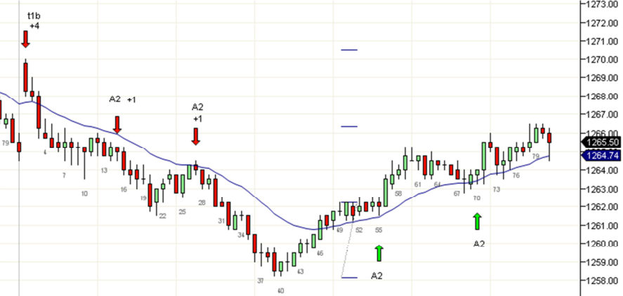

作为当天第一根k线的一根出色的趋势k线不容错过，因为它很可能会走得很远。理想的第一根趋势k线大约有两点长，两端不超过1t的引线。3 点或更长，它可能形成一个交易区间，导致人们争相在其下方买入或在其上方卖出。几跳较小，下一根k线可能会触发并反转走势，在获得刮头皮利润之前，从而建立一个交易区间。确保您正确入场的一种方法是等待k线触发前后出现小的回撤。这确保了买家有机会反转趋势k线，但失败了。

你应该能够持有该交易，直到你开始看到带有引线的k线，就像我们在k线 7 附近看到的那样。当这种情况发生时，通常明智的做法是退出并在下一个信号时重新进入。今天，我们在 b15 处收到了一个 A2 做空信号。通常，在旗形下方做空是个坏主意，但 b14 是一个失败的 H2, ，应该至少会带来 2 次下探。

当价格以清晰的 2 腿式走势在 b27, 处触及指数移动平均线时，它给出了一个非常清晰的 A2 信号，这对于波段交易来说是很好的。b34 是一个可能的末端旗形，在 b40 处触发并反转。

单腿走势收盘于指数移动平均线上方，并明确突破趋势线，意味着该走势已无卖空交易。在b55 和b70 处的A2 入场带来了多头交易，扭转了相当一部分空头走势。

<!-- 原书第 114 页 -->

## 首次回撤和突破测试

2011年1月5日 星期三 · 原书第 114 页

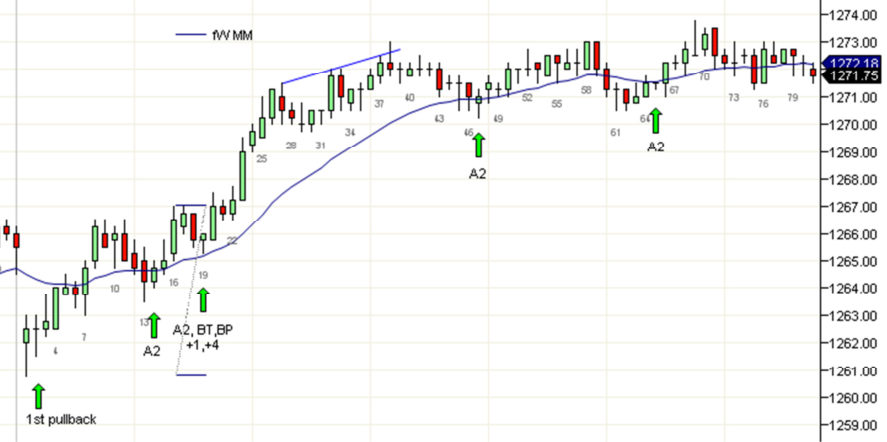

在第一根k线上方做多通常有风险。在今日这样的小缺口附近，靠近指数移动平均线的疲软反转k线通常会向上突破然后失败。如果k线实体很小，并且整个k线处于昨日的区间内（就像今天一样），这种情况尤其如此。

由于尽早抓住大行情很重要，如果第一根k线较弱，最好放弃，等待强力突破，并在首次回撤时入场。有时第二根k线会形成一根与第一根k线颜色相同的内包k线。这可以作为首次回撤。像今天这样的十字星是可以接受的，但较弱。

谨慎的交易者可以放弃 b2 ，并在 b6 上方做多。限价买家可以在原始入场点设置限价单，一旦某根k 线的低点收盘价在其上方（b5）。今天将在 b7 的低点触发。由于早盘的首次反转可能很剧烈，因此提前以限价买入存在一定的风险。因此，最佳入场点是在 b14 的首次 A2 。尽管技术上入场价高于 b13, ，但实际上所有交易者都会在 b14 上方买入，因为它是一根在指数移动平均线附近的小型多头K线。

b19 是一个突破测试，其止损点比之前的信号高一个跳。当突破测试的低点恰好位于指数移动平均线时，如果K线幅度不大，这是一个增加仓位的极好信号。

一旦涨势从低点达到 +10 点，大多数交易者都在考虑离场，所有交易本质上都是刮头皮交易。因此，交易质量会下降，所以你应该跳过任何可疑的交易。

<!-- 原书第 115 页 -->

## 无缺口开盘

2011年1月6日 星期四 · 原书第 115 页

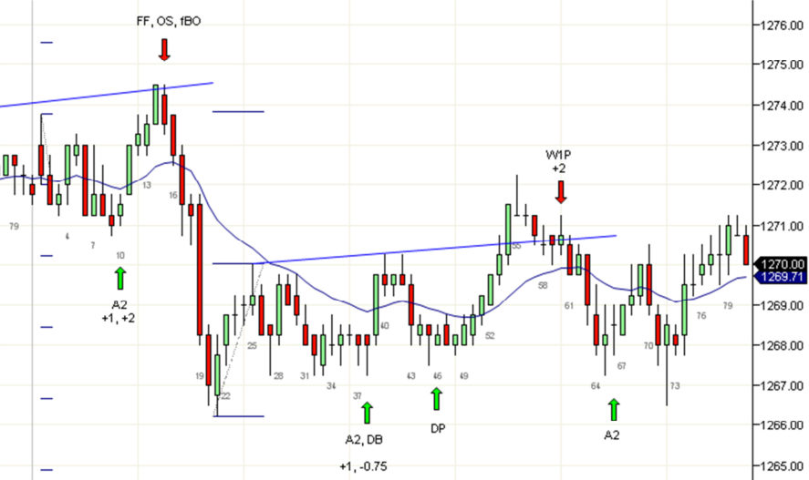

当第一根k线与昨天的最后一根k线相比，缺口很小或没有缺口，但第一根k线收盘强劲时，抓住初始走势的正确方向是最难的。通常，最好将其视为交易区间并逆势交易其突破。次优选择是等待突破，并在首次回撤时顺势进入。

这些日子通常会变成交易区间或趋势交易区间，但有时会从第一根k线突破成趋势，但更有可能是交易区间。

鉴于今天前两根强k线，许多交易者在b5处做空首次回撤并不令人意外。然而，b3 是一个可能的首次反转，并且入场k线b6 很容易给出高低点和多头入场，因此不交易是正确的选择。

第二次尝试向下突破在b9 处失败，b10 在交易区间底部提供了一个多头入场。这是一个容易的多头交易。然而，有时另一侧的突破不会给出突破回撤，而是会彻底失败。迹象已经出现，但很难解读。在b13 处有一个2 k线末端旗形，并且昨天趋势线的过冲以及早期的空头力量。然而，我错过了大行情，其他人可能也错过了。正如预期的那样，市场在交易区间大小的度量移动处停止，并给出了一个反转k线或一个先跌后涨的两根k线反转。入场k线很强，并且由于重叠，可以预期入场k线的低点会被买入。在b27,32 和38处对b3 次进行了测试。

A2 和 DB 在 b38 以及 DP 在 b46 都相对容易判断。W 移动到 b55 时出现了一个十字星 k 线，因此可以将其忽略，并在 W1P 的 b60下方入场。

<!-- 原书第 116 页 -->

## 顺势交易

2011年1月7日 星期五 · 原书第 116 页

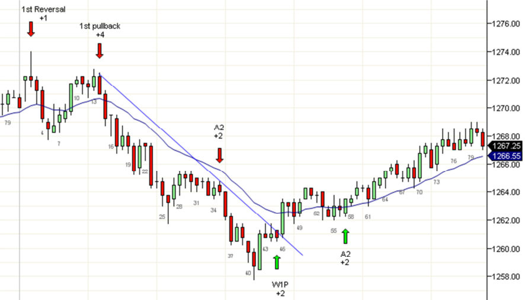

专注于震荡指标、枢轴点和支撑阻力位的؀一个不幸的后果是，交易者被迫专注于逆势交易，这通常是低概率的。第二个后果是，交易者通常关注小幅移动，获得 +1 或 +2 点，而他们本应专注于获取大份额的移动。

以这种方式交易的第三个后果是它迫使您使用限价单，而限价单本质上是逆势的。虽然稳健的交易者可以非常成功地使用限价单，但对于大多数交易者来说，它们适得其反，因为它迫使您关注获得最佳价格，而不是关注可以持有最大点数的最佳概率交易。

在交易者能够完美解读趋势突破和反转之前，最好是让趋势建立起来，然后进行每一次持续交易。例如，今天的k线 2 是一个可能的首次反转，即使您没有抓住它，您也可以轻松地在 b14, 处进行首次回撤，这通常是当天最佳的波段入场点。如果您错过了，仍然可以在 b35 处的第一个 A2 处入场。

在趋势线被 W 后的 b46, 突破后，您将不再关注做空交易。您可以在 b57 处的第一个 A2 轻松入场。

In addition to A2, W1P（W反转后的首次回撤）以及每日的首次反转 y are 非常好的交易，一旦你能正确解读它们。

<!-- 原书第 117 页 -->

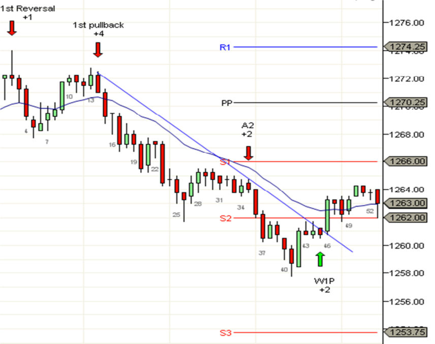

专注于在交易者认为会发生主要反转的低点做多（因为它是一个枢轴、斐波那契或其他专有支撑或阻力区）的交易者，可能获得了几点利润，也可能损失了几点。

<!-- 原书第 118 页 -->

## 大开口k线是一个交易区间。

2011年1月10日 星期一 · 原书第 118 页

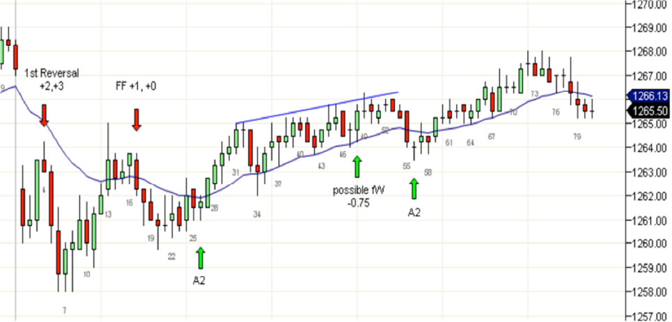

今天开盘有一个中等大小的缺口，但是开盘k线很大。当第一根k线太大时，它可以作用于交易区间。所以其在两侧的突破都可以在一个好的信号k线上进行逆势交易。今天的第一次突破在回现地在上方，并在今天中发生了最大的活动。一个非常见的外-内-外反转在b6,7,8 将价格反转，并在 b11出现了第一个回撤。然而，给定的入场位于的顶部的信号k线，把它通过是可以理解的。

一根退典k线在b13 后续了一个ii突破反转，并在b26出现了一个A2 做多单。然而，这很难解读，及上一半的末端旗形和双同叉，它一个低概率的入场信号。

第一个通道突破在b35 是一个风险的在交易区间顶部强制的做多交易。给定双顶处于32, ，最好是留着不管。

市场突破了 b38 处的双顶，并在 b42 和 b46处两次尝试失败。这也在频道中形成了一个 3 推动，并将充当楔形。如果这个触发并失败，就有可能出现 5 点的度量移动。然而，价格两次逆着买家走，在 b53 下方退出是合适的。b56 提供了一个 A2 多头交易，这是今天最后一个合理的交易。b73/74 可能是一个 FF 或 DT，但考虑到今天的市场情绪，最好在交易时段快结束时放弃这类交易。

<!-- 原书第 119 页 -->

## 买入限价单

2011年1月11日 星期二 · 原书第 119 页

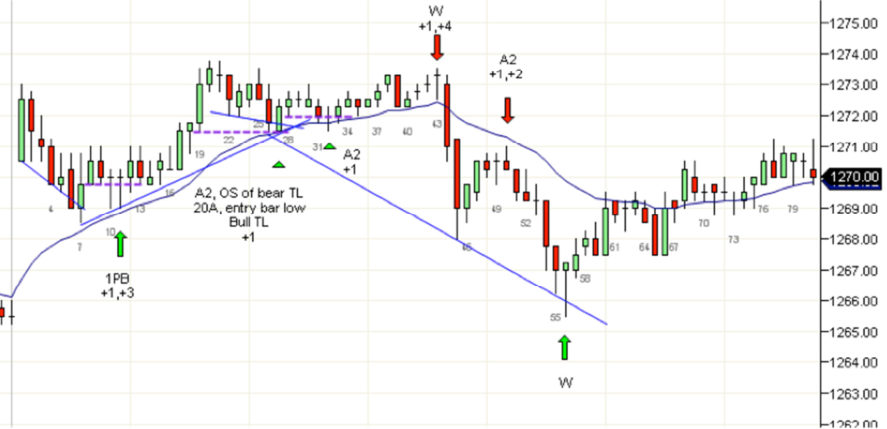

我很少使用买入限价单，因为我不知道价格会在何时何处反转（如果会反转的话），也不知道止损应该放在哪里。而且，在K线中间买入存在风险，因为K线最终的走势可能与你想象的截然不同。但有时，也会有令人信服的理由使用限价单入场。对我来说，主要原因是有一个坚定的价格水平，我相信买家会在那里入场。这使我能够以精确的价格入场，而不是凭感觉在图表上寻找入场点；其次，还有一个精确的止损，这很像在信号K线上方设置止损入场。今天就出现了一些这样的机会。我使用限价单入场的第一个条件是必须出现过冲。这将确保即使我判断失误，价格向我有利的方向移动 4 或 5 跳，市场也有可能回落，让我有机会在盈亏平衡点退出。第二个条件是我下方有一个价格点，买家将被迫在那里入场，例如，因为那是主要反转的低点，或者是 20 根K线后首次触及指数移动平均线。第三个条件是，产生该走势的做空信号必须来自一个糟糕的信号。

The Trader's mind VIII - The basics of emotionsBuying limits市场呈现了首次反转，但迫使在大的旗形上方做多，迫使止损超过 2 点。虽然入场k线 b8 很强，但其低点很有可能被突破。当 b9 呈现了一个糟糕的做空信号（再次由于重叠），在入场k线 b8 的低点买入的订单变得可行。 b7和指数移动平均线以及 b7 低点的过冲是买入的有力理由，并成为在 b11上方首次回撤买入的合理替代方案。请注意，当你在 b11, 上方买入时，首次回撤是真实的，但当你买入 b8, 的低点时，首次回撤只存在于你的希望中。第二个例子是，当市场以 2 腿部进近指数移动平均线在 b26 时，在 b19 低点上方一个跳做多。这里有很多买入的理由，例如：空头回撤趋势线的过冲，来自上升的指数移动平均线的多个 20 跳空K线，多头趋势线等等。即使是保守交易者也很可能在此限价买入。考虑到这波走势如此强劲，b19 的低点或其上方一个跳很可能被买入，并且是一个很好的入场价。

对于那些错过了限价交易的人来说，技术入场强制在 b26 上方做多，但一些交易者会在 b27 上方做多，而入场k线 b28 很可能会失败。多头K线 b30 的重叠和向下突破很可能会失败，因此在 b28 低点限价做多，并在 b27下方设置止损是一个不错的入场。今天出现了一个迟到的下降趋势突破，发生在4 突破尝试失败之后。b42 下方的 L4 是一个典型的双重陷阱。b42 下方跳了一个跳，套住了空头，上方跳了一个跳，将空头套出并套住了多头，然后向下突破，使得 b43 既是一个 W 也是一个 W1P，同时也是一个 DT 和一个 DP。

出现了 2 大K线下跌，随后是上午交易时段，由于 b45, 的大小，在它下方有一些做多的机会，因此在 b45 的低点退出可能是合理的。

<!-- 原书第 120 页 -->

## 首次反转 vs 首次回撤 vs 首次通道突破

2011年1月12日 星期三 · 原书第 120 页

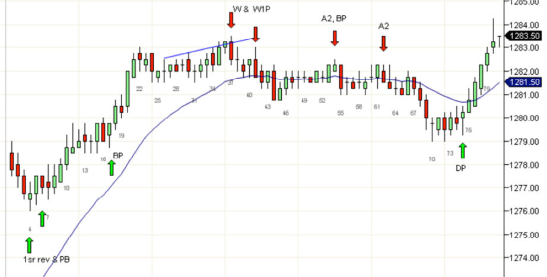

日复一日，我发布图表，其中首次反转和回撤可以被进入并持有进行波段交易，通常直到一天结束。首次回撤尤其适合进行盈利的波段交易，至少可以持有到上午交易时段。但是，你怎么知道哪根k线是首次反转呢？ b4 和 b5 是否代表一个将继续向空头方向移动的首次回撤？它会不会是一个通道突破，有很大的机会恢复下跌？

有时反转k线非常明显。它的大小几乎与之前的k线相同，看起来像一根制作精良的反转k线，最多只有一个跳入场侧引线（或者如果k线很大，则为2t）。然而，很多其他日子并不那么明显。例如，今天的图表中，k线4 不是一根明显的第一根k线。但是，任何在给出一点刮头皮交易后，入场点超出一根k线的反转都可以被采取。如果不是，则等待可能的突破回撤或持有你的波段交易部分。

一种策略是不选择可疑的首次反转k线，而是选择任意方向的首次回撤，前提是它是一个好的建仓形态。例如，今天b7 在某一方向的套牢也会为相反方向的入场提供机会。一个好的首次反转，如果其价格低于信号k线，通常会再下跌一腿（本质上变成了首次回撤交易），因此应该在信号k线下方，甚至在入场k线下方进行反转操作。通常情况下，如果最初的几根k线比2 点（平均区间为 10 点）大，或者最初的两根k线是先涨后跌或先跌后涨的k线，那么很有可能它会形成一个交易区间，你应该寻找失败的突破或突破回撤，当你的首次反转测试区间的另一端时，就像我们昨天看到的。

<!-- 原书第 121 页 -->

## 各种反转

2011年1月13日 星期四 · 原书第 121 页

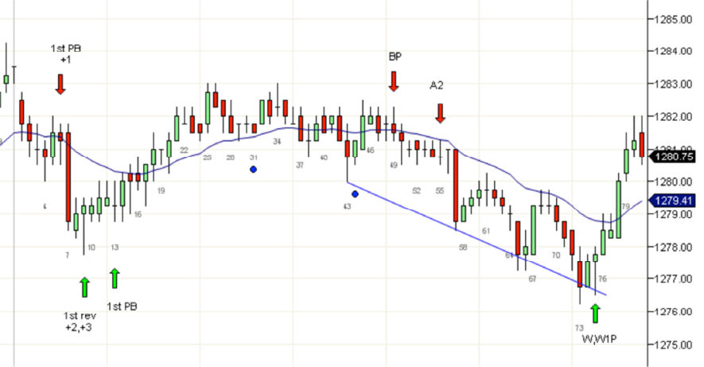

大多数交易者熟悉反转k线，但这种形态良好的反转k线只出现在强势趋势反转中，通常伴随着明显的过冲。经常会出现双顶（b26,34）或底部反转，这是许多交易者能够识别的。偶尔，会出现内包K线反转。这些只有在出现过冲并且入场后仍有空间进行刮头皮交易到外包K线的另一端时才应被纳入考虑。这是因为大k线通常会充当交易区间，大空头K线上方会有卖方，大头K线下方会有买方。

例如，上方的入场点距离外包K线高点正好是六个跳，如果存在过冲，这可能是一个反转K线。如果没有过冲，这些K线就充当了陷阱，你可以在空头建仓形态（例如内包K线）下方做空。b67 确实有过冲，但上方空间不足。实际上，你将买入空头K线的最高点，这是一个糟糕的入场。无论如何，它上涨成为了一个5tf。这也可以在内包K线b69处做空。

接下来非常重要的一种反转是我们在b73-75处看到的“外-内-外反转”。当与过冲结合出现时，它就和强势反转K线一样好。通常，3根K线会突破内包K线，将多头套在里面，然后跌破内包K线，将多头套在外面、空头套在里面，然后再次反转向上。这种双重陷阱会导致剧烈的波动。

最后一类过冲是上述情况的逆向，即内-外-内反转（b8-10）。当出现像今天这样的急剧过冲时，这也导致了反转。对于多头反转K线之后出现空头内包K线，你可能会希望空头们被套住，然后在其上方做多。

寻找高概率反转的能力可以让你更长地持有你的波段交易，同时避免陷入低概率的刮头皮交易。

<!-- 原书第 122 页 -->

## 趋势强度的迹象

2011年1月14日 星期五 · 原书第 122 页

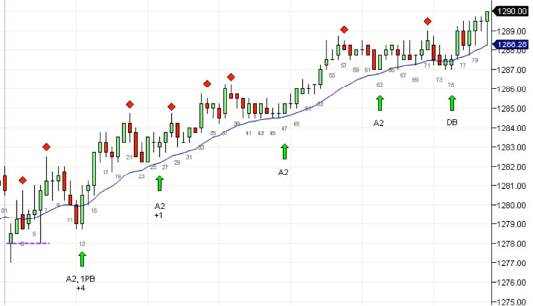

今天的第一个k线不太可能是首次反转，因为它位于昨天的近期波动高点和低点之间。然而，等待首次反转的人应该注意市场就趋势强度发出的非常强烈和明显的信号。

首先，b1 上方的入场k线是一根光头K线。这表明多头方面非常急切。其次，第一个反转k线 b3 没有触发。当反转k线没有触发时，这表明肯定还会上涨更多。相反，价格突破了它，这是另一个看涨信号。新闻反应在b6 低点对开盘进行了突破测试。这意味着那些在开盘时买入的人在同一价格有更多的买入订单等待。这通常意味着一个强劲的多头日。b4 和 b6 不符合首次回撤的条件，因为它们会在日内高点上方触发买入。b8 在疲软收盘后是一根十字星，并不是真正的买入建仓形态。因此，b13 是首次回撤，可以持有到收盘。

红色菱形表示较差的反转信号，这反过来又表明了趋势强度。b7, b21和 b71 是看起来较差的反转k线（它们是多头K线或有大的入场侧引线）。b34和 b38 是单跳内包k线。b57 在下一根k线中没有触发。所有这些迹象都表明了多头强势和半心半意的做空，这意味着整天都只应采取多头头寸。这是因为大多数优秀的交易者不会卖出这些k线，事实上，他们会利用这些点位来增加他们的头寸。

确实，在 b7 和 b21 处出现了过冲，但过冲只意味着即将回撤。需要一个明显的过冲才能实现真正反转。这也是为什么 W1P 比 W 是一笔更好的交易。

今天其他强劲的趋势迹象是 20+k线位于指数移动平均线上方以及中等大小k线。每一个波动低点都高于之前的波动低点，这也是健康趋势的标志。只要有许多或所有这些迹象存在，就不要考虑逆趋势交易。

<!-- 原书第 123 页 -->

## 盘整和突破

2011年1月18日 星期二 · 原书第 123 页

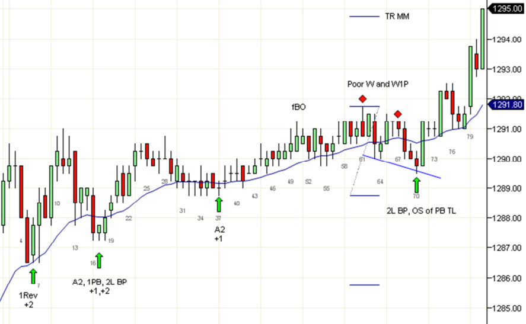

虽然今天的第一个k线是理想的大小（对于平均 10 点交易日来说是 2 点），两端只有 1点，但它发生在没有与周五形成缺口的情况下，这是认为这是一根交易区间k线的充分理由。一根好的空头 K线靠近顶部将是一个很好的做空候选，可能是一个 1st反转。然而，在多头K线之后，我们得到了一根十字星内包k线，虽然这可行，但很有可能出现一个不会带来刮头皮利润的高低点，所以正确的决定是放弃这笔交易，等待一个高低点或跌破这根k线并可能反转向上。

b6 处的下上反转是首次反转，应该被抓住。至少可以持有到日内高点。由于这是下上反转而不是内包 k线交易，入场点在多头K线上方。b7 处的几乎外盘上涨入场k线预示着可能的1291的度量移动。50。

b10-b12 是一个ii变体末端旗形，可能导致下跌。然而，我们预计在首次反转后会出现首次回撤，想要做多的人可以跳过做空交易，选择一个两腿高低点作为波段交易。

b17 是一个缺口k线和两腿回撤至高低点，是当日最佳的波段交易选择。这应该会尝试突破日内高点，并尝试获得回撤的度量移动，即1294。75。

b37 的走势是一个2 条腿的、形成不佳的A2 信号，以及一次相当浅的回撤。这是一个TTR盘整，并且在此点退出并等待市场突破是完全可以的。

市场以b61 的形态走势，在b7度量移动处出现了一个反转k线。这个反转k线未能触发，这是一个看涨信号，而且在此点最好避免做空，因为目前还没有看跌强度的迹象。

虽然我通常在看涨K线70 上方做多，但那是一根小空头K线，有很多值得关注的地方。在A2 信号的突破61, 之后出现的一次腿回撤，以及对A2 信号的回撤测试，还有第一次趋势线突破37 。

<!-- 原书第 124 页 -->

然而，在光头K线71 上方做多，或者在78 突破回撤后持有，直到满足度量移动或者收盘，都是完全可以接受的。

当天收盘价在1295, 1t之上，高于首次回撤和最终交易区间的度量移动。

三角形是盘整的标志，许多交易者会退出头寸，因为三角形可能向任何方向突破，尽管通常会沿着先前趋势方向突破。

在b50 和b61 处的糟糕反转k线，以及普遍强劲的趋势，表明了看涨突破，而看涨突破通常发生在回撤之后，例如b70的两腿回撤。

今天要注意的是失败的突破的例子。b2 突破上方并且失败，导致趋势移动到区间的另一端。b10 出现了一个2 腿回撤，形成了一个多头交易。b50 和 b61 是失败的突破，但没有产生交易，因为突破k线没有产生信号或触发。

<!-- 原书第 125 页 -->

## 强劲趋势日窄幅交易区间

2011年1月19日 星期三 · 原书第 125 页

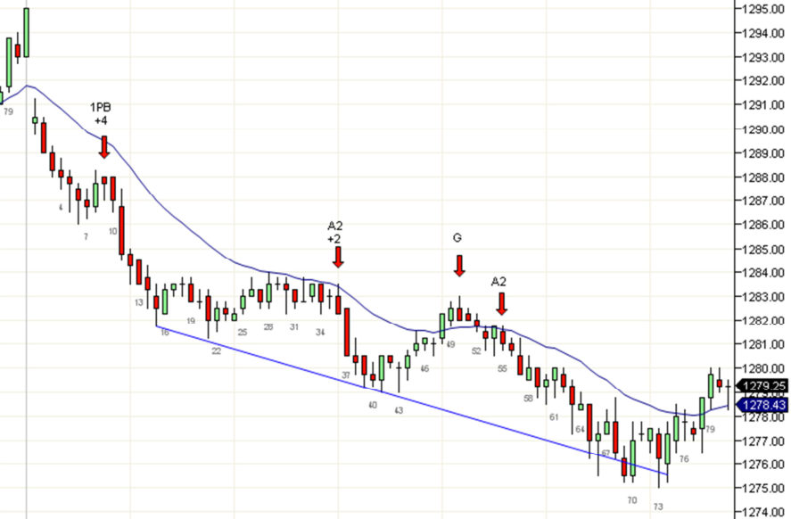

趋势转换矩阵中的两个方框被标记为 TTR。由于 TTRs 充满了失败的交易但常常导致强劲突破，检测并正确交易 TTRs 对你的交易成功非常重要。TTRs 的常见类型之一是在强劲趋势日（例如今天）发现的。通常，在经历了今天这样的大幅移动 10 点左右之后，市场会在 TTR 中横盘移动，本质上是一个非常弱势的回撤。

从 b16 到 b35 的走势是向下至横盘转换，并且是 TTR。除了 b19, 以下的做空，每一个价格行为入场都失败了。这是为什么你需要远离 TTR 的一个非常重要的例子。唯一可以进行的交易类型是，在另一边的失败突破之后的突破。b28 突破了 b19 的先前波动高点，并失败了，在 A2 给了 b36 以下的做空。即使你不能正确解读 A2 ，事实上市场在指数移动平均线处，在一次失败突破后给出了一个削减趋势k线，这足以让你做空。

识别和退出交易区间反转（TTR）：尽管今天的交易区间反转持续时间很短，但有时交易区间反转会持续到收盘，或者至少持续到最后的 90 分钟。在识别到交易区间反转时退出是正确的做法，以下是我的操作方法。如果一个强劲趋势日突然出现微小K线和十字星，例如 b17 和 b18, ，我会担心交易区间反转正在形成，并在下一个空头K线出现时或在之前的波动低点附近退出。然后我会等待一个失败的突破，并假设我们将向相反方向突破，特别是如果失败会打破趋势（大多数交易区间反转是顺势旗形）。偶尔，交易区间反转会出现双底回撤并向上反转，我通常只会在交易区间反转的另一侧至少有 6 跳的距离时才会进行该交易。

<!-- 原书第 126 页 -->

今日总结一个强劲的趋势很少能成功进行逆势交易，而一个强劲的趋势则有能移动许多点的腿。这通常意味着一个强劲的趋势如果进行波段交易，可能会带来意外之财，但如果它反转了，可能会抹去所有的盈利。我的方法是在我预计市场将进入一个窄幅区间时，平掉部分或全部仓位，并在下一个信号出现时重新进入。交易大量合约的交易者可以简单地在每一个波段极端或预设目标 +2, +4, +8 等处不断获利。

今天的第一根k线是一个实体很小的十字星，但它的入场k线是一根强劲的空头k线。跳空日并且有如此强劲的入场k线，足以在它下方做空。谨慎的交易者可以在首次回撤 b9 下方入场。实际入场点在 b8, 下方，这恰好是 b7 多头的入场k线，很可能导致抛售。这也是一个失败的 H1 交易（fH1），应该会产生略低于 5 点的度量移动。

上面描述的 TTR fBO 交易，一旦你能正确解读，也是一个非常明显的交易。

b41 是一个可能的 W反转，但有很多迹象表明信号不好。b43 是一根外包阳线，但从未被触发。b43 的 db K线是一个十字星，和外包K线一样，都是交易区间类型的k线。如果你在这些k线中的任何一根上方买入，你做得不错，但它不太可能大幅反转。没有 W1P，因此 b50 的缺口k线是一个好的做空信号，并且可以持有到新的 LOD。

## 处理不明确的信号

2011年1月20日 星期四 · 原书第 126 页

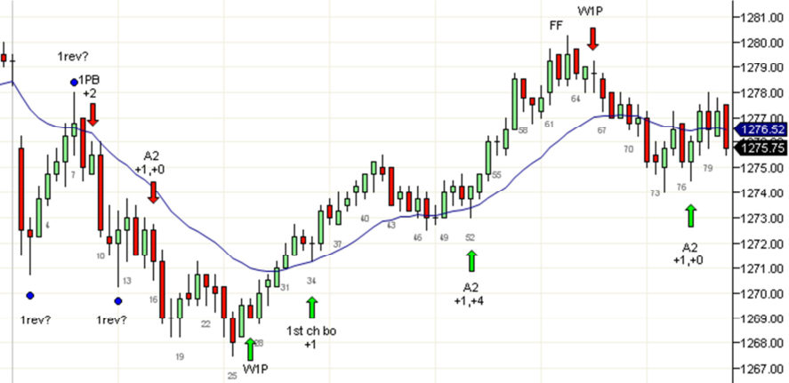

通常你会收到本应不错的信号，但最终的k线却不好，或者略有偏差。通常情况下，最好让它们过去，等待第二个更好的信号。信号k线可能因多种原因而不好。首先，它们颜色不对。你需要多头k线来做多，空头k 线来做空。第二个原因是K线尺寸导致风险过高。第一个小时的大部分反转都可以奏效，一些交易者会交易任何合理的信号。

<!-- 原书第 127 页 -->

在上面的图表中，b2 今天是一个首次反转吗？由于大k线b1 将构成一个交易区间，b2 可能是突破，一个小幅回撤可能导致突破回撤止损。即使它有一个单跳多头实体，它可能也值得冒这个风险。类似地，b7 可能出现突破回撤，因为实际的突破发生在k线6 上，额外的k线增加了突破回撤的几率。b9 确实是首次回撤，入场点位在b8 上方做多或下方做空。b12 只是一个大的十字星，而不是一个反转k线。第二次尝试跌破它可能被视为A2 空头交易。

b25,26 是一个下上反转k线，我错过了它，还有b27 W1P。通常W1P会形成一个通道，直到首次通道突破才能进入，就像b34那样。虽然b34 是一个十字星k线，可能是一个H1, ，但它是一个高概率交易，因为它是一个波动高点b21 的突破测试，并且也位于ema处。

上面b50 的A2 入场值得怀疑，因为它迫使在旗形上方、比前次入场高一点的位置做多。如果你宁愿不等待通常会像b52 在此处出现那样的一个2次入场，你应该使用8个点的止损，而不是价格行为止损。

W1P通常至少有1个点的盈利空间，但有时我不会参与。b66 就是一个例子。在b64 附近的FF附近没有明显的反转k线，而且入场k线b65 很弱。b66迫使在旗形下方做空，我放弃了这笔交易。

b74 是一个例外，尽管它是一根出色的k线，但许多人可能没有入场。在回撤过冲后出现了一个缺口反转k线，但要求10个点的止损。入场后出现了a5个点的失败，并止损了入场k线以下的止损。然而，8个点的止损得到了尊重。

总而言之，如果k线颜色不对，就放弃这笔交易。如果k线大小不对，使用资金止损而不是价格行为止损。如果k线是十字星，如果存在支撑原因，例如突破测试、ema、趋势线支撑、通道过冲等，则进行交易。

<!-- 原书第 128 页 -->

## 在强趋势中，在 L1 和 H1 入场

2011年1月21日 星期五 · 原书第 128 页

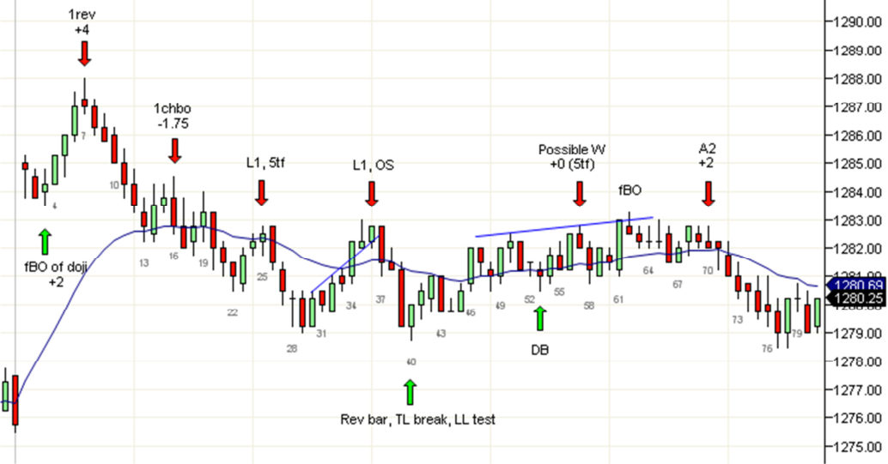

第二次入场，例如A2 和W1P，是我大多数日子的主要入场方式，但在强趋势日，你可能不会得到很多这样的机会。在这些日子里，你可能不得不在L1s和H1s入场。今天就是这样的一天，我想分享一下我如何选择我喜欢入场的L1s以及我避免的。

当像 b7 到 b13 这样的强趋势（带有平均大小的 k线，没有过多的引线或重叠，在回撤前运行了许多点）向前发展时，你可能不得不怀疑这是一个非常强的趋势日，并且你可能不得不以 L1 点入场。

我关于在 L1 点入场的规则很简单。每个小的趋势 k线，无论颜色如何，都是顺势入场。（注意：这仅适用于强趋势）。所以 b15, b25, b57, b62 就是这样的 L1 入场点。我的第二个要求是，需要有另一个理由，比如 b25 上的 5 tf，或者 b36 上的过冲和内包k线。

我等到空头K线 b16 下方时才做空，我的止损设在 b17 上方，因此我损失了 7跳。由于该K线有点大，我应该等到我刮头皮交易获利了结后再移动止损，这是我的一部分错误。当时最好避免在接近日内低点的外包k线下方入场。 b16 如果发生在稍高一点的位置，也将是回调入场。任何做空并在日终前持有的人都会做得很好。

<!-- 原书第 129 页 -->

## 交易通道

2011年1月24日 星期一 · 原书第 129 页

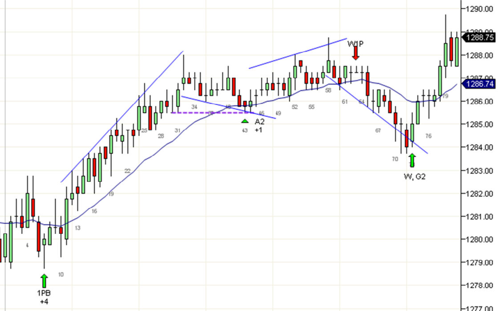

通道永远不应该被逆趋势交易，无论你从中读取到什么信号。对于刚刚突破交易区间的通道尤其如此。每一次 L2 或过冲都注定会失败，如果你进行逆趋势交易。这是因为通道只是一个较慢时间周期上的趋势。一个选择是交易较慢时间周期。另一个选择是在每一个回调K线上入场一半仓位。当通道首次突破时，你可以入场另一半仓位。例如，你可以收盘做多 k线 13,16,18,23,26, 等等，止损设在之前多头K线下方。

最安全且正确的交易是等待首次通道突破，并在腿回撤后顺势入场。首次通道突破在ema处入场相当安全，并设置紧密的止损。通道突破后，您逆趋势交易的成功率会提高。

当然，最好的时机是在通道开始之前就身处其中。在 b7 之上的首次回调入场 (1st pullback entry) 或在 b13 之上的突破回调入场 (breakout pullback entry) 可以让你持仓交易，直到首次通道突破 (first channel break) 并测试其上方。

<!-- 原书第 130 页 -->

## 最佳交易

2011年1月25日 星期二 · 原书第 130 页

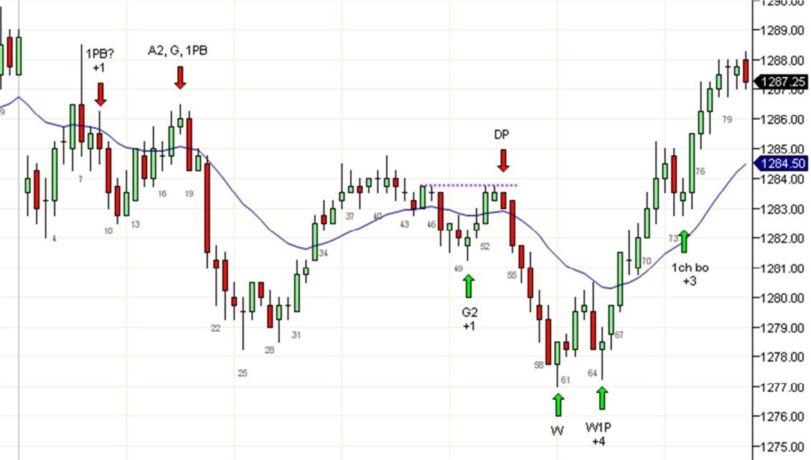

今天可能有数百次交易，但今天是我最喜欢的交易类型的绝佳采样。首次回调 (first pullback) (1PB)，ema 附近的双腿回撤 (Two legged pullback near ema) (A2)，双顶或双底和回调 (Double Top or Bottom and pullback) (DP)，楔形反转后的首次回调 (first pullback after Wedge reversal) (W1P)。最大的行情来自于这些交易，我确保在能够及时解读它们时就入场。今天我错过了 b54 上的 DP，以及可能在 b18上的 A2 或 1PB。

即使成功率只有50%，只交易这四种货币也能让你盈利，因为它们经常会达到+4 点。

<!-- 原书第 131 页 -->

## 突破和失效突破的最优交易

2011年1月27日 星期四 · 原书第 131 页

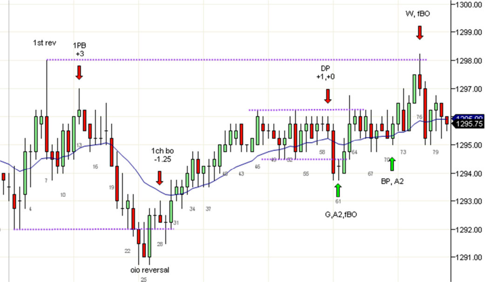

大多数突破都会失败，导致对交易区间另一侧的测试。偶尔，突破会成功，你需要顺势在回调时介入。

以下因素增加了成功突破的可能性：

- 大的突破k线
- 突破时趋势通道线上无过冲
- 此前在区间的另一端出现失效的突破
- 一次2 腿回撤

成功的突破很可能达到区间大小的两倍。例如，b63 突破了下午交易区间，并给出了一个突破回撤 A2 k线 b71 ，其幅度达到了b76的两倍。另一方面，失效的突破很可能向交易区间的另一端移动。例如，b1 处的失效突破在b24 处导致市场反转并测试了b7的高点。

因此，交易突破的正确方法如下：

如果交易区间很小，就像 b46 到 b58, 之间的下午震荡那样，那么第一次突破很可能会失败。在失败时进行刮头皮交易并反转。如果区间非常小，你可能甚至无法进行刮头皮交易，所以等到区间扩大后再入场。如果交易区间很大，比如从 b1 到 b7, 的开盘价移动，那么如果失效信号是一根尺寸合理的 k线，例如 b76，你就可以在失败时入场。如果失效 k线很大，则在第一次回撤时入场，例如 b13 做空或 b29 做多。你可以刮头皮交易一部分，并将剩余部分持有，直到突破或测试区间的另一端。偶尔，市场会突破一条趋势线并变成趋势终止 (TTR)，就像在 b50发生的那样。当这种情况发生时，最好在最近的波段的顶部附近退出，并等待更多的价格行为。这是因为失效的突破可能很快变成突破和深度回撤，而你不想让所有利润都蒸发。

<!-- 原书第 132 页 -->

## 交易硬趋势

2011年1月28日 星期五 · 原书第 132 页

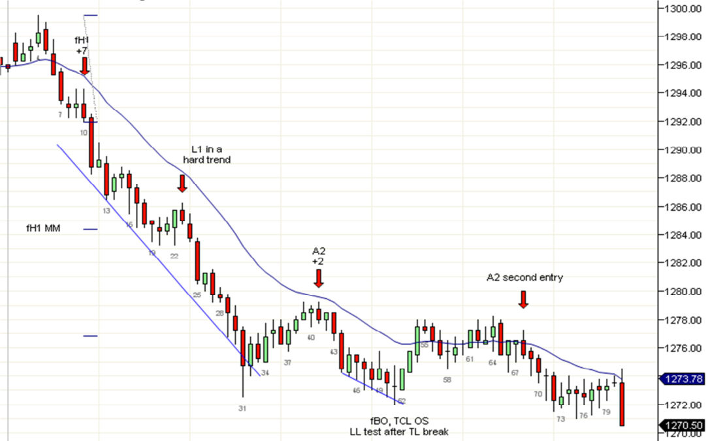

交易带有急剧移动和长 k线的趋势非常困难，因为入场机会非常少，而且每次入场都会移动大量的点数。当你看到两条或三条趋势 k线，重叠很少时，你就知道是这种日子。通常最佳的入场是第一次回撤，在这种剧烈趋势的情况下，这是一种特殊的失效 H1 (fH1)，通常会产生向下测量移动。趋势回撤之前的移动越剧烈，回撤越弱，就像今天这样，那么达到或超过测量移动的几率就越大。通常在达到测量移动后，会出现一个窄幅区间，所以我退出并等待更多的价格行为。在大多数日子里，持有 fH1 直到日终可以盈利，就像今天那样。

但是如果你错过了 b10 的 fH1 入场或者以几个点止损退出了呢？一种选择是做空每一个趋势k线或其突破的收盘价。我个人认为卖出收盘价难以接受，因为回撤可能和趋势k线本身一样大，就像 b13一样。我的方法是，在任何回撤时入场，并在任何小k线下方做空，无论其颜色如何，直到出现一个过分的过冲。像这样的日子几乎总会出现一个带有过分过冲的巨大k线，就像 b31中那样。

例如，在 b23, b26 下方做空是很好的进场点。激进交易者会做空任何 H1，期望它会失败。一旦卖出高潮出现，下跌走势就会暂时结束，你应该预期会有一次回撤。这次回撤不一定靠近 ema，但通常会测试卖出高潮 k线的高点。通常这至少可以做空一次来测试高潮 k线的低点。在这样的日子里，最好的策略是只顺着主要趋势的方向进行交易，因为很有可能在一天晚些时候出现另一波巨大的走势，但出现急剧反转的可能性非常低。例如，尽管 b62 至少有 3 个做多理由，我还是会放弃它，只关注做空交易。

<!-- 原书第 133 页 -->

## 判断延续还是反转

2011年1月31日 星期一 · 原书第 133 页

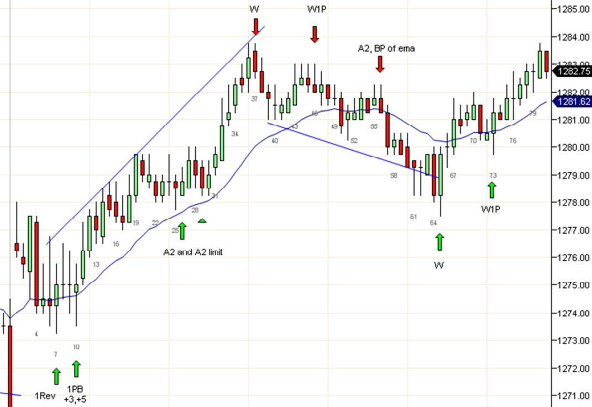

你经常会问自己趋势是否真的结束了，或者这仅仅是一次回撤。如果这是一次回撤，它将是单腿、双腿还是三腿的回撤。或者，它可能是一个下降通道。

例如，在今天的图表中，这是一个b25 a双腿回撤，还是一个应该做空的b19,b24 双顶？答案很简单。在没有趋势线突破或趋势通道线过冲的情况下，始终假设趋势仍在继续，并顺应趋势。宽幅的重叠使价格行为入场点难以设置在b25 或26 ，甚至b30之上。一种选择是突破信号k线（本例中为b25 或26 ）之上做多，并允许一次跌破入场k线的走势。你也可以在预期的回撤处买入部分仓位，即在双k线b27,28下方。

另一方面，b46是什么？这是一个W1P，还是仅仅是通往ema（最终在b51）的双腿走势中的一段上涨腿？每当你问自己这是否是一个W时，你应该问这是否是任何一种极端走势。从b31 到b37 的走势确实非常迅猛，触及了趋势通道线，但没有其他W反转的迹象。

- 没有明显的过冲。
- 没有出现反转k线
- 入场k线b38 并没有实际触发b36下方的理论入场。
---

[← 上一章](08-2010年12月.md) · [目录](00-目录.md) · [下一章 →](10-2011年2月.md)
