[← 上一章](09-2011年1月.md) · [目录](00-目录.md) · [下一章 →](11-2011年3月.md)

# 2011年2月

原书第 134–149 页

<!-- 原书第 134 页 -->

这确实是第三次推送，并且出现了微趋势通道线过冲，所以这仍然可能像一个边际W1P那样奏效。通常，当信号不明确时，你可能会得到一个深度回撤或趋势线突破，就像今天一样。为了刮头皮交易而接受一个较弱的W1P，或者等待下一次入场，都是完全可以的。 B56 出现了一个双腿通道突破回撤空头走势，该走势位于ema下方。b54 出现了一个更低的近期高点和更低的收盘价，并且将此次走势分为了两个腿。这是一个非常强的信号，表明你应该采取行动。

如果你因为某种原因在b51 上方做多了（假设这是一个A2 多头走势），那么到b56的双腿走势应该会告诉你退出或反转。

同时也要注意整体的价格行为背景。k线19-30 之间的水平交易区间可能会像一个磁铁，迫使任何突破都回撤到该区域。

回撤只是相反方向的小趋势，而其趋势通道线或趋势线突破后的测试是判断回撤是否结束的最佳方式。一般来说，单腿回撤只应该在非常强的趋势中进行，2 腿的回撤可以在任何时候进行，除非走势显示出回撤方向的强度（例如突破k线）。2 或3 腿（W形）的回撤可以在显示出过冲时进行。大多数在趋势线或ema处结束但未突破的回撤，如果出现了一个好的信号k线，就可以被看作是有效的。

## 检测和交易极强趋势

2011年2月1日 星期二 · 原书第 134 页

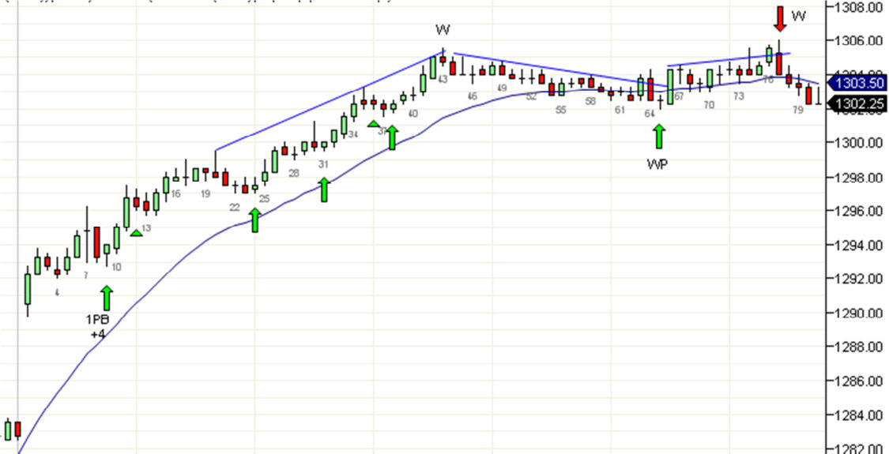

习惯使用指标进行交易的人们，在非常强烈的趋势日中，往往会一路做空直到顶部，从而毁掉他们的账户。学会识别强势趋势并顺势而为，而不是逆势而为，对您的交易成功至关重要。

强趋势日最大的信号之一是大缺口。任何大于平均日一半的缺口都算大缺口，你应该留意强趋势移动。中小型k线是强趋势日的良好指标。首次回撤（b3,4）

<!-- 原书第 135 页 -->

而不是反转，是价格想要上升趋势的另一个信号。b4 的空头入场1tf是强度的另一个指标。

此时您应该不计任何理由地买入任何回撤。b9处的第二次一跳失败预示着一个非常强劲的交易日，您甚至可以以限价买入任何内包空头K线的低点，只要K线尺寸合理。您也可以在任何内包多头K 线上方买入以获得H1入场。您可以一直这样做，直到出现强劲的趋势突破。但是，当K线变得非常小时，存在TTR（趋势终止）的真正机会，这仅仅是趋势结束，上涨转为横盘，并且是九段转换的一部分。仅在多头K线上方买入可以降低您在TTR中间买入的几率，同样，在更深的回撤后买入也能降低几率，因为TTR通常较浅。

楔形呢？b11 是第三次推送，因此是楔形吗？关于楔形最重要的一点是，它们在没有过冲的情况下不会回撤，并且在趋势线突破后是最佳交易的。因此，b11 甚至b20 不应期望有大的回撤。b 43 可能是一个W（反转形态），因为从b20 到b23 的走势可能是轻微的趋势线突破，并且它确实过冲了一个跳或左右。然而，如果没有一个不寻常的过冲在一个非常强劲的交易日出现，它是一个糟糕的W。尽管它确实下跌了3+ 点，但近两个小时都令人心惊胆战。然而，这一走势确实给予了强劲的趋势线突破，而下一个在b77 处的W则更容易做空。

关于像今天这样的交易日，最重要的一点是，你应该已经确定了一个强趋势日，并很早决定只做多头交易，或者在深度回撤后才入场，并波段交易直到出现明显的过冲或强趋势线突破。

## 绝命毒师

2011年2月2日 星期三 · 原书第 135 页

精确确定突破的方向和入场是交易中最困难的方面之一。即使你能确定方向正确，许多交易者在市场最终出现大突破之前常常会被止损。如果你能正确入场，你就能获得最佳的风险回报比。这导致了许多交易者和算法程序将精力集中在正确检测和入场突破上。今天的入场代表九段转换中的fBO或中心方块。

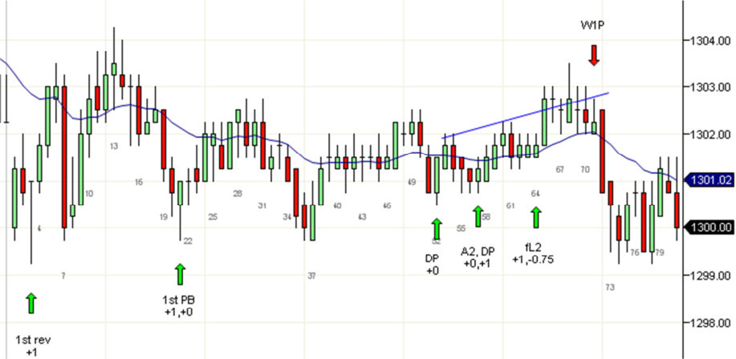

<!-- 原书第 136 页 -->

许多交易者专注于在突破时入场，而许多其他人则专注于在突破反转时入场，因为大多数突破都会失败。事实是，趋势中的突破通常会成功，而在交易区间中的突破通常会失败。即使如此，偶尔也会有突破从交易区间产生，从而诞生新的趋势。

如果看看今天的图表，b3 是一个可能的首次反转，b8 是一个可能的首次回撤。这是一笔很难做的交易，因为信号k线是一跳实体内包K线，带有一个大引线，迫使你在区间中间做多。在b21 处，首次回撤的2次入场是一个好得多的入场点，但此时，交易员发现自己处于一个交易区间。此时，正确的做法是假设每次突破都会失败，正如我们今天看到的：

- b37 尝试突破b21 波动低点失败
- b50 尝试突破BW失败
- b52 尝试跌破BW失败
- b65 突破3 波动高点，但最终失败
- b74 跌破三重底失败。

许多成功的突破源于交易区间一侧的失效突破或交易区间一端的双底回撤。今天我们在 b52 处出现了一个边际双底回撤。这个建仓形态不足之处在于，双底之后的回撤不够深。此入场迫使我们在区间中间3买入，价格高于双底入场价，并且肯定更接近最近的波动高点。成功的双底形态通常会在接近原始双底入场价处提供入场机会，并略低于双底。另一个关于这个双底很可能失败的重要线索是，突破发生在第三次推送，并伴有超冲。通常情况下，对于突破来说，如果随后有跟进，这是可以接受的。如果没有，就是时候退出或反转你的头寸了。

交易突破最困难的地方在于，它们会在心理上让你预期某种特定的走势，而你最终会选择一个边缘的入场点。例如，在 b37, 的双底之后，我预期会有一个 DP（深度回撤），并正确地解读了 b47 从 BW 突破和 b51 跌破 ema 的失败，但最终却选择在 b52, 入场，尽管它是一个边缘点位。另一方面，交易失效则要简单得多。你本可以交易上面列表中的每一次失效突破，并且今天表现会非常好。而且，如果失效突破因为某种原因再次失效，你总可以反转并跟随突破回撤。

<!-- 原书第 137 页 -->

## 越狱：水平旗形突破

2011年2月3日 星期四 · 原书第 137 页

带有交替上升和下降k线（像监狱牢房的栏杆一样）的水平旗形，常常会产生剧烈的突破。正确预测它们是一个巨大的挑战。通常会有多次突破，但都以失败告终，直到其中一次突然突破并移动的幅度是旗形大小的好几倍。

水平旗形也可以充当磁铁，并且趋势往往会回撤至该区域。因此，如果你遇到反转，至少应该退出，而不是完全反转你的仓位。像所有突破一样，水平突破也最好作为突破回撤进行交易。本文代表了九段转换中心行的第一列和第三列中的黄色框。请注意，试图预测突破风险极高，通常最好进行突破回撤。有时没有突破回撤，你只需放手即可。

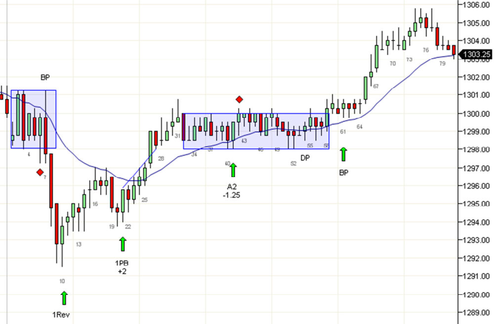

例如，b6 突破了旗形，尽管看起来像一个有大面积重叠的糟糕反转k线，但它未能突破另一侧，并在没有回撤入场的情况下出现了急剧的下降趋势。午餐时间另一个水平旗形也显示了类似的突破。b42 处的第一次突破，突破了b37 的前期波动高点，但未能跌破b40的波动低点。这使得b 54 上方的DP入场成为可能，或者你也可以直接在b61处进行BP。

水平旗形通常会随着先前的趋势而突破，并远离 ema，而不是横穿。由于昨天的最后一次走势是下跌，今天的开盘旗形也应该向下突破。同样，午餐时的旗形也应该向上突破。

<!-- 原书第 138 页 -->

## 首次通道突破

2011年2月4日 星期五 · 原书第 138 页

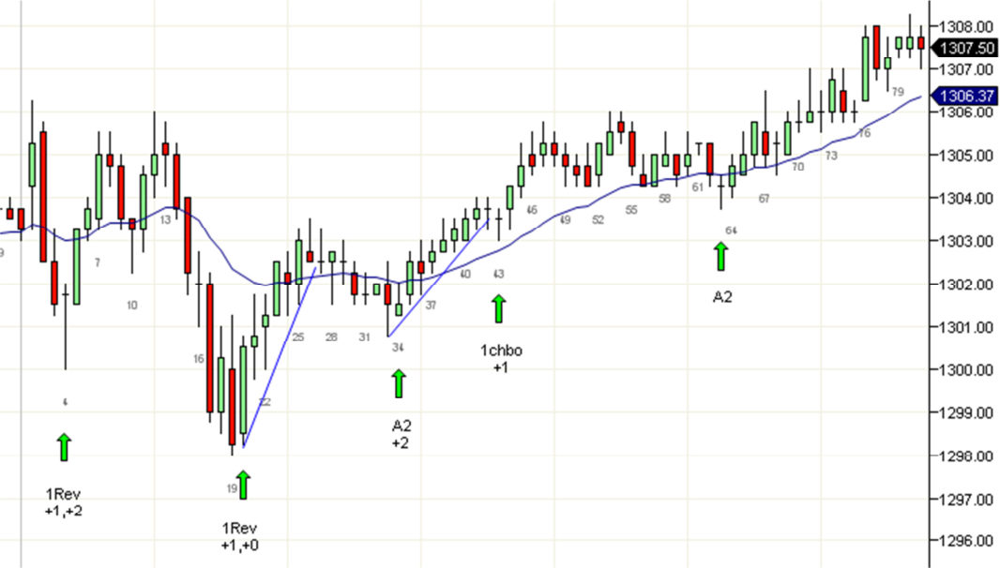

首次通道突破如果能正确识别，则是高概率的入场机会。我通常最终不会参与，因为我已经因为先前的入场而持有仓位，并且刚刚在几跳前退出了我的刮头皮仓位。除非价格行为发生显著变化，否则重新入场没有意义。

首次通道突破做多的正确入场方式是，如果价格触发到突破微趋势线的那根k线之上。因此，对于从b34 到b42, 的通道，由于k线b43跌破了前一根k线，因此在其之上入场是一个高概率的入场点。

另一方面，对于从b20 到b25, 的通道，通道被b27, 突破，但并未触发在其之上的做多。第二根跌破前一根k线的k线更有可能是2 或3 腿回撤或“barb wire”，您不应在b28之上买入。

该走势最终给出了两个失败的、极差的做空信号，在b29 和a1t ii的十字星反转和b32 的空头信号，但两者都失败了，并转变为A2 的多头。虽然技术上b32 ii是一个可能的多头信号，并且会使其成为一个A2, ，但这是一个非常差的信号，很少有交易者会抓住它。如果你抓住了这个差信号，你需要一个8 跳的资金止损（但并未触发）。

<!-- 原书第 139 页 -->

## 退出波段头寸

2011年2月7日 星期一 · 原书第 139 页

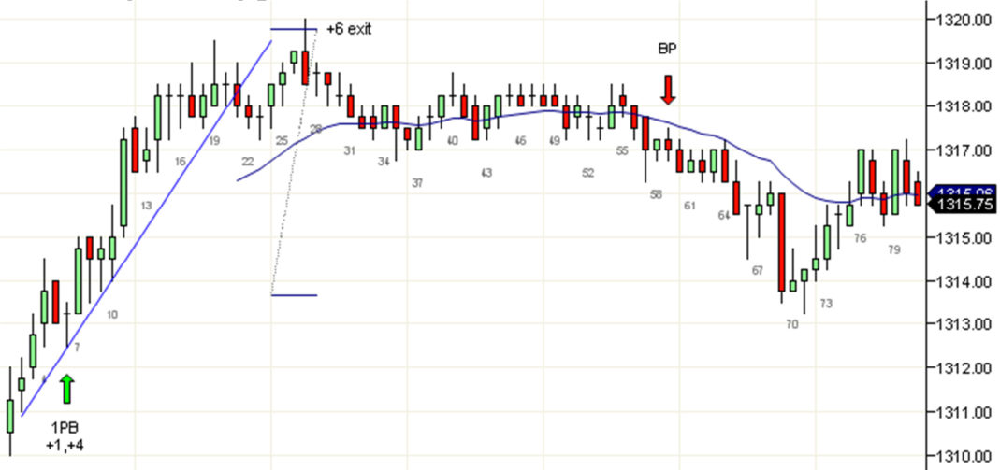

“盈利要频繁，盈利要趁早”是关于如何退出头寸的一个良好原则。你应该总是在+1, 处退出一个合约，这会让你有信心持有仓位，度过回撤到盈亏平衡或略低于盈亏平衡的阶段，因为你不会担心损失的利润或害怕一个好的交易变糟。在+4, +8 和+10 处退出其他合约，并将止损设置在前一个波动低点下方，是一种良好的实践，也是许多价格行为交易者所采用的。今天的帖子代表了九段转换中标记为“TTR”的顶部中央橙色单元格。

今天提供的低风险入场机会非常少，最早的入场点是 b1的1PB。你可以持有到日终，但市场有时会告诉你，持有到日终可能不划算。今天出现了一些不应被忽视的迹象。

健康的趋势会出现强劲的趋势实体。当它无法再做到这一点，而引线和重叠占据主导时，你应该注意趋势疲软的迹象，例如趋势线突破或高潮K线。

最早的迹象是一个可能的水平FF，从 b14 到 b16。在 b17 的突破立即失败这一事实，是一个强势退出的信号。接近一条至少已被测试过四次的趋势线的缩小的实体和增长的引线，预示着可能发生趋势线突破，这在我们向下移动到 b23时发生了。由于这是在急剧下跌后的第一次趋势线突破，测试HOD是一个高概率事件。如果你今天在 b6上方入场，你可以尝试在 1319 退出，75 给你 +6。价格以一个跳的价格突破后向下反转形成了一个反转k线。

正如我之前指出的，上涨的结束并不意味着您应该立即反转您的仓位。通常，强趋势会形成水平旗形，随后向原始趋势的方向突破。然而，有时它会像今天一样向相反方向突破，这时最正确的做法是退出并等待更多的价格行为。

<!-- 原书第 140 页 -->

## 经典A2

2011年2月8日 星期二 · 原书第 140 页

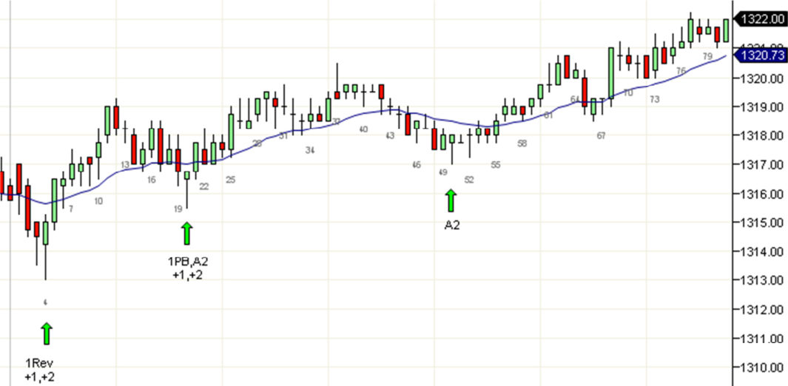

今天的帖子是关于趋势的延续，并代表了九段转换的左上角。

一个2 腿回撤，其入场点略高于或低于ema的，称为A2 （代表2腿部移动至平均线）。Brooks系统使用的ema是20 k线指数移动平均线。一个形态良好的A2 ，看起来就像b12 到b20的k线一样。该移动大部分是趋势k线，在b16 处有一个清晰的趋势线突破了回撤，并向下形成第二条腿到b20,，该k线强劲收盘。

并非所有的A2都那么清晰。有时可能很简单，就像2 失败的尝试，比如从b31 到b35的移动。b32 试图使新高失败，b35也是如此。这些k线是十字星，也就是交易区间。通常情况下，难以解读的A2不会走太远，最好错过。唯一的例外是在缓和趋势日，此时每次入场都是由重叠k线组成的A2 。

如果一个A2 不是由形态良好的k线构成，你可能希望等待一个额外的确认信号来增加其进行波段交易的机会，例如双底或G柱。例如，b50 是一个G2 柱，同时也是一个A2 多头入场点。因为G2 本身就是一个高概率交易。

<!-- 原书第 141 页 -->

## 单腿走势触及 ema

2011年2月9日 星期三 · 原书第 141 页

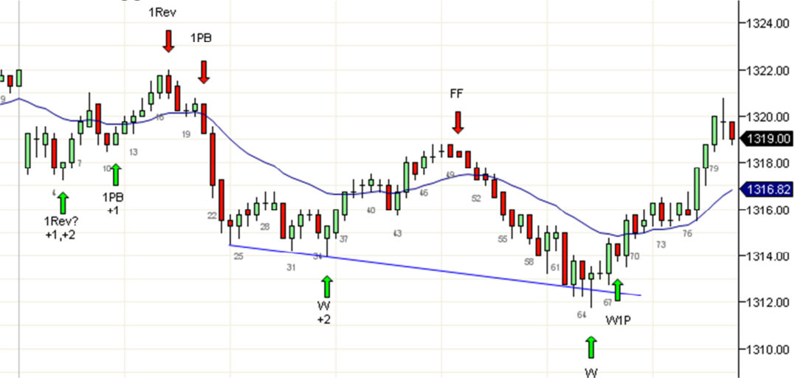

趋势结束的常见迹象，以及反转的开始，通常是一个单腿移动到ema处并收盘在其上方。今天出现了好几个这样的情况，保守的交易员可以在其首次回撤时进入新的趋势交易。

今日首次此类走势是从 b5 到 b7。如果 b5 未触及 b1, 下方，那将是一次双腿走势，因此可能是一个做空信号。同样，从 b17 到 b19 的走势是单腿的，即使它并未完全收盘于下方， apenas 一小跳也足以在回调K线 b20下方做空。

在 b35 处尾部与TCL的微小过冲重叠，使得楔形信号相当疲软，但强劲的趋势k线上的单腿走势意味着至少会有另一天上行腿，并且如果信号K线 b43 没有如此重叠，或者如果回调更深，我会选择交易而不是错过。

从末端旗形 b49 到 b52 的走势是单腿的，由光头空头K线组成。然而，首次回调是 b57 内包k线，这迫使在底部做空，风险更大。在收盘于ema下方后，任何与走势方向一致的小趋势k线都可以用作信号 K线，尤其是当它是光头K线时。

严格来说，从 b64 到 b69 的移动并非严格的单腿移动，但为了我们的目的，由于价格仅触及前一根 k 线一个跳就反转为外包阳线，您可以将其视为单腿移动。在此特定情况下，这应该无关紧要，因为强劲的过冲已经确认了反转。

<!-- 原书第 142 页 -->

## 午餐行情

2011年2月10日 星期四 · 原书第 142 页

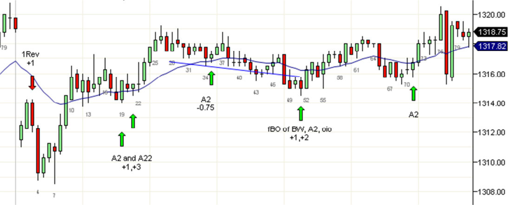

午餐时段，回撤可能复杂且旷日持久。午餐时段会出现趋势突破，但相对稀少。交易午餐时段最简单的方法是保持观望，这也是初学者的建议做法。午餐时间也充满了陷阱，以及那些看起来大胆实则无功而返的突破，因此限价交易者尤其容易受骗。看起来他们会刚好触及止损然后反转。即使是可靠的 A2，也可能像今天在 A2 的 b34处那样失败。这是因为午餐时间 k 线形成不佳，信号不足以让许多交易者入场。

即使反转每一次突破也是危险的，因为突破有时会成功，尤其是当伴随着一些突发新闻时。如果上午时段有趋势移动，只要没有过冲，你就应该假设整个午餐行情可能最多是回撤或趋势突破，并且它至少应该测试之前的波段极端。

在午餐时间结束时进入市场的正确方法是，在趋势k线突破之后，朝着其可能失败的方向入场。今天，b48 处相对较大的趋势k线出现了失败，并提供了一个做多入场点。可以持有至测试高点（ HOD）或日终，止损设在入场k线 b52下方。

<!-- 原书第 143 页 -->

## 高潮和耗竭k线

2011年2月11日 星期五 · 原书第 143 页

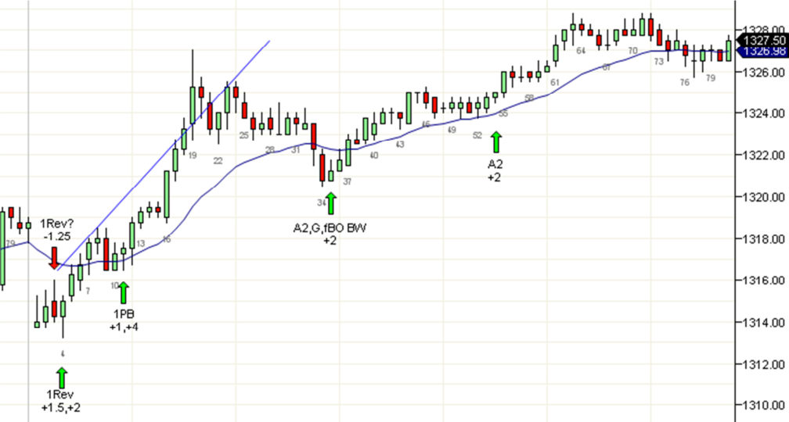

高潮k线是在延伸走势结束时，出现高成交量的大k线。真正的高潮在一次弱势回撤后，往往会演变成崩盘。今天的k线 19 由于以下原因，更像是耗竭而不是高潮：

- 这次的走势幅度很大，但并未拉升至极限。从日内低点开始的走势，远在近期平均k线规模之内。
- 在b22,23 上的回撤相当强劲。
- 在b20 和b24 上的做空信号均未出现跟进。

尽管通道过冲，但它并不是一个真正的楔形，因为就实际而言，它只有两条腿向上。所有这些都意味着延伸回调，并且价格肯定会测试并试图突破 b19。来自 b26-32 BW模式的缺口k线以及趋势k线的失效突破是正确的做多入场点。那些错过了的人也可以在 b52 或 b54 的ema上方抓住第一个 A2 。

<!-- 原书第 144 页 -->

## 弱势楔形

2011年2月14日 星期一 · 原书第 144 页

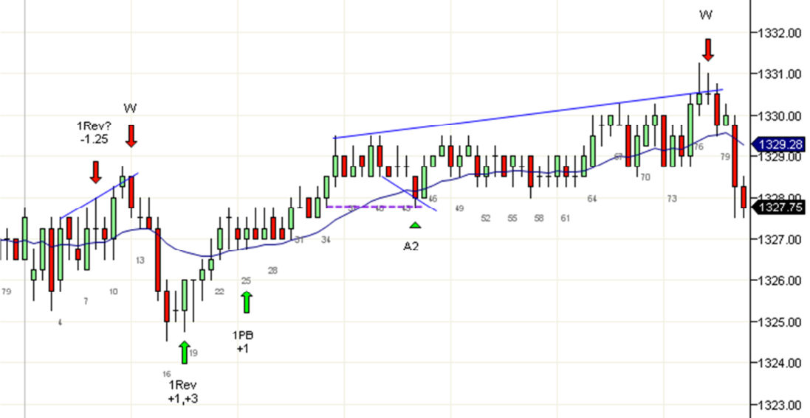

窄区间日通常有重叠k线和一两个弱势楔形。其中一些楔形是陷阱，另一些会回调几个点，但实际上可能不会导致反转。原因是楔形需要是极端走势，并且有一个清晰的信号k线供顺势交易者换边。

今天我们开盘后有一个 W4,8,11 ，但实际上并没有出现反转k线。最接近的可读入场点是 W1P，在 b14, ，但即使是那个点也有些冒险。开盘时的强烈重叠将起到磁铁的作用，将价格拉回，所以充其量只能是刮头皮交易。

有一个可能的 W23,31,35 ，它给出了一个从未触发的内包k线信号。这通常表明交易者不愿意做空，因此，更多的是上涨。正确的做法是做多一个 2L PB 到 ema，可能在限价 b44 左右。

第三个 W35,67,76 给出了一个更好的信号，该信号有一个强劲的入场k线，而 b79 的 W1P 是一个好的入场点，可以用于波段交易，如果不是在日终的话。弱势楔形也出现在回撤中，它们通常是趋势入场的绝佳机会。例如，W48,51,57 可能是一个弱势 W回撤，并且在下一个多头K线上方买入是可以接受的，只要你能接受在回撤中持有，因为你的信号k线有大量的重叠。

总而言之，交易楔形形态的诀窍和其他任何信号的交易一样。当信号清晰且强劲时，就顺势而为。否则，就逆势交易。

<!-- 原书第 145 页 -->

## 管理走向不好的交易

2011年2月16日 星期三 · 原书第 145 页

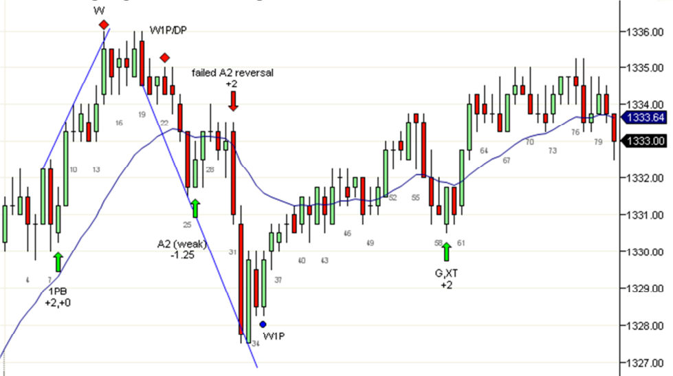

有时我们对市场的解读不正确，或者在大行情中，在正确识别形态之前就下单了。有时我们因为不良习惯而进行交易，或者我们进入的交易就是失败的。交易进场后如何管理你的交易，对你的交易成功起着至关重要的作用。理想情况是很少进行糟糕的交易。一个简单的方法是，永远不要在重叠区上方做多或下方做空，尤其是在BW（Black/White，黑白K线）的情况下。在b16, 十字星k线上方买入或b26 上方买入或b58 下方卖出的人都亏损了。第二个规则是，如果你的信号k线在入场侧有大引线，通常最好等待第二个信号。另外要避免大的内包k线，因为它们经常充当交易区间。最好的也是第一种选择是，如果你的入场k线除了趋势k线之外，就以小幅盈利或盈亏平衡的价格退出，从而持平交易。下一个选择是将你的止损移至入场k线下方，无论它看起来多么糟糕，让市场将你剔除。另一种选择是跟踪你入场点5t，让市场将你剔除。

如果你选择的入场点正确，你的入场k线应该是一根好的长趋势k线，并且有小的引线。我选择的建仓形态通常有这样的入场k线，如果它们看起来像其他任何样子，我就会考虑退出。例如，b9, b20 和b61。一根只有一根小引线的k线是可以接受的，只要收盘价强劲，例如b20 和b36。

任何带有较大引线的k线都意味着更高的失败风险，例如b27, b70。至少，在较小的目标位退出大部分仓位。

收盘价为十字星的k线，或者收盘价与你的仓位方向相反的k线，很有可能意味着失效，可能在你方向上还会有一点点 movement，例如b5, b17, b22, b64 等等。你应该立即退出并考虑反转你的仓位。

我的标准交易 A2, W1P、DP 和 fBO 止损不应超过 4t 或 5t，通常可达 +2。一旦您的刮头皮交易 +1 已成交，应立即将止损移至盈亏平衡。之后，您可以在每个 HL 或 LH 后移动止损。另一种选择是将其拖trailing 5t，让市场将您移出。如果您这样交易，您的最大亏损为 4t/交易（或第一小时 5t）。您的预期收益约为 6t 平均值（+1 和 +2/+0）。这种从 4t 目标和 6t 止损到 6t 目标和 4t 止损的转换意味着您的准确率只需略高于 50% 即可，而不是盈亏平衡所需的 70%。

<!-- 原书第 146 页 -->

## 楔形反转和 W1P

2011年2月23日 星期三 · 原书第 146 页

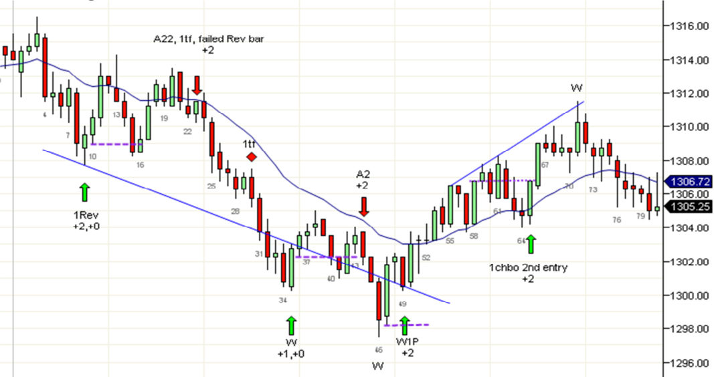

我几乎每次都选择 W1P，而只在信号k线形成得非常好时才选择楔形，原因是我对反转的强度和可持续性有更多信息。今天的入场形成了九段转换的左下角和右下角。例如，b9 可能是一个可能的 W （由于昨天最后k 线和今天开盘价k 线之间没有缺口，我们可以将其视为延续）。然而，到 b 16, 出现可能的 W1P 时，我们已经有很多线索表明这次反转尝试将会失败：

- 信号k线较弱，因为其大小小于近期的k线，并且顶部有一个2t引线。
- 一个光头入场k线或至少在一侧带有1t的入场k线会加强楔形。 b10 两边都有2t。
- 一个形态良好的楔形1P不应该在入场k线下方跳动超过1t b10。价格在其下方收盘，伴随一次强趋势移动。

这种楔形1P通常会产生刮头皮交易信号，但不建议用于波段交易。另一个类似的楔形出现在 b35。这有几个原因导致其较弱。

- b点的向下/向上反转34,35 可能是一个交易区间，其上方可能存在卖家。最好在2次入场或在2 腿回撤（2L W1P）后入场。
- 入场k线与近期k线相比很小
- 收盘价较入场k线低几个跳

b46 处的 W 却是极端行为的非常明显的标志，尽管它不是多头实体，但它有一个强烈的入场k线。下跌/上涨k线的大小必须相当，并且不应提供远超两条k线之外的入场点，才能成为上涨/下跌或下跌/上涨信号。因此，b29,21 例如是一个好的上涨/下跌信号，但 b47 是一个入场k线。回调K 线 b49 或内包k线 b51 可以作为 W1P 买入。W1P 往往会一直移动，直到它们的趋势在另一个 W 处终止，或者直到下降趋势到 W 的首次回撤。因此，例如，如果 W 从 b3, 开始，那么你可以预期 W1P 会移动到 b13 高点。有时它们会以 W 结束，就像我们今天在 b71处所做的那样。

<!-- 原书第 147 页 -->

## 内包k线

2011年2月24日 星期四 · 原书第 147 页

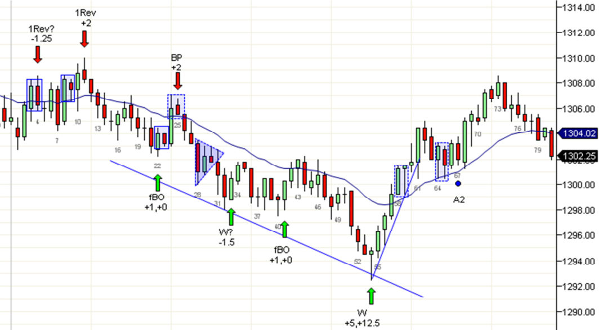

我经常提到外包k线是如何形成交易区间的，你应该始终关注失败或在突破后进行第二次入场。内包k线形成一个重叠区域，因此就像一个小交易区间。通常内包k线只应作为顺趋势入场。内包k线的反趋势突破很可能会失败并套住你，就像 b9的下行突破那样。

当一根k线的实体位于前一根k线实体之内时，如b4, 所示，它通常被视为一根内包k线，即使它略微（但不是很多）突破了前一根k线。

一些向下/向上反转形态，如果其幅度不可比，则实际上可以视为内包k线，如b33所示。它们的突破也可能失败。

如果内包k线是一根大型k线末端的一根小型趋势k线，那么基于内包k线交易的成功几率会更高。在这些情况下，你可以交易内包k线的突破，而不必担心从外包k线入场，如b25 和b35所示。

当内包k线的两根k线颜色相同时，可以将其视为一次回撤，并顺着趋势入场，如b59所示。双底在ema处也是另一个可接受的入场点，如b65所示。

内包-内包k线，如b30 所示，比单一内包k线有更高的成功率，尤其是在趋势中。在这种情况下，它起到突破回撤交易的作用。

总而言之，内包k线最好在趋势中入场，或逆势交易大k线。将内包k线视为基本的回撤，会更容易理解。如果您不相信趋势已经反转，可以限制您的入场，选择更高概率的交易。

<!-- 原书第 148 页 -->

## 预期回撤

2011年2月25日 星期五 · 原书第 148 页

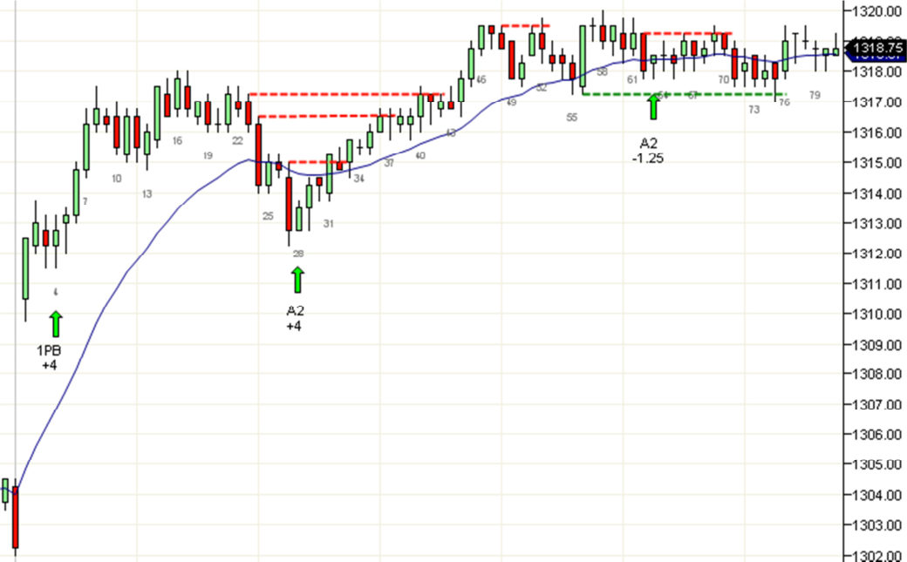

知道在哪里可以预期回撤有两个好处。一是您可以选择减轻您的持有量并获得一些利润。二是如果您错过了最初的入场，您可以在回撤时加仓或晚些入场。

当价格突破熊市趋势k线的高点或突破牛市趋势k线的低点时，它可能会略有回撤。原因很简单。最初在那里进场的交易者愿意再次进场。另一种看待方式是，当价格从熊市转向牛市时，整个回撤就像一个交易区间，而趋势k线则像是迷你交易区间。它们的交易方式类似，你可以选择做空其突破，或者根据失效信号的好坏程度，在突破回撤时做多。

例如，b32, 出现了一个糟糕的1跳十字星信号，实际上它是一个内包k线。下方的卖家被套住，价格上涨。激进交易者会在此k线低点做多，止损设在b31下方或2t下方1 。

这对于入场k线尤其如此，因为交易者喜欢在原始价格处加仓。例如，b75 在糟糕的空头信号和激进交易者的做多信号下，击穿了入场k线b56 的低点，并在b44, 另一条入场k线下方设置止损。

总的来说，这种方法最适合顺势进入，就像今天上半场那样，或者在交易区间突破时进行反转，就像下半场那样。

<!-- 原书第 149 页 -->

## 首次回撤后的乏力表现可能预示首次反转即将到来

2011年2月28日 星期一 · 原书第 149 页

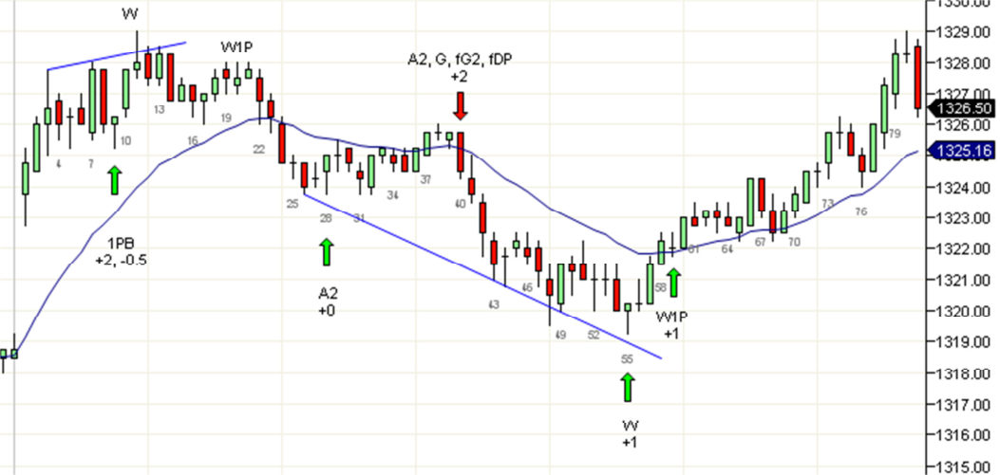

第一次回撤，尤其是深度回撤，通常是你进行波段交易的最佳选择，因为届时所有错过早期走势的交易者都会加入进来。首次反转后的首次回撤通常是最好的，因为最初的走势为交易者提供了更好的入场价格。

今天的首次回撤在 b9 突破了前期波动高点，但突破k线疲软且越过了趋势通道线。通常，这只意味着一次 2 或 3 腿的回撤，有时第二腿在ema附近止步并形成一个缺口k线。然而，如果它跌破入场k线一个跳以上，特别是第二次（b17,b22），则很有可能你错过了首次反转。你应该始终退出你的波段交易部分，并寻找入场做空。

疲软的A2 入场k线在 b29 进一步证实了即将到来的疲软，并且 b40 提供了稍晚的空头入场。首次回撤如果没有首次反转，甚至在首次反转之后，通常都是可逆转的交易。首次回撤的理念是，此时每个人都已认识到方向已经改变，并希望进入新方向。这种变动必须清晰且强劲。任何疲软都表明你判断失误，应考虑退出。

---

[← 上一章](09-2011年1月.md) · [目录](00-目录.md) · [下一章 →](11-2011年3月.md)
