[← 上一章](10-2011年2月.md) · [目录](00-目录.md) · [下一章 →](12-2011年4月.md)

# 2011年3月

原书第 150–172 页

<!-- 原书第 150 页 -->

## 交易中要结合趋势类型来考虑

2011年3月1日 星期二 · 原书第 150 页

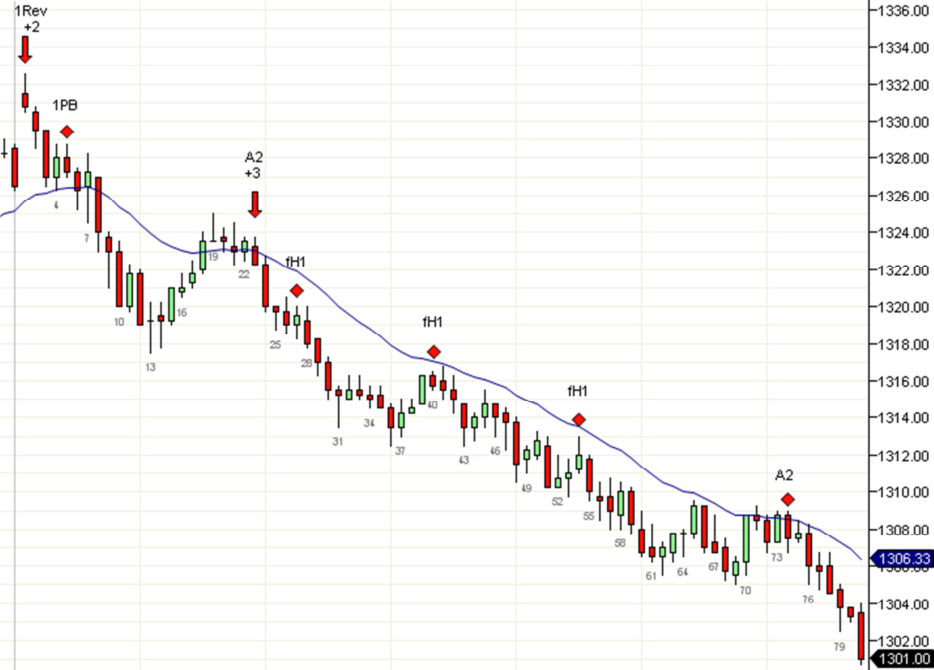

趋势有三种主要类型。最常见的是弹性趋势，它根据买卖压力来回摆动。大多数交易者期望每天都如此，并在另外两种日类型中遭受重大损失。第二种趋势是缓和趋势，它本质上维持缓慢的爬升（通常是向上），只回撤一两个跳（tick）就回到前一根k线之下。基于任何标准建仓形态做空这类日线，几乎等于在每六根k线左右就让你的账户亏损。第三种趋势是强势趋势日，它毫不留情地移动（通常是向下）。虽然有上涨，但没有一个值得交易，因为它们会让你偏离真正应该做的事情：等待顺势移动并一直持有到日终或高潮。在最开始的两三根k线内，你就应该已经知道这是一个强势趋势日。在强势趋势日，只有一条规则：没有逆趋势交易。是的，从b15 到b19 的变动很好，但那是例外。今天大多数逆势交易都亏损了，而几乎所有顺势交易都成功了。强势趋势的另一个有趣特征是，过冲需要非常深才能产生回撤。只有伴随巨大高潮k线的令人厌恶的过冲才能终止趋势。强势趋势日需要在进入交易区间之前破位，然后才能继续或反转。在许多日子里，比如今天，它们会一直向下推动直到日终。从正常或弹性趋势的角度来看，入场点非常少。今天我们在第 1 根k线出现了第 1 次反转。如果你观察k线形成，你会看到它在最初几秒内上涨了 4 个跳（tick），然后一直下跌。一根出现于急剧向上过冲且位于缺口上方的反转k线是任何交易员都应该抓住的信号。b5 是第 1 次回撤，如果不是因为即将到来的消息（通常会触及止损），那将是当天最好的波段入场点。如果你错过了，在b23, 出现了A2 ，这也是一个不错的波段入场点。整个午餐行情中，在强势趋势中只出现了失败的H1，你可以做空任何没有大引线的k线的回撤。这需要一些练习才能做到，我经常会放过它们。在b75 的最后一次A2 获得了 6 点。在强势趋势日，永远不会太晚以顺势入场。

<!-- 原书第 151 页 -->

## 楔形（不带过冲、反转k线或回撤）

2011年3月2日 星期三 · 原书第 151 页

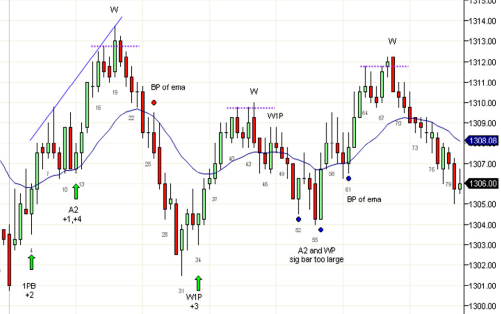

理想的楔形会在第三次或第四次推送时出现明显的过冲，并以一个清晰的反转k线结束。反转k线的入场k线是一根强劲的趋势k线。一次弱的回撤会形成一个W1P，让您入场参与现已反转的趋势。

在趋势日，您很可能会看到这样的反转。但在交易区间日，您可能会遇到大的波动，这些波动最好被视为每个方向的2 腿。今天没有一次第三次推送导致明显的过冲，也没有完全以反转k线结束，令人惊讶的是，在没有任何回撤的情况下，价格一路下跌。在这样的日子里，您可以放弃楔形交易，只需等待下一个建仓形态，或者如果您是一位激进交易者，可以将第三次推送交易为W，前提是它是一个失效的突破。

失效突破的理念是，突破交易者在前期波动高点上方做多，不应该能够获得刮头皮利润。你需要一个触发并失效的第一次入场，如 b18,b42,b65 ，然后第二次入场非常接近前期信号。如果第二次信号k线有很多重叠，如 b44, ，那么你最好等待回撤到入场k线上方，然后采取下一个信号。像这样的交易的一个非常重要的要求是新方向的前期强势。需要在昨天后半段或当天早些时候出现强劲走势，才能以这种方式入场，否则你可能会发现自己在强劲日里做空一系列 H1。

<!-- 原书第 152 页 -->

## 趋势终止和突破

2011年3月4日 星期五 · 原书第 152 页

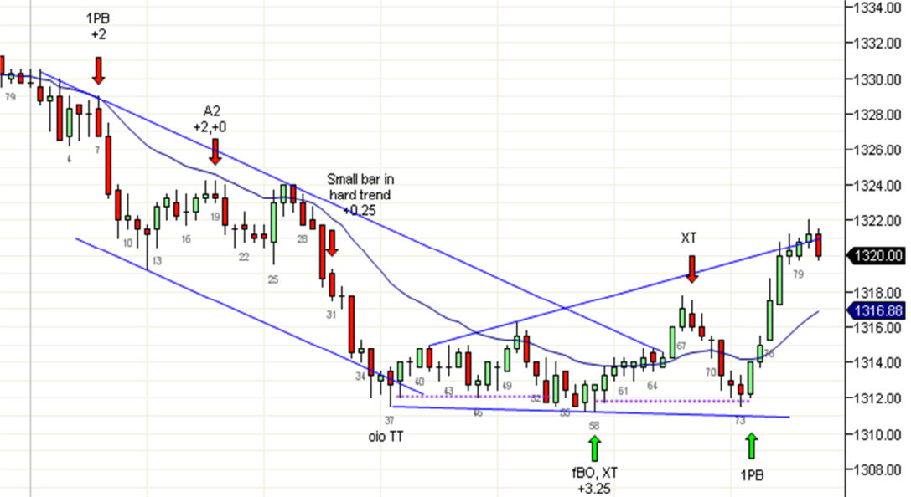

今天的帖子讨论的是九段转换的第二行。

实时中最容易识别的形态是延续，而最难识别的形态是突破，这有很多原因。最明显的原因是大多数延续都会成功，而大多数突破都会失败。突破可能会在最终成功之前失败多次，就像今天一样。

在你能识别突破之前，你需要能够检测到趋势何时终止进入交易区间。最简单也最容易的方法是查看最近的两个高点和低点。如果它们是横盘的，那么趋势就结束了。趋势终止（TT）通常带有微弱的反转信号，很多人不会选择，比如在b35-37 处疲软的oio反转，并给出一个微弱的延续信号，比如在b44 处疲软的多头K线A2 short，很少有人选择。趋势也可以终止于TTRs，或者最终突破趋势线。尽管在b66, 处突破了趋势线，但交易员应该已经预期到在b37 处疲软的oio处趋势会终止，并通过在b44 处的疲软的A2 以及在b57处的双腿失效突破得到确认。

扩张三角形（XT）突破相对而言是最容易识别和交易的。扩张三角形就是一系列的突破，每一次都在趋势失败后扩大区间。趋势终止后的交易区间始于反转或高潮形态本身（从b35高点到b37 低点），每一次移动都只是扩大区间的尝试。一旦该形态的两端都被突破，您就可以进行交易，并期望其向另一端移动，直到出现多头突破的HH和HL，或者空头突破到趋势中的LH和LL。请注意，无论先前趋势的方向如何，突破都可能是向上或向下。HL或LH通常会是双腿走势，而今天的十字星k线b70 分隔了这两条下行腿。

这个点是新趋势中的首次回撤，也是该趋势剩余部分的最佳波段入场点。

<!-- 原书第 153 页 -->

## oio反转和失效

2011年3月7日 星期一 · 原书第 153 页

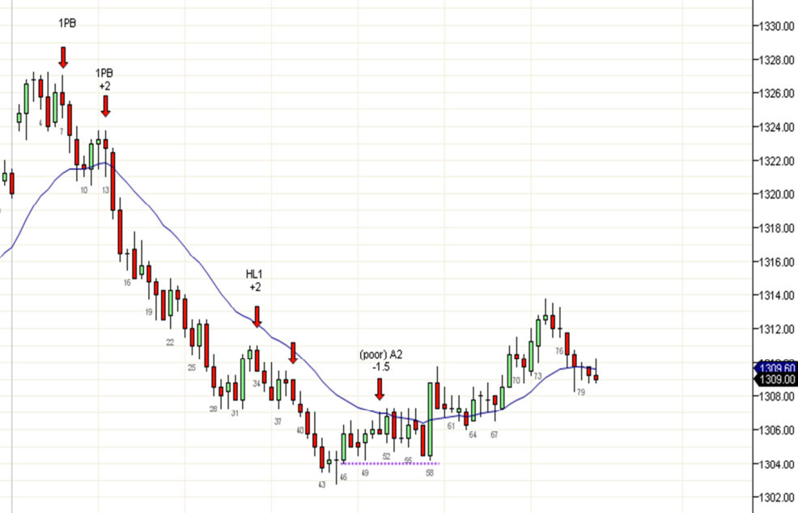

我经常谈论外包k线是如何成为交易区间，并且常常是逆势交易候选。我也提到了oio反转。你如何区分合法的oio反转和普通的交易区间k线？

有几个因素可能使oio成功。例如，前期强势、过冲、两根外包k线长度相当，但最重要的因素是入场k线的大小及其低点在回撤中保持不破。

当后一根外包k线很大时，止损也过大，因此许多做多者不会入场，而那些入场者会使用4t或6t等各种资金止损，换句话说，这些做多者是弱势的。如果入场k线是弱势的，并且其低点被突破（如b13 所示），或者在其低点之外给出做空信号（如b34, 所示），那么这是一个高概率空头。

如果入场k线是一根强劲的趋势k线（如b46 所示），并且其低点在多次尝试后都未能被跌破，那么趋势将终止。一个糟糕的反转信号b45 ，随后紧跟着一个糟糕的持续信号b51 ，是趋势终止的迹象，此时应该寻找突破进入新趋势的机会。

但在趋势终结之前，oio失效可能是你进入强势趋势移动的最佳选择，因为它们提供的后期进入机会很少，如果你错过了 b1或 b7 处的 13PB入场点。

<!-- 原书第 154 页 -->

## The obvious first reversal

2011年3月8日 星期二 · 原书第 154 页

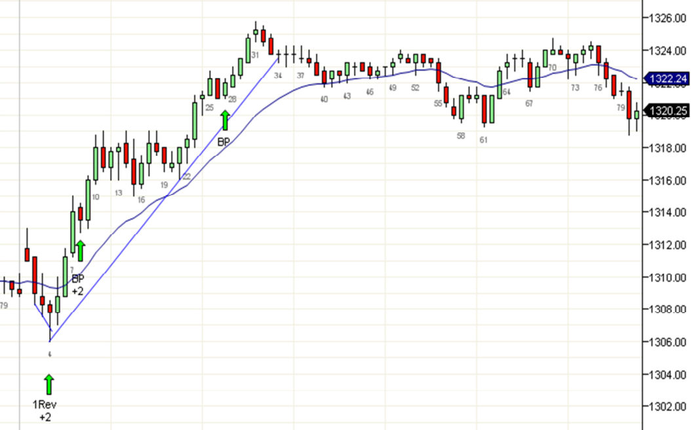

那些开盘价k线移动了 3 点或更多点，并在趋势通道被破坏后出现反转k线，该反转k线至少有 2 的实体（无论颜色如何）的日线，是清晰明显的首次反转，应该被抓住。如果反转k线的大小与前一根k线差不多，则会增加反转成功的几率。即使这些日线没有前期强势，只要有一些强势的迹象，例如前期尝试向上（缺口）或昨天的强势，就可以被抓住。

如果另一方面，第一根或两根 k线很大，这可能是一个交易区间，你应该寻找一个扩张三角形突破进入趋势。当由于多根大 k线而感到不确定时，如果一个方向的第二次尝试失败，你可以在相反方向进行交易。如果没有明确的信号，请等待突破，然后进行首次回撤。

明确的首次反转很可能会吸引大量交易者，您可以期待新方向的强劲趋势。较弱的首次反转可能在首次回撤后不久就夭折。因此，在大多数日子里，首次回撤更容易判断且更安全入场，您可以完全避开首次反转。

<!-- 原书第 155 页 -->

## The poor first reversal and triangle open

2011年3月9日 星期三 · 原书第 155 页

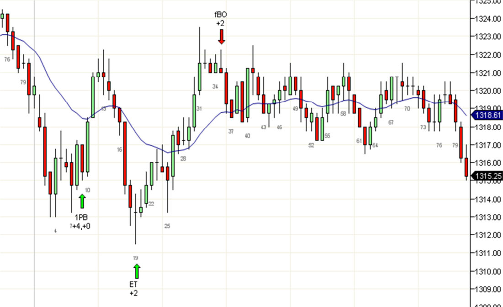

当某一日的开盘价正好在前一天的中间区域时，价格会在阻力和支撑之间震荡，通常会导致交易区间日。在这样的日子里，如果波动幅度较大（例如 6+ 点），那么捕捉每一次反转都是可行的。

通常，价格在创出每一个新高低点时会形成一个扩张三角形。偶尔，像今天一样，我们会看到一个三角形突破。两个更低的高点夹着两个更高的低点形成一个三角形，就像我们在开盘时一样， b4,5,7,8,9 进入趋势的三角形突破通常会失败，并转变为扩张三角形突破，就像我们今天看到的那样，但如果开盘时出现比前一天大幅跳空上涨或下跌，则可能导致失控趋势。

当首次反转不清晰时，例如在 b3 由于空头收盘、与前一根 k线相比反转 k线较小以及未出现对 TCL 的过冲，价格在突破第一根 k线后通常会失败，就像我们今天在 b13 处所做的那样。

一旦我们获得了一个糟糕的 A2 多头，b40 但无人参与，那么趋势基本上就结束了，最好的做法是等待突破。b78 一个迟来的 DP 突破可能已经开始了一个迟来的下跌趋势，该趋势可能在明天继续。

<!-- 原书第 156 页 -->

## 失效的突破

2011年3月10日 星期四 · 原书第 156 页

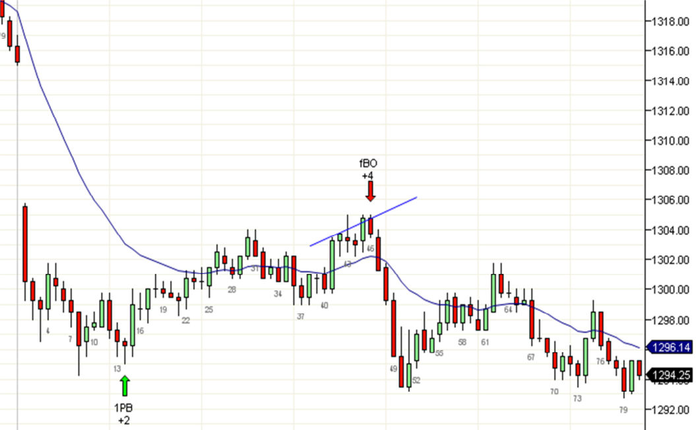

今天的入场代表了九段转换的中心方块。交易失效突破的诀窍是仅在交易区间内进行交易，并且当您的交易方向已证明有先前强度时。试图在趋势中交易 fBO 是灾难性的，请先等待过冲或趋势线突破。

今天的开盘价k线很大，任何大k线（3+ 点，平均k线约为2 点）和开盘价附近的大k线都是交易区间，无论开盘缺口大小。由于b1 是一个交易区间，因此可以作为交易区间进行交易。你可以通过在b5 下方做空来卖出b1 的突破回撤，或者在第二次尝试突破失败时做多b14 。请注意，如果我们没有b4 和b11, 的强度，这将是一个低概率交易。

向b43 的移动可以看作是从b14 到b31, 的趋势移动，其趋势线在向b37 的移动中被突破，并且是一个向名义上的更高高点移动。这是趋势终止和可能的反转。b46 是继b44 之后第二次尝试突破失败，因此是一个高概率交易。如果信号k线形成得非常好，例如是过冲的反转k线，则可以进行第一次尝试。否则，一个形成不佳的第一次尝试很可能会失败，并可能导致你止损。简单地看一下今天的走势就会说明只接受形成良好的信号k线的重要性。b16,20,24,27 下方的空头全部失效，因为它们本质上是十字星k线。b31,b46 和b63 下方的空头表现好得多，因为它们是趋势k线。第一小时和第二次尝试可以容忍较低的k线质量，如b14 和b73所示。

总而言之，要正确交易失效的突破，您至少需要具备前期强势、一个绝佳的信号k线、过冲和2次入场这四个条件中的两个。

<!-- 原书第 157 页 -->

## 三角形突破

2011年3月11日 星期五 · 原书第 157 页

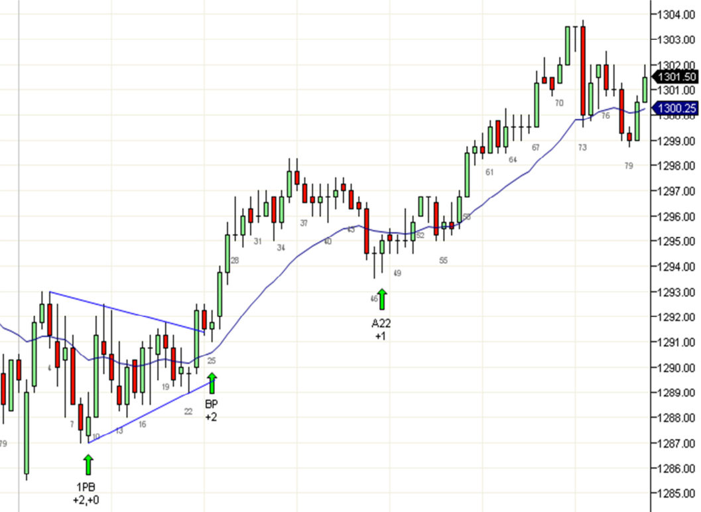

三角形整理很容易识别，例如从b4 到b22 的明显整理，但其突破难以预测。尽管它们可能向任何方向突破，但k线的相对强度通常会指示突破方向。今天这种制造上涨走势的强劲趋势k线和制造下跌走势的带引线k线通常意味着向上突破。

三角形突破会导致非常强烈的趋势，您应该始终抓住它们，尤其是当您收到诸如 b25 这样的突破回撤信号时。

交易三角形最大的风险是它们经常会变成扩张三角形。也就是说，在 b26, 处突破后，它很容易跌破 b9 然后再次回升。这就是为什么你总要在三角形的强力突破时获利一部分。如果回撤不够强劲，不足以变成扩张三角形，通常会发生 A2 在 b46 处的 2 腿回撤。如果回撤很深，这通常是一笔极好的交易，因为那些错过突破的人会和你一起入场。

<!-- 原书第 158 页 -->

## 突破回撤 vs 失效的突破。

2011年3月14日 星期一 · 原书第 158 页

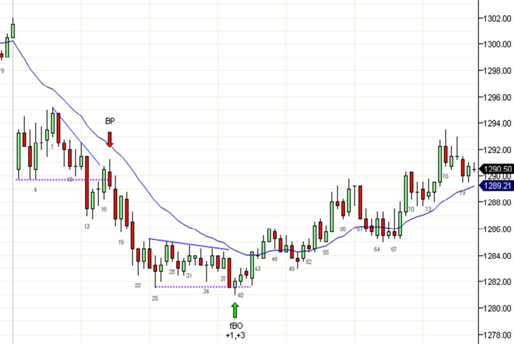

当出现突破时，你需要决定是交易突破的失败 (fBO) 还是交易突破回撤 (BP)，这本质上是 fBO 的失败。

一般来说，有几个指导方针可以帮助你做出决定。如果突破k线是一根强劲的趋势k线，并且已经脱离先前区间（或TL或ema）的一半，例如b13,，那么很有可能你会获得一个突破回撤入场，这将至少带你到先前区间的测量移动。如果突破k线很大（例如3+ 点），你应该始终等待回撤后再进入。第二条线索是盛行趋势的强度。如果看起来有任何形式的陡峭趋势线，那么突破很可能成功。如果趋势线非常浅，则不利于突破的成功。

如果突破k线较小（1 至2 点），且收盘价缩短，你可以在收盘价处或一个跳价后入场。如果突破与先前的 \,\text{ema} 相反，并且收盘价超过了 \, \text{ema}，则尤其如此。

如果突破k线是中等大小（2 到3 点）或者收盘带有引线，则等待突破失败。如果两次尝试突破失败都不成功，您可以朝原始突破的方向进入。

弱突破k线通常会导致失效的突破，特别是第二次尝试时，其效果就像b42处的外包k线。请注意，要交易与先前趋势相反的方向，先前的趋势应该已经终止（通过TTR、过冲或趋势线突破）。

<!-- 原书第 159 页 -->

## 宽幅震荡日

2011年3月15日 星期二 · 原书第 159 页

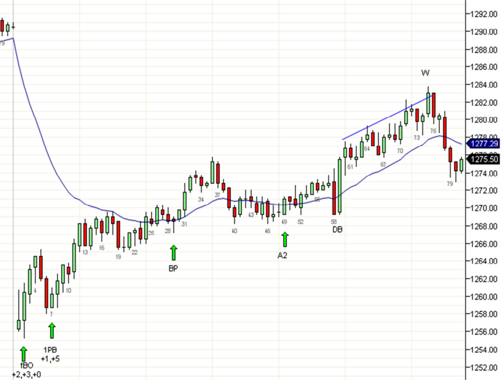

在下跌走势中，首次出现巨大的跳空下跌时，很有可能被买入并转变为上涨日。下跌走势会带来大范围日，交易者需要对这些交易格外小心，特别是最初的几根k线。一种选择是交易较短时间周期，但你需要更灵活，并且你的失败率可能会更高。第二种选择是交易更少的合约，这通常对于已经进行小规模交易的交易者来说不是一个选项。因此，最好的选择是只在小k线上进场，即使在大交易日中，你最终也会得到这样的设置。当开盘时出现强趋势移动时，你应该始终抓住第一次回撤并持有，直到遇到趋势终止的迹象。如果你因为几根大k线而获利，可以退出并等待下一次交易或结束你的交易时段。

在FOMC交易日，最好等待突破k线并顺应其失败。今天我们有一个强劲k线b58 ，其低点并未被触发，价格突破了交易区间。b62 处的一个突破回撤多头交易b36 给出了b58和b{v5}之间的交易区间的测量移动。

交易者如果在急速加通道的第 3 次推动时持有到日终或卖出，可以获利 30 点左右，这种情况在下跌走势的宽幅震荡日中经常可以看到。

<!-- 原书第 160 页 -->

## 交易强空头日

2011年3月16日 星期三 · 原书第 160 页

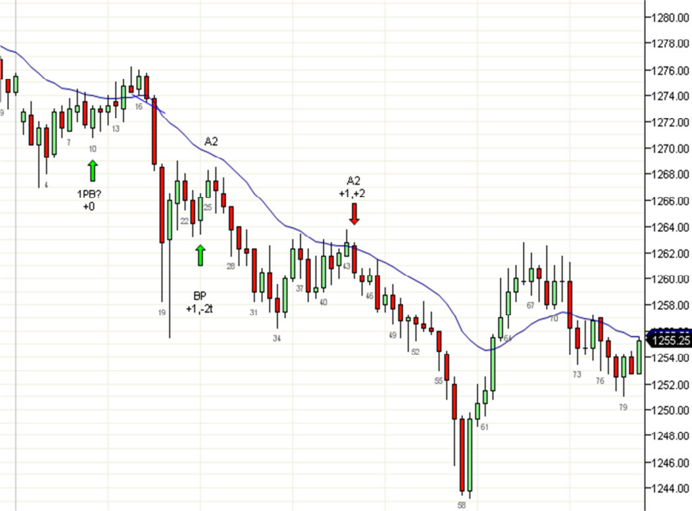

交易强劲的空头日是交易员可能遇到的最困难的事情之一，原因有很多。主要挑战在于价格变动非常迅速，回撤同样剧烈。在 k线中部或大 k线下方做空极其危险，因为在 b19 和 b58 低点附近的卖家得到了惨痛的教训。请注意，在 b58 之前，还有 3 根其他 k线本来可以被认为是大的，但在与 b58 和 59 附近巨大的 k线相比之下，它们看起来很小。

当这些日子出现k线时，它们会大幅波动，通常会触及你的止损位，因此更好的策略是进行更长的刮头皮交易并使用稍大的止损。当趋势在进行中时，可以使用MTL突破来顺势入场。几乎每一根下跌走势中的k线后面都有一个底部引线或一个内包k线。这些是剧烈的盘中回撤，使得波段头寸难以入场，迫使交易员刮头皮一两点并寻找下一个入场点。

<!-- 原书第 161 页 -->

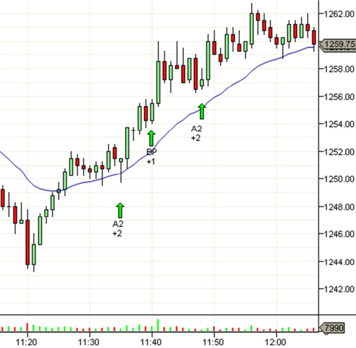

如果您是敏捷交易员，您可能更倾向于交易像 1 分钟图这样更快的图表。K线内波动和急剧的回撤会形成常规模样的信号，可以用来进行更多交易。跳图和区间图也可以使用，但这类图表的价格行为略有不同，没有大量练习，您不会在这样的日子里进行交易。

<!-- 原书第 162 页 -->

## 双顶和双底

2011年3月17日 星期四 · 原书第 162 页

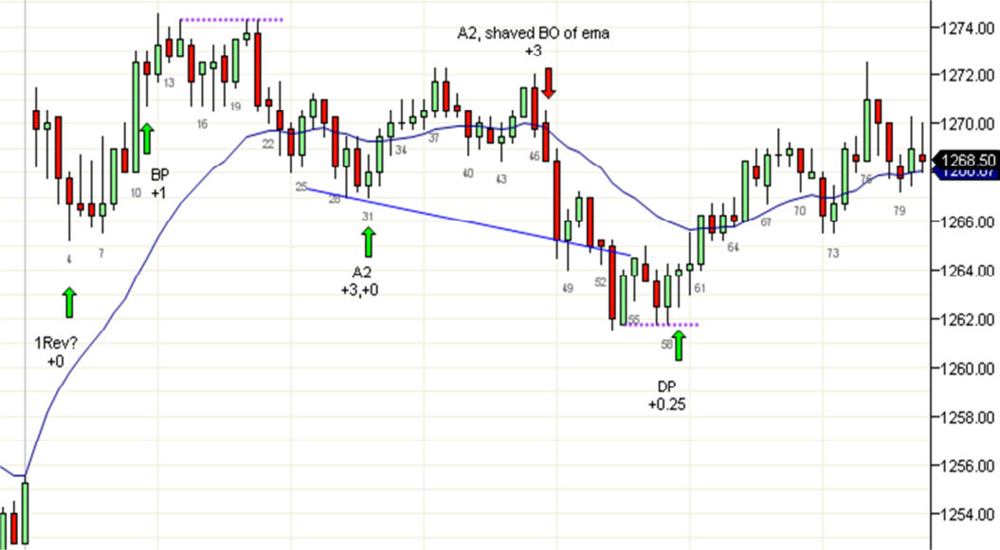

双顶和双底是重要的趋势终结者，也是最容易识别的。一旦价格形成趋势终结者，就完成了从趋势到交易区间的转变，您不应再考虑趋势延续，而应考虑趋势突破。在趋势日中，通常最多只会有一个。交易区间日可能有两个甚至三个。

形成双顶或双底的k线对趋势通道线的任何过冲都会增加深度回撤和宽幅交易区间的可能性，从而可能从双顶或双底进行交易。

在交易区间日，任何一个腿部移动到交易区间的另一端都可以像A2 （b31 和b46）一样进行交易，即使它们严格来说不是趋势延续。一旦趋势在一个方向上终止，下一次突破可能发生在任何方向，因此如果腿部移动形成得足够好，最好进入每一个腿部移动。

任何向上回撤至形成双顶/双底K线一半位置的回撤收盘都可以视为一个DP信号并做空以进行波段交易。像 b59 这样的内包k线在双底或双顶之后充当回撤，因此您可以将其视为DP信号。

<!-- 原书第 163 页 -->

## 多头K线之上做多，空头K线之下做空

2011年3月18日 星期五 · 原书第 163 页

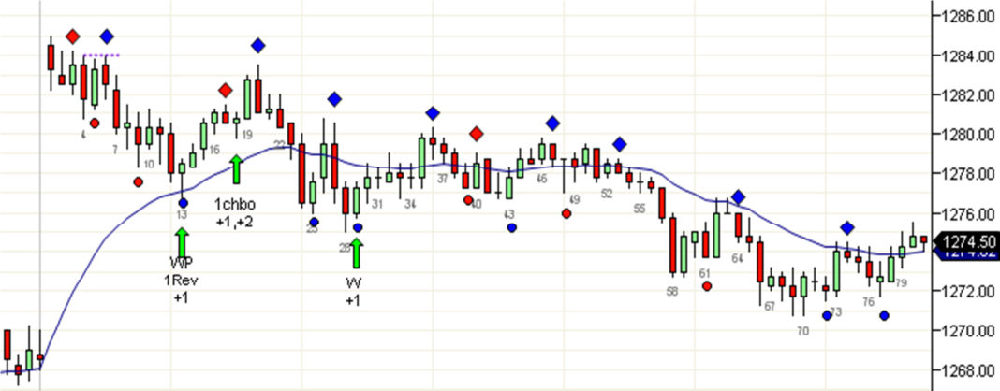

在多头K线上方做多，在空头K线下方做空，并避开任何其他K线，是价格行为交易的关键组成部分。如果你过于急切，在边缘K线上入场，你的成功率将会降低。

如果你在上升趋势之后仅做空空头K线，或在下降趋势之后仅做多多头K线并持有至少一点，你大多数日子里都能赚钱。当然，在弱势趋势日或强势趋势日，你不会想这样做，但在其他 80% 的日子里，这应该会让你在一天结束时盈利。

在上图表中，成功的买入由蓝色圆点表示，失败的买入由红色圆点表示。蓝色菱形表示成功的做空，红色菱形表示失败的做空。

例如，尽管今天整体是空头日，但唯一在多头K线之上买入失败的K线是内包k线 b5 和 b70。根据价格行为原则，这些不是买入信号，你不会买入。同样，唯一会失败的空头K线是内包K线变体 b17, ，你不会做空。

如果您仅在非内包多头K线处做多，可获得 1 点收益，您将有 +5 。在波段交易的非内包空头K线处做空，将为您带来额外的 +8 。

只是不要忘记内包k线和十字星排除规则。虽然它们有时会奏效，但知道何时适合交易这些例外情况需要相当多的经验。

<!-- 原书第 164 页 -->

## TTR 趋势终止

2011年3月21日 星期一 · 原书第 164 页

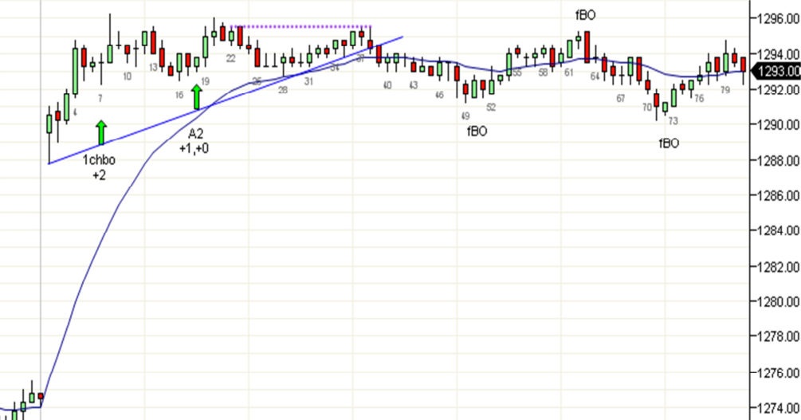

在大幅上涨（包括大缺口）之后，趋势可能演变为 TTR 趋势终止。一个在回撤后向上倾斜的 TTR 经常会形成双顶或名义上的高点或高点。另一方面，如果一个 TTR 从当日高点向下倾斜，那么它可能会在当日高点附近形成一个双腿或三腿的移动，然后向下移动。

当我们在一天早些时候看到接近 b6 时，这通常是 TTRs 和弱势趋势的早期迹象，应该非常谨慎地进行交易。一旦 TTR 终止了趋势，下一步就是等待趋势突破，例如扩张三角形或 DP。只要区间足够大，任何双腿走势都可以交易。今天区间勉强达到 5 或六个点，因此您将承担约 2 点的风险，而实际收益却只有 2 点或更少。通常，最好避免在此点进行交易。

一个巨大的跳空上涨日如果原地不动，通常是盘整，而第二天的一个缺口很可能延续这个缺口并演变成一个趋势日。

<!-- 原书第 165 页 -->

## 窄幅震荡日

2011年3月22日 星期二 · 原书第 165 页

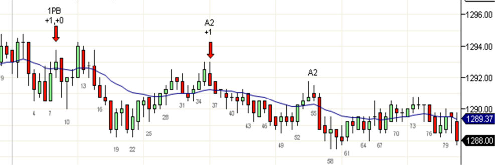

窄幅震荡日极其震荡，通常风险较高，因为每笔交易都需要是刮头皮交易。价格行为将难以解读，k线通常看起来很糟糕。总的来说，我避免在这些日子里交易，并且通常不做任何交易。你需要成为一个拥有高成功率的优秀刮头皮者才能在这些日子里交易。

前一天日k线区间很小，并且开盘时没有缺口或只有极小的缺口（小于一个k线），这样的k线是窄幅震荡日的候选。如果前几次双腿走势没有走太远，并且是由重叠k线组成的，那么很可能就是窄幅震荡日。

在这样的日子里，不要指望任何一波走势会远远超出之前的波动点。逆势交易的收益极低，因为价格不太可能在你入场点之外移动几个点。

<!-- 原书第 166 页 -->

## 波段交易视角

2011年3月23日 星期三 · 原书第 166 页

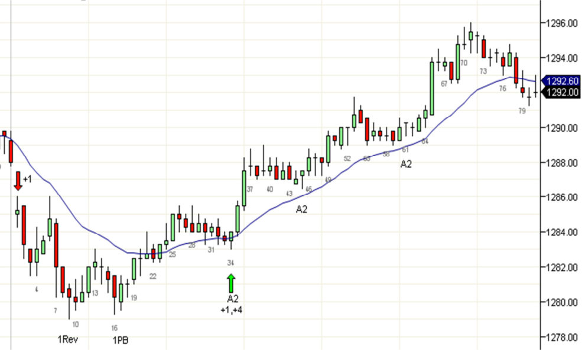

A2 是我最喜欢的入场方式之一，原因在于，如果在趋势日中相对早期地获得一个入场机会，你可以选择一直持有该交易，直到它通过触及之前的波动低点来止损。例如，如果你在b34 今天上方入场，你可以将止损设置在每一个新的波动低点，最终你会在b78被止损。在A2 未能变成趋势日的情况下，这可能意味着损失一两个点，但在趋势日中，你可以获得8 点或更多的收益。

例如，在我们今天的图表中，如果您有耐心一直持有到最后，那么错过 A2 在 b34 之前的所有的转折和弯曲都是可以接受的。这就是为什么掌握 A2 比正确把握首次反转和回撤更为重要。

然而，在出现大缺口开盘日和可能发生的硬趋势移动时，首次回撤是至关重要的。这是因为在首次回撤1PB 后的移动可能是当天的主要移动。当一个1st 回撤信号k线像今天的 b6 一样疲软时，它很可能不会发展成失控趋势，因此可以忽略它。

如果您想成为一名顺势交易者，一个好的选择是等待当日第一笔交易出现一个A2 。如果没有A2, ，那么这一天很可能不会出现趋势，您可以选择观望，而不是被微小的波动所困扰。

<!-- 原书第 167 页 -->

## TTRs 是交易区间

2011年3月24日 星期四 · 原书第 167 页

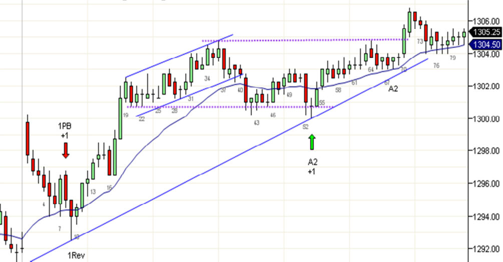

在没有真正过冲的情况下，趋势可能会在强劲走势后终结于TTR。TTR可能为横盘，与今日趋势相同，或与趋势相反。无论哪种情况，当趋势终结于TTR时，您应该在下一次顺势推动时退出，并等待突破形态的出现。

当趋势终结而非仅仅反转时，它就变成了一个交易区间，并且会尝试突破该交易区间。上升趋势会测试区间的底部（b42 和 b53），而下降趋势会测试区间的顶部。成功突破趋势底部可能会在突破方向上提供一个BP入场。失败则会导致价格测试TTR的另一端并可能突破，提供BP入场（b68）。

如果TTR区间足够大，你可以在区间低点附近做多，在高点附近做空，直到出现成功突破。

另一方面，水平的交易区间几乎总是向先前趋势的方向突破。这是因为它们是较大时间框架上的 ii 或 iii 旗形。另一个原因是水平移动中可能缺乏相反的趋势强度。

<!-- 原书第 168 页 -->

## 突破回撤作为趋势生成器

2011年3月25日 星期五 · 原书第 168 页

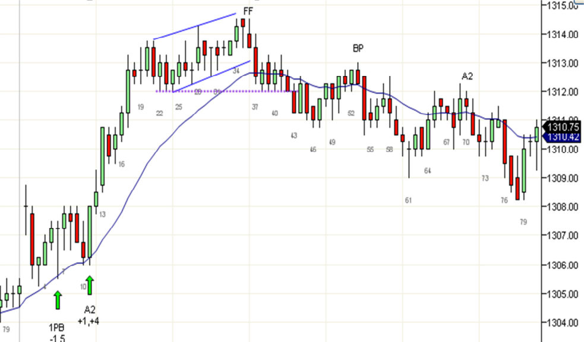

当一轮行情在 TTR 结束时，正确的做法是退出你的仓位，比如在 k 线 20 附近或者差不多的时候，然后等待更多的价格行为。昨天我们遇到了类似的价格行为，有一个回撤到 ema，随后是一个反弹，最终在一个向上倾斜的 TTR 结束。

TTR 跌破测试通道的低点，而昨天它失败并移动到通道的顶部，今天它成功作为突破回撤。有两个线索可以正确解读。两次尝试突破失败都没有成功（b44 和 b47）。这导致了一次突破回撤交易，应该至少有两条腿向下。回调到 b70 意味着至少还有两条腿向下，最后在 k线 78 结束。

将此与昨天 b42 和 b53 的价格行为进行比较。价格甚至无法收盘在突破点下方。第二次尝试的跟进足够好（许多 k线交易未跌破前一条 k线，多次收盘在 ema 之上，突破波动高点），以至于第二次尝试突破失败的交易足够成功，值得测试交易区间的另一端。

<!-- 原书第 169 页 -->

## 近期趋势

2011年3月28日 星期一 · 原书第 169 页

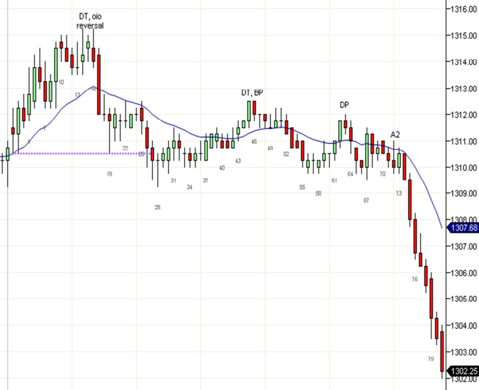

当趋势在一天内进行水平移动后（而不是在当天晚些时候出现延续或反转走势），会在收盘前出现晚期突破，并且通常会持续到收盘，没有中断或反转。这是因为加仓交易者不会进行逆趋势交易，因为没有足够的时间进行加仓操作。这会导致价格急剧上涨或下跌，您应该一直持有到收盘。

从开盘到日内高点的早期走势疲软，k线重叠，本质上是对昨日高点的测试。一旦失败，价格就会下跌测试交易区间的低点。跌破日内低点的b26 后，又持续了两根k线，这是一个良好的信号，表明一个 BP交易将会建立，并在b46处出现。

DP交易，其性质是较高概率的交易，在b63 处形成，随后在b72,73处出现A2 。请注意，自b16 以来，每一次像样的做空信号都成功了，因此A2无疑是一个波段交易候选。

即使你错过了所有这些，一个在ema下方很短的趋势k线也是一个相当不错的入场k线，并且可以凭借其自身优势进行做空。

<!-- 原书第 170 页 -->

## 经典趋势日

2011年3月29日 星期二 · 原书第 170 页

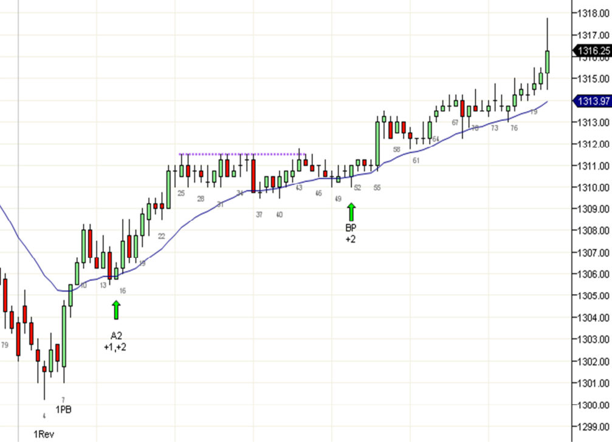

在熊市中，股票开盘强劲收盘疲软。在牛市中，股票开盘疲软收盘强劲。

当市场在低点附近开盘，然后下跌并在低点附近反转时，这通常是可能出现看涨趋势行情的良好迹象。最安全的入场点是在第一次回撤时，并且你应该能够持有到日末或趋势终止。

有时会出现水平的TTR，它们几乎总是会沿着先前趋势的方向突破。进入这种趋势的最佳方式是在今天的b51这样的突破回撤中。水平TTR通常是更高时间周期图表上的浅回撤。一种避免被震荡出局的方法是查看30分钟图并在那里入场。例如，今天的走势是30分钟图上的浅二级反转回撤。

尽管如此，如果你只将止损设置在每两个腿的更高低点下方，你就可以一直持有该交易的波段部分直到收盘。

<!-- 原书第 171 页 -->

## 交易区间：突破、突破失败反转、反转突破和趋势终止

2011年3月30日 星期三 · 原书第 171 页

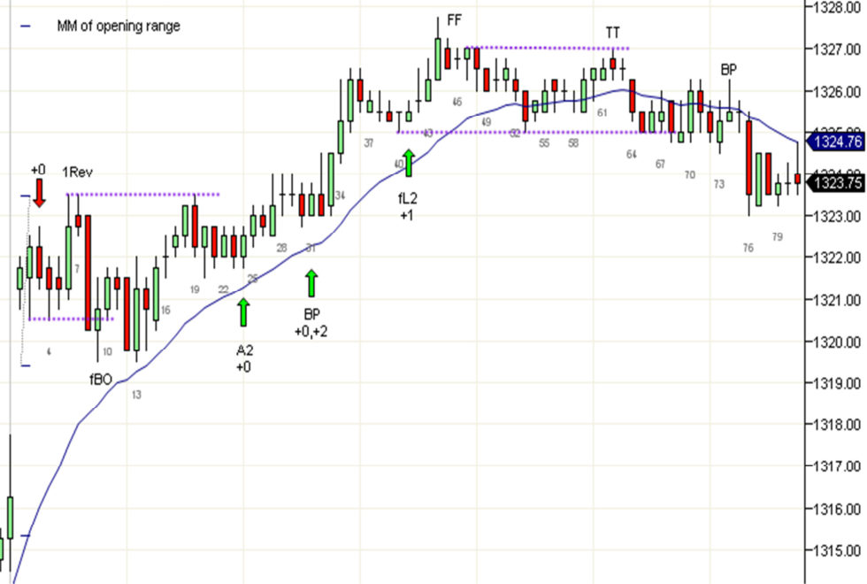

通过一些价格行为分析可以很好地交易交易区间日。如果最初的几个k线是带引线且重叠的，那么很有可能你遇到了一个交易区间日。

分析交易区间行为的关键在于将其视为一系列的失败突破和突破回撤。第一根k线是一根交易区间 k线。第二根k线向下触及第一根k线，然后向上触及，给出了两次突破失败反转（fBO）至b1。b 3,7,10 也是失败的突破。交易区间的失败突破只能预期测试交易区间的另一端，有时它们可能无法到达另一端，但会产生突破回撤。如果信号k线形态良好，你可以交易第二次尝试使突破失效（b13 是第二次尝试使突破b4, （当日最近的低点）失效），但你只能预期它会到达区间的另一端（b7 高点，在b19达到）。当到达区间的另一端时，你可能会得到一个突破回撤。这是一个高概率交易，应该预期会产生先前区间的量度移动（b44）。当出现高低点横盘而不是高高低（ HHs）和高低低（HLs）时，趋势就会终止。因此，在b62, ，我们有两个低点和两个高点，它们不再是趋势。通常，这会再次以突破回撤模式突破进入新趋势。通常，它会朝着先前趋势的方向发展，但如果价格行为不佳，它可能会像今天一样跌破。无论b74 是A2 还是反转突破（BP），它基本上是相同的交易。价格试图朝一个方向移动两次但失败了，因此它试图测试另一端。如果你已经有一个接近先前低点的低点（b53 接近b40），并且出现了一个双腿移动至高低（LH）（B62）或双顶（DT），最好退出，因为下一次上涨可能不会超过这一点。

因此，总结一下，反转突破是趋势生成器，假突破是逆势交易，趋势终止是退出（但不是反转）信号。

<!-- 原书第 172 页 -->

## 确定趋势日还是交易区间日

2011年3月31日 星期四 · 原书第 172 页

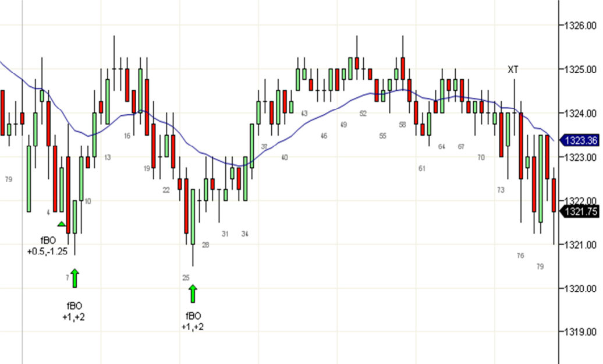

趋势日和交易区间日需要不同类型的交易，并且能够及早识别它们对于成功的交易至关重要。在交易区间日，区间可能像今日一样很小，任何波段交易入场都可能被失效。

区分这两种情况最简单的方法是退一步，在开盘几根k线后观察图表。如果价格距离开盘k线没有太大变动，你很可能会遇到交易区间行为。如果价格比第一根k线高出3 点或更多（即使之后又回落），很可能就会出现趋势行为。在趋势日，你可以在第一次回撤时入场波段交易，并一直持有直到趋势终止。你也可以在A2 或其他延续建仓形态入场，并且大多数交易都可能成功顺势而为。在交易区间日，你基本上会遇到一系列的失败。偶尔，趋势会从交易区间突破，但预测突破对经验丰富的交易者来说也很困难，而且大多数突破都会失败（今天所有的突破都失败了）。当价格试图突破交易区间时，你可以在第二次失败时入场。如果信号k线有强势收盘，例如b8 和b26，那么这种交易有很大的机会成功。当信号k线较弱或重叠，例如b52 ii或b58, 时，你应该轻仓交易并赚取较小的利润。失败突破入场需要非常强劲才能作为波段交易入场，并且第二次失败倾向于测试区间的另一端，但也有可能不会走那么远。你的大部分目标都应该是保守的。如果它强劲突破然后回撤，则可能是一个趋势生成器，你可以顺应新趋势入场。

总结一下：趋势日会产生波段交易和延续交易；交易区间日可能只会产生方向性突破。方向性突破是风险较高、概率较低的交易，只应在强建仓形态下进行，以获取较小的目标。

---

[← 上一章](10-2011年2月.md) · [目录](00-目录.md) · [下一章 →](12-2011年4月.md)
