[← 上一章](11-2011年3月.md) · [目录](00-目录.md) · [下一章 →](13-2011年5月.md)

# 2011年4月

原书第 173–192 页

<!-- 原书第 173 页 -->

## 趋势交易区间

2011年4月1日 星期五 · 原书第 173 页

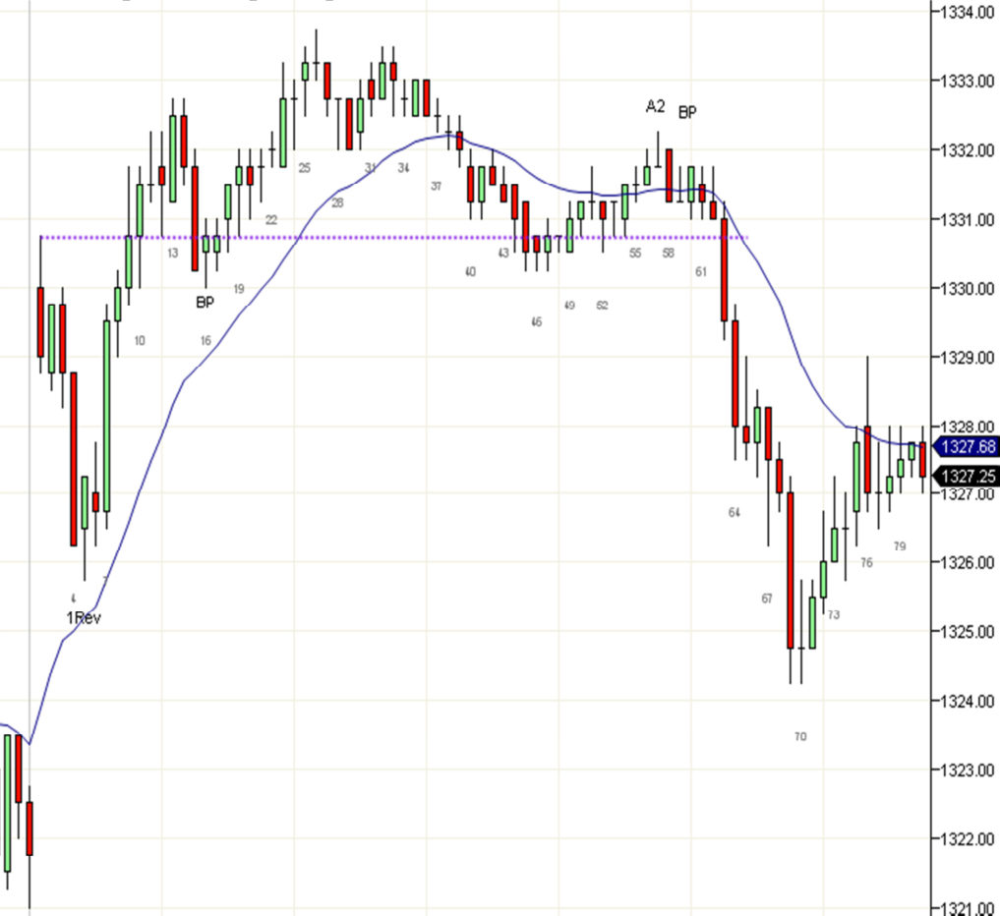

交易区间可以通过反转突破进入趋势，但有时也会进入更高的交易区间。通常，当天会有一次回撤进入之前的交易区间。趋势交易区间像交易区间一样进行交易。一旦出现突破回撤，如果趋势因任何原因终止（当日，TTR b16 to b25），您应该寻找新的突破或方向性突破交易。

今日，我们在 b58处出现突破回撤，回到了下行区间。突破进入之前的区间通常会测试区间的另一端（b5 低点）。如果你错过了初始突破或因价格行为（BW price action）而未选择入场，可以在突破蜡烛图下方 b63 入场，只要该k线不是太长（例如，小于 2 点）。

今日可靠的交易非常少。早期走势后的价格行为很差，由2 和3 跳十字星组成，通常最好不要交易它们，而是等待突破后再选择进行高概率交易。

<!-- 原书第 174 页 -->

## k线不佳的交易日

2011年4月4日 星期一 · 原书第 174 页

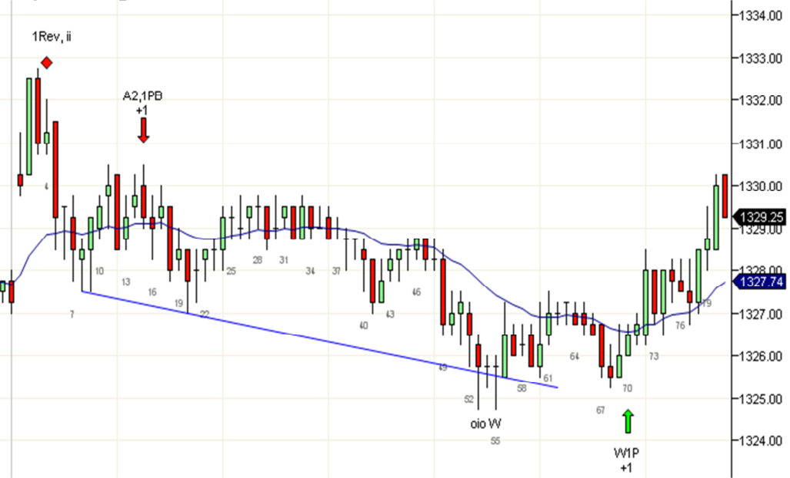

有时连续好几天，你可能会遇到k线只有四跳或更少的日子，而且很多都是十字星。这样的日子效率不高，每次突破只前进一两个点。有几种方法可以应对这些日子。

最简单的选择是此类交易日不交易，或者只交易极少的建仓形态。例如，如果在b4, 下方出现第一个1反转时入场，您可以一直持有，直到在第 55 根k线看到明显反转信号，并且忽略所有不佳的k线建仓形态。

第二个选择是获取适度利润，例如每次入场4跳。您应该交易较小的手数，例如正常手数的一半，因为您很可能会被止损。您可以在正常止损被触发的位置加仓另一半。这样，您就有更大的机会以适度利润退出。

第三种选择是在这样的日子里使用限价单逆势交易差的建仓形态。例如，b13 是一个差的建仓形态，并且它有一个差的入场k线。限价交易者可以做空b13 的收盘价或高点，并计划在交易不利时加仓做空。如果你选择这样做，请牢记趋势方向，并且只进行顺势交易（例如，不要在b55 反转后做空）。

<!-- 原书第 175 页 -->

## 趋势反转

2011年4月5日 星期二 · 原书第 175 页

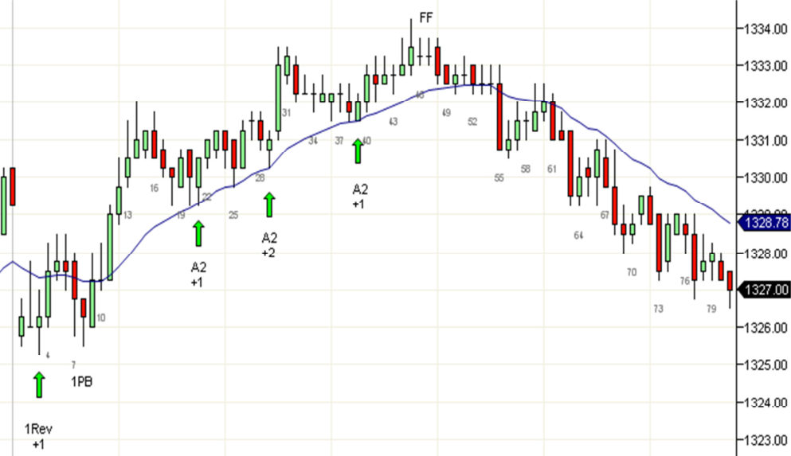

大多数你看到的盘中趋势反转很可能是楔形反转。通常在第三推时会出现过冲和反转k线，这使得反转非常明显。然而，对于看涨趋势，可能根本不会出现过冲。仅仅三推上涨并不能构成楔形。你需要其他的东西，例如TCL过冲、反转k线或末端旗形（FF），就像b47 在第三推结束时那样，才能将其判定为反转。

三推也需要从趋势突破开始计算，因此 b5 不算作一推。一旦 FF 触发，您可以考虑做空。如果您不想做空 BWish FF，则应简单等待 A2 的做空入场，例如 b62。

剃须或趋势信号k线的成功率很高，你应该选择它们而不是十字星。例如，b65 是一个ii，但它也是一个L1 ，同时也是一个十字星，所以你最好等待像b67 这样的k线，它的概率更高。

<!-- 原书第 176 页 -->

## 双腿W1P

2011年4月6日 星期三 · 原书第 176 页

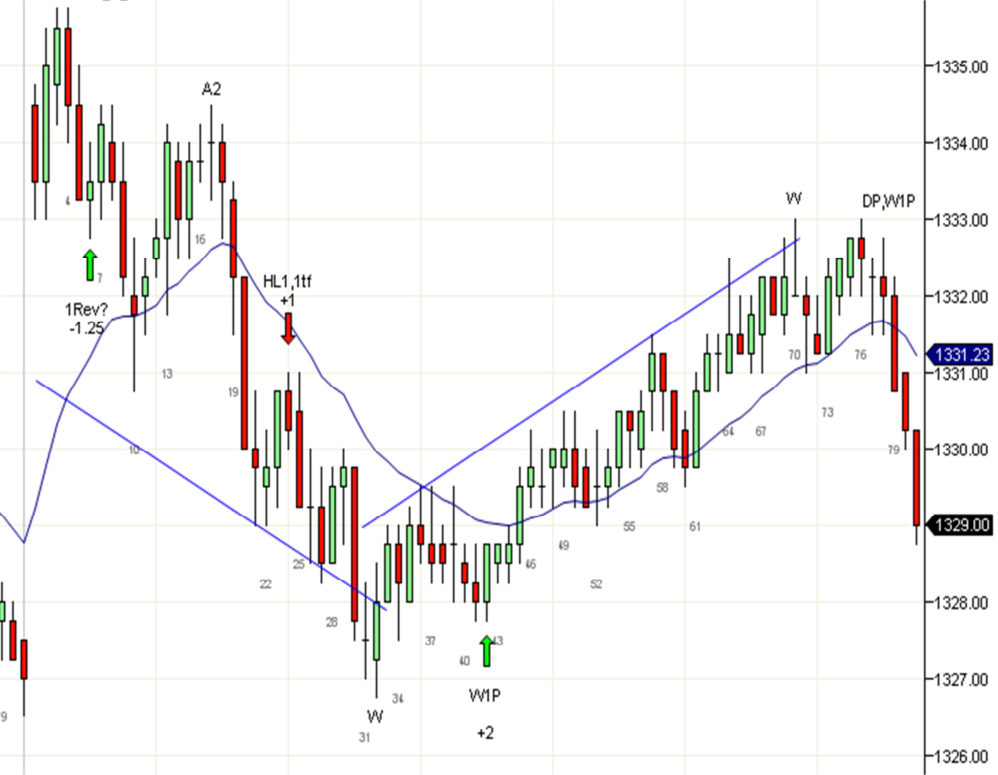

最好的W和W1P是强劲的反转k线。有时，反转k线可能是一根外包k线，如b32, 所示，这是一个可能的交易区间。入场k线可能很小（b33），并且其低点被突破（b34）。通常，这不是一个W1 P候选。然而，由于大幅过冲，至少会有一次看涨回撤。

当像b32 这样的k线形成了反转k线，由于重叠，入场k线很有可能被突破。接下来，如果你得到一个失败的持续信号（例如b38的失败A2 做空），那么它很有可能是一个2 腿W1P。请注意，当 W信号k线和入场k线是强烈的反转k线和趋势k线时，回撤不应超过W入场k线下方1个点。

如果W反转k线较弱，因为它看跌、是十字星、幅度过大或不是深度过冲，那么它就不再是W1P，而仅仅是趋势终止进入交易区间，你应该寻找突破和失败的突破。

<!-- 原书第 177 页 -->

## 突破测试作为趋势延续

2011年4月7日 星期四 · 原书第 177 页

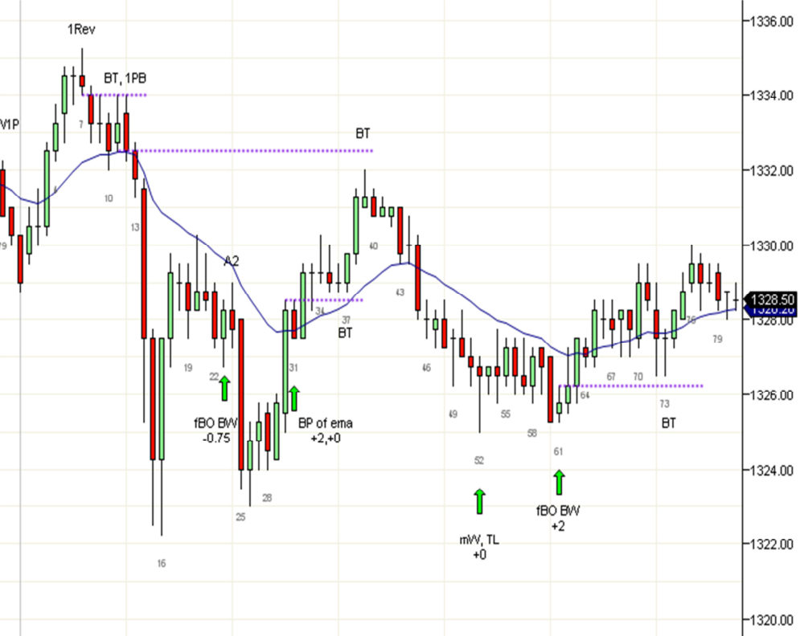

突破测试（BT）是指回撤至距离你最初入场位 -1t 至 +2t 的位置。本质上，这意味着交易者正在重新确认原始交易，并且价格很可能继续朝同一方向发展。BT是趋势延续的重要指标之一。BT是你可以将十字星k线视为有效信号k线的罕见情况之一。

反转k线后的突破测试(BT)是一种回撤交易(pullback trade)，并可能导致大幅波动。在一个本质上是大型三角形日（triangle day）的今日，价格试图盘整，可能会出现双向的突破测试。

突破测试(BT)是少数可以挂买入限价（buy limit）的地方，因为止损（stop）仅设在先前的波动点（prior swing point）之外。然而，保守的交易者（traders）可以简单地等待k线（bar）形成，然后在此信号k线（signal bar）之外设置止损价入场。

突破测试 (BT) 不仅限于波动点处的k线。趋势线、指数移动平均线 (b31) 以及价格突破的任何阻碍都可以进行突破测试。

<!-- 原书第 178 页 -->

## 一个通道趋势通常会有第二个相似的腿

2011年4月8日 星期五 · 原书第 178 页

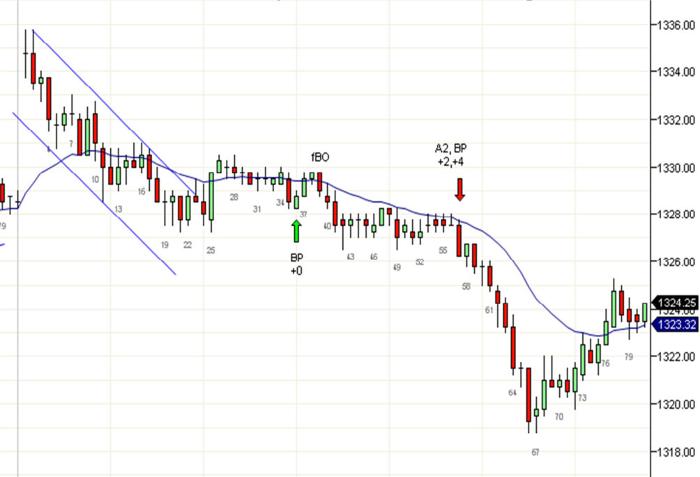

当一个趋势几乎在通道内运行时，它将有效地充当一条腿（通常是在更大的时间周期上）。当这样的趋势发生突破时，很有可能这次突破仅仅是一次回撤，而趋势将继续发展成第二条腿，其幅度相当。

b25 突破了上午的下跌趋势并完成了第一腿。在空头趋势中，一个强劲的外包多头K线表明这是一个交易区间，你应该像交易区间一样对待它。如果出现强劲突破，你可以进行一次BP（b36）交易；如果失败，你可以进行一次fBO交易，这应该会把你带到区间的另一端。

此时，你可以进行一次反转突破做空。第二次尝试（b57）实际上是一个A2 ，因此是一个高概率的做空机会。

<!-- 原书第 179 页 -->

## 当日首次双腿回撤

2011年4月11日 星期一 · 原书第 179 页

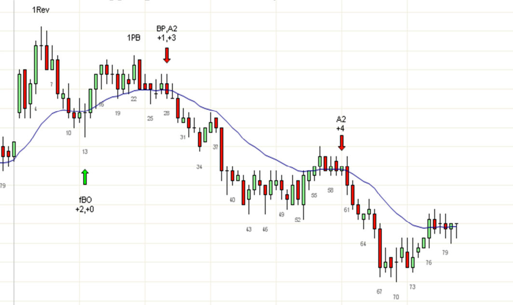

如果你一天只能交易一笔，那么第一次双腿式回撤是最佳选择。你应该在+1 平仓至少1 张合约，其余的让其运行。通常，如果当天是趋势日，这是你设置止损于盈亏平衡点并获得大部分利润的最佳机会。如果你的盈亏平衡止损被触发，那么当天很可能不是一个大的趋势日。

第二个选择是每次创下新高或新低后移动止损。例如，在 b34,之后，您可以将止损移动到 b28, 上方，然后在 b38 创下新低时将其移动到 b37 上方，以此类推。如果您在较大目标位（例如 +4、）平仓一部分，那么您可以在 2 腿部走势之后才移动止损，例如在 b64 创下新低后，将其移至 b56 上方。

在没有出现两腿回撤的交易日，你就不需要进行交易，因为这可能是一个强趋势日或交易区间日，这两种情况都不适合波段交易。

<!-- 原书第 180 页 -->

## 一个交易日的解剖

2011年4月12日 星期二 · 原书第 180 页

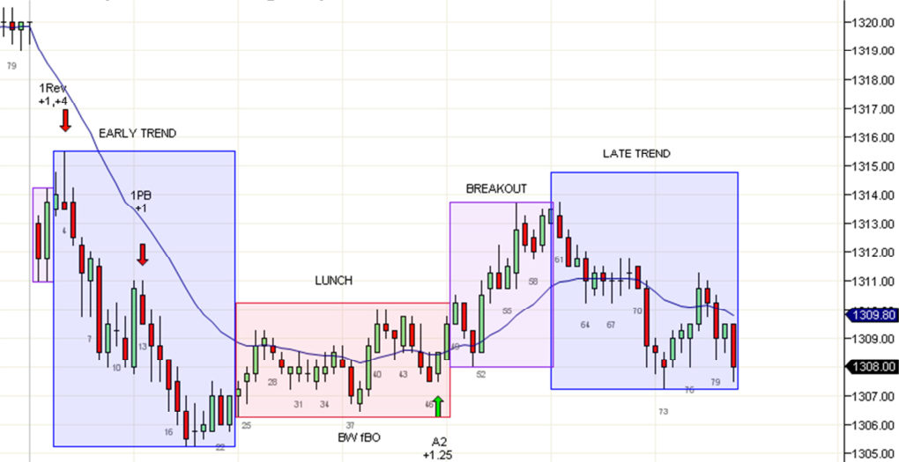

I 通常将交易日看作是由以下部分组成的一系列区段 :

1. 开盘k线
2. 开盘区间
3. 开盘区间的突破和可能的反转
4. 上午趋势
5. 午间盘整
6. 突破午间盘整
7. 下午趋势

这种细分是一种指导，而不是铁律。有些日子可能一整天都像午盘一样，我们称之为小区间交易日。有些日子会以首次反转开始，上午趋势可能会持续到收盘。我们称这些为从第一根k线开始的趋势日。你需要根据你一天早期看到的价格行为来调整你的预期。例如，早期趋势中带有大逆势 k线的日子，在午间盘整的突破中可能会有更强的尝试，而疲软或没有逆势k线可能导致尝试较浅。

你如何交易这些？总的来说，如果第一根k线是趋势k线或反转k线，并且强势收盘并且超出前一天的区间，你可以交易它的突破，特别是当它试图回补缺口时。这通常是这些日子里最好的入场点。然而，在大多数日子里，最好让开盘区间自行定义，要么使其突破失败，要么在其突破回撤时入场。这是你进入上午趋势的最佳机会。在许多日子里，如果你在上午趋势结束时（通常是开盘后 2 小时）迎来一个盈利日，你可以简单地选择结束你的交易时段，享受一天的剩余时间。这是因为午间时段通常充满形态不佳的k线和十字星，而且大多数交易者会被套牢并损失部分收益。偶尔，在午餐时间会有交易和突破，但如果你想交易，请注意，在大多数日子里，大多数交易最多是刮头皮交易。市场会试图突破午盘，有时会成功，但这种走势往往会失败并转为下午趋势。下午趋势可能会持续到收盘，但偶尔，获利了结会导致回撤。

总的来说，你最好的策略是抓住大部分上午趋势，在午餐时间休息（或者如果你擅长的话可以进行刮头皮交易），并逆势交易午餐突破。

<!-- 原书第 181 页 -->

## 趋势强度的迹象

2011年4月13日 星期三 · 原书第 181 页

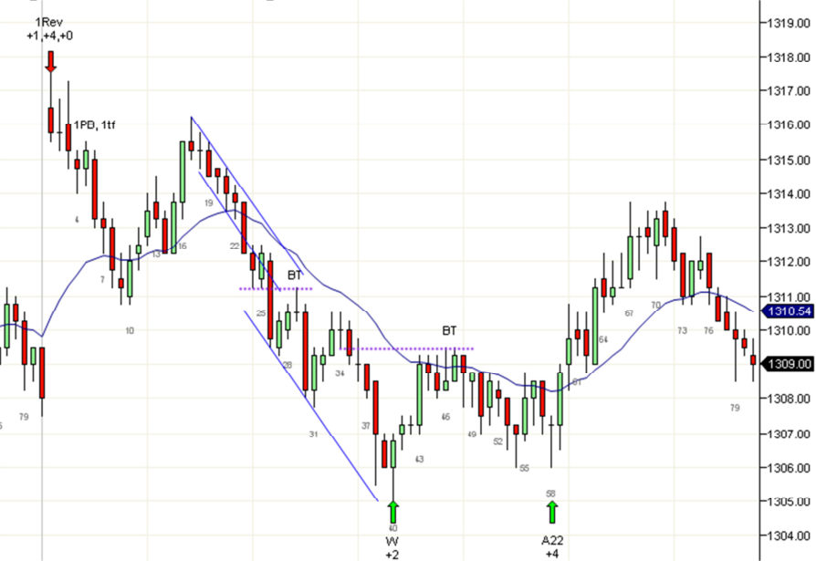

从 b1 到 b10 的第一段腿显示出今日趋势强度的各种迹象：

- 强势收盘的反转k线（入场侧引线1t或更短）
- 被套的交易者（b3）
- 1tf（b5）
- 没有逆势k线（b5 不是趋势k线）

尽管从b10 回撤至b16，但所有这些都暗示着进一步下跌。

b23 是一根双重剃刀ema突破k线。通常情况下，这些k线会随后跟进，并且如果它们较小且突破了至少4个单位到另一侧，则可以以高概率单独交易。

b26 是一根罕见的区间扩张k线。这是当TCL OS扩大区间而不是引起回撤或反转时。反转后的区间扩张k线通常表明扩张方向的强度增加。通道的宽度增加，表明买方没有像通常那样介入。（在延长的走势之后，看起来像区间扩张k线的东西很可能是高潮k线，不应被视为强劲的信号。）

突破测试也是强劲的持续信号，可以基于单腿（L1/H1）和渡鸦线等边缘信号k线进行交易。如果信号 k线没有在紧接着的下一根k线上被触发（b46），则可能无效。在可能反转（b40）之后出现的高低双底（b58）表明至少有可比的同一方向的腿（b59 至 b67）。强势信号可以作为过滤器，除了单独交易外，还可以避免逆势交易。例如，在b29 处的突破测试可能意味着b31 多头交易不太可能成功。同样，在b58 处的高低双底可能意味着你不应该逆势交易从b43 到b58的交易区间的突破。

<!-- 原书第 182 页 -->

## 趋势交易

2011年4月14日 星期四 · 原书第 182 页

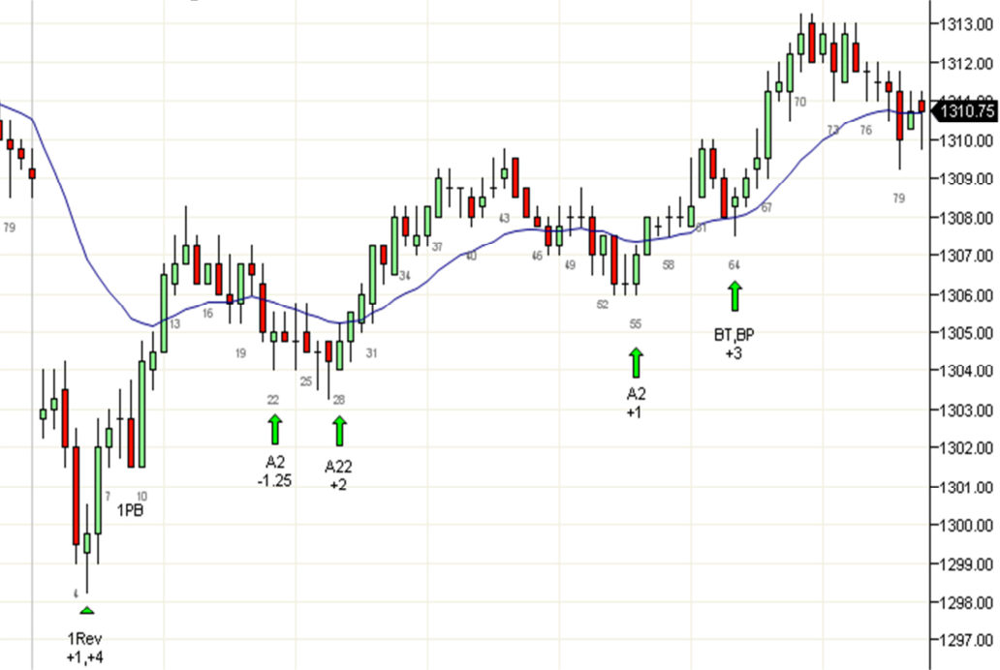

趋势日易于交易，你应该充分利用它。实际上任何顺势建仓形态都会奏效，任何交易风格也可能奏效。任何趋势指标也可能奏效。另一方面，逆势建仓形态和振荡器可能只会带来有限的利润。

当市场开盘远超前一天的区间时，这很可能是一个趋势日。第一次反转（b5）是一个很好的切入点。买入第一根空头K线的低点（b9）是一种限价交易风格，适用于强趋势，并且效果非常好。

每隔两点回撤后加仓也是如此。在b28 和b55处买入两段式回撤也同样有效。突破测试（b64）效果很好，买入指数移动平均线以及低于指数移动平均线两点的价格也效果很好。

买入第一次反转和/或回撤并持有至收盘也同样有效。

关键在于，像这样的日子里，你得非常非常糟糕才会亏损。当遇到这样的日子时，不要浪费它，抓住每一个顺趋势的交易。

然而，最重要的问题是，您何时知道这是一个趋势日？从技术上讲，一旦出现更高的高点和更高的低点，趋势就存在了。因此，通过 b14 ，我们非常有信心我们正处于一个强趋势中。这一天仍然有相当多的交易机会，可以在交易结束前进行一些盈利交易。

任何了解价格行为交易的人都会意识到，一旦出现大的缺口，很可能是一个趋势日，首次反转或回撤是一个高概率入场，值得把握。

<!-- 原书第 183 页 -->

## 趋势线突破

2011年4月15日 星期五 · 原书第 183 页

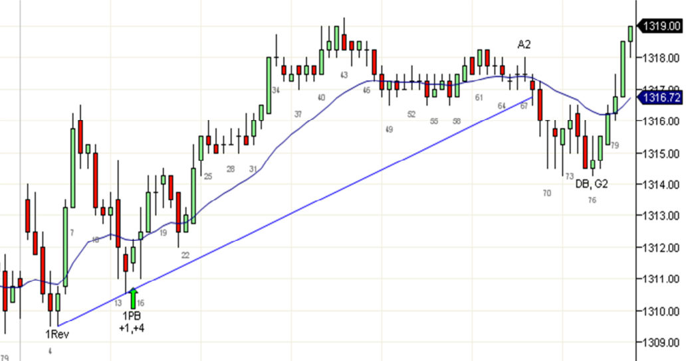

强趋势线的突破，在突破前后有相当数量的点数。例如，今日从 b43 下跌到 b72 突破了趋势线，突破点前后各有约 2.5 点。

仅仅跌破趋势线的行为并不能真正地突破趋势线，而只是将趋势线调整为更平缓的角度。这意味着一部分逆趋势的能量被吸收了，但市场仍能继续维持原有趋势。

然而，硬性趋势线突破则标志着趋势的终止。此时价格将尝试至少测试前一个极端高点（b43），如果价格仅以微小的幅度（例如一个跳或一个点）突破，那么市场很可能在两个点之间形成一个交易区间。如果其中任何一个点出现强劲突破，则突破回撤可能导致趋势行情。

如果新形成的交易区间（b43 到 b76）足够大，比如达到 3 点或更多，你可以考虑进行一个失败突破交易，反向操作进入区间的另一侧。

如果突破非常强劲，因为它是一根强劲的趋势k线，收盘价远高于前期高点（例如 b33 突破 b8），那么即使趋势线被突破，趋势也很可能继续。

有时市场太弱，无法突破先前的极端高点，只能进行两次或三次腿部走势，接近先前的极端高点。这应与测试先前的极端高点相同，并以类似的方式进行交易。

<!-- 原书第 184 页 -->

## 交易 TTR 突破

2011年4月18日 星期一 · 原书第 184 页

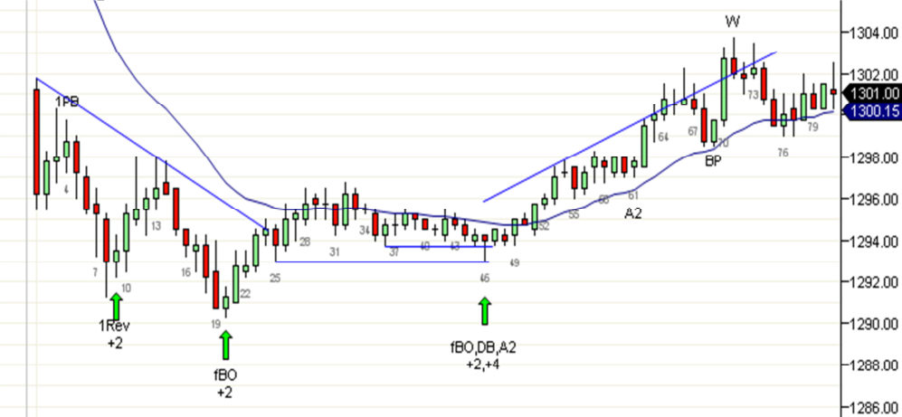

突破是最难预测和正确交易的，大多数人最好是在突破后的第一次回撤时就离场。然而，在某些情况下，例如今日在 28 和 46 k线之间的延长 TTR，是可以正确解读和交易突破的。

第一个线索是通道走势至指数移动平均线，并且在三次下推后成功收盘三次。市场随后三次尝试抛售均告失败。第一个信号是在 b30, 的 oio，第二个是在 b34 的 A2 变体，最后一个是在 b43的 A2 。诚然，这些信号都不佳，但考虑到今日开盘和早期走势的基调，其中一个信号至少应该能提供一次刮头皮交易的机会。

即使价格尚未明确在 b24今日出现突破，一个延长的 TTR 也会突破趋势线。b46 完成了 2 条腿向下形成更高低点。在多次未能延续先前趋势后，价格很可能会突破并向上走至少两条腿。

b46 单独来看是一根弱K线，但结合整体市场背景，它是一个双底（与 b25构成）、对先前波动低点的失败突破（fBO）以及一个 A2 ，因为这是在可能反转（b20三次下推至反转K线）后形成的、有两条腿的更高低点（HL）。谨慎的交易者可以在下一根多头K线（b47）时做多，只要它不是太大。

请注意，这是在经历了（b1- b20）的延长走势后的TTR趋势突破和反转的一个特定案例，不适用于您看到的任何铁丝网。对于大多数BW，您最好在BW中的趋势k线突破后进行反向操作。

进入突破的右侧需要大量的经验，大多数交易者可以直接在b56 或b61 （这也是一个A2）处进行反转突破。

如果您识别出趋势的TTR扩展突破，可以采取一个快捷方式。您可以简单地在任何波动高点上方做多（b47 或 b42 ，具体取决于您的判断有多宽松），并将止损设在近期波动低点下方（b46）。一旦入场k线收盘，您应该立即将止损移至入场k线下方（b49 或 b51）。

<!-- 原书第 185 页 -->

## 失效楔形

2011年4月19日 星期二 · 原书第 185 页

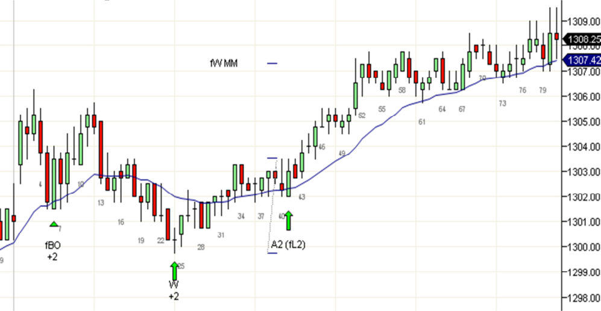

楔形很少失效，但当它们失效时，它们通常会给出到楔形另一侧的度量移动。从LOD b24 到b40 的移动是三推上涨，b40 两者都是第三推以及楔形的触发器。当价格在未先给出两腿下跌的情况下突破它时，这是一个失效楔形，预计会上涨到度量移动。

需要注意关于失效楔形的一些要点。

1. 楔形很少失效，形态良好并且带有明显过冲、清晰k线和强劲反转k线的楔形几乎从不失效
2. 如果一个楔形被触发并至少移动了两个腿，则满足楔形条件，如果随后价格突破楔形上方，则不再是失效楔形，不应预期其会达到度量移动
3. 大多数失效楔形通常是通道或通道类走势，并非过度反应
4. 真正的楔形代表极端行为，这些不太可能失效

每当看到一个通道出现楔形走势时，如果你进行交易，请记住，有时它们会失败，你应该反转你的头寸并交易到度量移动。

<!-- 原书第 186 页 -->

## 跳空下跌后的盘整

2011年4月20日 星期三 · 原书第 186 页

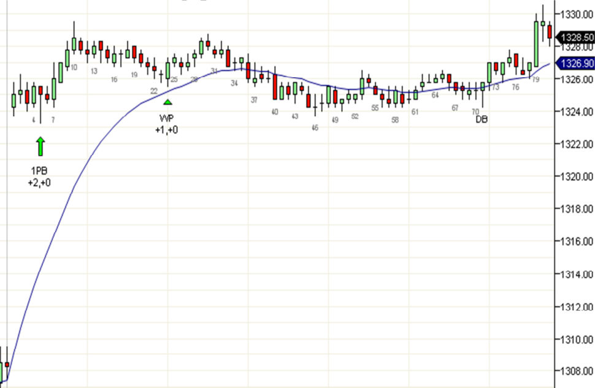

巨幅跳空上涨后出现狭窄的横盘日通常是盘整日。这是隔夜交易者获利了结，而错过大动作的交易者入场的时候。通常这会在一两天内导致一个大的方向性移动。

如果下一个交易日跳空下跌，可能会导致大幅下跌，原则上与日线图上的岛形反转相似。

像这样的一个交易区间日，如果你交易了任何双腿移动，你很可能做得不错。

<!-- 原书第 187 页 -->

## 交易窄幅区间交易日

2011年4月21日 星期四 · 原书第 187 页

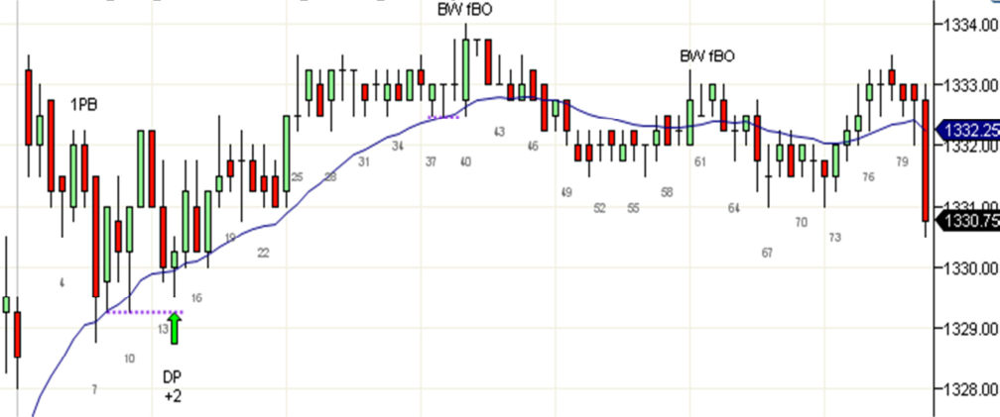

For 大多数交易者，交易窄幅区间的最佳方式就是完全不进行交易。如果你... o want to trade, the best setups are to 逆势交易突破 high and low of the da y.

这种方法会引发以下问题：

1。您如何知道这是窄幅区间交易日？

2。如果出现大幅突破怎么办？

答案很简单。当K线大小连续多根K线小于4 跳，并且当天的交易区间很小时，这非常可能是一个窄幅区间交易日。在区间内交易是极其危险的，因为即使在价格达到区间的另一端之前，交易也有很高的失败几率，例如形成一个较高的双底。为了最大限度地提高成功几率，你应该逆势交易弱势突破或失败突破形态，如DP。你永远不必担心错过窄幅区间内的强势突破。窄幅区间很少会立即形成趋势。K线大小可能会增加到高于4 跳，并持续数根K线，价格也可能突破区间的两侧，形成一个扩张三角形突破。

<!-- 原书第 188 页 -->

## 把握上午趋势的重要性

2011年4月25日 星期一 · 原书第 188 页

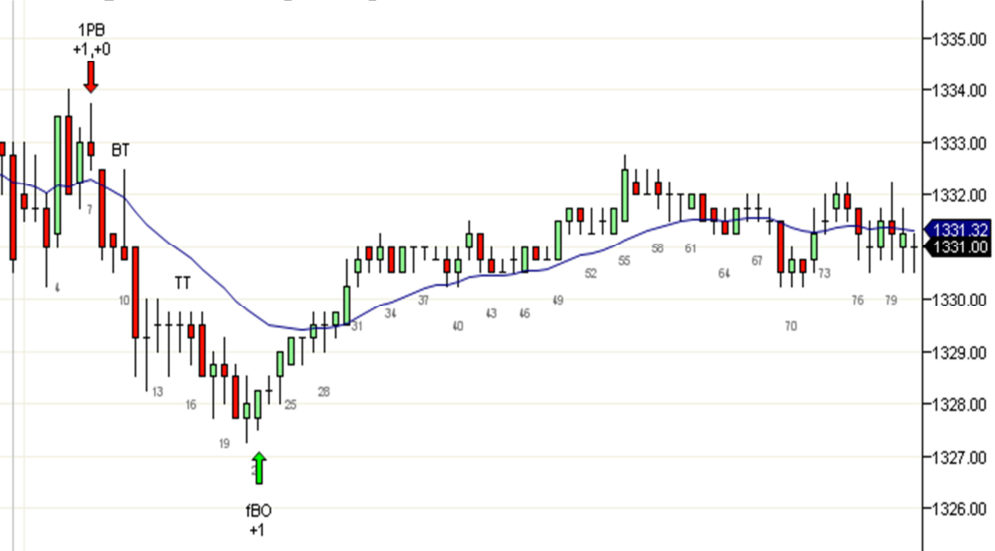

低成交量日的K线行为不会产生很多清晰的信号。即便如此，最初一两个小时会产生一些交易信号，你应该尝试抓住它们。例如，今日在b5 之后出现了一个首次反转，然后在K线7上出现了一个1 PB。这导致了当日的最大波动。不幸的是，它止损了低于b7,的任何入场的盈亏平衡止损，但这或许是无缺口十字星开盘所预期的。

任何犹豫做空b7 的人，如果他们愿意，可以做空b10 的突破测试（BT）k线。该走势迅速趋势终止（TT），进入了一个从b12开始的TTR。

趋势突破和第二次失败值得在 b22 进行交易，但价格行为很快转变为连续的 3 K线。这是退出并停止交易的好理由，因为低成交量日不太可能产生大幅波动。

<!-- 原书第 189 页 -->

## 急速加通道

2011年4月26日 星期二 · 原书第 189 页

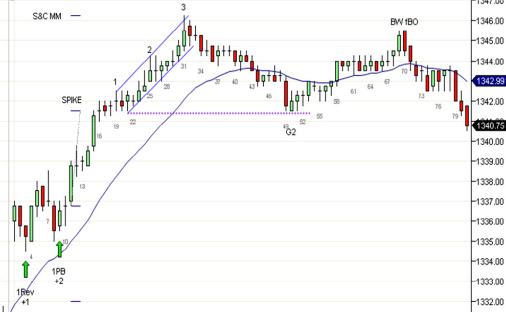

在短时间周期内任何相对较大的波动都是一个尖峰，通常是一根 K线，但有时也可以是多根 K线。在今天的例子中，从 b11 到 b15 的波动可以被视为一个单一的尖峰。如果尖峰强势收盘，即在今天的例子中接近顶部，这种强势会促使顺趋势交易者在任何小 K线时收盘做多，而逆趋势交易者会轻仓交易，从而引发通道走势。

强势收盘的急速通常（但不总是）会移动到一个大急速的度量移动。弱势收盘的急速，例如一根收盘在中部的长k线，可能只会通道到一个极端。有时急速会向两个方向形成，通道会移动到其中一根k线的极端。

急速加通道通常有三推，它们会正常回撤到通道的开端，就像我们在b49 今日看到的。此时，急速加通道通常会回撤至少一半的移动，就像我们直到b70一样。

交易急速加通道有许多方法。你可以在第一次（b22）以及可能第二次（b28）回撤后顺势入场。通常，这应该只在有长急速的强势收盘时进行。带弱势收盘的小急速可能不会移动超过一两个点，不值得冒险。激进的刮头皮者可以简单地做多任何剃须k线或任何回撤k线的收盘价，并在每一次推时退出。

第二种选择是等到三推完成，如果通道覆盖了 3点或更多，则逆势交易直到它回到通道的起点。一旦回撤完成，如果你获得了一个良好的信号，比如 G2 at b50，你可能有机会交易到新的交易区间的一半。

<!-- 原书第 190 页 -->

## 趋势强度与 K线大小和交易区间大小成正比

2011年4月27日 星期三 · 原书第 190 页

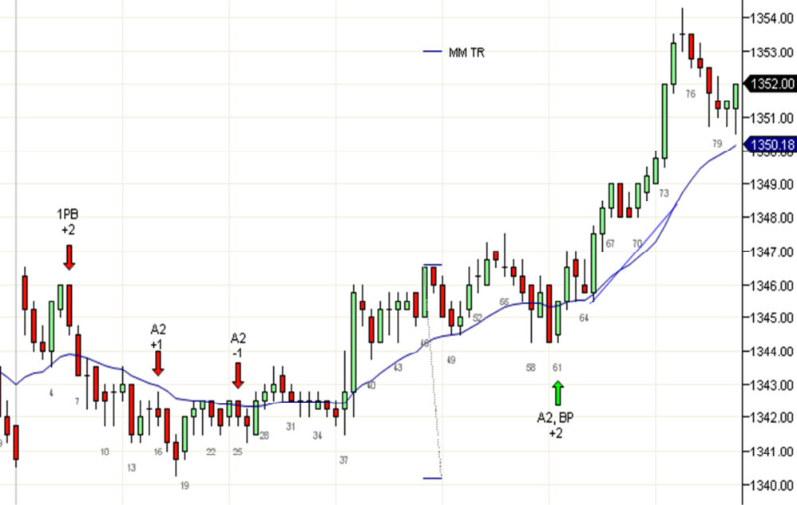

我之前曾讨论过突破回撤作为趋势生成器。今天在向上突破日内高点 b54 并随后的 2L PB 之后，基本上是相同的走势。最好的反转突破是发生在实际突破之后，例如 b61, ，而不是几乎突破，例如 b50。

由于趋势的诞生源于反转突破，通常会达到交易区间的度量移动（b74），因此，如果反转突破是后期走势，那么更大趋势的突破将导致更强的走势和更浅的回撤。任何具有强势收盘的大K线，例如今天的b38 ，都预示着潜在走势。

当走势可能很大时，可能没有回撤或只有非常浅度回撤 (b68,69)。你可以做多任何小K线之上，无论其颜色如何，直到触及衡量性移动。

<!-- 原书第 191 页 -->

## 在交易区间内做空双腿走势

2011年4月28日 星期四 · 原书第 191 页

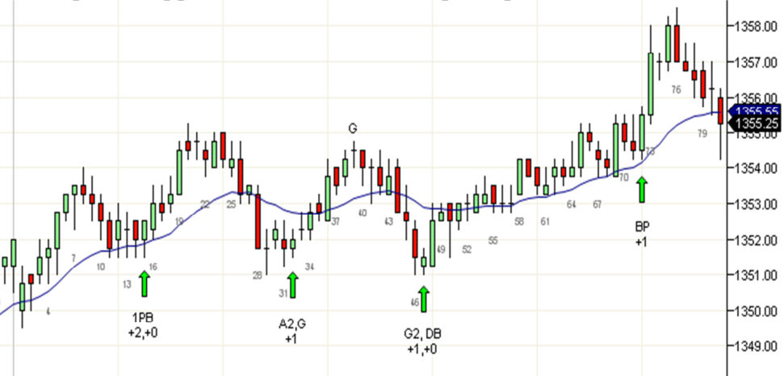

当今日开盘在昨日区间内，尤其是今日第一根k线与前一天最后一根k线之间没有缺口时，今日很有可能变成一根交易区间日。这并不令人意外，因为大多数日子确实都是交易区间日。

在b15 的1PB处趋势日仍有可能发生，但b24 处的第二腿的深度抛售后表明这是一个交易区间日。此时，任何方向的2L PB都可以被做空，直到出现HOD b20 或LOD b1的突破。

同样，失败的突破也表明你的交易模式发生变化。LOD 上方的双底（或 HOD 下方的 DT）在技术上是创造新极端的第二次失败，是一种 fBO。DP 是其后的第一次回撤，通常表明将移动到区间的另一极端。

b47 买方因此应只做多，直至测试日内高点。成功并出现回撤是反转突破趋势生成器，而失败则是突破失败反转交易

<!-- 原书第 192 页 -->

## 良好信号k线的重要性

2011年4月29日 星期五 · 原书第 192 页

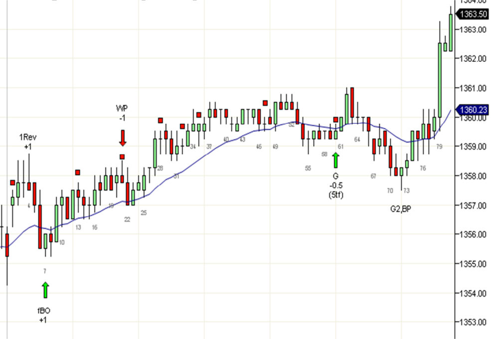

一些交易者认为他们能正确判断市场的整体方向，但他们总是被止损出局。尝试使用更宽的止损来解决这个问题通常意味着更大的潜在亏损。

当使用信号k线边界进行止损和入场时，如果入场选择得当，则无需设置比信号k线另一端更大的止损。一个形态不佳的k线通常是导致止损的原因，包括我今日的两笔交易。

例如，在上图的k线中，b1 是一个差的做多信号，因为它是一个十字星，并导致了5tf。另一方面，b4 是5tf 的反向交易，因为它收盘于其低点，是一个强得多的信号。b13是1PB的一个差的信号k线，正确的做法是忽略它，因为入场会迫使你做空指数移动平均线。b21 是一个重叠的十字星，因此是一个边缘性的WP和fBO交易（1t低于日内高点）。

b28 是一个差的BP信号，b29 是一个差的fBO信号，因为它们都是小十字星。所有给出日内高点 1 信号一直到b47 的所有小k线都是差的信号，只有b32 买方可能设法进行了刮头皮交易。

所有小k线都应被视为十字星，无论其形状如何。十字星唯一可接受的入场点是2次入场，且发生在深度的回撤或震荡区（TR）的极端位置之后。即便如此，当整体 k线形态不佳时，你的交易仍可能失败。例如，b55 买方刮头皮离场，而b60 买方触及了一个5时间周期。

---

[← 上一章](11-2011年3月.md) · [目录](00-目录.md) · [下一章 →](13-2011年5月.md)
