[← 上一章](12-2011年4月.md) · [目录](00-目录.md) · [下一章 →](14-2011年6月.md)

# 2011年5月

原书第 193–213 页

<!-- 原书第 193 页 -->

## 第二次失败的反转突破是一个趋势生成器

2011年5月2日 星期一 · 原书第 193 页

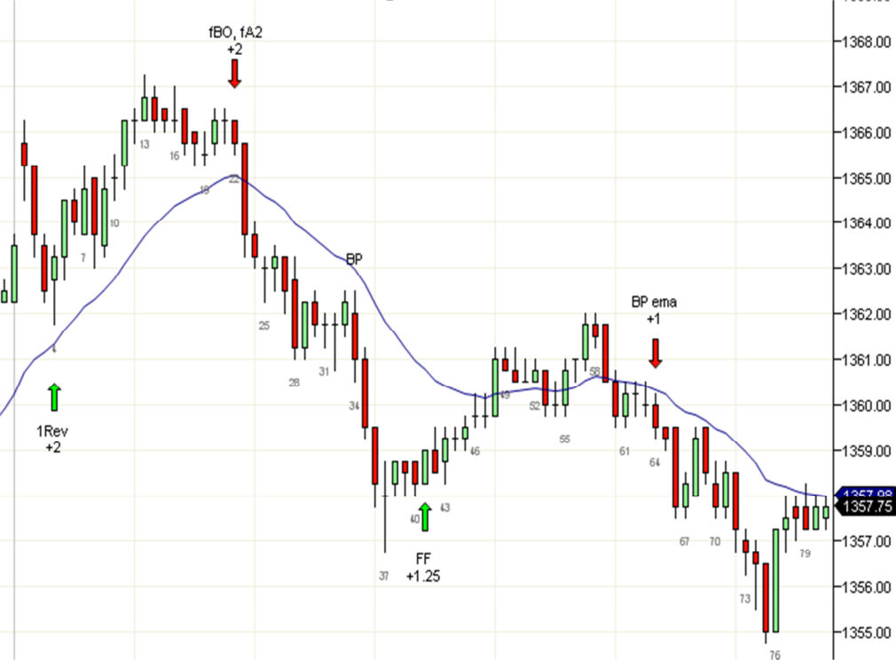

新趋势的突破需要一些经验来正确解读。今日b13 出现了一个向上突破，b1 形成突破并建立了一个 BP。b15 和b19 建仓了非常弱的BP信号，只有很少的交易者参与。第二次向上反转失败的尝试使得这成为了一个失败的A2 ，并建立了一个趋势行情，该行情很可能至少测试入场k线b5 的低点。

当区间足够宽且k线尺寸正常（6 到8t）时，一侧的方向性突破通常会在另一侧成功反转突破。b 33 提供了一个A2 ，虽然类似但却成功了，并达到了开盘区间度量移动至b38。

这次移动是通道状的，尽管随后的末端旗形是b38, ，但其低点至少很有可能被测试。

总而言之，如果上午行情中的日内高点或日内低点被向上突破，并且随后的腿式回撤很差，那么这种突破的失败很可能会逆转趋势，并成为一个可能的趋势生成器。

<!-- 原书第 194 页 -->

## 选择正确的反转

2011年5月3日 星期二 · 原书第 194 页

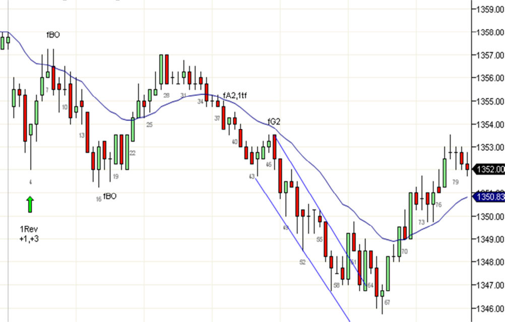

大多数交易者在进行逆趋势交易时会亏钱，这主要是因为他们试图逆势交易一个仍然强劲的趋势。改变方向的正确时机是在趋势被破坏且其低点被测试之后。当然，另一种可能性是进入楔形区域的过冲。

今日以一个扩张三角形突破开盘，在价格未能突破新高至 b28, 后，进入测试 b16的低点。在价格跌破 b16, 之前，这仍然不算真正的趋势，因为扩张三角形确实可以变成收敛三角形。

一旦价格果断地跌破 b16 ，在 b48 （这也是一个失败的 G2, ）上，趋势就确立了，只能进行空头交易。交易者们买入任何看起来像反转k线的东西，都在 b49, 、b52 和可能 b57上亏损了。

一旦趋势线突破，特别是当突破发生在强劲的趋势k线（如b60, ）上时，下一个信号是在名义上的更低低点（b66）之后的高概率入场。任何大幅下跌的走势都不应买入，在任何逆势入场之前，需要新的趋势线突破。

<!-- 原书第 195 页 -->

## 开盘大K线

2011年5月4日 星期三 · 原书第 195 页

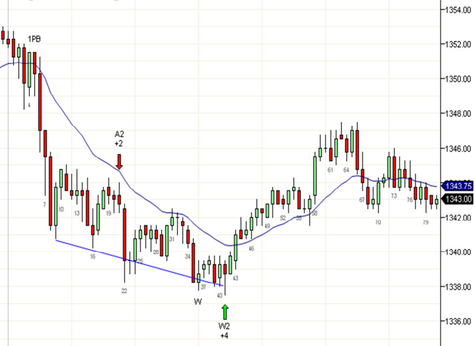

开盘时的长k线通常是急速加通道行为的标志。通道本身可能会持续到日终，但它通常不是一个坚定的趋势。最佳选择是进行2腿式回撤以及2次顺势交易入场，例如b21。

像任何强空头日一样，趋势终止（b22）和2次入场（b41 入场价格与b36相同）是反转入场所必需的。趋势突破和测试可能会很少出现。当通道发生反转时，你应该预期在通道的开端会出现回撤，无论反转看起来多么强劲。

最重要的一点是，在有大k线的日子里，不要进行首次反转（b9）。第一次尝试不太可能成功。

<!-- 原书第 196 页 -->

## 优化您的止损大小

2011年5月5日 星期四 · 原书第 196 页

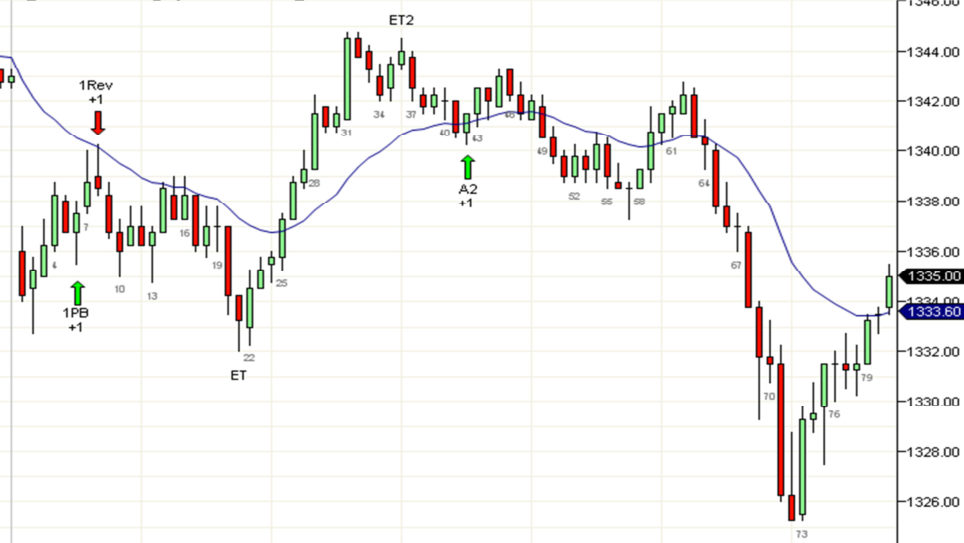

价格行为交易使用信号k线边界作为入场和止损。k线大小各不相同，一个大的信号k线可能意味着大的风险，而一个小的信号k线可能给出的止损会因为信号k线太小而无法代表真正的风险管理而被打掉。

由于较大的止损意味着较大的风险，因此您可以通过选择需要较小止损的入场来降低整体风险，从而提高您的盈利能力。假设您的入场在回撤不超过3 或4 跳之前，持续获利+1 点，您应该能够将止损大小减少到5跳，从而降低您的风险。请注意，您需要确信，如果触及止损，价格触及止损目标的可能性较低。

一种方法是检查最大不利波动（MAE），如果您的交易平台支持的话。例如，今天我的最大不利波动（入场交易后出现的回撤）是2跳，如下所示。

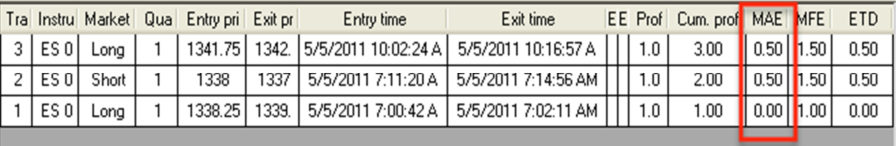

对于您交易的每一个建仓形态，都应该计算出盈利入场的可能最大不利波动 (MAE)。如果一个建仓形态在超过一定跳数后就可能失败，那么那里就是您最好的止损位。关注 MAE 可以让您只关注 MAE 最小的建仓形态，同时还能调整您对信号k线质量的判断，从而选择那些可能具有较小 MAE 的入场。一旦您能够持续地收紧止损，您就可以在相同的账户大小下交易更大的手数。此外，您的平均盈利与平均亏损比也将提高，从而增强您的盈利能力。如果价格在触发止损后，并非罕见地走向盈利目标，您就需要稍微改进您的入场，或者稍微放宽您的止损。

<!-- 原书第 197 页 -->

## 巨大的第一根k线

2011年5月6日 星期五 · 原书第 197 页

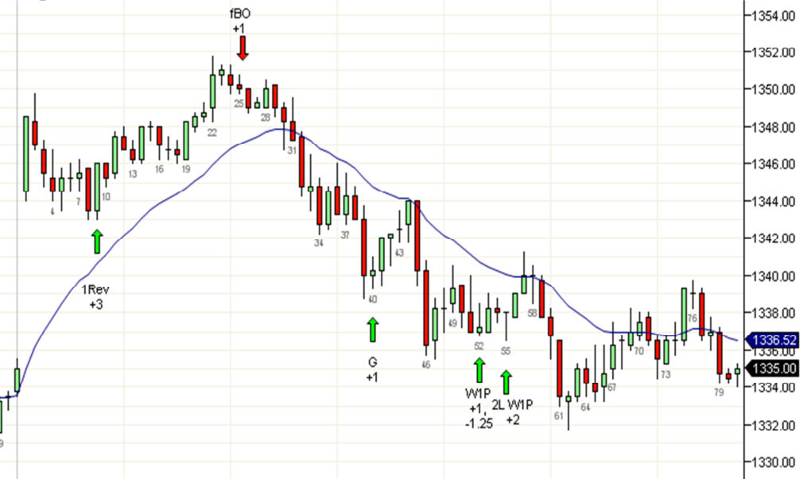

第一根k线以及接下来的几根k线通常很特别，因为它们指示了当天剩余时间内可能的价格行为。一系列小的十字星可能表明一个窄幅区间。一系列平均大小的k线可能表明一个趋势日。如果第一根k线是一个巨大的缺口反转k线，它可能表明从第一根k线开始的趋势。一根大k线表明能量充沛，可能是一个宽幅区间日。

巨大的第一根k线有时是尖峰，但几乎总是交易区间。当它是尖峰时，它会缓慢地向上通道到一个与k线等量的度量移动。当它是交易区间时，通常意味着交易者很可能会在低点附近做多，在高点附近做空。这根k线需要像任何其他交易区间一样进行交易。如果k线的突破强劲，则在回撤时顺势入场，否则就逆势交易突破。

b2 是买方的一个5交易区间，位于b1 上方，并有强势收盘。如果入场价接近k线顶部，这本身就是一个合理的入场。你永远不应该在k线中心或低点附近进行第一次失败交易，因为下一根k线可能会出现突破回撤，因此会出现一次顺势1回撤入场。如果一个两腿入场在k线的一端附近设置好(b9)，你应该抓住它，并一直持有到k线的另一极端。这是一种1反转交易。

cz< 一旦触及另一极端，您可能会获得趋势的突破延续，从失败突破（b25 或 b29）回到较低的极端。第二次尝试突破通常会成功（b34），并带来一次趋势行情（b38）进入新趋势。

<!-- 原书第 198 页 -->

## 首次反转

2011年5月9日 星期一 · 原书第 198 页

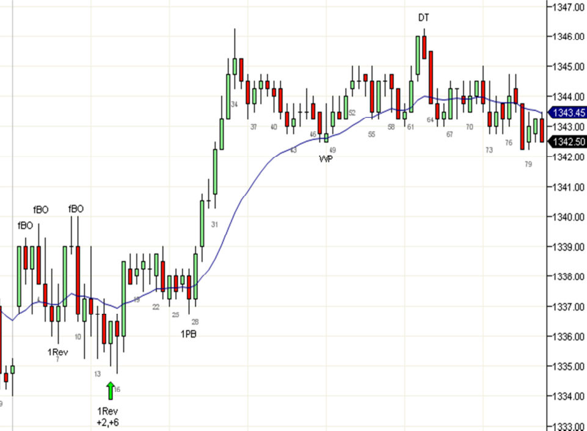

首次反转（1Rev）是当日首次趋势行情后的反转。这应与简单的失败突破区分开，例如当日第一根k线的1tf或5tf。第一根k线的失败突破（甚至更晚的k线）不能期望有大的行情，但趋势行情的首次反转通常会有。

反转 (Rev.) 有很多种。在首次成功的刮头皮交易之后发生的反转，或者至少是在上根k线收盘价附近进行6 跳（tick）之后发生的反转，是一种1反转 (Rev.) (b7)。然而，在趋势行情之后发生的反转通常是最好的一种1反转 (Rev.)，并且通常是日内低点或高点。在出现大缺口之后出现的反转k线可以被视为首次反转，因为大缺口代表了趋势行情。

如果开盘缺口很小或不存在，最好等待第一根k线出现趋势行情，然后进行反转。阅读所有这些变体是很复杂的，但一个简单的过滤器是抓住当日首次双腿移动 (two legged move) 后的反转 (b15)。如果这种反转产生了顺应交易方向的小幅双腿移动，您应该考虑出现A2 的可能性，并且您应该退出您的仓位并反转至A2, ，这是一种1PB交易。

即使你从不交易1反转，或者只是刮头皮交易，跟踪它们也很有用，因为首次反转（b27）后的第一个回撤（1）通常是当天最好的1回撤走势。

<!-- 原书第 199 页 -->

## 通道开盘

2011年5月10日 星期二 · 原书第 199 页

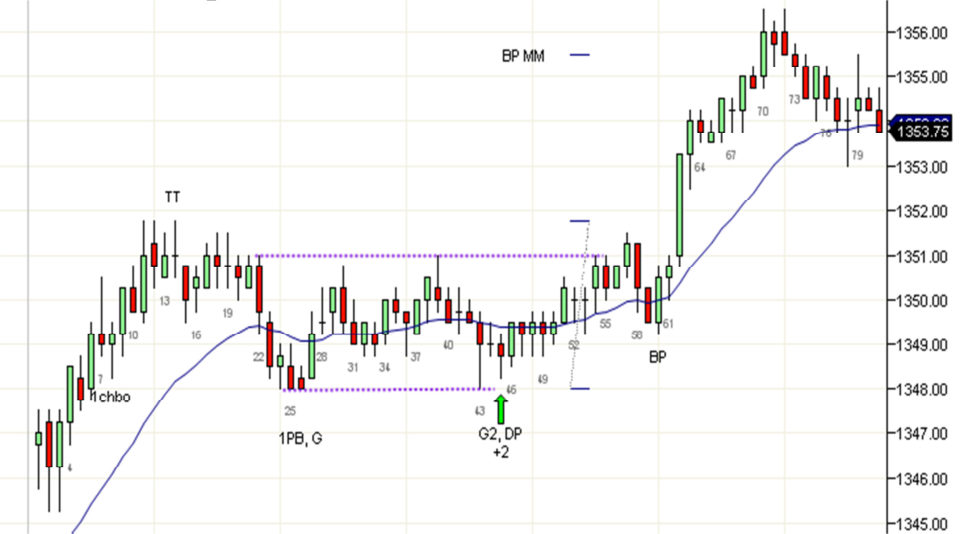

当市场开盘并立即开始移动，出现重叠k线，且回撤到前一根k线下方非常小或没有时，就表明市场进入了一个通道。通道走势在一个更大的时间周期上就是一个趋势k线，通常情况下，如果通道被突破并横盘移动，会有一个第二腿上涨。除非通道出现过分的过冲，否则通道走势永远不应该被逆势交易。

通道通常会演变成形态不佳的双顶或双底形态，或者十字星k线，或者两者皆有（b14）。如果通道只回撤了一部分，例如 50%，那么当天晚些时候很可能会出现一个同等幅度的原方向的走势。如果你遇到了深度回撤，应该考虑在 G2 时进场。

通常在通道之后的回撤会进入交易区间（trading range）并横盘整理，如果通道发出了趋势终止信号，例如 ii (b13)、双顶 (b14) 或十字星（也包括 b14）。波段交易者（Swing traders）应该在此点等待突破，今天我们看到了一个 DP (b45)，这是一个趋势生成器。

在交易区间（trading range）的另一端，应预期出现反转突破（BP），并可以持有以进行波段交易（swing），直到达到交易区间的度量移动（measured move），或出现另一个趋势终止信号（b72）。

<!-- 原书第 200 页 -->

## 第一次回撤

2011年5月11日 星期三 · 原书第 200 页

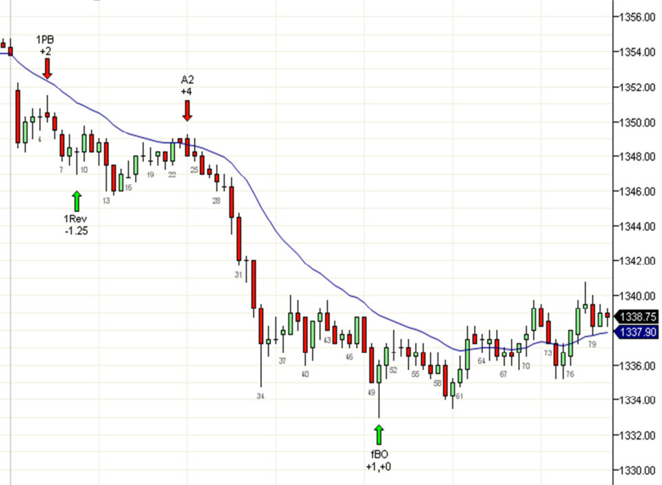

趋势行情（trend move）后的第一次回撤（1PB）通常是当天最好的波段交易。趋势行情可能是一个大的缺口（ gap），一个大的趋势k线（trend bar）或通道走势（channel move）。趋势越强，1PB入场（entry）就越好。如果第一次入场（1PB信号k线 b5 hi 是 5tf 从 b2）形成了一个5tf，这个走势会特别强劲。第二种形式的1PB是第一次2 腿式回撤（b24）。当2 腿式回撤到达指数移动平均线（ema）时，与A2, 并无区别，但第一次此类入场很可能给你带来当天最好的波段走势。一次2 或3 腿式的回补缺口（close the gap）的尝试，同时被视为1反转（ Rev）和1回撤（PB），通常是高概率交易（high probability trade）。

第二次回撤尝试（b9）有时会成为一个1反转交易，因此，建议在第一次下行推动时退出部分或全部仓位，并在第一次2L pb（b24）时重新进入。

对于新手交易者来说，1PB 通常是最好的建仓形态，前提是他们愿意在没有明确1PB 的日子里选择不交易。

<!-- 原书第 201 页 -->

## 各种1PB

2011年5月12日 星期四 · 原书第 201 页

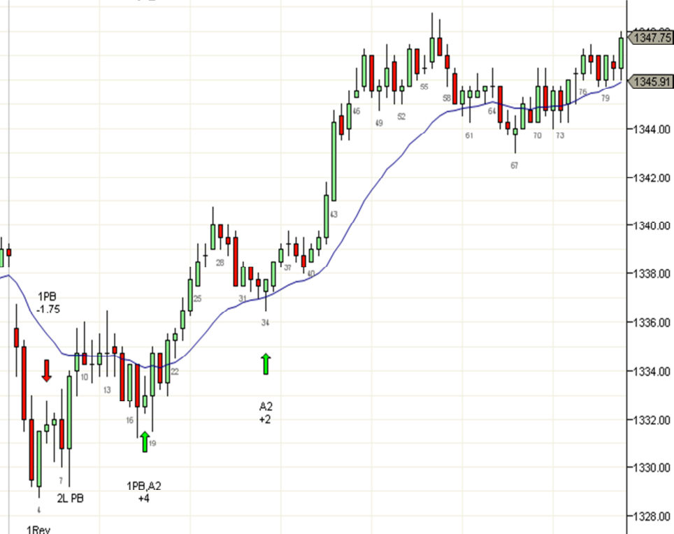

1PB 通常表示日趋势行情后的第一次回撤。1PB 的理念适用于所有趋势，即新趋势中的第一次回撤是一个高概率交易。因此，趋势突破或趋势反转后的第一次回撤都属于1PB，因为它们都代表了趋势中的第一次回撤。

当一天的1腿是强趋势行情时，有可能跌破低点形成第二腿。强反转k线将使其成为明显的反转，你不应顺着先前方向进行交易。然而，当下方引线很小时，它可能只是一个趋势k线的回撤。如果信号强劲，可以立即将持续信号视为1PB。如果b5 出现空头收盘且下方引线很小或没有，这将是形成另一向下腿的1PB信号。b5 然而在最后一刻转为看涨，结果却是一个糟糕的、失败的1PB信号。b7 显然不是信号k线，因为区间底部的外包k线是一个逆势交易建仓形态。

b5 至b8 形成1PB，因为它们构成了反转后的2 腿式回撤。然而，b8太大而无法买入，最好等待下一个信号。b18 是跳空k线，并且是A2 ，代表了两次在开盘价附近尝试抛售失败，以及第一个风险合理的PB，因此是一个事实上的1PB。

b34 是次A2 ，但它是明显趋势突破后的第一次回撤，也值得关注。

<!-- 原书第 202 页 -->

## 惹人厌的过冲

2011年5月13日 星期五 · 原书第 202 页

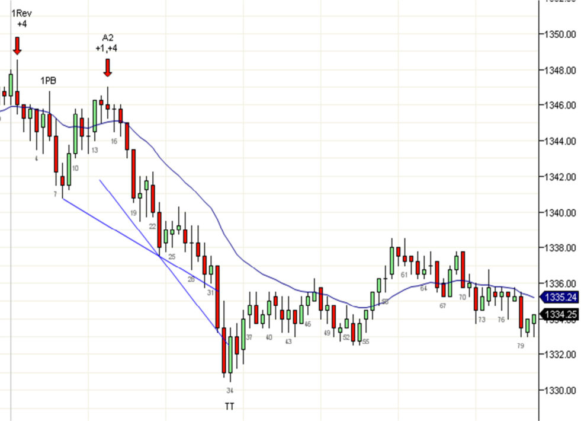

当价格过冲趋势通道多个点，并且出现一两个巨大的k线时，这个过冲是令人厌烦的。如果过冲以一个形态良好的反转k线结束，那么趋势反转将非常强劲，并且很可能会抹去整个之前的行情。

通常，当最后一到两条k线非常大时，趋势会终止但不会逆转。大k线（或多条k线）有效地形成了一个交易区间，价格行为类似于交易区间的移动。价格会尝试突破任一端，但第一次尝试通常会失败。交易这种走势的最佳方式是刮头皮双腿走势，如果区间足够大，偶尔也可以波段交易其中一端的失败突破。

如果区间非常大，价格可能会在收敛三角形中尝试盘整，然后寻找新的方向。

<!-- 原书第 203 页 -->

## 强劲楔形

2011年5月16日 星期一 · 原书第 203 页

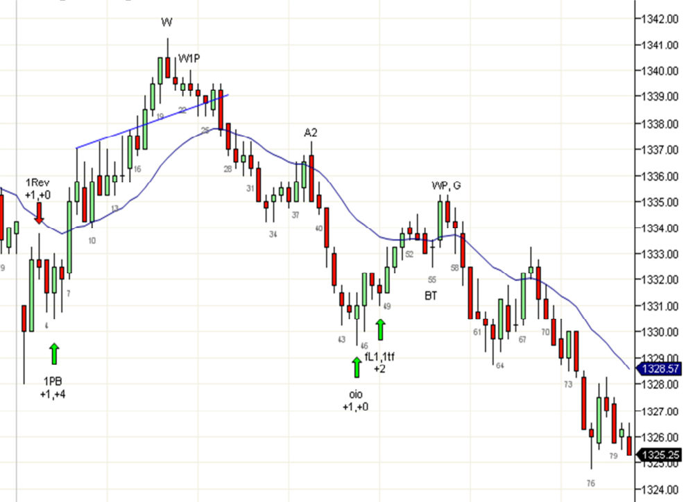

一个远超TCL但k线尺寸合理的楔形通常是一个非常强劲的楔形，尤其是在出现反转k线的情况下。这样的楔形可能难以解读，因为在强劲上涨后测试高点通常是规则而非例外。b21 处的更强入场 k线可能更容易解读这个楔形反转。

一个正常的楔形预计会回撤今日的第一次回调，即 b5 低点。这解释了从 b45 到 b56的买入活动。然而，楔形的反转失败了，价格跌破了 b45。这表明了非常强劲的下跌走势，通常会产生楔形顶部的度量移动。

<!-- 原书第 204 页 -->

## 铁丝网

2011年5月17日 星期二 · 原书第 204 页

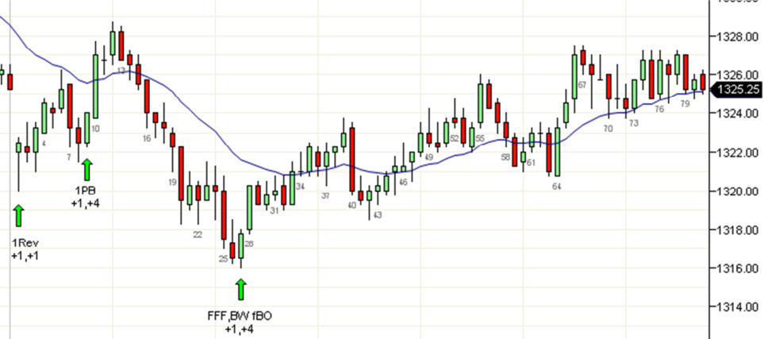

任何三个重叠的 k线，其中一个为十字星，都可以称为铁丝网，例如 b1-b3, b20- b24, b29-b32。交易铁丝网没有真正的方法，除非逆势交易。这是因为铁丝网是一个交易区间，大多数交易区间的突破都会失败。

有两种方法可以逆势交易铁丝网。一种是逆势交易任何趋势收盘。铁丝网中的趋势收盘很可能在另一端突破。所以你可以卖出高点或收盘一个多头趋势k线，或者你可以买入低点或收盘一个空头k线。然而，这很危险，因为可能会出现突破导致你的止损失效。

一个更简单的策略是等待一个趋势k线突破，这个突破超过铁丝网两跳以上，然后进行逆势交易。铁丝网运行的时间越长，突破越强，成功的几率就越高。

如果铁丝网是由小k线组成（小于4t），那么你很可能会多次遇到失败的突破，基本上形成一个扩张三角形突破。你需要至少 6 到 8t 到铁丝网的另一端才能逆势交易这个突破。

在一个交易日的极端位置（b21-b24）经历了一段延长的走势后出现的一个刺针k线，通常会导致反转，你可以对你的一部分交易进行波段操作。

<!-- 原书第 205 页 -->

## 强劲趋势

2011年5月18日 星期三 · 原书第 205 页

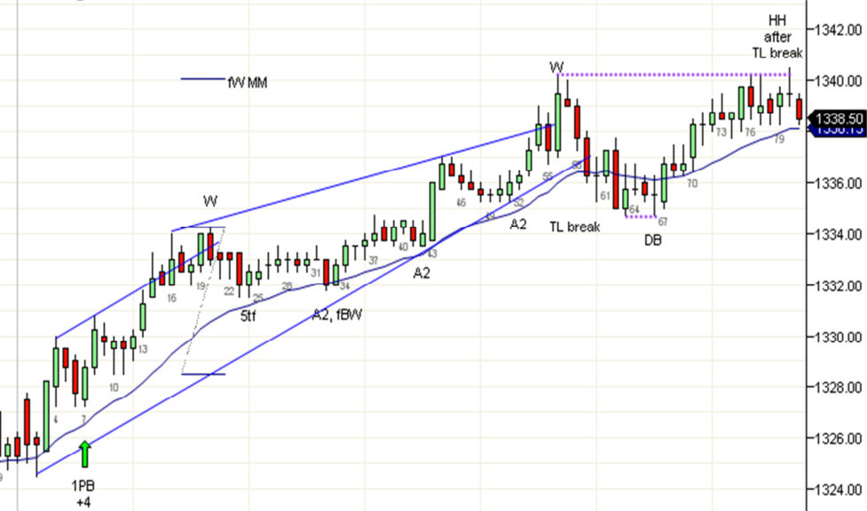

虽然一个大的缺口通常预示着趋势日的可能性，但这并非必然。如果前几个k线突破了前一天的区间并出现了一个突破回撤（b7），那么这一天很可能是一个非常强劲的趋势日。一个在指数移动平均线处的反转k线（b2）也常常预示着强劲的走势。

在强劲趋势中，唯一永远不应该做的事情是逆势交易。简单来说，买入回撤比做空次要回撤能赚取更多利润。

一次超额完成并出现横盘整理（b19 到 b34）通常是极强趋势的信号，应预料到可能的 fW。此外，当第一次上涨是通道式移动（b1 到 b20）时，在横盘移动后出现第二段是正常的。

强劲趋势最重要可能是成功逆势交易的缺失。直到第二个 W 处 b57, ，没有一次回撤低于波动高点信号k线。这本身应该向您保证趋势的强度，并让您在整个过程中站在正确的一边。

当出现大K线（b43,b56）并且有两个收盘价低于指数移动平均线（b59,60）时，趋势会减弱。这个移动也打破了趋势线，但这种强劲的动量几乎保证了至少会对高点进行测试，并且通常会出现更高的高点（b80）。

只进行顺势交易，直到至少一次逆势交易已被证明成功，这一条规则将使许多交易者免于逆势而动一个不可阻挡的趋势。

<!-- 原书第 206 页 -->

## TCL 在开盘时测试

2011年5月19日 星期四 · 原书第 206 页

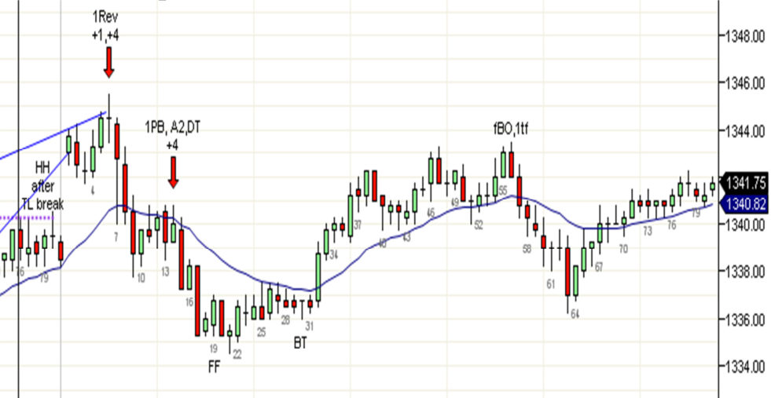

开盘时的TCL测试可能指示上午趋势的方向。昨日一次或多次TCL的第二次失败过冲可能指示反转，或至少是远离TCL的2L走势。

当缺口很小的时候，这可以被简单地看作是高潮k线和在TCL过冲时的 W型反转。如果缺口很大，这通常会导致形成一个反转k线，并可能从第 1 根k线开始出现趋势。

绘制前一天的高低点连线 (TCL) 可以防止您在错误的方向入场，在经历了一两个强劲趋势日后尤其有用。

<!-- 原书第 207 页 -->

## 最具波段交易潜力的建仓形态

2011年5月20日 星期五 · 原书第 207 页

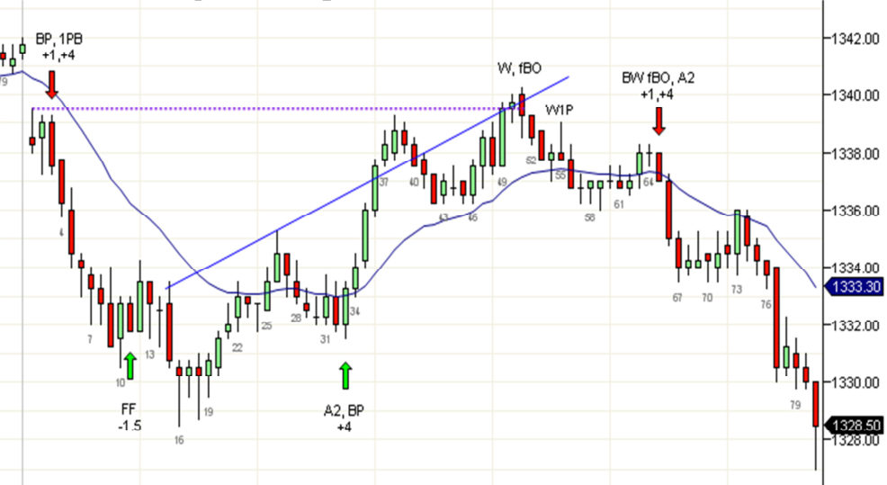

在您的胜率非常高之前，您应该只交易可波段交易的建仓形态以求盈利。如果您能在一次 2, 中盈利 +2 或 +4 ，平均而言是 +3 ，而当您犯错时亏损 2，即使您的成功率是 50%，您大多数时候仍然可以盈利。

最具波段交易潜力的建仓形态如下：

当日第 1 次腿式回撤。包含在入场k线之后紧接着一个内包趋势k线，就像今日一样。这基本上是一个 L2 腿，当接近指数移动平均线时，其表现会像一个 A2 或者 2 腿的 1 回撤。

当日首次 A2 。当出现趋势行情，随后出现一个 2 腿式回撤时，这种形态非常有可能成功，并产生一个与第一腿大小相似的行情。

反转后的首次 A2 。当价格突破 b12 和 b26 的指数移动平均线，并出现 2 腿式回撤时，这是一个高概率的波段建仓形态，可能带来 4 点的利润。

任何W1P或W之后的第一个A2 ，fBO或任何类型的关键失败。W1P通常会回撤整个楔形，因此您可以持有部分交易以获得许多点。

所有这些基本上都是新趋势中的首次回撤，唯一的要求是价格有足够的移动空间。强劲的上午趋势增加了任何交易成功的几率。如果你有不止一个理由来建仓，那么你可以选择在+2 和+4 处退出，而不是在+1 和+4处。

<!-- 原书第 208 页 -->

## 楔形失败突破楔形失败突破

2011年5月23日 星期一 · 原书第 208 页

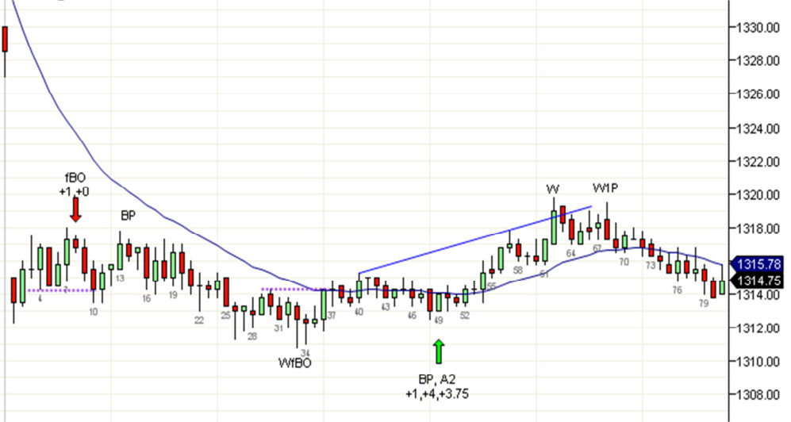

就像开盘趋势可以不带缺口产生一样，一个大缺口也可能无法产生趋势。在最初几次上涨和下跌的推动（b5）中，通常很明显这是一个交易区间日。在交易区间日，最好的交易通常是逆势交易突破，而 b8 是我们的第一个信号。

失效的突破预计只会出现两个腿，而且无法确定走势是浅还是深。然而，最高概率的虚假突破交易是发生在第三次——或者如果它们间隔很近——走势的第四次推力中的突破，如 b33 所示。这些预计会失败并触及区间的另一端。有时它们可能会出现突破回撤和另一端的强趋势行情，但在其他日子，例如今日，它们也可能在另一端失败（因为在 b63 今日出现了第二次楔形失败突破）。

虽然楔形失败突破是很好的入场点，但它们通常是刮头皮交易的入场点，并且在 b8 失败突破入场后，可能会出现像 b13 这样的深回撤。如果趋势线或波动点被突破（b4 低点被 b10, 触及，也突破了趋势线 b1, b6），那么突破入场可能会提供趋势行情。如果该走势是一个清晰的 2 腿部走势，例如在触及波动点 b30 并突破趋势线 b19-b33 之后的 b40-b49 ，通常会更强。

当任何失败突破入场突破了区间的另一端时，要为失败和回到区间内的走势做好准备，尤其是在窄幅区间中，因为它们的磁吸效应很强。

<!-- 原书第 209 页 -->

## 通道是趋势

2011年5月24日 星期二 · 原书第 209 页

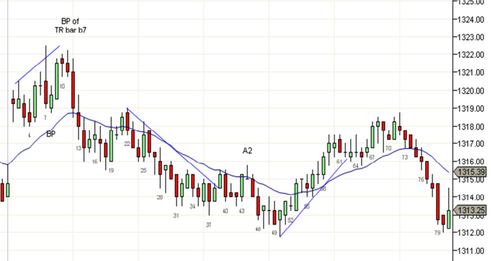

通道是窄幅的趋势，交易它们的方式应与交易趋势相同。尖峰后的通道通常表现为一个由三推组成的楔形。总的来说，通道本质上是趋势，尖峰的动量是使尖峰后的通道以三推的方式运行并经常过冲 TCL的原因。

没有明确尖峰的通道也应像趋势一样进行交易。通道内的2 腿PB（b37-44）可以作为A2 进行趋势交易，而通道的突破（b39, b63）和极端点的测试是逆势交易通道的先决条件。在通道的情况下，仅仅因为整个通道作为一个推动并且在先前的波动点之外的两个或三个跳动远远不是新的推动或极端行为，而去计算推动并逆势交易一个感知到的楔形（b31）是适得其反的。

<!-- 原书第 210 页 -->

## 楔形回撤

2011年5月25日 星期三 · 原书第 210 页

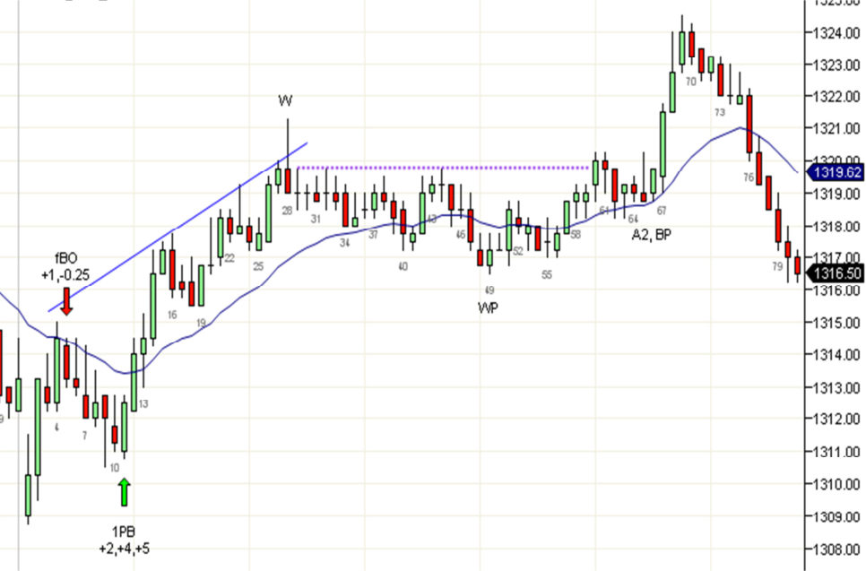

一天中的低动量、低成交量、三推回撤（b34,40,48）是楔形回撤，通常像A2一样运作。此交易有几个积极因素。它类似于BW fBO、A2 和W反转，集于一身。

如果出现强劲的k线且没有后续跟进，则此交易的成功概率会增加。一个小的内包趋势k线或任何小的趋势反转k线会增加延续的可能性。一个跳空k线或一个缺口入场会增加价格突破极端的可能性。

楔形回撤通常应作为波段入场，特别是如果上午趋势强劲。

<!-- 原书第 211 页 -->

## 在趋势线突破之后再考虑逆势交易

2011年5月26日 星期四 · 原书第 211 页

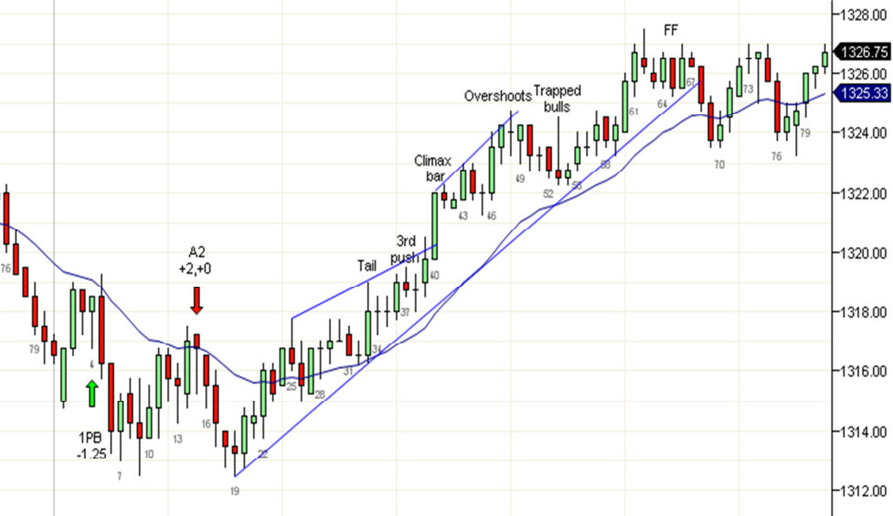

一再尝试逆势交易强劲的趋势是清空交易账户最可靠的方式。如果这个博客只能让你记住一件事，那就是：“在趋势线突破之前，逆势交易的概率都很低。”

今日是一个非常有启发性的一天，我们看到了几乎所有逆势交易失败的理由。许多交易者会做空像b40 这样的强劲k线，并假设这是一个过冲和高潮，但当这样的k线发生在前期HOD或LOD突破之后，它通常是在确认趋势。高潮k线一般可以用来退出，但它们是不可靠的逆势交易入场点。通常你会紧接着看到一个或两个高潮k线，即使那样，你仍可能看到横盘整理。

Minor过冲（b46,48）和引线（b25,33）通常在强劲趋势中建立顺势入场点和您不应该逆势交易它们。

陷阱k线（b52）是外部k线和交易区间，并且可能在铁丝网内失效。更好的陷阱k线是b5, ，它在停止1PB交易者之前没有走得太远。

在FF高点附近的小k线b67 下方做空，但即使如此，在趋势线突破之前也不是高概率的建仓形态。一旦b67-69 的走势突破了趋势线，逆势交易就可以接受，任何反转形态如W或DT都变得可以交易。

如果您的趋势逆势入场点被止损，那么正确的做法是立即画一条趋势线，如果它没有被突破，就在每一次轻微触及或尝试触及时以趋势方向入场，直到您看到趋势线突破为止。

<!-- 原书第 212 页 -->

## 1PB 作为一种可反转交易

2011年5月27日 星期五 · 原书第 212 页

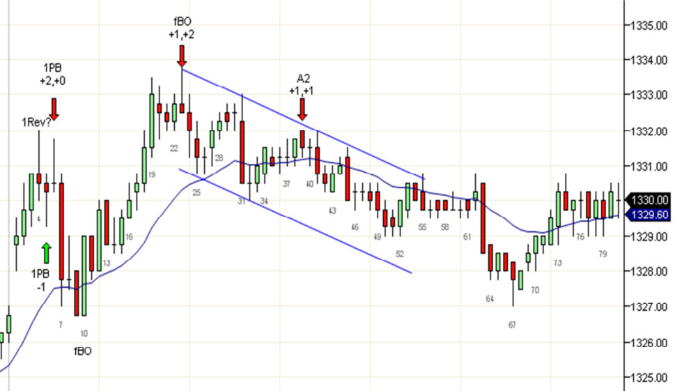

一些交易者在被止损后会反转仓位。这通常是个糟糕的主意。大多数时候，交易者对方向的判断是正确的，但入场点是错误的。对于大多数交易，最好是进行二次入场，并在失败时选择观望。

然而，有些建仓形态本质上在失败时可能会有大幅走势。根据我的经验，这些是 1PB，A2 和 W1P。一次失败的 1PB（在 b5上方做多）会转变为相反方向的 1PB（在 b6下方做空）。这尤其适用于开始回撤的 k线（b4）的实体方向是新方向的情况。

一次失败的 A2 多头（在 b36上方）会变成一次 A2 空头（在 b39下方做空）。这些需要一些经验才能正确交易。通常，看起来像是 A2 的走势，实际上是在新方向上发生可能反转后的回撤（b23）。

一次失败的 W1P（b57, 如果 W25,32,52）在失败时也是一次 A2 空头（在 b62下方）。这些很容易识别，因为真正的 W 需要有强劲的过冲和一个明显反转k线形态。W1P 也应该由强劲k线组成，因为弱 k线表明缺乏反转的信念。

其他建仓形态，如BT、G2, 1CBO等，本身并非反转形态。如果你判断错误，最好在进行下一次交易前等待更多价格行为出现。

<!-- 原书第 213 页 -->

## 反转通道

2011年5月31日 星期二 · 原书第 213 页

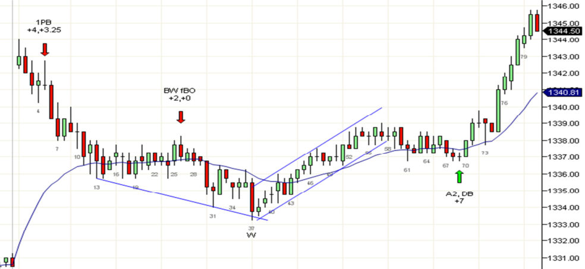

在之前的一篇文章中，我描述了开盘通道是如何导致后续的第二段走势的。对于任何新趋势的第一段的通道走势，包括反转，也是如此。

通道通常是更高时间周期上的强劲趋势，因此横盘整理是浅层回撤，通常会延续一程，如图左侧的30分钟Globex图所示。该图中的b32 对应开盘后的第一段30 分钟，是一根巨大的光头光脚突破K线。通常（但不总是）横盘整理会突破至少一根K线的高点，在5分钟的时间尺度上，这相当于突破了六根K线之外的波动高点。因此，交易横盘整理的正确方法是等待至少一个波动点被突破，然后在原始通道的方向上进行交易。第二段通常只需要突破第一段的极端即可，但除非第一段较弱，否则通道方向上至少会有两段，形成W入场。

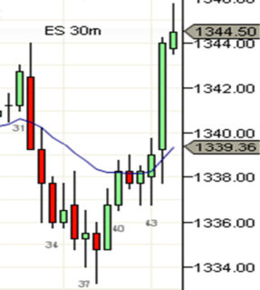

同样，左侧 30 分钟图上的 b39 和 b40 代表反转后的通道，而横盘整理的回撤则抹去了 30 分钟图上的 b41 的低点。因此，正确的入场方式是在 5 分钟图上抹去 b56 的低点之后入场。一旦你理解了它的运作方式，你就可以交易通道后的横盘整理，而无需参考更高时间周期的图表。只需等待至少一个波动点被抹去，然后在原始通道的方向上进行下一次入场。

请注意，有时它可能不会了结波段高点，而是在更高时间周期的图表上给出ii形态。这同样有效，但在5分钟图表上直接读取会更困难。然而，这些是较低概率的建仓形态，虽然它们有效，但通常会在5分钟图表上给出其他信号。

---

[← 上一章](12-2011年4月.md) · [目录](00-目录.md) · [下一章 →](14-2011年6月.md)
