[← 上一章](13-2011年5月.md) · [目录](00-目录.md) · [下一章 →](15-2011年7月.md)

# 2011年6月

原书第 214–235 页

<!-- 原书第 214 页 -->

## 持有波段

2011年6月1日 星期三 · 原书第 214 页

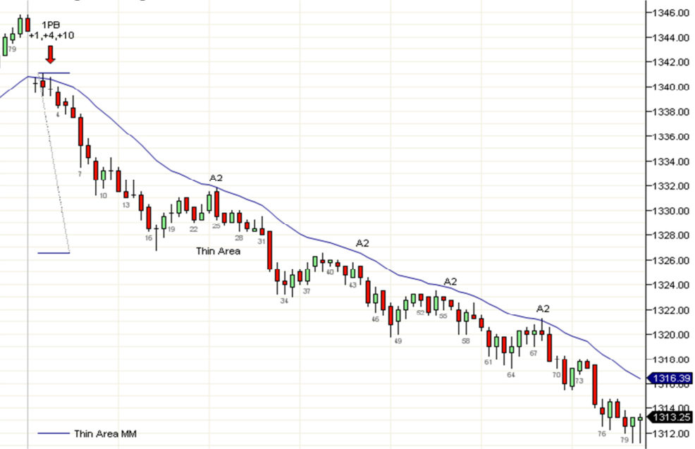

当市场在前几个小时只有一个多头K线，并且收盘价没有一次高于ema时，这表明是一个非常强劲的趋势。极强的趋势会产生多个A2 入场点，但在一波强劲下跌后，心理上会越来越难做空。持有一个早期入场很容易，尤其是当你的头寸没有阻力K线时。一旦出现可能的趋势突破（b18-25），就总有立即反转的可能性，因此很难留下可能会在突然反弹时消失的巨额浮动利润。有些日子，比如今天，强劲的趋势会持续到收盘，而在另一些日子，比如昨天，它们可能会完全反转，所以一个简单的策略是将止损移到每个新的波动点后面。

然而，经验丰富的交易者可以在强劲趋势中持有波段头寸，直到发生以下情况之一：

- 强劲的趋势线突破 4t 或更高
- 2nd 趋势线突破 2t 或更高。
- 趋势线突破并成功测试极端（即价格未跌破极端很多）
- 失败的A2 (A2 触发、接近极端、反转并突破信号k线)
- 单腿突破ema
- 突破K线突破ema，超过多个跳和一或多个之前的波动点
- TTR (k线突然变得很小，波段只比之前的波段高几个跳)
- 双顶或双底后出现趋势线突破。
- 达到主要度量移动。

在上述情况中，衡量移动仅在非常强劲的趋势中才可靠。Thin area 衡量移动和 fH1 衡量移动最为可靠。双底需要出现在交易区间内，因为在趋势中它们仅仅是回撤。

<!-- 原书第 215 页 -->

## 失效的A2

2011年6月2日 星期四 · 原书第 215 页

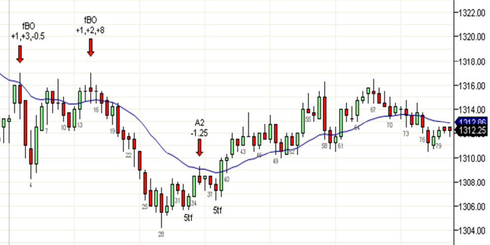

While 一个 A2 在趋势中是一个可靠的交易，它们确实会失败，而 A2 在交易区间中则不是。 t real在强劲趋势中的A2 的概率一样高。

当A2 被触发，朝着前期极值移动几个跳，然后回撤，导致突破信号k线之外的止损失效时，该A2 即为失败。

当突破后的第一个A2 失败（b35）时，无论几根k线之前的突破看起来多么强劲，这都是一个强烈的失败突破信号。这是因为在没有趋势的情况下，延续交易并不可行，你应该寻找逆势交易突破。

失败的 A2在趋势中，有时会成为 WP，如果它们离 ema 很远。一个清晰的 2段式走势到 ema （b28-35）不应该需要第三次推送，并且通常可以在信号 k线以上反转。一个 fL2 （b36 和 b 38 低于先前 k线）实际上使这成为一个看涨 A2 ，并且它是可接受的波段入场。在午盘时段，波段走势很少见，所以对这类交易的一部分进行刮头皮交易是可以的。

<!-- 原书第 216 页 -->

## 主趋势反转：趋势线突破和测试

2011年6月3日 星期五 · 原书第 216 页

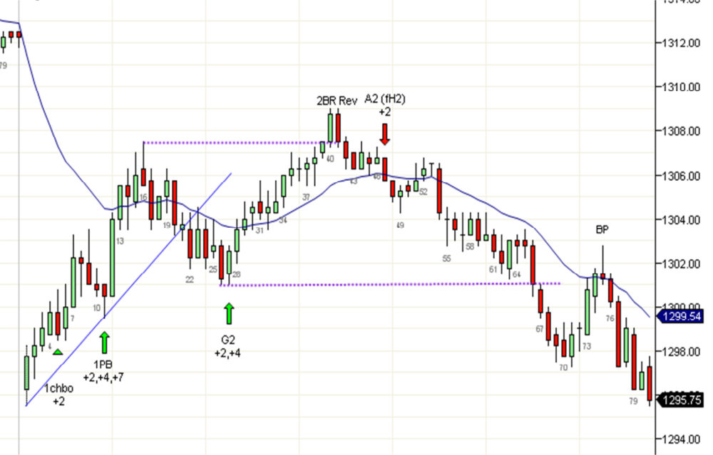

趋势线突破后对极端的测试是主要的趋势反转，能够实时识别它非常有益。这使您能够精确地退出仓位，也许还可以顺势而为。

在主趋势反转中，有几点需要注意。首先，趋势线突破需要是强劲的突破。这意味着突破持续了数根k线和数个点。通常情况下，您希望趋势线两侧各占整体走势的一半。像b11 低于趋势线从 b1 到b6 的轻微跌破可能不一定会导致趋势破裂。

第二点需要注意是，在趋势突破前的前期极值（b16 高点）附近没有大幅走势。当您在这一点看到强劲的推动，这是一个在强度上退出的绝佳时机。如果价格能够突破该前期极值，并且走势持续多根k线和多个点，那么趋势应该会继续，直到出现另一个趋势线突破。

最后一点需要关注的是，在前期极值之外出现反转信号。今日我们在b40,41处出现了一个2k线反转。反转k线或弱势k线后跟一个小型的内部趋势k线也是完全可以接受的。如果没有反转信号，最好等待2 次入场，或者等待反转发生后再于第一次回撤时入场。

反转后的第一次回撤通常非常浅（b46），但会运行很多点。这通常是一笔可波段交易，至少可以交易到趋势线突破的波动点（b27 低点）。

<!-- 原书第 217 页 -->

## 1次反转和1PB的考量

2011年6月6日 星期一 · 原书第 217 页

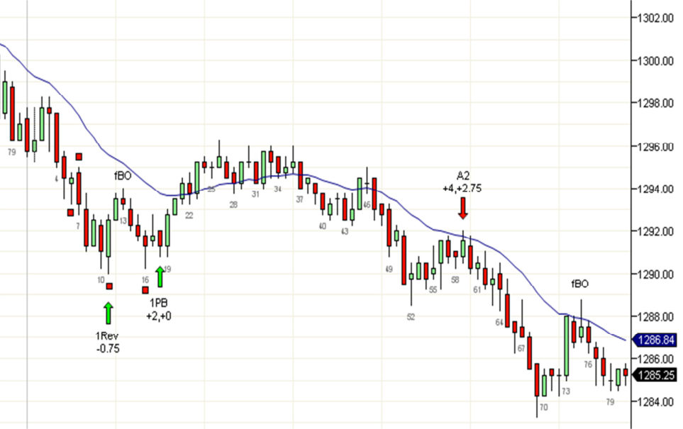

第一次反转和第一次回撤通常会在上午出现大走势，因此正确识别它们非常重要。关于它们的 the price action 通常不太清晰，今天的走势就显示了一些需要注意的地方。

b6 是一个糟糕的第一次反转信号，因为它是一个1十字星k线，几乎完全重叠。b7 是一个糟糕的1PB，因为它强迫在当日极端之外入场。在这种特殊情况下，它是一个1t，在强趋势中通常是一个可以接受的入场。

b11 是一根外部k线，预计会形成交易区间。尽管我因为这根k线的强度而做多了，但这是一个糟糕的入场，2L PB或第二次入场会是更好的选择。

从技术上讲，b13 是一个1PB做空，但由于k线尺寸小且发生在可能的反转之后，可以忽略。除非市场处于强趋势中，否则远离开盘价的1PB需要是深度回撤或2 腿。考虑到以上所有因素，b13 是一个风险较高的交易，最好等待更多的价格行为。

b16 是结束回撤的第一次尝试，在4 空头K线之后，并且是一个糟糕的入场点。尽管b18 处的L PB是一个糟糕的K线，但它仍然可以入场，因为它是在相同价格的第二次入场。

<!-- 原书第 218 页 -->

## 迟到的波段交易者

2011年6月7日 星期二 · 原书第 218 页

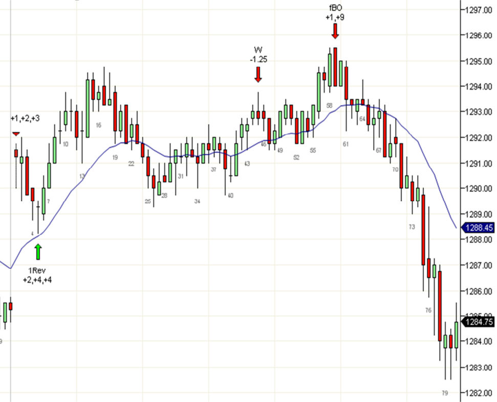

正确交易强趋势……很难。这是因为强趋势相对罕见，而且当它们发生时，交易者直到为时已晚才认识到它们。一旦他们认识到强趋势，他们就会花时间寻找从未出现过的回撤。强趋势确实会提供入场点，今天的晚盘趋势就说明了其中的一些。收盘前（90 分钟收盘前）的趋势突破通常是强趋势，将部分仓位持有至收盘是个好主意。这对于反转和大的缺口填补尤其重要。在你的入场（b60）和刮头皮退出（b61）后，等待至少一次结束交易的尝试失败（b64）。一旦这条K线收盘，你应该将止损移到这条K线上方。每次价格创出新低时，你应该将止损移到最后一次逆势波段（ b67,b70）之外。如果你过早退出或未入场，在后面仍然有一些可以进行晚期入场或加仓的地方。有时你可以早期识别趋势并向下方的fH2 （b67）加仓，或者一旦你识别出强趋势（由于多次1 tfs（b67, b70）以及缺乏任何相反颜色的趋势K线），你就可以在任何小K线（b73）或任何小的逆势K线（b74）下方做空，并将止损移到它上方。像b75 这样大的顺势K线通常会伴随着强烈的逆势走势，但在强趋势中，它们几乎总是在K线收盘前崩溃。

当有巨额未实现利润，并且您的波段止损点比正常情况（例如临近b 4 时）远 4 点左右时，很难坚持持有，但请放心，一个在日内晚些时候产生的强趋势很少会突然反转。通常，带有引线的第一个大k线（b76, ）后面至少会跟着一根k线，因此许多交易者会在下一根大k线收盘时退出（b77）。

<!-- 原书第 219 页 -->

## 一个简单的交易区间日交易计划

2011年6月8日 星期三 · 原书第 219 页

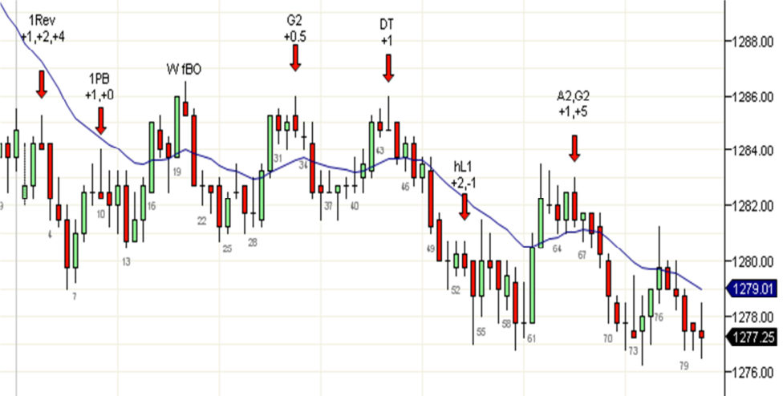

大约 80% 的日子是交易区间日，并且能够从中盈利地交易它们很重要。首先要做的是识别交易区间日。我的标准是：等待两次上涨和两次下跌（b13 今日）。之后，如果价格非常接近开盘价，那么它很可能是一个交易区间日。当日早期的强劲上涨和下跌k线（b2, b4）增加了在走势之间进行更大刮头皮交易（+2 至 +4）的可能性。当然，交易区间日确实可能转变为趋势，但在大多数情况下，它们只会进行两到三段式的走势，达到当日的极值。

一旦识别出交易区间日，只需对任何一个或两个段式走势进行逆势交易，直至当日极端。如果走势非常像通道，你可以选择跳过，因为它可能只算一个腿。如果一个两腿走势只到达了区间中部，它可能会提供另一次上涨形成一个楔形，所以你可以跳过那个，选择楔形或在第二次尝试时入场 (b66)。

偶尔，可能会出现像DT（b44）这样的强信号，从而导致强趋势。如果您怀疑强趋势可能正在形成（剃须趋势k线，没有强CT k线，没有跳高过先前k线），您也可以在任何小的趋势k线（b53）上入场，因为陡峭的趋势可能带来丰厚利润。

<!-- 原书第 220 页 -->

## 强劲趋势中的反转k线

2011年6月9日 星期四 · 原书第 220 页

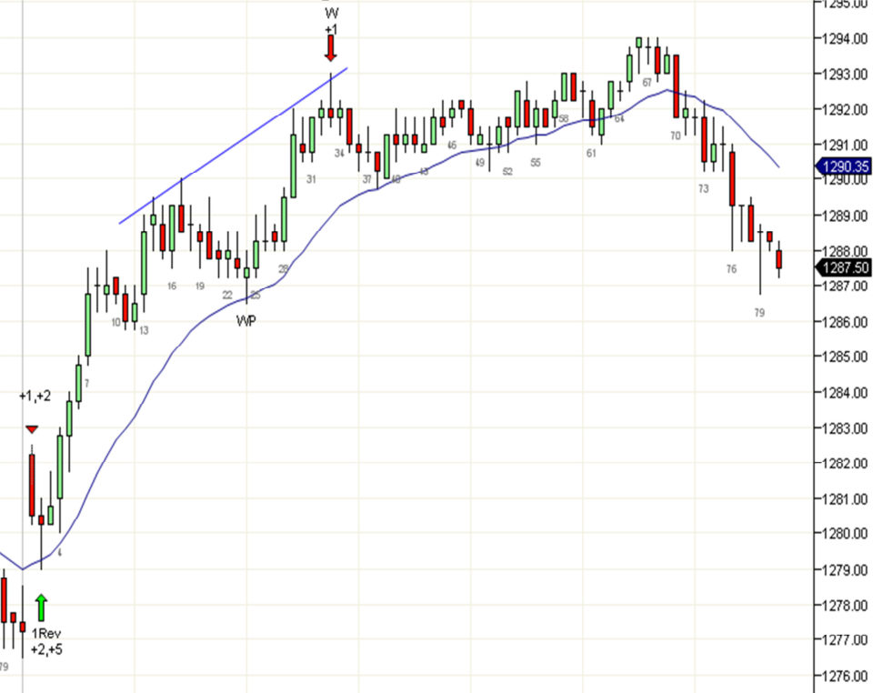

在趋势极强的日子里，反转k线看起来很不错（b17,b33），但通常只能带来刮头皮交易的利润。另一方面，顺势进场看起来很差（b2, b12, b24, b38,b50），但往往能带来合理的利润。

当顺势入场点突然看起来很好（b62）而反转信号看起来很差（b67）时，我通常会怀疑是反转。这是一个绝佳的退出点，并且根据价格行为，可以反转你的仓位。

<!-- 原书第 221 页 -->

## 强劲趋势中的 H1/L1 失败

2011年6月10日 星期五 · 原书第 221 页

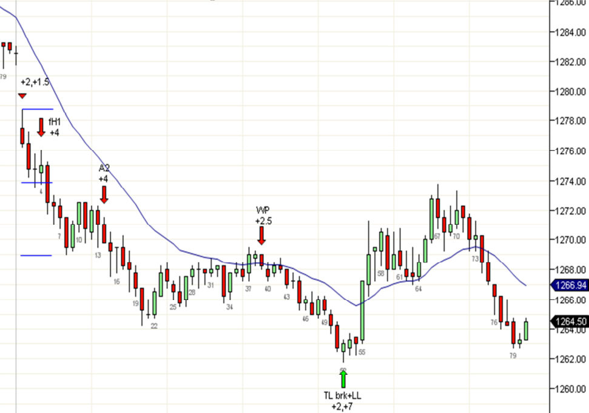

当一天以非常强劲的趋势开盘（大缺口，第一个2 k线收盘强劲）时，有很大可能第一次反转该趋势的尝试不仅会失败，而且会惨败。除了非常强劲的趋势，第一次反转的反转信号及其入场k线需要很差（b3,4）。一个1周期（b4）会形成一个绝佳的fH1 ，你应该在其下方做空，无论该k线看起来如何。

一个fH1 通常会进行一次衡量移动，从趋势开始到失败的入场k线（b1 高点到b1 低点）处，并且通常会很快（b4 ）达到衡量移动。在衡量移动处可能发生反转或进一步下跌，因此最好是退出并根据下一个信号重新入场。

<!-- 原书第 222 页 -->

## 失败楔形

2011年6月13日 星期一 · 原书第 222 页

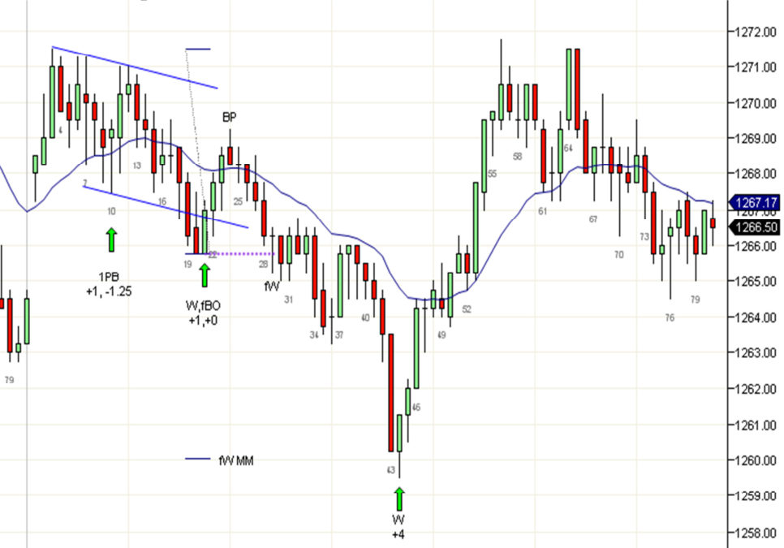

真正的失败楔形很少见。通常失败的楔形之所以失败，是因为它们没有代表极端行为。今日，我们有一个 W5,10,20 ，它强烈过冲了趋势通道线，并预期会给出双腿上涨。但仅仅一个单腿到b24, 后，它就突破了楔形的低点（b29），从而构成了一个失败的楔形。失败的W预期会进行一次楔形的衡量移动，正如我们在b44 处所做的。

如果到b24 的走势是2 腿的，那么它就不再是失败楔形，但仍然是一个做空信号，因为楔形之后一个浅的2 腿走势是一个持续信号。这仅仅意味着它不会是一个与楔形等大的衡量移动。

在楔形反转（W1P）后的回撤入场，而不是在W本身入场的原因之一是避免误读W或像今日这样的失败 W。如果有一个强劲的信号k线，例如b44，在强劲的W时入场一小部分仓位是个好主意。这是因为W有可能要到更晚的时候（通常在ema之上）才会回撤。

<!-- 原书第 223 页 -->

## 大型缺口

2011年6月14日 星期二 · 原书第 223 页

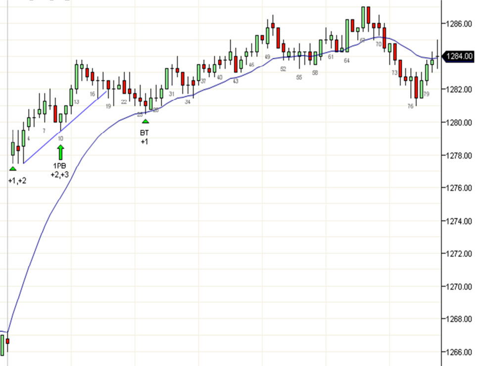

巨大的缺口——其大小相当于一个平均日，目前在ES中约为10 点——很可能会远离缺口而不是回补它。这通常意味着一个趋势日。一个试图回补缺口的巨大缺口日通常会远远超出前一天的收盘价，但一个试图扩大其自身优势的缺口可能会遇到阻力，而早期的价格行为会提供一些线索。

在强劲趋势k线早期出现的强劲上行走势通常意味着可能出现一根大阳线，而早期出现带有引线的重叠k线可能意味着早期走势后的走势有限。浅的趋势线突破（b15-25）可能意味着趋势结束而无反转。通常在这种强劲的交易日里，早盘的强劲趋势和浅的趋势线突破之后会跟随一个通道型走势。这是因为在更高的时间周期上，这实际上是一个急速加通道的走势。通道在出现自身的趋势线突破（b50-55）并伴随极端测试之前，永远不应该被做空。

总的来说，如果只在ema附近进行顺势进场交易，那么由平均或小k线组成的趋势后面跟着的大幅上涨缺口是相对容易交易的。一个粗略的经验法则是，只在ema附近进行顺势交易，直到出现收盘跌破ema（b57）成功，然后在下一次上涨时退出（b67）。只在多头K线之上买入第二次尝试，通常会保护你免于止损出局。

<!-- 原书第 224 页 -->

## 反转k线是交易区间

2011年6月15日 星期三 · 原书第 224 页

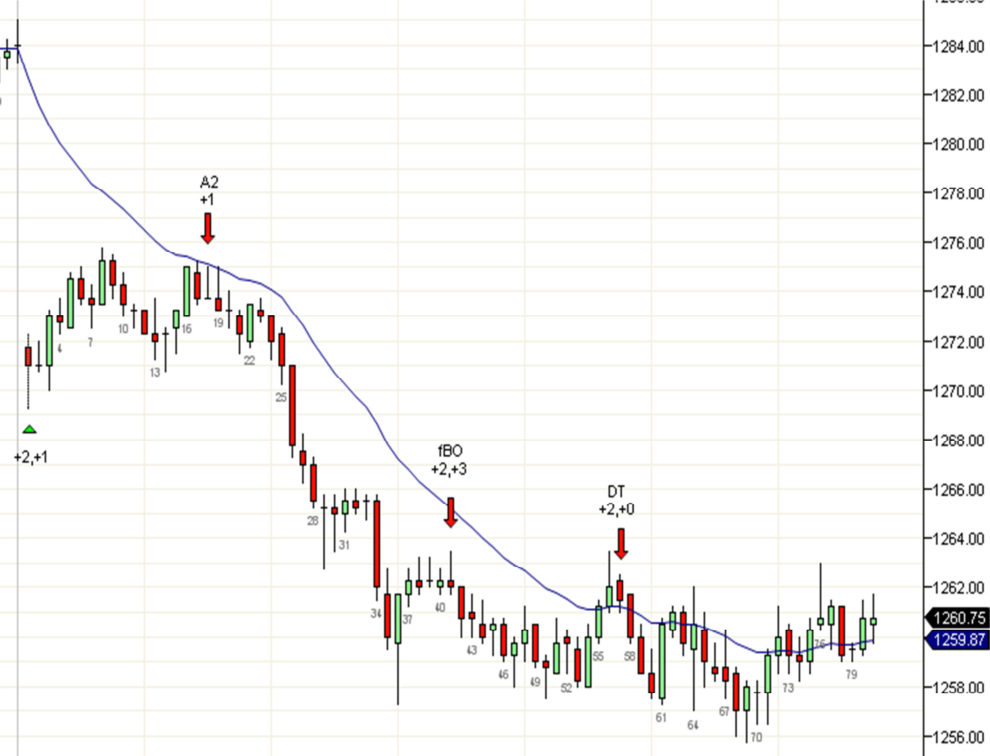

大的反转k线（b36），尤其是在强劲空头走势（b23-35）之后，通常是交易区间。一次强劲的过冲伴随着一个非常大的反转k线（超过3 点）将终结趋势并转变为交易区间。这种K线后的价格行为有时是向上或向下趋势中的突破回撤，但通常是K线两侧的失败突破和横盘运动，直到新的趋势突破。

交易此k线的正确方法是，在任何一侧进行第二次失败的突破（b41, b69）交易，并持有至测试另一侧。交易区间的规模可能随着每一次失败的突破而逐渐增大。通常最好跳过失败突破的交易，直到区间规模达到4 点或更多。

k线越大，您就越有信心，因为他们不会在它上方买入太多，仅仅是因为止损会太大。

<!-- 原书第 225 页 -->

## 主趋势反转：双重趋势线突破

2011年6月16日 星期四 · 原书第 225 页

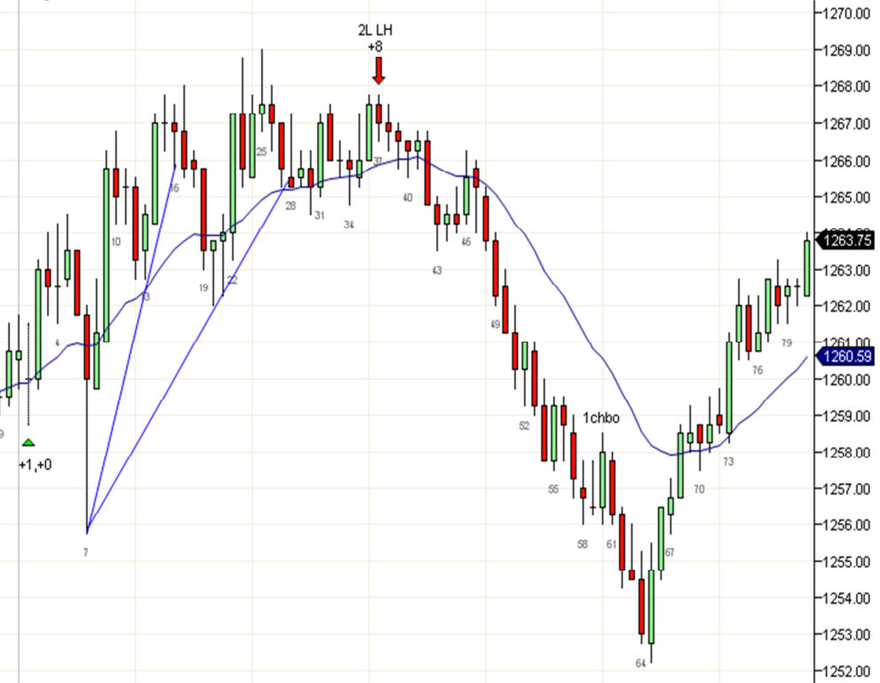

趋势线突破（b19）后，对极端进行测试（b23），然后是额外的趋势线突破（b30），最后是2L 未能达到极端（b37）是一个双重趋势线突破，并伴随主趋势反转。您应该始终抓住这些机会，因为它们会带来强劲趋势。

尽管趋势线突破和2L的走势达到新极端（b25）本身就是一个信号，但信号差的k线应该让你保持观望。第二次入场即使信号临界也可以接受，但2L的LH是更好的信号。1L的LH（b32）很少应该被交易（例如在有强劲的过冲时）。在所有其他情况下，2L的LH是理想的入场点。

<!-- 原书第 226 页 -->

## 三角形突破

2011年6月18日 星期六 · 原书第 226 页

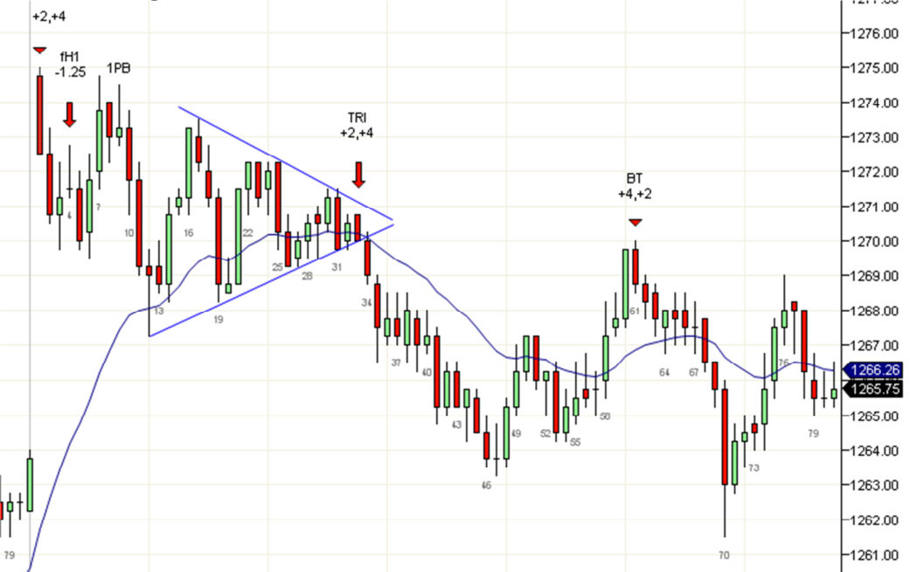

突破是最难正确预测的形态，也是最常失败的形态。突破大致可以分为三种：

- 三角形
- 扩张三角形
- 交易区间突破

本质上，所有的突破都是交易区间突破，而三角形突破代表收敛交易区间，扩张三角形则代表扩张交易区间。横盘交易区间突破可以通过未能突破另一侧来预测，或者在突破回撤时入场。这种方法不适用于三角形。

然而，对于收敛三角形，有一个简单的指导原则。它通常会朝着之前的趋势方向（上午空头走势 b1-12）突破（b34）。有时三角形会立即突破并反转，但如果突破K线有强劲的收盘价，并且其下方的止损（b34 hi）没有被触及，这通常是一个成功的突破，并且应该至少延续 2 腿。

<!-- 原书第 227 页 -->

## 从第一根k线预测趋势

2011年6月20日 星期一 · 原书第 227 页

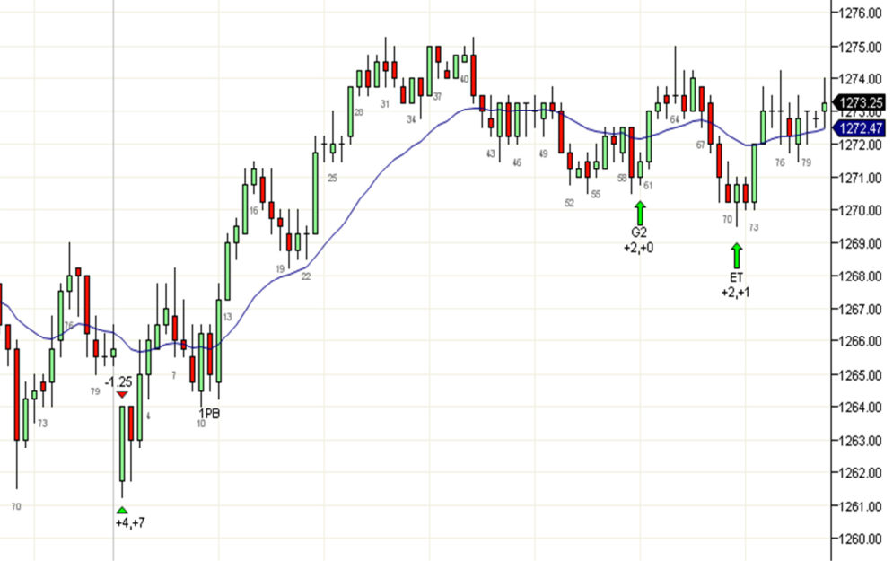

巨大的缺口可以帮助你预测趋势日，但预测趋势更重要的是当日极端的反转。今天的 b1 反转了 b70 昨日最低价，并且前一天后半段显示出足够的强度，使我们能够预期至少会测试昨日高点。

如果在第一小时内，当日极端的第二次反转尝试失败，那么这也是一个非常好的早期趋势指标。在波动点之上或之下的入场，可以进行多个点的波段交易，至少可以达到前一天的波动点之上一个或两个点。

保守的交易者可以在两次做空ema失败后，于b1PB上方入场。

<!-- 原书第 228 页 -->

## G2在强劲趋势中的深度回撤之后

2011年6月21日 星期二 · 原书第 228 页

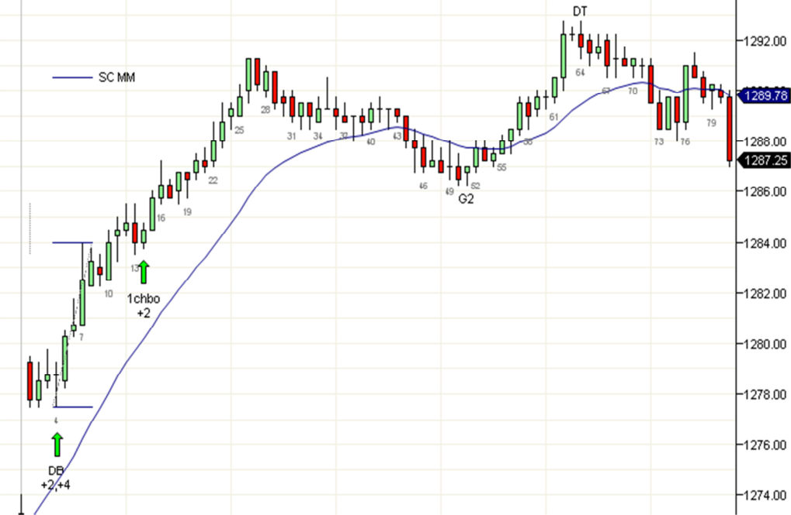

强劲趋势的第一次深度回撤通常值得再次入场并继续走势。当趋势强劲且已经运行了很多点（b4- 26）时，第一次深度回撤（b28-50）很可能会很深，并且经常跌破ema。第二次尝试填补缺口（b52在b49失败后）通常会成功，并且是一笔高概率交易，很可能达到新的极端（b62）。

需要注意的是，第一次深度回撤可能已经打破了趋势，而触及新高点可能仅仅是趋势结束和可能反转。 G2 也应该是只有在潜在利润达到4点或更高时才应进行的交易。如果回撤不够深，它可能还需要经历另一条腿才能恢复原始趋势。

进行此交易的额外理由将增强该交易。例如，今天的b51 是一个低动量的3 推回撤，因此是一个楔形回撤。b51 也是第一个实际触发的看涨信号k线（b34 和b40 是入场k线）。

G2 是在疲软趋势的日子里以及第二次深度回撤时，这是一个较低概率的选择，并且y 鸥首 ld 寻找更多理由来进行此次交易。

<!-- 原书第 229 页 -->

## 反转前一日的极端作为趋势生成器

2011年6月22日 星期三 · 原书第 229 页

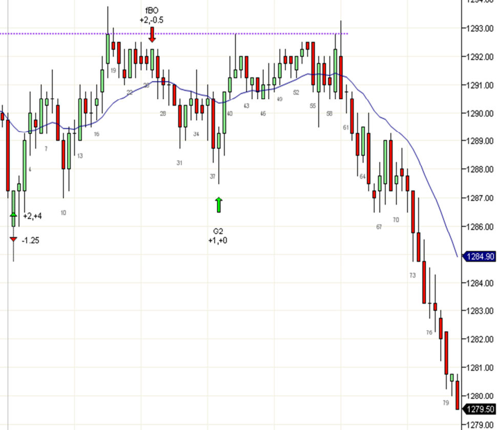

开盘价接近前一天区间中值的交易日很可能是交易区间日。如果它们测试其中一个极端并反转，即前一天高点或低点的失败突破，那将是一个潜在的趋势生成器。

反转前一日的收盘价有时会产生小的走势，如同今日的开盘价一样，特别是作为前一日整体趋势的持续走势。然而，反转当日的极端，尤其是第二个失败的突破，很可能会试图触及前一日的另一极端。

当你看到一个极端出现两次失败的突破时，这是一个非常好的波段交易，可以获得很多点，你应该始终进行一些合约的波段交易。

<!-- 原书第 230 页 -->

## 趋势加速

2011年6月23日 星期四 · 原书第 230 页

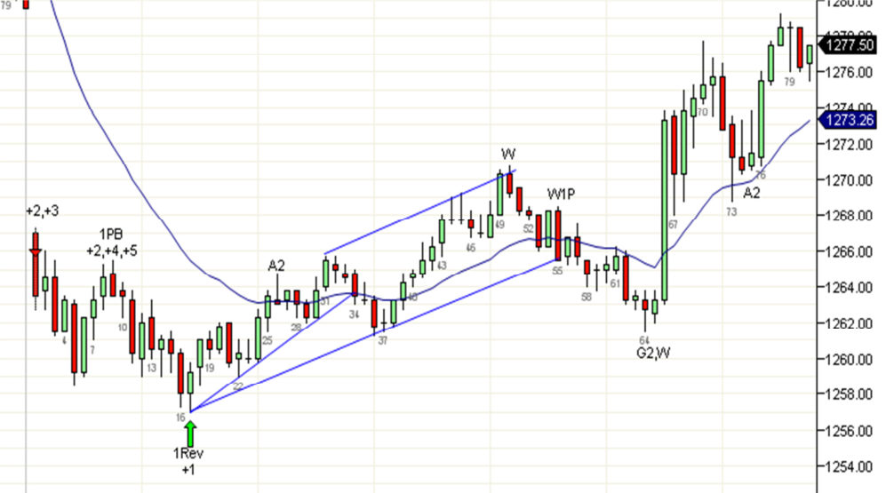

趋势线突破（b7-9）后，如果极端测试（b17）成功，则为一次主趋势反转。但是，当趋势线突破（b32-36）而高点测试（b41-44）失败时，趋势可能会加速，从而产生更大的波段。这就是为什么当趋势线首次突破时，顺着趋势方向入场总是一个好主意。如果趋势加速，它会形成一个由新趋势线（b17,37）支撑的新趋势。

早盘强势（b6-8）通常预示着后续会有强劲走势，如果没有早盘强势，除非有极佳的建仓形态，否则你可能想放弃买入趋势突破。

<!-- 原书第 231 页 -->

## A2变体

2011年6月24日 星期五 · 原书第 231 页

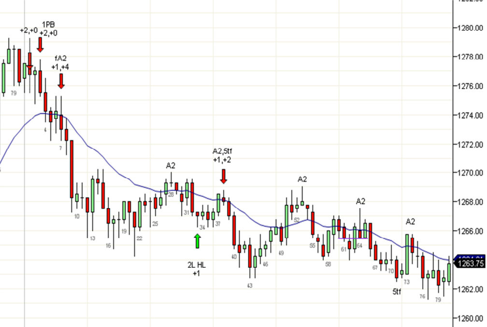

一个强劲的趋势日会显示出多个A2，今天我们看到了A2 变体的绝佳范例。

第一个也是不太明显的，是fH2 at b7。这将起到A2 的作用，并至少产生2 个下跌腿。虽然今天的形态很清晰，但在疲软趋势日，它可能会表现为在轻微倾斜的市场中，价格触及先前k线之外。

第二个是经典的A2, ，这是一个2 段式走势（b21-28），方向与主趋势（b1-b21）相反。

通常，计数逆势腿是一个好的做法，即在每一次新的趋势推动时重置计数。否则，你将会做空b23 而不是b28。然而，在两种变体中，你不必重置计数。这些是5tf走势。b36 以上的入场是一个5tf，这将允许b38 成为一个A2, ，将b35 计数为一个L1, ，尽管它与b33是相同的低点。另一种变体是b64 起到 A2 的作用，尽管b62 与b57 具有相同的低点，因为b64 以下的入场是一个2次入场，价格与b60相同。

甚至更好的是 b74, ，它是一个 A2 ，因为 b70 以下的做空是一个 5tf。请注意，您应该留意其他确认A2 的迹象，例如走势处于趋势中，靠近ema（不要离ema太远或太近），良好的趋势k线价格行为（没有太多十字星或重叠）以及合适的k线尺寸（k线过小或过大都必须忽略）。

<!-- 原书第 232 页 -->

## 末端旗形

2011年6月27日 星期一 · 原书第 232 页

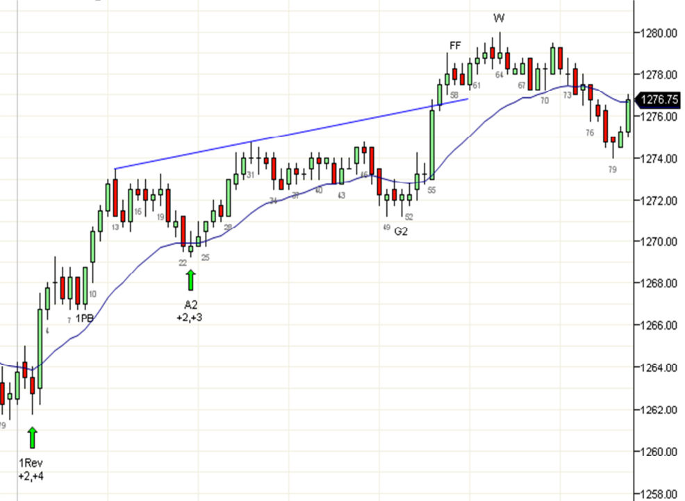

在强劲趋势中，旗形应该逆主趋势移动，如b13-23所示。只要旗形逆主趋势移动，价格总是有可能重新突破回原始趋势的方向。即使出现强劲趋势突破，预期是先前的极端几乎总是会被测试。

在一个持续的走势之后，也就是说在很多点和很多k线以及通常2 次或更多次的回撤（尽管做多高潮可能很少或没有回撤）之后，一个旗形可能会横向移动（b58-60），然后向原始趋势的方向突破（b61）。通常这次突破将无法获得刮头皮交易的利润（b64 hi曾是5tf高于b60），然后掉头向下。

在趋势线突破（b46-49）之后，末端旗形（FF）可能通过两次额外的推升（b63, b64）演变为W形态，然后向下反转。在TCL OS（b55,56）中出现的末端旗形通常是趋势反转的信号。非常大的k线（b55）可能出现在末端旗形之前，通常是高潮买入（在空头市场中为恐慌性抛售）的迹象。

<!-- 原书第 233 页 -->

## Choosing trades to swing

2011年6月28日 星期二 · 原书第 233 页

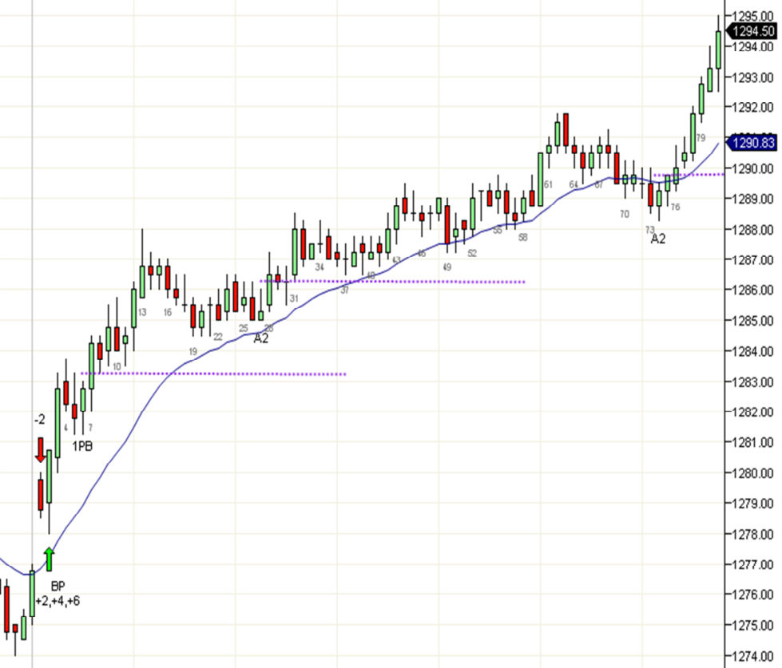

在趋势日，波段交易比刮头皮交易更有利可图。然而，你并非每次交易都可以进行波段交易。对于大多数入场点，你的入场价的波段止损很可能会被触发。

我使用一个简单的启发式方法来选择波段入场点。如果回撤有 2 条腿并且很深，我会增加我的波段交易头寸。今天这些将是 a2 多头在 b27 之上，以及 a2 在 b74之上。一旦价格走势 6向上突破这些k线并且刮头皮交易在这些交易中被填充，止损就可以移至盈亏平衡点。

多头入场点高于 b41 和 b52 ，已经过 2 腿，但深度不足以支撑波段交易入场。这些仅是刮头皮交易，风险较高。放弃这些交易，只坚持深度回撤是完全可以接受的。

除了 A2 交易外，上面 b6 的1PB 交易始终是波段交易，并且通常是当日最好的波段交易。

<!-- 原书第 234 页 -->

## 震荡：铁丝网

2011年6月30日 星期四 · 原书第 234 页

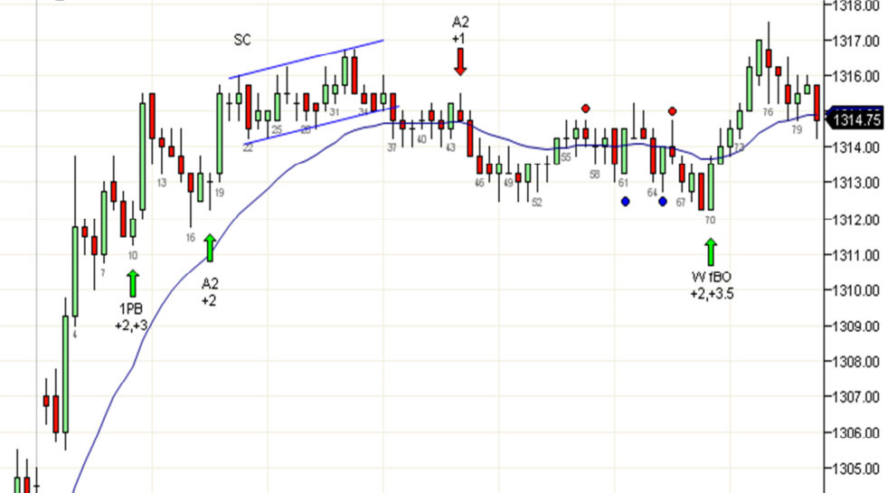

最危险的价格行为是铁丝网。铁丝网是指任何三个重叠的 k线，其中至少有一个是十字星。这个定义几乎使大多数 b20-b60 的铁丝网。许多交易者在尝试交易午餐时间的铁丝网时损失了他们的上午点数。

交易铁丝网的正确方法是不要交易它。在从 b55 到 b67的区域共有四次失败的交易。第一次是可能的 A2 做空，低于 b57。第二次是可能的 A2做多，以及失败的 A2 做空，高于 b61。b65 是突破波动点后可能的 A2L pb。b66 是可能的第二段下跌，从 b62开始。

虽然它们通常都是不错的交易，但身处铁丝网就使它们不合格。任何建仓形态都可能在铁丝网中失败，所以无论发生什么都不应感到兴奋。唯一可以入场交易的时候是当铁丝网不再像铁丝网一样的时候。在b70, 我们不再有十字星，并且有3 下跌推动至一次失败突破，所以这是一个可能的失败突破多头。如果b68 是一个十字星，那么这也会是一次糟糕的入场。

<!-- 原书第 235 页 -->

## 两腿回调至开盘价ema

2011年6月29日 星期三 · 原书第 235 页

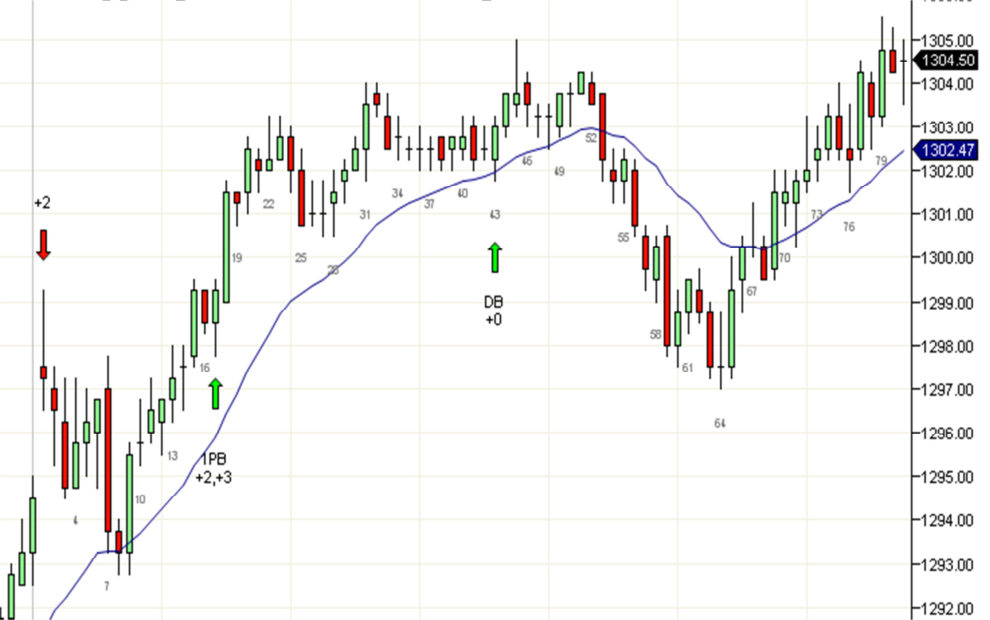

当昨日有一波强劲趋势走势，并且今日以昨日整体趋势的方向出现跳空缺口开盘时，任何两段式走势触及ema都应被视为持续信号。这通常是昨日趋势方向至少在上午走势中会持续的一个良好迹象。

如果前一日的最后一次上涨是顺着趋势方向并且由许多平均大小的k线组成，尤其是单腿走势，这个信号会大大增强。如果开盘价的回撤跌破昨日收盘价并反转（b7-9），这表明一个非常强烈的信号。

如果你因为一个糟糕的信号 b8 而错过了实际的反转，你总可以抓住第一个小幅回撤 b12 或者在向上突破 b1 后的 BP。

---

[← 上一章](13-2011年5月.md) · [目录](00-目录.md) · [下一章 →](15-2011年7月.md)
