[← 上一章](14-2011年6月.md) · [目录](00-目录.md) · [下一章 →](16-2011年8月.md)

# 2011年7月

原书第 236–253 页

<!-- 原书第 236 页 -->

## 交易区间内的两次回撤

2011年7月5日 星期二 · 原书第 236 页

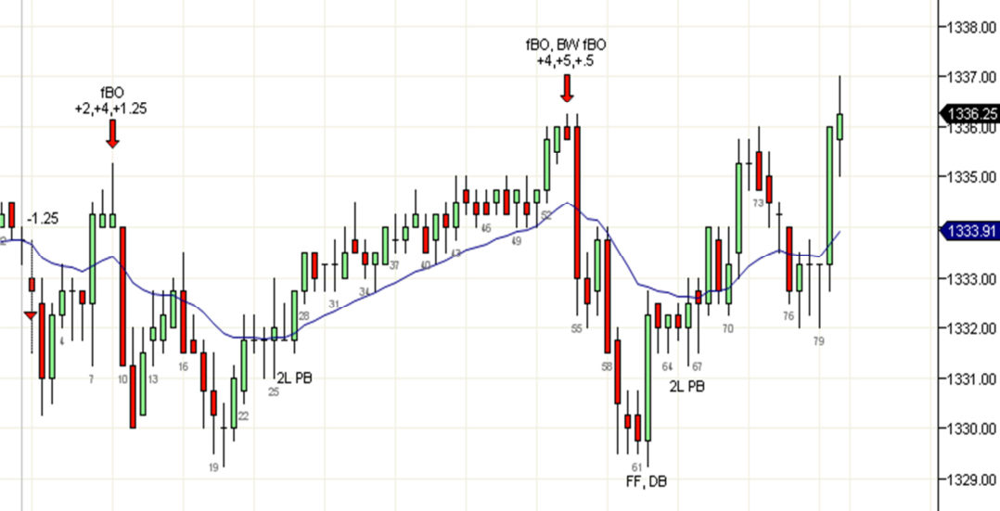

在交易区间日，没有 A2 建仓形态，但一次 2 腿回撤，在测试了区间的极端价位并反转后，往往可以像一个建仓形态一样起作用。例如，在 b20, 上可能出现突破和反转后，出现了两次在 b24 和 b27 做空的尝试都失败了。当它们失败时，就相当于一次 2 腿回撤，价格应该会继续朝着新的方向发展。

在b62 DB之后的回调和可能的反转稍微清晰一些，因为b63 是L1 ，而b66 是L2。同样，b5,7 是两次失败的做空尝试，b77 和b79也是如此。

当交易区间足够大时，尝试逆势交易突破变得很有吸引力。一个好的经验法则是，当交易区间至少有 4点宽时，进行 fBO 交易。

<!-- 原书第 237 页 -->

## 震荡

2011年7月6日 星期三 · 原书第 237 页

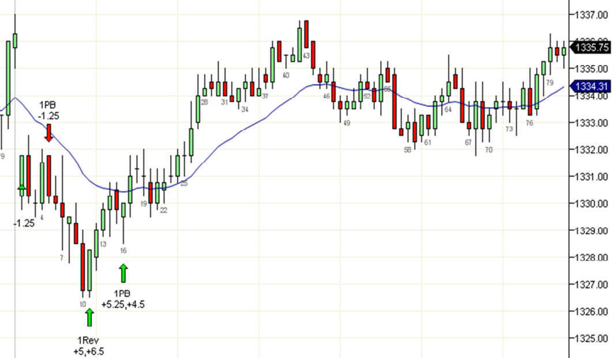

当市场在每个 k线上上下波动，导致每次交易都被止损出局时，市场就处于震荡模式。震荡可能由新闻触发或加剧，就像今天一样。

通常情况下，震荡代表着激烈的冲突，但绝对是一个交易区间（b1-b7）。最可能的结果是突破和反转（b10,11），从而形成趋势（b11-b43）。

如果两个多头订单和两个做空订单都被止损出局（b1多头止损于b2, 下方，b2 做空止损于b3, 上方， b3 多头止损于b4, 下方，b5 做空止损于b6上方），那么市场可能处于震荡状态。此时，最好的做法是停止交易，等待突破及其反转。震荡很少会突破并朝着突破方向继续（但偶尔也会发生）。

更安全的入场点是在反转后的第一次回撤（b16），或者如果突破方向是朝着ema（指数移动平均线），则可以逆势交易（fade）向ema的段式走势。

盘初的震荡可能在下午（b68-b74）产生余震，因此一旦趋势突破（b43-48）并形成交易区间，就必须谨慎行事。

<!-- 原书第 238 页 -->

## k线微小时顺势交易

2011年7月7日 星期四 · 原书第 238 页

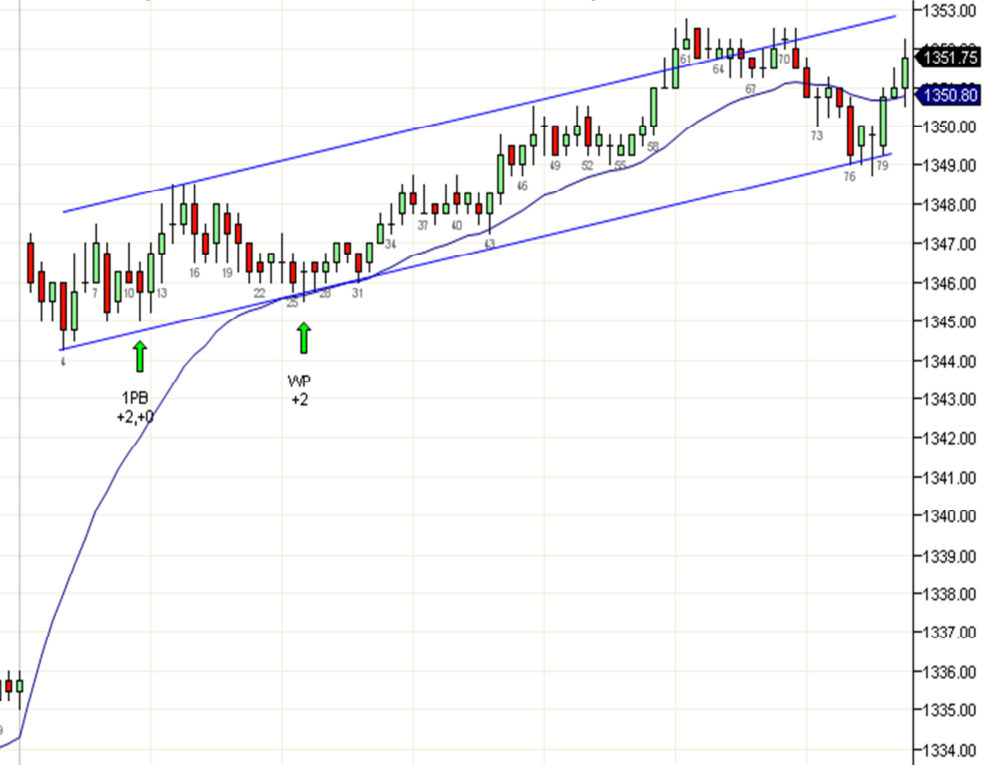

大的缺口就像一个尖峰，通常是盘前交易中的一个尖峰。如果开盘没有出现明显的卖出，价格很有可能沿通道向上。急剧的两腿走势到达ema可能产生强劲趋势，但低动量的走势伴随微小的k线可能起到楔形回撤（WP）的作用，并产生通道型走势。

当大多数k线都很小，并且只有一到两个跳的实体时，趋势很可能会继续朝着当日缺口的方向发展。如果通道很窄，每一次做空信号都会在中等区间提供一个入场点，而这很可能会失败。

交易通道的最佳方法是在接近ema或趋势线时，在出现无效的L2 后买入任何多头K线。通常，当 L2 是接近ema的内包K线时，你可以用限价单买入内包K线的低点，并设置紧密的止损。

<!-- 原书第 239 页 -->

## 突破后的两腿回调是反转的良好迹象

2011年7月8日 星期五 · 原书第 239 页

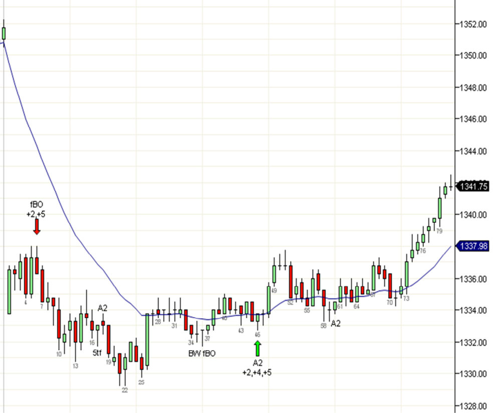

趋势突破后对前期极值的测试是主趋势反转。有时突破如此强劲，以至于测试非常浅。例如，b 26 突破了趋势线，在ema处止步，然后进入了铁丝网。通常一次突破会失败并迅速抛售，但当出现2 腿回撤（b28 和b32 找到了卖方）并且买方能够突破前期波动高点（b40 突破了b28 高点）时，一个新的趋势就已经形成（2更高的低点和两个更高的低点）。

因此，接下来的2 腿回撤在b46 遇到了大量买家，收盘前的每一次回撤也是如此。

<!-- 原书第 240 页 -->

## 趋势不会轻易反转

2011年7月11日 星期一 · 原书第 240 页

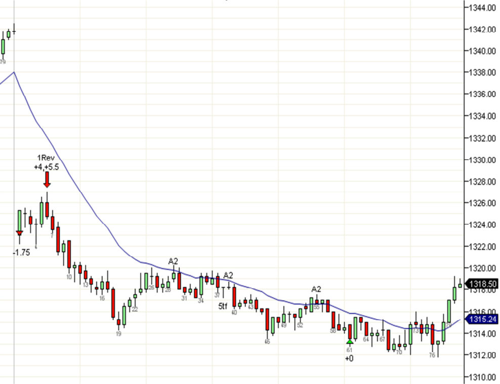

顺势交易者总是占有优势，原因是趋势不会轻易反转。尤其是强劲的第一段走势。今日从b6 开始出现了一段通道式走势，直到出现明显的趋势线突破（b19-b29）。通道式走势很可能意味着会出现第二段下跌，将触及b19 的低点。这一点在b46达到了。然而，b46 或b47 的买家们感到失望，因为趋势并未简单地反转为看涨。他们可能在b61 （3 下跌推动）再次尝试，然后在b65, 、b68 和b72再次尝试。所有这些尝试都失败了，因为趋势不会轻易反转。大多数逆势交易者过早入场并为此付出代价。巨大的缺口和通道式的第一段走势是强势信号，如果没有明显的过冲，反转的可能性很低。

总的来说，一个 1 段式走势触及ema（b72）并收盘在ema之上，是趋势可能结束的一个好迹象，或者至少逆势交易很可能比一点或两点的刮头皮交易更有利可图。在此之前，每一次入场都是投机性的，即使你入场了，也要在没有回撤的情况下，在入场价格超过ema之前退出。

<!-- 原书第 241 页 -->

## 弱势趋势的楔形反转可能会产生强劲趋势

2011年7月12日 星期二 · 原书第 241 页

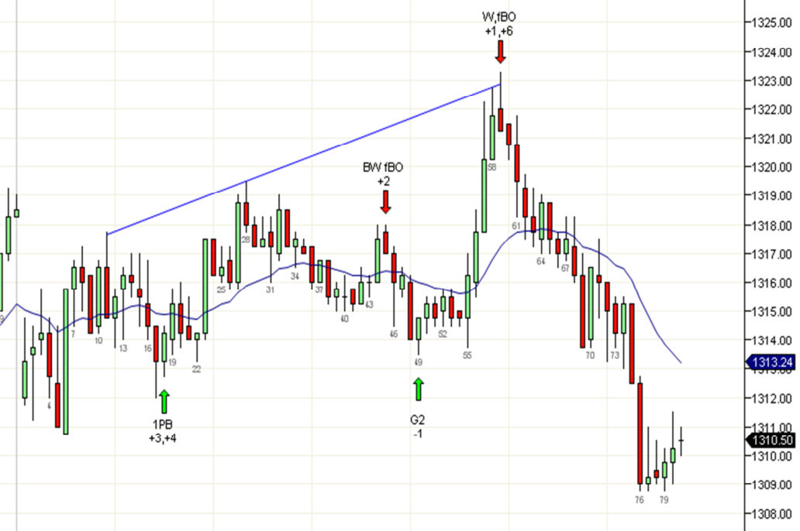

通常交易区间日是弱势趋势，带有深度回撤。价格持续创下更高高点（b11,b28, b59）和更高低点（b17, b22, b49）等。当这种趋势出现楔形反转（W11,28,59）时，整个楔形很可能会反转。在横盘运动失败后出现强力突破（b55-58）将产生大幅下跌。原因很简单：横盘运动就像铁丝网（BW），而突破就像铁丝网的fBO（BW fBO）。

然而，最主要的原因是，在没有大幅缺口开盘的交易区间日上发生的每一次新突破，其失败的可能性远大于成功的可能性。

<!-- 原书第 242 页 -->

## TCL 失败

2011年7月13日 星期三 · 原书第 242 页

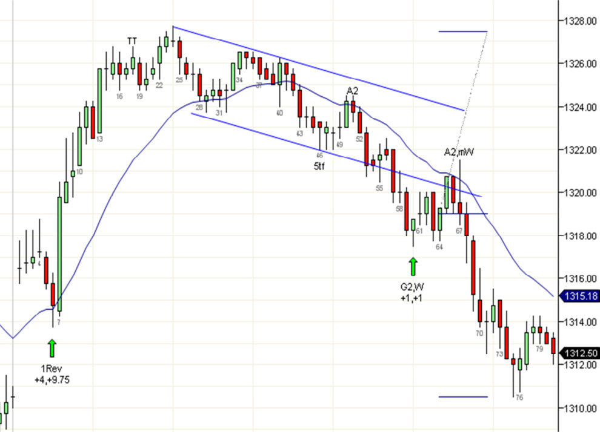

一个通道通常是一个旗形，在3 次推动左右后，将恢复之前的走势，至少测试原始趋势极值。价格在通道外的任何移动往往会将价格行为推向通道的另一极端（b29 到 b34, b40 到 b46）。违规行为越极端，反弹越尖锐。

非常深的偏离可能会导致非常急剧的反弹，特别是当早盘（b7-13）的价格行为显示出相同方向的强度时。然而，如果这种反弹未能冲向通道的另一极端，反而出现了一个 2 腿的走势（b60-67），那么我们就遇到了 TCL 失败，其结果通常是通道程度的衡量移动（在 b75处遇到）。这就像一个 fH1 ，并且通常是在更高时间周期上发生的。

正确的交易是既要抓住预期的反弹，也要在其失效时进行反向操作，因为两者可能移动的点数相同（b16 高点到b24 高点与b66 低点到b75 低点相同）。

<!-- 原书第 243 页 -->

## 趋势线突破是趋势的终结，但并不意味着反转

2011年7月14日 星期四 · 原书第 243 页

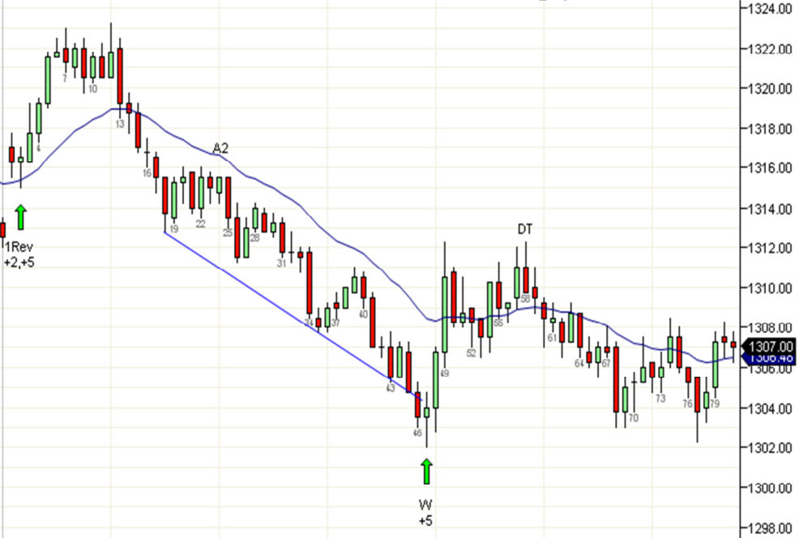

当趋势在足够大的走势（b13-b34）后加速（b40-b46）时，由此产生的深度趋势通道线破损（b 46,47）通常会引发强烈的反弹走势。侵入越深，反弹越强（b47-b49）。

当逆势交易者能够制造出强劲的走势，例如上述的反弹时，就会出现趋势线突破。通常情况下，突破非常明显，甚至无需实际画出趋势线。这种强度的表现足以让趋势暂停一段时间，但它可能不会立即完全反转整个趋势。这是因为在趋势线突破点（b49 high），卖方希望以更好的价格卖出，而错过的买方则希望以更好的价格买入。结果就是对趋势极值（b47 low）或至少对入场k线（b48 low）进行测试。此时第二次强劲的买入走势通常（但不总是）会导致趋势反转。

这暗示大多数入场点应在反弹暂停时退出，而波段入场点应等待前期极值的测试。

<!-- 原书第 244 页 -->

## BW 中等区间

2011年7月15日 星期五 · 原书第 244 页

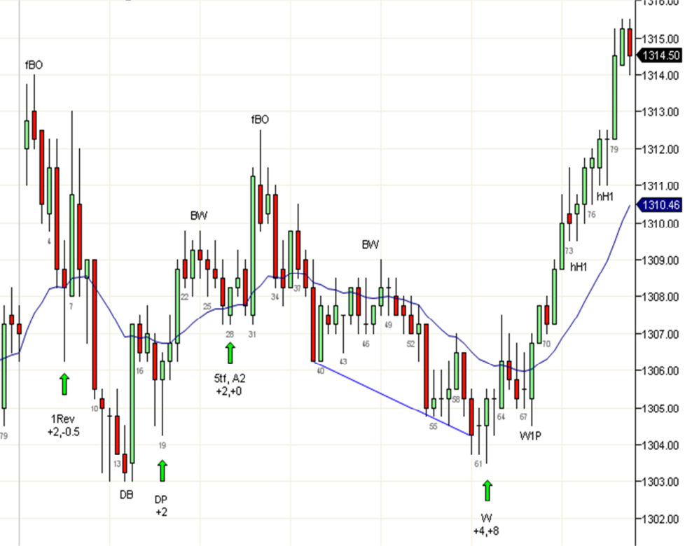

中等区间铁丝网（BW）形态在交易区间日中非常普遍。大多数交易者在试图交易这些形态时被震荡所困，例如今日b22-29 和b41-53 之间的形态。

关于铁丝网您需要了解的事实：

1. 它们几乎总是突破 ema 而不是穿过 ema
2. 来自 BW(b31,54) 的强劲突破 K线，无论它看起来多么强劲，都可能失败并反转，从而穿过 BW。交易区间日尤其如此，因为您期望区间末端的走势会反转
3. 2 如果看到额外的信号（TL触碰、5tf、修剪信号k线 b28），则失败的突破 ema(b25,27) 尝试可以像对待 minor A2 一样进行交易。这样做需要谨慎，因为做 fBO 总是更好的交易，您不想因为它站错边而错过
4. 日内的 BW fBO 可能比午盘的 BW fBO 产生更强的走势

请注意，强趋势（b74,b78）中的强H1/L1 入场点不构成铁丝网。这是因为趋势十字星属于趋势，而铁丝网需要有一定的横盘性。

<!-- 原书第 245 页 -->

## 趋势线突破

2011年7月18日 星期一 · 原书第 245 页

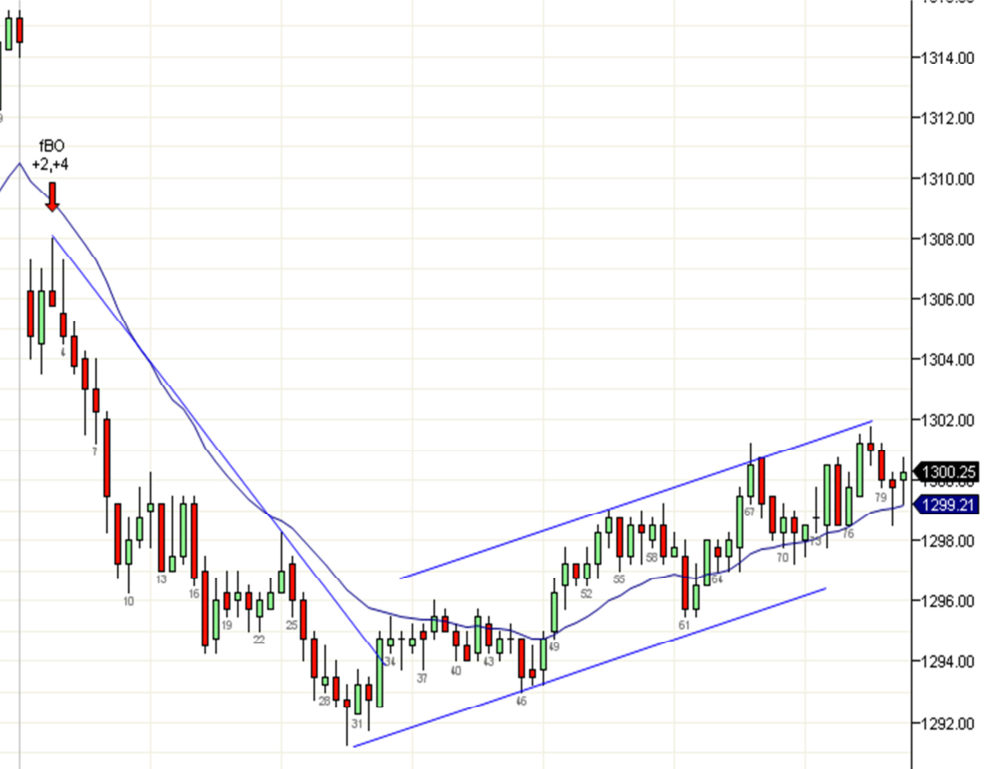

Tren线突破，尤其是超过20 根k线或更长的趋势突破，应仔细评估 d 用于延续、反转或交易区间行为。强劲的趋势线突破将远超趋势线多个点和多根k线，通常在一腿中收盘于ema之上。如果此突破发生在强劲的过冲和反转k线之后，那么它是一个非常强劲的趋势线突破，反转很可能发生。任何 2 腿回撤或任何合理的 1 腿回撤，例如 1chbo，都应该被抓住。

发生在非常大的趋势k线或带引线的k线之后的弱势趋势线突破很可能演变成交易区间。如果糟糕的信号k线之后是向ema的 2 腿回撤，该回撤接近趋势的极端高点但未能突破，或仅突破几个跳然后反转，那么这种情况尤其成立。

两者之间是一个温和的突破，形成一个通道，方向与今日的原始趋势相同或相反。这次突破来自于一个2段式走势（b30-34），之前有一个十字星k线，并没有真正的过冲。然而，随后的A2 （b38）并没有走远，并开始在通道中运行。一旦你判断出这是一个通道，你就应该像对待弱势趋势一样对待它，在趋势线和ema处买入2 腿回撤，并在趋势通道线处退出大部分入场，进行刮头皮交易。

<!-- 原书第 246 页 -->

## 限价入场

2011年7月19日 星期二 · 原书第 246 页

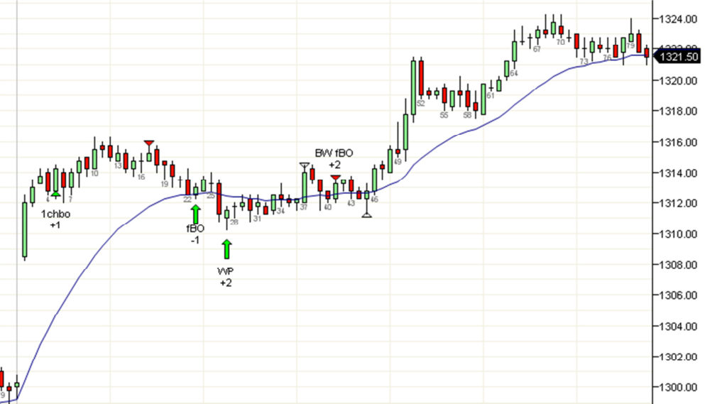

在尝试了限价入场后，我缩小了几个潜在的入场点，它们工作得相对稳定，而且当它们奏效时，比之前的或之后的止损入场能提供稍好的入场点。交易的关键是选择最佳的建仓形态，在小k线日进行限价交易可以将你的每笔交易胜率提高4倍或更多。在大k线日，这种方法可能不会有太大收益，因为每一次走势的动量都可能轻易触发严格的止损。总的来说，除非存在重叠，否则我不寻找限价入场，因为重叠的入场点往往会产生深度回撤。限价入场主要是为了晚些入场，通常能获得更好的价格。

第一个通道突破：当动量强劲且没有k线跌破前一根k线的低点时，第一根空头趋势k线的收盘价（b4）可以在限价入场，止损设在近期趋势k线下方（b2）。如果止损太远，则不进行交易。

入场k线测试：当内部信号k线（b13, mDP）被触发时，入场k线的高点通常会被1t（b14, b39）突破。这在入场k线的高点提供了一个非常紧密的入场点。止损可以设得很近，为3t，但如果附近有趋势k线，可以将其止损设在其上方（b12 high, b38 high）。

突破测试：当首次接近当日最高低点或最低高点时，有很大的可能性会以0-2t的距离失败。可以在距离突破点3t处设置突破入场，止损设在上方4t处。例如，b37 high如果首次接近，则会是b11 low的突破测试。总的来说，突破入场是针对突破的，除非趋势走势在该点位突破，否则不应期望其有效。

双底：强k线形成的双底，预期反弹幅度至少等于该k线的大小。例如，下方形成了双底，并且是可能的限价入场点。止损应设在最近的趋势k线下方（该图表中不存在，因此不是真实入场）。捕捉双底的技巧是始终在第二段或第三段下跌时入场。例如，尽管下方出现了反弹，但你真正想做多是在第二段下跌时，即在图中所示的位置。

<!-- 原书第 247 页 -->

## 微通道

2011年7月20日 星期三 · 原书第 247 页

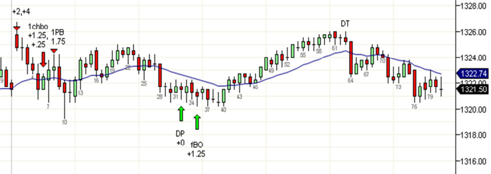

扩展微通道通常意味着反转，并且经常出现在趋势日和交易区间日。在趋势走势扩展之后，顺势微通道代表了趋势线突破，以及更高高点或更低低点的测试，并通常会发出反转信号。

在交易区间日，它们代表着向区间一端进行的弱势走势，这种走势通常会崩溃，并可能发展成任何方向的趋势。超过 20 k线的微通道会失去任何预测价值。

微通道与任何其他通道一样进行交易。突破并出现2 腿回撤是顺着趋势（朝MC方向）交易，而突破并出现2L测试则代表反转。

<!-- 原书第 248 页 -->

## 双底回撤

2011年7月21日 星期四 · 原书第 248 页

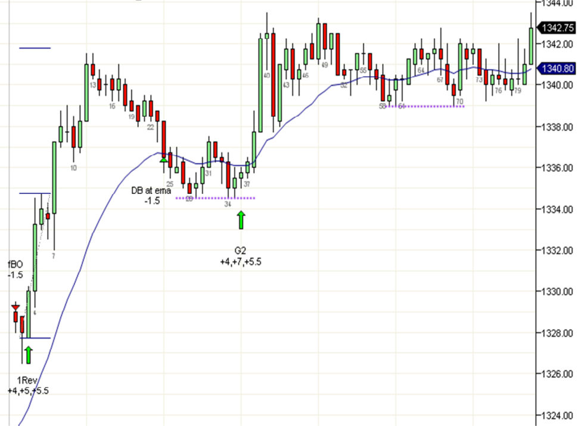

牛市趋势日中的一个重要持续信号是双底旗形（熊市趋势中的双顶旗形）。当它们出现在支撑位时，这些信号尤其强劲。例如，今日我们有两个双底牛旗。第一个出现在b29,35 ，位于b6上方的1PB入场点处的BT；第二个出现在b59,69 ，位于趋势线处。

深度回撤后的双底（DB）具有很大的意义，因为它暗示交易者在接近其入场价时再次买入或加仓。双底之后出现一个小幅回撤（pullback），但未能完全触及底部，就变成了双顶（DP）。内包k线（ inside bar），例如 b36 ，或者仅仅是偏离几个跳（tick）的幅度，例如 b74 ，都构成双顶（DP）。

DPs 是一种失败的突破，它们会走向区间的另一端（b12高点，b35 以及 b40 高点，b75），并且在区间较大的情况下应该被纳入考量。

<!-- 原书第 249 页 -->

## TTRs 突破趋势

2011年7月22日 星期五 · 原书第 249 页

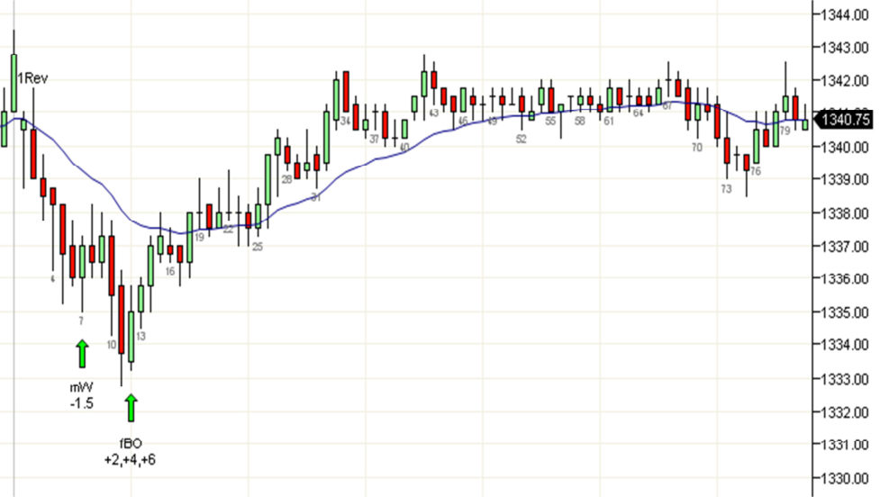

任何足够长的横盘运动都会突破趋势，包括单根 k 线趋势和缺口。最好在 TTR 的顶部附近退出任何仓位，并在下一次趋势突破后寻找新的入场点。

一个 Minor 横盘运动像 b19-24 仅仅是一个两腿回调 (b20 和 b24 是两次回撤) 并且不应被视为一个延长的 TTR。另一方面，当两次上涨和下跌尝试失败 (b46,47,49,50) 有很大可能这是一个横盘旗形和 TTR。

TTR（b54,55 和 b56）中的止损运行不是反转，不应被纳入考量。TTR 的突破，尤其是 2 或 3 腿的突破，可以进行逆势交易（b69-75）。

<!-- 原书第 250 页 -->

## 交易铁丝网

2011年7月25日 星期一 · 原书第 250 页

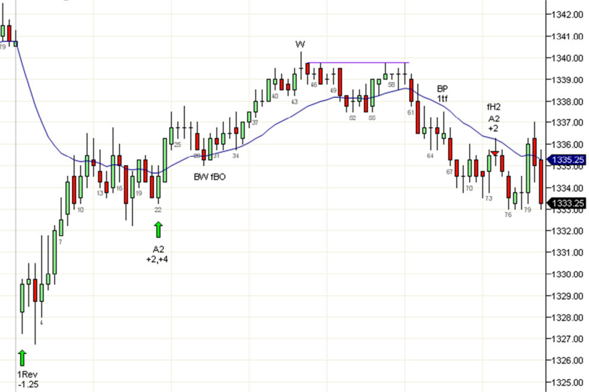

虽然通常避免铁丝网是极佳的交易习惯，但经验丰富的交易者能够并且确实能从中获利。在我确实入场交易铁丝网的情况下，通常是因为我错过了趋势中的早期入场点，而铁丝网为我提供了另一个顺势入场的机会。我通常会避免在区间的中间交易铁丝网。

例如，今日的铁丝网在 b24-b28 之间出现了向 ema 的趋势突破，并反弹，提供了一个 fBO 入场位，同时也是一个 fL2 入场位（b27L1, b29L2），适合那些错过了 b22上方买入的人。这种突破通常会产生持续 4 到 6 根 k线的非常短的铁丝网。在 b66也发生了类似的突破。b62 的强劲突破后，出现了两次无效的趋势反转尝试（b63 是一次无效的反转 k线尝试）。

b73 是趋势中一个类似的铁丝网 A2 ，应该被解读为 fH2 ，因此出现了两次无效的趋势反转尝试。（如果你预期 k线会触发，那么像这里一样，在收盘时限价做空是完全可以的）

最后一种但相对罕见的情况是，当 BW 反复未能触及止损时（如 b45-60 所示），可以进行做空。多少次尝试才算“反复”？这一点尚不清楚，但两次未能向上突破，并且至少有一次成功向下突破的尝试后，应该就足够了。

<!-- 原书第 251 页 -->

## 楔形回撤

2011年7月26日 星期二 · 原书第 251 页

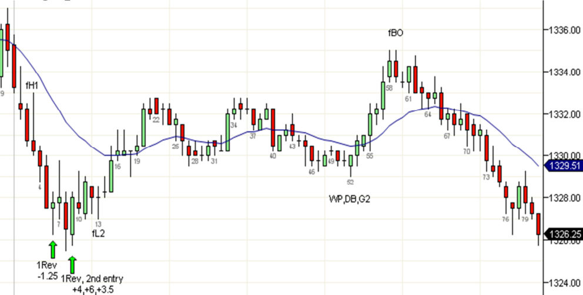

盘中低动量三推回撤是楔形回撤 (WP)，通常是良好的入场点。在趋势日，这种走势通常会在接近 ema 处结束。在交易区间日（如今日）中，它通常会提供前一个波动低点（b52 跌破 b27）的三推假突破。

通常这也会是一个G或G2 交易，鉴于之前同方向的趋势，这通常是一个高概率交易。通常WP构成了复杂午盘回撤的一部分。

<!-- 原书第 252 页 -->

## 趋势线突破后的通道

2011年7月28日 星期四 · 原书第 252 页

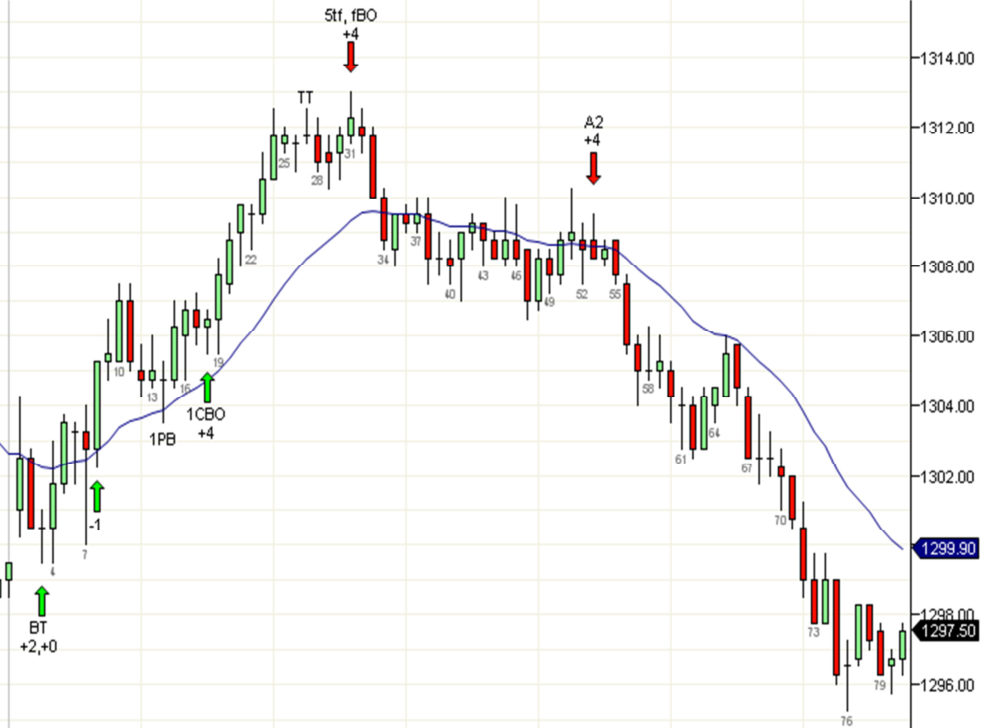

趋势线突破（b35-48 在b32-34之后）后的通道通常是新趋势的第一段。如果出现2 腿回撤（b49- 53），则应考虑可能出现的第二段，这通常是一个更强的走势（b55-62）。无论原始趋势的方向如何，新通道更有可能决定至少再一程的方向。

如果两腿回调非常强劲，它可能会突破通道趋势并最终反转通道。这通常很少见，但偶尔会发生。

<!-- 原书第 253 页 -->

## 内包k线

2011年7月30日 星期六 · 原书第 253 页

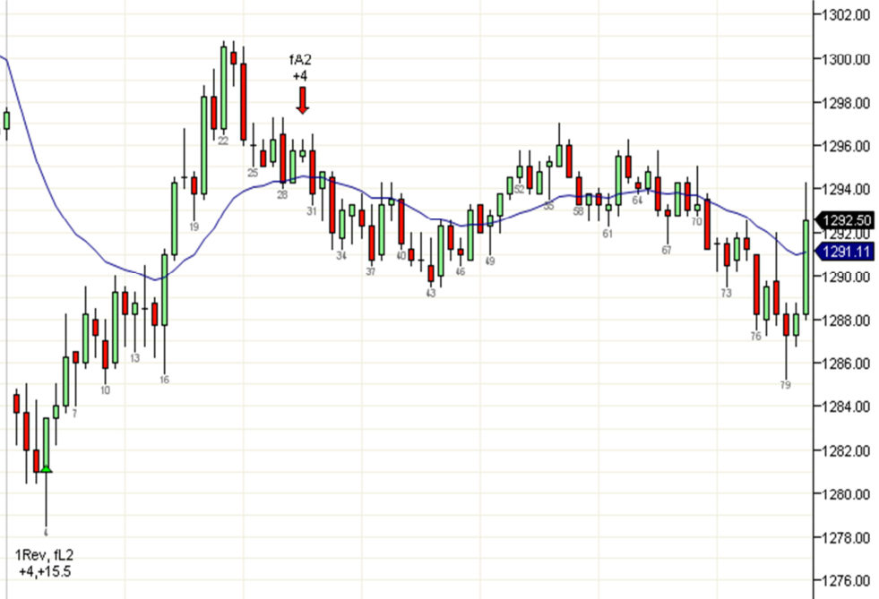

一根大K线的一端出现一根小K线，就构成了一个逆势交易大K线的形态，无论这两根K线是什么颜色，但当入场方向与内包k线方向一致时，信号会更强。例如，b23 形态构成了一个逆势交易，b22 ，并且价格有望至少触及b22的低点。

有时，即使内包k线和大K线的颜色相同，如果入场方向与整体趋势一致，逆势交易大K线也是完全可以的。例如，b30 形态构成了逆势交易，b29。虽然两者都是多头K线，但整体趋势已经向下（2 更低的低点和2 更低的高点）。b39 逆势交易b38也是同样的道理。

最重要的标准是内包k线的大小应小于外包k线的一半。例如，b9 和b45 是糟糕的入场点，仅仅因为到K线低点的空间不足以获得利润。如果K线有超过一个跳的引线，您可能希望改为进行2次入场。

小k线，其K线实体完全包含在较大K线实体之内（b21 内包k线 b20），只要其引线不是太长，也算作内包k线。

交易内包k线最简单的方法是，只在内包k线小于外包k线的一半且顺势（b30）或在波段交易或第三次推升之后（b23）才进行交易。

---

[← 上一章](14-2011年6月.md) · [目录](00-目录.md) · [下一章 →](16-2011年8月.md)
