[← 上一章](15-2011年7月.md) · [目录](00-目录.md) · [下一章 →](17-2011年9月.md)

# 2011年8月

原书第 254–275 页

<!-- 原书第 254 页 -->

## 小k线

2011年8月1日 星期一 · 原书第 254 页

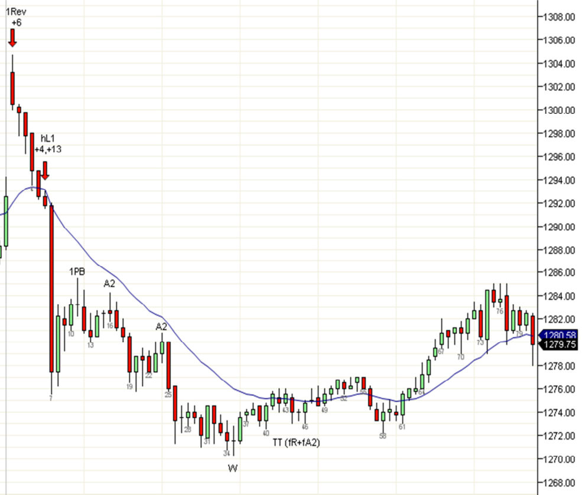

小趋势k线是非常重要的信号，你应该密切关注它们。在强趋势中，小趋势k线是顺势信号。这些信号经常出现在突破K线之后（b6 在b5 之后，以及b62 在b61之后），并且应该总是被纳入考虑，因为紧随其后的k线通常是大K线（b7）或会产生大幅度变动（b63-67）。这种小k线在当日最低价（LOD）处做空或在当日最高价（HOD）处做多都是安全的。

一个强信号模式下出现的小趋势入场k线表明了疲软（b10,b41），除非随后出现更多趋势k线，那样的话它才是一个强劲的信号。

在通道内的第一个逆趋势k线，如果收盘价强劲（b39 收盘价），可以在其收盘价处入场，因为这将被视为一次回撤。

<!-- 原书第 255 页 -->

## Inside bar after breakout bar

2011年8月2日 星期二 · 原书第 255 页

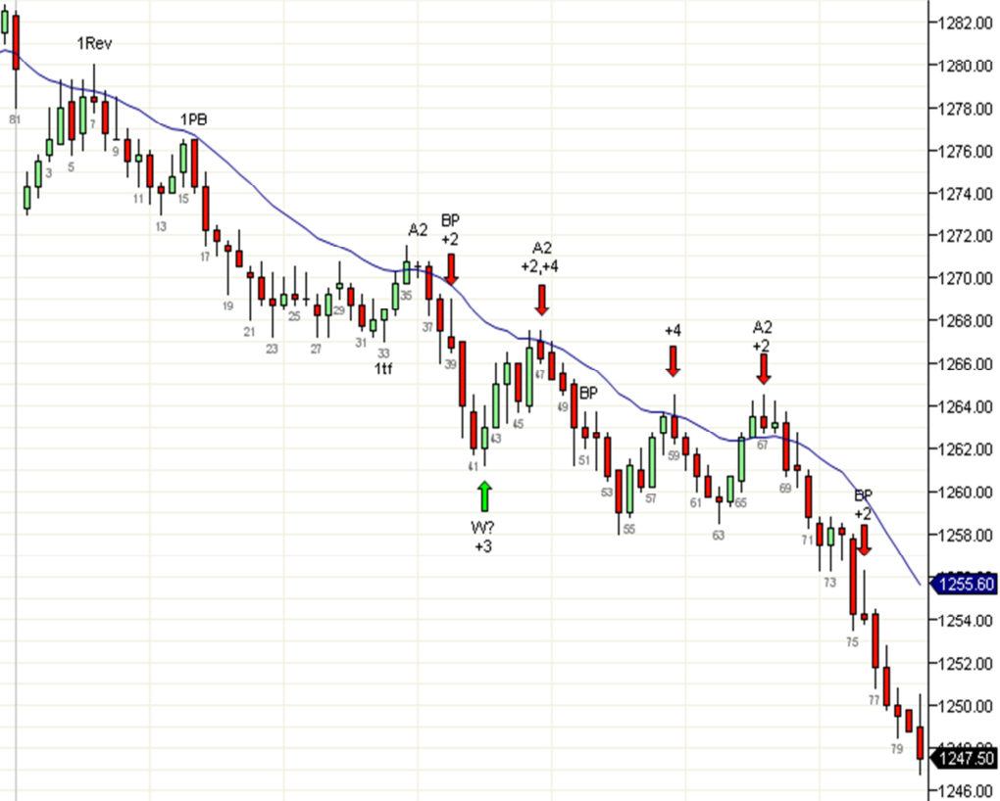

在方向突破后，通常会有反方向的交易者试图抵抗。这可能导致出现反转k线、内包k线或小K线，具体取决于试图逆势交易突破的交易者们的力量。

突破后的反转k线通常意味着突破失效，而突破失效本身就是一个不错的顺势信号，但如果它出现在ema (b59) 或趋势线 (b36) 附近，或者是突破测试等情况，则会增强其信号。

趋势k线，特别是突破（b18）后的**小k线**，代表突破的**成功**，如果k线**头寸规模**够小，可以代表适中**风险**（正常**天****交易区间**约2 **点**），则可以**入场****顺势**。

突破后的内包k线（b39, b51,b74,b76）代表着一次回撤和可能的失效，可以被视为双向交易的机会。如果突破K线和内包K线都是空头K线，通常最好只顺势交易。如果空头K线之后的内包K线是看涨的，则可以进行双向交易。

<!-- 原书第 256 页 -->

## 趋势十字星

2011年8月3日 星期三 · 原书第 256 页

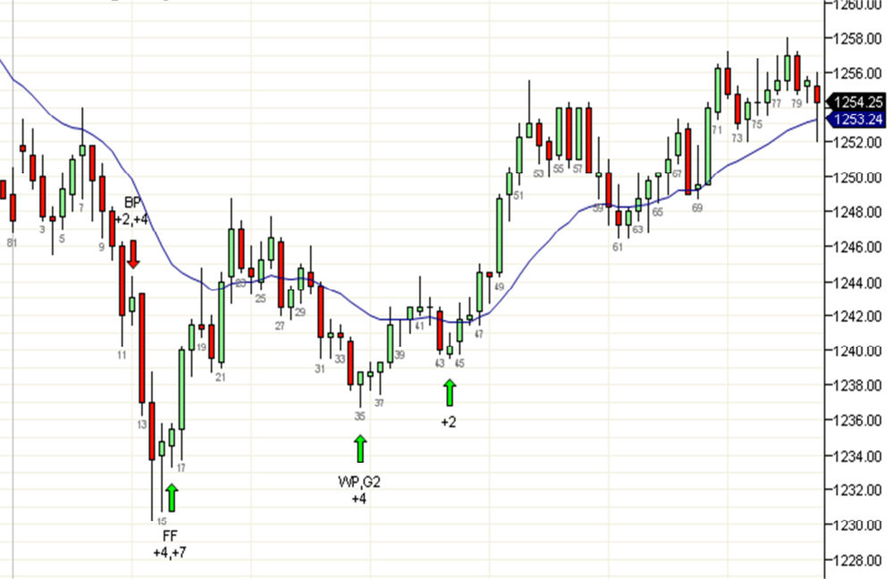

趋势十字星（b35-41, b61-66）是迷你趋势。它们是在较小时间周期内的微小趋势变动，而在较大时间周期上则表现为一根大的趋势K线。当你看到趋势十字星时，正确的做法是在回撤k线上顺势入场。

很明显，大多数交易者都这么做了，因为 b43 和 b68 的低位都被毫不犹豫地买入，各自都经历了一次绝佳的上涨。如果你对在跌势k线收盘时限价买入感到不安，那么等待看下一根k线是否看涨，然后买入其收盘价或高于其高点（如果它不是太大）是完全可以的。

<!-- 原书第 257 页 -->

## 大K线充斥的一天

2011年8月4日 星期四 · 原书第 257 页

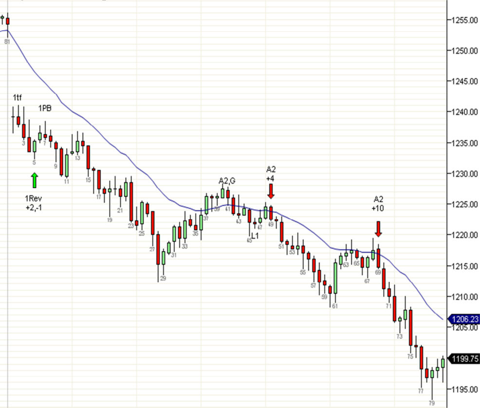

当k线较大时，你的风险也较大，虽然k线之间在比例上可能看起来合理，但你每份合约的货币风险却更大，因此你需要通过减小头寸规模来适应。你还需要做的另一件事是，只选择回撤风险较低的交易。

在趋势日，当正确入场时，A2 通常只有很小的反向波动（b49, b69）。尽管b69 是4个点，但其反向波动仅为1个点。其他低位回撤的建仓形态有W1P和G2。

最好避免出现大幅回撤建仓形态，例如内包k线反转（b29）和两根k线反转（b10,11）。

<!-- 原书第 258 页 -->

## 其他期权在宽幅交易日

2011年8月5日 星期五 · 原书第 258 页

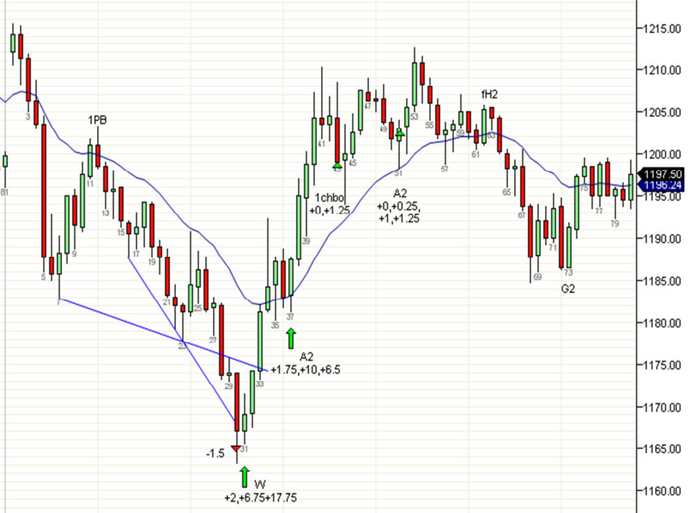

在许多k线与普通交易日大小相同的日子里，我会在五分钟图以外寻找其他交易选项。我使用过1 分钟图、4500 跳图，以及最近的20K和10K成交量图表。1 分钟图的优势在于下一个k线打印前有固定的时间，但通常会给出糟糕的信号，尤其是反转信号。自从交易所改变了跳数据报告方式后，跳图的意义有所减弱，现在与成交量图表类似。尽管我对这些图表都没有足够的经验，但我更偏好成交量图表，因为它产生的糟糕信号更少。今天的入场来自于10K和20K成交量图表，图表上的标记代表规范的入场点，而非实际入场点。（在某种程度上，这对每天都是如此）。

成交量图表和跳图的优点在于，您可以调整计数以获得您认为风险可接受的k线大小。缺点是k线打印速度非常快。在今天，4500t和20K成交量图表上的一些k线打印时间不到一分钟，因此您几乎没有反应时间，压力可能会迫使您犯错。

第二种选择是实际交易标的物的期权——在本例中是SPY。期权头寸不像期货那样随着标的物的变动而迅速变动，最适合在几天内进行波段持仓，但在今天这样的大日子里，它们变得非常可行。我个人只在大日子被证明是这样并且显示出强劲反转迹象之后才交易期权。如果收盘价强劲（不像今天在收盘前有所回落），通常最好将其持仓到第二天，但周五除外，因为期权会损失 2额外的天数时间价值。

<!-- 原书第 259 页 -->

## 熊市反弹

2011年8月8日 星期一 · 原书第 259 页

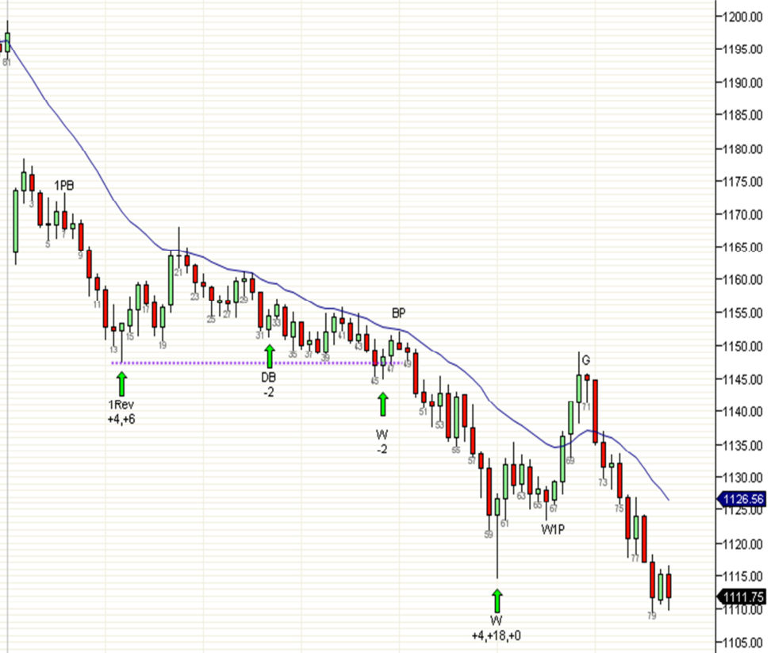

最强劲的看涨走势通常发生在强劲空头中的突破失败。例如 b1-2, b14-21 以及 b60-70 等走势看起来非常强劲，但最终却成为失败的突破。

b2 未能形成上涨行情，b21 未能形成A2 ，b71 未能形成缺口k线。在像今天这样交易区间非常大的日子里，即使逆着主要趋势交易，也有可能获得较大的波动幅度。然而，顺着主要趋势交易的波动幅度会明显更好。

在强烈的空头趋势中，务必警惕突破失败。您可以通过仅采用2 腿的回撤来最小化您的逆趋势头寸敞口。例如，b67 将是在可能出现反转后的2腿回撤。

<!-- 原书第 260 页 -->

## 极端波动性的风险与回报

2011年8月9日 星期二 · 原书第 260 页

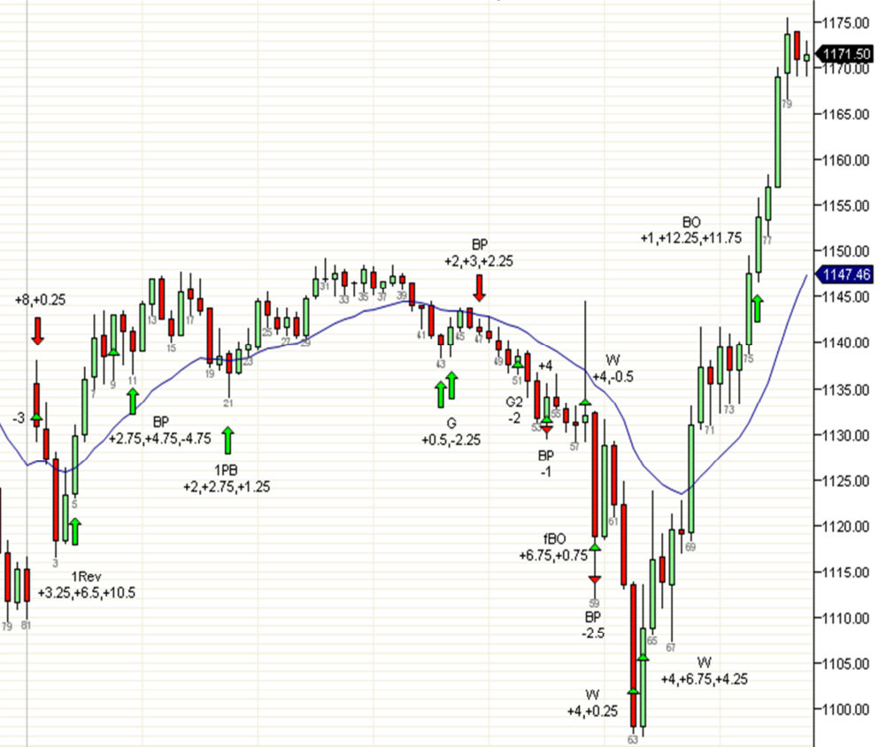

如预期，今天也是一个极其震荡的一天，我被迫使用20K成交量图表进行交易。因此，许多入场点都在K线中间，在5m图表上可能不完全合理。我将所有非标准和实验性交易都包含在内，而不是省略它们，希望这比分散注意力更有教育意义。让我简要讨论一下今天的非标准交易。b1 的多头交易是一个可能的1反转，接近ema，导致3点亏损。b43 和44 上方的G入场点不是我的标准交易，但我预期会有2 腿的上涨，可能达到当日新高。b51 处的G2 在5m上没有触发，但在成交量图表上触发了。价格走势非常震荡，以至于b54 和b59上的做空交易仅仅是因为K线打印过快而产生的错误。b76 的突破是在确认在达到hod后回撤概率较低的情况下发生的。这些交易大多数在成交量图表上看起来是合理的，这也是使用能降低风险的图表的另一面，它通常也会降低成功的概率。当成交量图表上的K线快速打印时，很难回头查看5m图表在入场前进行验证。最大的错误是，我在b64 接近b67 低点时平仓了我的多头头寸，而不是让它在b/e点退出。这让我错过了40 点的上涨行情。从技术上讲，我大概可以忽略K线的大小相当于周度行情这一事实，并像对待其他任何K线一样进行交易，设置18 点的止损，并保持我正常的成功率，但此刻这对我来说非常困难，我宁愿承担一些小的亏损来获得明确的更小风险，并有机会进行波段交易以获取大行情。

<!-- 原书第 261 页 -->

## 大内包含日

2011年8月10日 星期三 · 原书第 261 页

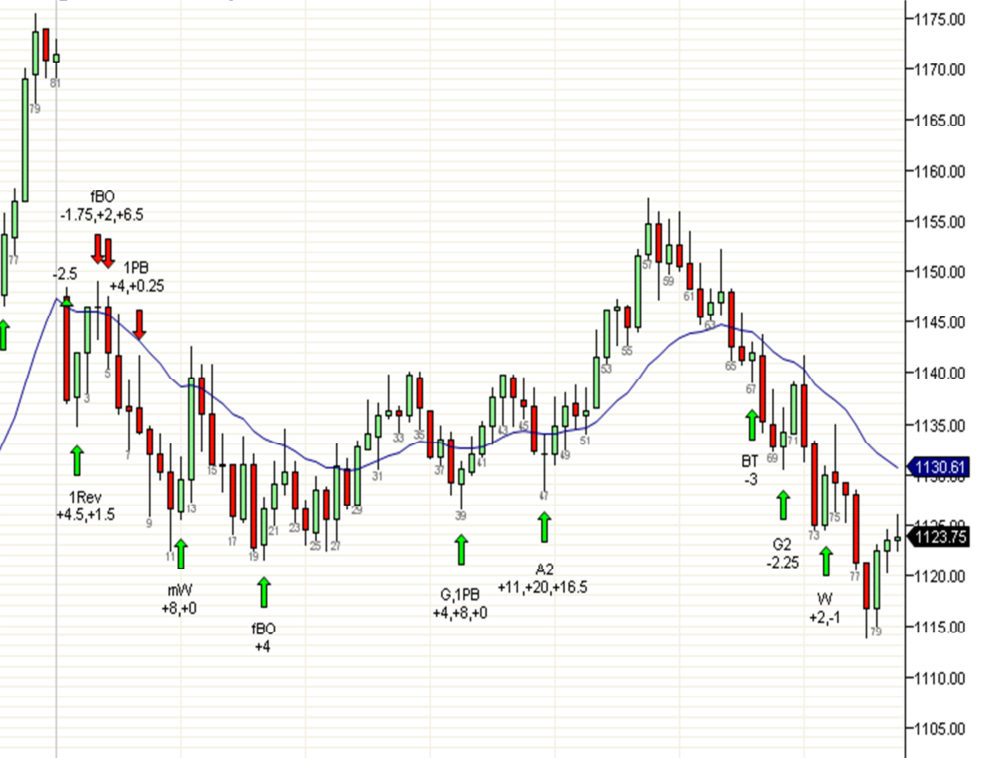

一个小的内包含日通常会是表现不佳的一天，但鉴于今天只有 40+ 点的区间，跟随几个波段交易可能会有所收获。像这样的日子，诀窍在于识别突破失败并退出，然后可能从中反转。

在AM交易中，正确的操作是在fBO（突破阻力）时反转做多，并在b20 处反转做空。在交易区间日进行波段交易的麻烦在于，交易者需要对可能的fBO（突破阻力）具有灵活性。如果我正确地将b60 解读为fBO（突破阻力）信号，我就会反转做空，而不是一路寻找做多的理由。

<!-- 原书第 262 页 -->

## 失败的突破和突破回撤

2011年8月15日 星期一 · 原书第 262 页

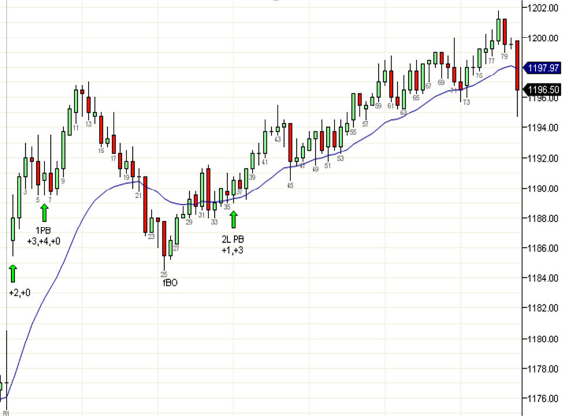

在震荡区间日，像b26 这样的突破失败可能在信号强劲时进行交易。如果我逆势交易的走势是通道式的，我通常会放弃建仓形态，并等待2 尝试继续走势失败（b30,32）。这是因为第一次逆势交易通道的尝试通常会失败。

另一方面，如果突破的信号K线不佳（b60）或未触发（b65），或者两次未能回到区间内，我通常会寻找BP。

第二个选择是将失败的L2视为软趋势波动，并在下一个信号K线（b36 或可能是b38, b53, b73）上方买入。勇敢者可以以限价买入第二次尝试的收盘价，并设置止损于下一个较低的多头K线下方或严格的资金止损。

<!-- 原书第 263 页 -->

## 替代图表比较

2011年8月16日 星期二 · 原书第 263 页

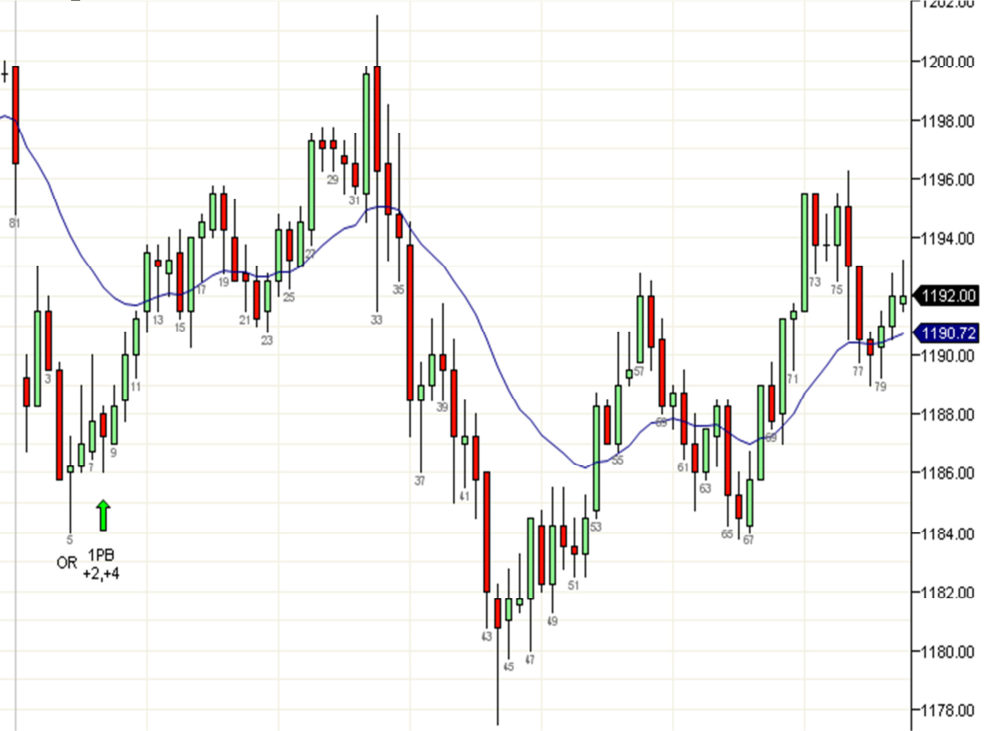

今天午餐时间发生了与价格走势相关的暴力新闻，与往常午餐时间最窄不同，今天的午餐时间出现了“k线疯狂”。当短时间内交易量突然增加时，基于时间的k线不太可能提供有意义的信号K线。替代图表的比较显示了在高度活跃时期如何仍然可以获得不错的信号：

20K 4500 跳成交量 3m 1m

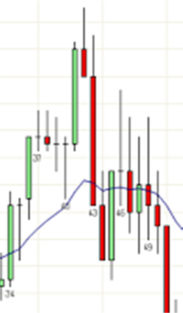

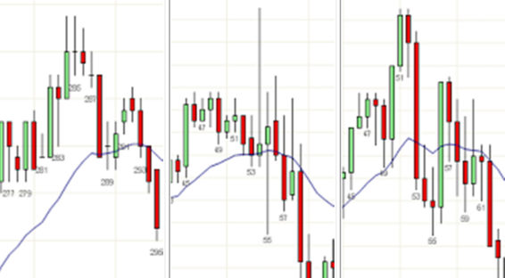

<!-- 原书第 264 页 -->

请注意 3m 未能给出可交易信号。1m 给出的是一个较弱的 ii十字星，可以看作是末端旗形。4500t 则好得多，它给出了一个 2 k线反转。然而，成交量图表是今天给出的最佳信号，出现了一个清晰的光头反转k线。只有在成交量图表上，入场价的止损才没有被触及，从而实现了一个无风险的波段交易。

时间框架图表的缺陷只能通过非时间框架图表来解决，当k线较大或不可交易时，这是必需的。我还没有收集很多数据，但在我非常有限的经验中，成交量图表在这种情况下提供了最佳的建仓形态。

## 硬转

2011年8月17日 星期三 · 原书第 264 页

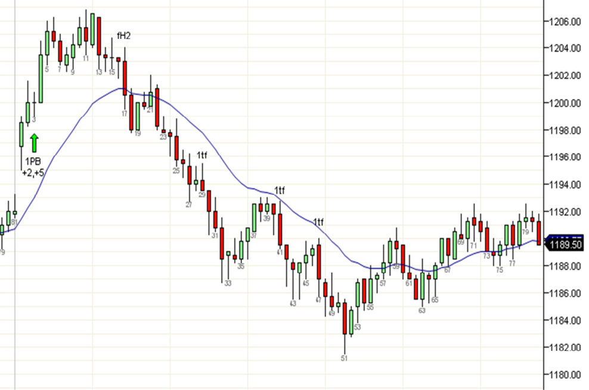

通常硬趋势以硬开盘，但今天，趋势在反转突破前一天的高点后硬转。不幸的是，我没有及时识别出来，完全错过了下跌，一直在等待 A2s。fH2 at b17 可能是趋势正在硬转的最早线索，但当时也可能只是简单的 BW。

这是一个强趋势，任何光头或1低位都可能被做空，即 b21, b29 和 b39。同时，无论 k线如何收盘，任何1都可能被做空，但 b41 和 b47 可能太大。

强趋势会发生突破但通常不会反转（即不太可能回到区间上部），因此在 b58 处的趋势线突破后，可能只出现了一次弱势交易。

<!-- 原书第 265 页 -->

## 交易大的缺口

2011年8月18日 星期四 · 原书第 265 页

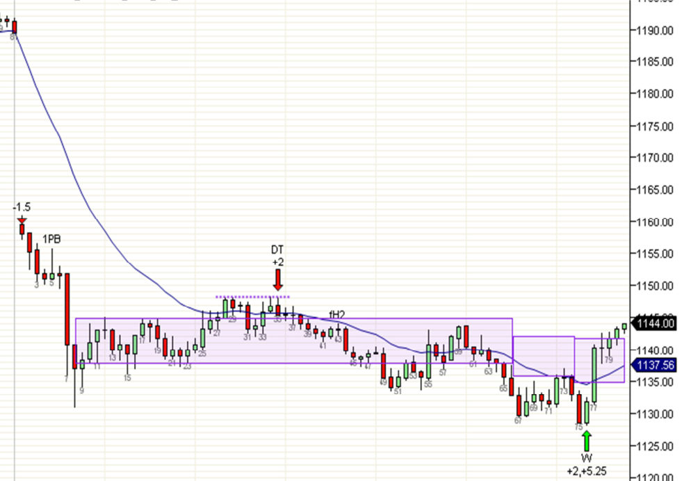

小的缺口会收窄，大的缺口会扩大。目前一个实验性的交易是交易开盘价，押注大缺口会扩大，并设置一个 6 跳的止损。其想法是开盘时的买入不应该快速获利平仓。今天，这个入场在价格反转前一跳被止损了，但总体而言，由于你通常能获得当日的最佳入场，这值得承担风险回报比。然而，这仍然是一个未经证实的交易，不建议大头寸。

趋势尝试后的 A1PB 通常是最安全的交易，并且从整体上看，比开盘入场能获得更好的风险回报比。然而，当信号K线不佳且有新闻即将公布时，通常建议跳过此交易。

巨幅K线是交易区间，并且在收盘时非常明显地形成了一个大的交易区间，你应该只在较低的1/3 做多，在较高的1/3做空。当天剩余时间里唯一可行的入场是b35 的双顶和b76的W形。值得一提的是：b54 可能是W1P，如果你将b41,46,51 视为W形而非通道的话。

<!-- 原书第 266 页 -->

## 大型三角形突破

2011年8月19日 星期五 · 原书第 266 页

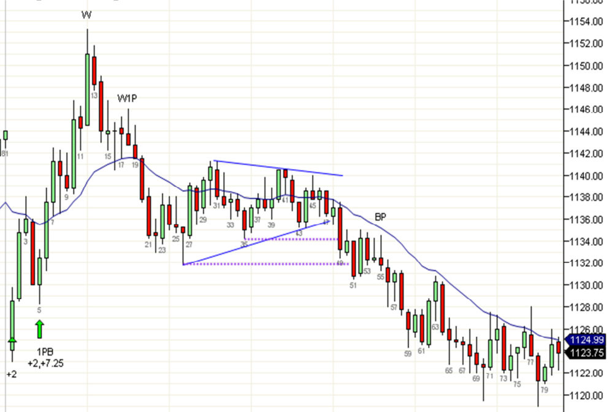

我之前写过关于三角形突破的交易。一般来说，三角形会朝最近的趋势方向突破（b13-b26）。最佳入场点通常难以确定，因为实际的突破往往没有信号K线。正确的入场方式是等待一个清晰的三角形外突破（低于b26）或至少是最后一个波动点（低于b35）的突破，并在第一次回撤时入场。在这一天，它会在b55下方。然而，当这一天是巨幅K线时，更早的入场可能带来更大的利润。

一种优化方法是在任何可能出现失效的信号K线上顺着先前的趋势方向入场，例如在b45 （b45 曾经是 b44上方的买入信号K线）下方，或在b47 （反转K线失效）下方。之所以可以接受这种做法，唯一的原因是失效通常会导致至少两腿反弹，如果交易不成功，您至少应该能够以盈亏平衡点退出。

<!-- 原书第 267 页 -->

## 捕捉早盘趋势

2011年8月22日 星期一 · 原书第 267 页

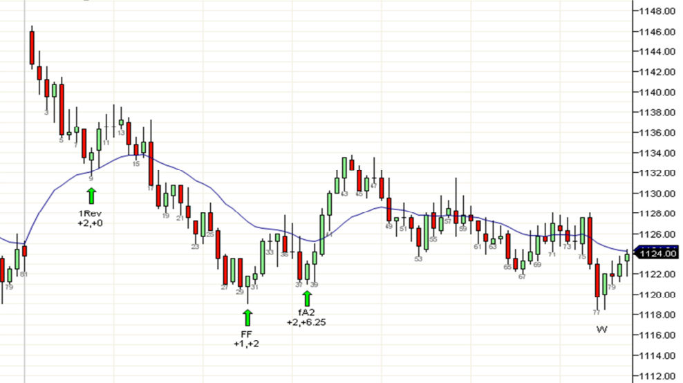

大多数新交易者会发现，如果他们的顺势交易胜率在55 到60%之间，逆势交易胜率在40 到45% 之间，那么他们并不需要感到惊讶。本质上，他们处于50%的顺势交易状态，但趋势偏差在5 到 10%之间。这意味着您进行的交易越多，亏损的可能性就越大，经纪商就越高兴。持仓以进行更大的波段交易，可以强迫您减少交易次数，并每笔交易赚取更多点数。这也能强迫您进行高质量交易，并专注于大局，而不是迷失在最近的K线的细节中。大多数日子都像上面的图表一样。早盘有趋势尝试，然后是交易区间。交易20%的日子里，走势持续朝同一方向发展是重要的，但这更容易，因为您可以获得多次连续入场。然而，在像今天这样的典型一天里，尽早进入早盘趋势并持仓直到它结束或反转非常重要。如果您错过了今天的b1 ，直到可能的b25才有真正合理的顺势形态。另一方面，市场在b9, 、b30 和b38给出了三个逆势形态。与跟随早盘趋势相比，这些形态的盈利幅度要小得多。这就是为什么糟糕的1PB形态（b13）应该经常被捕捉，而糟糕或疲软的1 反转形态可以在支撑位（b9）进行交易。如果您成功捕捉到早盘趋势，一旦早盘趋势结束并转变为交易区间，通常最好在一天剩余的时间里进行小额交易或不交易。与早盘趋势中非常清晰的价格走势相比，午餐和下午的交易时段充斥着重叠、陷阱和糟糕的信号K线。

大多数初学者最好通过以下方式进行：

- 仅通过交易1Rev 和 1PB 来交易早盘趋势，除此之外不做其他交易
- 在趋势日2 仅在趋势日加仓
- 在获得一定的一致性后，在硬趋势1中加仓 H1 /L2 ，在弱趋势{v5}中加仓 fL{v6}。

1反转和1PB有各种极端情况，而且更复杂难读，但在早盘趋势运行过远之前，它们能提供任何建仓形态的最佳风险回报比。一旦趋势日建立，只要有一些经验，A2就相当安全。所有其他建仓形态都需要经验才能正确解读，一开始只能在小仓位交易。1反转和1PB的诀窍在于认识到，有些日子你会错过它们，而这些日子不交易也没关系。不要急于不惜一切代价入场，并在次优形态入场。

<!-- 原书第 268 页 -->

## 双腿回撤 vs A2 vs G2

2011年8月23日 星期二 · 原书第 268 页

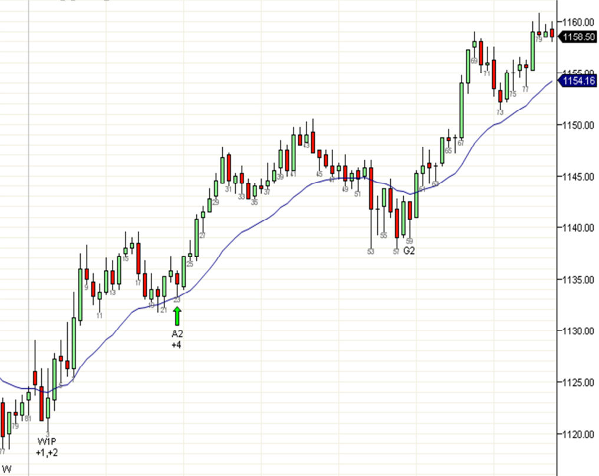

存在双腿回撤，也存在A2。区别在于A2 围绕ema，包括刚好略高于到重叠。像b13 或b36 这样的浅2 腿回撤不是A2。A2 最好是深度的，并提供接近回撤低点的入场。这是更可取的，因为即使是测试高点也意味着更大的回报。

浅层回撤，例如 b13 ，可以进行交易，但它们应该只作为刮头皮交易。浅层回撤入场的盈亏平衡止损非常有可能被触及，当然，软趋势和硬趋势除外。

另一方面，G2 仅在非常强劲的趋势中才有意义。抛售尝试为错过了先前入场的每个人提供了廉价的入场机会，他们会争相做多。如果趋势不强，G2 不能单独考虑。

<!-- 原书第 269 页 -->

## 弱信号K线后的确认信号

2011年8月24日 星期三 · 原书第 269 页

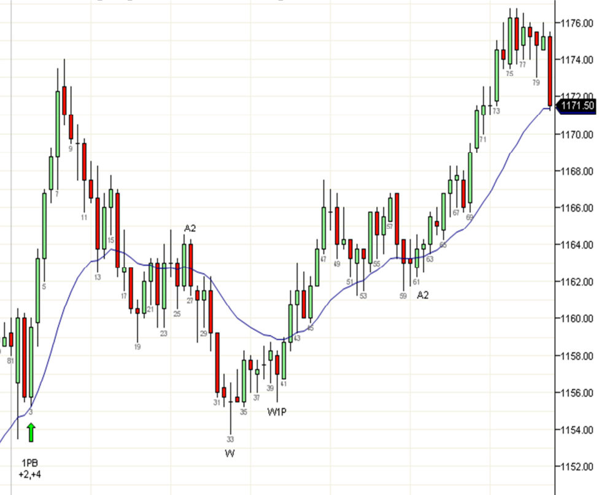

有时，一个显而易见的入场可能会有一个糟糕的信号K线，例如b24 A2 或b33 W。在这种情况下，最好寻找2次入场。对于b24, 2次2 K线信号在b27 确认了入场。通常，2次入场被两次反向的失败所取代。对于b33, 有2 空头入场，但它们变成了1tf（在b34 下方和b38下方做空）。这是b33 多头非常强劲的确认。价格突破b39 高位也使其成为一个fL2, ，这本身就是一个合理的信号。

同样，十字星信号K线b62 上方的双底由b64下方的做空信号K线1的tf确认。具有强劲收盘的信号K线不应需要任何确认。

<!-- 原书第 270 页 -->

## 一次失效的 1Rev 可以是 1PB

2011年8月25日 星期四 · 原书第 270 页

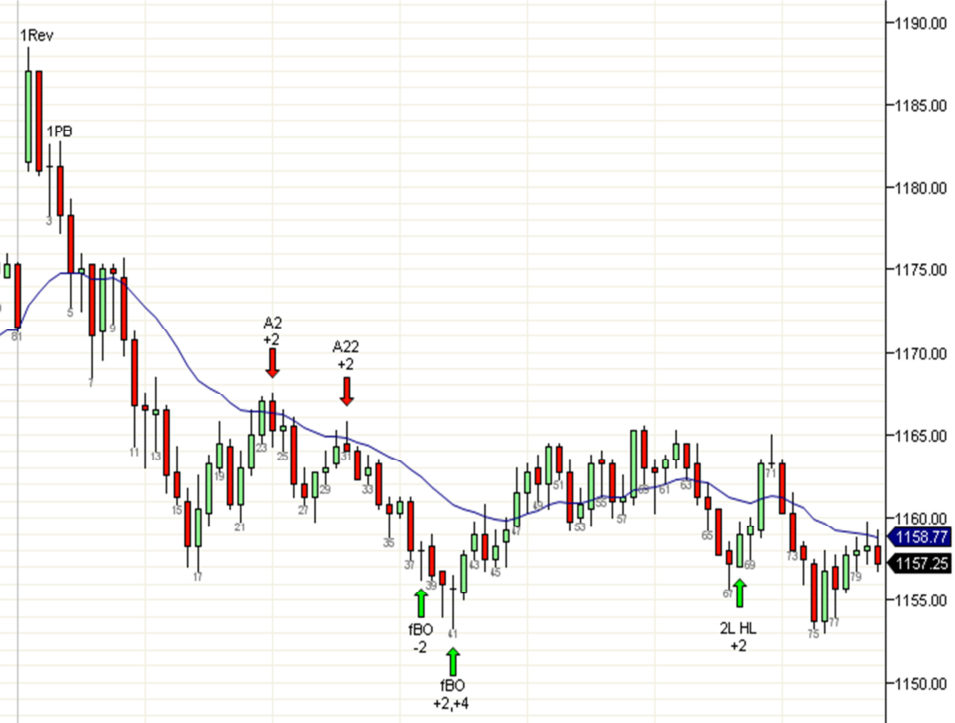

一次 1Rev 或 OR 需要出现在一个反转有意义的位置。否则，它很可能会失效。今天，开盘的 2 k线反转可能是首次反转，但如果不是，那么 b3 就是一次尝试提供首次反转。

左侧的三分钟图更清晰地显示了这一点。b5 尝试反转开盘走势，但由于它不在任何有意义的反转区域附近，例如ema或前一天的极端区域，因此失败了。

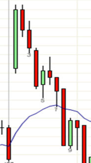

考虑到这是对带有强劲收盘的三根空头趋势k线的首次反转尝试，这可能是预料之中的，但更重要的是，失效通常是朝向原始走势方向的 1PB （3m b6）。当然，进行此操作的风险在于第二次尝试和 ema 距离非常近。然而，当在 ema 处进行反转的第二次尝试（b7）未能触发时，这证实了 1PB，并且反应迅速的交易者可能在 b7下方进行了做空。

在强趋势日，正确的入场会走得很远很快，几乎没有延迟的空间。这就是为什么新交易者最好交易单一图表，并尽量专注于最佳入场。

幸运的是，今天我们得到了一个 A2 (b24)，这相对比较罕见在一个强趋势中。考虑到k线尺寸，在趋势线突破(b17-23)后，允许进行逆势交易。在正常波动日， fBOs应仅在强趋势方向上进行，因为任何反向走势都可能失败或无利可图。

<!-- 原书第 271 页 -->

## 管理巨幅K线日的风险

2011年8月26日 星期五 · 原书第 271 页

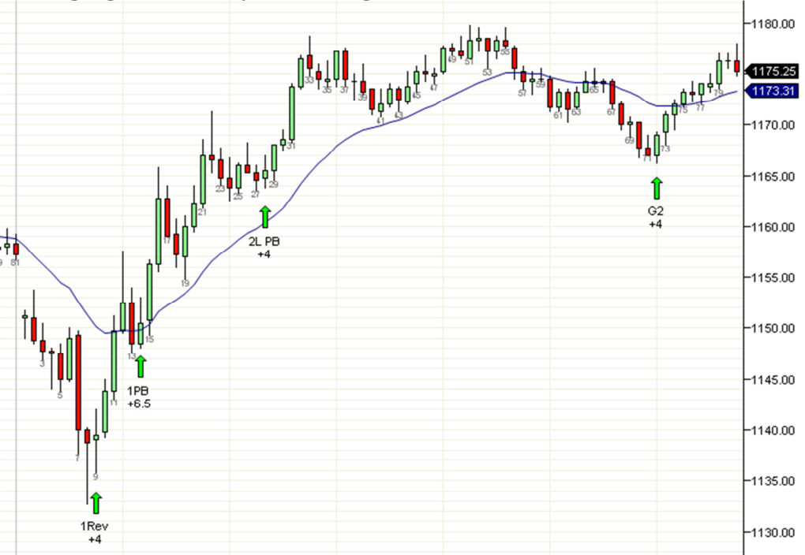

当k线巨大时，我倾向于使用5分钟图以外的其他期权。我之前已经讨论过成交量图表和跳图。在第一个小时，我也关注3分钟图以获得清晰度。

在左侧的3分钟图上，1Rev与5分钟图相比非常清晰。同样清晰的是由多头和空头趋势k线交替组成的FF(k线3分钟 b6-9)。高于b13 且止损设在其下方的入场是典型的入场，风险约为7 点。由于入场k线收盘后，可以将止损移至入场k线下方，因此高于3分钟 b 14 且止损设在其下方的入场是一个有效入场。这会将您的风险降低到4。5 点。在这样的日子里，当您看到一个潜在的20 至40 点的走势时，这是一个合理的风险。另一个选择是买入b14 的收盘价，并将止损设在其收盘价下方。这将风险降低到约2 点。考虑到潜在的上涨空间，这是非常合理的。

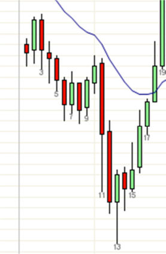

然而，鉴于这是一种潜在的 1tf，操作起来很困难。保守的交易者可能会想在强劲收盘的多头k线上方买入。请记住，以上所有操作本质上都是在 b13, 上方买入，您只是根据后续的k线来管理您的风险。

<!-- 原书第 272 页 -->

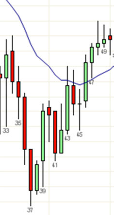

还有一种选择是在 1 分钟图上买入。需要注意的是，在 1 分钟图上进行交易反转绝对不应该做，因为这可能是爆仓的最快方式。然而，在潜在反转后两次未能延续趋势（在 1m b45 之后 1m b38 反转）是有效的入场。请注意，这只应在 3 分钟图和 5 分钟图已显示反转后进行。单独的 1 分钟图绝不能用于反转信号。

上面的 1m 入场点 b45 对应的是在 3m b15 或 5m b9 的顶部下方 1141, 个点买入。正如你所见，1m 没有提供最佳入场点，而 3m 提供了。

1m 的作用是让你假装在一个巨幅K线日子的快速移动的 5m 图表上。请注意，即使在 1m 上，K线

是 2 到 4 点。它提供了更多的入场机会和更小的风险。在超级强劲的趋势中逆势交易 1m 反转也是一个非常好的操作，但这只适用于趋势非常强劲的时候，就像这一天一样。

大多数新交易者的最佳选择是只关注第一个小时的 3m 图表，然后切换到 5m 图表，并且在较高时间周期图上出现潜在信号建仓形态之前，根本不看 1m 图表。一旦K线开始变小或重叠（b23-b27），您就不应再查看 3m 或 1m 图表，否则您可能会因为较低时间周期图上的许多糟糕建仓形态而亏损。

不要忘记 5 分钟图表是你的主要图表，而你对其他时间周期则经验较少。你的读盘应该始终基于 5 分钟图表，并且仅在一天的早期，在非常大的K线期间，才使用较低的时间周期进行入场。

<!-- 原书第 273 页 -->

## 软趋势日中，表现不佳的 1PB 建仓形态

2011年8月29日 星期一 · 原书第 273 页

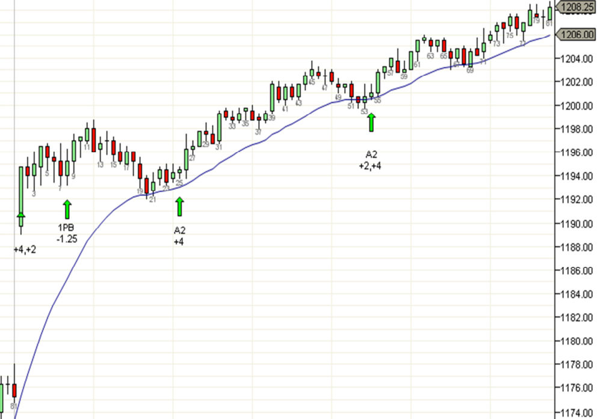

趋势日中，1PB通常是波段交易的最佳机会，即使看起来是差的建仓形态，我通常也会抓住。这个例子很好地说明了一个差的建仓形态。b6 和b8 严格来说不是1PB，因为在那个点位，我们可能已经处于一个看起来像交易区间内。1PB是一种新趋势中的建仓形态，它通常在交易区间内会失败。

然而，在一个大的跳空日和强劲的 b1, 条件下，它仍然有可能形成趋势（正如它最终所做的那样），而一个可能是 1PB 的形态可能值得承受风险回报比。

回撤至 b21 或 25 的 ema 是一个更好的入场点，因为它位于支撑位，2 腿，并且低于交易区间。

大型上涨跳空之后出现大型 b1 的第二个特征是，它很有可能演变成一个软趋势。这意味着任何 fL2 ，例如 b38 和 b43 ，都是有效的建仓形态。然而，我通常只会进行刮头皮交易，或者放弃它们，等待深度回撤，例如 b54。这是因为深度回撤更有可能让我在入场价的波段止损在不被打扰的情况下，缓慢上涨。

<!-- 原书第 274 页 -->

## 首次反转的原理

2011年8月30日 星期二 · 原书第 274 页

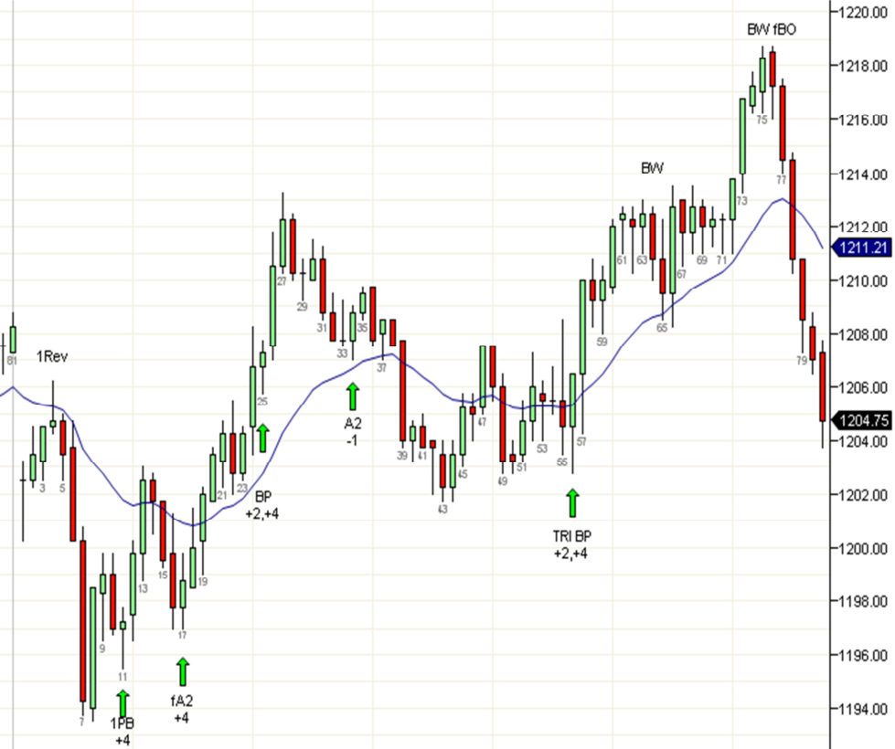

从图表可以看出，今天的 k线是日线图上的一个十字星。价格有上下波动，收盘价接近开盘价。尽管这是一个典型的震荡区间日，但它有一种向上的主要趋势。我们称之为主要波动。

首次反转交易通常试图最大化主要波动。当市场试图朝一个方向进行趋势波动并发生反转时，在震荡区间日，很有可能它会尝试去触及这个区间的两倍（就像今天发生的那样），然后回撤至接近开盘价的位置。

在实时交易中，你永远不知道从 b1 到 b4 的波动是否会反转并导致主要下跌波动，或者下方的另一反转是否会将其推高。这就是为什么第一个小时左右任何像样的反转信号都是一个绝佳的建仓形态。初始波动越大，十字星区间越大，因此主要波动也越大。

在趋势日，情况恰恰相反。最初的波动很小，而反转会导致持续趋势。

<!-- 原书第 275 页 -->

## 5点失效, 9点失效和 1点失效

2011年8月31日 星期三 · 原书第 275 页

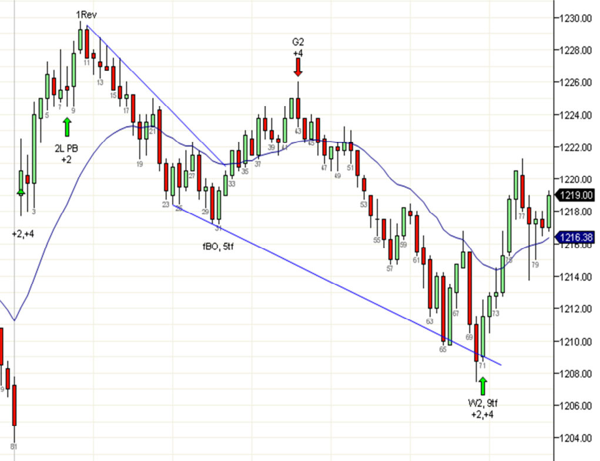

当交易者选择顺势建仓形态时，他们期望在某些离散的点数处获利。最受欢迎的目标是+1, +2, +4, +8, +10。逆趋势交易者知道这些位置，并将在这些位置进行逆趋势入场，希望额外的交易会引起小幅上涨，从而使他们能够获利。

当逆趋势交易者挂单的数量远远超过顺势挂单时，价格将拒绝突破。例如，突破交易者在 b24卖出 1218。25 并期望在 1217 处平仓。25逆趋势交易者知道这个价格点，并将在此价格挂买单。如果价格拒绝跌破 1217。25,，那么这是一个很好的迹象，表明许多买单没有成交。这包括那些做空的空头和那些想在当日最低价下方买入的多头。因此，当K线强劲收盘时，如 b31, ，那些没有成交的多头和空头将立即挂买单。这一点可以从 b32 看得很清楚，该K线没有跌破其开盘价。这种失效被称为 5 跳价失效或 5 tf。类似的失效也可以在 b27 上看到，因为在 b24 上方的买单也变成了 5 tf。与 5 tf 类似的是，对于 2 点的目标，可以在 b70 上看到 9 tf，这是针对 b65 下方的空单。9 tf 经常发生在 K 线密集区附近，因为较大的信号K 线会导致交易者期望更大的目标。与 5 tf 和 9 tf 不同，1 tf 是由交易者在上涨行情中买入K线顶部或在下跌行情中卖出K线底部引起的。例如，当价格在强劲的上涨日拒绝跌破 b6 时，交易者会将重叠的 b5-7 视为一个交易区间，并在 b7 的低点挂买单。这会导致价格在触及前一根K线的低点后，反弹到该K线之上，形成一个 1 tf。1 tf 通常是逆趋势交易的结果，尤其是趋势线突破前的第一次尝试。

---

[← 上一章](15-2011年7月.md) · [目录](00-目录.md) · [下一章 →](17-2011年9月.md)
