[← 上一章](16-2011年8月.md) · [目录](00-目录.md) · [下一章 →](18-2011年10月.md)

# 2011年9月

原书第 276–286 页

<!-- 原书第 276 页 -->

## 最近一次反转确定1PB的方向

2011年9月2日 星期五 · 原书第 276 页

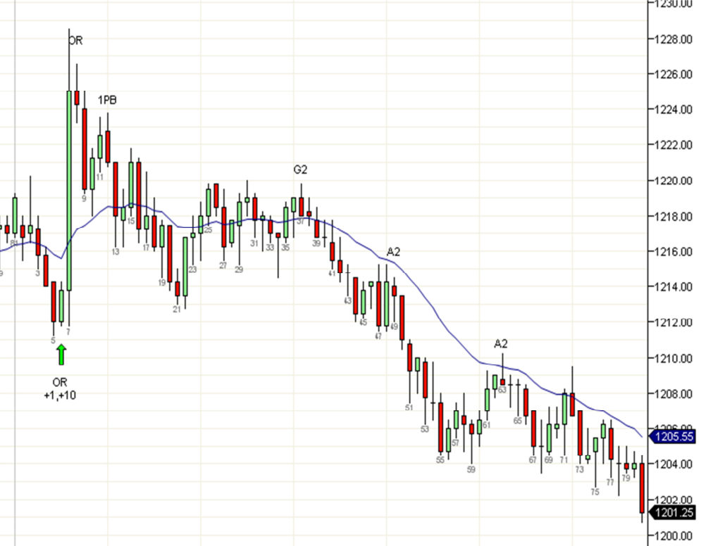

每当趋势波动（b3-b5, b6-b7）后出现开盘反转 (OR)，您就应该预期在最近的反转方向上会出现一个 1PB。这是因为 1PB 是趋势中的第一次回撤，当趋势反转时，预期的方向也会改变。

1PB通常是可逆的。这意味着，如果你的1PB入场后立即发出了与你入场相反的信号，则说明你的入场不正确，你应该反转你的头寸。例如，如果你错过了b8 的内包k线反转，并在b10, 入了1PB多头，那么你应该在b12的1PB空头处反转做空。这样，你的1PB入场通常会自我纠正。

<!-- 原书第 277 页 -->

## 极强的趋势

2011年9月7日 星期三 · 原书第 277 页

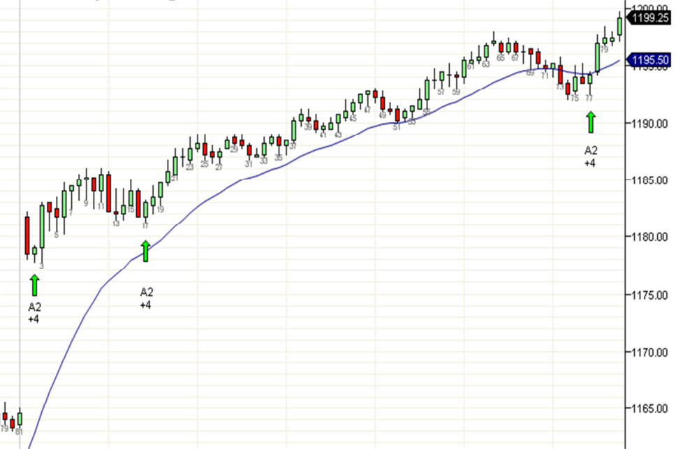

弱趋势和硬趋势是两种极其强劲的趋势。这些趋势绝不应该逆趋势交易。当你看到开盘时出现一个大的上涨跳空，并且第一根k线出现1tf，在k线低位附近提供了逆势交易入场信号，那么它很有可能转变为一个弱趋势日。

当第二次回撤也是 1tf（b5）时，这是一个非常强劲的趋势的信号。这本质上意味着多头们在买入每一个做空信号的低点。

一个形态良好的双腿回撤，但未能完全触及 b17 的ema，是另一个强劲的迹象。通常，第一次深度回撤是你当天做多波段交易的最佳选择。然而，任何深度回撤，例如 b52 或 b77 ，都可以进行波段交易。

错过了入场第一次深度回撤的人可以逆势交易每一个 L2。一个软趋势是最容易交易的，你应该抓住每一次深度 2 腿回撤，即使你是保守的。

规避逆势交易非常重要。第一次成功的逆趋势交易发生在b48。通常你应该跳过第一次，选择第二次（b64 或b67）。总的来说，在你看到像b48-51这样的ema单腿移动之前，绝不要尝试逆趋势交易。

<!-- 原书第 278 页 -->

## 大K线可能变为急速加通道。

2011年9月8日 星期四 · 原书第 278 页

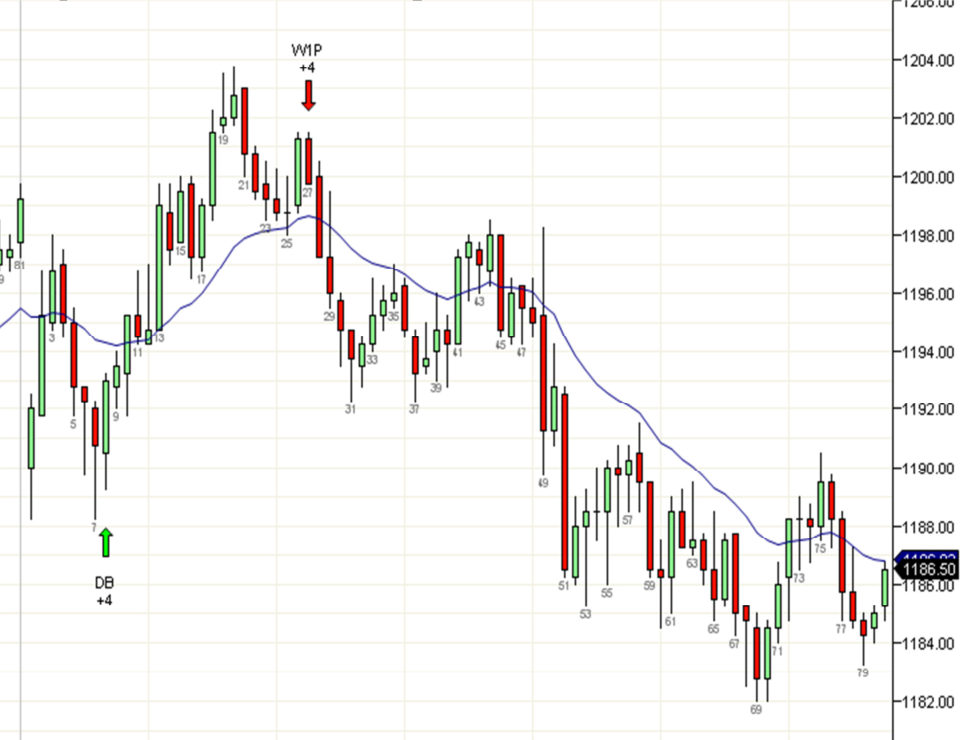

这根k线b49 可以有很多种解读方式。它可能是一根入场k线，在b48, 下方，b48, 是一个A2做空2次入场（b45 是第一次）。它也可能是一个失败的H2 ，以b44 作为H1。无论哪种情况，它都是一个加速趋势的套住k线。

当一根不成比例的大K线突然出现，就像新闻事件发生时那样，它很有可能会转变为急速加通道的走势。例外情况是，如果它是一根趋势K线，触发于一次2-腿回撤并有后续跟进。

一旦急速形态确定，等待回撤并只在通道方向上进行交易。通道（b58-69）的方向与急速形态（b49）的方向一致，除非回撤也出现了与主要方向相反的大幅急速形态。

通道通常（但不总是）由三次推动组成，会形成W形态结束（b70），并测试通道的起始点（b75）。然后它们会进入通道的中部区域（b81）。

很有可能你错过了那次飙升，但回撤和通道通常会达到飙升的衡量性移动。

<!-- 原书第 279 页 -->

## 楔形破位失败

2011年9月9日 星期五 · 原书第 279 页

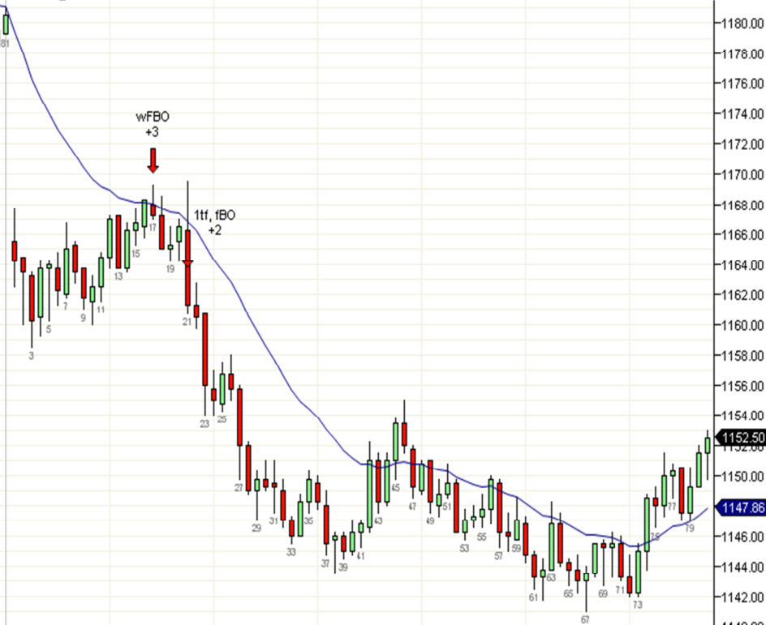

通常，当开盘出现较大缺口时，会预期出现趋势波动。虽然第一个k线就出现趋势是一个合理的预期，但有些跳空日只会形成一个交易区间。然而，在某些日子里，你会看到一个试图朝一个方向发展的楔形，它会触及当日最低价，并通常会产生开盘区间段的衡量性移动。

开盘时的楔形可能与缺口形成，也可能与缺口反向形成。当楔形与缺口方向一致时，正如今天所示，它通常表现为一种 2 腿回撤至 ema 的变体。

要识别开盘时的楔形，请寻找一个大的第一根 k线（表示 TR），最好带有大的引线（也是 TR）或重叠（b3,4 -- 也是 TR）。在最初的移动之后，市场会向任一方向进行三推，并提供一个反向交易区间的入场点。当楔形移动反转了最初的移动并清除了 TR 极值（b1 high）时，这就是一个楔形破位失败或 WfBO。WfBO 是趋势启动信号，应始终作为波段交易建仓形态。至少它们会提供两条腿，通常会清除 TR 的另一端。如果 TR 用一条腿被清除，它们通常会给出 TR 的衡量性移动。

<!-- 原书第 280 页 -->

## 主要反转：空头趋势线突破和HL

2011年9月12日 星期一 · 原书第 280 页

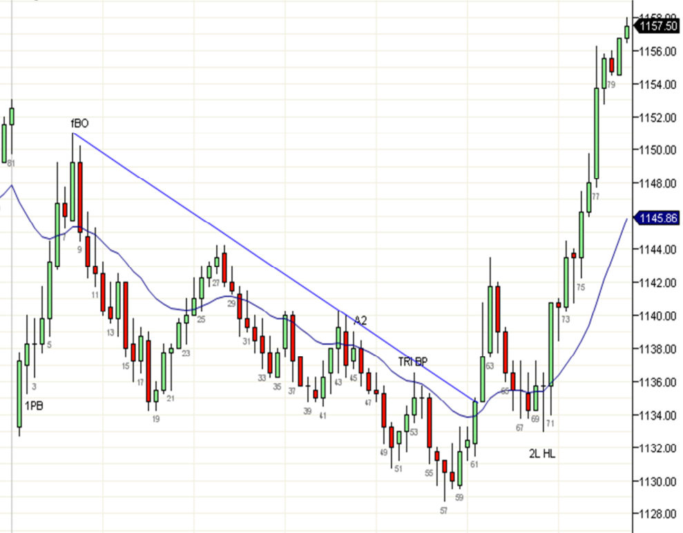

通常，空头趋势的主要反转需要对趋势线进行强力突破和一个低低点测试。但有时，不会有低低点测试，而您需要根据 HL 入场。这些情况将进入一个非常强硬的趋势，仅有一条腿，因此您需要能够识别这些情况并根据 HL 入场。

当天晚些时候强劲反转的先决条件是第一个小时的非常强劲的走势（b1-b8）。如果没有事先表现出实力，任何没有LL测试的反转都可能失败。

如此HL主要反转的最重要特征是趋势线突破将扫除多个波动点（b57-63 扫除了3 波动高点）。第二个重要特征是趋势线突破走势远远超出ema，并且在一个单腿走势中收盘价远高于ema。出现W（b19,50,57）形态的区间多腿失败突破比区间单腿或2 腿强劲突破更有可能失败。

在 b63, 交易者应该在 ema 处做多一个回撤，并且可能做多任何合理的 Yeg. 一个 2腿回撤（b69 结束了第一腿）是非常理想的，并且通常会给出一个强趋势。这本质上是一个 A2 或者 fL2 （b68 是 L1），可以在反转后作为波段入场进行交易。

<!-- 原书第 281 页 -->

## 价格行为指标

2011年9月16日 星期五 · 原书第 281 页

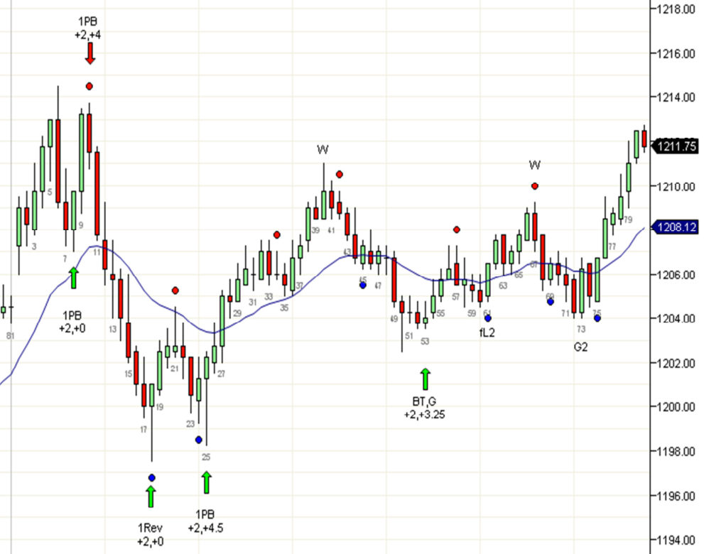

正如你们中的许多人从图表上的点猜测到的，我一直在为 NinjaTrader 开发一个价格行为指标。目前，它只突出显示 Al Brooks 书中描述的合理信号K线，除此之外没有其他功能。

要机械化交易该指标，可以用 6t 止损来入场刮头皮交易和波段交易部分。在 +2 点时，刮头皮交易部分获利退出，止损移至盈亏平衡。理想情况下，刮头皮交易部分应是波段交易部分的双倍，以获得最佳结果。波段交易部分应在固定利润处退出，例如 +4 ，或在第二次尝试反转趋势时退出，如果入场是顺势的，即在 HL（b25）做多或在 LH（b10）做空。如果是逆势入场，第一次做空信号应导致任何波段交易部分退出（入场在 b18 上方或 b41下方）。在今天这样有合理区间的日子里，这应该能从大多数交易中获利。例如，今天唯一亏损的交易是下方 b57的做空。下方 b 34 的做空以及上方 b45 和 b69 的做多是第一次尝试（L1/H1），并且不会进行交易。一种选择是将 L1/H1 标记为不同的颜色，因为排除它们并非选项，否则会消除强趋势中的所有信号。一个 2 合约刮头皮交易 + 1 合约波段交易将会在盈利时赚取 +40 ，在亏损时亏损 3 。但今天可能是该指标表现极好的一天，并非每天都如此慷慨。要收集更多数据，我需要自动交易它，并运行它处理几年份的数据。我预计在窄幅区间交易日表现不佳，因为两点刮头皮交易在 5 点日可能很难。大区间交易日可能会不确定，导致在达到利润目标之前止损出场，但一次波段交易可能可以弥补许多亏损。

<!-- 原书第 282 页 -->

## 重叠的k线产生差的信号

2011年9月19日 星期一 · 原书第 282 页

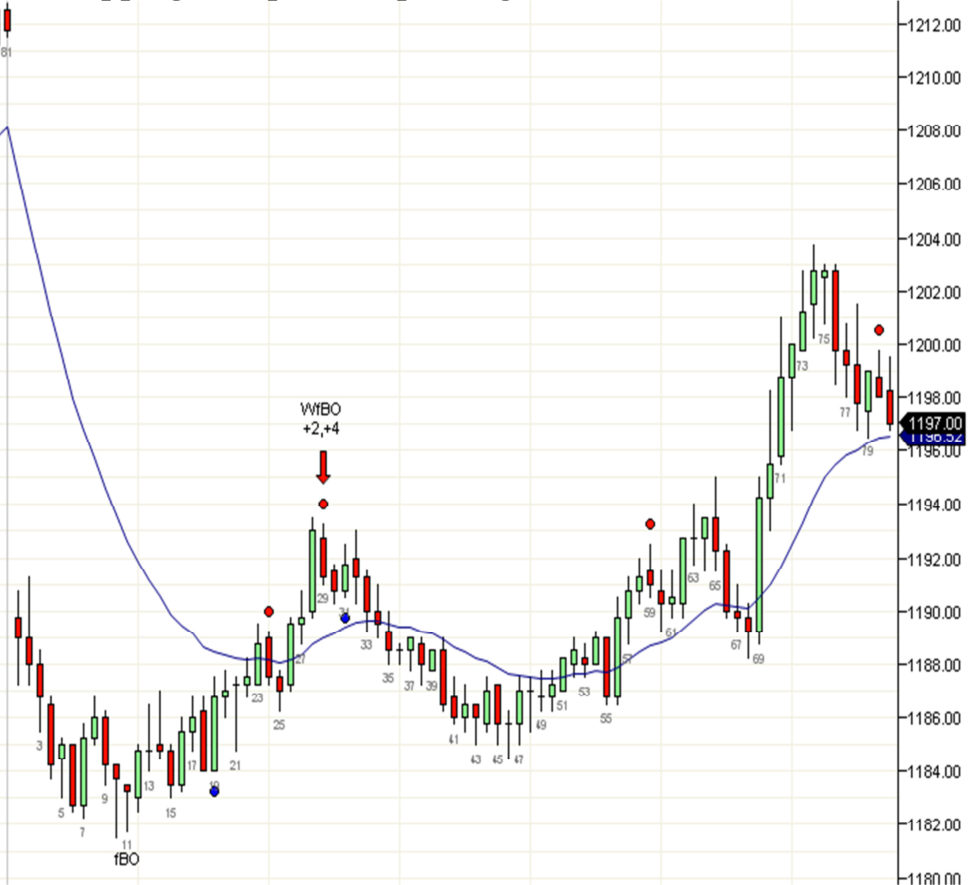

Somewhere bear b11 was a fBO or 1OR。Unfortunately, the bars were overlapping and full of tails, so my indicator could not catch them. On such days, I look to see if the 3m chart has clearer bars. Today it did:

<!-- 原书第 283 页 -->

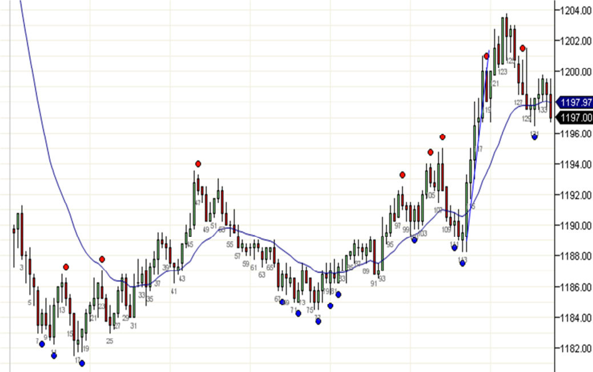

交易3分钟图的风险在于，第一个小时后的k线可能不可靠。例如，3分钟图的k线和k线建仓形态失败，尽管存在合理的k线。但是，在第一个小时内，并且仅当5分钟图出现重叠溢出时，3分钟图才可使用。

通常在5分钟图上不清晰的建仓形态会在3分钟图上变得清晰。例如，当日最低价反转在5分钟图上表现为一根空头K线内的内部十字星K线，但在3次推升时，在3分钟图上则是一个ii FF。这可能使得在一个本不利的日子里获得一个绝佳的入场机会。

交易时间周期小于 5 分钟的心理风险在于，您会沉迷于小风险和好价格，并交易它们超过第一个小时。这通常很危险，尤其是在午餐时间，即使是 5 分钟的图表也很危险。

<!-- 原书第 284 页 -->

## 后期趋势突破

2011年9月20日 星期二 · 原书第 284 页

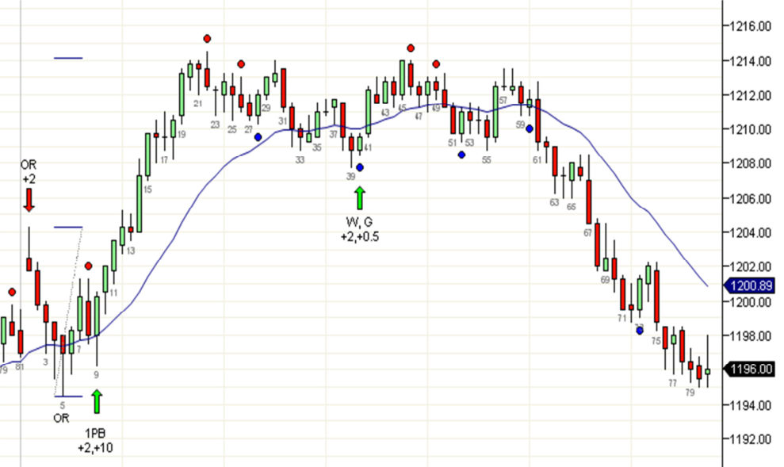

早期趋势突破更容易正确识别，并且它们产生可观趋势波动的概率很高。后期趋势很难预测，并且它们通常只会走一小段距离或失败。这就是为什么 1PB（b9）是一个非常重要的建仓形态。抓住早期趋势波动的绝大部分，可以让您放松并忽略日中的低概率建仓形态，并可选择性地进入任何后期趋势突破。

后期趋势突破通常非常难以发现，您会遇到许多假信号，例如 b40 处的可能的 W 形或 b55处的第二个 W 形。b22,46,49 处的双底可能是一个不错的信号，但 b56 处的飙升清除了任何波段止损。

任何趋势突破最清晰、最简单的入场方式是反向突破 (b66)。即使它看起来像区间底部，鉴于之前的信号（例如失败的 W 形和双底），反向突破通常值得冒险。

然而，读取 1PB 和 OR 远比读取长期盘整中的突破要容易。如果你不能持续地交易 1PB，那么你也很难持续地预测长期交易区间 (TR) 中的突破。

<!-- 原书第 285 页 -->

## 回撤和失败的风险

2011年9月22日 星期四 · 原书第 285 页

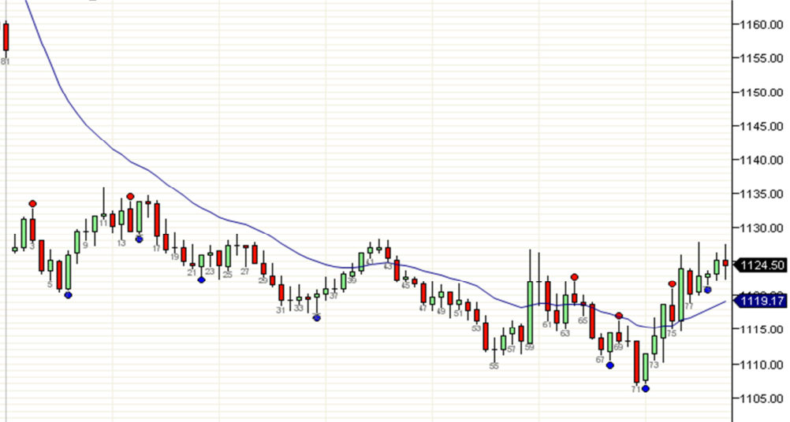

交易者常常对他们的止损有时会被如此剧烈地触发感到惊讶，例如下方 b14 的做空或上方 b15的多头。如果你希望使用止损入场来突破信号K线进行入场，信号K线的选择非常重要。几乎所有止损入场的失败都具有一些共同的特征，掌握这些特征将降低你的失误率。

1。重叠：重叠，尤其是大K线重叠是风险中最容易识别和评估的。一般来说，大K线通常不是好的信号K线，无论是否重叠。任何重叠实际上都保证了信号K线的交易区间属性，你应该等待重叠一端的止损（b16, b26）小K线，并进行突破（fBO）。小K线重叠，例如b47-51 ，通常可以进行第二次顺势尝试。交易区间（例如，预期突破）中绝不应采取这些，首次尝试也绝不应采取。

2。反转K线前的十字星：十字星代表交易区间，十字星后的反转K线并不否定这一事实（b21-22）。第二次尝试，尤其是在双向套牢交易者（b35）后，即使有十字星，也可能是一个可以接受的入场点。

3。第一次尝试：从图表中可以清楚地看出，与第二次尝试相比，第一次尝试（b22, b33, b60）极有可能失败。第一次尝试应仅用于非常清晰和非常具体的情况，例如1反转（b3）、W型反转（b72）和1 PB，或者至少仅用于出色的信号K线。

4。信号K线质量差：信号K线质量差（b11, b60）几乎肯定会引发回撤，原因是一些交易者会逆势交易其突破。这就是为什么如果信号K线颜色错误、有长入场侧引线或为十字星，则推荐第二次尝试。即使第一次尝试成功，在市场从质量差的K线入场位置走远之前，通常也会出现回撤。

如果您考虑最小回撤的k线，即在回撤前走势较远因此成为波段交易候选(b7,64,72)，它们通常是形态良好的k线，并带有强劲收盘，或者是第二次尝试(b16, 35)。将您的入场限制在这样的k线上应该会大大降低您的失误率，这是增加您头寸规模的先决条件。

<!-- 原书第 286 页 -->

## 好的和坏的fBO

2011年9月23日 星期五 · 原书第 286 页

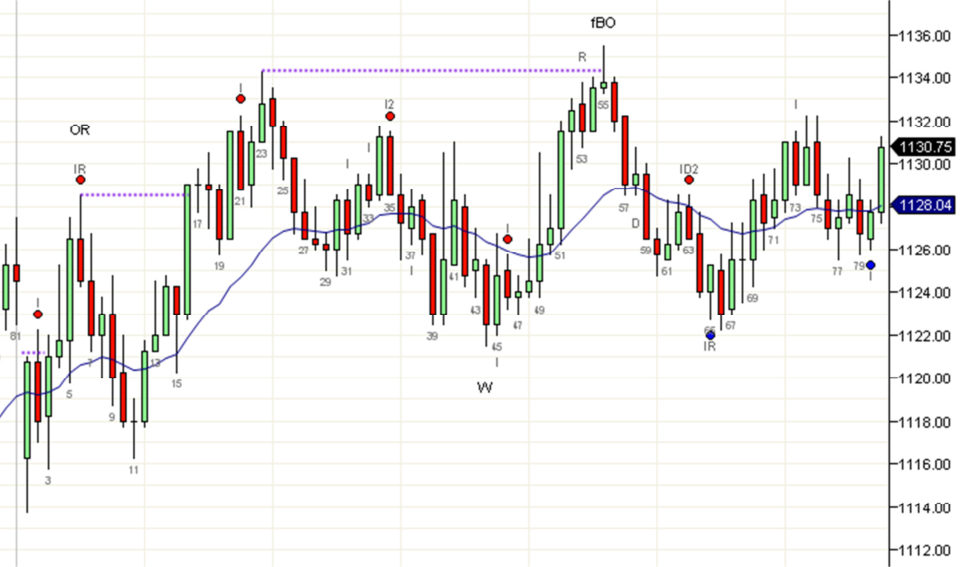

我经常提到，在趋势中顺势交易是最简单的交易方式，而突破阻力是一些最难把握的交易。原因非常简单。市场惯性决定了在趋势中，市场很可能继续沿趋势发展，而顺势入场是一种高概率的建仓形态。另一方面，突破阻力可能会变成反向突破，或者在第一次或第二次尝试时失败，只在第三次尝试时成功（形成迷你W形态）。

This 除非区间很大，否则你不应该费心去进行fBO交易。有了这个洞察，我们仍然可以尝试推断出最好和最差的fBO建仓形态。

第一个fBO建仓形态是b2, 突破大K线b1, 的失效，该K线充当了一个小的TR。由于入场点会位于区间下半部分，因此很可能会失效，尤其是在这是第一次入场的情况下。如果入场点非常接近b 1, 高点，这才是值得考虑的风险回报，因为该K线很大。如果K线是4 个点或更小，最好忽略b1的 fBO。第二个fBO是b6, 试图反转前一日收盘价和三推向上（b2,4,6）。这是一个更高概率的交易，可以标记为OR。下一个可能的fBO/BP是b16, ，这是一个强劲的BO，但没有提供像样的BP信号 K线。此时，我们有一个更高的高点和一个更高的低点，并且可能处于多头趋势中，不应该寻找 fBO交易。相反，我们应该寻找2L PB回测ema或TL，并进行顺势交易，或者等待趋势突破。这意味着我们会忽略b21 ，甚至b24 ，即使它形态良好。单腿移动到b29 并收盘于ema下方，可能已经打破了趋势，所以我们应该再次切换到寻找fBO和BP。三推到b45 是一个可以的建仓形态，但通常，当市场没有趋势时，我会避免在中部区间入场。如果我们处于趋势中，或者到b23 的移动是一个强劲的趋势，我会考虑买入b47 作为可能的G2。b55处的fBO是最理想的fBO类型。突破 HOD的K线变成了一个反转K线，并且没有任何其他K线的重叠。（在一天的高低点附近，十字星 K线被接受为fBO信号）。BOK线之后出现反转K线或内包k线也将是极好的信号。

总而言之，好的 fBOs 是在交易区间之外的三推，或者是在你确定自己不处于趋势中时的突破后的立即失效。

---

[← 上一章](16-2011年8月.md) · [目录](00-目录.md) · [下一章 →](18-2011年10月.md)
