[← 上一章](17-2011年9月.md) · [目录](00-目录.md) · [下一章 →](19-2011年11月.md)

# 2011年10月

原书第 287–305 页

<!-- 原书第 287 页 -->

## 陷阱 I - 错误位置的 K 线

2011年10月6日 星期四 · 原书第 287 页

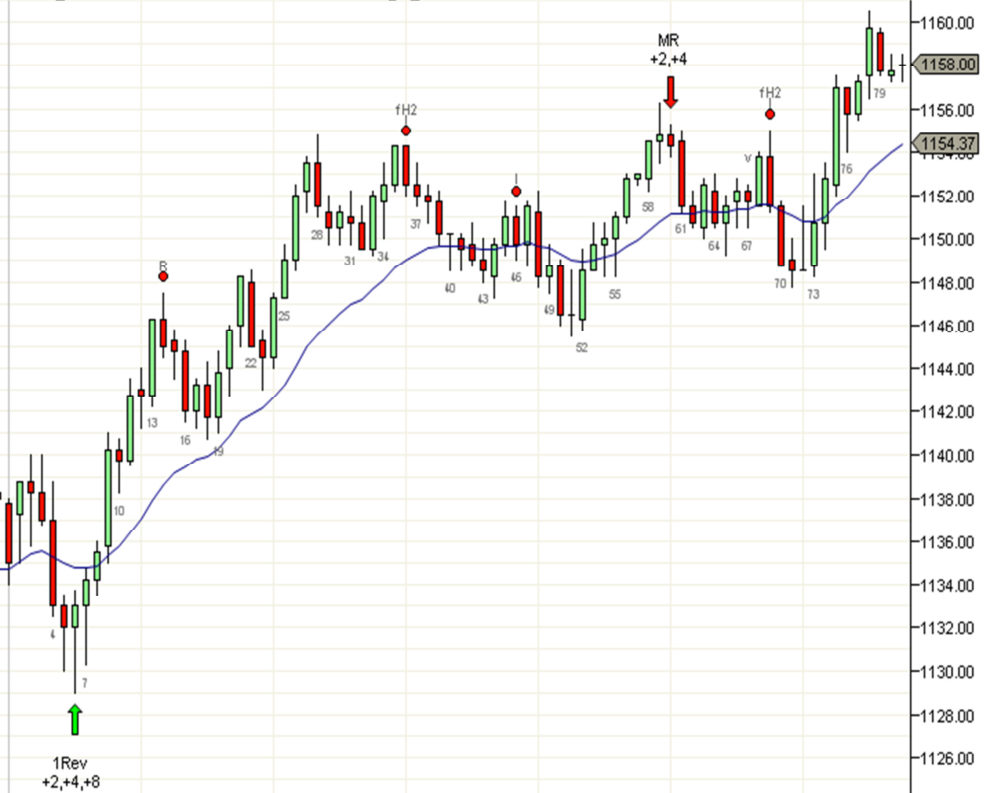

许多交易者亏损是因为他们没有及时识别陷阱，一旦陷入其中，就会寄希望于奇迹。通过一些经验和痛苦，任何交易者最终都会学会识别陷阱并避开它们。

陷阱有很多种，但它们有一些共同的特点。第一个是单独来看，这根 K 线可能看起来很棒。例如，b1 今天的 EMA 处出现了一个反转 K 线，收盘非常强劲。新交易者可能会错误地认为其突破将引领强劲趋势。然而，一个反转 K 线需要跌破前期的波段才能有效——否则，它只是一根交易区间 K 线。

b14 是一个类似的陷阱。虽然它确实提供了一个不错的刮头皮交易机会，但作为从当日最低价反转强劲走势的第一次尝试，不太可能成功，并且强劲的交易者在 EMA 处加仓，而不是做空。

b44 看起来可能是在 EMA 处的看涨反转 K 线，但它出现在一连串看跌 K 线之后。更重要的是， b36 是一个失败的 H2 ，应该会导致两腿下跌，所以 b44 不太可能是一次成功的交易。

b65 发生在一个可能的主要反转（MR）之后，并且不太可能在至少2 次下探之前就反转。b69 则如果是在旗形的顶部出现的小K线，可以算是一个不错的交易，因为它可能是在第二次尝试上涨后的失效。

<!-- 原书第 288 页 -->

## 陷阱 II - 重叠

2011年10月7日 星期五 · 原书第 288 页

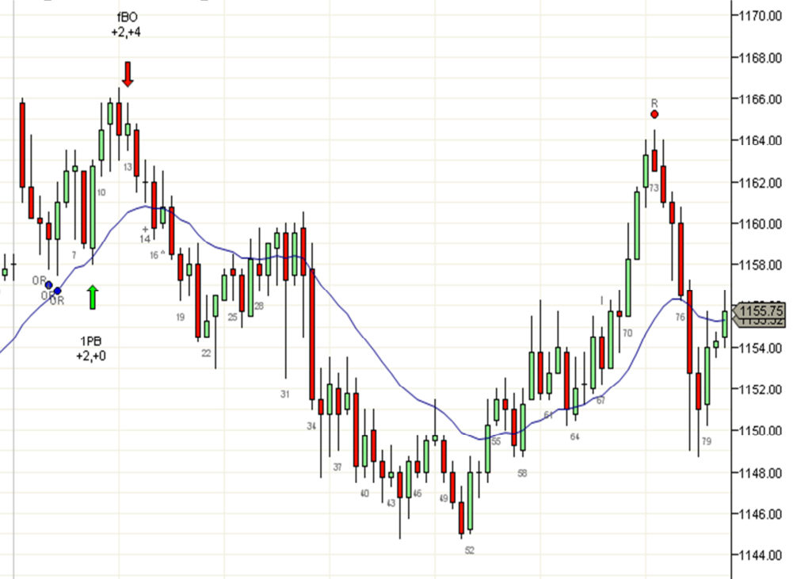

虽然由错误位置的K线组成的陷阱需要一些经验才能识别，但由重叠造成的陷阱则更容易识别。基本上，只要你记住重叠是交易区间，并且只在它们下方做多，在它们上方做空，你就可以避免麻烦。

例如，b9 可能是一个1PB，但由于它处于区间的中部重叠，它很可能失败，你应该警惕上方的做空信号。b13处的突破失败很可能会至少触及止损（b9的低位），你应该退出任何多头头寸并在那里反转。

虽然 b23 本身可能看起来是一根强劲的反转 k线，但它的大部分与两根 k线重叠，实际上是一个交易区间。更糟糕的是在 b27 上方买入（假设它是第二条腿）或在 b29上方买入（假设它是一根光头反转 k线）。此外， b23 是反转下行腿的第一次尝试，很可能会失败，即它的低位应该被触及（正如在 b31期间发生的那样）。

只有当多头和空头们都已经套住，并且你正在顺势入场时，你才能在重叠区域入场。例如，在多头们套住于 b61 上方，空头们套住于 b62下方之后，b64 曾是可能的长线入场。

<!-- 原书第 289 页 -->

## 套牢 III - 差的信号K线

2011年10月10日 星期一 · 原书第 289 页

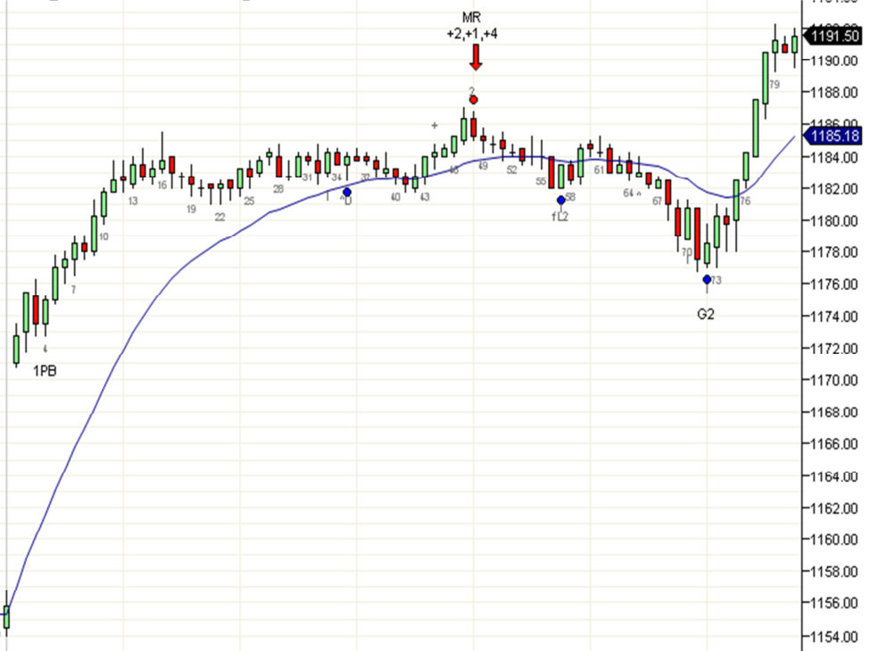

最难避免的陷阱是那些给出良好形态但信号K线糟糕的陷阱。不幸的是，这些糟糕的K线有足够的比例奏效，使得它们难以抗拒。

例如，b22 看起来像一个差的做多K线，但成功进行了一次小额刮头皮交易。 b35 则失败了，尽管它更接近ema。 b42 是一个带入场边引线的K线，但它仍然奏效。 b61 是一个十字星，但效果非常好。

那么，交易者该如何区分可能成功也可能失败的信号K线呢？在许多强势日，尤其是弱势趋势日，好的信号K线非常罕见。那么，大部分交易日都持币观望是唯一的选择吗？这无疑是安全的选择，对大多数交易者来说，可能也是最好的选择，但有一些启发式方法可以让你以更高的成功率选择入场。

重叠信号K线，如 b35 ，以及单腿回撤，如 b22 ，都是弱信号。您绝不应在旗形的顶部买入弱K线。组合信号，如 b61 DT 和 G，是强信号。顺趋势信号，如 b72 G2 ，是强信号。逆趋势信号，如 b16 和 b57 ，是边缘信号，只有在趋势被清晰突破后，如 b48 ，才应交易CT信号。

<!-- 原书第 290 页 -->

## 趋势中断

2011年10月11日 星期二 · 原书第 290 页

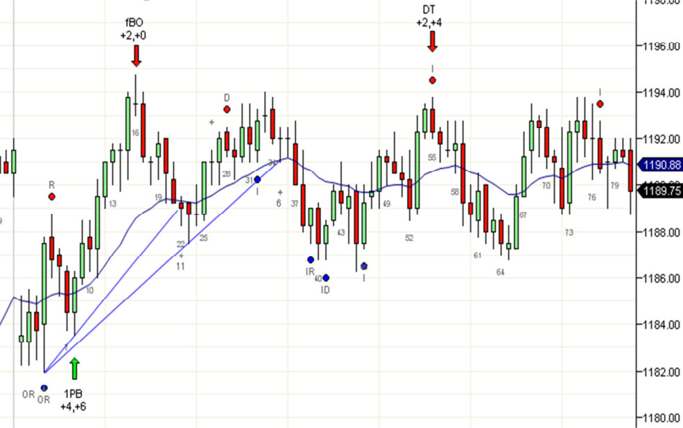

像 b22 这样略微跌破趋势线并不能真正突破趋势。另一方面，像 b34-40 这样的大幅移动会突破趋势，市场将进入震荡区间。此时，所有顺势入场都将不再有效。例如，b41, 即使有强劲收盘，也不是一个 A2。

一旦您注意到趋势中断，请仅在交易区间的极端位置进行交易。最好，您应该在创新高时进行 fBOs，或者如果突破强劲，则进行 BP。偶尔，您将能够进行 DT，例如在 b55 今天，甚至可能是 DP（如果 b69 收盘价更强劲）。

交易区间内的许多建仓形态实际上是套住。您往往会看到许多建仓形态，例如 b45,46 和 b72,73。看起来另一条强劲的腿迫在眉睫，但如果其位于区间中部，则该走势通常会失败，或者成功突破区间是成功的必要条件。

即使是接近区间末端的建仓形态也需要强劲的 k线（b55）才能有合理的成功机会。重叠和回撤的可能性非常高，因此交易通常是危险的。如果区间很小（小于 5 点），位于区间中部且由带引线的重叠 k线组成，则尤其危险。

耐心交易者应等待趋势突破，并在第一次回撤时入场，波段交易部分仓位。如果你必须交易，则逆势交易每一次两腿或三腿的走势。

<!-- 原书第 291 页 -->

## 内包k线反转

2011年10月12日 星期三 · 原书第 291 页

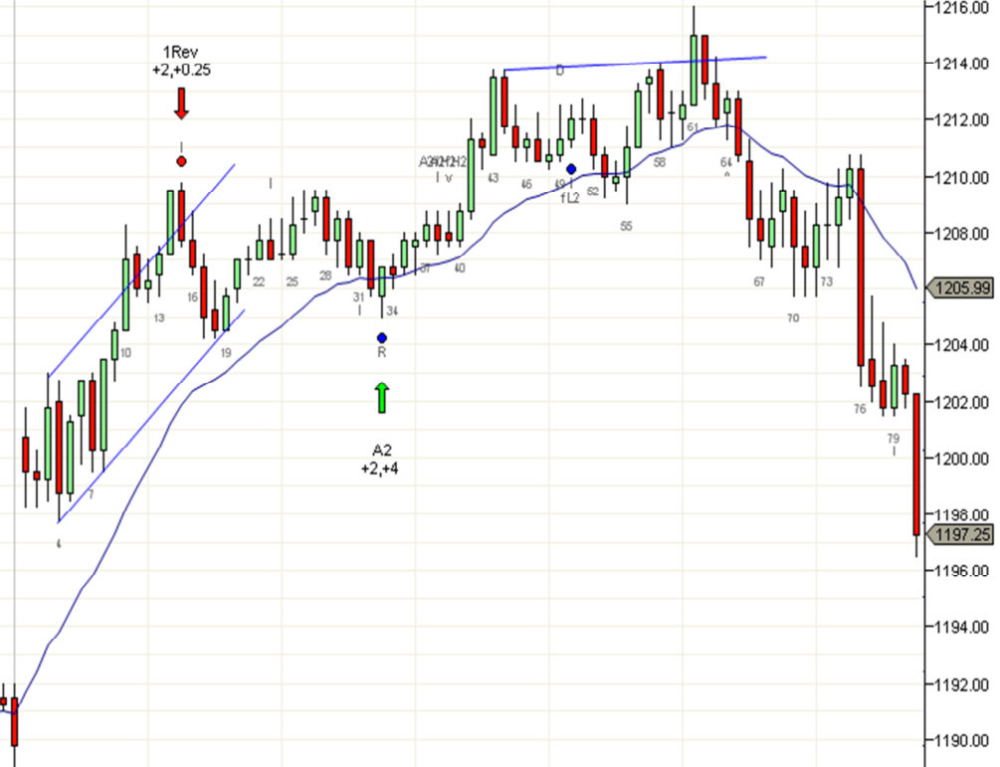

内包k线反转的解读难度很大。为什么b11 的向下突破失败，但b15 却提供了刮头皮交易盈利？为什么b44 在提供刮头皮交易盈利之前就触及了入场k线（b44）之外的止损，使其成为一个差的信号，而b62 却变成了一个优秀的波段交易？

所有这些k线都有强劲收盘，但有两个失效，两个成功。运用一点常识，我们可以降低承担无利可图的内包k线入场的机会。b12 是第一次尝试突破趋势，预期会失效。B15 是第二次尝试，并且出现了过冲，因此应该至少会有一个回撤。

同样，b44 是第一次尝试使强劲突破失效（b41 比先前高点50%+ ），不太可能成功。另一方面， b62 在趋势线突破（TL b4-b25）和TCL过冲后的第三次推升。

波段走势通常以内包k线结束，而这些内包k线通常非常适合顺势入场。例如，b19 ii预示着可能的波段结束，b54也是如此。

总结：

- 内包k线是突破失败的绝佳信号K线，但并非适用于任意反转。有人会说b15 和b62 是突破失败，而b11 和b42则不是。
- 当TL或TCL被违反时，内包k线是很好的信号
- 内包k线是顺势或波段末期的良好信号

<!-- 原书第 292 页 -->

## 末端旗形

2011年10月13日 星期四 · 原书第 292 页

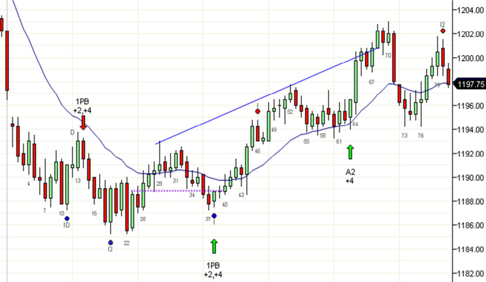

末端旗形代表高概率反转区域。经典的末端旗形是由重叠的趋势k线组成的水平旗形。当空头趋势结束时，这些k线很可能是大的（b18-23），但在多头趋势结束时，则可能由较小的k线组成（b65- 67）。如果这些k线不是趋势k线，那么延续的可能性大于反转的可能性。

一个正常的旗形是朝向与主趋势相反的方向移动 (b32-38, b53-b60)，它代表早期交易者退出，逆趋势交易者被套住，以及新交易者进入，将价格推向新的极点。回撤越深，顺势回撤入场成功的可能性就越大。

另一方面，一个横盘旗形并不代表早期交易者的退出。他们的目标非常接近，并且他们在持有，等待下一次推升时退出。逆趋势交易者不会被套住，并且新交易者不太可能在非常浅的回撤时入场。

在第三次推升时出现的横盘旗形很可能是一个末端旗形，你应该寻找有利的入场机会。如果风险过大，如在 b23, 的情况下，最好等待 2 次入场 (b38) 或在趋势反转后的第一次回撤时入场。这是因为当入场是逆趋势且风险较大时 (b19 买家)，被套住的风险相当高。

如果旗形是由更小的K线（b65-67）组成，那么在趋势突破和失效后的入场比避免被套住（b66 以下的做空者止损）更可取。ii变体，如b69,70 ，在过冲TCL时，是一个绝佳的FF入场点。

<!-- 原书第 293 页 -->

## 通道内的限制入场

2011年10月14日 星期五 · 原书第 293 页

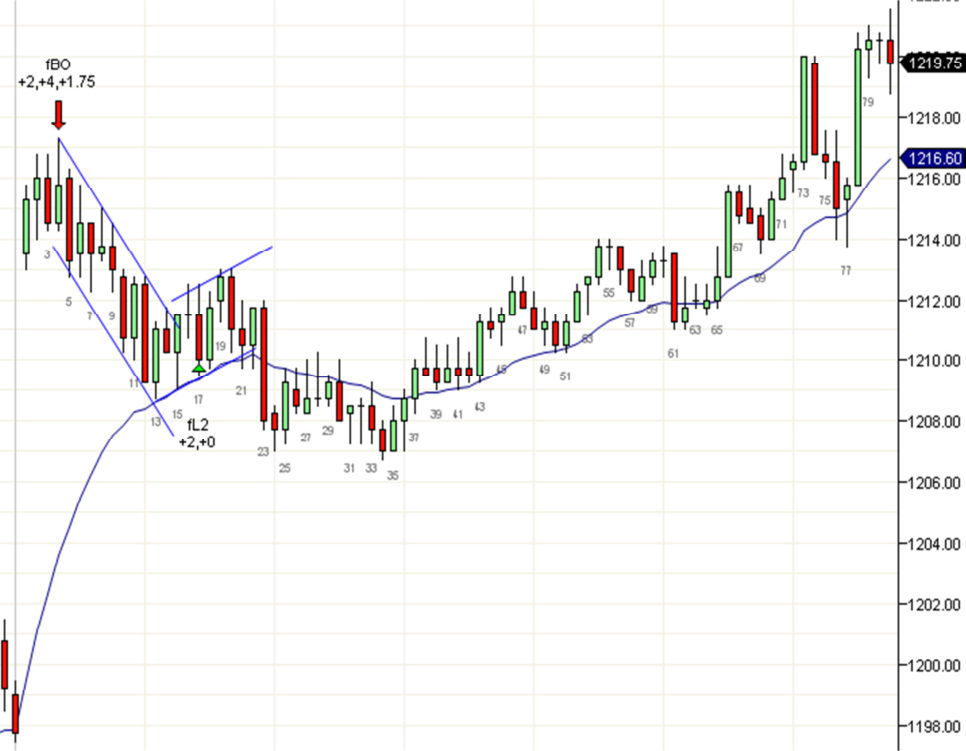

通道是由重叠K线组成的一条腿，回撤非常小。这意味着通道不会给出清晰的入场信号。偶尔，你会得到像b8 这样的小K线，你可以用它作为信号K线来入场。然而，你经常得不到任何这样的K线，即使得到了，你也可能发现自己在通道的顶部买入，正如b22 上方的买家所发现的那样。

通道的一个特点是，其第一次突破几乎总是失败的。这使得我们可以在通道趋势线附近入场，只要k线收盘价非常接近它。例如，b11 收盘价可以卖出，b17 收盘价可以买入。这对于第一次收盘价接近趋势线非常有效。后续的收盘价，如b15 收盘价，效果就没那么好了。

像b21 这样的弱收盘价，或者像b19 和b13这样远离趋势线的收盘价，都值得怀疑，因为距离趋势线还有很大的空间。这些应该避免。

将这些推广到总体趋势会稍微困难一些。理论上，您应该能够买入任何接近多头趋势线（例如 b 49 或 b61 ）的强劲空头收盘价，并卖出任何接近空头趋势线的的交易区间。然而，与通道不同，通道的首次突破是大概率失效，而像从 b35 到 b79 这样的总体趋势，其趋势线突破尝试并不期望会以如此高的概率失效。

<!-- 原书第 294 页 -->

## 加仓

2011年10月17日 星期一 · 原书第 294 页

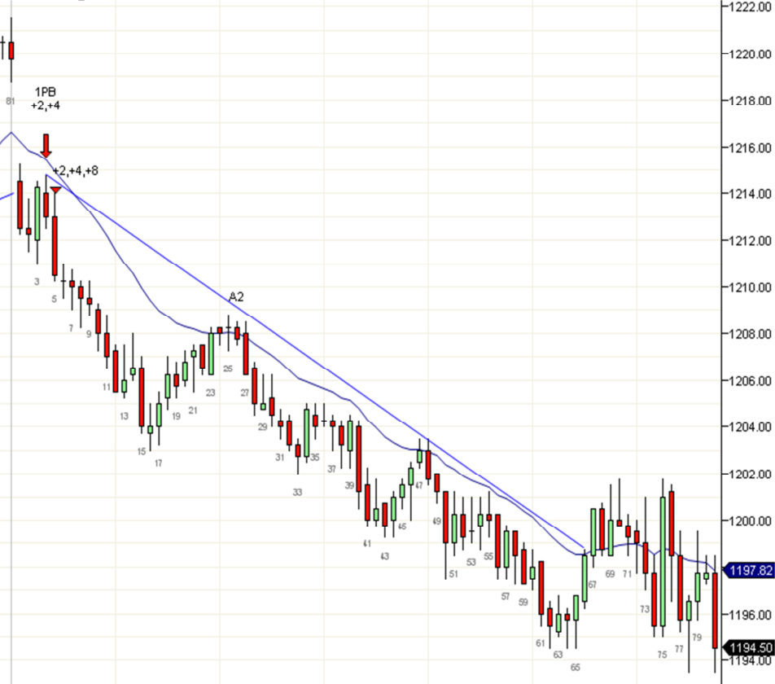

许多交易者在价格走势与他们相反时加仓新合约。个人认为这是一个糟糕的选择。如果您一开始就错了，那么现在您很可能以更大的头寸规模错了。然而，偶尔，前提是概率对您有利，加仓新合约是有意义的。

例如，今天我在 b4 下方做空，当价格朝不利方向移动时，我在 1点加仓。75 。通常情况下，我在这里会被止损，但此时我选择加仓而不是止损。

对我来说，加仓的条件如下：

1。判断正确的潜在回报巨大，判断错误的潜在损失很小：在 b4 触发后，我的止损位在其上方，所以我的加仓头寸只有 4t 的风险，但由于这是一个 1PB 建仓形态，潜在回报至少是 4 点，可能达到 8点或更多。2。入场是顺势：跳空下跌，强劲的 b1 低于 ema，失败的 H1 （已触发）都表明至少会测试 b3, 的低点，从而提供顺势入场。

<!-- 原书第 295 页 -->

3。你预期会因为价格行为出现回撤：b4 有一个入场侧引线，并且它的大部分都被所有之前的k线重叠了，所以回撤的可能性很大。由于你已经预期会回撤，你可以在第一次尝试时轻仓入场，然后在回撤时加仓。4。你正在你的舒适区内交易：如果你不能舒适地持有额外的合约，你就会面临在k线中间被震出的风险。

以下是加仓的不当理由：

1。您的逆势交易不利：这是破产的最佳方式，错上加错。做一个坚强的交易者，让它止损。这将训练您的大脑只在高品质建仓形态入场。2。您认为这将是一个巨大的走势，并希望在价格朝着有利于您的方向移动后加仓：这通常是一个糟糕的操作。一旦价格朝着有利于您的方向移动，您就应该退出您的刮头皮头寸，而不是加仓。

<!-- 原书第 296 页 -->

## 1Rev 的种类

2011年10月18日 星期二 · 原书第 296 页

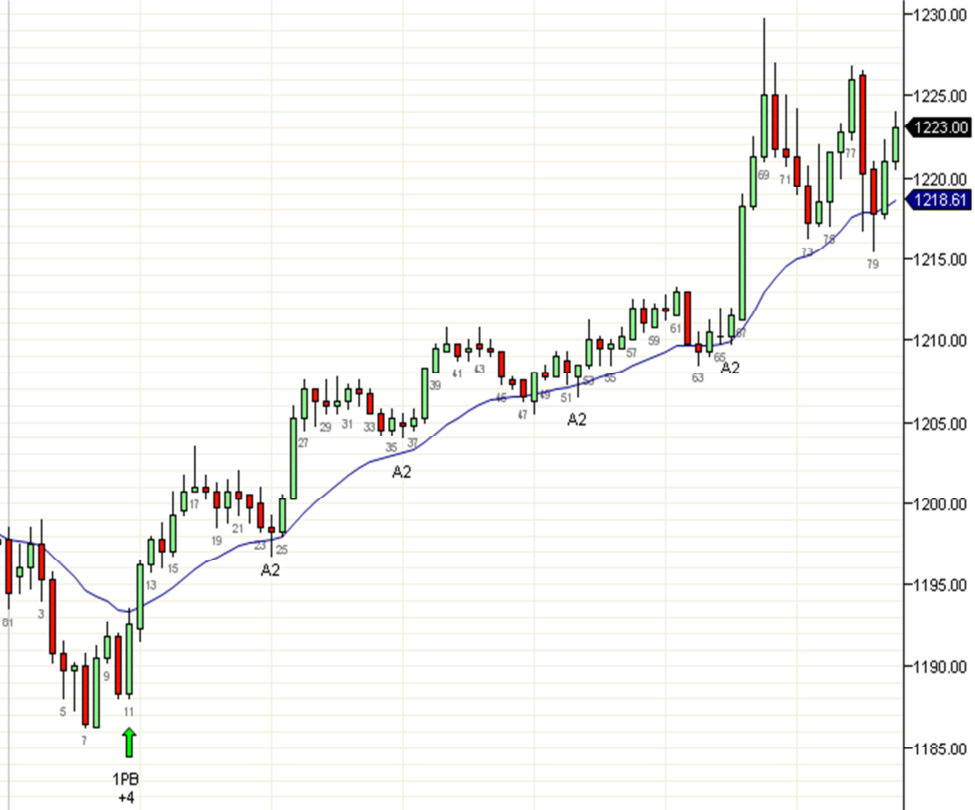

之所以1反转（Rev）难以解释，原因之一是它实际上是各种建仓形态的组合，这些形态恰好在开盘一小时内于当日最高点或最低点反转。有些日子会有一种以上的1反转（Rev），导致图表上有多个标签。为了便于解释，我将其分解为更简单的组成部分，希望能更容易解释和采纳。第一种1反转（Rev）实际上是开盘区间（OR）的假突破（fBO）。如果假突破（fBO）产生了一个不错的信号，并且区间足够大（例如4 点），那么它至少应该可以进行刮头皮交易。这最好标记为假突破（fBO），而不是1反转（Rev）。第二种1反转（Rev）是前一天高低点（HLC）的反转。通常，这种反转通常会寻求前一天的高低点之一。这可能应该称为开盘反转（OR）。第三种1反转（Rev）是从缺口（gap）到指数移动平均线（ema）的回撤（pullback）和反转。这可以像一个A2 一样运作，通常是一个高概率建仓形态。

最后一种 1Rev 是从开盘开始的趋势走势，并剧烈反转（b7,8）。后两种是高概率的日内高点或低点，可能导致波段交易直到日终（就像今天一样）。第一种应标记为 fBO。第二种可标记为 OR。第三种和第四种交易方式类似，可能应标记为 XOD（日内极值）。

我将采用新的命名法，避免使用1Rev作为标签。当出现一种以上的1Rev时，我可能会为了简洁而只写1Rev，但会尽量写出单独的组成部分。

<!-- 原书第 297 页 -->

## 上午趋势和下午趋势

2011年10月19日 星期三 · 原书第 297 页

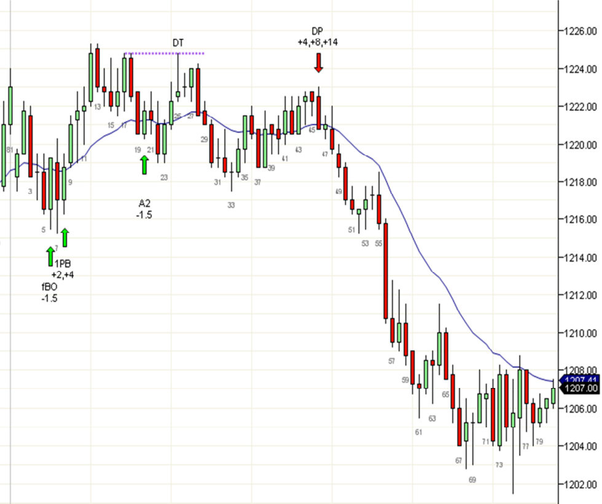

正如我之前所发的，交易者最好的选择是顺应上午趋势，而弄清楚这一点应该是波段交易的首要目标。在大多数日子里，1PB，偶尔1Rev会转变为上午趋势。如果这一天以较大的缺口开盘，远高于收盘价，尤其当开盘价超出前一天的区间时，这种情况尤其明显。

当开盘价接近前一天的收盘价时，除非距离前一天的一个极值较大，否则上午趋势可能不会很强。像今天这样的日子，有时可能导致下午趋势较大。

请注意，上午趋势的缺失并不能保证下午有趋势。通常一整天都没有趋势，一天可能在日线图上变成一个小型的停顿K线或内包K线。然而，有时趋势生成模式可能导致下午趋势出现突破。最容易识别的趋势生成器是DP，即b46上的双顶回撤。这是双底回撤的看跌类比。双顶回撤的特点是有一个定义良好的双顶，即几个点和较大的K线，最好是第二个低点(b33)跌破第一个低点(b23)。一个无法达到第二个高点(b28)的两条腿或三条腿的回撤(b33-45)完成了DP。如果它形成在交易区间的顶部附近，这是一个高概率的趋势生成器，应该始终被持有。可能的止盈目标是先前区间(b7- b13)的两倍，这通常是一个大的走势。DP不应在TR的错误一端（即，看跌DP在TR底部附近）或区间过窄（4 点或更少）时被采取。

<!-- 原书第 298 页 -->

## 预测午盘反转

2011年10月20日 星期四 · 原书第 298 页

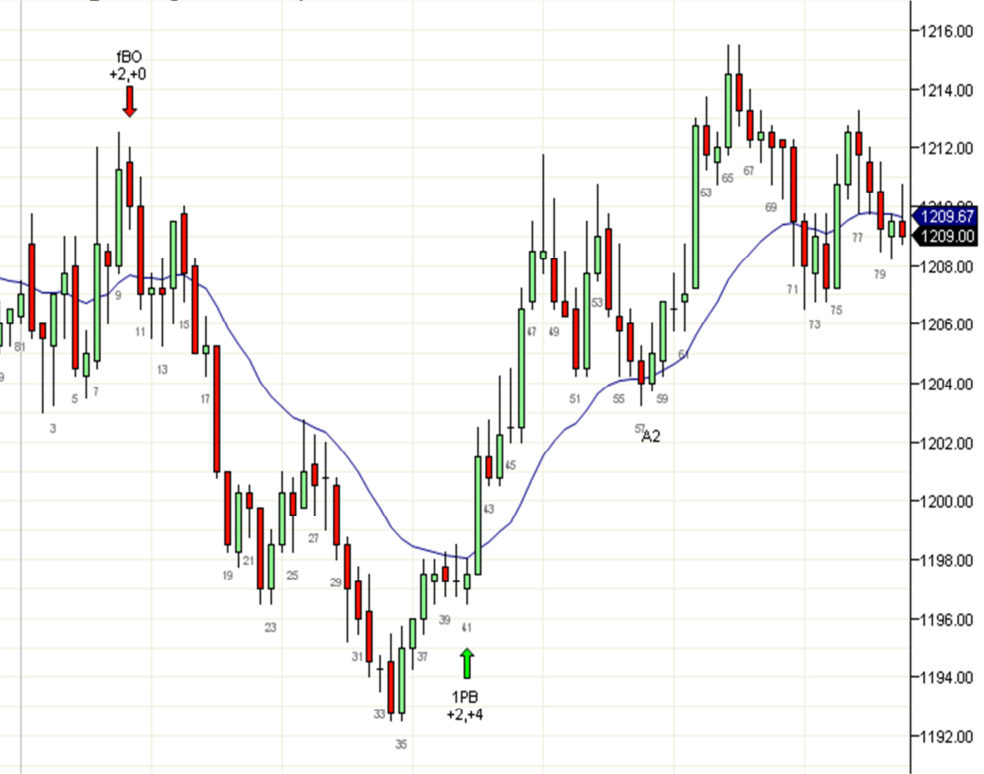

当上午趋势突破开盘区间时，了解趋势是否会持续到当天结束、转变为横盘区间或反转并试图打破当天的另一极端情况，是非常有用的。

即将到来的午盘反转的最早迹象之一是早期 k线显示出强度。今天 b7 和 b9 显示出买家们愿意积极买入，并且上涨动能扫除了空头们的止损。通常，在给定价格出现的强劲的逆势活动表明在更好的价格下可能出现更强的活动。

因此，当你看到像 b34,35, 这样的潜在反转时，最好退出你的上午趋势头寸，并寻找新的反转趋势入场，该趋势可能会持续到当天剩余时间，或者至少持续到它扫除先前极端 (b62) 为止。

开盘价非常接近前一日收盘价的日子，以及突破高拥挤区域的趋势，由于紧密盘整区的磁性效应，很可能会反转。

<!-- 原书第 299 页 -->

## 通道回撤

2011年10月21日 星期五 · 原书第 299 页

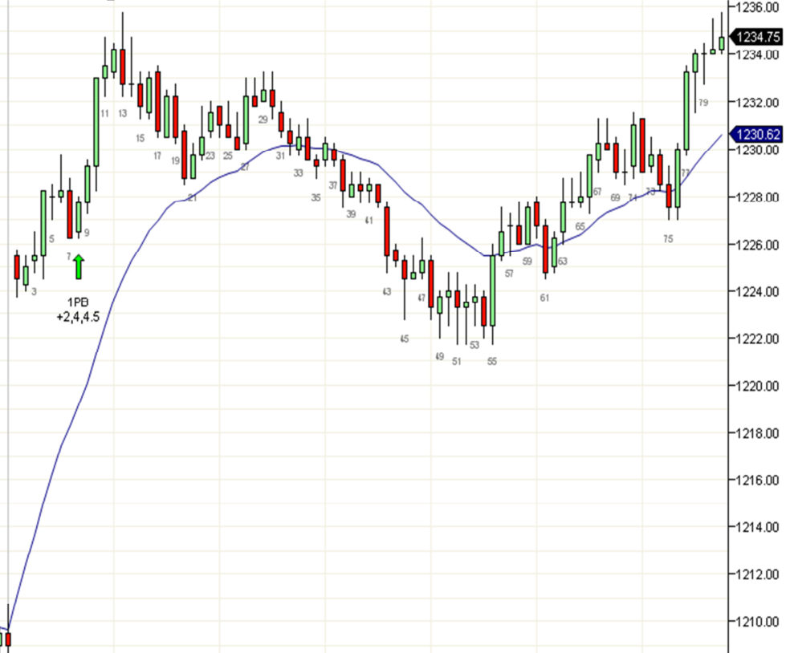

在开盘带有大缺口且以强劲趋势开始的一天，你可能会期望在第一次双腿回撤后出现一次像样的走势。然而，当回撤看起来像一个通道时，很有可能它只充当了一条腿，在趋势恢复之前，需要完成第二条腿。

b18 的外包k线和与指数移动平均线之间的距离排除了在b18 之上入场的可能性，因此下一个合乎逻辑的建仓形态是b21。b21 是一个可能的WP，但由于它确实是一次下跌腿而不是一个低动量走势（即，不是微小/十字星k线），它可能是一次下跌腿，并且预期会再次出现下跌腿。

一次失败的2 腿尝试，试图突破b29 处的高点，属于失败，因此很可能至少有两腿做空下跌。

<!-- 原书第 300 页 -->

## 趋势线突破后

2011年10月24日 星期一 · 原书第 300 页

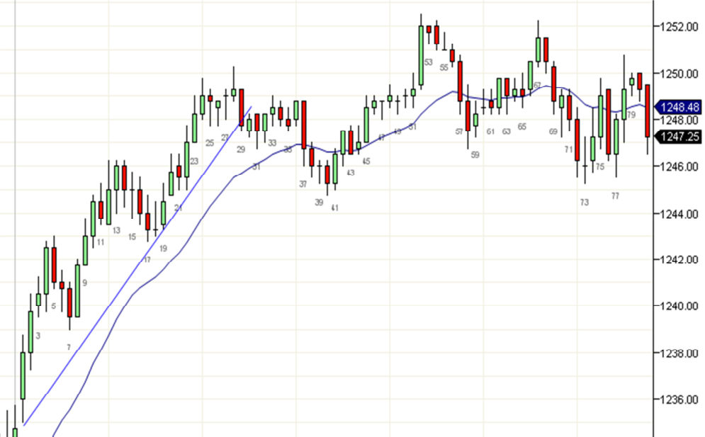

无论趋势有多强，信号k线有多好，趋势在趋势线突破（b29-39）后终止。持续多个k线和多个点数的趋势线突破意味着您不再寻找顺势信号。

因此，b35 不是一个H2 或A2 ，b41也不是。然而，这是一笔好交易，因为强劲走势后的趋势线突破预计会回测先前的极端。

趋势线突破后，您处于一个交易区间，并且只应期望两腿走势，这些走势可能不会到达交易区间的另一端。例如，b53 给了两腿到b73；b59 给了两腿到b67；b73 给了2 腿到b79。无法确定任何一腿能走多远，b77 的做多只比先前的波动高点高了一点。这就是为什么应该避免在TR中间进行交易。它们不太可能有许多参与者，其强度值得怀疑。

另一方面，您应该逆势交易弱势突破，并做强势突破的回撤。尽管b52 是一根强k线，但它是一次弱势突破。这是在趋势线突破后的第三次上涨（b45,49,52）。突破后的oio（b52,53,54）建立了一个反转。b59 的BP很弱（TR k线b58,59）。而b68 则是一次强势BP做空。

总结一下，在区间的末端逆势交易弱势突破，只在趋势线突破后进行强趋势回撤交易，并避免尝试寻找延续交易。

<!-- 原书第 301 页 -->

## 巨大的开盘k线

2011年10月25日 星期二 · 原书第 301 页

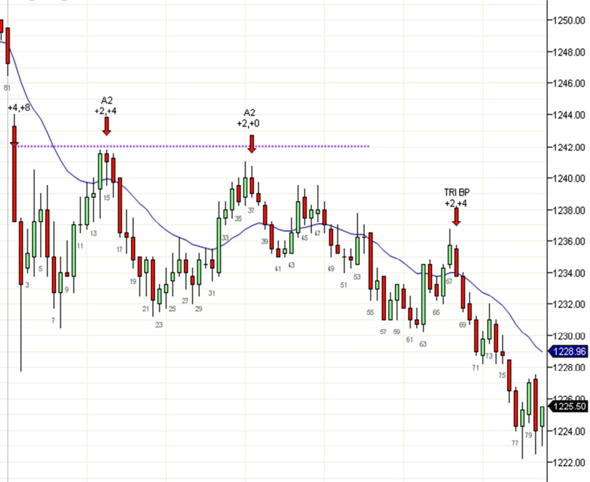

开盘大k线很少见，但一旦出现，你最好的选择就是及早入场。一种入场方法是利用开盘后的5走势，并且只顺着缺口的方向。因此，对于今天，当价格触及上方显示的紫色线时，你应该做空。在大多数有大缺口的日子里，价格在这一天剩余的时间里或者直到出现W形或其他反转信号之前，都不会触及盈亏平衡止损。大k线代表交易区间，开盘大k线也不例外。一系列的大k线之后，必然会出现一次回撤，并测试极值，而无论回撤有多深。

这是因为大k线代表一个尖峰，而趋势尖峰通常会被测试。一两个k线内的大范围（b1,2）通常会形成一个收敛三角形（高点，低点，高点，低点...），因为市场试图在区间的两端找到平衡。

交易三角形最安全的方式是三角形BP。基本上，等待2 高低点或2 高点被突破（b41,23 被突破于b62），然后进行下次回撤。如果回撤是2 腿部形态，如b68, ，这通常是一个优秀建仓形态。

然而，在三角形突破之前，您只能进行顺势入场，并且最好是违反趋势线的入场。交易三角形而逆着先前趋势是危险的，应该避免。关注疲软入场k线和买家在 b8, b23 和 b58上方的回撤。

<!-- 原书第 302 页 -->

## 预测上午趋势反转。

2011年10月26日 星期三 · 原书第 302 页

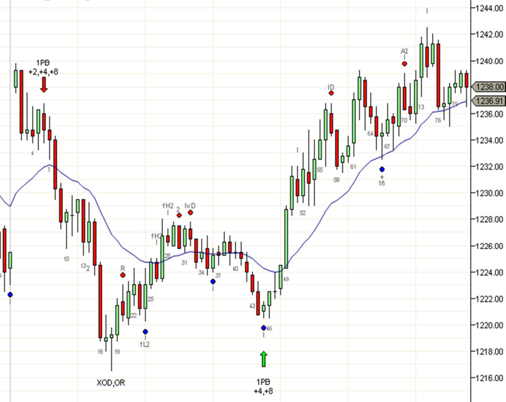

我经常说，持续的成功在于能够尽早进入趋势，特别是上午趋势。通常，上午趋势的缺失可能意味着潜在的下午趋势，如果当日以大缺口开盘，但在很多日子里，这仅仅是一个交易区间日（无论是否有缺口）。

然而，有时我们会遇到一个极好的上午趋势，该趋势被打破，并且没有演变成交易区间，而是反转为另一个极好的下午趋势。

为了预测此类走势，请留意一个大缺口和前一天区间内的开盘（b1）。如果趋势移动以三推的方式突破前一天的极值（b5,10,18）并发出反转信号（b18），那么接下来的腿部回撤（b45）很有可能演变成趋势。该趋势应至少突破 b1 ，因此是一个极佳的波段交易候选。

<!-- 原书第 303 页 -->

## 非常大的跳空上涨

2011年10月27日 星期四 · 原书第 303 页

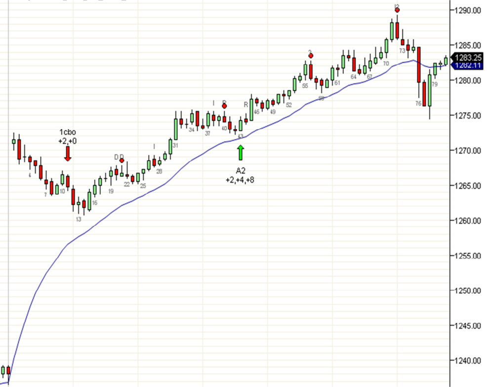

大缺口就像一个尖峰，如果价格远离指数移动平均线，则很有可能回撤至指数移动平均线附近。一次腿部回撤至指数移动平均线是缺口日上的一个非常强的信号。缺口越大，最初的回撤（b1-b14）越深，可能看起来像一个小趋势。

就像一个以大尖峰K线开盘的一天一样，非常大的缺口日很可能表现为软趋势日，回撤非常浅。当第一个更高的低点是fL2 (b19,b22)时，这是一个即将出现软趋势日的非常强烈的信号，您永远不应进行逆势交易。

在软趋势日，你可以像交易多头K线一样交易十字星k线（b42,58）上方的价格，前提是它们接近趋势线或指数移动平均线。如有疑问，你总可以交易十字星信号K线（b43,b59）后面的强劲多头K线。

<!-- 原书第 304 页 -->

## 1跳点指向方向改变

2011年10月28日 星期五 · 原书第 304 页

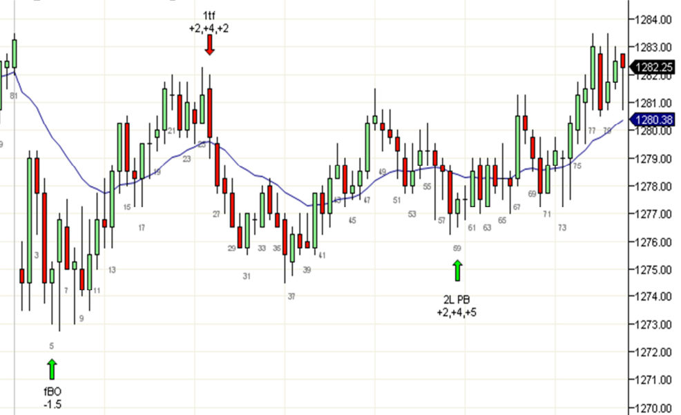

失败常常是很好的信号，尤其是1tf，它们是市场转折的绝佳标志。1tf也非常适合顺势入场，因此你应该小心区分两者。

经典的 1跳是由于在趋势线突破或出现逆势强度信号前尝试反转而导致的失败。这通常是持续信号。在 b14 下方（b14,15内包k线变体需要在 b14下方入场）的卖方被套在了 1跳中。

在某些情况下，1跳也可以是反转指标。例如，b25 在 ii旗形上，作为末端旗形，是 b21 先前波动高点上方的 1跳。同样，b39 处的 ii变体变成了 1跳反转。末端旗形变体通常是 5跳，例如 b 25 （超过 b24），但有时也可能是 1跳，如 b41所示。

今天还有一种1趋势终止。b6 套住了买家，通过触发b5 上方并破b1的低点，然后反弹向上。这种双重套牢后接一个1趋势终止是一种微型楔形（3 在1图表上进行推动），通常表明市场方向改变。

<!-- 原书第 305 页 -->

## 预判后期趋势突破。

2011年10月31日 星期一 · 原书第 305 页

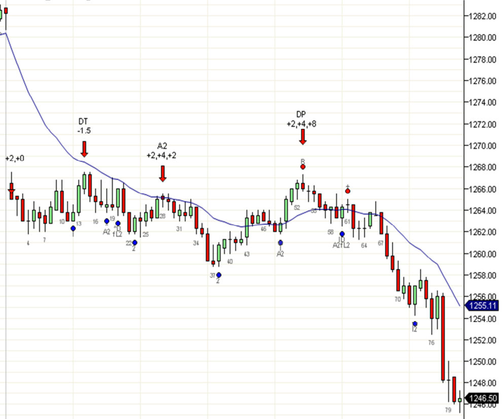

在开盘超出前一天区间的大缺口日，趋势的可能性很高。如果第一根k线没有形成强劲趋势，那么它很有可能至少会尝试回撤到指数移动平均线，然后向任一方向发展趋势。

一旦当天行情陷入交易区间，任何趋势突破都可能发生在区间的另一端，即多头趋势突破自区间底部，空头趋势突破自区间顶部。这就是为什么在交易区间内，你应该只做低吸高抛。

一个1tf，就像b24 上的那个，可能会导致趋势，但当区间很小时，可能性较低。交易区间通常会在突破进入趋势之前试图扩大。扩大区间的一个常见方法是反复突破区间的两端，直到区间足够宽。这是一个扩张三角形突破，任何尖锐的突破都可以被逆势交易，直到向上突破并出现2L HL 或向下突破并出现2L LH。第二个选择是提供一个突破回撤。b36 是交易区间的强势突破，并出现了一个LH 3 推拉回撤到b53, ，这也是一个DP。这些通常是趋势生成器，应该被抓住。在区间中部入场，例如在b28 的入场，应该被避免，除非您有理由相信您处于趋势中（LL和LH）或者您正在进行突破回撤入场。总的来说，您最好的波段交易入场点是在交易区间被先前的失败突破充分扩大后，靠近交易区间的两端。

---

[← 上一章](17-2011年9月.md) · [目录](00-目录.md) · [下一章 →](19-2011年11月.md)
