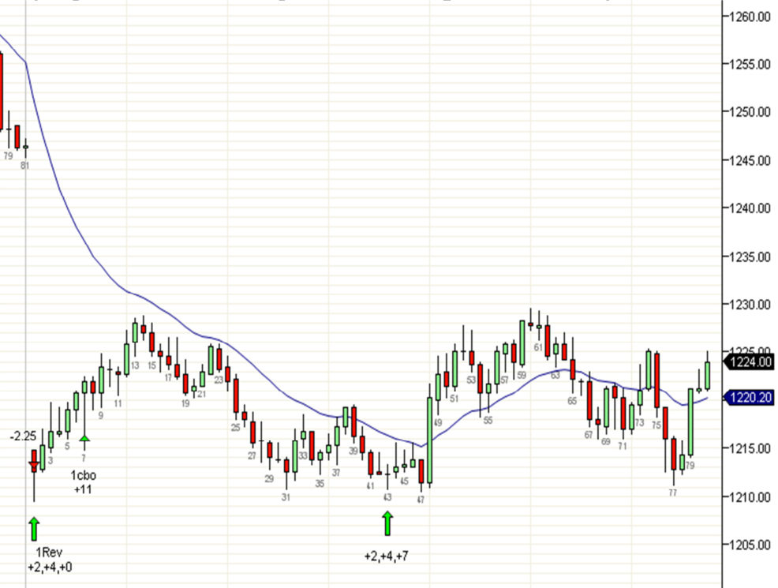
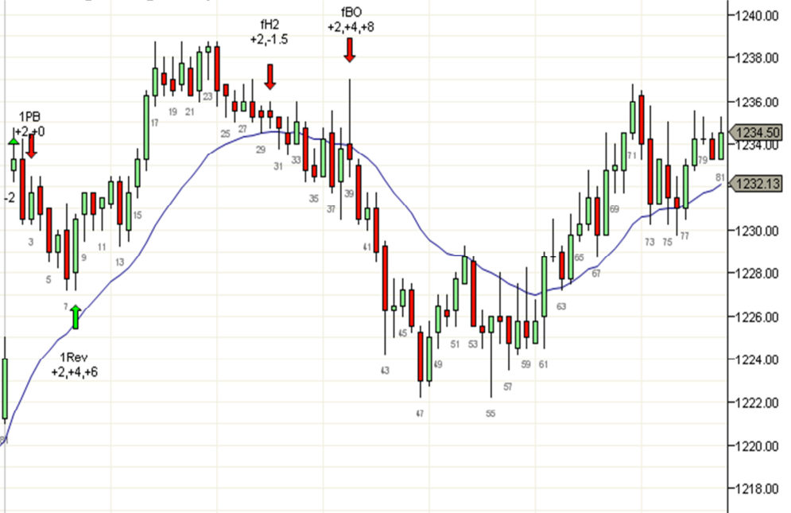
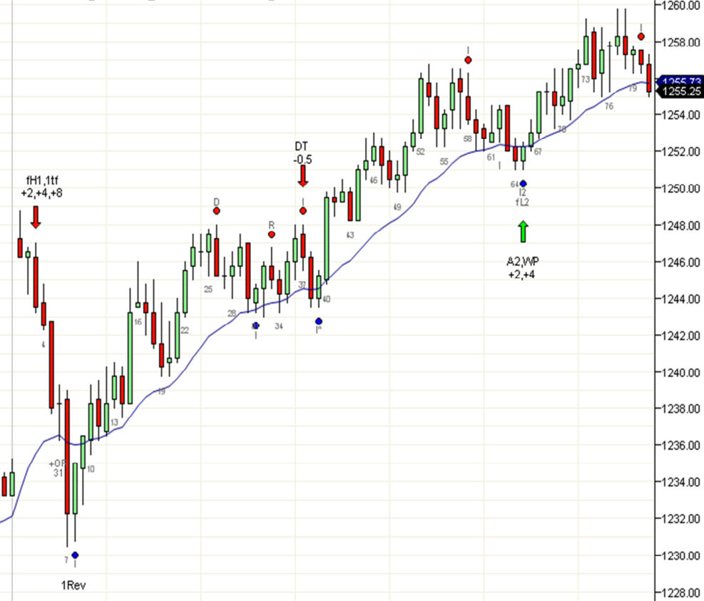
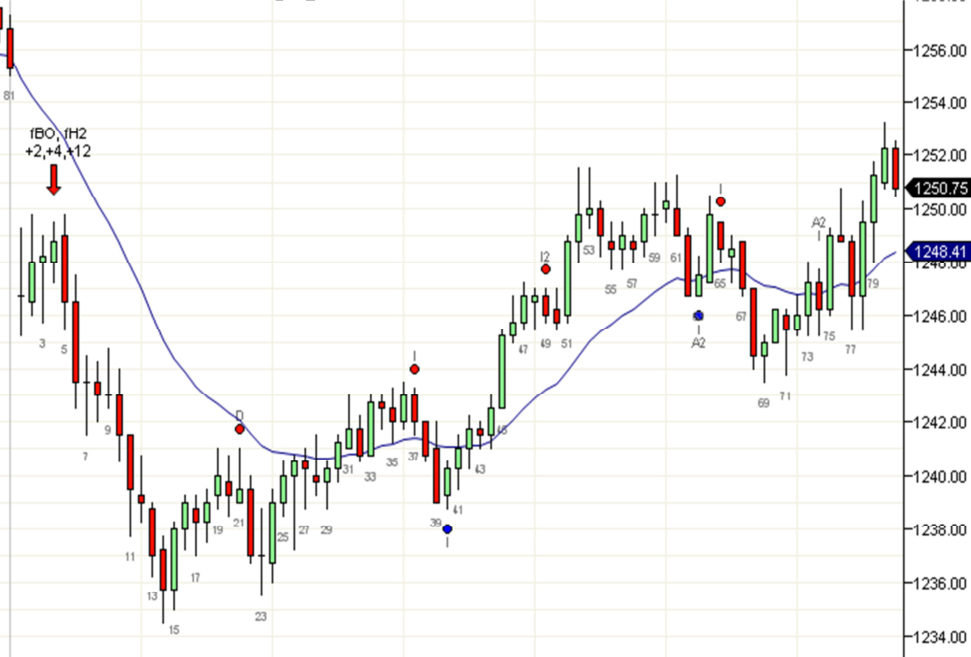
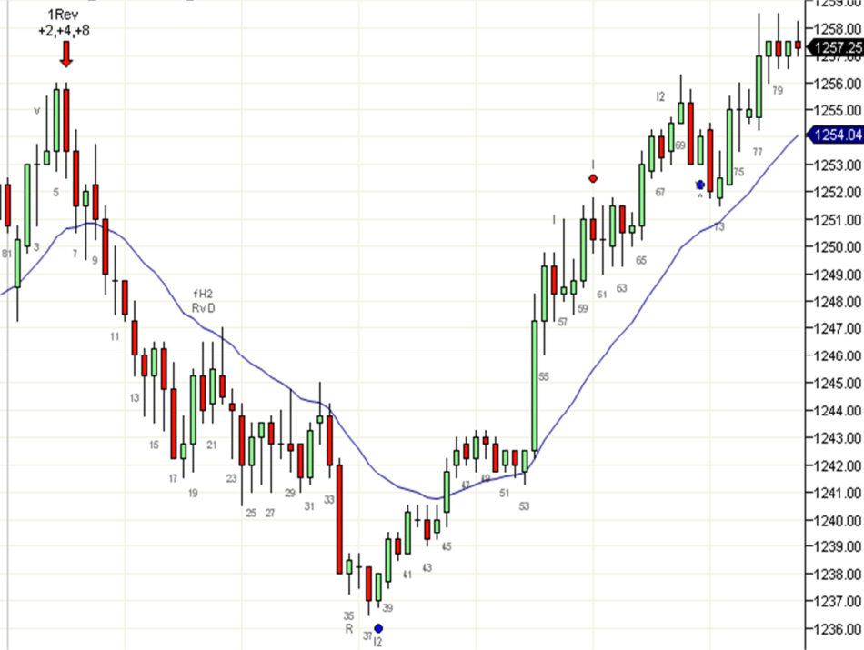
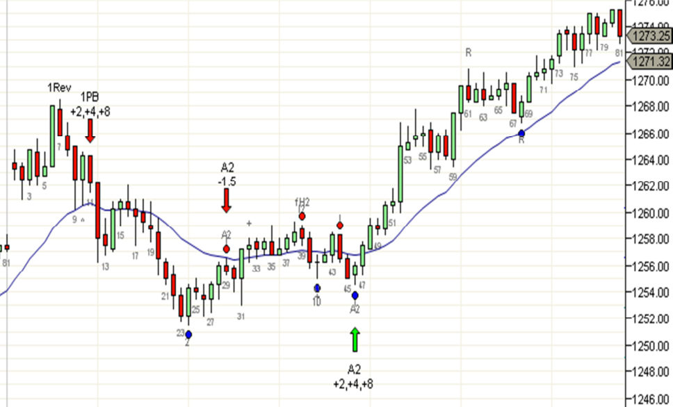
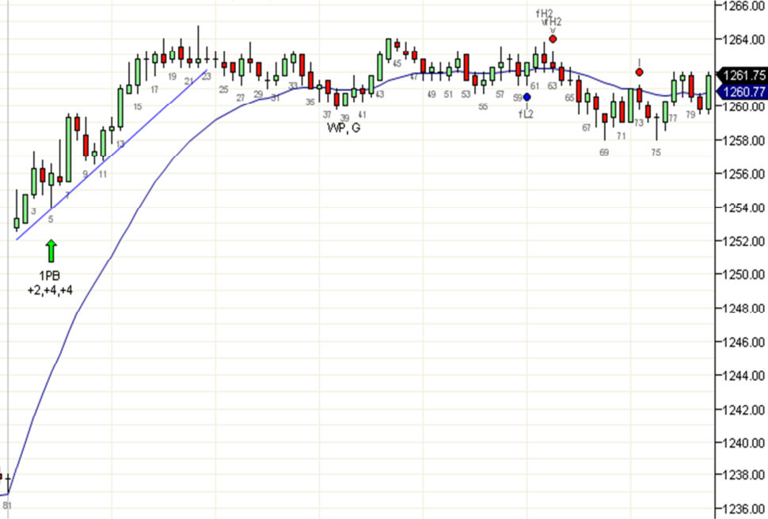
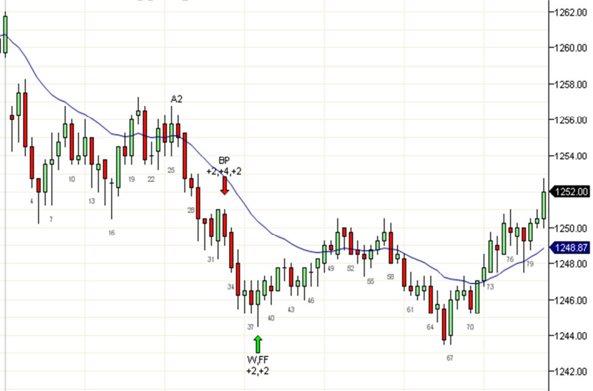
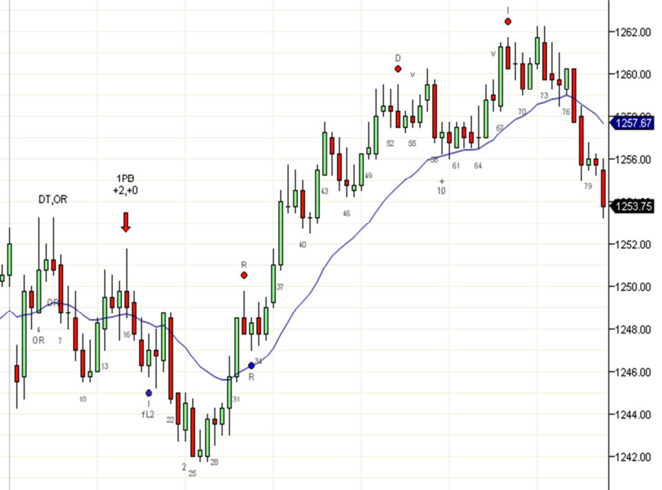
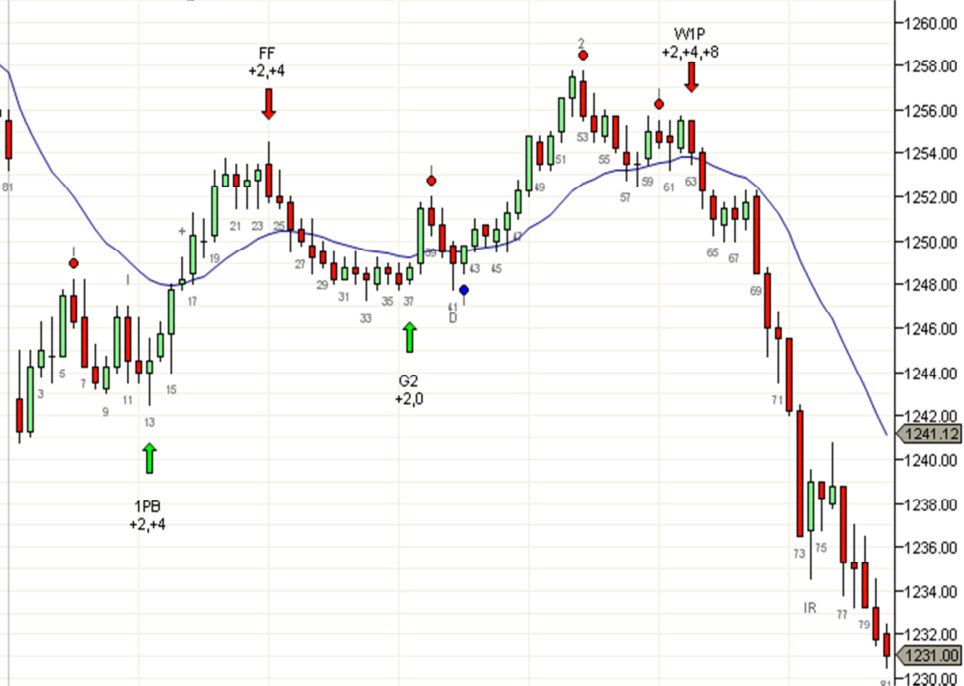

[← 上一章](18-2011年10月.md) · [目录](00-目录.md) · [下一章 →](20-2011年12月.md)

# 2011年11月

原书第 306–315 页

<!-- 原书第 306 页 -->

## 交易区间日下方买入和上方卖出重叠区。

2011年11月1日 星期二 · 原书第 306 页

交易强势趋势日不一定容易，但肯定很简单。您基本上可以抓住每一个合理的顺势入场，并且成功率很高，除非您接近趋势的末端。在交易区间日，情况变得更加不确定，波段交易入场会一直被止损。

处理交易区间日的一个简单启发法是，在重叠区下方买入，在重叠区上方卖出。就我们的目的而言，重叠区是任何交易区间k线，例如外包k线 b7, 任何重叠的k线，例如 b54,55 或任何横盘区间，例如 b69-72。唯一的限制是重叠区必须足够大，以产生刮头皮利润，例如 4 点。像 b48这样的趋势k线不应以这种方式逆势交易，因为很有可能它会变成急速加通道，或者变成突破回撤。

一旦重叠区形成，就决定在它上方卖出，在它下方买入。在交易区间日，任何突破这些重叠区的行为很有可能失败，并且很有可能至少会触及重叠区的另一端。

相反，如果突破失败的重叠区在趋势日成功触及另一端，例如上面的突破，该突破随后触及了 b 7 低点，则该日会变成交易区间日，您只应在区间的两端进行交易。

<!-- 原书第 307 页 -->

## 交易区间日，一系列假突破

2011年11月2日 星期三 · 原书第 307 页

由于大多数日子都是交易区间日，交易者需要对市场触及当日高点或低点或重要波动点后会发生什么有一个切合实际的预期。通常，预期突破会失败，但在突破方向上进行交易的入市点应在两次尝试继续突破方向失败后确定。

例如，周二强势突破日高受阻，市场两次未能继续（周二周三）形成横盘旗形，该旗形实际上充当了末端旗形。此时，应该很清楚市场将尝试重新测试低点，您不应再寻找多头交易。

周二跌破日低是由一根大k线形成的，但第二次尝试继续卖出失败，形成了一个双底。此时，在双底被突破之前，市场预计将再次测试高点。

交易区间日可以看作是在突破新高或新低后，一系列未能产生趋势的失败尝试。当然，在未能突破的情况下，以两次或三次腿的方式向高点或低点移动，也可以视为假突破。

有时，突破会产生成功的BP，这可能导致趋势，尤其是在另一端出现DP之后。

<!-- 原书第 308 页 -->

## 选择刮头皮和波段交易入场

2011年11月3日 星期四 · 原书第 308 页

一天中的第一个小时很可能产生日内高点或低点，并且此时进行的交易最适合波段交易。有时，上午未能产生任何趋势移动，在这样的日子里，下午可能会出现趋势，但通常可能性更大的是上午趋势。

一个 1PB 是 AM 波段交易的最佳选择，但有些日子，比如今天，1Rev 是最清晰的波段入场。如果早盘趋势走势导致强劲反转，您应该始终波段持有 1Rev 入场。如果您错过了 1Rev 和 1PB，那么您应该寻找第一个深度回撤，例如 b20 今天。这是一个糟糕的信号（一个重叠的十字星），所以跳过它也无妨。第一个 2 腿的回撤，例如 b31 或 b39 ，通常会提供一个不错的趋势晚期入场，即使在那时看起来您正在买入高点。午餐时间尤其危险，许多交易者会正确地交易较小的交易量或只进行刮头皮交易。浅度回撤通常是刮头皮建仓形态，因为您的波段止损很可能会在下次回撤时被突破。深度回撤更有可能出现强劲的入场k线，导致下次回撤错过您的盈亏平衡止损。随着交易日剩余时间减少，波段走势的选择也随之减少。除非您处于晚期强劲趋势中，否则您应该对适度利润感到满意。这对于当天早盘突破的趋势尤其如此，因为预计它们会因获利了结而显示出一定的波动性。

<!-- 原书第 309 页 -->

## 两次未能回补缺口

2011年11月4日 星期五 · 原书第 309 页

在许多日子里，当市场以一个合理大小的缺口 (4+ 点) 开盘时，市场会试图两次填补缺口。如果两次尝试都失败了，那么在市场试图反方向运动之前，有很大可能出现一个沿着缺口方向的强劲趋势。

缺口越大，在任何试图反转之前的趋势移动就越大。

今日开盘出现一个合理的缺口和一个十字星k线，收盘接近k线低点，这是一个糟糕的多头信号，很可能失败。第二个信号是另一个十字星，但收盘价更高，也失败了。糟糕的逆势信号k线的出现是趋势延续的强烈指示。

两次失败导致市场打破了趋势，并将缺口扩大到 k线14。在此过程中，一个平坦的 b9 标记了 k线14低点附近的一个精准退出。

<!-- 原书第 310 页 -->

## 三推腿

2011年11月7日 星期一 · 原书第 310 页

三次推动，每次推动之间都有小的回撤，如在 b8,15,18 或 b57,60,69 中所示，可能形成一个糟糕的楔形。这个楔形基本上会作为一条腿，可能会出现一次回撤，然后恢复原来的走势，突破之前的腿部极值。

例如，下跌到b18 的三推腿在给出两腿走势到指数移动平均线之前又给出了下跌腿到b24 ，上涨腿到b69也是如此。

三推腿至指数移动平均线或其他障碍可能会导致深度回撤甚至反转，尤其是在一天开始时。另一方面，顺着指数移动平均线斜率方向的三推腿可能会形成一个在指数移动平均线处停止的回撤，就像今天一样。

交易这样的腿很简单。如果腿在障碍处停止，则在信号不错的情况下进行反转。如果没有，请等待至少另一条腿的回撤和延续。

<!-- 原书第 311 页 -->

## 失败的持续反驱

2011年11月8日 星期二 · 原书第 311 页

当一个可能的反转形态被触发，例如在第三次下探时出现 b23,24 2 k线反转，但原始趋势仍未被打破（因为趋势线尚未被突破），则在你可以沿新趋势方向交易之前，延续需要失败。

一条经过一个柱形走势后的腿走势如同亏b29 很多是一个非常好的持续信号，应当然要通过，因为它很多时候会导致相同大小的走势。如果这条走势失败，如同亏b31 取代了b29, 一样，应当在新的方向中寻找建仓的形态。

例如，虽然 b39 今天奏效了，但在 k线较小的日子里，它很可能会失败。正确的交易是在新趋势的方向上，在 b46 上方做多 A2 并进行波段交易。

<!-- 原书第 312 页 -->

## 趋势终止 (TT)

2011年11月11日 星期五 · 原书第 312 页

在像今天这样的日子里，识别潜在的趋势通常很容易：一个大缺口接着两个或三个收盘在缺口方向的 k线是一个非常强劲的趋势尝试，而购买 1PB（b5）并持有直到波段终止或反转是一个容易的决策。

并非所有趋势都会反转，许多趋势只会终止于交易区间。确定趋势的结束需要一些经验。趋势主要有三种终止方式，今天我们很幸运地看到了这三种方式。

第一种是 TTR，由许多小型重叠的十字星 k线组成。根据这个标准，我们应该已经知道，在大约 b22 的时候，趋势已经终止了。

第二种是延长趋势线突破。走势超出趋势线很多 k线且超出很多点才算趋势线突破。它超出趋势线的时间越长，需要超出趋势线的点数就越少。这意味着一个足够大的单根 k线就可以突破趋势，或者一个大约 20 根 k线（b21-39）的横向或略微倾斜的走势就可以突破趋势线，而不会低于太多。

最后一个是失败的反转，随后是失败的延续。b22 是一个形态不佳的W和FF，随后在b39 出现 WP，未能突破反转k线。一旦你意识到趋势已经终止，就不应再寻找顺势交易。你最好的选择是等待新趋势突破，并在第一次回撤时入场。如果TT之后的交易区间很小，最好不要再进行任何交易。如果交易区间很宽（8+ 点），你可以考虑反转新交易区间的极值。请注意，一般来说，你不应期望在交易区间内的任何入场都会有大的走势。一般来说，你应该期望的走势大约是交易区间的一半大小。

<!-- 原书第 313 页 -->

## 第一次双腿回撤

2011年11月14日 星期一 · 原书第 313 页

在很多日子里，开盘可能构成一个开盘区间，由不规则的走势（b1-b25）组成，最终进入趋势（b26-b38）。一些交易者可能会在初始区间反复被止损，而他们后来的交易几乎无法弥补他们的初始亏损。避免在开盘TR被震荡的诀窍是等待趋势尝试，并在强信号k线上进行清晰的回撤。这基本上是1PB交易的理念。

确定一腿是否是趋势尝试有点棘手。任何两三根趋势k线都可能是一个趋势尝试。一根k线通常不能构成趋势（除非它非常大）。一旦趋势被尝试，它要么会反转，一个新的趋势会在相反方向被尝试，要么一个回撤提供了一个原始腿的可能延续。一次强烈的反转尝试是 1Rev。一次回撤是 1 PB。今天，从 b3 到 b5 进行了一次趋势尝试，并在 b5上进行了一次弱反转尝试。然后可能从 b6 到 b9进行第二次趋势尝试。请注意，这根k线由较弱的k线组成，不太可能成功，尤其是在缺乏前期多头强度的情况下。b16 代表了当天的第一次双腿回撤，并且是多头趋势尝试的一个可能 1PB 多头入场。然而，信号k线是一根十字星，反转相当疲软。但是，这仍然是一个可行的多头入场。当多头入场未能突破前期高点时，它变成了第一次 2 腿部高点，在原始空头趋势尝试的 b 20 处变成了一次 1PB 做空。

另一种解读是，b2 和b9 代表了两次未能填补缺口而导致的空头趋势。尽管许多交易者可能已经正确地将b9 解读为可能的1PB做空信号，但通常等待一个强烈的信号k线（b26）是进行盈利入场最明智的做法。这是因为，即使市场方向判断正确，在震荡开盘时，在多头K线下方做空总是可能失败。

<!-- 原书第 314 页 -->

## 反转k线

2011年11月15日 星期二 · 原书第 314 页

反转k线通常会发出反转信号，无论它们出现在哪里。一个位置恰当的反转k线（b6）可以预示一个走势的结束（ b1-b6），但一个位置不恰当的反转k线，例如b15 预示前期走势（b10-b15）的结束，也能起到同样的作用。

一个反转k线之后是另一个相反方向的反转k线（b15,16 和b32,33）通常是一个非常强的信号，尤其是当第二个反转k线可以被视为新趋势走势中的一个1PB，即可能反转后的第一个回撤。

同样，反转k线失效是非常强的顺势信号。通常在最近可能的反转之后，反转k线的失效可以被用作入场。你可以做多入场，止损设在b32 之上（例如，如果你还没有在b33获得买入信号）。

A re错误颜色的反转k线，例如b39 ，通常是套住，如果趋势已经 n stro成立，则可以将其作为持续信号进行交易。

小的反转k线（与前一根k线或近期k线相比）容易失败，例如b68，您应该只进行二次入场。唯一的例外是当引线至少和实体一样长，并且您在信号方向上有额外的力量迹象。

<!-- 原书第 315 页 -->

## 双重楔形

2011年11月16日 星期三 · 原书第 315 页

双重楔形仅仅是两个在同一根k线结束的楔形。在上面的图表中，可以认为存在两个楔形 W 6,24,52 和 W 34,39,52 或其他变体。双重楔形可能导致大走势（b63-b81）

要形成双重楔形，最近的波动点（b24）的回撤需要足够深，以便下一腿可能需要多次推动才能突破。由 CT k线组成的强劲深度走势（b24-33）也可能显示出逆势强度，这将鼓励顺势交易者退出，并鼓励逆势交易者在波动点（高于 b24）之外入场。

---

[← 上一章](18-2011年10月.md) · [目录](00-目录.md) · [下一章 →](20-2011年12月.md)
