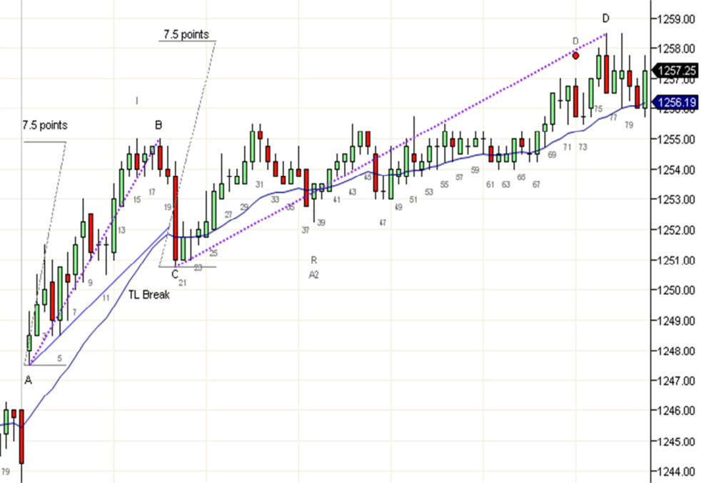

[← 上一章](19-2011年11月.md) · [目录](00-目录.md) · [下一章 →](21-2012年1月.md)

# 2011年12月

原书第 316–316 页

<!-- 原书第 316 页 -->

## AB=CD 衡量交易

2011年12月29日 星期四 · 原书第 316 页

当趋势移动的第一腿相当强劲时（由收盘价接近高点的强k线、陡峭的趋势线、浅幅回撤等表示），第一次趋势线突破很有可能产生一个应该走相同点数的第二腿。

今天的第一腿以 b1 开始，在 b18 的双顶处结束，由紫色线 AB 表示。该腿的长度为 7。5 点。这意味着交易者可以预期第二条腿也约为 7。5 点。紫色线 CD 表示的第二条腿也为 7。5点，超出了预期的走势 1t。

衡量交易并非必然发生的走势，有时价格未能达到目标，或远远超过目标。但在一个正常的交易日，当价格行为正常时，这是一个合理的预期。

交易的关键是只在 b21 处进行深度回撤，并且只进行强劲腿的第一次深度回撤（即趋势线突破）。

---

[← 上一章](19-2011年11月.md) · [目录](00-目录.md) · [下一章 →](21-2012年1月.md)
