[← 上一章](20-2011年12月.md) · [目录](00-目录.md) · [下一章 →](22-2012年2月.md)

# 2012年1月

原书第 318–336 页

<!-- 原书第 318 页 -->

## 一月效应

2012年1月3日 星期二 · 原书第 318 页

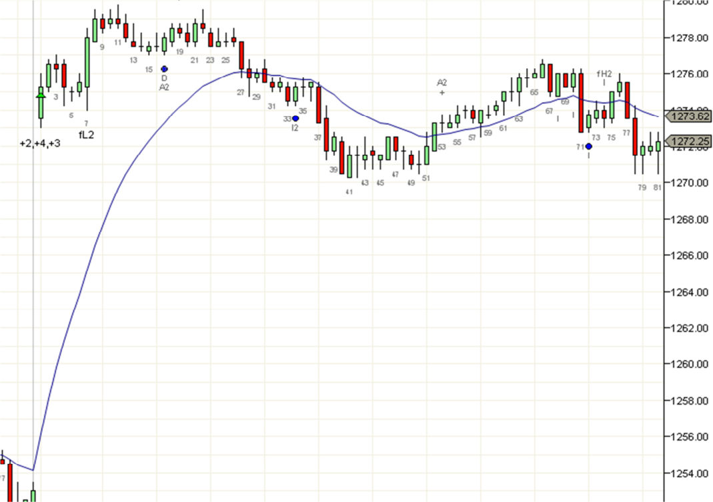

年初第一个交易日出现大缺口并向上走势，通常被认为是吉兆，并预示着未来几个月的上涨行情。当市场收盘接近其低点时，这一假设的强度会被削弱。

在许多年份，这是一种预期的跳空开盘，一些交易者会在前一年的最后一个交易日建多头头寸，并在开盘时退出以获得丰厚利润。然而，这仍然是赌博，因为跳空下跌可能会让你血本无归。

基于大隔夜走势的交易是投机行为，应谨慎进行。可以使用看涨期权建立一个小头寸，但建立大头寸则需要价差、蝴蝶或其他有限风险期权策略。收益、利率变动、政府公告等也可以通过这种方式进行交易。

更正：原始图表显示在 fL2 的 b6 处做多。实际做多价格与此接近，但位于下方所示的 3m 图表的第一根k线之上。

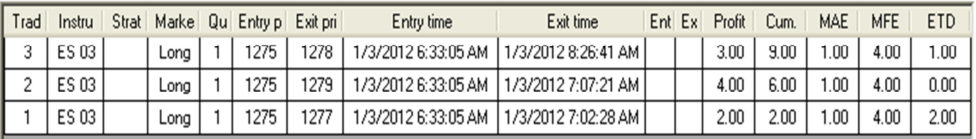

<!-- 原书第 319 页 -->

## 开盘假突破

2012年1月4日 星期三 · 原书第 319 页

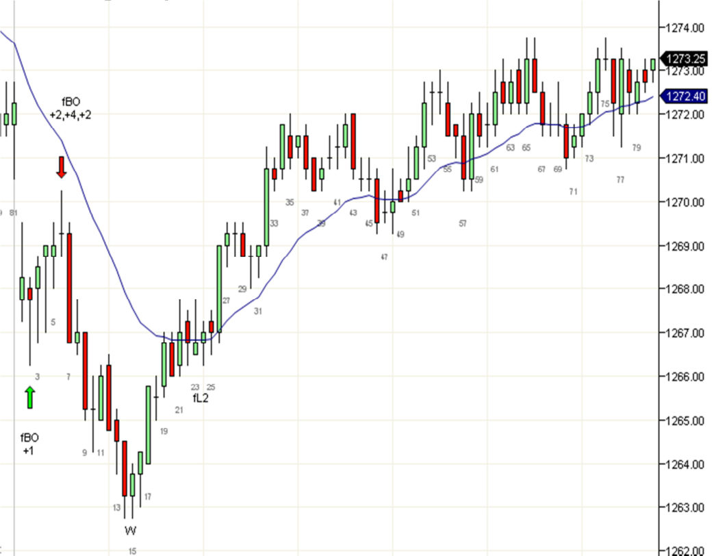

当第一根k线明显是交易区间k线时，例如十字星、带双引线的长k线，或者甚至是趋势k线后紧跟一个反方向的趋势k线，那么开盘k线的第一个或第二个假突破很有可能引发一个开盘趋势移动，即使是很小的趋势。

这是因为一个交易区间下方有买家，上方有卖家。今天的下方买家 b1 很弱，被上方的卖家压倒了。这是可以预期的，并导致了一个大型走势，最终以一个 W形反转结束。

许多日子里，当开盘区间很小时，市场可以制造多个假突破，形成一个扩张三角形，直到其中一个假突破失败，导致一个突破回撤，进而导致一个趋势。

当开盘区间（b1-6）构成一个试图填补缺口的弱势尝试时，其失败很有可能导致一次扩大缺口的尝试。这次尝试（b6-14）通常是一次可交易的趋势移动。

<!-- 原书第 320 页 -->

## 在看涨反转后出现更重要的低点是最好的波段交易入场y

2012年1月5日 星期四 · 原书第 320 页

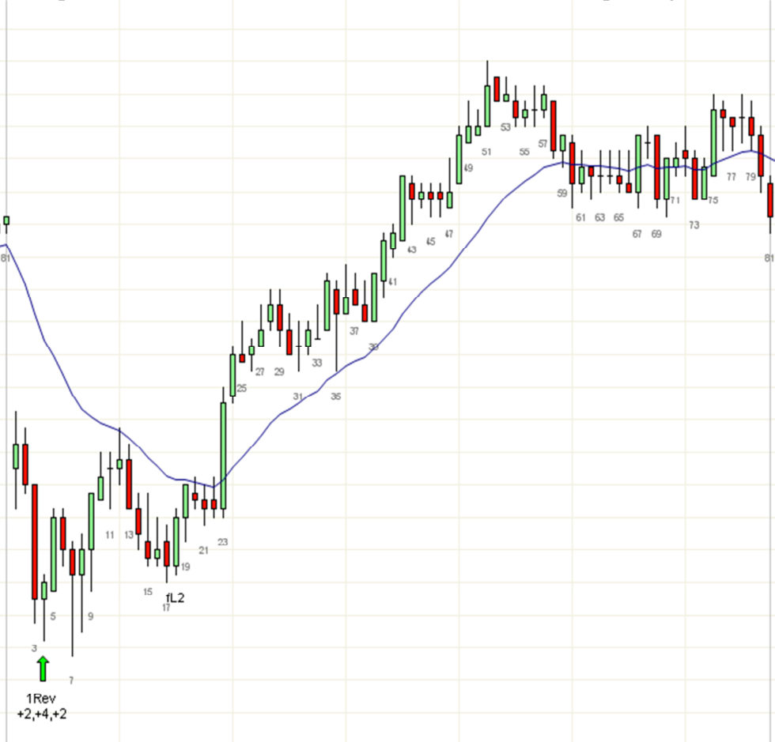

在看涨反转后的一个高低点（HL）或在看跌反转后的一个高点（LH）是任何走势中最佳的波段交易入场点。这是因为它们代表了新趋势的1次回撤（1PB）。当一天以明显趋势尝试（b3）开盘，脱离明显的开盘TR（b1,2），并立即给出反转信号（b4）时，它就是一个可能的1反转。理想情况下，反转k线需要与前一根k线一样大，并且跌破1。b4 因此，这相当是一个弱k线。然而，1反转通常是弱信号。

第二个信号在b7,8 跌破b4 ，因此不是一个好的波段交易候选。b17,18 的fL2 因此是第一个HL，可以持有一个波段交易。

请注意，即使在 1反转，TL break (b7-b12 突破 TL b1,6) 对于波段交易入场也是理想的（对于其他反转来说是绝对必需的）。

<!-- 原书第 321 页 -->

## Trading on small days

2012年1月6日 星期五 · 原书第 321 页

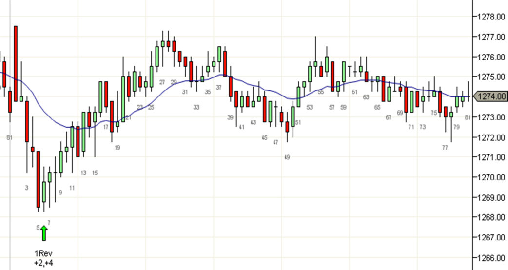

2011 的夏季和初秋呈现出非常波动的价格行为，日度区间巨大。这些是熊市或自由落体式市场的特征。如果你交易具有强劲收盘的k线，在这样的价格行为中交易日内的任何部分都很容易。

当市场正常化并谨慎看涨时，区间会收窄，需要许多k线才能达到您的盈利目标。在这些日子里，通常上午的走势在耗尽您之前有最好的盈利机会。

今天的上午走势带来了微薄的利润，价格行为在开盘后两小时内枯竭。每小时只移动几点的小重叠k线非常不利于交易，会导致许多交易者对自己的头寸产生怀疑，并被市场消耗。

走势速度的差异以及对随后预期的调整，对于交易者来说很难适应。交易者总是希望他们的入场能带来下一次大的走势、突破或巨大的趋势。衡量价格行为和向下调整目标的能力只能通过经验获得，任何模式都无法预测。最接近的迹象是当k线变小和出现十字星时。

如今，交易的最佳方式是预期市场在初次走势后出现缓和。缓和可能不会发生，但任何在开盘附近入场的交易者都应该考虑离场，而不是入场后又呆在场内，直到出现假突破（fBO）或突破回撤（BP）。

<!-- 原书第 322 页 -->

## 磨盘

2012年1月9日 星期一 · 原书第 322 页

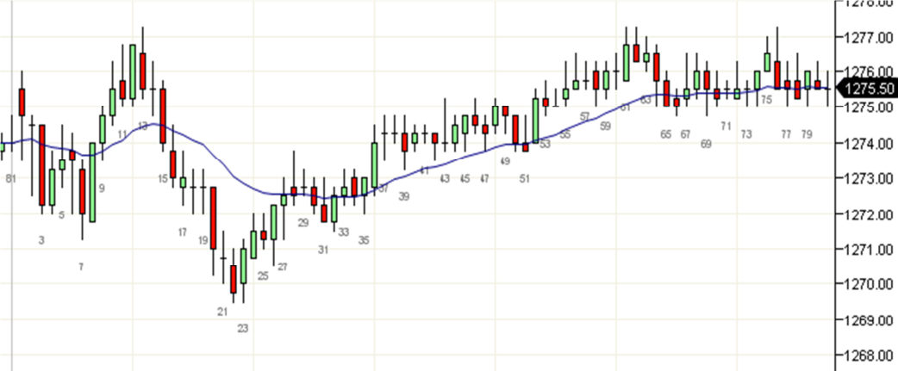

最糟糕的价格行为是缓慢磨盘。带状图形态（BW）更具危险性，但谨慎的交易者可能不会持有头寸。在磨盘行情中，很有可能你持有头寸，而价格却迟迟不肯走势。

该平坦的建仓形态是一个做多信号，许多交易者未能成交其退出指令，直到该低点。如果你的图表设置为自动缩放，小的k线可能会显得很大，给人一种走势不利于你的错觉。最好是

交易磨盘的最佳方式是避免交易磨盘。能够正确解读b13 为1反转的交易者已经获得了他们的4 点数，并且可以选择停止交易，但其他人必须忍受磨盘。一些交易者在看到疲软的价格行为时会加倍他们的头寸并削减他们的目标。这通常是一个危险的走势，因为当磨盘显现时，进一步加仓可能不会产生与增加的风险成比例的回报。最简单的事情是削减你的目标并获得较小的赢利。

<!-- 原书第 323 页 -->

## 突破k线后的内包k线

2012年1月10日 星期二 · 原书第 323 页

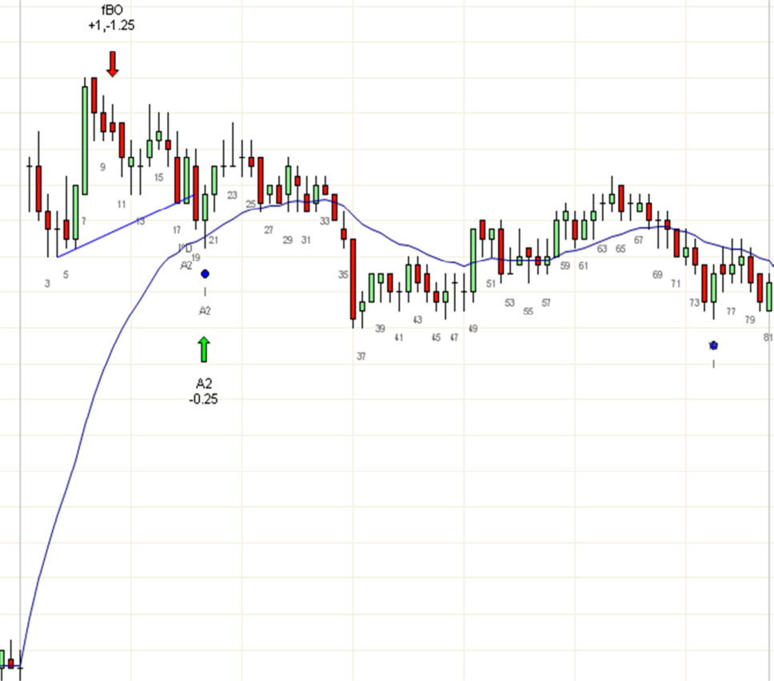

在突破k线之后紧接着出现一个内包k线（b8, b37）通常预示着一次失败的突破。失败的突破并不自动意味着趋势移动将会建立，但由于失败通常至少有两条腿，因此在支撑位附近出现一个强信号，例如在指数移动平均线处的b20 反转k线，是一个可接受的信号。

然而，当区间较小时，市场通常会在区间的另一端出现假突破（fBO）或突破回撤（BP），正如我们在 b37 处看到的。这次导致了一个复杂的、一直到 b67 的回撤。一种最大化假突破交易（fBO trades）的方法是，在强劲的推动（例如 b17, b19 或 b49）时退出部分仓位，并在出现任何强劲的逆势信号（例如 b20 或 b65）时退出平衡仓位。

<!-- 原书第 324 页 -->

## 2BR信号k线

2012年1月11日 星期三 · 原书第 324 页

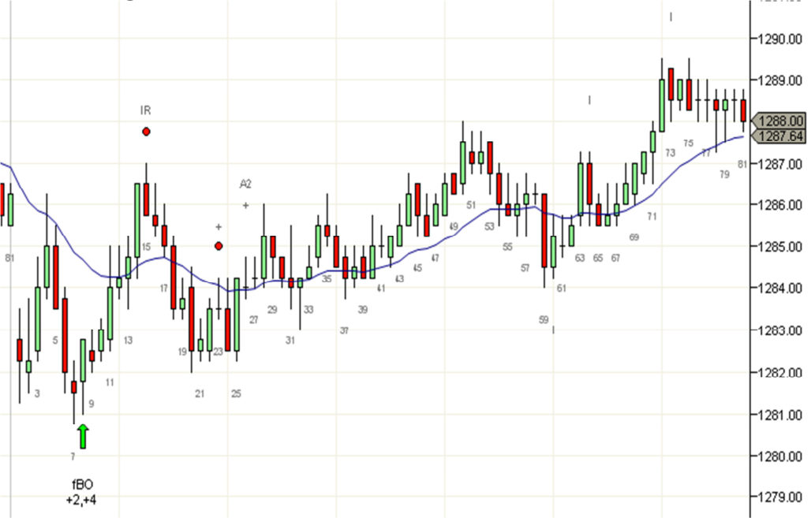

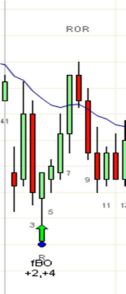

当两个 k 线重叠时，它们可能形成向上/向下做空（up/down short）或向下/向上做多（down/up l ong）信号。为简洁起见，它们可以表示为 2 k线反转（bar reversal）或2BR。2BR 通常是在较大时间周期（larger timeframes）上的反转 k 线（reversal bars），就像左侧所示的4 在10分钟图上的情况一样。

有时，k线会形成交易区间k线，例如带有长引线两端的k线，甚至是十字星。一直打开多个图表来验证2BR的强度是不切实际的，因此能够从主图（如上方的5m）正确读取它们很重要。

一个2BR的第一个要求是2根k线被削去。第二个要求是第一根k线至少比前一根k线低两个跳。这两个要求确保你不是仅仅在旗形上方做多，并且一旦触发，走势就会有跟进。偶尔，如果对信号有其他信心，你可以允许第二根k线上有1t。

第三个要求是第二根k线和第一根k线大小基本相同，并且不对齐超过一两个跳。（5m b8,9 大小相同且对齐2t）。

一开始，您可以通过比较10分钟图上的k线来获益。但这最好在交易时段结束时进行，因为大多数交易者在观察一个以上的图表时会损害其交易表现。

<!-- 原书第 325 页 -->

## 开盘区间度量移动

2012年1月13日 星期五 · 原书第 325 页

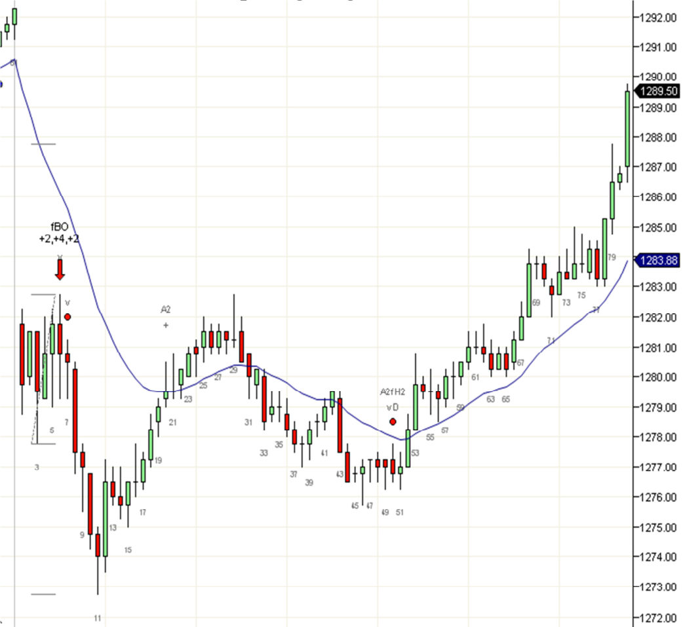

当一天以清晰的交易区间开盘，该区间由多条腿构成时，任何脱离该区间的趋势尝试很可能至少会试图回到区间内，因为盘整具有磁吸效应。通常，反转会正好发生在开盘区间的度量移动处，就像今天展示的那样。如果反转成功，那么它就会转变成日内极端 (XOD) 1反转。

成功的日内极端 1Rev 走势会试图突破当天的另一个极值 (b29)，并且通常会形成新的方向的 BP 趋势。当突破尝试发生在午餐时间，回撤可能会复杂且冗长 (b29-46)

有时，在一次或两次腿的移动中，试图逆转的尝试会失败，并导致 1PB 趋势移动的恢复。在回调之前，k线越少，1PB 原始趋势恢复的可能性就越高。

<!-- 原书第 326 页 -->

## 交易区间突破 vs 假突破

2012年1月17日 星期二 · 原书第 326 页

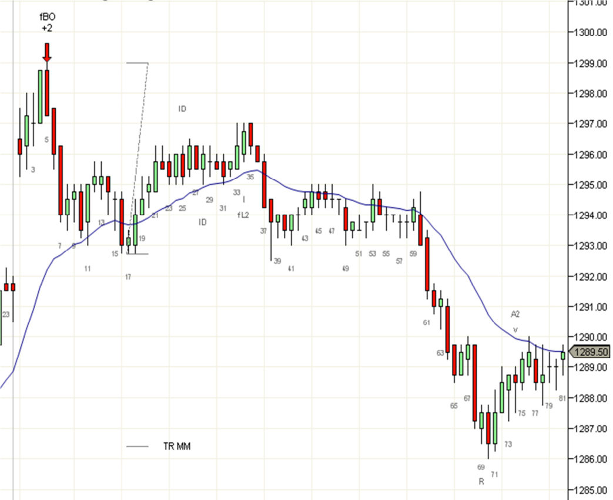

当价格试图突破一个清晰的交易区间 (b1-17) 时，有几件事可以帮助我们确定是应该寻找 fBO 交易还是 BP 交易。

突破中的强度很可能导致一次BP。疲软的突破尝试很可能导致fBO。

力量迹象是：

- 突破k线被削去（任意一端，尤其是突破端）（b7, b38）
- 突破k线至少有一半超出突破点（b7）
- 突破尝试是一次单腿尝试（b5-b7, b35-b38）
- 第二次尝试突破（b38 在 b15之后）

此外，一个 A2 (b54) 也很可能导致突破。

<!-- 原书第 327 页 -->

## 突破后的停顿K线

2012年1月18日 星期三 · 原书第 327 页

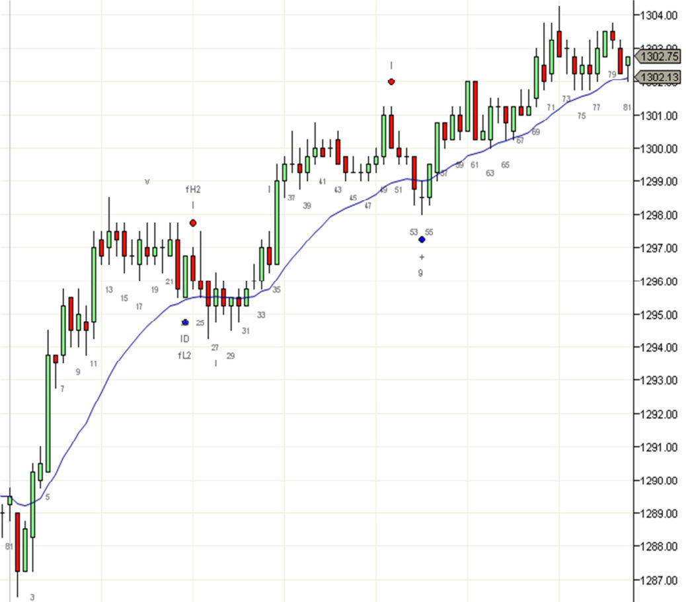

总的来说，突破（BO）后的最佳入场是突破回撤（BP）。有些交易者在突破k线之上入场，这是危险的，因为回撤可能很大，可能导致止损。有时在突破k线（b3）之后会有一个小的趋势k线（b4）。这根k线可以是任何颜色，但最好是与突破k线颜色相同且非内包k线。你可以在这根k线上入场，止损设在其另一端。

其原因在于，一个真正的强势新趋势突破很可能会在回撤之前进一步上行。因此，这适用于例如 b4 ，而不适用于b36。请注意，突破K线最好有强劲的收盘（被削去或1引线）。突破K线的引线很可能导致回撤，因此您最好在BP入场。

如果没有停顿K线，或者你不确定停顿K线是否是合适的趋势K线，最好是让突破进行，然后等待第一次回撤。突破k线之后的第一次回撤可能很浅，但只要你在一个强信号k线上入场，就可以接受。如果回撤是在一次长时间的走势之后发生的，你需要等待一次深度回撤。在今天的趋势突破中，这将导致在b29 上方入场（因为 b23 不是深度回撤）。

<!-- 原书第 328 页 -->

## 趋势突破不代表反转

2012年1月19日 星期四 · 原书第 328 页

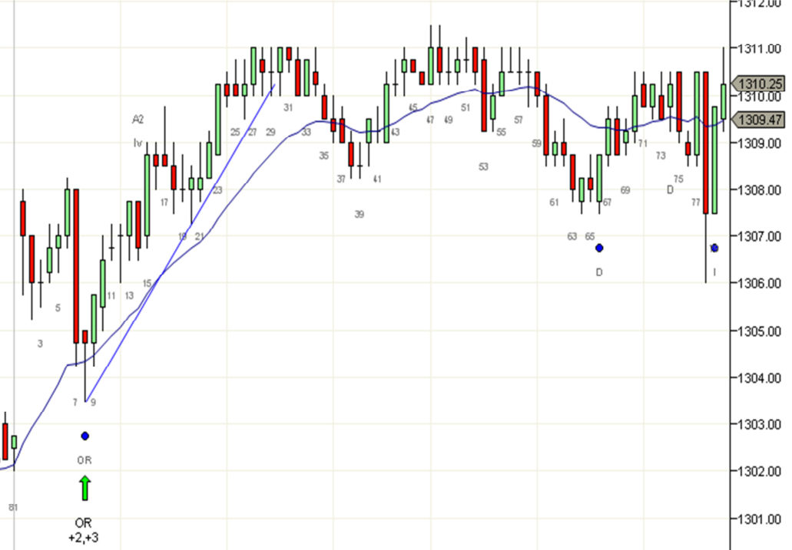

趋势突破就意味着：趋势已经不复存在。要实现先前趋势的反转，还需要发生其他一些事情。即使是趋势突破（b31-39）并且测试了先前的高点（b47），也并不意味着即将发生反转。在日线图的多头走势中，盘中波动通常是多头趋势，这些趋势会发生突破并转变为水平交易区间。今天，在b39, 处发生趋势突破后，价格行为变成了一系列假突破，这对于水平交易区间来说是很典型的。

在趋势线突破后出现两到三腿的极值测试，以及平均大小的非十字星k线，都是可能反转的良好迹象。十字星k线的泛滥表明任何突破 (b53) 都可能失败并重新回到区间 (b54,55)。最佳入场将是潜在的高点 (LH) 出现在低点 (LL) 之后 (b56)。

通常，在小幅度交易日，如果k线是十字星，最好在趋势突破后停止交易。交易区间危险，当k线微小时，您可能需要使用资金止损而不是价格行为止损。最高概率的交易通常在上午，并且当日线图处于多头模式时，您应该始终寻找一个不错的1Rev或1PB，因为您可能无法在下午盈利交易。

<!-- 原书第 329 页 -->

## 首个收盘价远离指数均线

2012年1月20日 星期五 · 原书第 329 页

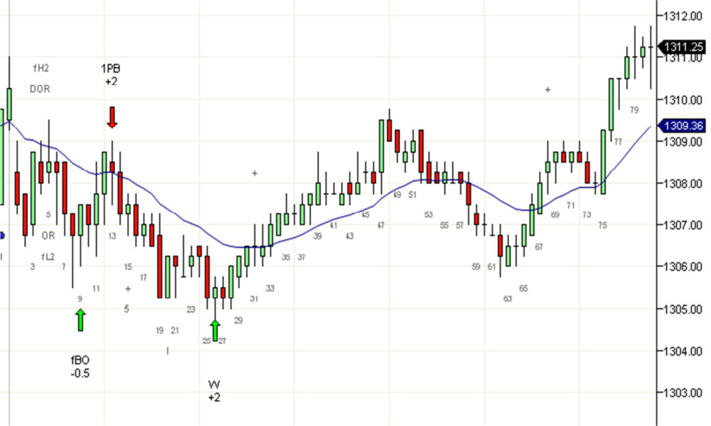

k线指数移动平均线是Brooks价格行为使用的唯一指标，但它提供了几个信号，包括G、G2 和A2。此外，它还揭示了一点非常有用的信息，对价格行为交易者来说。在很多方面，指数移动平均线就像趋势线、波动点、当日最高点和最低点或前一日最高点和最低点一样是一个障碍，因此会受到假突破和突破回撤交易的影响。总的来说，一个A2 可以被看作是指数移动平均线的2 或3 腿假突破。

指数均线代表了一种平均价格，许多交易者和算法都喜欢在优于平均价格的价位入场。因此，当价格在非常强劲的趋势中首次触碰指数均线时，很可能会找到支撑。许多交易者（和算法）只会在 K 线收盘时做出决策，这能给我们一些关于价格在收盘远离指数均线后如何反应的线索。

首个收盘价高于指数均线（ b12 ）应会遇到卖方。这表明此处的任何信号 K 线很可能会有跟进，特别是一个 2 腿的高点，如 b13 。往往，收盘价远离指数均线会出现在一个强势突破 K 线上，并导致一个小的或弱的回调 K 线（ b31 ）。这是强度的迹象，并表明延续。如果在指数均线突破 K 线后的收盘价没有反转收盘低于指数均线，则应始终将其视为强度的迹象。

两次或以上收盘价突破指数移动平均线应视为强劲信号，即使随后的回调k线反转了突破（b55），该走势在至少一段时间内持续的可能性很高。唯一的注意事项是，带状图形态（BW）经常不遵守这些规则，因此当市场最近处于趋势时，它的作用最大。

<!-- 原书第 330 页 -->

## 解读疲软的反转信号

2012年1月23日 星期一 · 原书第 330 页

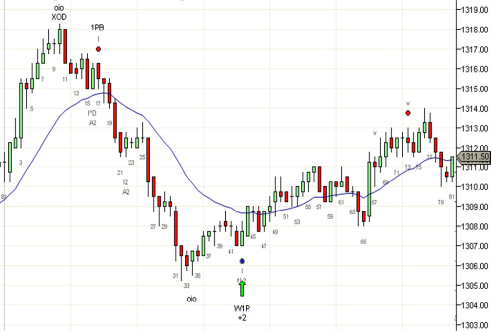

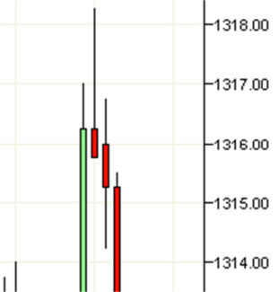

当反转信号看起来疲软时，无论是oio（b8-10, b32-34）还是普通的反转k线，如果入场k线有一个强劲的收盘（被削去或1 t），例如b11, ，那么它很有可能像一个带有强劲收盘的反转 k线一样发挥作用。通常，当与强劲的入场k线结合时，这样的k线在较高时间周期上是一个强劲的反转k线，如左侧的30 m图表所示，说明了b8-10的开盘反转。

只要第二根k线以强劲收盘价突破第一根k线，且k线尺寸相当，并且未出现超过1t或2t（如果被削去）的错位，那么BR（b 76,77）就可以被视为强劲。

当一个疲软的反转信号出现一个疲软的入场k线（b28, b70）时，很有可能出现延续。

当信号指示方向的重大改变 (b11,b35) 时，通常采取新方向的第一次回撤 (b17,b43) 是更安全的选择。当信号模棱两可时，反转后不久就出现回撤的可能性很高。

<!-- 原书第 331 页 -->

## 跳空开盘时的逆势强度信号

2012年1月24日 星期二 · 原书第 331 页

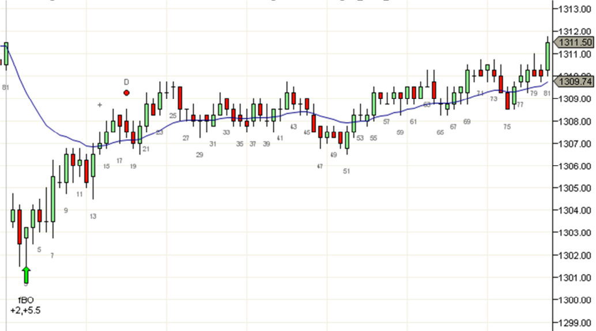

大缺口倾向于扩大而非收窄，因为导致大缺口的原因通常是基本面发生了变化。然而，有时大缺口会试图收窄，并在当天剩余时间里保持趋势，通常以高点收盘。

开盘后的第一根k线（b1）收盘方向与大缺口相反，通常是强度的第一个信号。如果它是平均大小的趋势k线或反转k线，则是一个非常强的信号。（如果缺口很小，这根k线可能仅仅是一个回撤，不应被视为信号）。

一根触发了b1 并强劲收盘的b2 是第二个好信号。如果b2 试图扩大缺口但失败，形成了一个假突破（fBO，b3），这也是一个好信号。

在试图扩大缺口时的1tfs（b7,9）和5tfs是接下来要寻找的信号。强劲趋势通常会有浅度回撤和平均大小的k线，而不是深度回撤和大k线。

<!-- 原书第 332 页 -->

## 交易大k线和外部k线

2012年1月25日 星期三 · 原书第 332 页

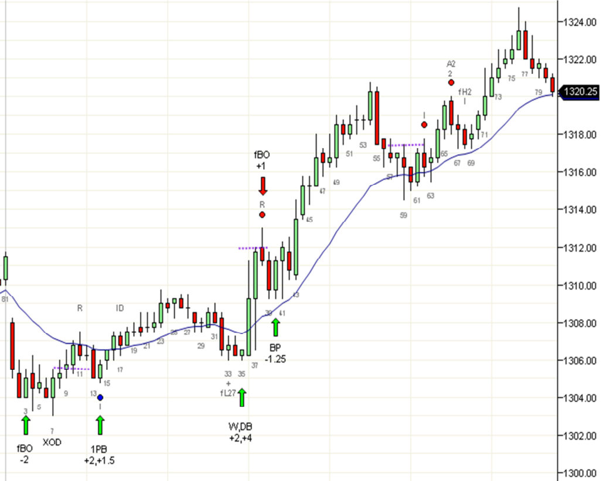

外部k线经常会在两边套住交易者，并且由于它们下方有买家，上方有卖方，因此它们有效地构成了一个 1 k线交易区间。大k线非常相似。任何比周围k线大很多的k线都应该被视为一个 1 k线交易区间。

交易此类k线的正确方法是寻找该k线的假突破或突破回撤。当外部k线的突破相对强劲时，您应该寻找突破回撤。如果突破疲软，则寻找失败的突破。

b7 是一根外部k线，收盘强劲看涨。它也是一个可能的m w，所以它是一个很好的突破回撤（b14）的候选者。b 37, 也是一根大k线，收盘也强劲，但其突破（b38）疲软，可以做空。然而，它立即就给出了一个突破回撤（b40）。

外包k线的情境也很重要。你想在低位做多（b14）或在高位做空（b38）。b62 是一个糟糕的做空信号，因为它是在低位做空，而且你预期会再次出现上涨腿，或者至少会测试b54 ，尤其是在强劲的上涨走势之后。

<!-- 原书第 333 页 -->

## 微趋势线 (MTL)

2012年1月26日 星期四 · 原书第 333 页

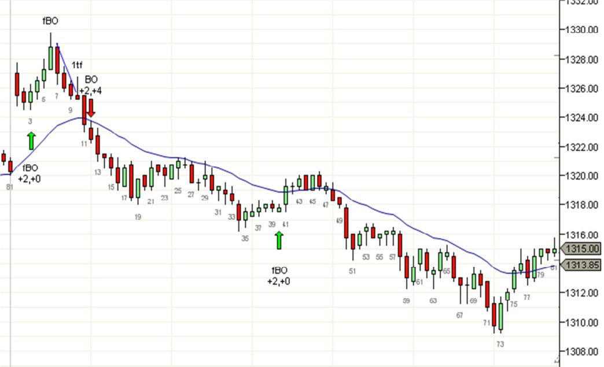

微趋势线（MTL）是绘制在相邻k线上，而不是相邻波段上（如图b7-b9所示）。在潜在反转后立即出现的MTL通常在出现非常强劲的趋势之前。为了正确识别来自MTL的强劲趋势，构成MTL的k线应该有强劲的收盘。十字星、与趋势相反的k线等都会大大削弱MTL的强度，并可能轻易变成高低点（HL）。

微趋势线 (MTL) 的失效突破 (b10) 是一个绝佳的入场点。通常，这是少数几个可以在外包k线（例如，如果b10 突破了b9 的低点）的k线中间入场的地方。然而，如果未能突破，只要该k线有足够大的实体和强劲收盘，你仍然可以入场，价格在k线下方。

如果 he smal MTL信号k线是十字星，例如b10, ，你可以选择等待下一次入场机会，例如t l 趋势k线 b12 在突破k线之后。

虽然技术上，你可以从 b13 画一条微趋势线到 b16, ，但这些k线并非完全由具有强劲收盘的趋势k线组成，因此在微趋势线突破（低于 b18）处入场并非一个好的入场点。同样，从 b73 到 b76 的多头微趋势线也不值得仅仅因为它是微趋势线就进行交易。

<!-- 原书第 334 页 -->

## 最危险的价格行为

2012年1月27日 星期五 · 原书第 334 页

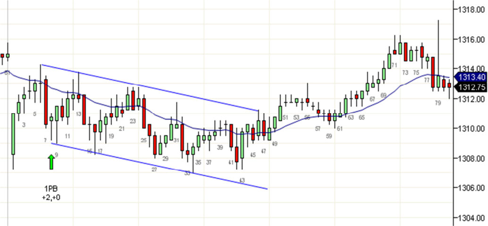

最危险的价格行为k线形态是带状图形态 (BW)，但最危险的较大价格行为形态是宽幅微倾通道。

BW 相当容易识别和规避，例如，没有多少交易者会做空 b40。像 b60-71 这样的窄幅通道也容易交易：你可以在通道的低点附近买入。然而，像 b7-b43 这样的宽幅微倾通道会诱骗交易者认为反转即将来临，并迫使他们在每个新低点买入。通常，逆势信号（b9,16,28,34,43）看起来比顺势信号k线（b6,13,24,31,40）好得多，每次都将交易者套在错误的一边。

没有简单的方法可以交易这样的通道。最简单的趋势交易要求，即仅买入更高的低点和仅卖出更低的高点，除了 b8 之外，可以保护你免受所有糟糕的信号的影响。第一个更高的低点，在 b43 ，如果你使用了 2 点的价格行为或资金止损，实际上是有效的。

A pa顺势交易者只会在通道趋势线之后进行多头交易，在此处进行多头交易。 e was 于b50 或附近{broken}。

<!-- 原书第 335 页 -->

## 开盘估选: 1Rev 对比 1PB 对比 fBO

2012年1月30日 星期一 · 原书第 335 页

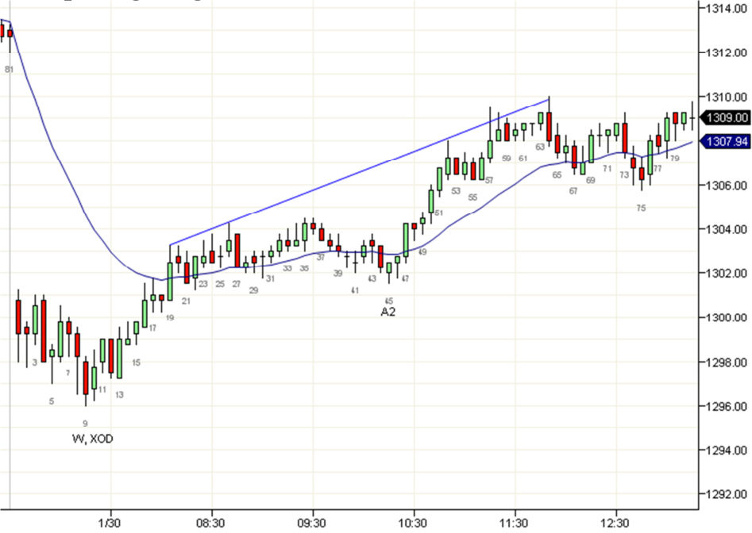

要想正确交易开盘估选，必须攘参见 1PB，1Rev和fBO的定义：

- 1PB是强劲或成功的{trend attempt}后的第一次{pullback}
- 1Rev是弱大或中度趋势尝试后的强力反转
- fBO是未能关闭开盘估选的趋势突破

如果我们看看今天的 b1 ，它显然是一个交易区间k线。还没有趋势。一些交易者会买入 b1 的低点，希望是假突破。然而，这是危险的，因为 b2 可能是一根继续向下走势的大趋势k线。b2 试图突破进入空头趋势，但失败了。在这一点上，我们有一个假突破。然而，它无法交易，因为信号k线很弱，我们将被迫在中间价位买入。请注意，这不是 1反转，因为只有趋势才能反转，交易区间内没有反转。b3 是一根趋势k线，但由于它没有突破交易区间，所以不是成功的突破。b3 不是 1腿部回撤，因为没有趋势，而且无论如何它都是一根颜色错误的k线。如果 b3 非常高并且是一根空头k线，你将在交易区间的低点附近卖出，你可以说它是 1腿部回撤，即使 b2 是一根弱势突破k线。b4,5 再次是假突破，但信号 k线是一根重叠的弱势十字星，不值得交易。如果交易区间至少有 4 点，并且另一端至少有 2 点远，信号通常会起作用大约一半 (1 点在这种情况下)，但通常它只是一个干扰，因为更清晰的建仓形态通常只在几个k线之后。b6,7 是一根内包k线，在连续的高点和低点之后出现一个高点，所以是一个可能的趋势。然而，在弱势反转k线 b5之后，它将是一个非常浅的 1 腿部回撤。你真的不想在交易区间的低点附近卖出，除非至少是 2腿部回撤。b9,10 是一个 W形反转，并且由于我们有一个弱势下行趋势，这可以标记为 1反转。由于反转不在前一天的高低点附近，它不是开盘区间；因此，它被标记为日内极端。

<!-- 原书第 336 页 -->

## 趋势终止 (TT)：失败的反转后接失败的 A2

2012年1月31日 星期二 · 原书第 336 页

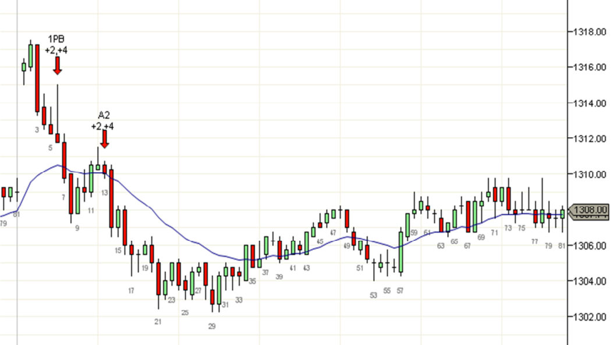

主要有三种趋势终止方式，它们将强劲趋势转变为交易区间（而不是反转趋势方向）。第一种是趋势终止，k线逐渐变得微小且类似十字星。这很容易识别，并且通常出现在多头趋势中。第二种是双顶或双底，触发但未能导致另一侧的突破。最后一种是失败的反转，随后是失败的 A2。这通常是空头趋势终止的情况。

b22 是一个内包k线信号，紧随三推下跌（以及轻微的 TCL 过冲）之后。然而，由于它不是一个多头反转k线，因此在 b21 底部附近出现了一个剃刀内包k线或者第二次入场，它是一个糟糕的信号，不太可能吸引许多多头。之后是两个横盘腿，在 b27 处第二次尝试抛售，这是基于一个糟糕的信号k线（一个 3t 多头十字星）在中部区间。这不太可能吸引大量空头。这是趋势终止的最早迹象。

b29 处的 1t 名义新低 (1tf) 是由剩余空头在 b21 的低点退出造成的，并确认了趋势的结束。从 b30 到当天的结束是一个交易区间，由小型趋势腿组成，就像所有交易区间一样。正如预期的那样，几乎所有的信号k线都非常糟糕，并且没有出现大幅移动。

---

[← 上一章](20-2011年12月.md) · [目录](00-目录.md) · [下一章 →](22-2012年2月.md)
