[← 上一章](21-2012年1月.md) · [目录](00-目录.md) · [下一章 →](23-2012年3月.md)

# 2012年2月

原书第 337–348 页

<!-- 原书第 337 页 -->

## 深回撤与浅回撤

2012年2月1日 星期三 · 原书第 337 页

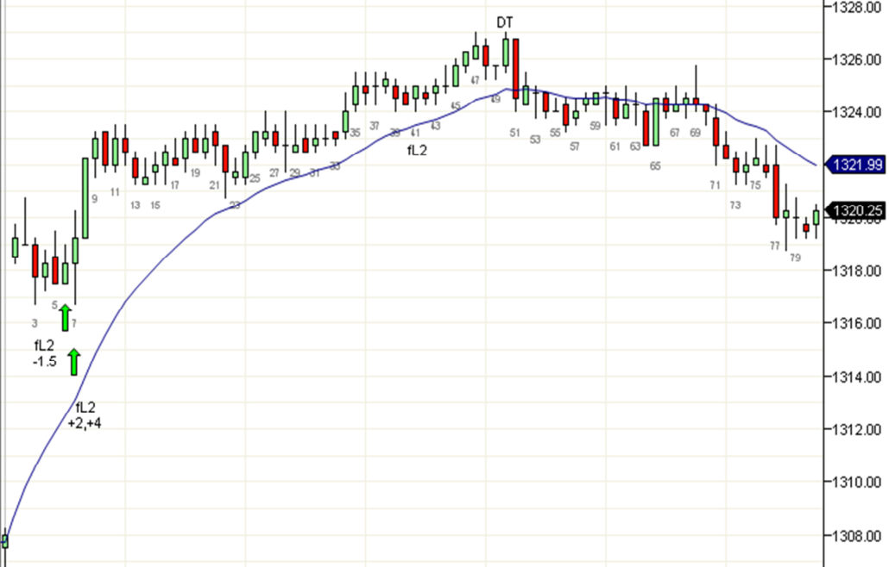

最成功的交易是顺势信号k线，并且有强势收盘且无重叠的深回撤。特别是，它们提供了良好的波段交易入场点，这些入场点往往能达到4 点或更多。

第一个要求是存在趋势。趋势应该相当容易发现。如果眼前的图表从左下角移动到右上角，或者从左上角移动到右下角，那么你可能就处于趋势之中。传统定义是，多头趋势是更高的高点和更高的低点，空头趋势是更低的低点和更低的高点。

第二个要求是强势信号k线。在浅回撤和重叠区域的弱信号k线在一个软趋势中会奏效，例如今天的早盘（b23,33,41）。然而，一旦趋势不再是软的，每一个这样的信号k线都很可能失败（b57,61,65）。

第三个要求是无重叠，因为重叠是交易区间，它们的突破很可能被逆势交易。但是，如果信号k线强劲且处于支撑位，您可以进行一些二次入场，因为它们可以起到突破回撤的作用。如果您不确定，请避免重叠。

最后一个要求是深回撤。深回撤确保了到前期最高点有足够的空间来实现盈利退出。对于大多数交易，这相当于约10跳以获得2 点利润。然而，只要回撤比近期k线（b69）更深，它就很可能顺势成功。

软趋势和硬趋势的特殊之处在于它们没有深回撤或良好的信号k线，但几乎每个信号都有效。但在其余 80% 的日子里，这些规则将大大减少您可以进行的交易次数，并大大提高您的一致性。

<!-- 原书第 338 页 -->

## 水平窄幅区间 (TTR) 或十字星区间

2012年2月2日 星期四 · 原书第 338 页

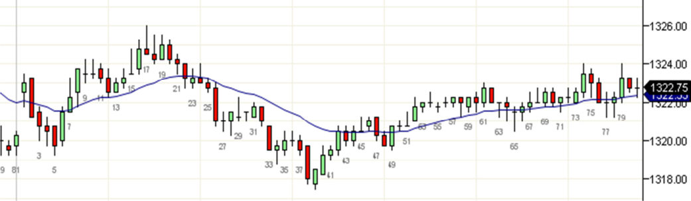

长时间的横盘价格缠绕模式几乎不可能交易，并且可以标记为十字星区间。尝试使用止损入场交易十字星区间将不可避免地导致失败。

预测十字星区间很简单。当你看到k线变得比 1 点小，并且其中很多是十字星时，你就应该保持谨慎。像 b55这样高为两个跳的k线是早期预警，表明可能出现十字星区间。请注意，在十字星区间内，任何高为 4t 或更小的k线都应视为十字星，并且通常不是建仓形态k线 (b59, 62)。

交易十字星区间唯一可能的方法是逆势交易趋势k线突破。根据定义，十字星区间是一个窄幅区间。由于大多数交易区间突破都会失败，你可以简单地在趋势突破k线的收盘价做空，止损设在它 1t 之外。例如，你可以卖空 b61 收盘价，并在限价单中卖空 b74 收盘价。

最好的方法是按兵不动。你在十字星区间（dojistan）可能获得的一两点利润通常不值得承担风险和消耗精力。更好的价格走势即将到来，耐心等待即可。

<!-- 原书第 339 页 -->

## 交易区间作为一系列fBO

2012年2月3日 星期五 · 原书第 339 页

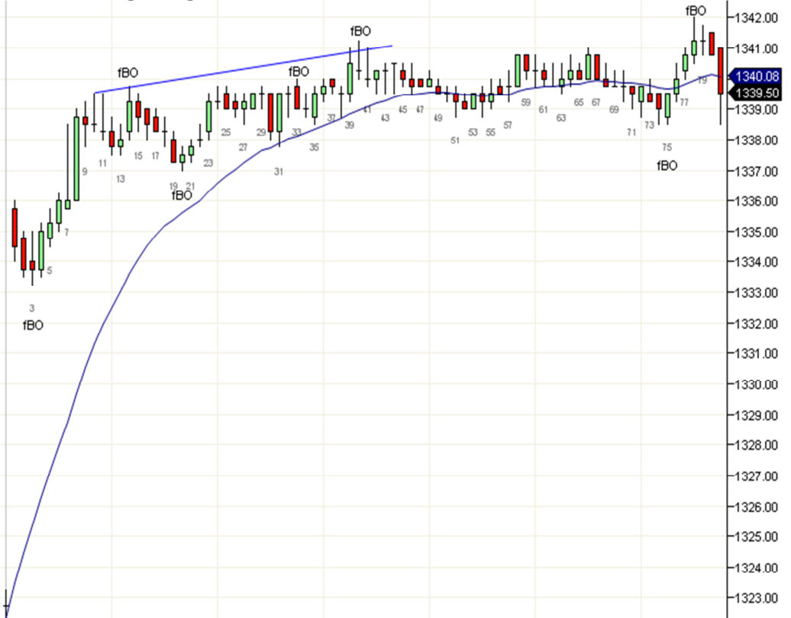

如果趋势可以被视为一系列的突破回撤，那么交易区间就是一系列失败的突破。我通常避免交易 fBO，除非交易区间足够宽，能够获得可接受的利润。一般来说，这意味着如果你希望获得约2 点的利润，你希望交易区间是其两倍，即4 点。

原因是许多fBO交易将无法到达交易区间的另一端（b33,b40）。因此，窄的交易区间无法通过止损入场一致性地盈利交易。即使是像b40 这样较弱的楔形，通常也不值得交易。

信号k线的质量对于入场任何交易都非常重要，因为它直接关系到成功率。信号k线周围k线的质量同样重要。在一个大部分k线形态良好的图表上，你可以接受任何像样的信号k线，但在一个价格缠绕的图表上，你无法期待一个足以证明交易价值的走势。

但最终，市场会突破窄幅区间并形成可交易的k线（b75-81）。如果这种情况发生在收盘前有足够时间时，不同于今天，你可以寻找高概率交易。

<!-- 原书第 340 页 -->

## 流动性效应

2012年2月6日 星期一 · 原书第 340 页

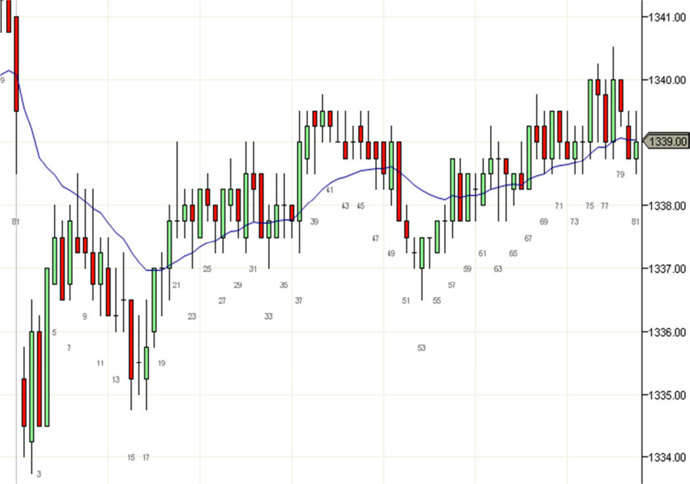

踩踏事件是由大量人群朝同一方向奔跑引起的。任何挡在他们前面孤身一人的人都会被踩死。这本质上就是趋势k线。大量交易者朝一个方向前进。

当一窝蜂的买盘遇到一窝蜂的卖盘时，人群通常不会去任何地方。可能会有一些拉扯，但什么都不会发生。这些是小的十字星和其他交易区间k线。

在成交稀薄的合约上，流动性较低，即使少数人也能轻易地一窝蜂地行动而不会遇到阻力（直到他们疲倦休息）。这就是为什么合约越稀薄，波动性就越大。然而，流动性高的合约变动非常缓慢，小的日k 线是其整体走势的必要组成部分。

今天的图表显示，这些小k线内的价格走势很模糊。双方都有推升和拉扯，其中一方很快就会屈服。

即使在这样的一天，最好的走势也仅仅是带有深回撤强势收盘的k线（b53）。除了1PB（oio at b17）的通常例外，最好的交易通常是顺势、带有深回撤和强势收盘的。

<!-- 原书第 341 页 -->

## 趋势终止 (TT): TTR

2012年2月7日 星期二 · 原书第 341 页

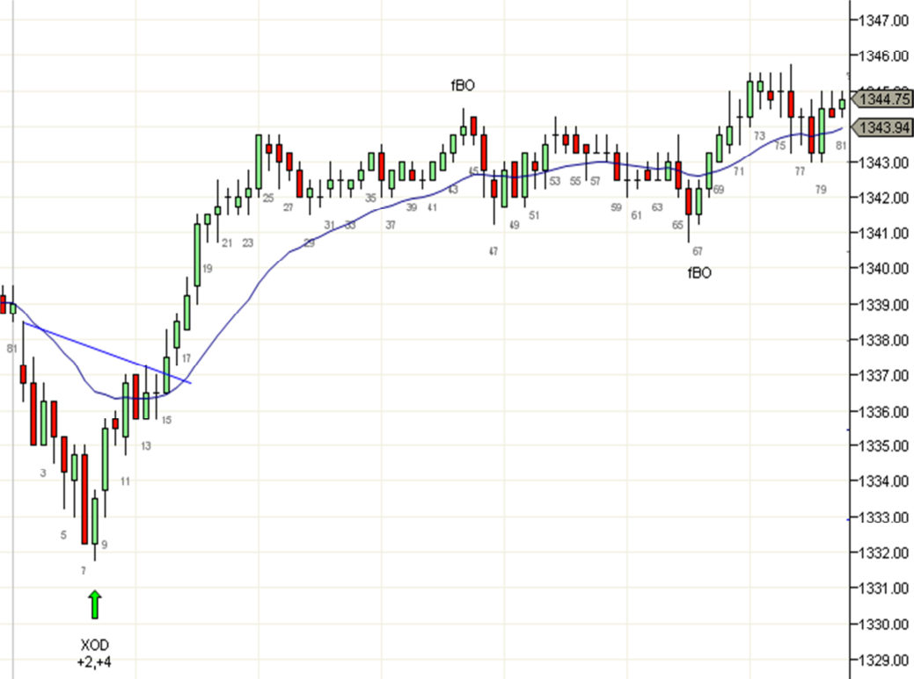

我们清楚地知道，当趋势线突破时，趋势就结束了。如果突破强劲，可能出现反转；如果不是，则可能出现交易区间。即使图表上没有画出趋势线，趋势线突破通常也是显而易见的。例如，今天，b 46,47 果断地突破了趋势线。

如果您持有的是多头头寸，何时出场？您可以等待测试高点并在 b70, 出场，但这需要您持有多半天才能获得一个好价格。您也可以在任何强k线，如 b50 出场，或在下一个 L2 出场，如下方 b55。然而，这并没有为您节省多少时间。

理想情况下，您将在 b24的收盘价出场。您如何预测趋势移动在一段时间内不会进一步扩大？趋势的定义是应该大部分是趋势k线。当k线转变为 TTR (b19-23)时，趋势很有可能接近终止或至少出现深回撤。之后出现的任何强k线，对于在 b8买入反转的人来说，都是一个非常有吸引力的出场点。

通常，如果上涨行情非常强劲（没有深回撤），会有第二次机会。你也可以在 b24 的高点或其下方一个跳处出场，并在 b44处成交。

请记住，趋势终止并非反转。这仅仅是表明最佳选择是出场并等待新趋势突破的一个信号。

<!-- 原书第 342 页 -->

## A2变体在小k线日

2012年2月8日 星期三 · 原书第 342 页

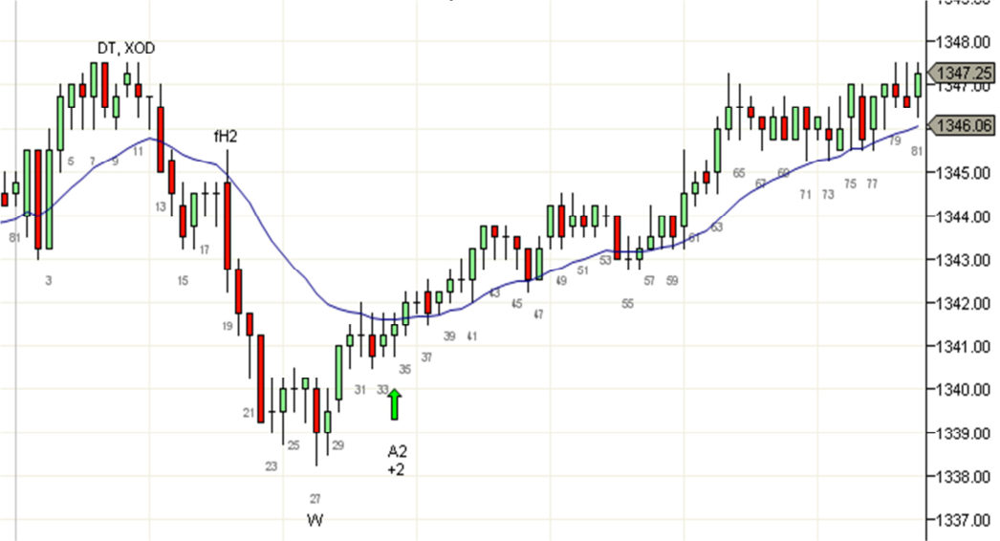

当k线相对较小时，A2 可能形成，难以阅读和入场。对于新趋势的第一次回撤尤其如此，因为难以预测。有两种方法可以尝试阅读这些。

第一种是fH2 or fL2。当趋势刚开始，并且第一次回撤接近ema时，如果它尝试两次逆势走势但都失败了，你就得到了一个fH2 or fL2。例如，b17-b19 就是一个fH2。如果b19 是一根更小的k线（即使它是一根外包 k线），它也是一个可接受的入场。当k线较大时，大回撤的风险会降低在外包k线上入场的成功概率，即使它靠近ema的fH2 。

第二种是A2 变体，其中第一次尝试是一根内包k线。例如，b33 是一根内包k线，具有更高低点和更高收盘。这使其成为H1 ，而紧随其后的尝试，高于b35 ，有效地使其成为A2。

最重要的先决条件是存在趋势或近期刚刚发生突破。b13 处的 DP 是一个趋势生成器，因此下一个 fH2 是一个高概率交易，而 b27 处的 W 逆转了趋势，因此 b35 处的 A2 是一个高概率交易。

<!-- 原书第 343 页 -->

## 趋势终止（TT）：双顶

2012年2月9日 星期四 · 原书第 343 页

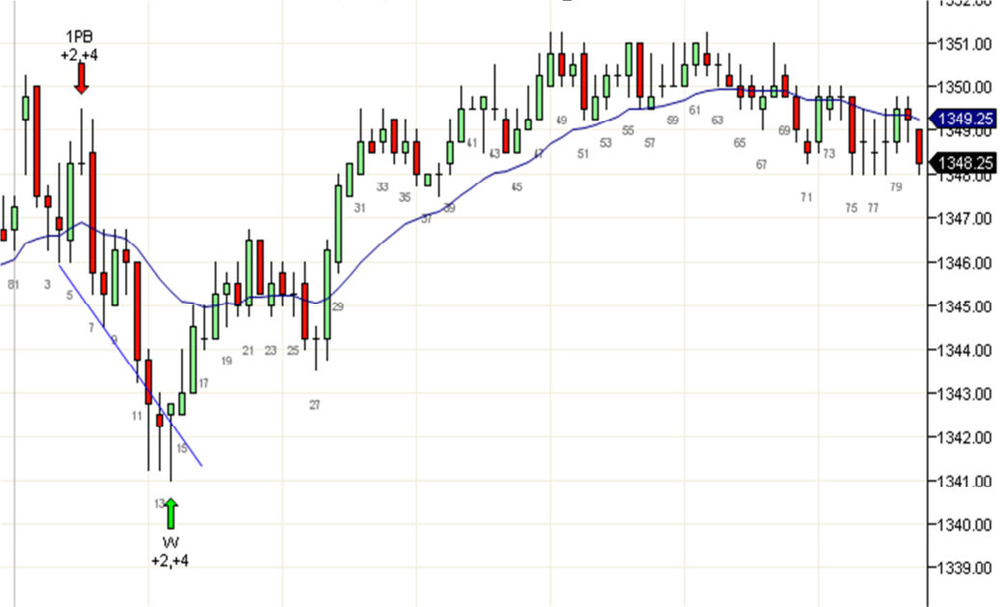

新趋势的第一个回撤通常是最深的，随后的回撤会越来越浅。随着回撤变浅，它们吸引的买家越来越少，因为买入回撤的利润与回撤深度成正比。

最终，回撤如此之浅（b52, b58），以至于找不到买家，早期买家将在高点附近出场。这将导致双顶或双底，并终止趋势。

由于这是一个趋势终止而非趋势反转，您需要等待新的趋势出现突破后才能入场新交易，或者只交易fBOs。

<!-- 原书第 344 页 -->

## 窄幅盘整日扭曲你的认知

2012年2月10日 星期五 · 原书第 344 页

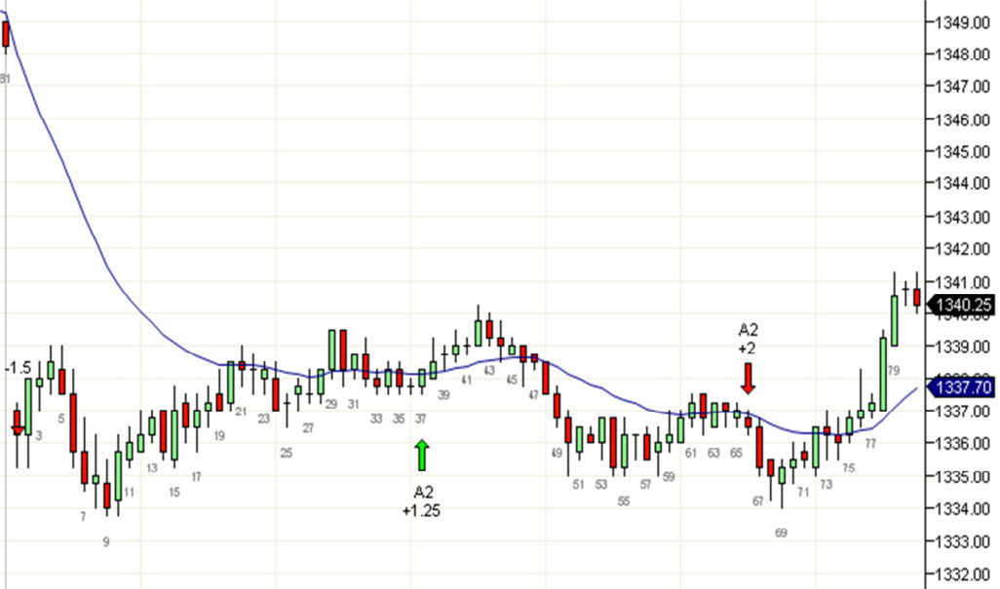

窄幅盘整日通常对我来说是糟糕的，并且会造成许多错误。我学会了应对方法，那就是大部分时间都观望。如果前两个小时的区间为6 点或更少，最好非常谨慎，并且只进行短线交易。原因很简单。窄幅区间会像磁铁一样，导致任何突破都回落到区间内。

交易窄幅盘整日的一大难点在于它会扭曲你的认知。例如，b37 是一个可能的BP交易，b29 是 HOD上方可能的BO。如果交易区间更宽，那么只交易区间上半部分的空头将非常明显，而b37 将是一个糟糕的决定。同样地，在b43 处的第二次fBO可能已经突破进入了一个趋势，并且b66 可能是一个A2 ，但如果交易区间更宽，那么b50-65 是一个横向旗形和可能的FF就将非常明显。

微小K线、浅回撤、差信号k线会扭曲你的认知，迫使你对模式和信号做出许多错误的解读，而区间的狭窄会降低每个交易的利润潜力与概率。

<!-- 原书第 345 页 -->

## 当反转k线未能触发时

2012年2月14日 星期二 · 原书第 345 页

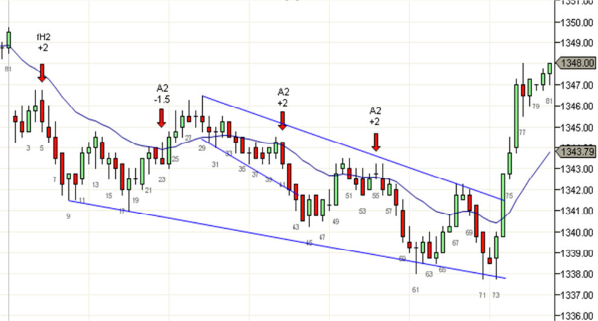

斜率浅、范围宽的通道会欺骗最优秀的交易者，让他们认为反转即将来临。有一些方法可以猜测反转是否会失败，其中一种是具有强势收盘的反转k线拒绝触发。例如，今天b9, b18,b45尽管有强势收盘，但拒绝触发。这通常意味着卖家正在卖出强势k线的收盘价，而不是买入。这也显示了买家缺乏信心，你应该寻找原有方向的延续交易。

TCL的过冲和一个强信号，例如b73 的oio，是进行反转交易并寄希望于成功的重要前提。

<!-- 原书第 346 页 -->

## 当反转k线未触发 - II

2012年2月16日 星期四 · 原书第 346 页

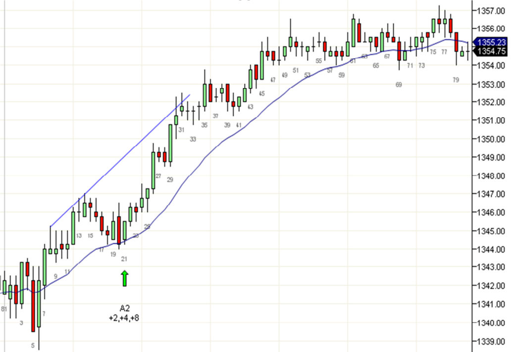

强趋势最确定的迹象之一是反转信号将无人问津。这是因为交易者认为空头收盘是一个买入机会，在大多数情况下，如果订单未从信号k线触发，您应该取消订单。例如，b36,37 在3 上涨后可能是一个卖出信号，但是，由于它没有触发，您应该考虑做多。这将使您能够在强趋势中经过两次下跌腿后的强势收盘b41, 上方买入。同样，b62 在浅TL突破后可能是一个1tf，使其成为一个主要的反转候选。但由于它没有触发，您不应该做空。然而，由于趋势突破，您也不应该寻求做多。

正确的做法是等待区间达到 4 点或更大，然后交易fBOs或等待BP或其他新趋势。

<!-- 原书第 347 页 -->

## 交易工具的选择：流动性差的更好吗？

2012年2月17日 星期五 · 原书第 347 页

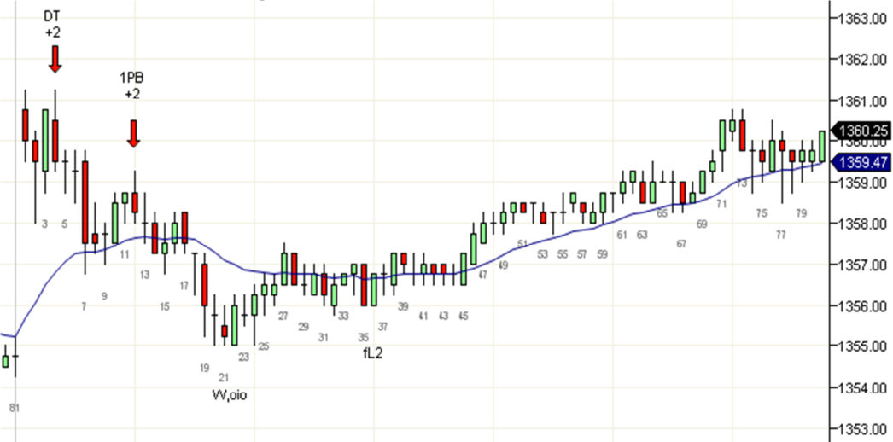

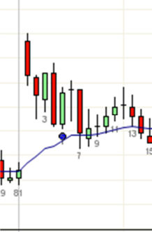

像ES这样流动性很高的工具可能会形成微小K线并给出疲软的走势。像 TF（左图所示）这样流动性较差的工具通常会显示出清晰形成的K线，并经常导致强劲的走势。那么新手交易者应该交易什么？

一位经验丰富且能盈利的交易者可能通过一些技巧调整就可以交易任何工具。一些动量交易方式在低流动性合约上表现更好。

对于一位新的价格行为交易员来说，正确的答案是流动性更好的合约。原因是什么？有很多原因，但主要是因为尽管低流动性合约的k线看起来很棒，但它们所承载的信息是不可靠的。

以今天为例。它在ES上是一根十字星，但在TF上是一根强劲的多头K线。乍一看，这可能看起来像是向ema的2 腿走势，或者是强劲的信号。这根k线触发并止损了买家。另一方面，b5 在ES上是一根十字星，更重要的是，它没有被触发。b4 下方的卖空者未能止损。入场后的回撤幅度可接受。低流动性合约的止损需要更大，除非你能够持续获得大于止损的目标，否则你应该避免交易低流动性合约。

新手交易者不应该专注于赚钱，而应该专注于做正确的事情，正确地交易。一旦你的胜率很高，你就可以简单地进行更大规模的交易，以赚取与较小交易区间相同的金额。

当您的头寸增加时（这是一个好问题），您可能会在没有显著滑点的情况下交易低流动性合约。也就是说，具有小跳点大小的低流动性合约，例如NQ，通常是新交易者的良好选择。

<!-- 原书第 348 页 -->

## 陡峭趋势的突破

2012年2月27日 星期一 · 原书第 348 页

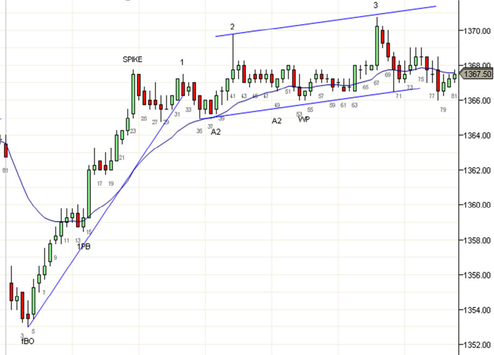

当趋势非常陡峭时，例如从b5 到b23, 的走势，整个走势就像一腿，并且通常像急速加通道，通道充当了尖峰的第二腿。通常，大部分动量在尖峰处耗尽，导致通道的斜率相对较浅。

由于该通道呈现 W 形，您应该预期 3 更高幅度的推升，然后测试通道的起点（在 35 下方），这可能在下个交易日发生。

由于通道是弱势趋势，如果其足够宽可以进行交易，您仍然可以捕捉A2 以及其他深2 腿型回撤，直到第三次推升完成。

---

[← 上一章](21-2012年1月.md) · [目录](00-目录.md) · [下一章 →](23-2012年3月.md)
