[← 上一章](22-2012年2月.md) · [目录](00-目录.md) · [下一章 →](24-2012年4月.md)

# 2012年3月

原书第 349–360 页

<!-- 原书第 349 页 -->

## 第一根K线：趋势k线

2012年3月5日 星期一 · 原书第 349 页

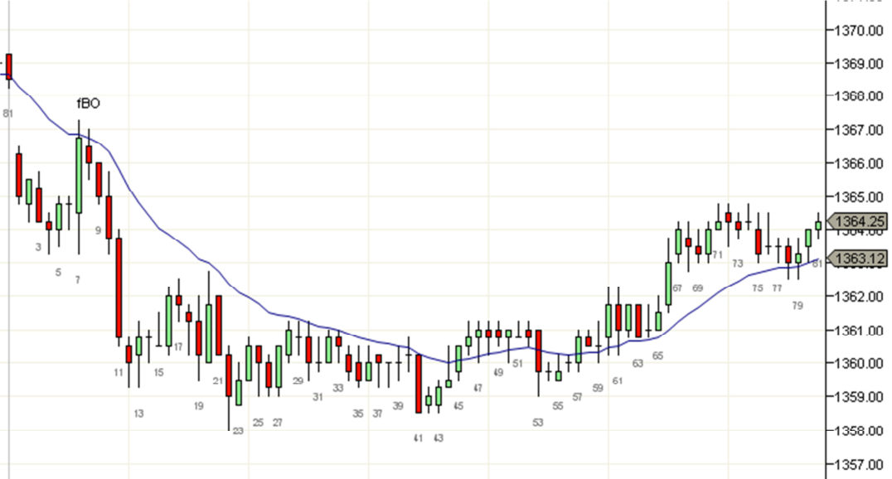

第一根K线，无论其形态如何，都应被视为一个1 k线交易区间。大多数交易者会同意，两根相反的趋势k线构成一个交易区间。这在任何地方都是正确的，当只有一根k线时，您没有关于第二根k线的信息来假设它会继续成为趋势k线。

当第二根K线是反向K线时，无论其外观如何，你很可能处于一个交易区间。因此，在b2 上方做多将是在交易区间中间做多，这是一个低概率的交易。你需要接近b1 的低点做多，才能获得更高的概率建仓形态。

交易两个相反k线的正确方法是将其视为任何其他交易区间。在弱势突破时进行逆势交易，或者在突破回撤时顺势入场。因此，如果b4 在b1, 的低点附近强势收盘，那么进行b1的逆势交易将是一个不错的第二次尝试。

<!-- 原书第 350 页 -->

## 3个小推升：通道、微楔形和楔形。

2012年3月6日 星期二 · 原书第 350 页

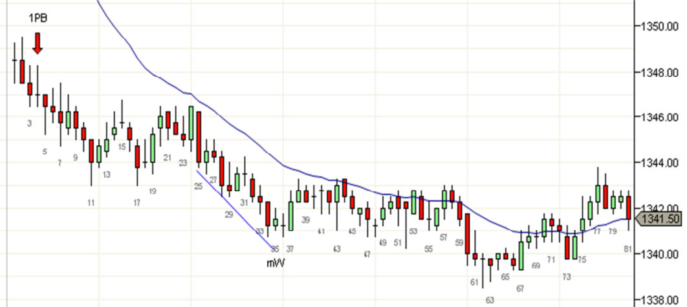

同一方向的三次推升不应自动标记为楔形。三次推升只是终结了一个腿。终结后，走势可能在回撤后继续，或者在一个水平交易区间内运行，直到出现新的突破。

例如，从b2 开始的通道导致了三个小推升（b5,7,11），从而结束了这一腿。微楔形（b13-15）结束了逆势腿。

弱势楔形（b26,29,34）结束了从b2 开始的完整下跌走势的第二腿，价格在交易区间内横盘整理了好几根k线。

这里的关键要点是，这三个推升都不是自动可交易的。通道到b11 在回撤到b24后继续。微楔形到 b15 在两根k线走势后继续向上，而微楔形或小楔形到b34 只是结束了趋势，没有明确的方向。

楔形需要非常强劲，并以清晰的反转k线结束，以获得高概率的反转交易。即便如此，大多数交易者最好在W反转（W1P）后的第一次回撤时入场。如果你处于旧的方向，你应该考虑在TCL附近（b11）的第三次推升时出场。或者，你可以等待k线收盘，并在k线强势收盘（b34）时出场。

<!-- 原书第 351 页 -->

## 偏好深回撤

2012年3月8日 星期四 · 原书第 351 页

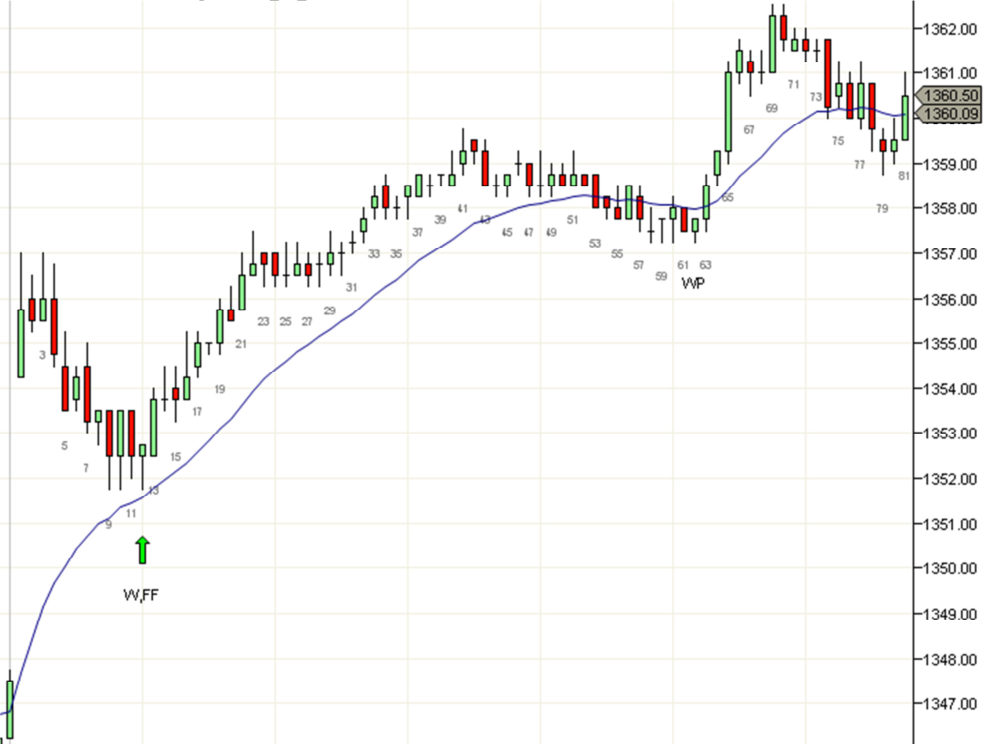

掌握顺势交易最重要的技能是选择合适的回撤入场时机。根据你在趋势中的位置，你有几种选择。例如，假设你确定W形态和FF到b12 结束了熊市行情，并正在建立开盘趋势的反转。如果你没有在b12, 做多，你随时可以在第一次回撤时入场。3月合约的b15 高点低于b14 ，你可以在其上方买入。也就是说，在趋势开始后，浅层、1 腿型的回撤是可以接受的。

通常你也可以做多第一个2 腿型回撤。例如，b28 是第一个2 腿型回撤，在这种特定情况下，突破b1 的风险始终存在，可能导致更深的回撤或上涨行情逆转。但在许多其他情况下，强劲走势的第一个2腿型回撤通常有效，即使它不是深回撤。正常情况下，我不会交易非深度的回撤，即使它是第一个2 腿型回撤。例外情况是当它是温和趋势日，回撤发生在ema处且信号k线强劲。b28 不具备这些条件。但你可以肯定的是，可以做多第一个深回撤。所有浅回撤（b15,18,28,30,35,39）都可以视为同一更大部分的腿，而第一个深回撤通常应该在同一方向上至少产生一个更长的腿。

深回撤是指回撤幅度至少为日内最高点2 点，且回撤幅度大于至少一条近期k线的大小。深回撤的突破（尤其是第一次）更强劲，能更快地实现你的目标，且回撤至入场价的风险更小。这使得它们成为绝佳的波段交易入场点。如果深回撤的突破远远超过前期最高点，趋势在测试前期最高点时终止的可能性就会降低，你就可以以更高的信心参与下一次深回撤。

<!-- 原书第 352 页 -->

## 期待 DP 建仓形态

2012年3月9日 星期五 · 原书第 352 页

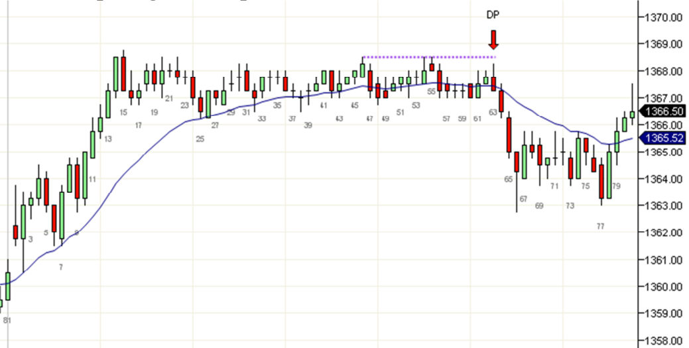

长时间的横盘走势会打破趋势，但你不必等待那么久才能检测到趋势终止。任何差劲的反转（b66）后紧随差劲的A2 （b71）都足以满足条件。回撤开始后出现的任何十字星簇（b15-b23）通常也足以宣布趋势终止。

此时，您处于一个交易区间，不再处于趋势中。任何A2 或其他延续交易很可能都会失败。即使您错过了终止信号，只在强信号k线处入场也能保护您免受差建仓形态的影响。例如，b26 未触发， b32 是空头十字星，b38 之前有个十字星，b52 是BW中的iii。所有做多建仓形态都不可接受，所以您不会买入它们。

做空信号也相当差，大多数是在多头K线触发的，或者之前有十字星。第一个可接受的卖出信号是 b55 内包k线，下一个尝试是b63。一个简单的过滤条件，即不在1 腿收盘跌破ema（b47）之前卖空，也能让您避免麻烦。

在某个时刻，您会发现趋势已经结束，无论您采用何种判断方法。那时，您在等待BP或fBO。 DP是一种fBO，它源于两次尝试（b46,55）未能突破一个阻力位（b22 高点），而第三次尝试（b63）则未能达到前两次尝试的高度。

所以，虽然 b63 的 DP 很清楚，但需要注意的是，b32,38,51 不是 DP 做多。原因是 DP 只在交易区间内逆势交易，从不扩大交易区间。因此，如果交易区间狭窄，例如今天的横盘走势，任何像 DP 这样的建仓形态去做多都很有可能失败。然而，DP 做空更有可能成功，因为上涨行情只是将我们带到了交易区间的顶部。

<!-- 原书第 353 页 -->

## 交易联邦公开市场委员会

2012年3月13日 星期二 · 原书第 353 页

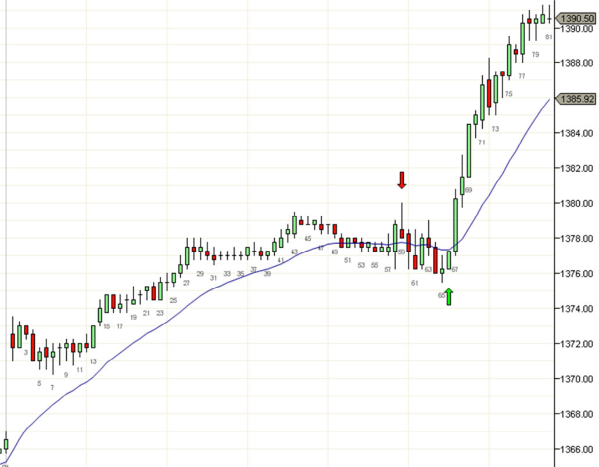

交易联邦公开市场委员会（FOMC）相当棘手。在成为一名价格行为交易员之前，我曾在 FOMC 期间交易前期波动点的突破，但现在我采用了更准确的方法，将 FOMC 的初始 K 线视为一个交易区间，并交易其突破（fBO）和突破（BP）。

例如，实际的联邦公开市场委员会公告导致了一个 b58, ，这是一个大的外包k线。这样的k线是一个交易区间，它的突破通常可以逆势交易。b59 是一个相当弱的k线，与它的引线大小相比，它的实体很小，但收盘强势。如果这根k线靠近 b58 的高点，那就理想了，因为它不会迫使在交易区间中期卖空。

另一方面，在 b65 的一个 2L 突破提供了在 b58, 另一侧的突破入场，这导致了一个大的上涨。

请注意，并非所有联邦公开市场委员会的公告都会导致大幅波动，但当它们发生时，通常会获得良好的风险回报比。我建议采用固定止损，尤其是在出现大k线时，以限制损失。

<!-- 原书第 354 页 -->

## 氪石日

2012年3月12日 星期一 · 原书第 354 页

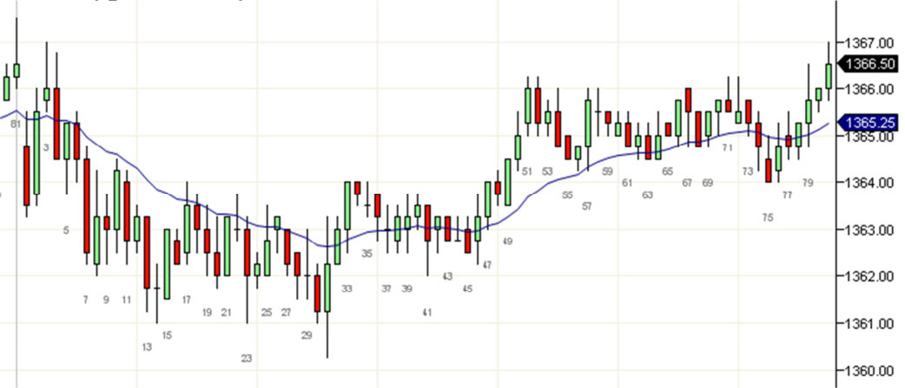

交易者最终会从大部分日子亏损、少数日子盈利，转变为相反的情况：大部分日子盈利、少数日子亏损。但亏损的日子可能会不成比例地大。这偶尔会发生，因为交易者当天由于睡眠不足、疾病、感情问题等原因，身体或精神状态不佳。但通常情况下，这是因为交易系统在某些价格走势下存在真正的弱点，而这些弱点已经被市场暴露出来。

如果你发现自己处于这一点，你可能已经是一个盈亏平衡的交易者了。如果你能驯服或消除这些灾难性的日子，你可能已经成为一名稳定的交易者了。最初一两次灾难性的日子可能会非常毁灭性。这是因为你最初的成功让你增加了头寸，而不断增长的损益让你获得了巨大的信心提升。这可能意味着你交易的头寸很大，并且每次亏损时都重新入场，到日终时，你可能会震惊地发现几周甚至几周的利润都消失了。

你需要问自己的第一件事是，你是否又回到了旧习惯。信心和高胜率会让你觉得自己像超人一样无敌，你可能会回到旧习惯。最终，超人会被氪石打败。如果你的纪律一直很好，并且你没有屈服于不良习惯的诱惑，那么某些类型的价格走势可能会毁掉你的成功率。

例如，今天宽幅且略微倾斜的通道是像我这样的AM趋势交易者的氪石。窄幅盘整日也是那些喜欢每次交易获取2 点或更多点的交易者的氪石。重叠的信号k线对于喜欢用价格走势止损来入场的交易者来说是氪石。今天这三种情况都有，如果你知道你的氪石是什么，你就可以通过不交易来避免它。同样地，趋势日是那些喜欢逆势交易每一个突破的交易者的氪石。软趋势日是那些仅依靠模式来做交易决策的交易者的氪石。硬趋势日是那些接受每一个反转信号的交易者的氪石，等等。

关键在于了解哪种价格走势不适合你的交易风格，并避免在这一天进行交易。由于认识到这一点总是太晚，所以最好的做法是在任何一天出现一定数量的亏损交易后退出。除此之外，第二种方法是在你被止损之后，至少等待两个波段交易后再进行下一笔交易。

随着经验的积累，或许可以识别出某种价格走势，并切换到一种有利于当前价格走势的不同风格。

<!-- 原书第 355 页 -->

## 最理想的第一次反转

2012年3月15日 星期四 · 原书第 355 页

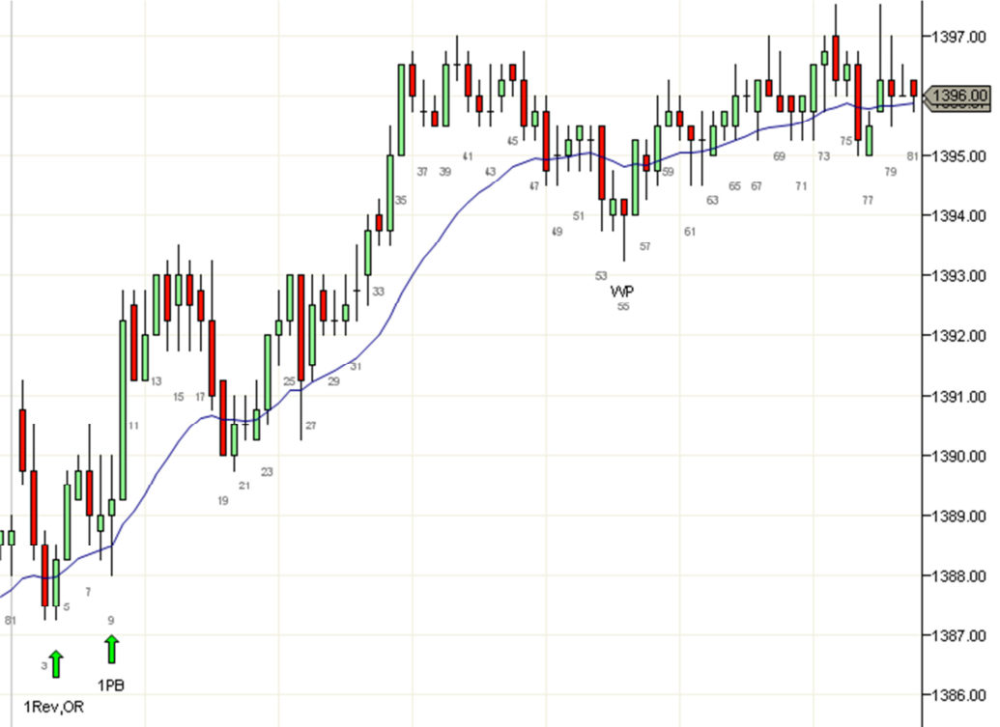

最容易识别的第一种反转是趋势移动，从开盘起完全由趋势k线构成，突破了支撑位，例如前一日的HLC或ema（今天既是前一日的收盘价也是ema），并给出了反转信号。

如果反转信号较弱（例如，入场侧引线较长或k线颜色错误），则很可能会突破低点并尝试第二次。

这种1反转通常是当日的低点，并且会接近其高点收盘，因此是日内多头波段交易的良好候选。实际上，如果您看到一次非常尖锐的走势（b31-35），看起来像过冲并且带来了可观的利润，那么最好是全部或部分离场并等待更多价格走势。

<!-- 原书第 356 页 -->

## 第一根K线：十字星 - 窄幅交易日。

2012年3月16日 星期五 · 原书第 356 页

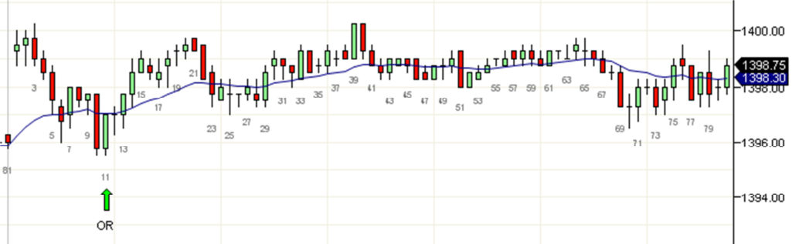

十字星第一根K线可能预示着多种走势，从像今天这样的窄幅区间到大的趋势日和宽幅交易区间。

像今天这样的窄幅交易日，如果你的第一个目标是 2 点或更大，交易起来会非常危险。将目标减半是差的风险管理，因为你无法实际地将风险也减半。因此，6的风险配合 4的利润潜力需要远更高的成功概率，即便如此，回报通常也不值得追求。

任何迅速退化为十字星k线（b16-20）的趋势尝试都应始终引起对差的交易行为的怀疑，您应该观望，直到k线恢复正常或价格突破。初始走势之后的大多数k线都在3 点位区间内，价格行为入场的成功概率极低，因此最好观望。

<!-- 原书第 357 页 -->

## 简单1PB

2012年3月19日 星期一 · 原书第 357 页

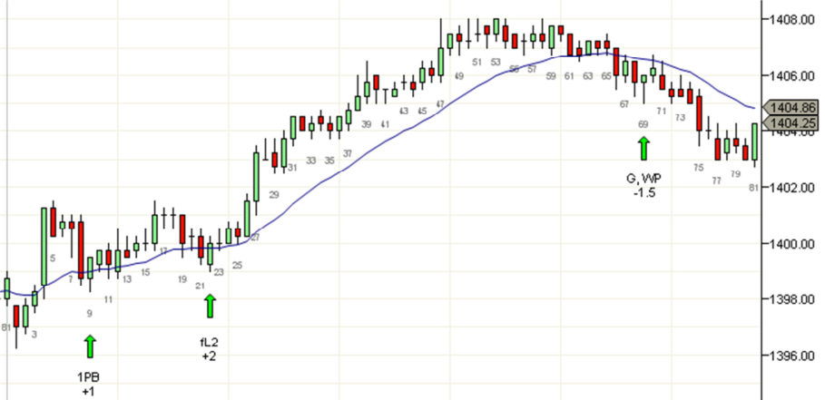

最简单的1PB由第一根k线开始的趋势移动组成，即至少两根趋势k线突破第一根k线（b2-b4），然后回调至更高低点。如果开始回调的k线是一根反转k线（b5），那么最好进行2 腿PB或2次入场。像b 6,7,9 今天这样的mW也可以充当2L pb。

加强1PB信号的因素包括：

- 两腿PB或mW PB
- 信号k线强势收盘
- 信号k线幅度不大
- ema或趋势线上的信号k线

一腿触及前期高点的1PB通常可以持仓至日终。然而，2 腿的走势往往会在日内最高点停滞或反转，最好是选择出场并等待下一个信号。

<!-- 原书第 358 页 -->

## 通道中的第一个反向趋势k线

2012年3月22日 星期四 · 原书第 358 页

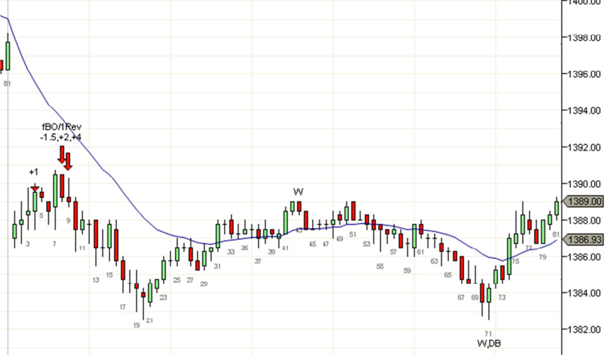

通道会提供较少的入场点，并且可能持续很长一段时间。通道中最可靠的入场点之一是逆势交易第一个反向趋势k线（b15, b27, b60）。通常可以在限价单中收盘做空，设置一个较小的止损，例如2 点或3点。如果通道形成以来一直没有出现反向k线，这种方法尤其有效。

其有效的原因在于，这本质上是一次你预期会失败的首次通道突破。请注意，你需要一个带有强势收盘的趋势k线。像b57 这样的十字星或b11 这样的弱势收盘通常并不可靠。这通常只是一个优化，因为你会在(b16, b30, b61)之后立即获得一个信号，并且你可以选择以正常的止损入场来交易它。

<!-- 原书第 359 页 -->

## 极强趋势的迹象

2012年3月26日 星期一 · 原书第 359 页

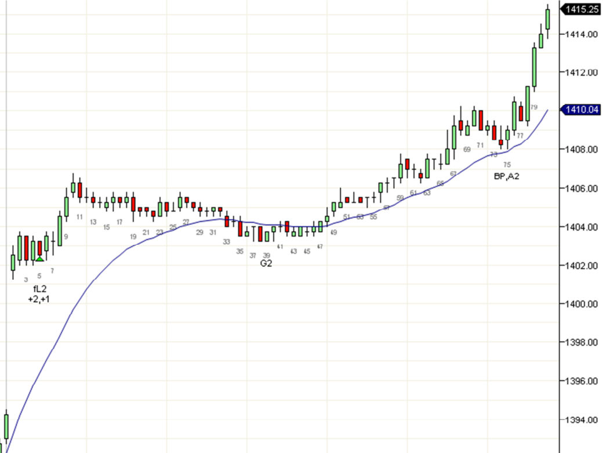

当前一日在日线图上形成了一个强信号k线时，次日通常会是一个大的趋势日。大的趋势日通常可以持仓至日终进行波段交易。

强趋势的迹象：

- 前一日强势收盘 (b81)
- 大缺口，无卖出 (b1, b3,5)
- 开盘区间强劲突破 (b8-10)
- 20 k线或更多，才到达ema（b33）
- 多个A2 和fL2 （b47,54,62,75）
- 逆势信号的微小走势（b22,28,33,64）
- 横盘回撤（b43-47, b51-54,b61-65）
- 失败的W形态（可能是W42,50,59）

在一个非常强势的日子里，只要是顺势的重叠信号k线和十字星信号k线，都可以进行交易。

<!-- 原书第 360 页 -->

## 每天两个波段交易

2012年3月29日 星期四 · 原书第 360 页

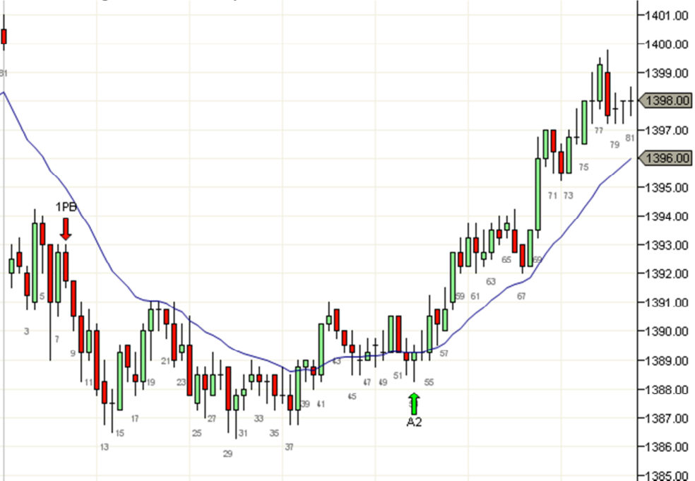

波段建仓形态是指，在达到你的刮头皮交易目标后，价格并未回测你的入场价。这使你能够将止损移动到盈亏平衡点，并让市场带你获得更高的利润。

总的来说，一天中前半部分有一个波段建仓形态，后半部分有一个。通常，两者中可能有一个缺失。如果两个建仓形态都朝同一方向，那就是一个趋势日，可能包含多个顺势的小入场点，您可以在那里入场并跟随趋势。如果建仓形态朝相反方向，比如今天，那就是一个趋势反转日。

只在这两个建仓形态入场，并在获得2 点的刮头皮利润后，持有4 点或更多，这是一个有效的交易计划。能够持续这样做的方法是忽略反转，只在被证实的趋势反转后的第一个回撤时入场。

例如，如果您猜测 b2 是一个反转，您将大失所望。b5也会让您的盈亏平衡止损失效。在 b8 处的 LH 的第一个回撤是高概率的波段建仓形态。

同样地，如果你猜测 b14 是一个反转，你会感到失望。即使你正确地判断 b30 是当天的低点，在它上方做多也未能带来 2 点盈利，并且你在入场k线下方设置的止损被触发了。如果你有耐心等到第一个在 HL 的可行信号k线 b53 ，你就可以一直波段交易到日终。

In s总结一下，一种进行波段建仓形态的好方法是，在趋势出现后，抓住第一个回撤。 d brea或反转，并忽略当日的实际低点和高点。

---

[← 上一章](22-2012年2月.md) · [目录](00-目录.md) · [下一章 →](24-2012年4月.md)
