[← 上一章](23-2012年3月.md) · [目录](00-目录.md) · [下一章 →](25-2012年5月.md)

# 2012年4月

原书第 361–371 页

<!-- 原书第 361 页 -->

## 通道内的后期入场点

2012年4月2日 星期一 · 原书第 361 页

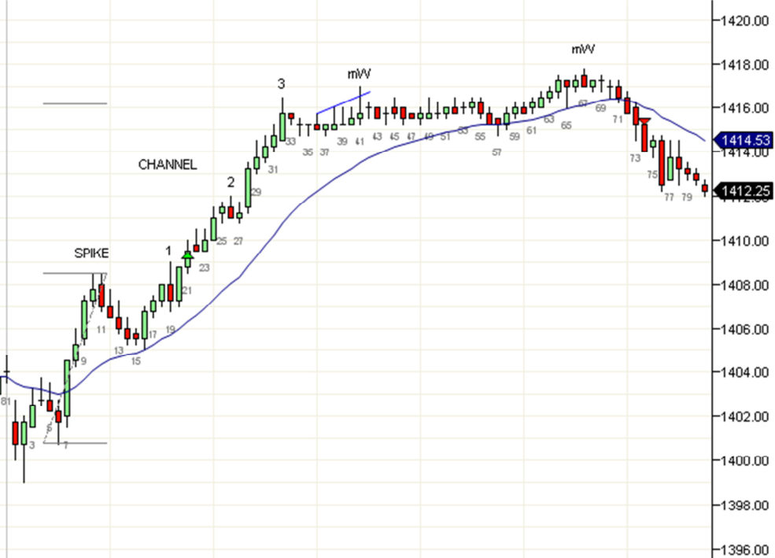

我通常会避免后期入场，因为它们通常很危险。然而，如果你有理由相信一个扩展通道正在形成，例如由于尖峰 b7-10 ，你可以寻找通道中段的入场点。

首先你需要识别出通道正在形成。一般来说，如果价格在同一方向移动，但大多数k线重叠，除了约一两个跳，你可能处于一个通道中。不像从 b7 到 b10, 的走势，从 b16 开始的走势明显是一个通道。

经典的通道中部入场点是逆势交易通道的第 1 次突破或 1chbo。这可能发生在 b20。如果你错过了，你可以随时在任何通道中逆势交易对立的趋势k线，第一次是最好的。今天，我们最接近对立趋势k线的是 b26。

通道中沿通道方向的第一个引线（b21）与第一个相反的k线非常相似。它代表通道中的回撤，是除了最差价格以外做多的机会。偶尔，会形成1tf（b27），这通常是高概率交易。必须注意不要在预期通道走势结束时入场过近，例如尖峰长度的量度移动或第三次推升（b19,26,31）。通常，强势通道在趋势线突破后会以更浅的通道（可能是b37 到b67）继续，因此您应该退出您的头寸，但在趋势突破之前绝不要逆势交易强势通道。像今天这样的长时间横盘走势会打破趋势，但当您看到一系列十字星时，您可能已经在b36 左右猜到走势可能已经暂时结束了。即便如此，SC日以在糟糕的信号k线上持续运行直到日终而臭名昭著，因此在逆势交易时务必谨慎。

<!-- 原书第 362 页 -->

## 早盘强势预示尾盘强势

2012年4月3日 星期二 · 原书第 362 页

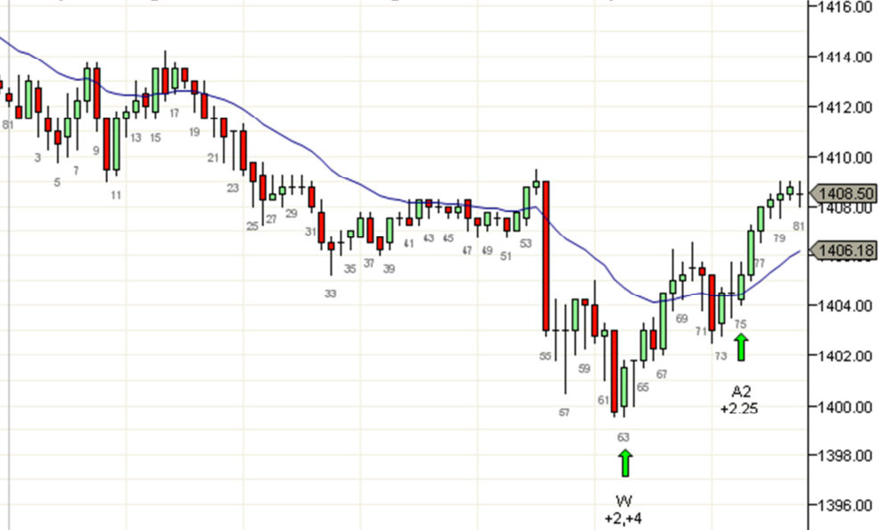

当日线突破进入趋势（b18-62）并出现反转信号（b63）时，您需要评估成功的概率以及可能的波段加码。这次尝试会只到ema吗？它会在几次微弱的上涨尝试后失败并继续下滑吗？

有几种指标可以帮助您进行此类评估。首先，是否出现了趋势线突破？（b33-b54）。如果没有，成功的反转几率可能很低。趋势可能会终止并横盘整理，但趋势线突破会大大增加成功反转的机会。

第二点是需要有一个楔形（b33,57,63）配合强势的信号k线（b63），或者成功测试到导致趋势线突破的波动点（b33）。

要进行波段交易您的头寸，您需要在一天的早期（b5-10,b11-15）看到强劲的迹象。如果早期没有强劲的走势，您的走势不太可能走远。（这种情况确实会发生，但很少见）。

<!-- 原书第 363 页 -->

## 交易破坏的趋势

2012年4月5日 星期四 · 原书第 363 页

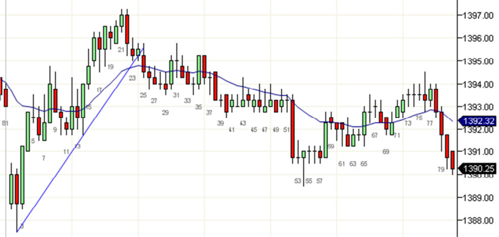

一旦价格走势突破趋势线许多k线，趋势就应该被宣告破坏。当市场触及实时趋势线时，其反应就像触碰了带电的电线一样（b12,b15）。当市场在一条腿的走势中收盘于ema下方，并且保持在该下方，远超趋势线时，趋势很可能已经结束。

破坏的交易本质上很难交易，因为它既不是真正的反转，也不是真正的回撤。当原始趋势强劲时，市场有可能呈现与原始趋势相同方向的缓慢通道。偶尔，例如今天，通道可能与原始方向相反。

这些通道本质上很难交易，大多数走势需要很长时间才能获得 2 点利润。交易它们的正确方法是认识到通道就是楔形，并在交易通道时等待三推（b29,40,54）之后。最好的选择是等待测试前期最高点或等待新的突破，并在回撤时入场。

<!-- 原书第 364 页 -->

## 第一根K线：反转k线

2012年4月9日 星期一 · 原书第 364 页

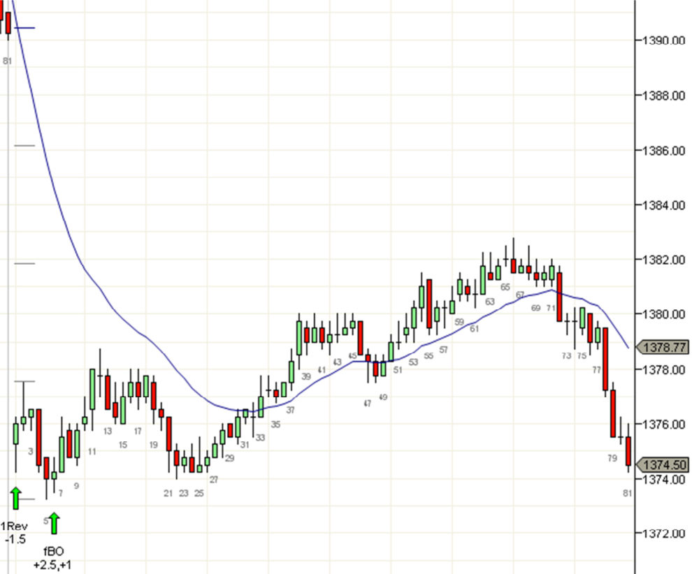

当第一根K线是反转k线，但出现在不合逻辑的位置，例如在缺口上方带有阳线反转k线，或者重叠了前一日的交易区间，那么它很可能是一个失败的建仓形态。另一方面，大缺口下方带有阳线反转k线通常会从第一根K线开始一段趋势。

当第一根K线未能产生趋势时，这一天很可能会变成一个交易区间日。这意味着，只要出现新的突破，并且交易区间足够大（4+点），你就可以寻找fBO交易。

Occa有时，这样的突破会提供BP交易，例如b26, ，这种交易可以持仓至测量开盘区间内的红色走势。

<!-- 原书第 365 页 -->

## 第一根K线：外包k线

2012年4月10日 星期二 · 原书第 365 页

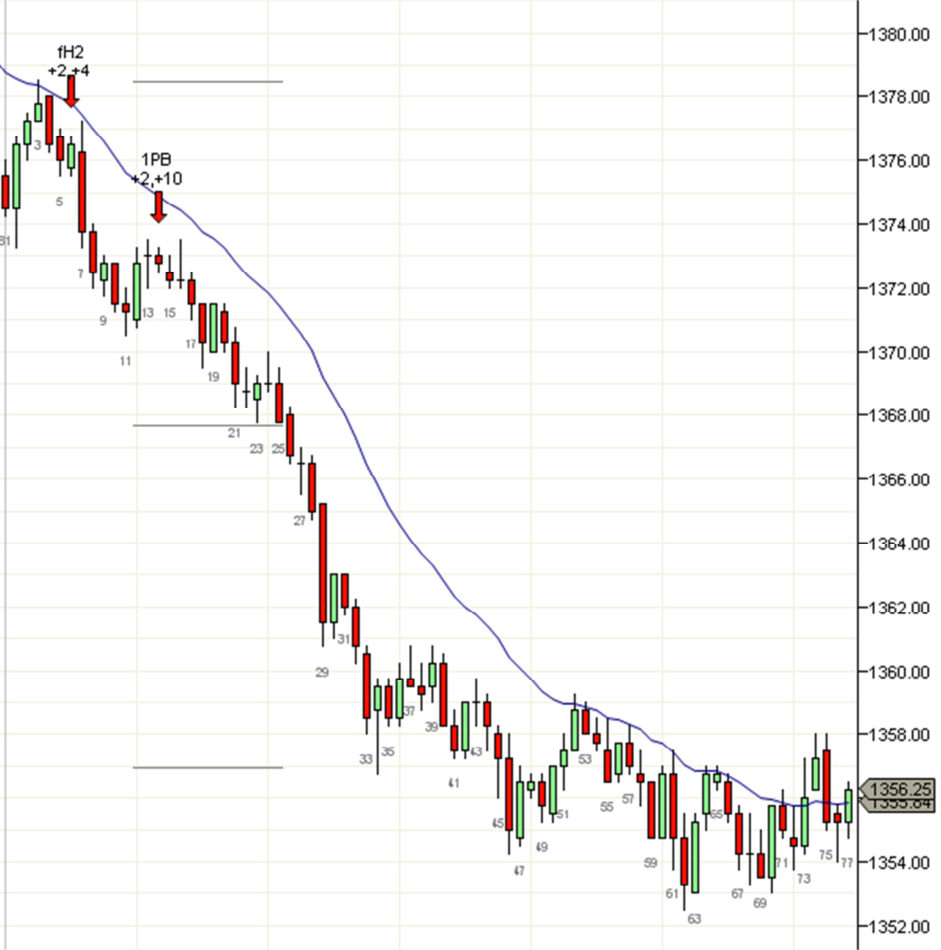

当第一根K线完全重叠前一日的最后一根K线时，应将其视为一个交易区间。这意味着你可以选择逆势交易其突破，或者在突破强劲时采取突破回撤。

第一根外包k线，尤其是大k线（事实上任何大k线）都是逆势交易候选。你不应该交易它的突破，即使交易了，也要设置固定（刮头皮交易）利润。突破回撤，尤其是大k线的2 腿式突破，是可以接受的，但除非你的入场k线很大，否则你很可能会遇到深回撤。

当大k线的高低点突破（BO）幅度很大且实现成功的高低点（HL）时，急速加通道（spike and channel）发展的几率很高。通道通常是急尖的量度移动（measured move）。

<!-- 原书第 366 页 -->

## K线强化指标：5跳失败

2012年4月11日 星期三 · 原书第 366 页

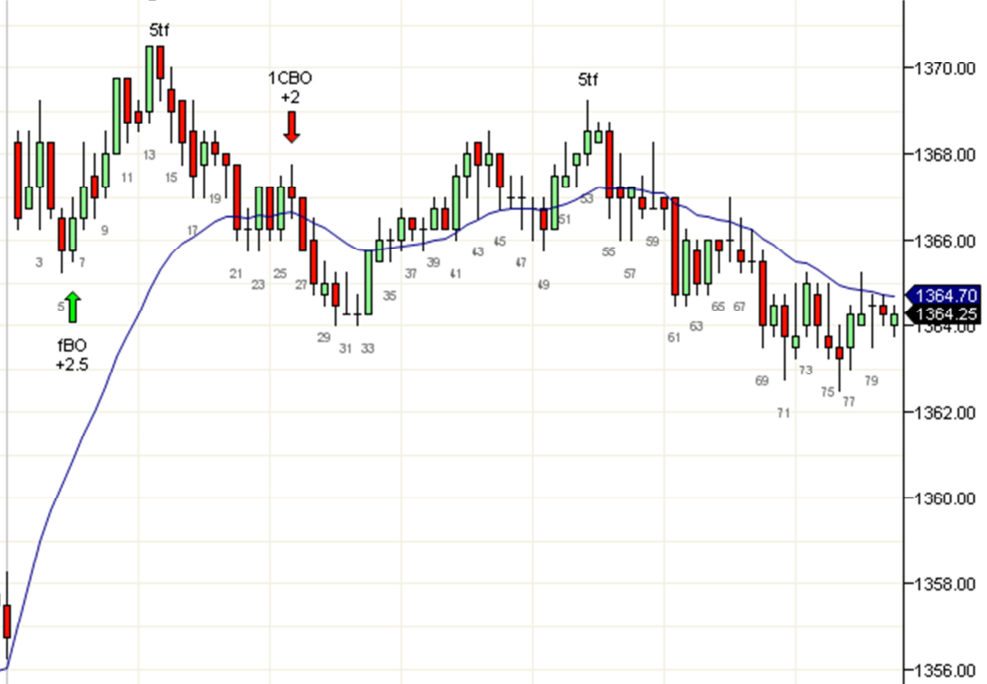

理想情况下，信号k线（signal bars）形态良好且明显，具有强势收盘（strong close）和一个看起来很棒的入场k线（entry bar）。在现实世界中，信号k线往往不尽如人意，你解读它们除了收盘价之外的其他信号强度从而增加交易机会的能力会大大提升。

一个非常容易观察的信号是5 跳失败，当突破价格超出入场点5 跳并反转下跌时发生。5跳失败意味着一些交易者未能成功出场，当价格未能突破突破k线时，他们很可能会被迫出场。

理想情况下，5跳失败会产生一个可以被视为反向信号的k线。在突破前期波段高点5后出现看跌内包k线（b14）是一个很好的例子。当然，即使不是5跳失败，这也可能是一个有效的信号。

b54 在突破信号k线b52上方5跳后，发生了5跳失败。这是一个看涨内包k线，因此信号较弱，但5 跳失败赋予了它额外的强度，并允许建立一个卖空建仓形态。

b5,6 形成了一个k线反转，在b4, 下方出现了一个5tf，这增加了fBO交易成功的几率。同样地，b32 出现了一个5tf，位于b5 下方，尽管是一个弱k线，但交易仍然成功了。请注意，5tf 并非保证交易成功的神奇公式。它仅为信号k线增加了一些额外的强度。对于其他不符合您标准的交易，您应该乐于放弃。例如，b71 曾是一个可能的 5tf，在 b32 下方，但这笔交易很差，因为 71 可能过大且离日终太近。而且它可能只是一腿，而至少需要两腿才能在 A2 变体卖空信号（位于 b68下方）中出现。

<!-- 原书第 367 页 -->

## Trading a trend from the first bar

2012年4月12日 星期四 · 原书第 367 页

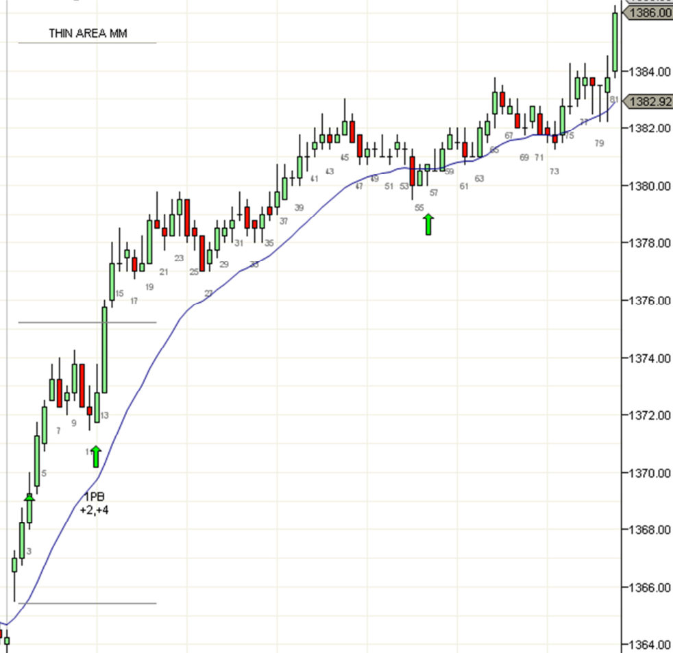

第一根k线就形成的趋势是罕见且宝贵的事件。当第一根或第二根k线接近支撑位（例如 ema 或前一日的低点）并形成强烈的反转k线时，就可能出现第一根k线形成的趋势。一旦出现趋势突破（b2），通常会尝试测试这个突破。在追逐趋势之前，等待至少一根k线（b3）通常是一种稳妥的做法。如果下一根k线有上影线，您通常可以在其收盘价做多，并在此k线下方设置止损。这不是一个高概率的建仓形态，但风险回报比通常足够高，可以证明这笔交易是值得的（通常为 10 倍）。

保守的做法是等待任何回撤，例如内包k线、下跌趋势k线或任何 2 尝试失败趋势（b7-11）。这基本上是一个 1 回撤建仓形态，通常应该能为您带来可观的利润，常常是当日最佳的波段交易入场点。

在明显强势的交易日，你可以对任何深回撤进行加仓或重新入场进行波段交易，例如 b27 或 b55。在这种交易日进行逆势交易是危险的，你将错过许多优秀的顺势走势。

<!-- 原书第 368 页 -->

## 你的交易优势

2012年4月13日 星期五 · 原书第 368 页

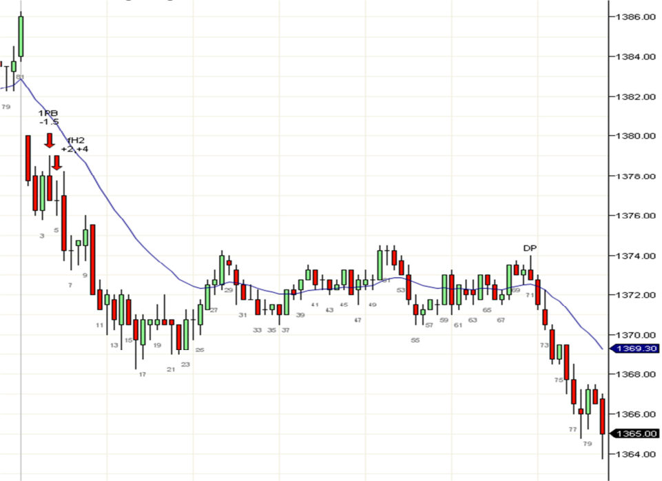

交易者在交易一段时间后会掌握一些技能。如果这些技能优于普通交易者，他就能在其他市场参与者之上获得微小的优势。这些技能集在交易系统中很常见：

1. 正确判断市场方向
2. 大致估算市场可能移动的距离
3. 寻找精准的入场点
4. 确定入场的止损大小
5. 持有交易，不被任何小幅回撤震出局，或不轻易移动止损
6. 长期持有盈利的交易
7. 从亏损的交易中获取重要的市场信息，并应用于下一笔交易

一旦你确定了自己的优势，就要量身定制你的交易策略，以放大这些优势，并使自己在没有优势的市场行为中得到保护。

例如，如果你能准确衡量市场方向和预估的走势，但你的入场点通常会被止损，可以考虑交易期权。例如，如果你预估首几个 k 线会是 10 点的下跌日，但如果你尝试价格行为入场（就像我在我的 b4 卖空交易中那样），通常会被止损，你可以简单地在上午买入 SPY 看跌期权，并一直持有，直到它达到你的目标或日终，然后盈利出场。

另一方面，如果你的方向感较弱，因此无法长期持有多头，但你能精确地入场和出场，你可以进行多次小的刮头皮交易，并获得小的固定利润。

<!-- 原书第 369 页 -->

## 尖峰作为交易区间

2012年4月24日 星期二 · 原书第 369 页

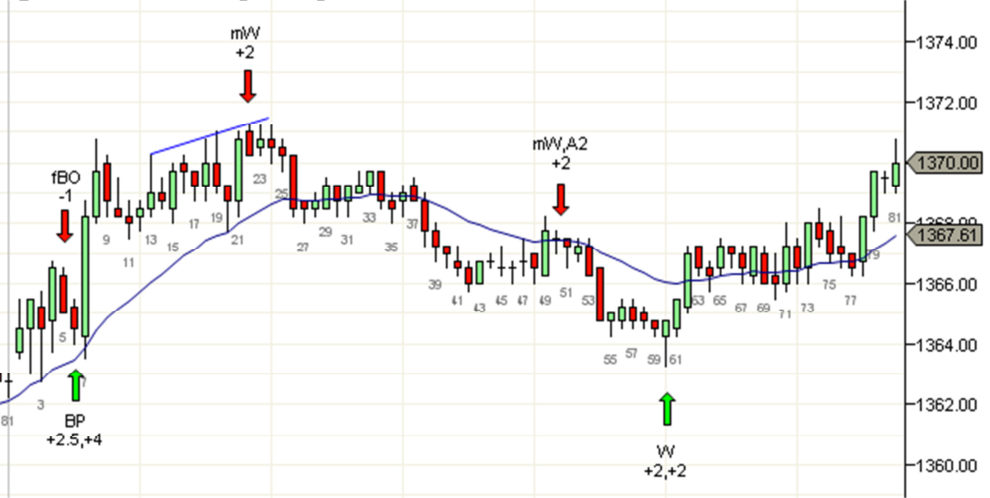

第一小时的大k线，例如 b7 ，可能建立一个趋势，通常是与k线方向一致的急速加通道。如果k线有良好的跟进，那么你可以预期可能出现一个上涨行情，其幅度等于尖峰的量度移动。

有时，尖峰被视为逆势交易机会，价格将难以维持在它之上。发生这种情况时，对尖峰的逆势交易应尝试触及k线的另一端（在b60处）。如果当天剩余时间充足，在该点的强劲反转可能导致整个下跌走势的反转（在b81处完成）。

因此，当你在日初看到一根大k线时，请记住它可能是一个交易区间。其成功的突破可能会朝k线方向进行量度移动，而失败的突破（BO）则可能导致整个k线的逆势交易。这个估计可以作为持有波段交易的指导。

<!-- 原书第 370 页 -->

## 失败的交易揭示市场信息

2012年4月25日 星期三 · 原书第 370 页

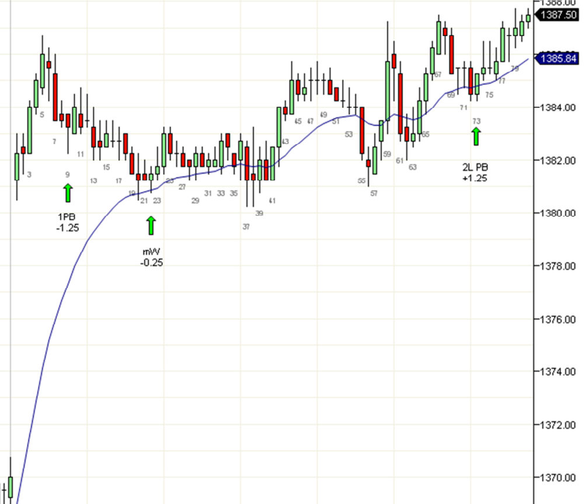

当一笔交易失败时，它应该为你提供一些信息，供你在后续交易中使用。如果一次失败没有给你任何信息，你应该避免进行该笔交易。我的大多数建仓形态在失败时都会提供关于市场结构的一些明确信息。

例如，今天的b9 可能是一个1PB建仓形态。这是一个差的k线，基本上是一根红色k线，该形态是一个1 腿的深回撤，并且位置是双底形态且带有一根强趋势k线。尽管我通常不买4 红色k线，但在1PB期间，我会稍微放宽我的规则，不是因为交易的概率更高，而是如果它奏效，其风险回报比通常是值得的。

当b9 被触发并让我进入交易时，如果它奏效，我预计会有一个大的上涨日，并且考虑到日线图上最近的深回撤，这可能是一个10 点的走势或更大的走势。然而，当跳空开盘幅度很大时，总有它对新买家来说太贵的风险，交易可能会失败。当b13 止损了我时，交易失败了。

这次失败给了我新的信息：今天不会是趋势日，而是一个交易区间日，其边界由上午的尖峰（b1- b5）划定。现在唯一可以接受的交易是区间下三分之一的做多（b22, b41）和上三分之一的做空，直到出现突破和BP（b73）。像b50 这样的边缘建仓形态可以忽略，因为它不在区间的靠上位置，且处于价格缠绕之中。

<!-- 原书第 371 页 -->

## 预测突破

2012年4月30日 星期一 · 原书第 371 页

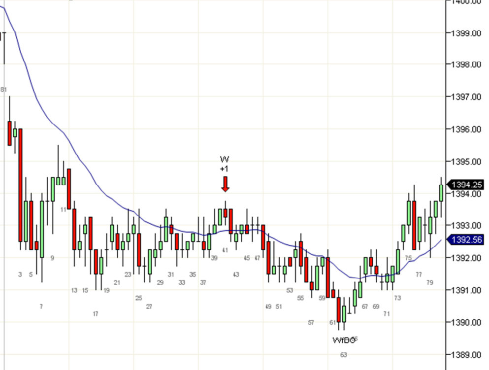

正如反复发布的帖子所述，预测突破是交易者能做的最困难的任务之一。即使你预测到了，通常也最好等待突破失败或出现突破回撤，并在价格走势从震荡转为趋势后入场。

看待震荡的最简单的方式是将其视为一个交易区间。只在震荡的顶部（b41）或底部（b63）入场是避免被震荡套牢的最佳方式。震荡通常是形态不佳的通道，并且经常是三推楔形的变体。例如，b41 今天的行情是一个3 推升楔形（b20, 23,41）。然而，在实时交易中解读震荡中的楔形非常困难，需要大量的练习。

一个强趋势的入场k线可以确认您的入场判断是正确的（b42 相较于其他入场k线空头或不确定，是一个趋势 k线），然而在震荡行情中持仓会更难，因为您的交易实际上是一笔fBO交易，只需要给出两腿即可。

当信号k线明显脱离震荡区域（b63）时，这是一个更好的入场点，并且至少应该回测最后一次走势的起点（b41 高点）。

---

[← 上一章](23-2012年3月.md) · [目录](00-目录.md) · [下一章 →](25-2012年5月.md)
