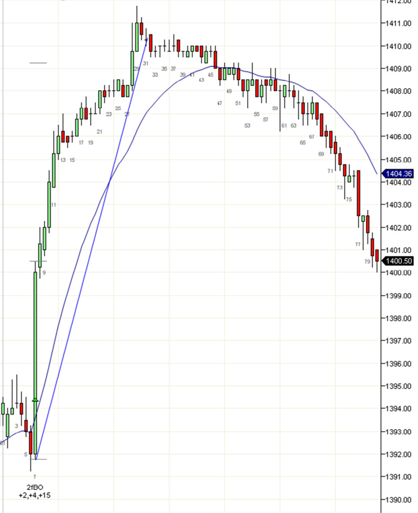
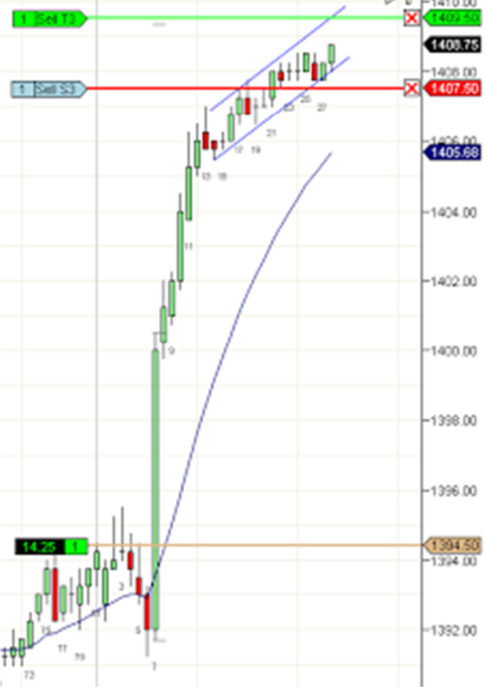
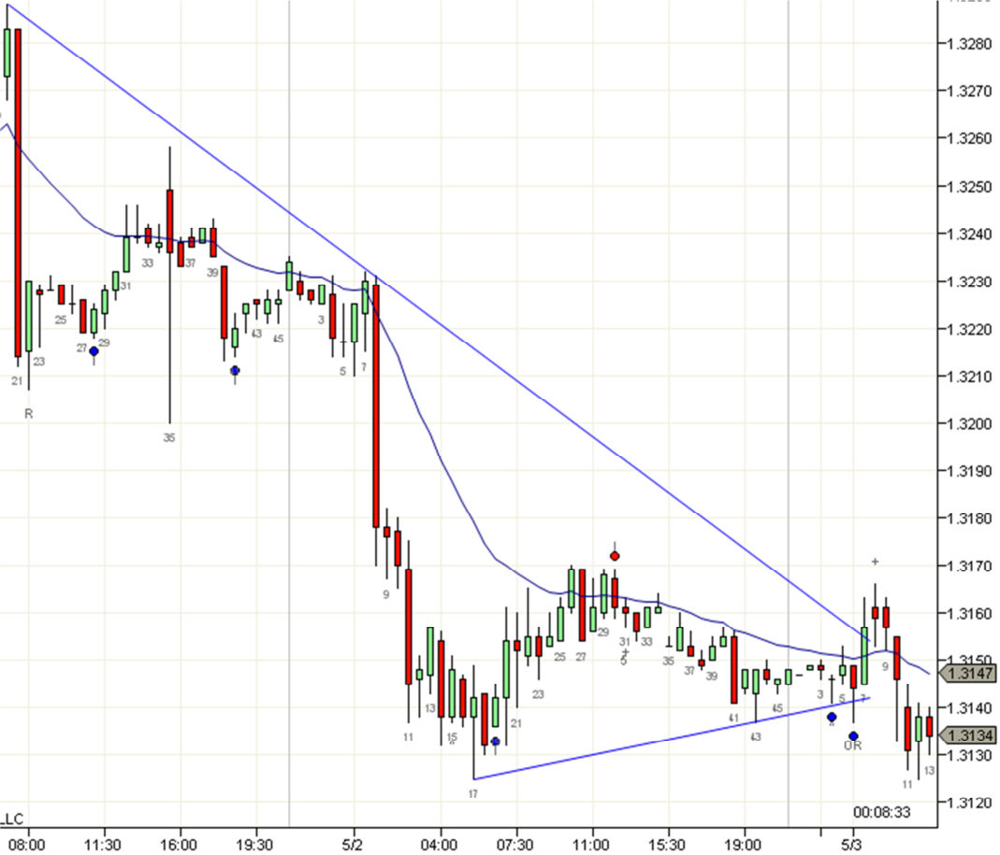
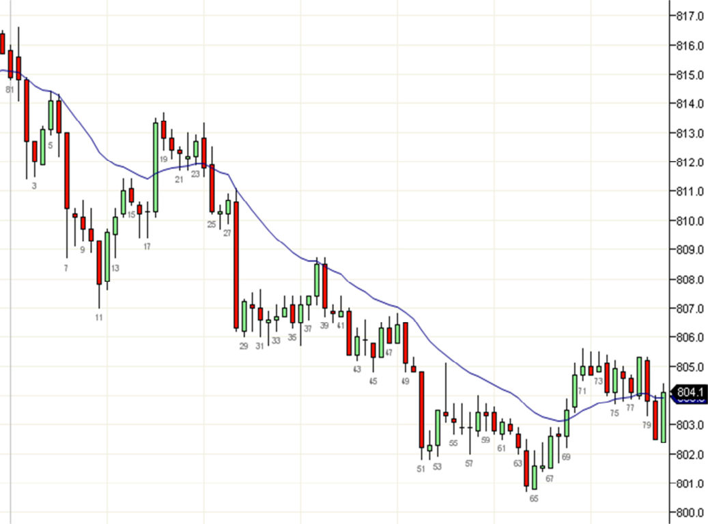
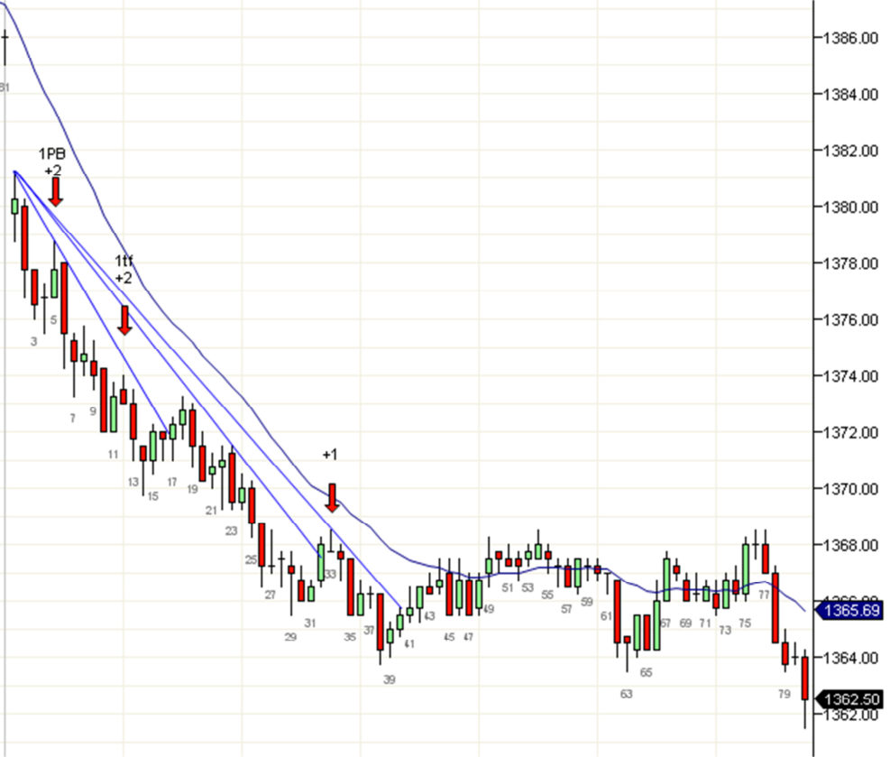
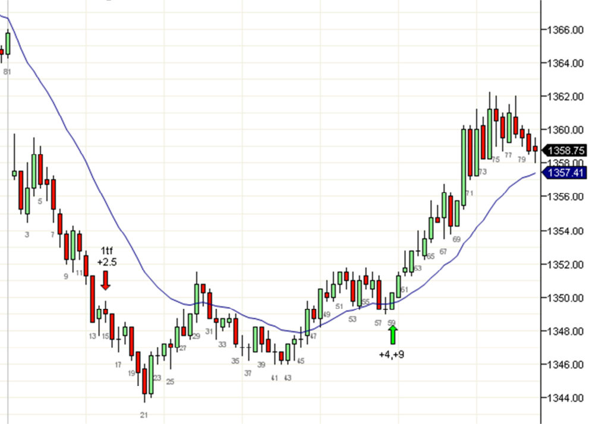
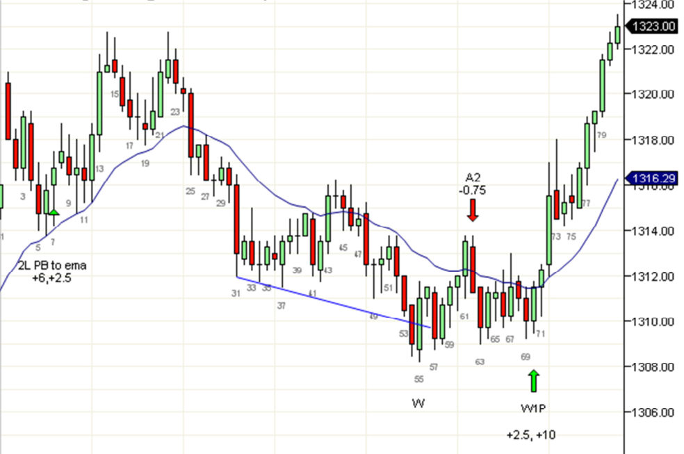
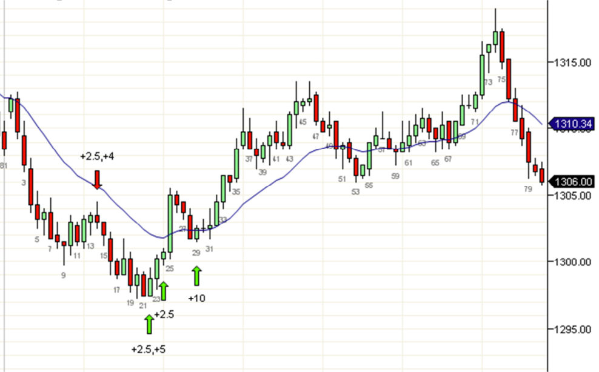

[← 上一章](24-2012年4月.md) · [目录](00-目录.md) · [下一章 →](26-2012年6月.md)

# 2012年5月

原书第 372–379 页

<!-- 原书第 372 页 -->

## 高潮顶部

2012年5月1日 星期二 · 原书第 372 页

偶尔，你会持有一个大的走势，从而获得可观的利润。在某个点，你需要做出决定，是出场还是继续持有以获得更多利润。我曾多次在获得可观利润后出场，但价格最终却超过了我的目标许多点。我从不后悔，因为有保证的良好利润远胜于理论上巨大的利润，而这些理论上的利润伴随着损失所有收益的真实风险。

<!-- 原书第 373 页 -->

然而，优化出场是非常重要的交易环节，我已从多个角度着手。最简单的方式是等待趋势终止信号。在强劲的上涨行情中，例如 AM趋势，如果你看到k线变小（b13-25），那么趋势终止很可能以TTR（b33-37）的形式出现。

当买家不再能够创造出健康形态的k线时，该走势就结束了。如果在回撤中看到三个或更多十字星，最好立即出场或在下一次推升时出场。

除此之外，如果价格已充分穿越趋势线（b31- 47），特别是当该走势有自己的逆方向趋势线时，趋势结束的可能性非常大，你应该考虑出场。

虽然这些都是不错的出场点，但有时你会获得我所谓的未获利。一个凭空出现的推升（b28- 29），这是一种高潮，你可以在推升过程中的任何位置出场。有时高潮k线可能是

趋势k线或两个这样的k线，b29 ，您可以在其收盘时轻松出场。您也可以在达到高潮后的第一个L1 （低于b30）时出场。我偏好的方法是，如果我的原始目标接近，则在推升时出场，因为高潮可能很快转变为反转k线。

<!-- 原书第 374 页 -->

## 替代性工具 I - 微型合约

2012年5月2日 星期三 · 原书第 374 页

新手期货交易者在其早期交易生涯中，面临损失大量资本的风险。一个选择是先进行模拟交易（SIM），熟悉价格走势并正确处理交易管理。但达到某个点后，就必须投入真实资本来学习交易。

为了避免账户很快爆仓，你可以交易微型合约。微型合约只是其标准合约的一个微小比例。图中所示的 6E 的微型版本是 M6E。每跳 1 美元。25 加上 10 跳止损将使你损失 12 美元。50 加上手续费。

为了使你的盈利有意义，你应该在更大时间周期上交易 M6E。上面显示的 30m 图表显示，尤其是在欧洲和美盘开盘期间，走势非常剧烈，如果你能正确解读市场，就有可能抓住这些走势。

大你达到时间周期也迫使你持有更长时间，并提供更少的优质建仓形态。一旦你一定程度的一致性后，您可以切换到标准合约。

<!-- 原书第 375 页 -->

## 替代性工具 II - 低成交量合约

2012年5月3日 星期四 · 原书第 375 页

警告：TF 交易是实验性的。本帖中的建议未来可能需要修订。

成交稀薄的合约本质上是波动剧烈的。这是因为任何不成比例的大订单都可能轻易引发止损奔溃，从而在几秒钟内将k线推高几个跳甚至点。这使其成为动量交易者的绝佳选择。

上方罗素合约TF的图表显示了今天的巨大波动。市价止损单的滑点风险非常高。限价止损单通常可以避免滑点，但往往会让你无法入场交易。根据我的经验，最好在限价止损单上允许一些滑点，并将止损扩大一些。 (Ninjatrader和许多其他平台允许您为限价止损设置默认值。) 你实际上需要大约12的止损来正确交易TF。

上午交易时段后，TF的风险很高，因为震荡中的k线看起来像是准备突破成强劲走势 (b29, b35, b36)，而在ES这样成交量更大的合约中，这些k线通常看起来很差。在ES上可能有效的反转差建仓形态和其他刮头皮交易技巧，在这里会惨败，你的账户将死于千刀万剐。

交易低流动性合约最简单的方式是在上午只进行两次交易。基本上，根据前一次尝试的强度和建仓形态k线的强度，进行第二次下跌尝试（b6 卖空）或第二次上涨尝试（b12 多头）。如果你两次都被止损，你就会损失两次。如果其中一次成功，你通常会获得可观的利润。

<!-- 原书第 376 页 -->

## 趋势线测试和突破

2012年5月4日 星期五 · 原书第 376 页

当价格跌破趋势线并立即（在一到两条k线内）发出持续信号时，这便是对趋势线的测试，并且测试已成功 b18,b33。成功的测试会吸引顺应趋势方向的新订单。每一次超出趋势线并建立顺势交易的微小下跌，通常都是一次波段交易，可以一直持有，直到出现明确的趋势线突破。

当趋势线测试失败时，例如从 b39 到 b49, 的走势，趋势就被打破了，您不应再寻找反转或延续。市场现在处于交易区间，您只能在区间的极端进行 fBOs 交易。

趋势线突破是趋势终止 (TT)，不自动意味着反转，即使经过前期高点测试（b63 是 b39的测试）。只有 fBOs 可以交易，并且所有 fBOs 都应预期只给出两个腿。

当fBO交易以一腿的价格突破区间另一端时，尤其是在强劲突破的情况下，您可以预期会出现BP建仓形态和趋势延续。如果新的突破方向与旧的突破方向相反，它可能起到主趋势反转的作用。如果方向相同，则起到趋势延续的作用。

<!-- 原书第 377 页 -->

## 成功反转的明确信号

2012年5月8日 星期二 · 原书第 377 页

大多数反转都会失败，每一次回撤都仅仅是一次失败的反转。b3, b10,b14 都有一个不错的反转下跌走势的机会，但都失败了。b22 最终成功了，但寄希望于抓住“那个”反转而尝试每一次反转是一种糟糕的交易方式。在几次失败后（b3 和b10），假设每一次反转尝试都会失败，并顺着之前的趋势交易，当市场证明你是错的时止损，这是更简单的做法。

采用这种方法，您已将成功率从多次失败后的一次成功转变为多次成功后的一次失败。如果趋势线在信号出现（b30）之前明显被破坏（broken），您可以选择不再沿旧方向交易，并寻找明确反转的迹象。

当市场出现2 更高的高点（b29, 51）和两个更高的低点（b43, b58）时，熊市行情（bear move）就明确反转了。此时，多头（bulls）和空头（bears）很有可能都认同大势已去，并进入新的方向。

一个更高的低点总是比试图捕捉精确的反转要好，因为你最终会看到新方向上的腿型回撤。你可能错过了 b22, ，但你可以为了再多几个跳而选择在 b43 之上入场。或者你可以等待价格回撤到 ema（b59）处进行 2L 回撤，这很可能会带来更强的走势。

<!-- 原书第 378 页 -->

## 选择最佳入场点

2012年5月24日 星期四 · 原书第 378 页

对于包括经验丰富的交易者在内的任何交易者来说，最具挑战性的任务之一是坚持度过看起来像震荡的行情，并将他们的交易一直持有到波段。有时，当回撤和盘整远离你的入场价，或者你已经处于趋势中并且价格立即有利地远离你时，这种情况会更容易。

当趋势终止时，确定哪个入场点将导致大幅走势被称为“突破问题”，这是一项相当艰巨的任务。要做到这一点，您首先需要能够确定趋势何时真正终止。

失败的反转后跟着失败的波段交易（b2 和 b54,55 ）是趋势终止的经典迹象。在趋势终止后再进行交易可以避免两次非波段交易入场（b61,62和 b58 ）。

一旦趋势终止，您需要评估反转的可能性。在交易区间日中，如果早盘（b6-22）和近期（b55-61）显示出多头力量，那么走向区间另一端的走势的概率相当高。在一个强劲的空头趋势日，这将是一个较低概率的交易。

<!-- 原书第 379 页 -->

## 退出与加仓

2012年5月31日 星期四 · 原书第 379 页

总的来说，我倾向于在交易表现出强势，更确切地说，是未曾预期的收益时退出。当交易的走势令我感到意外时，这通常是一个我最好退出的信号。因此，像b25 和b72 这样的k线，它们以好运令交易者感到震惊，常常是退出候选的迹象。当走势处于初生阶段，尤其是单腿走势，如b25,所示，很有可能在一次深度的回撤后，你可以期待另一条腿的出现，甚至是一个持续的趋势。另一方面，在持续走势后出现的像b72 这样的大k线，最有可能是一个衰退的信号。

第一次回撤（b29）、第一次双腿回撤（b14）以及第一次趋势线突破（b46-53），但仅限于在强劲走势（b22-46）之后，通常是持续交易的良好候选。在这些之中，W或W1P之后的第一次回撤（b29）常常是一个绝佳的加仓机会，即使你的所有目标尚未达成。

任何在趋势中带有强劲收盘的小k线 (b24, 29, 71) 都可以用来加仓，只要它们不是内包k线 (b39) 或十字星 (b45)。

一些交易员会在任何强趋势k线（b2,3,4）上加仓。我倾向于避免这样做，因为回撤可能随时发生，你可能无法承受。例如，如果你买入了b35 或b55。趋势k线上加仓的理论止损是k线的另一端，所以最好在小k线上进行。

---

[← 上一章](24-2012年4月.md) · [目录](00-目录.md) · [下一章 →](26-2012年6月.md)
